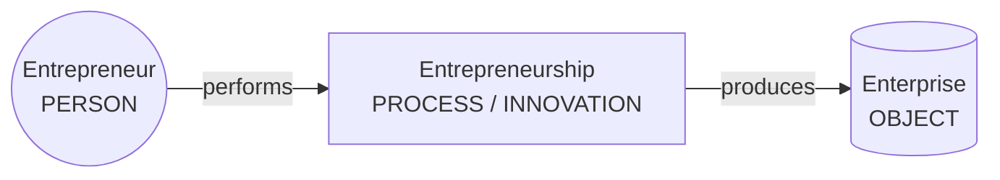
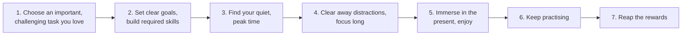
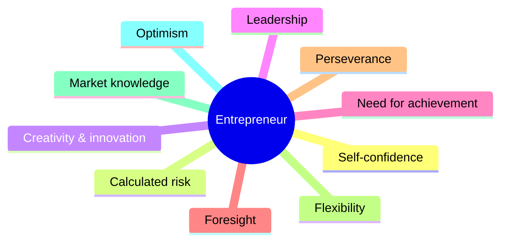
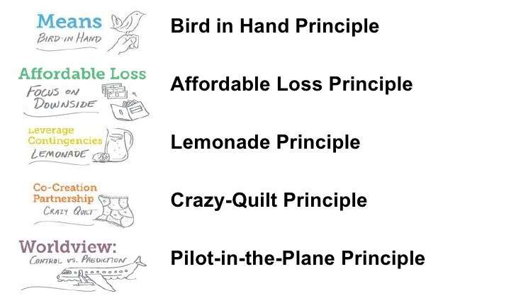
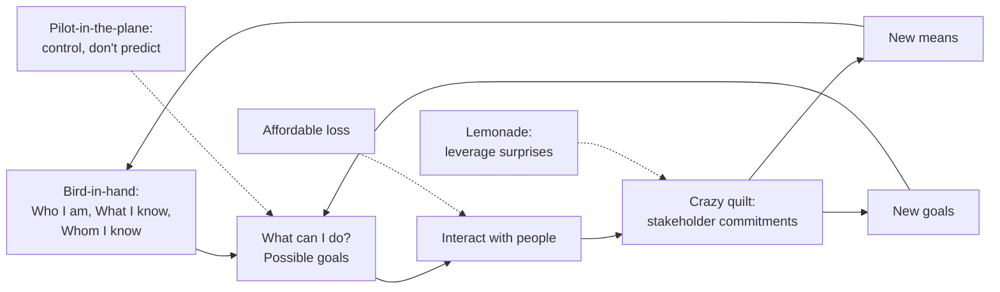
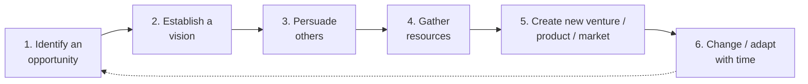
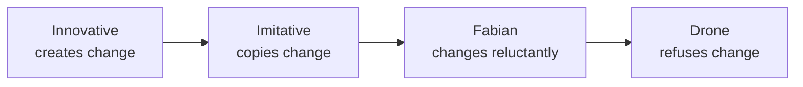
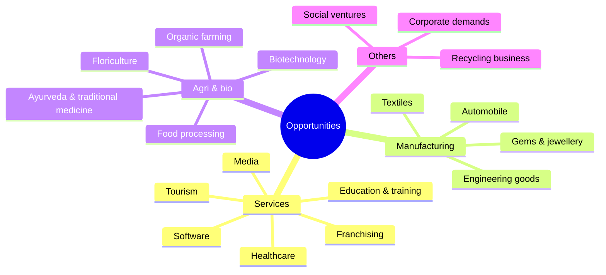

# Unit I — Entrepreneurship: Concepts, Effectuation & Impact

> **Topics:** Meaning and definitions of entrepreneur and entrepreneurship, entrepreneurship as a career option, finding your flow, taking stock of your means, characteristics/functions/qualities/skills of entrepreneurs, effectuation and its principles, life as an entrepreneur, successful entrepreneurs, entrepreneurial process, benefits and myths, types of entrepreneurs (incl. Danhof's classification), pitfalls, impact on economy and society, opportunities in India & abroad.
>
> **Source:** *BOE U1.pdf* (text extracted from the PDF slides)

**Importance legend:** ★★★ = very frequently asked (long answer) · ★★ = medium · ★ = short answer

---

## Table of Contents
1. [Meaning & Definitions of Entrepreneur and Entrepreneurship](#1-meaning--definitions-)
2. [Entrepreneur vs Entrepreneurship vs Enterprise](#2-entrepreneur-vs-entrepreneurship-vs-enterprise-)
3. [Entrepreneurship as a Career Option & Life as an Entrepreneur](#3-entrepreneurship-as-a-career-option-)
4. [Finding Your Flow](#4-finding-your-flow-)
5. [Taking Stock of Your Means](#5-taking-stock-of-your-means-)
6. [Characteristics of Entrepreneurs](#6-characteristics-of-entrepreneurs-)
7. [Functions, Qualities & Skills of Entrepreneurs](#7-functions-qualities--skills-)
8. [Effectuation & Its Principles](#8-effectuation-)
9. [The Entrepreneurial Process](#9-the-entrepreneurial-process-)
10. [Benefits of Entrepreneurship](#10-benefits-of-entrepreneurship-)
11. [Myths of Entrepreneurship](#11-myths-of-entrepreneurship-)
12. [Types of Entrepreneurs](#12-types-of-entrepreneurs-)
13. [Pitfalls of Being an Entrepreneur](#13-pitfalls-of-being-an-entrepreneur-)
14. [Impact of Entrepreneurship on Economy & Society](#14-impact-of-entrepreneurship-)
15. [Successful Entrepreneurs & Opportunities in India and Abroad](#15-successful-entrepreneurs--opportunities-)
16. [Unit I — One-Page Summary](#unit-i--one-page-summary)

---

## 1. Meaning & Definitions ★★★

### 1.1 Origin of the word
- **"Entrepreneur"** comes from the French **"entreprendre"** — **"to undertake"**; originally used for those who **organised musical or other entertainment programmes**.
- **Oxford Dictionary (1897):** the director or manager of a public musical institution.

### 1.2 Definitions of Entrepreneurship
| Source | Definition |
|---|---|
| **Hisrich, Peters & Shepherd** | "Entrepreneurship is the **process of creating something new** and **assuming the risks and rewards**." |
| **Joseph Schumpeter** | Launched the field by associating entrepreneurship clearly with **innovation** (creative destruction). |
| **Peter Drucker** | "A **systematic innovation**, which consists in the **purposeful and organised search for changes**, and the systematic analysis of the opportunities such changes might offer for economic and social innovation." |
| **Modern definition** | The **professional application of knowledge, skills and competencies** of generating a **new business idea**, by an individual or group, by launching an enterprise to pursue growth while generating **wealth, employment and social good**. |

### 1.3 Definitions of Entrepreneur
- An **agent who buys factors of production at certain prices** in order to combine them into a product, with a view to **selling it at uncertain prices** in the future (Cantillon's view — risk bearer).
- One who **combines the land of one, the labour of another and the capital of yet another** and thus produces a product (organiser of factors of production).
- A **person who starts an enterprise**.

---

## 2. Entrepreneur vs Entrepreneurship vs Enterprise ★★★

- **Entrepreneur** = the **actor** — the person who starts an enterprise.
- **Entrepreneurship** = the **act** — the **process** of creation; a **creative activity**; an **attitude of mind** to seek opportunities, take **calculated risks** and derive benefits by setting up a venture.
- **Enterprise** = the **outcome** of the actor and the act — the business organisation formed, which provides goods and services, **creates jobs**, contributes to **national income**, **exports** and overall **economic development**.

| Entrepreneur | Entrepreneurship |
|---|---|
| A **person** | A **process** |
| The actor / organiser | The act / function |
| Visionary, risk-bearer | Vision, risk-taking, innovation |
| Creates the enterprise | Method of creating the enterprise |
| e.g., N. R. Narayana Murthy | e.g., the setting up of Infosys |

---

## 3. Entrepreneurship as a Career Option ★★★

**Why choose entrepreneurship?**
1. **Freedom** to work and be your **own boss** (and boss to others).
2. Freedom to **make money for oneself** rather than for someone else.
3. **Participation in every aspect** of running a business — learning new things, gaining experience.
4. Work **directly for customers** and gain first-hand knowledge of their needs.
5. **Personal satisfaction** of owning and running a venture.
6. Build **retirement value** and gain **respect** from family and friends.
7. Satisfaction of **creating jobs** for many people.

### 3.1 Life as an Entrepreneur
The career chosen sets one's **pattern of living**, determines **social status** and controls present and future life. Three options: **(i)** work for someone else, **(ii)** be self-employed in a profession, **(iii)** be an **entrepreneur**. Entrepreneurship is popular because:
- numerous opportunities for **self-expression** and realising one's passion for doing something new;
- opportunities for **growth and self-development**;
- **greater monetary rewards**;
- **power of decision-making**;
- immense **satisfaction** of working on one's own.

---

## 4. Finding Your Flow ★★

- **Flow** = losing yourself in tasks you're **passionate** about — enjoying progress in something **challenging yet rewarding**; a **blissful state of balance** where you are fully immersed, free from distracting thoughts.
- People in flow are about **five times more productive**; flow brings positive thinking, happiness, productivity and early success — helping entrepreneurs reach their potential quickly.

**Benefits:** focuses attention on what's important · **peak performance** & thriving in the new economy · **accelerated learning** and skill development · maximised productivity · increased **creativity** · happiness & fulfilment.

**Steps to find your flow:**

---

## 5. Taking Stock of Your Means ★★

- Carefully examining the **"means"** you have or require to start well as an entrepreneur — **finance, skills, people (network), knowledge**, etc.
- Crucial for the first principle of effectuation, **"Bird-in-Hand"** — an entrepreneur **starts with what they have** after taking stock of their means:
  - **Who I am** — traits, tastes, abilities;
  - **What I know** — education, training, expertise, experience;
  - **Whom I know** — social and professional networks.

---

## 6. Characteristics of Entrepreneurs ★★★

According to **John Hornaday**:

| Group | Characteristics |
|---|---|
| **Personal drive** | Self-confidence, energy, diligence, perseverance, determination, **need to achieve**, initiative, independence |
| **Risk & creativity** | Ability to take **calculated risk**, creativity, flexibility, positive response to challenges, resourcefulness |
| **Leadership & people** | Dynamism, **leadership**, ability to get along with people, responsiveness to suggestions and criticism |
| **Knowledge & vision** | Knowledge of **market, product and technology**, **foresight**, profit orientation, perceptiveness, optimism, versatility |

---

## 7. Functions, Qualities & Skills ★★★

### 7.1 Functions of Entrepreneurs
| Function | Description |
|---|---|
| **Planning** | Setting objectives, deciding what to produce and how |
| **Risk & uncertainty bearing** | Bears financial and business risk of the venture |
| **Organisation building** | Assembling and coordinating land, labour, capital |
| **Managing** | Day-to-day management of operations |
| **Decision-making** | Choosing among alternatives (product, location, finance) |
| **Innovation** | New products, methods, markets, sources, organisation |
| **Leading** | Motivating and directing people |
| **Managing growth** | Expansion, diversification, adapting to change |

### 7.2 Qualities of Entrepreneurship
1. **Ability to innovate**
2. **Business-oriented** tendency
3. **Organising** function
4. **Managerial and leadership** function
5. **Knowledge-based** function
6. Based on **principles, not intuition** — essential in every activity

### 7.3 Skills of Entrepreneurship
| Skill | Meaning |
|---|---|
| **Communication** | Read, write and speak in an understandable, accurate, professional manner |
| **Human relations** | Build and maintain positive relationships; work well with others |
| **Math** | Basic arithmetic and business maths (profit calculations) |
| **Problem-solving & decision-making** | Assess situations and make good decisions |
| **Technical** | Knowledge of computers and their productive use |
| **Business** | Understanding of the economy and business functions (marketing, management) |

---

## 8. Effectuation ★★★

### 8.1 Meaning
> **Saras Sarasvathy's theory of Effectuation (2001)** describes an approach to **making decisions and performing actions** in entrepreneurship where you **identify the next best step by assessing the resources available** to achieve your goals, while **continuously balancing** goals with resources and actions.

- **Causal reasoning** (traditional): start with a **given goal** and select means to achieve it.
- **Effectual reasoning**: start with **given means** and select among possible **effects** that can be created with them.

| Causation | Effectuation |
|---|---|
| Goal-driven: "What should I do?" | Means-driven: "What can I do with what I have?" |
| Predict the future; plan | Control the future; act |
| Expected returns | **Affordable loss** |
| Competitive analysis | **Partnerships** |
| Avoid surprises | **Leverage** surprises |

### 8.2 Features of Effectuation
- Face challenges with **common sense**
- Focus on **what is doable**
- A **framework** to make decisions
- A **mindset** and practical approach
- **Not a formula**
- Does **not** mean entrepreneurs don't plan

### 8.3 Five Principles of Effectuation ★★★

| Principle | Meaning | Example |
|---|---|---|
| **1. Bird-in-Hand** | Entrepreneurs **start with what they have** — who they are, what they know, whom they know | A cook starts a tiffin service from home kitchen |
| **2. Affordable Loss** | Invest only what you can **afford to lose** — focus on **minimising losses** rather than maximising expected returns | Test a product with ₹50,000 savings instead of a big loan |
| **3. Crazy Quilt** | Build **partnerships** with self-selected stakeholders you can **trust**, who commit resources and co-create the venture | Early customers/suppliers become partners |
| **4. Lemonade** | **Leverage contingencies** — turn surprises and mistakes ("lemons") into opportunities ("lemonade") | A failed product feature becomes a new product line |
| **5. Pilot-in-the-Plane** | Entrepreneurs can **control** some factors that determine the future — focus on controllable activities rather than predicting | Shape the market through own actions |

---

## 9. The Entrepreneurial Process ★★★

**Six-stage entrepreneurial process:**

| Stage | What the entrepreneur does |
|---|---|
| **1. Identifying an opportunity** | Identifies opportunities **where others do not** |
| **2. Establishing a vision** | Has a **clear understanding of the concept** |
| **3. Persuading others** | **Communicates** the concept clearly to investors, partners, employees |
| **4. Gathering resources** | Assembles **money, people and things** |
| **5. Creating the new venture** | **Organises resources** to create the venture/product/market |
| **6. Changing/adapting with time** | Meets the **changing demands** of the market |

---

## 10. Benefits of Entrepreneurship ★★

| Benefit | Explanation |
|---|---|
| **Create your own destiny** | Independence and opportunity to achieve what is important to you |
| **Make a difference** | Start businesses to make a difference in a way that is personally important (social causes) |
| **Reap extraordinary profits** | Profits motivate and spur further achievement and success |
| **Contribute to society & gain recognition** | Small-business owners are among the most **admired, respected and trusted** in society |
| **Do work of their choice** | Engage in business that gives **personal satisfaction** |
| **Self-actualisation** | The business is a vehicle of **self-expression** and fulfilment of personal goals — the pinnacle of career success |

---

## 11. Myths of Entrepreneurship ★★★

| # | Myth | Reality |
|---|---|---|
| 1 | Entrepreneurs are **doers, not thinkers** | They are also thinkers — **planning** and analysis matter |
| 2 | Entrepreneurs are **born, not made** | Entrepreneurial skills can be **learned** through education and experience |
| 3 | Entrepreneurs are always **inventors** | Many **innovate** or adapt others' ideas (e.g., Ray Kroc — McDonald's) |
| 4 | Entrepreneurs are **academic and social misfits** | Most are well-educated and socially respected |
| 5 | Entrepreneurs must fit the **"profile"** | There is **no single profile** — diverse backgrounds |
| 6 | All entrepreneurs need is **money** | Money helps, but **management, skills and ideas** matter more; lack of money is rarely the sole cause of failure |
| 7 | All entrepreneurs need is **luck** | "Luck" is preparation meeting opportunity — **hard work and planning** |
| 8 | **Ignorance is bliss** for entrepreneurs | Knowledge, research and planning are essential |
| 9 | Entrepreneurs seek success but experience **high failure rates** | Many failures are learning steps; many succeed in later ventures |
| 10 | Entrepreneurs are **extreme risk-takers (gamblers)** | They take **calculated, moderate** risks |

---

## 12. Types of Entrepreneurs ★★★

### 12.1 Based on motivation and other criteria
| Type | Description |
|---|---|
| **Pure entrepreneur** | Motivated by **psychological and economic rewards**; starts activities for personal satisfaction, ego or status |
| **Induced entrepreneur** | Induced to take up entrepreneurship by **government policy measures** (incentives, subsidies, concessions) |
| **Motivated entrepreneur** | Motivated by the desire for **self-fulfilment**, innovation and profit |
| **Growth entrepreneur** | Chooses an industry with **high growth prospects** |
| **Super-growth entrepreneur** | Shows **enormous growth performance** in the venture |
| **First-generation entrepreneur** | Starts an industrial unit using an **innovative skill** (no family business background) |
| **Modern entrepreneur** | Undertakes ventures matching **changing market demand**; cares for current marketing needs |
| **Women entrepreneur** | Enterprise owned and controlled by a woman with **≥ 51 % financial interest** of the capital and giving **≥ 51 % of employment to women** (Govt. of India definition) |
| **Copreneurs** | **Married couples** sharing ownership, commitment and responsibility for a business |
| **Young & part-time entrepreneurs** | Part-time business as a gateway — enter business **without sacrificing service benefits** |

### 12.2 Clarence Danhof's classification (by stage of economic development) ★★★
| Type | Characteristics | Example |
|---|---|---|
| **Innovative** | Introduces **new products, methods of production and technology**; aggressive experimentation; found in developed economies | Henry Ford (mass production; experimented with alternative fuels) |
| **Imitative / Adoptive** | **Readily adopts** successful innovations initiated by innovators; suitable for developing economies | Chinese cellular market adapting/modifying innovative products |
| **Fabian** | **Cautious, sceptical, lazy and shy**; adopt new methods only when failure to do so would cause losses | Indian rural agriculture |
| **Drone** | **Refuses to change**; follows **traditional methods** even at the cost of reduced returns | "Beedi" (hand-rolled tobacco) producer co-operatives in a dying industry |

---

## 13. Pitfalls of Being an Entrepreneur ★★

- **Constraints** of lenders, labourers, customers, suppliers and debtors curtail freedom of thought and work.
- **Frustration** due to **limited capital** and other resources.
- **Work–life balance** under stress — busy life and **long hours** of work.
- Frustration due to **non-achievement** of full objectives.
- **Risk of failure and bankruptcy**; uncertainty of income.

---

## 14. Impact of Entrepreneurship ★★★

### 14.1 Impact on the economy
1. **Improvement in living standards**
2. **Employment generation**
3. **Managing (mobilising) resources** — capital and skills
4. **Balanced regional development** and economic growth
5. **Import substitution, export promotion** and **capital formation**
6. **Technological advancement**
7. **Market-place change** — new products, competition
8. **Contribution to large businesses** (ancillaries, suppliers)
9. **International opportunities**
10. **Social and ethical awakening**

### 14.2 Impact on society
| Impact | Explanation |
|---|---|
| **Creates employment** | Businesses need people to work for them |
| **Improves quality of life** | People work to survive, meet needs and satisfy wants |
| **More equitable distribution of income** | Rural enterprises give natives work opportunities, discouraging migration |
| **Utilises resources** | Natural resources processed into more useful things |
| **Social benefits through government** | Taxes collected return as services, infrastructure, schools, peace and order |

---

## 15. Successful Entrepreneurs & Opportunities ★

### 15.1 Successful Indian entrepreneurs (from slides)
| Entrepreneur | Enterprise |
|---|---|
| Dhirubhai Ambani | Reliance Group |
| Azim Premji | Wipro |
| N. R. Narayana Murthy | Infosys |
| Kiran Mazumdar-Shaw | Biocon |
| Gautam Adani | Adani Group |
| Ghanshyam Das Birla | Birla Group |
| Karsanbhai Patel | Nirma |
| Kallam Anji Reddy | Dr. Reddy's Labs |
| Dr. Pratap C. Reddy | Apollo Hospitals |
| Galla Ramachandra Naidu | Amara Raja Batteries |
| Ramoji Rao | Ramoji Film City |
| Brijmohan Lal Munjal | Hero Group |
| Deepak Parekh | HDFC |
| Kishore Biyani | Pantaloon |
| Naresh Goyal | Jet Airways |
| Ekta Kapoor | Balaji Telefilms |
| Chetan Maini | Reva Electric Car |
| Others | Ajay Piramal (Piramal), Amar Bose (Bose), Anil Agarwal (Vedanta), Bhai Mohan Singh (Ranbaxy), O. P. Jindal (Jindal), R. P. Goenka (RPG), Mohan Singh Oberoi (Oberoi), Kochouseph Chittilappilly (V-Guard), Ramnath Goenka (Indian Express) |

### 15.2 Opportunities for entrepreneurs in India & abroad

---

## Unit I — One-Page Summary

| Topic | Key points |
|---|---|
| **Origin** | French "entreprendre" = to undertake; Oxford (1897): manager of a musical institution. |
| **Definitions** | Hisrich: creating something new + assuming risks/rewards. Schumpeter: innovation. Drucker: systematic, purposeful search for change. Entrepreneur = buys inputs at certain prices, sells at uncertain prices; combines land, labour, capital. |
| **Actor / act / outcome** | Entrepreneur (person) → entrepreneurship (process) → enterprise (organisation). |
| **Career option** | Own boss, own money, all-round learning, customer contact, satisfaction, respect, job creation; growth, rewards, decision power. |
| **Finding flow** | Immersed, challenging work → 5× productivity; 7 steps (choose task, goals, peak time, remove distractions, immerse, practise, reap). |
| **Taking stock of means** | Finance, skills, people — who I am, what I know, whom I know → Bird-in-Hand. |
| **Characteristics (Hornaday)** | Self-confidence, calculated risk, creativity, leadership, need to achieve, foresight, perseverance, market knowledge, optimism. |
| **Functions** | Planning, risk bearing, organisation building, managing, decision-making, innovation, leading, managing growth. |
| **Skills** | Communication, human relations, math, problem-solving/decision-making, technical, business. |
| **Effectuation (Sarasvathy 2001)** | Means-driven decisions. Principles: **Bird-in-Hand, Affordable Loss, Crazy Quilt, Lemonade, Pilot-in-the-Plane**. |
| **Process** | Identify opportunity → vision → persuade others → gather resources → create venture → adapt. |
| **Benefits** | Own destiny, make a difference, profits, recognition, work of choice, self-actualisation. |
| **Myths (10)** | Doers not thinkers, born not made, inventors, misfits, fit profile, only money, only luck, ignorance is bliss, high failure, gamblers. |
| **Types** | Pure, induced, motivated, growth, super-growth, first-generation, modern, women (51 %), copreneurs, part-time. **Danhof:** innovative, imitative, Fabian, drone. |
| **Pitfalls** | Stakeholder constraints, limited capital, work–life stress, unmet objectives, failure risk. |
| **Impact** | Economy: living standards, jobs, resources, regional balance, exports, technology, capital formation. Society: jobs, quality of life, equitable income, resource use, government services. |
| **Opportunities** | Tourism, software, healthcare, education, food processing, organic farming, biotech, recycling, franchising, textiles, automobiles. |
