# Unit II — Entrepreneurial Style, Customer Problems, Design Thinking & Value Proposition

> **Topics:** Determining your entrepreneurial style (5 Ms), methods of finding and understanding customer problems, problem interviews, design thinking, market segmentation & targeting, identifying the target market, niche marketing, value proposition & Value Proposition Canvas, customer-driven innovation, identifying more business opportunities, consumer adoption process.
>
> **Source:** *BOE U2.pdf* (text extracted from the PDF slides)

**Importance legend:** ★★★ = very frequently asked (long answer) · ★★ = medium · ★ = short answer

---

## Table of Contents
1. [Determining Your Entrepreneurial Style](#1-determining-your-entrepreneurial-style-)
2. [Finding & Understanding Customer Problems](#2-methods-of-finding-and-understanding-customer-problems-)
3. [Designing the Business Model Around Customers](#3-designing-the-business-model-to-give-customers-what-they-want-)
4. [Running Problem Interviews](#4-running-problem-interviews-)
5. [Design Thinking](#5-design-thinking-)
6. [Market Segmentation](#6-market-segmentation-)
7. [Market Targeting Strategies](#7-market-targeting-)
8. [Identifying & Analysing the Target Market](#8-identifying-and-analysing-the-target-market-)
9. [Niche Marketing](#9-niche-marketing-)
10. [Value Proposition & Value Proposition Canvas](#10-value-proposition-)
11. [Customer-Driven Innovation](#11-customer-driven-innovation-)
12. [Identifying More Business Opportunities](#12-identifying-more-business-opportunities-)
13. [Consumer Adoption Process](#13-consumer-adoption-process-)
14. [Unit II — One-Page Summary](#unit-ii--one-page-summary)

---

## 1. Determining Your Entrepreneurial Style ★★★

**Why know your style?** We're all unique, with natural strengths, weaknesses, experience and knowledge. Knowing our style lets us:
- put ourselves in situations that **suit our natural style** → more success with less effort; easier, more natural decisions; enjoyable work; growing confidence;
- identify roles that are **not natural** for us → find **partners or suppliers with complementary strengths**.

Entrepreneurs are **leaders** who see into the future with inspired **vision**, championing competent teams to make the seemingly impossible possible.

### 1.1 The Five Entrepreneurial Styles (5 Ms) ★★★
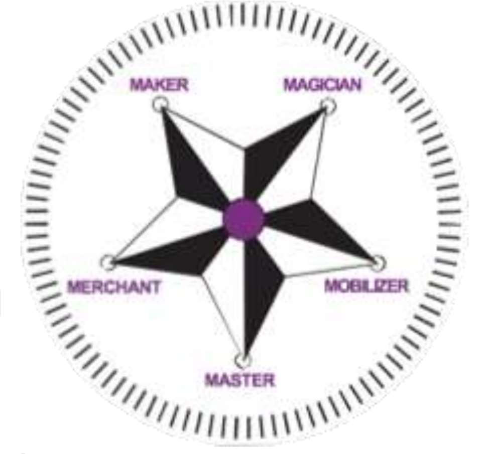

| Style | Description | Famous example |
|---|---|---|
| **Maker** | Brings ideas to life through **tangible plans**; sees both big picture and smallest details; **simplifies complex problems**; strength is **execution** — great at getting things done; prefers **processes and systems over people** | **Henry Ford** (Ford — production & manufacturing) |
| **Merchant** | Always on the lookout for the **next big thing**; quickly spots a **market opportunity / unmet need** and matches demand with supply; tweaks or improvises existing ideas; applies concepts from other industries | **Richard Branson** (Virgin Group — music to space tourism) |
| **Magician** | **Challenges the status quo**; dreams of what can be; takes risks that aren't always calculated; navigates uncharted territory; stays ahead of the market — **visionaries and rule-breakers** who ask "**why not?**" | **Steve Jobs** (Apple, Pixar) |
| **Mobilizer** | The **connecting thread** — connects **ideas, people and resources**; builds relationships and high-energy teams; grass-roots involvement; focuses on **large-scale social problems** as catalysts for systemic change | **Muhammad Yunus** (Grameen Bank — microfinance) |
| **Master** | **Expert** — highly skilled and knowledgeable, with great **passion for their field**; high quality standards and expects the same of others; a **role model, thought leader or influencer** | **Bill Gates** (Microsoft, Gates Foundation) |

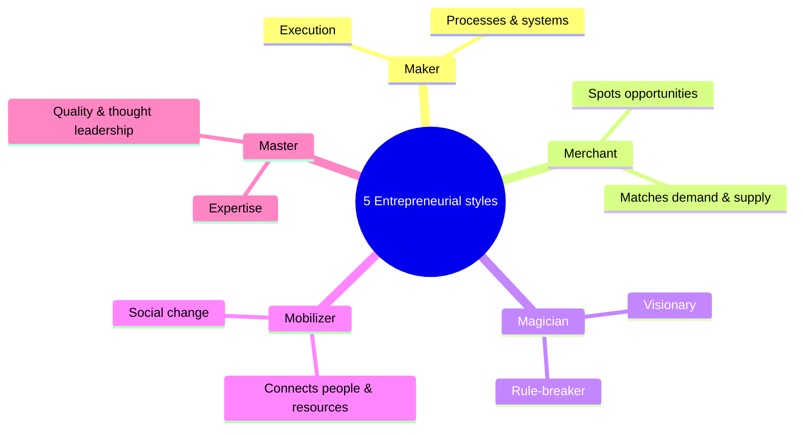

---

## 2. Methods of Finding and Understanding Customer Problems ★★★

**How do entrepreneurs learn what customers really need or want?**
- **Traditional methods:** **surveys, focus groups, interviews, secondary research** — effective in the right situations; inform business models and organisation design.
- **Direct observation** of potential customers' activities gives deeper insights.
- **"Test and learn"** — app developers release a **beta version**, see how customers use it, gather direct feedback, refine until it's out of beta; sometimes then shift from free to paid once needs are met.

### 2.1 Customer-problem observation worksheet
1. Go out, look around and **identify a problem** you can spot; explain its **context**.
2. What **opportunity** can you perceive from the problem?
3. **Who is the customer?**
4. What, according to the customer, are the **main problems**?
5. What is the **job to be done**?
6. What job is **currently getting done**?
7. How is the customer **addressing the problem today**?
8. **Estimate the market size** (assumptions are fine).
9. Is this a **problem worth solving**? If not, look for another problem.

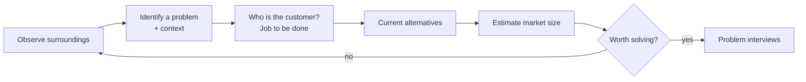

---

## 3. Designing the Business Model to Give Customers What They Want ★★

- Delivering products/services in a **distinctive way** is as important as — or more important than — knowing what customers want.
- Many companies fail because they **don't change how they operate**.
- *Example:* a client built a large **standardised back office** for customer/vendor billing — efficient and productive internally, but **hard for customers to navigate** → drove customers away. Result: **happy internal users, frustrated external customers** — distracted by internal operational ease instead of serving customers.
- **Avoid this:** make the business model a **reflection of the key customer problem(s)** you plan to solve, then **align** work activities, reward systems, metrics, culture and structures to the strategy — a thoughtful, ongoing, **holistic alignment** (not a quick shuffle of the org chart).

---

## 4. Running Problem Interviews ★★★

- After identifying a problem worth solving, **talk to customers** to understand their **"worldview"** about the problem **before** designing a solution.
- **Validate** that it is a problem worth solving and rated **critical** from the customer's point of view.
- **Key questions:**
  1. Is this a **must-address** problem or not?
  2. What are the **demographics** of those who say it is a must-address problem?
  3. How are people **addressing this problem today**?
- **Interview at least 10 people** to judge whether the problem is actually worth solving.
- Best practice: ask about **past behaviour**, don't pitch the solution, listen more than talk, record exact words.

---

## 5. Design Thinking ★★★

- A **user-oriented, prototype-centred** process of innovation ideally suited for **product, service and business design**.
- A **systematic approach** to handling problems and generating new opportunities — applicable to any field.
- An **iterative** process: **understand the user**, **challenge assumptions**, **redefine problems** to find alternative strategies and solutions not apparent at first.
- A **solution-based** approach — both a **way of thinking and working** and a collection of **hands-on methods**.

**Regular innovation process:** Ideate → Define → Design → Develop (4 stages).
**Design-thinking process:** **Empathise → Define → Ideate → Prototype → Test** (5 stages).

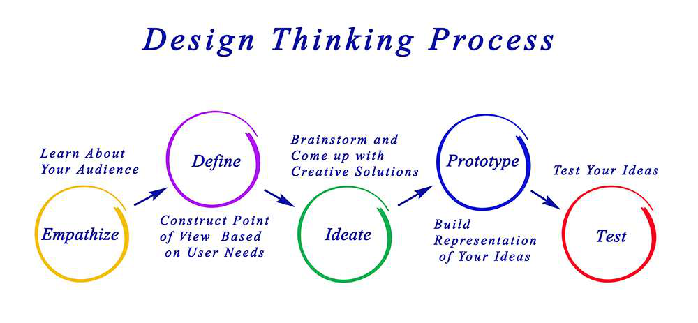

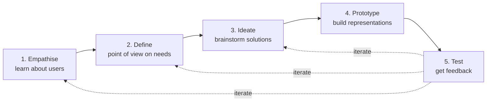

| Stage | Activity | Phase |
|---|---|---|
| **1. Empathise** | Listen to and **observe** customers' needs and wants relative to the problem; record learnings in **empathy maps** (says, thinks, does, feels) | Problem finding |
| **2. Define** | Combine insights to **frame the problem clearly** — a **problem statement / point of view** based on user needs | Problem finding |
| **3. Ideate** | **Brainstorm** as many ideas as possible; don't ignore obvious or easy ideas — any idea can sprout a brilliant concept | Problem solving |
| **4. Prototype** | Make solutions visible — **sketching, rapid prototyping**; create rough drafts to judge whether they help | Solution testing |
| **5. Test** | **Test prototypes with customers**; monitor responses; decide if the solution satisfies them; refine | Solution testing |

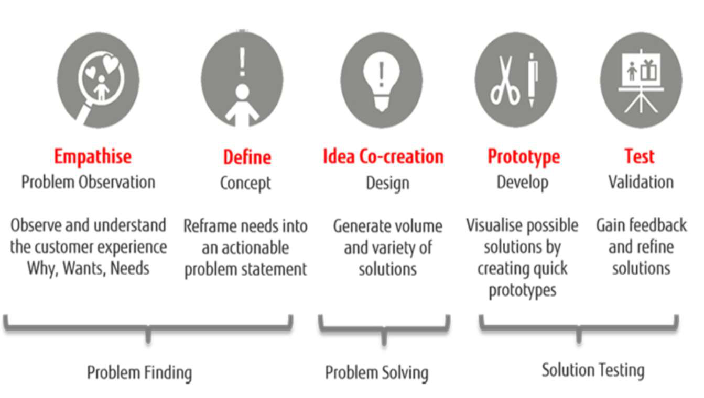

### 5.1 The power of design thinking
- Creates the **right features for the right people**.
- Ensures designers tackle **real user problems** — avoids creating something undesirable.
- Helps make the **right decisions** about features; pose the right questions; engage clients effectively; judge whether a feature fits and serves a real need.

| Traditional innovation | Design thinking |
|---|---|
| Starts with technology/idea | Starts with **user empathy** |
| Linear | **Iterative** |
| Expensive late testing | **Early, cheap prototypes** |
| Risk of building unwanted products | Validated solutions |

---

## 6. Market Segmentation ★★★

**Market segmentation** = dividing a broad consumer or business market (existing and potential customers) into **sub-groups** sharing some characteristics.

| Basis | Variables | Example |
|---|---|---|
| **Geographic** | Region, country, city size, climate, urban/rural | Woollens for northern India |
| **Demographic** | Age, gender, income, education, occupation, family size, religion | Kids' cereals; premium products for high income |
| **Psychographic** | **Lifestyle, values, personality, interests, attitudes**, social class | Fitness-enthusiast apparel |
| **Behavioural (behaviouristic)** | **Usage rate, benefits sought, loyalty, occasion**, user status | Festival offers; frequent-flyer programmes |

**Each segment should be:** **unique, identifiable, accessible, measurable, durable and substantial** (large/profitable enough).

---

## 7. Market Targeting ★★★

A **target market** = the group of consumers or organisations **most likely to buy** a company's offerings → focus marketing efforts on them.

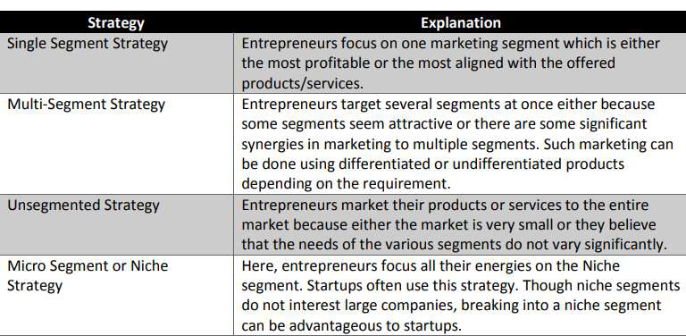

| Strategy | Explanation |
|---|---|
| **Single-segment strategy** | Focus on **one segment** — the most profitable or most aligned with the offering (concentrated marketing) |
| **Multi-segment strategy** | Target **several segments** at once (attractive segments or synergies); differentiated or undifferentiated products as required |
| **Unsegmented (mass) strategy** | Market to the **entire market** — when the market is small or segment needs don't vary significantly |
| **Micro-segment / niche strategy** | Focus all energy on a **niche** — common for **startups**; niches don't interest large companies |

**Process (STP):**
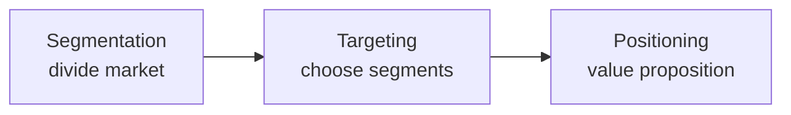

---

## 8. Identifying and Analysing the Target Market ★★★

**Start:** figure out the **need/problem** your product solves → refine your target by looking at **who already buys** (demographics, audience type, attributes) → for brand-new products, study **competitors**.

**Key questions:**
1. What are the **features** of your business, products or services?
2. What are the **benefits** of these features?
3. How do the benefits **help the user**?
4. How does your target market **shop**?
5. Typical **age and gender**?
6. Average **income and education**?
7. Common **interests** — attitudes, values, lifestyle?
8. Are they comfortable **online**?
9. Which **web and offline marketing methods** engage them?

### 8.1 Seven steps to define the target market
| Step | Action |
|---|---|
| **1. Gather information** | Is the market large enough? Alter the idea to appeal to this audience? Tailor the product? How to target marketing for maximum reach? |
| **2. Create customer profiles & segments** | **Demographic** (age, gender, location, education, income, marital/family status, occupation, ethnicity) + **psychographic** (interests, hobbies, values, attitudes, behaviours, lifestyle) |
| **3. Be specific** | Narrow definition is "more art than science"; drill down to attitudes, beliefs and **pain points** — the core customer problem sets you apart |
| **4. Tap existing resources** | Online research on industry, segment, competition, ideal customer |
| **5. Look at your competition** | Their positioning, what customers buy, pricing, willingness to pay, would they pay more for extras, social-media sentiment and channels, customers' other interests |
| **6. Conduct primary research** | Gather data directly — **focus groups**, surveys, interviews |
| **7. See the business in a fresh light** | Enough potential customers? Will they benefit, see a true need, buy repeatedly? What drives their decisions? Can they afford it — how often? |

---

## 9. Niche Marketing ★★★

- A **niche market** = a **small subset/segment** of the market on which a specific product focuses; the niche defines product **features**, **price range**, **production quality** and **demographics** targeted.
- **Best targeting approach for a new venture (startup)** because it:
  - allows **sensible use of resources**;
  - makes **marketing easy**;
  - helps **identify clients** easily;
  - helps the venture gain **expertise** quickly;
  - helps gain **repeat business and referrals**.
- *Example:* **The North Face** began in a niche as a "**speciality outfit brand for mountaineers**"; today it's a highly successful mainstream apparel brand.

| Mass marketing | Niche marketing |
|---|---|
| Whole market, standard product | Small, well-defined segment |
| High competition, large budgets | Low competition, focused budget |
| Low loyalty | High loyalty & referrals |

---

## 10. Value Proposition ★★★

- A **value proposition** defines the **benefits** a company's products and services offer the customer — a short statement (based on the **Business Concept Statement**) expressing the essence of the business in a way that **compels the customer to buy**.
- Forms the basis for **sales, marketing and product development**; part of the **business plan**; a guide for marketing efforts.

### 10.1 Benefits of a value proposition
- **Strong differentiation** from competitors.
- Increases the **quantity and quality** of prospective leads.
- Gains **market share** in target segments.
- Improves **operational efficiency**.
- Increases **revenue**.
- Ensures everyone in the company communicates the **same message**.

### 10.2 Guidelines to create a value proposition ★★★
1. Start from the **Business Concept Statement**.
2. **Address the needs** of your target market — what problems must they solve? What's not working? Where do they want to go?
3. **Emphasise benefits, not features** — not what the technology does, but what the buyer gets: greater revenue, competitive advantage, reduced costs, convenience, higher **ROI**, better results.
4. Use **tangible examples** — be precise: numbers, percentages, time frames.
5. **Differentiate** from the competition — what do you have that no one else has, and why is it an advantage to customers?
6. **Research and test** your value proposition.

*Template:* "For **[target customer]** who **[need/problem]**, our **[product]** is a **[category]** that **[key benefit]**. Unlike **[competitor]**, we **[unique differentiator]**."

### 10.3 Value Proposition Canvas ★★★
- A simple tool to **understand customers' needs** and design products/services they want; works with the **Business Model Canvas** (Alexander Osterwalder).
- **Two sides that must fit:**

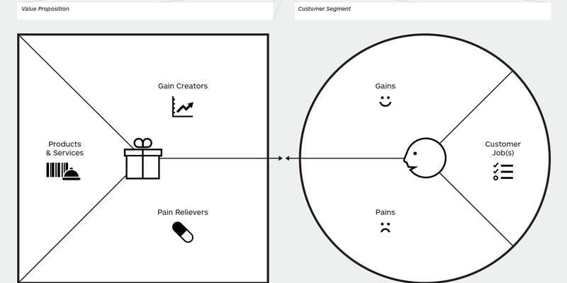

| Value map (square — your offer) | Customer profile (circle — your customer) |
|---|---|
| **Products & services** — what you offer | **Customer jobs** — tasks they're trying to get done (functional, social, emotional) |
| **Pain relievers** — how you **eliminate** customer pains | **Pains** — negative outcomes, risks, obstacles |
| **Gain creators** — how you **create** customer gains | **Gains** — outcomes and benefits they want |

**Fit** is achieved when pain relievers address important pains and gain creators produce important gains.

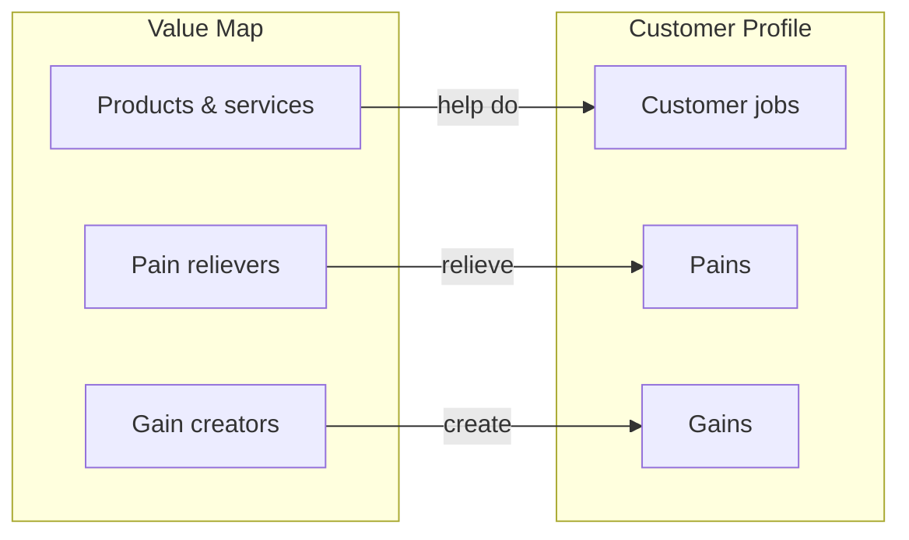

**Example — Uber/Ola (taxi smartphone app):**
| Customer profile | Value map |
|---|---|
| Jobs: call a taxi, find a taxi, give directions, pay | Product: taxi smartphone app |
| Pains: long waiting time, overcharged, no cash, unsafe driver, competing with other customers | Pain relievers: instant booking, assigned driver, cost system (upfront fare), cashless payment, driver rating |
| Gains: arrive on time, fair price, professional driver, easy payment | Gain creators: saves time, professional drivers, rating system, visual map |

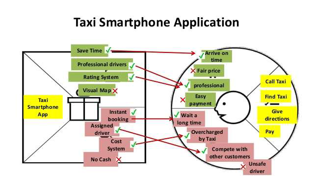

**Example — Swiggy/Zomato:** jobs — order food, discover restaurants, pay; pains — long delivery, cold food, limited choice; relievers — live tracking, wide restaurant listing, ratings, multiple payment options; gains — convenience, offers/discounts, quick delivery.

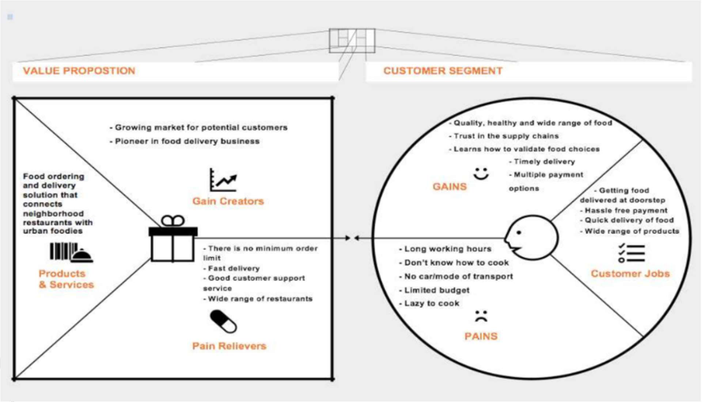

---

## 11. Customer-Driven Innovation ★★★

- **Customer-driven innovation** — customers look for **more innovative products and services**, so you develop the company to satisfy their needs. (*Customer-driven influence* — customers look for brand names and promoted goods.)
- **Shift to consumer-driven innovation:** businesses try to keep up with **consumer expectations faster than the competition**. Customers no longer compare brands only within an industry — they compare a brand's service with the **best service they get anywhere** (*e.g., we're frustrated when an airline is slow on social media because our broadband provider replies in under 10 minutes*).

### 11.1 Ten keys of value innovation
1. Customer **focus** 2. Customer **empathy** 3. Customer **insight** 4. Customer **involvement** 5. Customer **feedback** 6. **Observing** people 7. **Competitive intelligence** 8. **Beta testing** 9. **Continuous improvement** 10. **Strategic intent**

### 11.2 Seven practice tips for customer-driven innovation ★★
1. **Observe people** to understand hidden, unarticulated needs.
2. **Empathise** — "walk a mile in the shoes of your customer".
3. **Involve everyone** — every person, regardless of position, spends time on customer contact.
4. **Involve customers** in testing prototypes.
5. **Help employees** understand customer needs by listening to post-launch feedback.
6. **Watch how customers use** your product — learn what works and what doesn't.
7. **Ingrain** customer-driven innovation in corporate **culture** and operations.

### 11.3 Drivers of innovation
New ideas for products and services · **listening to customers** · continuous improvement of current products · offering a **unique** product · **excellent customer service**.

### 11.4 Examples
| Company | Customer-driven practice |
|---|---|
| **Amazon** | Vision: "We seek to be **Earth's most customer-centric company**" |
| **Sony** | Over **5,300 customer-service locations** worldwide |
| **Netflix** | Huge customer data → **hyper-personalised recommendations** |
| **Dollar Shave Club** | "We don't respond to situations; **we respond to people**" — stands out in a crowded subscription market |

---

## 12. Identifying More Business Opportunities ★★

Successful entrepreneurs **continually innovate** and look for opportunities to grow.

| Way | What to do | Outcome |
|---|---|---|
| **1. Listen to potential clients** | Their needs, wants, challenges, frustrations; have they used similar products? Likes/dislikes? Why did they come to us? Objections? | Tailored products, refined target market, overcome objections |
| **2. Listen to customers** | What they say about the industry; FAQs, experiences, frustrations, feedback and complaints | Expand/develop current products |
| **3. Look at competitors** | What others are doing — and **not** doing; where they fall down; what they do right; why customers choose them | Expand market reach |
| **4. Look at industry trends & insights** | Industry publications, associations, Google alerts, follow experts on social media; continuous self-education | Stay ahead with latest techniques and trends |

---

## 13. Consumer Adoption Process ★★★

The mental stages a consumer passes through from first hearing about an innovation to final adoption.

| Philip Kotler (5 stages) | William Stanton (6 stages) |
|---|---|
| 1. Awareness | 1. Awareness |
| 2. Interest | 2. Interest & information |
| 3. Evaluation | 3. Evaluation |
| 4. Trial | 4. Trial |
| 5. Adoption | 5. Adoption |
| — | 6. **Post-adoption** behaviour |

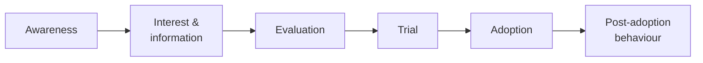

| Stage | What happens |
|---|---|
| **1. Awareness** | Consumer becomes **aware** of the innovation but knows very little — via friends, relatives, salespeople, dealers, ads (newspaper, magazines, internet, TV, outdoor); pays little attention yet |
| **2. Interest & information** | Becomes **interested**; collects information from ads, salespeople, dealers, current users, the company — qualities, features, functions, risk, brand, colour, price, incentives, availability, service |
| **3. Evaluation** | Uses the information to **judge the worth** — compares quality, features, performance, price, after-sales service with existing products; decides whether to try |
| **4. Trial** | **Tries the product on a small scale** (buys a small quantity or uses free samples) to gain personal experience — determines whether to buy |
| **5. Adoption** | If the trial satisfies, decides to **adopt/buy** — quantity, type, model, dealer, payment; consumes individually or jointly |
| **6. Post-adoption** | If satisfied, becomes a **regular user** and spreads **positive word of mouth**; otherwise discontinues — crucial for marketers |

**Adopter categories (Rogers):** innovators (2.5 %), early adopters (13.5 %), early majority (34 %), late majority (34 %), laggards (16 %).

---

## Unit II — One-Page Summary

| Topic | Key points |
|---|---|
| **Entrepreneurial style** | Knowing your style → work in natural roles, partner for complementary strengths. **5 Ms:** Maker (execution — Henry Ford), Merchant (opportunity spotter — Richard Branson), Magician (visionary rule-breaker — Steve Jobs), Mobilizer (connector, social change — Muhammad Yunus), Master (expert, thought leader — Bill Gates). |
| **Customer problems** | Surveys, focus groups, interviews, secondary research, direct observation, beta "test and learn". Worksheet: problem, context, customer, job to be done, current solution, market size, worth solving? |
| **Business model fit** | Model must reflect the customer problem; align activities, rewards, metrics, culture, structure (back-office billing example). |
| **Problem interviews** | Validate worldview; must-address? demographics? current solutions? ≥ 10 interviews. |
| **Design thinking** | User-oriented, iterative, prototype-centred: **Empathise → Define → Ideate → Prototype → Test** (empathy maps, problem statements, brainstorming, rapid prototypes, user testing). |
| **Segmentation** | Geographic, demographic, psychographic, behavioural; segments unique, identifiable, accessible, measurable, durable, substantial. |
| **Targeting** | Single-segment, multi-segment, unsegmented (mass), micro/niche. STP. |
| **Target-market analysis** | Features → benefits → user help; shopping habits, age, gender, income, education, interests, online comfort, channels. 7 steps: gather info, profiles, be specific, existing resources, competition, primary research, fresh look. |
| **Niche marketing** | Small focused segment; best for startups — sensible resources, easy marketing, expertise, repeat business (The North Face). |
| **Value proposition** | Benefit statement compelling purchase; differentiation, better leads, share, efficiency, revenue, one message. Guidelines: needs, benefits not features, tangible numbers, differentiation, test. |
| **VP Canvas** | Value map (products & services, pain relievers, gain creators) ↔ customer profile (jobs, pains, gains); Uber/Ola, Swiggy/Zomato examples. |
| **Customer-driven innovation** | Keep up with expectations faster than rivals; 10 keys (focus, empathy, insight, involvement, feedback, observation, competitive intelligence, beta testing, improvement, strategic intent); 7 tips; Amazon, Sony, Netflix, Dollar Shave Club. |
| **More opportunities** | Listen to potential clients, listen to customers, study competitors, track industry trends. |
| **Adoption process** | Kotler: awareness, interest, evaluation, trial, adoption; Stanton adds post-adoption. |
