# Unit III — Business Models, Lean Approach, MVP, Product-Market Fit & Industry Analysis

> **Topics:** Business models — meaning, components, types; the lean approach and its five principles; Business Model Canvas (Swiggy, Ola, Netflix); blue and red ocean strategies; problem–solution test; solution demo & solution interview; minimum viable product; product–market fit; start-up vs small business; industry analysis (Porter's five forces, SWOC, ABCD, etc.); Build–Measure–Learn feedback loop.
>
> **Source:** *BOE U3.pdf* (text extracted from the PDF slides)

**Importance legend:** ★★★ = very frequently asked (long answer) · ★★ = medium · ★ = short answer

---

## Table of Contents
1. [Business Models — Introduction](#1-business-models--an-introduction-)
2. [Components of a Business Model](#2-components-of-a-business-model-)
3. [Types of Business Models](#3-types-of-business-models-)
4. [The Lean Approach & Its Five Principles](#4-the-lean-approach--five-principles-)
5. [Business Model Canvas](#5-business-model-canvas-bmc-)
6. [Blue Ocean vs Red Ocean Strategies](#6-blue-and-red-ocean-strategies-)
7. [The Problem–Solution Test](#7-the-problemsolution-test-)
8. [Solution Demo & Solution Interview](#8-solution-demo--solution-interview-)
9. [Minimum Viable Product (MVP)](#9-minimum-viable-product-mvp-)
10. [Product–Market Fit](#10-productmarket-fit-)
11. [Start-up vs Small Business](#11-characteristics-of-start-ups-vs-small-businesses-)
12. [Industry Analysis](#12-industry-analysis-)
13. [Build–Measure–Learn Feedback Loop](#13-buildmeasurelearn-feedback-loop-)
14. [Unit III — One-Page Summary](#unit-iii--one-page-summary)

---

## 1. Business Models — An Introduction ★★★

- A **business model** is an outline of **how a company plans to make money** with its product and customer base in a specific market. It explains four things:
  1. **What** product or service the company will sell;
  2. **How** it intends to **market** it;
  3. What **expenses** it will face;
  4. How it expects to **turn a profit**.
- **Peter Drucker:** "A business model is supposed to answer **who your customer is**, **what value** you can create/add for the customer, and **how** you can do that at **reasonable cost**."
- It describes how a business **creates, delivers and captures value**; a **conceptual structure** supporting the viability of a product or company, explaining how it operates, makes money and achieves its goals — all processes and policies are part of it.
- *Example:* the **subscription model** — customers pay a monthly/annual fee to access a service (customisable per business).

**Parts of a business model:**
1. Everything related to **designing and manufacturing** the product;
2. Everything related to **selling** it — finding the right customers to distribution;
3. Everything related to **how the customer pays** and **how the company makes money**.

---

## 2. Components of a Business Model ★★★

| Component | Meaning |
|---|---|
| **Value proposition** | The feature that makes your product **attractive** to customers |
| **Target market** | A specific group of consumers interested in your product |
| **Competitive advantage** | A unique feature that **can't easily be copied** by competitors |
| **Cost structure** | Fixed and variable expenses needed to function, and how they affect pricing |
| **Key metrics** | The ways the company **measures success** |
| **Resources** | Physical, financial and intellectual **assets** |
| **Problem and solution** | Target customers' **pain points** and how you'll meet them |
| **Revenue model** | Framework identifying viable **income sources** |
| **Revenue streams** | The **multiple ways** the company generates income |
| **Profit margin** | Amount by which revenue **exceeds costs** |

---

## 3. Types of Business Models ★★★

| Model | How it works | Example |
|---|---|---|
| **Manufacturing** | Converts raw materials into finished goods and sells them (directly or through distributors) | Tata Motors, Ford |
| **Retailing** | Buys goods from manufacturers/wholesalers and sells to end consumers with a markup | Reliance Retail, D-Mart |
| **Freemium** | **Basic service free**, premium features **paid** | Spotify, LinkedIn, Canva |
| **Online (e-commerce)** | Sells products/services over the internet | Amazon, Flipkart |
| **SaaS (Software as a Service)** | Cloud software accessed via the internet on a **subscription/usage fee** | Salesforce, Zoho, Microsoft 365 |
| **Subscription** | Recurring fee (monthly/annual) for continuous access | Netflix, Amazon Prime |
| **Aggregator** | Brings many **service providers under one brand/platform**; earns commission | Ola, Uber, Swiggy, Zomato, OYO |
| **Franchise** | Franchisor licenses brand, processes and support to **franchisees** for a fee/royalty | McDonald's, Domino's |

*(Others: advertising, marketplace, razor-and-blades, direct sales, peer-to-peer.)*

---

## 4. The Lean Approach & Five Principles ★★★

- The **lean approach** to start-ups emphasises the **business model over the business plan**, and encourages **customer discovery and development** and **iteration** to achieve the right **product/market fit**.
- **Lean = creating more value for customers with fewer resources.**
- A lean organisation understands **customer value** and focuses key processes to **continuously increase** it.
- Ultimate goal: **perfect value** to the customer through a **perfect value-creation process with zero waste**.

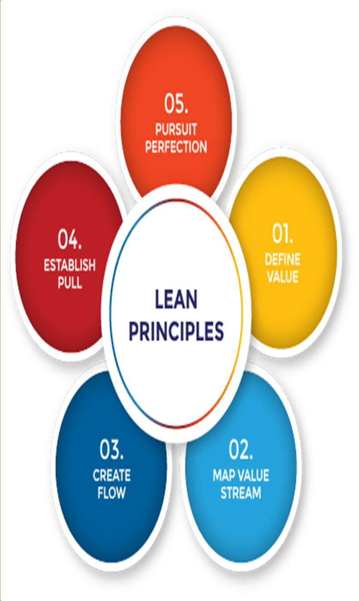

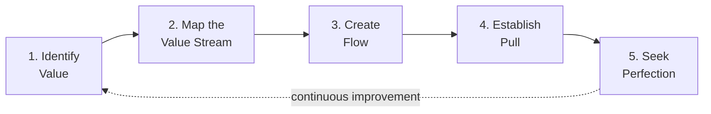

| # | Principle | Meaning |
|---|---|---|
| 1 | **Value** | Always **defined by the customer's needs** — timeline for manufacture & delivery, price point, other requirements/expectations |
| 2 | **Value stream** | Map **all steps and processes** from raw materials to delivering the final product; **value-stream mapping** reveals and removes waste (non-value-adding steps) |
| 3 | **Flow** | Ensure remaining steps **flow smoothly** without interruptions, delays or bottlenecks — "make value-creating steps occur in tight sequence" |
| 4 | **Pull** | With better flow, time to market drops; deliver **just in time** — the **customer pulls** the product as needed (weeks instead of months); no over-production |
| 5 | **Perfection** | Make lean thinking and process improvement part of **corporate culture**; lean is not static — needs constant effort (**kaizen**) |

**Seven wastes (TIMWOOD):** transport, inventory, motion, waiting, over-production, over-processing, defects.

---

## 5. Business Model Canvas (BMC) ★★★

- A **strategic management tool** (Alexander Osterwalder) to **quickly define and communicate** a business idea — a **one-page** document covering the fundamental elements of a business, structured coherently.
- **Right side = customer (external)**; **left side = business (internal)**; both meet at the **value proposition** — the exchange of value between business and customers.

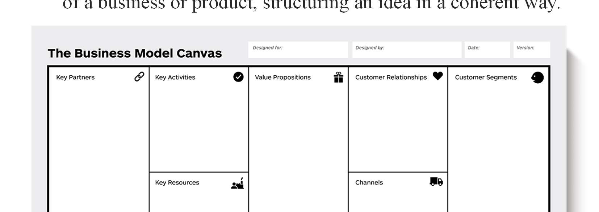

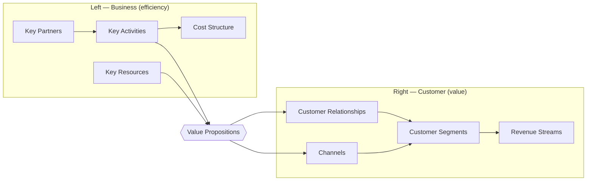

| # | Building block | Key question |
|---|---|---|
| 1 | **Customer segments** | For whom are we creating value? Who are our most important customers? |
| 2 | **Value propositions** | What value do we deliver? Which problems do we solve? |
| 3 | **Channels** | How do we reach and deliver to customers? |
| 4 | **Customer relationships** | What type of relationship does each segment expect (self-service, personal, community)? |
| 5 | **Revenue streams** | For what value are customers willing to pay? How? |
| 6 | **Key resources** | What assets does the value proposition require (physical, intellectual, human, financial)? |
| 7 | **Key activities** | What must we do to deliver the value proposition? |
| 8 | **Key partnerships** | Who are our key partners and suppliers? |
| 9 | **Cost structure** | What are the most important costs? (cost-driven vs value-driven) |

**Why use it:** quickly draws a picture of the idea; helps make connections between the idea and how to turn it into a business; shows which customer decisions influence use; gives everyone a **clear idea** of what the business will be.

### 5.1 BMC example — Swiggy
| Block | Swiggy |
|---|---|
| Customer segments | Urban consumers ordering food; restaurants; delivery partners |
| Value propositions | Wide restaurant choice, fast delivery, live tracking, no minimum order, offers; for restaurants: more orders & reach |
| Channels | Mobile app, website, social media, ads |
| Customer relationships | Self-service app, customer support, Swiggy One membership |
| Revenue streams | Commission from restaurants, delivery fees, advertising, subscriptions (Swiggy One), Instamart |
| Key resources | Technology platform, delivery fleet, brand, data |
| Key activities | Platform development, logistics, restaurant onboarding, marketing |
| Key partners | Restaurants, delivery partners, payment gateways, investors |
| Cost structure | Delivery-partner payouts, technology, marketing & discounts, salaries |

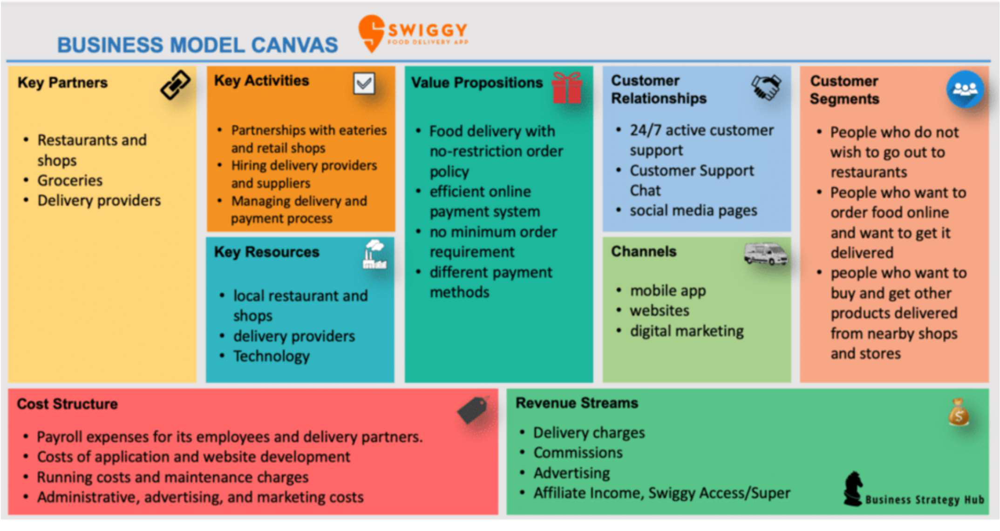

### 5.2 BMC example — Ola
| Block | Ola |
|---|---|
| Customer segments | Commuters (budget to premium), drivers/cab owners, corporates |
| Value propositions | Convenient booking, transparent fares, multiple ride options, safety features; for drivers — steady income |
| Channels | App, website, call centre |
| Revenue streams | Commission per ride, surge pricing, Ola Money, advertising, corporate tie-ups |
| Key partners | Drivers, car owners, payment wallets, financiers |
| Cost structure | Technology, driver incentives, marketing, operations |

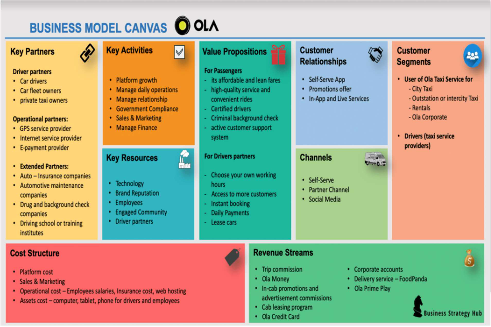

### 5.3 BMC example — Netflix
| Block | Netflix |
|---|---|
| Customer segments | Global viewers of films/series, families, mobile users |
| Value propositions | Ad-free, on-demand streaming, personalised recommendations, original content, multi-device |
| Channels | App, smart TVs, website, partner devices |
| Revenue streams | **Monthly subscriptions** (tiered plans) |
| Key resources | Content library, recommendation algorithms, streaming infrastructure, brand |
| Key activities | Content licensing & production, platform development, data analytics |
| Key partners | Studios, content producers, ISPs, device makers |
| Cost structure | Content acquisition/production, technology, marketing |

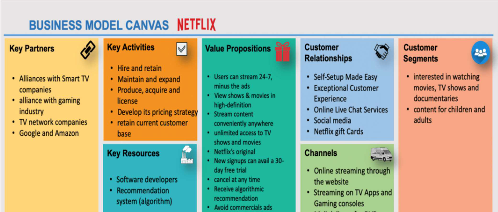

---

## 6. Blue and Red Ocean Strategies ★★★

Introduced by **W. Chan Kim and Renée Mauborgne (2005)** to gain an edge amid cut-throat competition.

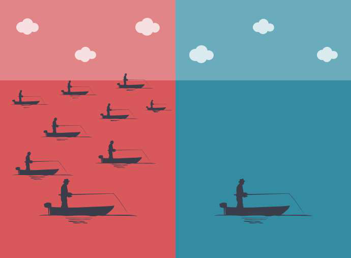

| Red Ocean Strategy | Blue Ocean Strategy |
|---|---|
| Compete in **existing** market space | Create **uncontested** market space |
| **Beat the competition** | Make the competition **irrelevant** |
| **Exploit existing demand** | **Create and capture new demand** |
| Make the **value–cost trade-off** | **Break the value–cost trade-off** (differentiation **and** low cost) |
| Align the whole system with **either** differentiation **or** low cost | Align the whole system in pursuit of **both** |
| Intense competition, **commoditisation** — competing mainly on **price** | Most blue oceans are created **from within red oceans** by expanding industry boundaries |
| *Example:* **soft-drink industry** — Coke and Pepsi leaders, many small rivals, limited shelf space and vending spots, strong brand recognition, high entry barriers | *Example:* **Apple iPod (2001)** — "a whole new category of digital music player that lets you put your entire music collection in your pocket" — created a new industry by looking beyond what customers asked for |

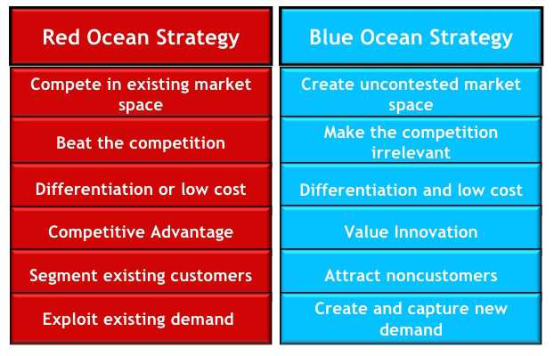

**Blue-ocean tools:** strategy canvas; **ERRC grid** — Eliminate, Reduce, Raise, Create factors (e.g., Cirque du Soleil eliminated animals and star performers, created theatre-style experience).

---

## 7. The Problem–Solution Test ★★★

- Before building the **right solution**, understand the **right problem**.
- Inspired by the **scientific method**: start by creating a **model** (business model) — your best guess at articulating a **customer and problem** — then test it.

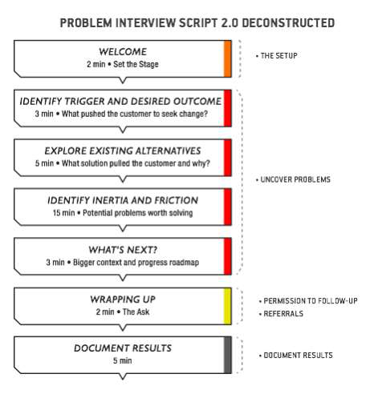

**Exploring the customer's journey (problem interview elements):**
| Element | Meaning |
|---|---|
| **Trigger** | Event that creates a **desire for better** |
| **Desired outcome** | What the customer wants to achieve (e.g., an entrepreneur hit with an idea → securing funding, launching the product) |
| **Existing alternatives / current solution** | What attributes attracted the customer? What solutions did they consider? |
| **Inertia** | Obstacles that **hold the customer back** when choosing a new solution |
| **Friction** | Obstacles that get in the way **during usage** |
| **Next summit** | How well the job was done and the customer's **next goal** |

- The interview script sets the stage and problem context, but its heart is exploring the **customer's worldview** — gather **empirical evidence** that supports or refutes your case.
- Only reliable evidence: what customers **did in the past or do now**. Asking about the **future** ("Will you use…?") invites **bias** — avoid it.
- **Validation** (evidence supports assumptions) → move to defining and testing a solution with a **Solution Interview**.
- **Invalidation** → dig deeper for new problems. People stumble because:
  1. they unconsciously **frame (or fake) problems around the solution** they already want to build and seek just enough evidence to convince themselves;
  2. starting with a **non-problem** — invalidation shows quickly but recovery is hard.

---

## 8. Solution Demo & Solution Interview ★★

### 8.1 Building a solution demo
- The **smallest possible stand-in** for the actual solution, for **testing** — contains the **core component**, not the entire solution.
- Avoid investing in a full product nobody wants — build a **demo/mock-up** and test it with customers (a **Lean Startup** technique to validate the solution).
- *Example:* a **video** depicting the services of a data centre.

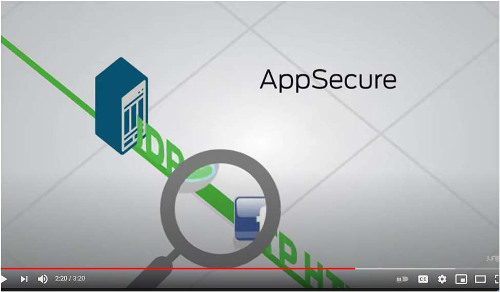

**Guidelines:**
1. **Not too simple** — give a real sense of the solution (a mock website rather than a photoshopped image).
2. **Not unnecessarily flashy** — must represent something that can **actually be built**.
3. **Build with your own resources** — quick mock-ups; don't hire extra resources (slows feedback turnaround).
4. **Build as many mock-ups as required** — one per user requirement.

### 8.2 Solution interview method
Show the demo to customers who confirmed the problem; test whether the solution solves it, which features matter most (MVP), and **pricing** (what they would pay).

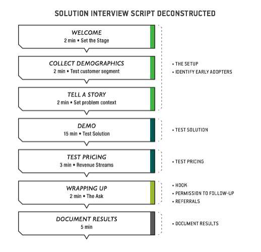

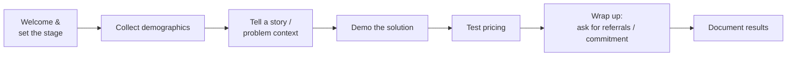

---

## 9. Minimum Viable Product (MVP) ★★★

- A **Minimum Viable Product** = a product with **just enough features to satisfy early customers** and provide **feedback** for future development (Eric Ries, Lean Startup).
- Lets you **test** the product in **real market conditions** with everyday consumers to evaluate performance — maximum validated learning with minimum effort.

**Example — Food on the Table (2009):** a mobile app that collects your food preferences and suggests recipes and grocery stores with the best deals. Founder **Manuel Rosso** had **no app or website** initially — he found people willing to participate, interviewed them about food preferences and budgets, and manually prepared recipes and shopping lists (a **concierge MVP**) to prove value before building the product.

### 9.1 Steps to build an MVP
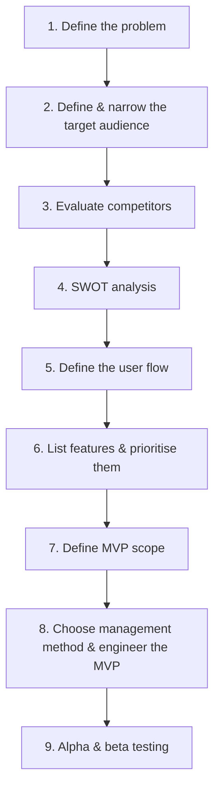

**Types of MVP:** concierge, Wizard-of-Oz, landing-page/smoke test, explainer video (Dropbox), single-feature, piecemeal.

| MVP | Prototype |
|---|---|
| Working product with core features, released to real users | Model to test design/concept internally |
| Validates **market demand** | Validates **feasibility/usability** |

---

## 10. Product–Market Fit ★★★

- **Marc Andreessen:** "**Product/market fit means being in a good market with a product that can satisfy that market.**"
- Often interpreted as creating an **MVP** that addresses an existing problem or need.
- **Dan Olsen's Lean Product Process** (6 steps):
  1. Determine your **target customer**
  2. Identify **underserved customer needs**
  3. Define your **value proposition**
  4. Specify your **MVP feature set**
  5. Create your **MVP prototype**
  6. **Test** your MVP with customers

**Product–market fit = 2 parts:**
| Product (you control) | Market (you don't control) |
|---|---|
| MVP feature set | Target customer |
| Value proposition | Underserved needs |
| UX | |

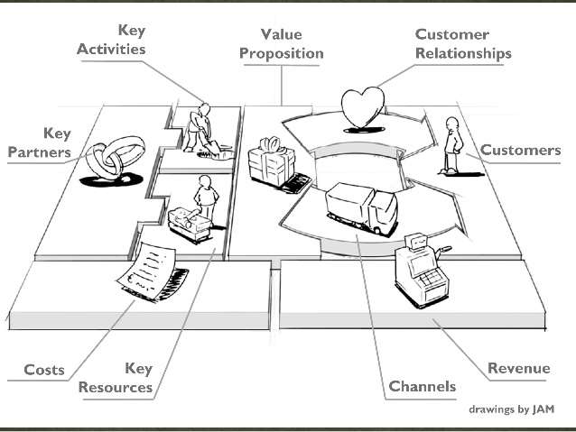

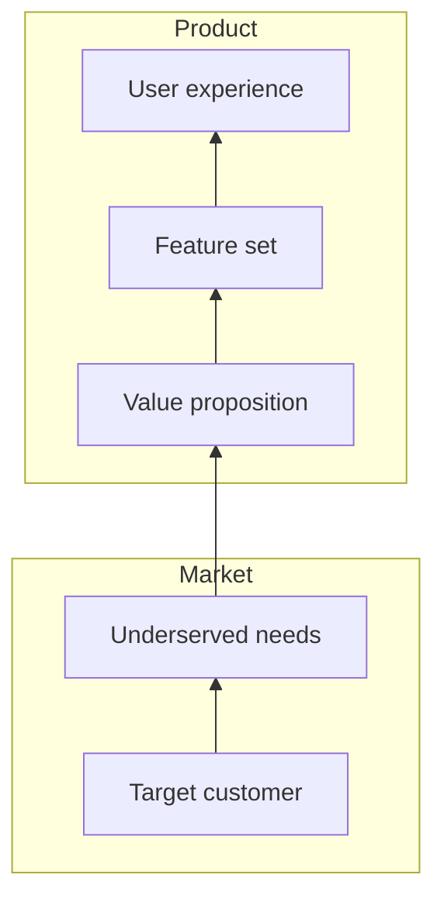

**Examples:** diapers → B2C, newborns up to ~8 years; milk → the universe; Audi → upper-middle to upper class; **Allegra** → people with allergies; a school app that helps students learn and alerts teachers when a student isn't meeting goals; markets for airline travel, smartphones, cars, pharmaceuticals, banking/mortgages/pensions.

**Signs of PMF:** strong retention, organic word-of-mouth growth, customers would be "very disappointed" without it (Sean Ellis 40 % test).

---

## 11. Characteristics of Start-ups vs Small Businesses ★★★

| Start-up | Small business |
|---|---|
| Fundamentally concerned with **growth** (scalable, fast) | **Smaller teams** of employees |
| Must exhibit **economies of scale** | **Small market area** |
| Must pursue **large markets** | **Sole proprietorship or partnership** ownership and taxes |
| Operates under **extreme uncertainty** | **Limited area / fewer locations** |
| Markets products in **very unique (innovative)** ways | **Lower revenue and profitability**; stable, steady |
| Funded by venture capital/angels; high risk, high reward | Funded by owner savings/bank loans |
| e.g., Zomato, Ola | e.g., local bakery, kirana store |

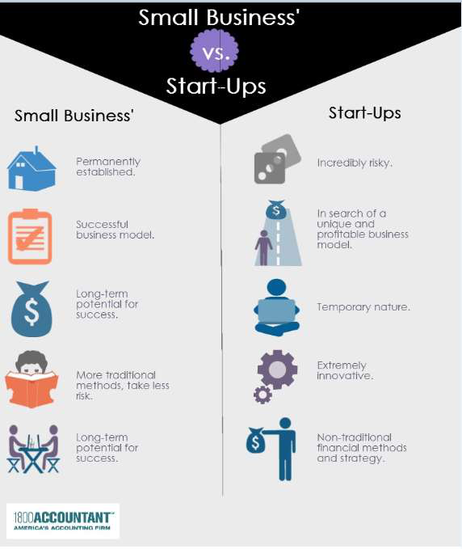

---

## 12. Industry Analysis ★★★

An **industry** = a system of manufacturers/businesses with the **common objective** of producing a particular kind of goods or services, doing business with a profit motive. **Industry analysis** studies the industry's structure, trends, competition and attractiveness before entering.

### 12.1 Components of industry analysis (23 elements)
| # | Analysis | What it covers |
|---|---|---|
| 1 | **Industry sector analysis** | Segment of industries of a type — materials, financial, food, energy, transport, health, education |
| 2 | **Industry trend analysis** | Present and future trends driven by economy, technology, environment, people's aspirations |
| 3 | **Environmental analysis** | Internal and external environmental challenges and opportunities |
| 4 | **Competitor analysis — Porter's 5 forces** | (see below) |
| 5 | **Alternative product/service analysis** | Substitutes → new innovative business models |
| 6 | **Financial performance analysis** | Investment, working capital, ROI, share prices, profitability, growth prospects |
| 7 | **ABCD analysis** | **Advantages, Benefits, Constraints, Disadvantages** of key issues |
| 8 | **SWOC analysis** | **Strengths, Weaknesses, Opportunities, Challenges** — strategic position; align resources to environment |
| 9 | **Product/service analysis** | Quality, suitability, durability, features, acceptability, innovations |
| 10 | **Investment analysis** | Revenues, expenses, income; growth prospects; competitive factors; expected ROE/ROA |
| 11 | **Automation & labour analysis** | Capital-intensive or labour-intensive |
| 12 | **People perception analysis** | Perception of the industry, usefulness to society, environmental effect, economic/social contribution |
| 13 | **Size & contribution to economy (GDP)** | Number of companies, GDP contribution |
| 14 | **Market demand analysis** | Can firms enter and earn enough profit? |
| 15 | **Opportunity analysis** | Growth, expansion, better models, margins, brand building, economies of scale |
| 16 | **Government policy analysis** | How policies support or hinder the industry |
| 17 | **Contribution & employment generation** | Jobs, support to other industries, exports |
| 18 | **Latest industrial developments** | Changes in business models, technology, aspirations, policies |
| 19 | **Top leading companies & strategies** | Strategies of industry leaders |
| 20 | **Cross-industry analysis** | Horizontal (within sector) and vertical (across sectors) comparisons |
| 21 | **Market size** | From web, government, trade associations, financial firms, data providers |
| 22 | **IT implementation** | Using e-business models to cut costs and market globally |
| 23 | **Industry innovations — Six Thinking Hats** | Edward de Bono's lateral-thinking technique (white = facts, red = feelings, black = caution, yellow = benefits, green = creativity, blue = process) |

### 12.2 Porter's Five Forces ★★★
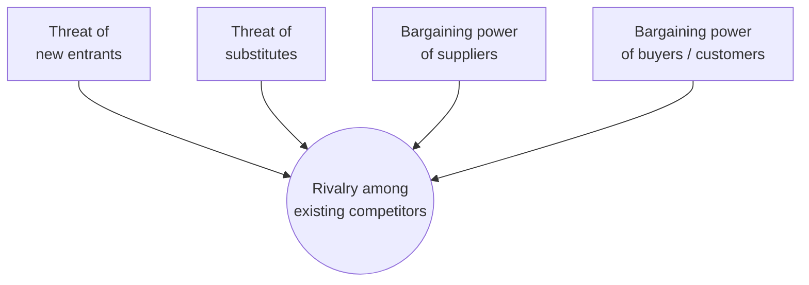
| Force | Meaning |
|---|---|
| **Threat of new entrants** | Ease of entering the industry (barriers: capital, brand, regulation) |
| **Threat of substitutes** | Alternative products, services or technologies |
| **Bargaining power of customers** | Ability to push down price and demand quality and after-sales support |
| **Bargaining power of suppliers** | Ability to raise input prices; depends on **switching cost** |
| **Rivalry among existing competitors** | Intensity of competition and its effect on profit and sustainability |

---

## 13. Build–Measure–Learn Feedback Loop ★★★

- A **core component of the Lean Startup** methodology (Eric Ries).
- First figure out the **problem**, then develop an **MVP** to start learning as quickly as possible.
- A cycle of **creating and testing hypotheses**: **build** something small for potential customers to try, **measure** their reactions, **learn** from the results → **pivot or persevere**.

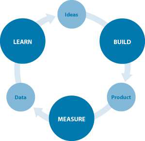

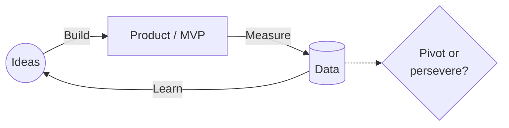

| Step | Activity |
|---|---|
| **Build** | Turn ideas/hypotheses into an MVP quickly |
| **Measure** | Collect data — **actionable metrics** (not vanity metrics), A/B tests, cohort analysis |
| **Learn** | **Validated learning** — confirm or reject hypotheses → **pivot** (change strategy) or **persevere** |

Goal: **minimise total time through the loop**.

---

## Unit III — One-Page Summary

| Topic | Key points |
|---|---|
| **Business model** | How a company makes money: what it sells, how it markets, expenses, profit. Drucker: who is the customer, what value, at reasonable cost. Creates, delivers, captures value. |
| **Components** | Value proposition, target market, competitive advantage, cost structure, key metrics, resources, problem & solution, revenue model, revenue streams, profit margin. |
| **Types** | Manufacturing, retailing, freemium, online, SaaS, subscription, aggregator, franchise. |
| **Lean** | More value with fewer resources; business model over business plan; principles: **Value → Value stream → Flow → Pull → Perfection**; zero waste. |
| **BMC** | 9 blocks: customer segments, value propositions, channels, customer relationships, revenue streams, key resources, key activities, key partners, cost structure. Right = customer, left = business. Swiggy, Ola, Netflix. |
| **Blue vs red ocean** | Kim & Mauborgne (2005). Red: existing market, beat competition, price wars (soft drinks). Blue: uncontested space, new demand, competition irrelevant (iPod); ERRC grid. |
| **Problem–solution test** | Scientific-method approach; trigger, desired outcome, alternatives, inertia, friction; past behaviour not future intentions; validation → solution interview; invalidation → new problem. |
| **Solution demo** | Smallest stand-in for the solution; not too simple, not flashy, own resources, one per requirement; solution interview tests demo and pricing. |
| **MVP** | Just enough features for early customers + feedback (Food on the Table — Manuel Rosso). 9 steps: problem, audience, competitors, SWOT, user flow, prioritised features, scope, build, alpha/beta test. |
| **Product–market fit** | Andreessen: good market + product that satisfies it. Olsen's lean product process (6 steps); product (controllable) vs market (not). |
| **Start-up vs small business** | Growth, scale, large markets, uncertainty, unique marketing vs small teams, small market, sole/partnership, few locations, lower revenue. |
| **Industry analysis** | 23 elements incl. sector, trend, environment, **Porter's 5 forces**, substitutes, financials, **ABCD**, **SWOC**, investment, labour, perception, GDP, demand, opportunity, policy, employment, leaders, cross-industry, market size, IT, Six Thinking Hats. |
| **Build–Measure–Learn** | Ideas → build MVP → measure data → learn → pivot or persevere; minimise loop time. |
