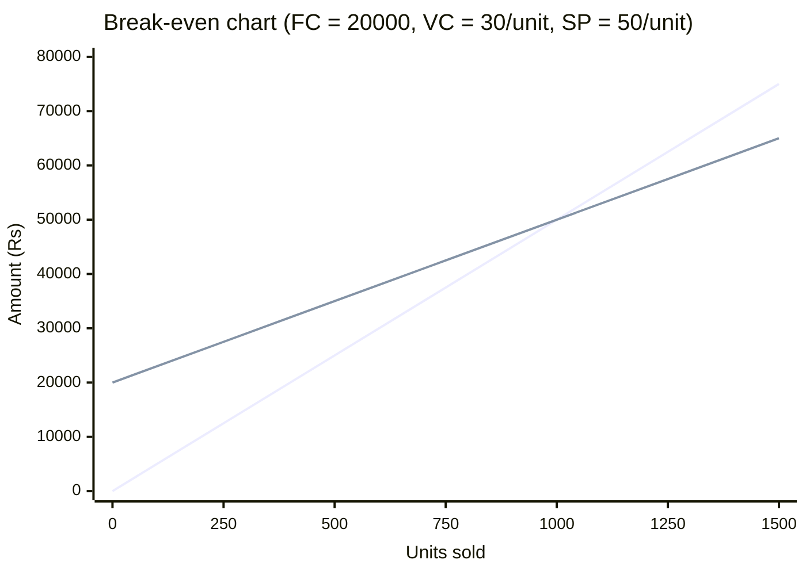
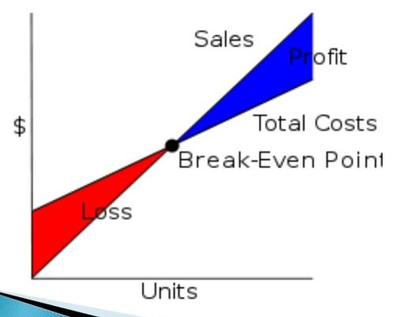
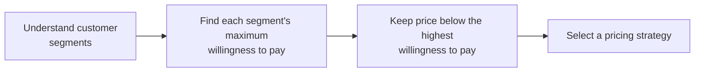
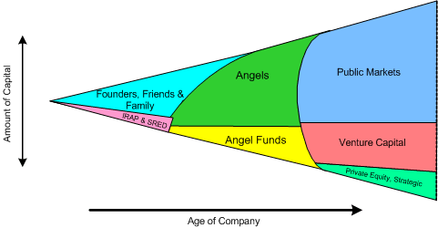
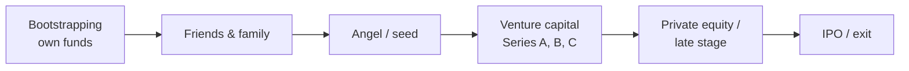

# Unit IV — Revenue, Cost & Break-even Analysis, Pricing Strategies and Start-up Funding

> **Topics:** Revenue analysis & revenue streams, types of revenue, cost analysis (start-up, fixed, variable costs), break-even analysis, profit analysis, pricing & pricing strategies, pricing pitfalls, bootstrapping, angel investors, venture capital, private equity, IPO, start-up accelerators & incubators.
>
> **Source:** *BOE U4.pdf* (text extracted from the PDF slides). Worked break-even numericals added for practice.

**Importance legend:** ★★★ = very frequently asked (long answer / numericals) · ★★ = medium · ★ = short answer

---

## Table of Contents
1. [Revenue Analysis & Revenue Streams](#1-revenue-analysis-)
2. [Types of Revenue](#2-types-of-revenue-streams-)
3. [Cost Analysis](#3-cost-analysis-)
4. [Break-even Analysis](#4-break-even-analysis-)
5. [Profit Analysis](#5-profit-analysis-)
6. [Introduction to Pricing](#6-introduction-to-pricing-)
7. [Pricing Strategies](#7-pricing-strategies-)
8. [Pricing Pitfalls](#8-pitfalls-in-pricing-)
9. [Bootstrapping](#9-bootstrapping-)
10. [Angel Investors](#10-angel-investors-)
11. [Venture Capital](#11-venture-capital-)
12. [Private Equity](#12-private-equity-)
13. [Going for IPO](#13-going-for-an-ipo-)
14. [Start-up Accelerators & Incubators](#14-start-up-accelerators--incubators-)
15. [Unit IV — One-Page Summary](#unit-iv--one-page-summary)

---

## 1. Revenue Analysis ★★★

- **Revenue** = income a business generates by means of **sales**.
- A business may have **multiple sources** of revenue, based on different services — e.g., a **soda shop** with **home delivery, counters in malls and mobile trucks** has **three revenue streams**.
- **Revenue streams** = the individual sources of revenue. A business should have **as many revenue streams as possible**.

**Revenue streams should be:**
| Property | Meaning |
|---|---|
| **Dependable** | Built so the **same customer** can be tapped **multiple times** → **repeat revenue**, making the stream reliable |
| **Clearly defined** | List sources, their **life cycle** and **pricing** → judge whether the stream is profitable and should continue |
| **Flexible** | If a revenue model isn't working, **change it immediately** — e.g., if the soda shop earns poorly in a locality, study demographics elsewhere and **shift** |

**Every revenue stream answers two questions:**
1. **What value** are customers **willing to pay** for?
2. **How much** does each revenue stream contribute to overall revenue?

---

## 2. Types of Revenue Streams ★★★

| Type | Description | Example |
|---|---|---|
| **Asset sale** | Selling **ownership rights** to a physical product | Selling cars, books, phones |
| **Usage fee** | Charging for **use of a service** — more use, more pay | Telecom per-minute, hotel per night, courier per parcel |
| **Subscription fee** | Selling **continuous access** to a service for a period | Netflix, gym membership, Spotify |
| **Lending / leasing / renting** | Temporary **exclusive right** to use an asset for a fixed period | Car rental (Zoomcar), equipment leasing |
| **Licensing** | Permission to use **protected intellectual property** for a fee | Software licences, patents, media rights |
| **Brokerage fee** | **Intermediation** service — commission for bringing parties together | Real-estate agents, stock brokers, credit-card issuers |
| **Advertising** | Fees for **advertising** a product or brand | Google, Facebook, YouTube, newspapers |

---

## 3. Cost Analysis ★★★

| Cost type | Definition | Food-truck example |
|---|---|---|
| **Start-up costs (capital costs)** | Incurred **before starting** the business | Vehicle, freezer, blender, licence, chairs, signage |
| **Fixed costs** | Incurred **regularly irrespective of production and sales**; usually calculated **monthly** | Salary, rent, interest, (base) fuel |
| **Variable costs** | **Depend on the number of units** produced and sold | Raw materials — yogurt, sugar, cups and spoons |

**Total cost = Fixed cost + Variable cost** (TC = FC + VC × Q).

**Preferences for an entrepreneur:**
- **Better to have variable costs than fixed costs** (variable costs arise only when sales happen → lower risk).
- **Better to have fixed costs than start-up costs** (avoid large upfront investment; e.g., rent instead of buy).

**Questions for cost analysis:**
- What are the **major costs** of the business?
- Can you **avoid or postpone** certain costs?
- Is your business **value-driven or cost-driven**?
  - **Low value proposition → cost-driven** (minimise costs — budget airlines);
  - **High value proposition → value-driven** (premium value creation — luxury hotels).

---

## 4. Break-even Analysis ★★★

- Determines **how much sales volume** the business needs to **start making a profit** — the point where **total revenue = total cost** (no profit, no loss).
- To decide how to **price** a product, first calculate the **break-even point**; especially useful when developing a **pricing strategy** in a marketing or business plan.

### 4.1 Formulae
$$\text{Contribution per unit} = \text{Selling price per unit (SP)} - \text{Variable cost per unit (VC)}$$
$$\textbf{BEP (units)} = \frac{\text{Fixed costs}}{\text{SP} - \text{VC}}$$
$$\textbf{BEP (sales value)} = \frac{\text{Fixed costs}}{\text{P/V ratio}}, \qquad \text{P/V ratio} = \frac{\text{SP} - \text{VC}}{\text{SP}}$$
$$\text{Units for target profit} = \frac{\text{Fixed costs} + \text{Target profit}}{\text{SP} - \text{VC}}$$
$$\text{Margin of safety} = \text{Actual sales} - \text{BEP sales}$$

*Revenue line (0 → 75,000) crosses the total-cost line (20,000 → 65,000) at **1000 units** = BEP.*

### 4.2 Worked examples
**Example 1 — food truck (smoothies):** fixed costs ₹20,000/month, variable cost ₹30/cup, price ₹50/cup.
- Contribution = 50 − 30 = **₹20/cup**
- **BEP = 20,000 / 20 = 1,000 cups/month** (≈ 34 cups/day)
- BEP sales value = 1,000 × 50 = **₹50,000**
- For a target profit of ₹10,000: (20,000 + 10,000)/20 = **1,500 cups**
- If actual sales are 1,300 cups → margin of safety = **300 cups** (₹15,000)

**Example 2:** FC = ₹1,20,000; SP = ₹200; VC = ₹120 → P/V ratio = 80/200 = 40 % → BEP units = 1,20,000/80 = **1,500 units**; BEP sales = 1,20,000/0.4 = **₹3,00,000**.

### 4.3 Advantages & disadvantages
| Advantages | Disadvantages |
|---|---|
| Decides the **minimum quantity of sales** | **Supply-side** analysis only — analyses costs of sales, ignores demand |
| Helps determine **tender price** | Flawed **assumptions** — fixed cost constant, units produced = units sold, constant SP and VC |
| Examines effects on **profitability** | Ignores competition and market changes |
| Helps decide on **replacing plants** | Hard with multiple products |
| Guides **sales price and quantity** decisions | |
| Helps determine **marginal cost** | |

---

## 5. Profit Analysis ★★

- **Profit = Total revenue − Total cost**; analysed via **cost–volume–profit (CVP)** relationships, gross profit, operating profit, net profit, margins.
  - **Gross profit** = Revenue − Cost of goods sold
  - **Net profit** = Gross profit − operating expenses − interest − taxes
  - **Profit margin** = Net profit / Revenue × 100

| Advantages | Disadvantages |
|---|---|
| Helps find the right **break-even point** | **Doesn't consider future prospects** of the business |
| Aids **decision-making** | Based on historical data |
| Gives a **detailed snapshot** of all activities | |

---

## 6. Introduction to Pricing ★★★

- An entrepreneur must **rightly identify the price** at which to offer the product/service.
- **Fixing the right price is key to profit-making:**
  - **too high** → customers won't buy;
  - **too low** → you won't **recover the cost**;
  - the right price fetches **both** sales and profit.
- **Because of wrong pricing, many products fail.**

### 6.1 How is the price fixed?

Different segments have different **maximum willingness to pay**; the price should be **below the customer's highest willingness to pay** and **above cost**.

---

## 7. Pricing Strategies ★★★

| # | Strategy | Description | Example |
|---|---|---|---|
| 1 | **Profit-maximisation pricing** | Determine the **price and output level** generating the **most profit**; used when **all segments have similar willingness to pay**; optimum short- and long-term prices are equal | Starbucks |
| 2 | **Market skimming** | For **high-tech, low-availability** goods: **high initial price**, then **gradually reduced** as competition increases — "skims" early adopters | Apple iPhone |
| 3 | **Market penetration** | **Low (discounted) initial price** to **gain market share**; reduced relative to **competitors' prices**; loss later recovered by **raising the price** once satisfactory share is gained | Jio, new FMCG brands |
| 4 | **Loss-leader pricing** | Product sold below cost for **customer attraction** and increased sales of **other goods**; loss compensated by selling **other high-margin products**; competitor prices don't really matter | Printers (ink), supermarkets' cheap staples, gaming consoles |
| 5 | **Psychological pricing** | Change **perceptions about the price** — **odd prices** (₹999, ₹4,499) feel much cheaper; show **original price next to sale price**; for **price-sensitive** customers | Bata, retail sales |
| 6 | **Premium pricing** | **High prices** to build value and a feeling of **exclusivity and luxury**; for audiences seeking **quality over a good deal** | Mercedes-Benz, BMW, Louis Vuitton |

**Penetration vs loss leader:**
| Market penetration | Loss leader |
|---|---|
| Discount to gain **market share** | Discount for **customer attraction** and sales of **other goods** |
| Loss recovered by **raising the price** later | Loss recovered by selling **other high-margin products** |
| Prices cut **relative to competitors** | Prices cut for **popularity**; competitors' prices don't really matter |
Both maximise broader adoption — use **carefully**.

**Skimming vs penetration:**
| Skimming | Penetration |
|---|---|
| High → low price | Low → higher price |
| Recover R&D fast; prestige | Rapid market share, economies of scale |
| Few competitors, innovative product | Price-sensitive market, many competitors |

*(Other methods: cost-plus pricing, competition-based pricing, value-based pricing, dynamic/surge pricing — Ola/Uber.)*

---

## 8. Pitfalls in Pricing ★★

- Better to **price higher to start** and **lower later** (raising prices later is hard).
- Set the price to match the **perceived value** of the product/service.
- **Do research** with your customers.
- Consider how much customers are **willing to pay**.
- **No one strategy fits all** products — think about what suits yours.

---

## 9. Bootstrapping ★★★

- **Bootstrapping** = starting a business using **your own resources without external capital** — ties directly to the **"Bird-in-Hand"** effectuation principle.
- One of the **best and least expensive** routes to raise capital; entrepreneurs bring their own **seed capital** through personal funds.

**Sources of finance in bootstrapping:**
| Source | Meaning |
|---|---|
| **Personal finances** | Savings, personal assets |
| **Loans from family and friends** | Informal, flexible loans |
| **Trade credit** | Buy now, pay suppliers later (e.g., Airbnb founders' early creative financing) |
| **Revenue / profit** | Reinvest early earnings (customer-funded growth) |
| **Advances** | Pre-payments/deposits from customers |

**Key strategies to use funds wisely:**
- **Convert fixed costs into variable costs**
- **Lease** furniture and equipment instead of buying
- **Rent vehicles** for delivery
- Use **negotiation skills** with suppliers and landlords

| Advantages | Disadvantages |
|---|---|
| Full **ownership and control** (no equity dilution) | Limited capital → slower growth |
| Financial discipline, frugality | Personal financial risk |
| Focus on customers and profitability | May miss market opportunities |

---

## 10. Angel Investors ★★★

- An **angel investor** (private investor, seed investor, angel funder) is a **high-net-worth individual** who provides financial backing to **small start-ups or entrepreneurs**, typically in exchange for **ownership equity**. Usually invests at the **seed stage**, often also providing **mentorship and networks**.

**Indian examples:**
| Angel | Background | Investments |
|---|---|---|
| **Rajan Anandan** | MD of Sequoia Capital (Peak XV); worked at McKinsey, Dell, Microsoft, Google | Unacademy |
| **Rohit Bansal** | Co-founded **Snapdeal** with Kunal Bahl (2010) | Open Secret, Park+, Bira 91, Mamaearth |
| **Vijay Shekhar Sharma** | Founded **Paytm** (2010) — "iron man" of Indian start-ups; rags-to-riches | 25+ angel investments — Unacademy, Open Secret, Innov8, Kawa Space |

---

## 11. Venture Capital ★★★

- A **venture capitalist** is an individual or group (VC firm) that invests money into **high-risk start-ups**; the potential for **rapid growth** offsets the risk of failure.
- After a set period the VC may **fully buy the company**, or in an **IPO** sell a large number of shares (**exit**).
- Invests in stages (Series A, B, C…), takes board seats, provides strategic guidance.

**Indian VC examples:**
| VC firm | Portfolio |
|---|---|
| **Sequoia Capital India (Peak XV)** | Just Dial, Knowlarity, Practo, Akosha (Helpchat) |
| **SAIF Partners (Elevation Capital)** | Paytm, Just Dial, HomeShop18, BookMyShow |

---

## 12. Private Equity ★★

- **Private equity** = capital invested in a company **not publicly listed or traded**.
- PE firms mostly buy **mature, established** companies (possibly **deteriorating** or under-performing due to inefficiency), **streamline operations** and increase revenues.
- PE firms usually buy **100 % ownership** → total control after buy-out; VC firms invest in **≤ 50 %** of equity.

| Venture capital | Private equity |
|---|---|
| **Start-ups** with high growth potential | **Mature** companies |
| Minority stake (≤ 50 %) | Majority/100 % ownership (buy-outs) |
| High risk, high return | Lower risk, operational improvement |
| Smaller cheques, multiple companies | Large investments, fewer companies |

---

## 13. Going for an IPO ★★

- An **Initial Public Offering (IPO)** = a private company **offers its shares to the public** for the first time and gets **listed on a stock exchange** (NSE/BSE).
- Benefits: raises large capital, **exit/liquidity** for early investors, credibility and visibility. Drawbacks: regulatory compliance (SEBI), disclosure, cost, dilution, market pressure.
- **Indian start-up IPOs:** **Zomato**, **Nykaa**, **PolicyBazaar**, Paytm (Flipkart was acquired by Walmart and has been preparing for listing).

---

## 14. Start-up Accelerators & Incubators ★★

- **Accelerators and incubators** help start-ups **attain success**.
- **Accelerators** focus on **mentorship, advice and resources** over a short, fixed-term **cohort programme** (typically 3–6 months), ending with a **Demo Day** — investment pitches to focus the investor community's attention on the start-ups; usually take a small equity stake.
- **Incubators** nurture **very early-stage** ideas over a longer period with **office space, infrastructure, mentoring**, often at universities (e.g., IIT/T-Hub).
- **Corporate accelerators** — seed accelerators sponsored by a profitable company: **TLabs, Z Nation Lab, BusinessWorld Accelerate, NASSCOM initiative (10,000 Start-ups), Venture Nursery, Microsoft ScaleUp**.

| Incubator | Accelerator |
|---|---|
| Idea / early stage | Existing MVP, early traction |
| Long, flexible duration | Short, fixed cohort (3–6 months) |
| Space, infrastructure, basic mentoring | Intensive mentoring, network, **Demo Day** |
| Often non-profit/university | Often for equity |

---

## Unit IV — One-Page Summary

| Topic | Key points |
|---|---|
| **Revenue** | Income from sales; multiple **revenue streams** (soda shop: delivery, mall counters, trucks); streams must be dependable (repeat), clearly defined (life cycle, pricing), flexible. Questions: what value will customers pay for; contribution of each stream. |
| **Revenue types** | Asset sale, usage fee, subscription fee, lending/leasing/renting, licensing, brokerage fee, advertising. |
| **Costs** | Start-up (vehicle, freezer, licence) · fixed (salary, rent, interest) · variable (raw materials, cups). Prefer variable > fixed > start-up. Cost-driven vs value-driven. |
| **Break-even** | Sales volume where revenue = cost. **BEP units = FC/(SP − VC)**; BEP value = FC/PV ratio; target profit units = (FC + profit)/(SP − VC). Food truck: 20,000/(50 − 30) = 1,000 cups. Pros: minimum sales, tender price, marginal cost. Cons: supply-side, unrealistic assumptions. |
| **Profit analysis** | Profit = revenue − cost; helps BEP & decisions; ignores future prospects. |
| **Pricing** | Too high → no buyers; too low → losses; many products fail from wrong pricing. Understand segments → willingness to pay → strategy. |
| **Strategies** | Profit maximisation (Starbucks), skimming (Apple), penetration (gain share, raise later), loss leader (recover via other products), psychological (₹999), premium (Mercedes, LV). |
| **Pitfalls** | Start high, lower later; match perceived value; research; willingness to pay; no one-size-fits-all. |
| **Bootstrapping** | Own resources (Bird-in-Hand): personal funds, family/friends, trade credit, revenue, advances; convert fixed to variable, lease, rent, negotiate. |
| **Angels** | HNIs, seed stage, equity: Rajan Anandan (Unacademy), Rohit Bansal (Mamaearth, Bira 91), Vijay Shekhar Sharma (25+). |
| **VC** | High-risk high-growth start-ups; exit via buy-out/IPO; Sequoia (Practo, Just Dial), SAIF (Paytm, BookMyShow). |
| **PE** | Mature unlisted companies, ~100 % buy-outs, streamline operations vs VC ≤ 50 % in start-ups. |
| **IPO** | First public share offer: Zomato, Nykaa, PolicyBazaar. |
| **Accelerators/incubators** | Mentorship, resources, Demo Day; corporate accelerators (TLabs, Microsoft ScaleUp, NASSCOM). |
