# Unit V — Leadership, Team Building & Project Management

> **Topics:** Leadership styles (autocratic, democratic, laissez-faire), shared leadership and its importance, team building and barriers, role of a good (top) team in a venture, collaboration tools — brainstorming, mind mapping, six thinking hats, nominal group technique, fish-bone diagram; projects and project management — importance and principles, project evaluation techniques (Gantt charts, PERT, CPM), project life cycle.
>
> **Source:** *BOE U5.pdf* (text extracted from the PDF slides). Sections marked 📘 (six thinking hats, NGT, fish-bone, PERT/CPM worked example) are listed on the slides but not detailed — completed from standard references.

**Importance legend:** ★★★ = very frequently asked (long answer) · ★★ = medium · ★ = short answer

---

## Table of Contents
1. [Leadership Style — Introduction](#1-leadership-style--introduction-)
2. [Lewin's Leadership Styles](#2-leadership-styles-lewin-1939-)
3. [Shared Leadership](#3-shared-leadership-)
4. [Team Building & Barriers](#4-team-building-)
5. [Role of a Good Team in a Venture](#5-role-of-a-good-team-in-a-venture-)
6. [Collaboration Tools & Techniques](#6-collaboration-tools-and-techniques-)
7. [Brainstorming](#7-brainstorming-)
8. [Mind Mapping](#8-mind-mapping-)
9. [📘 Six Thinking Hats, Nominal Group Technique, Fish-bone Diagram](#9--six-thinking-hats-nominal-group-technique--fish-bone-diagram-)
10. [Project & Project Management](#10-project--importance-of-project-management-)
11. [Principles of Project Management](#11-principles-of-project-management-)
12. [Project Evaluation Techniques — Gantt Charts](#12-project-evaluation-techniques--gantt-charts-)
13. [Network Analysis — PERT & CPM](#13-network-analysis--pert--cpm-)
14. [Project Life Cycle](#14-project-life-cycle-)
15. [Unit V — One-Page Summary](#unit-v--one-page-summary)

---

## 1. Leadership Style — Introduction ★★

- A **leadership style** = a leader's characteristic behaviours when **directing, motivating, guiding and managing** groups of people.
- Great leaders inspire political movements and social change and motivate others to **perform, create and innovate**.
- Leadership style is the **manner and approach** of providing direction, implementing plans and motivating people — the total pattern of **explicit and implicit actions** by the leader (**Newstrom & Davis, 1993**).
- First major study of leadership styles: **Kurt Lewin (1939)**.

---

## 2. Leadership Styles (Lewin, 1939) ★★★

| Style | How it works | Pros | Cons | Best when |
|---|---|---|---|---|
| **Authoritarian / Autocratic** | Leader **tells** employees **what to do and how**, **without their advice** | Quick decisions; clear direction; useful in crises | Low morale, little creativity, dependence | Emergencies, unskilled teams, tight deadlines |
| **Participative / Democratic** | Leader **includes employees in decision-making**, but **retains final authority** | Higher motivation, creativity, commitment | Slower decisions | Skilled teams, complex problems |
| **Delegative / Laissez-faire (free-rein)** | Leader **lets employees make decisions**, but is **still responsible** for them | Autonomy, innovation by experts | Lack of direction, role confusion | Highly skilled, self-motivated experts |

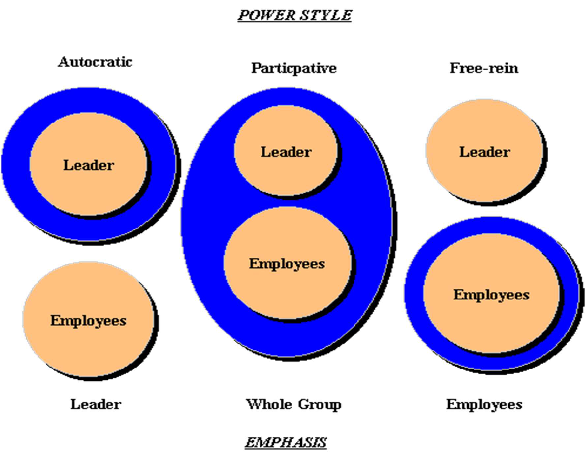

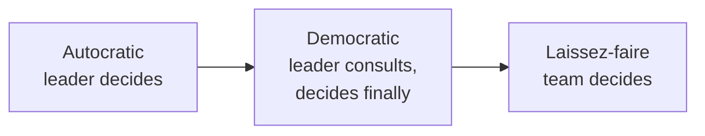
*(continuum of decreasing leader control / increasing team freedom)*

Other styles: transformational, transactional, servant, charismatic, situational.

---

## 3. Shared Leadership ★★★

- **Shared leadership** broadly **distributes leadership responsibility** so that people within a team and organisation **lead each other**.
- Leaders merge with the team and give **freedom to all members to contribute** while leading.
- Compared to **horizontal, distributed and collective** leadership.
- Creates a sense of **ownership**, happiness and **trust** — the **ideal leadership style for a start-up**.

**Defined by:**
- A **systematic approach** of finding and developing organisational leaders;
- These leaders take charge of important **areas, products and services**;
- They lead and develop **cross-functional teams**;
- Each team focuses on a smaller part of the organisation's portfolio.

**Example — Google (1998):** co-founders **Sergey Brin and Larry Page** shared common interests and ideology ("**Don't be evil**" — e.g., arms and hard-liquor ads don't appear on Google). **Page headed products**, **Brin took care of technology**; today many teams work on Google's numerous products.

### 3.1 Importance of shared leadership
- Promotes **innovative and committed** behaviour among members.
- Positively transforms **vertical (hierarchical)** companies, reintegrating teams.
- Creates bonds of **interdependence**, favouring **teamwork**.
- Lead roles assigned by **experience and expertise**.
- Main objective: take the **entire team to a common goal**.
- **Driving principles: Ownership · Trust · Alignment to the big picture.**
- Freedom to **speak out** increases **satisfaction** and **company identification**.
- Positive behaviour and proactivity **motivate** everyone; successes lead to recognition of participative work.
- **Benefits to companies and partnerships:** team-based work is increasingly common; leader partnerships change workplace composition; since employees mostly seek **space and recognition**, shared leadership motivates staff and raises team and company results.

| Traditional (vertical) leadership | Shared leadership |
|---|---|
| One leader at the top | Leadership distributed across members |
| Top-down decisions | Collective, expertise-based decisions |
| Followers execute | Members own outcomes |
| Slower innovation | Higher innovation & commitment |

---

## 4. Team Building ★★★

- **Team building** = taking a collection of individuals with **different needs, backgrounds and expertise** and transforming them, by various methods, into an **integrated, effective work unit**.
- Critically important as **bureaucratic hierarchies decline** and **horizontally oriented teams** become important; involves relationships among **peers** with diverse expertise.

**Stages of team development (Tuckman):** Forming → Storming → Norming → Performing → Adjourning.

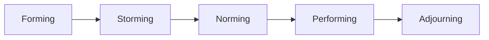

### 4.1 Major barriers to team development ★★★
| Barrier | Explanation |
|---|---|
| **Differing outlooks, priorities, interests and judgments** | Members pursue different goals |
| **Role conflicts** | Unclear/overlapping responsibilities |
| **Project outcomes not clear** | Vague objectives demotivate |
| **Competition over team leadership** | Power struggles |
| **Lack of team definition and structure** | No clear organisation or processes |
| **Team personnel selection** | Wrong people / skill gaps |
| **Credibility of the project leader** | Leader lacks trust or competence |
| **Lack of team member commitment** | Low motivation, divided loyalty |

---

## 5. Role of a Good Team in a Venture ★★★

- A **great top team** extends the **values, vision, mission and plan** throughout the company, **aligns** it and **accelerates growth**; a **dysfunctional team** can tear a company apart.
- The team should handle **three roles: functional, executive and leadership** — combining operations management, serving on the executive team and fulfilling leadership responsibilities.

### 5.1 Evolution of the top team
- An effective top team **runs the company day to day** so the founder can move out of operations and focus on **strategy**.
- Helps create a **new, better "big-picture" vision** as the company grows, bringing **new perspectives and specialised knowledge**.
- Encourage and support members as they grow into **expanded roles**.
- The team **implements the plan, measures and evaluates results**, and helps each other succeed — hold them **accountable** in all three areas; define **explicit expectations**; be clear which roles you **retain** and which you **delegate**; provide **direction**.

### 5.2 Roles and responsibilities of each top-team member
| As … | Responsibilities |
|---|---|
| **Leader of their functional area** | Manage their area and allocated **resources**; **attract and retain** great people; **communicate** so everyone understands the vision, mission, values and plan, how their job relates, and expected results |
| **Member of the executive team** | Manage **implementation** of the company plan; be a **role model** for innovation, teamwork and problem-solving; help other members succeed |
| **Member of the leadership team** | Help **develop the growth plan**; protect and build a **culture** supporting growth; **optimise resources** to achieve company goals |

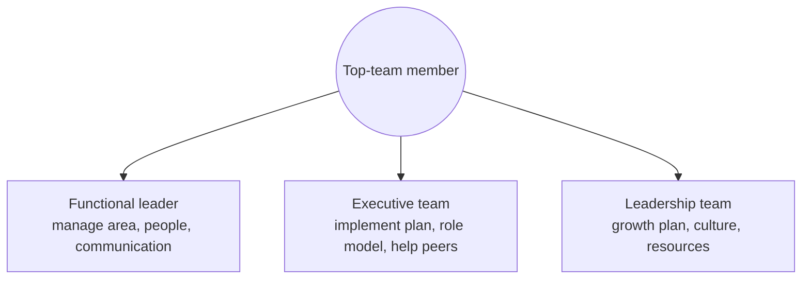

---

## 6. Collaboration Tools and Techniques ★★

**Collaboration** = two or more people/organisations working together towards **common goals** by sharing knowledge, learning and building **consensus**.

| Tool | Purpose |
|---|---|
| **a) Brainstorming** | Generate many ideas quickly |
| **b) Mind mapping** | Organise ideas visually around a central theme |
| **c) Six thinking hats** | Look at a problem from six perspectives |
| **d) Nominal group technique** | Structured idea generation and voting |
| **e) Fish-bone diagram** | Identify root causes of a problem |

---

## 7. Brainstorming ★★★

- **Brainstorming** = generating ideas and putting them in concrete form (on paper) — forcing the brain to produce **new solutions** to problems or product ideas.
- Traditionally a **group** activity (can be individual); members **spontaneously** contribute ideas to solve a specific problem; also weaves connected ideas into a **whole collaborative idea**.
- Popularised by **Alex F. Osborn** (advertising executive); usable at **all stages** of problem-solving; an entirely **divergent thinking** process.

### 7.1 Method — group brainstorming
1. **Set the problem** — precisely defined, not too big, fits into **one question**.
2. **Plan the session** — send **memos** to invitees describing the problem and sample ideas so they think beforehand; include session details.
3. **Select ~10 participants** — core contributors, guests familiar with the subject, and an **idea collector (recorder)**; run the session.
4. Prepare **lead questions** to revive creativity when it dips — "*Can we combine these ideas?*", "*How about looking at these from a different perspective?*"
5. **Evaluate** and select the best ideas afterwards (convergent phase).

### 7.2 Osborn's four rules (1957) ★★★
| Rule | Meaning |
|---|---|
| **1. Criticism is ruled out** | No negative comments — allow free exploration (defer judgment) |
| **2. Freewheeling is welcomed** | "Crazy" or exaggerated ideas aren't censored — easier to tame an idea than to make it unique |
| **3. Quantity is encouraged** | More ideas → higher likelihood of useful ones |
| **4. Combining and improving ideas** | Build on others' ideas to form newer, better ones ("piggy-backing") |

### 7.3 Advantages
- **Many ideas in a short time**.
- Participants contribute individually and **benefit from others' ideas**.
- Encourages **unusual** ideas and **deeper thinking**.
- Enhances **group activity and teamwork**.

---

## 8. Mind Mapping ★★★

- Note **every idea**, however far-fetched — the more ideas, the bigger the chance of a "golden ticket" idea.
- A mind map captures thoughts, ideas and keywords in a **two-dimensional, radiant structure**: the **main idea in the centre**, related ideas **branching** in all directions (sub-branches for details). Popularised by **Tony Buzan**.

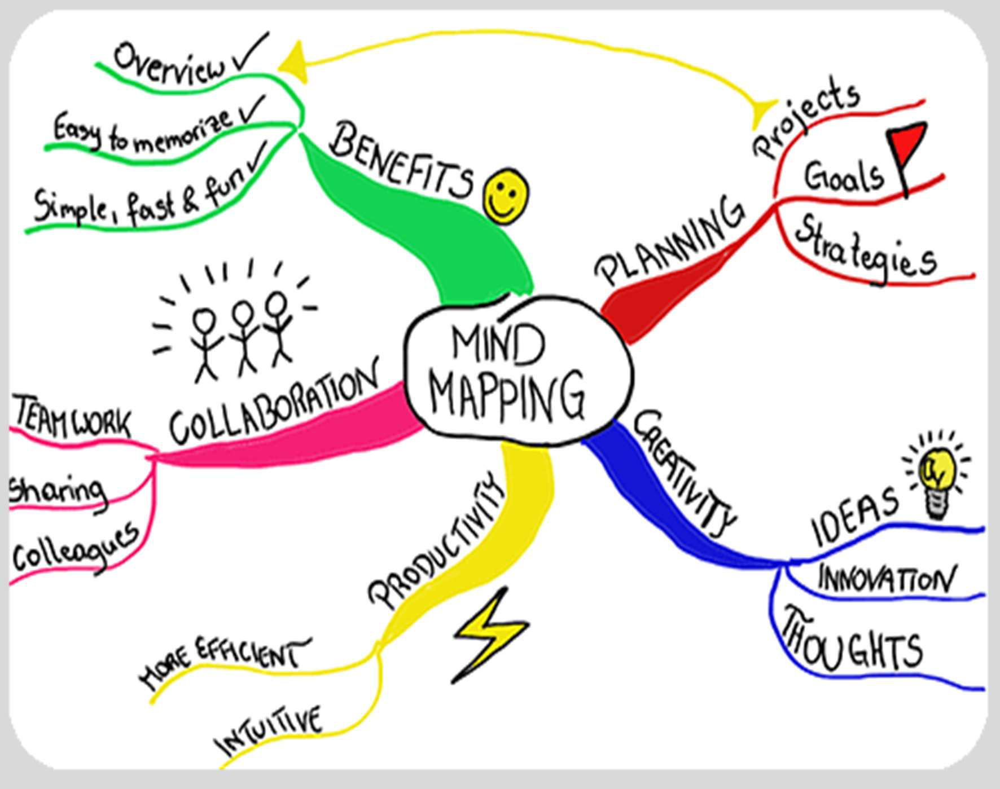

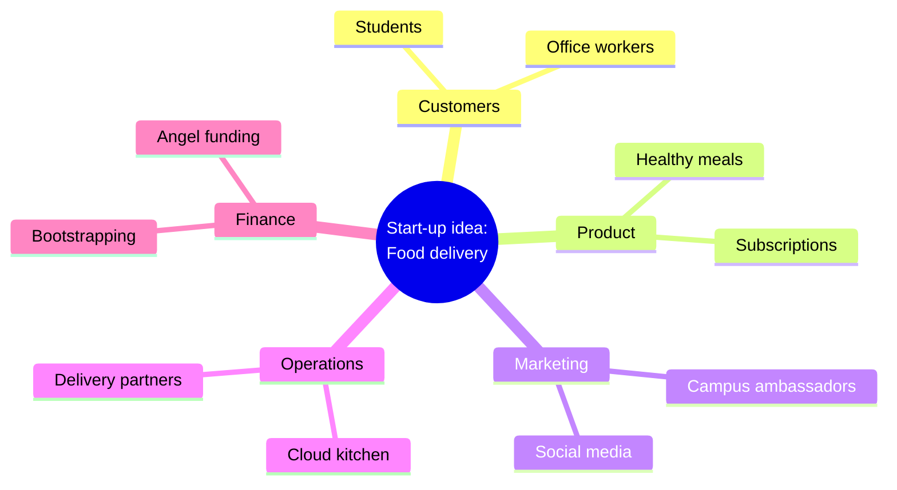

**Advantages:** improves **productivity** · **structures** information · finds **relationships** between variables · fosters **creativity** · improves **memory and recall**.

---

## 9. 📘 Six Thinking Hats, Nominal Group Technique & Fish-bone Diagram ★★

### 9.1 Six Thinking Hats (Edward de Bono)
A **parallel/lateral thinking** technique — the group looks at a problem wearing one "hat" at a time.
| Hat | Focus |
|---|---|
| ⚪ **White** | Facts, data, information |
| 🔴 **Red** | Feelings, emotions, intuition |
| ⚫ **Black** | Caution, risks, critical judgment |
| 🟡 **Yellow** | Optimism, benefits, value |
| 🟢 **Green** | Creativity, alternatives, new ideas |
| 🔵 **Blue** | Process control, organising the thinking (the facilitator) |

### 9.2 Nominal Group Technique (NGT)
A **structured** method that ensures equal participation:
1. **Silent generation** of ideas individually in writing.
2. **Round-robin** sharing — each member presents one idea at a time; recorded without discussion.
3. **Clarification/discussion** of each idea.
4. **Voting/ranking** privately; ideas with the highest scores are selected.
→ Avoids domination by vocal members; good for prioritisation.

### 9.3 Fish-bone (Ishikawa / cause-and-effect) diagram
Identifies **root causes** of a problem (the "head"); causes grouped on "bones" — commonly the **6 Ms: Man, Machine, Method, Material, Measurement, Mother Nature (environment)**.

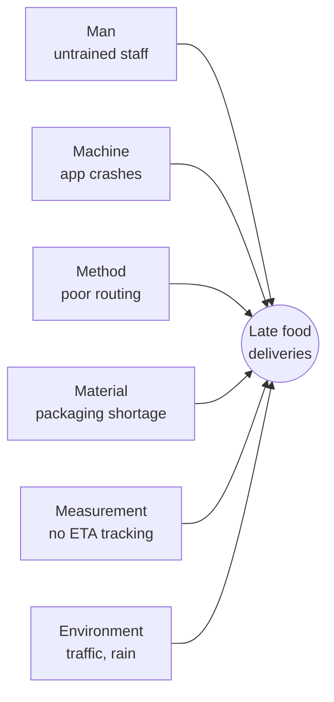

---

## 10. Project & Importance of Project Management ★★★

**Project — definitions:**
- "A **series of activities, tasks or operations** directed to the accomplishment of a **desired objective**."
- "A **temporary endeavour** undertaken to create a **unique** product or service." (PMI)
Characteristics: **temporary** (definite start/end), **unique** output, specific objective, limited resources, progressive elaboration, uncertainty.

**Importance for start-ups:**
- Starting an organisation involves many loose ends and **millions of small tasks** at once.
- **Lack of experience** makes many entrepreneurs **scale up too quickly** — a prime reason **over 70 % of new ventures** fail to perform.
- **Project management** = a detailed methodology for the **systematic initiation, tracking and closing** of a project — a holistic solution improving the chance of commercial success.
- It is a significant factor for business success — helps achieve goals with **greater clarity**; brings **agility and flexibility**; gives a **roadmap and detailed timeline** to team members.

**Triple constraint:** **scope, time, cost** (→ quality).

---

## 11. Principles of Project Management ★★★

| # | Principle | Practice |
|---|---|---|
| **a** | **Develop a long-term vision** | Specific goals with **timelines**; **communication** is the golden key; convey long-term goals and corporate strategy so the team isn't in the dark |
| **b** | **Plan by breaking down milestones** | Step-by-step plan breaking goals into **smaller tasks and milestones** (Work Breakdown Structure); assign deadlines to each phase; stay flexible to changes; helps members track progress |
| **c** | **Manage structured execution** | Tools: **time-tracking software, Gantt charts, file-sharing apps, budget-management systems**; optimise **physical, intellectual and financial resources**; **fair and transparent** allocation to avoid conflicts |
| **d** | **Constantly monitor progress** | Check milestones at intervals vs the plan; track **KPIs** to spot under-performers and red flags; give positive and negative **feedback** |
| **e** | **Close the project by creating future resources** | Know when to wrap up; complete payments to vendors/suppliers; thank clients; capture **lessons learned**; **archive** vital documents; reflect on mistakes |

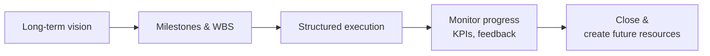

---

## 12. Project Evaluation Techniques — Gantt Charts ★★★

Techniques: **(a) Gantt charts; (b) network analysis — PERT, CPM.**

- A **Gantt chart** is a **bar chart** illustrating a **project schedule**, named after **Henry Gantt (1861–1919)**, designed around **1910–1915**.
- **Tasks on the vertical axis**, **time intervals on the horizontal axis**; the **length of each bar = duration** of the activity.
- Shows **start and finish dates** of terminal and summary elements (which form the **work breakdown structure**).
- Modern Gantt charts show **dependencies** (precedence network) and current status using **percent-complete shading** and a vertical **"TODAY" line**.

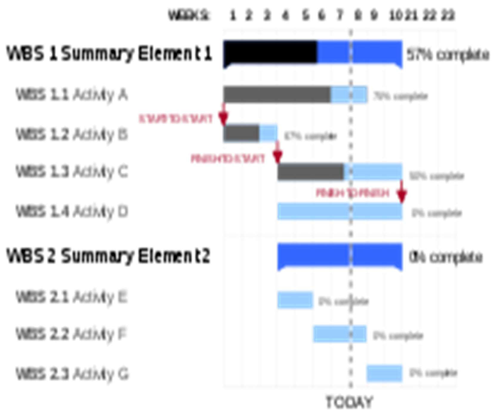

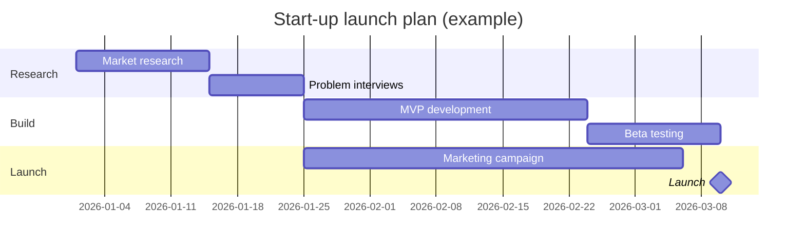

**Advantages:** easy to understand · **clarity of dates** · enables **time management** · brings **efficiency** · ensures **accountability** to the timeline · expects **coordination** among stakeholders.
**Limitations:** dependencies not obvious in simple charts; becomes cluttered for large projects; doesn't show uncertainty.

---

## 13. Network Analysis — PERT & CPM ★★★

- **Network analysis** plans projects by analysing activities: the project is broken into **individual tasks** arranged in **logical sequence**, and a **network diagram** shows the relationships between all activities.
- "Network analysis helps in designing, planning, coordinating and decision-making to accomplish the project **economically in minimum time with limited resources**."
- Two most-used forms: **PERT (Programme Evaluation and Review Technique)** and **CPM (Critical Path Method)**.

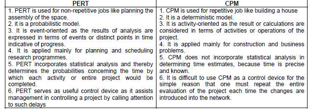

| PERT | CPM |
|---|---|
| **Probabilistic** — activity times uncertain | **Deterministic** — activity times known |
| **Event-oriented** | **Activity-oriented** |
| Three time estimates: optimistic (a), most likely (m), pessimistic (b) | One time estimate |
| Used for **R&D**, new, non-repetitive projects | Used for **construction**, repetitive projects |
| Focus on **time** | Focus on **time–cost trade-off** (crashing) |
| Developed by US Navy (Polaris, 1958) | Developed by DuPont & Remington Rand (1957) |

### 13.1 PERT expected time
$$t_e = \frac{a + 4m + b}{6}, \qquad \sigma^2 = \left(\frac{b - a}{6}\right)^2$$
*Example:* a = 2, m = 4, b = 12 days → t_e = (2 + 16 + 12)/6 = **5 days**; σ = 10/6 ≈ 1.67 days.

### 13.2 CPM — critical path example
| Activity | Predecessor | Duration (days) |
|---|---|---|
| A — Market research | — | 3 |
| B — Product design | A | 4 |
| C — Arrange funding | A | 2 |
| D — Build MVP | B, C | 5 |

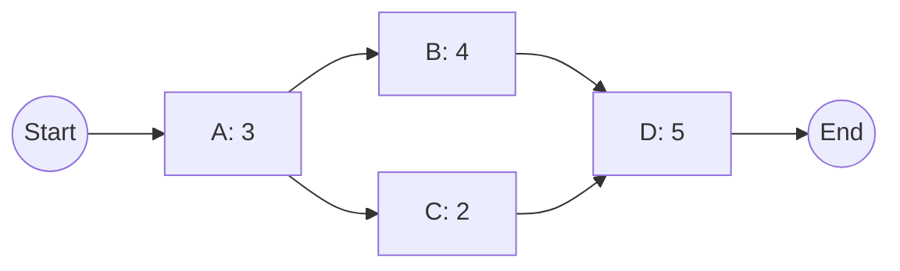
Paths: A–B–D = 3 + 4 + 5 = **12 days**; A–C–D = 3 + 2 + 5 = **10 days**.
→ **Critical path = A–B–D (12 days)** — the longest path; any delay on it delays the project. Activity C has **slack (float) = 2 days**.

---

## 14. Project Life Cycle ★★★

A **project life cycle** = the sequence of **phases** a project goes through from **initiation to closure**.

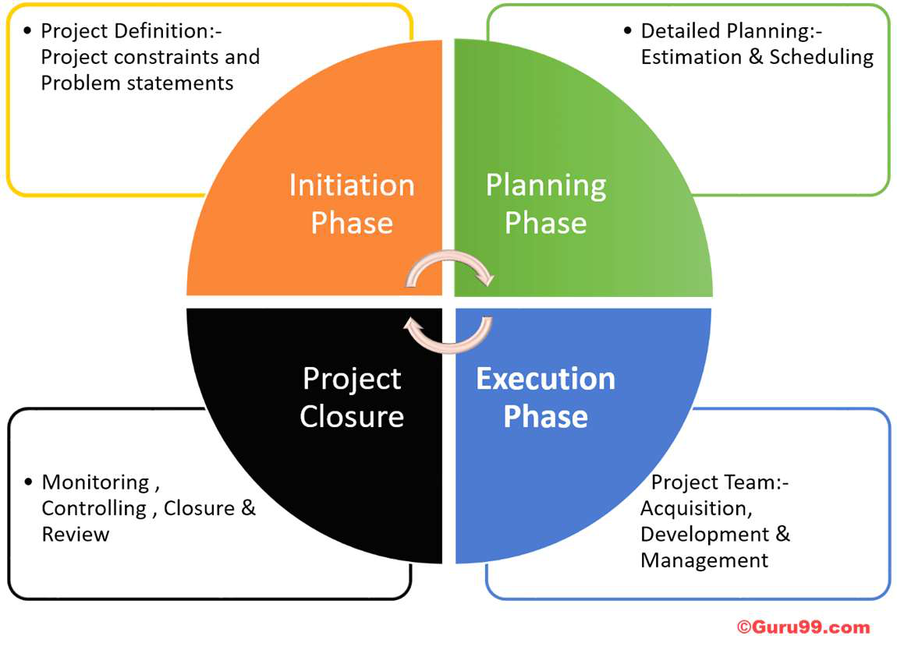

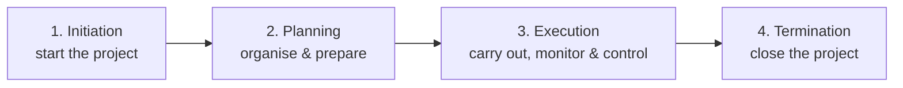

| Phase | Activities |
|---|---|
| **1. Initiation** | Define and **authorise** the project; the project manager creates a **Project Charter** documenting: purpose, vision & mission; **measurable objectives and success criteria**; project description, conditions and **risks**; name and authority of the **sponsor**; concerned **stakeholders** |
| **2. Planning** | Detailed strategy for performing the project — **strategic planning** (overall approach) and **implementation planning** (how to apply decisions): scope, WBS, schedule, budget, resources, risk & communication plans |
| **3. Execution** | Implement planned activities; the PM **supervises** and prevents errors — **monitoring and controlling**; after customer/sponsor/stakeholder satisfaction, move to closure |
| **4. Termination (closure)** | **Official closure** — hand over deliverables, release resources, settle contracts, document lessons learned |

### 14.1 Characteristics of the project life cycle
- **Cost and staffing** are **low at the start**, **peak** during execution, and **drop rapidly** as the project closes (not universal — some projects need heavy early spending to secure resources).
- **Risk and uncertainty** are **highest at the beginning** and fall as decisions are made and deliverables accepted.
- The **ability to influence** the final product without large cost is **highest at the start**; the **cost of changes and error correction rises** as the project nears completion.

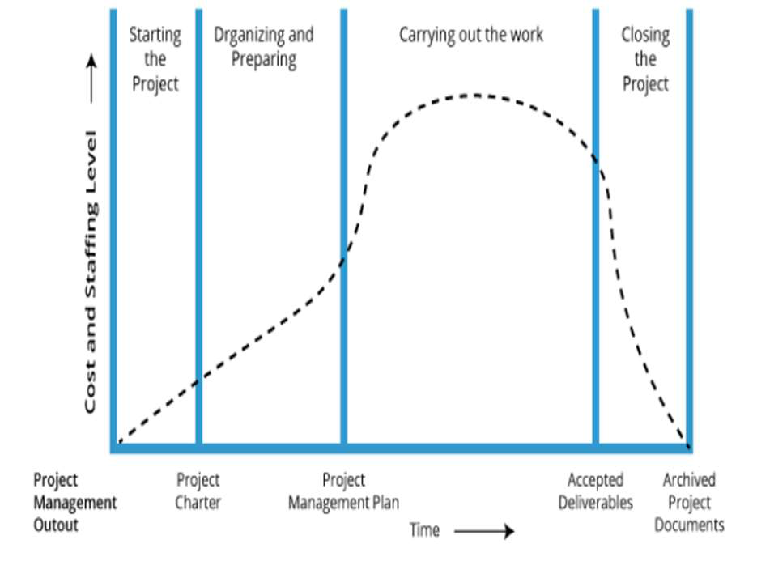

---

## Unit V — One-Page Summary

| Topic | Key points |
|---|---|
| **Leadership style** | Characteristic behaviours in directing, motivating, managing (Newstrom & Davis 1993); Kurt Lewin (1939). |
| **Lewin's styles** | Autocratic (leader tells), Democratic (consults, keeps final say), Laissez-faire (team decides, leader responsible). |
| **Shared leadership** | Distributed leadership, members lead each other; ideal for start-ups; ownership, trust, alignment; Google — Page (products) & Brin (technology). |
| **Team building** | Diverse individuals → integrated effective unit; Tuckman stages. Barriers: differing outlooks, role conflict, unclear outcomes, leadership competition, no structure, poor selection, leader credibility, low commitment. |
| **Good top team** | Extends vision/values, aligns, accelerates growth; three roles — functional, executive, leadership; evolves to free founder for strategy; accountability, explicit expectations, delegation. |
| **Collaboration tools** | Brainstorming, mind mapping, six thinking hats, nominal group technique, fish-bone diagram. |
| **Brainstorming** | Osborn; divergent; method: define problem, memos, ~10 participants, lead questions. **Rules:** no criticism, freewheeling, quantity, combine & improve. |
| **Mind mapping** | Central idea, radiant branches; productivity, structure, relationships, creativity, memory. |
| **📘 Other tools** | Six hats (white facts, red feelings, black caution, yellow benefits, green creativity, blue process); NGT (silent ideas → round robin → clarify → vote); fish-bone (6 Ms root causes). |
| **Project & PM** | Temporary endeavour for a unique output; >70 % of ventures fail partly from scaling too fast; PM = systematic initiation, tracking, closing; clarity, agility, roadmap. |
| **PM principles** | Long-term vision, milestones (WBS), structured execution (tools, fair resources), monitor KPIs, close & create future resources. |
| **Gantt chart** | Henry Gantt (1910–15); tasks vs time bars; dependencies, % complete, TODAY line; clear dates, accountability. |
| **PERT/CPM** | Network diagrams; PERT probabilistic, tₑ = (a + 4m + b)/6; CPM deterministic, critical path = longest path (A–B–D = 12 days), slack. |
| **Life cycle** | Initiation (project charter) → Planning (strategic + implementation) → Execution (monitor & control) → Termination. Cost/staff peak mid-way; risk & ability to change highest at start; cost of change rises later. |
