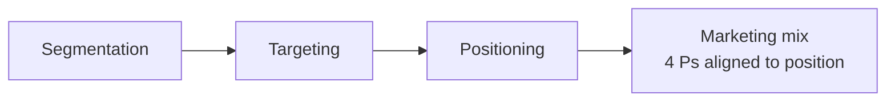
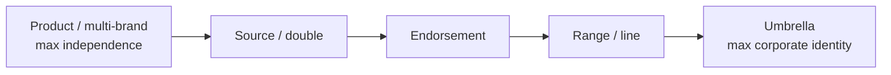
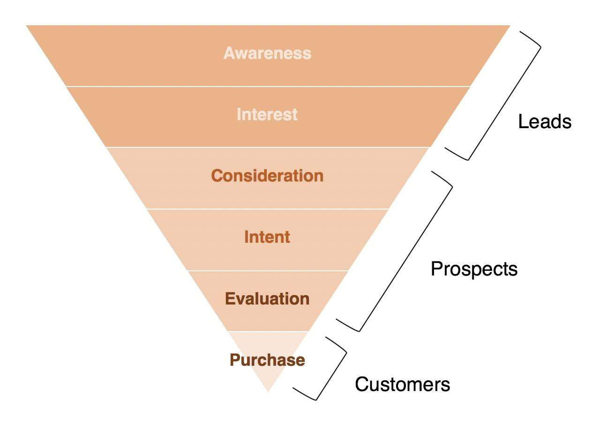
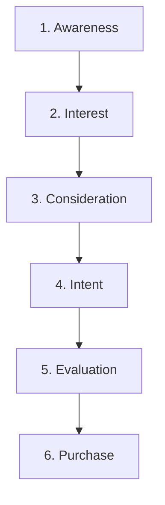
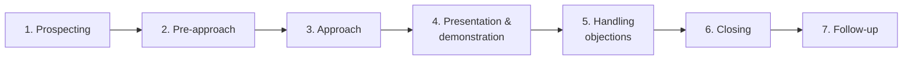
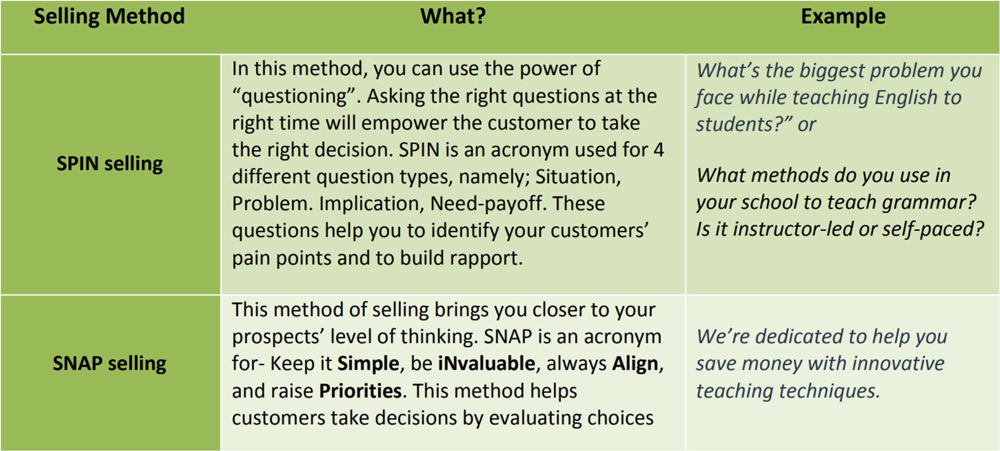
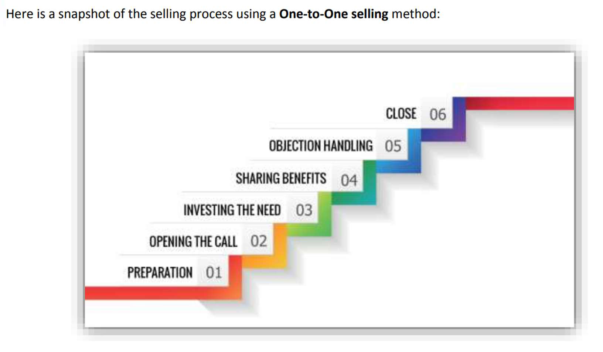
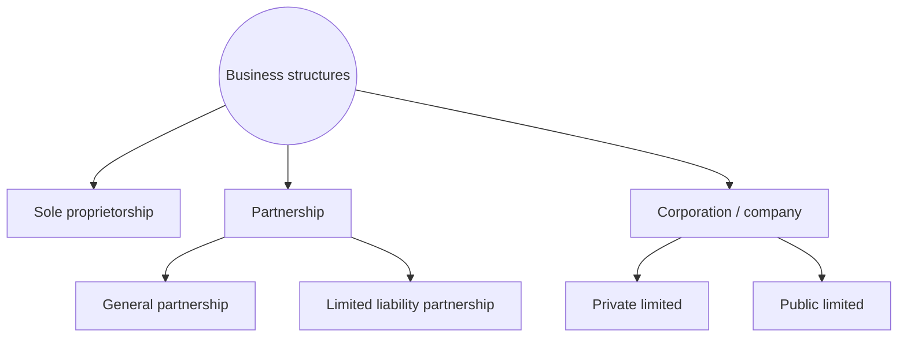
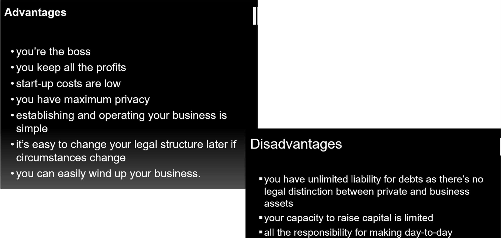

# Unit VI — Marketing (Positioning, Branding, Channels, Sales) & Business Regulations

> **Topics:** Positioning and positioning strategies, branding, brand association & brand equity, branding strategies, channels (communication & delivery), selecting and measuring channels, marketing KPIs, customer acquisition process, selling process, selling skills and methods, sales plans, business regulations, required registrations, compliance checklist, business structures (sole proprietorship, partnership, corporation).
>
> **Source:** *BOE U6.pdf*, *Comparison of Business Structures.pdf* / *📊 Comprehensive Comparison of Business Structures.docx*

**Importance legend:** ★★★ = very frequently asked (long answer) · ★★ = medium · ★ = short answer

---

## Table of Contents
1. [Positioning](#1-positioning-)
2. [Positioning Strategies](#2-positioning-strategies-)
3. [Branding, Brand Association & Brand Equity](#3-branding-)
4. [Branding Strategies](#4-branding-strategies-)
5. [Channels — Communication & Delivery](#5-channels-)
6. [Selecting Channels & Examples](#6-selecting-and-measuring-channels-)
7. [Measuring Channel Effectiveness — KPIs](#7-measuring-the-effectiveness-of-marketing-channels-)
8. [Customer Acquisition](#8-customer-acquisition-)
9. [The Selling Process](#9-the-selling-process-)
10. [Selling Skills & Methods of Selling](#10-selling-skills--methods-of-selling-)
11. [Sales Plans](#11-sales-plans-)
12. [Business Regulations](#12-business-regulations-)
13. [Required Registrations & Compliance Checklist](#13-required-registrations-for-a-start-up-)
14. [Business Structures](#14-business-structures-)
15. [Unit VI — One-Page Summary](#unit-vi--one-page-summary)

---

## 1. Positioning ★★★

- **Positioning** = designing the company's **offering and image** to occupy a **distinctive place in the target market's mind** (Kotler).
- Firms can position **brands, the company, the CEO or individual products**.
- Popularised by **Al Ries and Jack Trout** in *"Positioning: The Battle for Your Mind"*.
- Positioning is what the **customer believes** based on **experience and evidence**, not just awareness from advertising.
- **Pricing, promotion, distribution channels and advertising** are all geared to maximise the chosen positioning.

**Positioning should be:** **Simple · Creative · Unique.**

### 1.1 Conceptual fundamentals of positioning
| Concept | Positioning delivers… |
|---|---|
| **Functional** | **Solves problems**, provides **benefits** to customers |
| **Symbolic** | **Self-image enhancement**, ego identification, belongingness & social meaningfulness, affective fulfilment |
| **Experiential** | **Sensory** stimulation and **cognitive** stimulation |

**Positioning statements (examples):**
- "iPhone is for the **high end** of the market."
- "To be the **family-friendly, low-cost** restaurant in the fast-food business."
- "For drivers who value auto performance, **BMW** provides luxury vehicles that deliver **joy through German engineering**."
- "**Finest in the sky**" (airline).

---

## 2. Positioning Strategies ★★★

| Strategy | Basis | Example |
|---|---|---|
| **Product/service attribute** | Features — size, colour, ingredients, speed | Computers, financial-planning services |
| **Technology positioning** | Shows the firm is on the **cutting edge** | Oracle (databases), Microsoft (PCs) |
| **Benefit positioning** | Answers "**What will this do for me?**" — generally the **strongest** basis | **Volvo — safety** |
| **User category** | Specific customer segment | "The **Pepsi Generation**", Wheaties "Breakfast of Champions" |
| **Competitor positioning** | Advantages **over competitors** | Software claiming superiority; Times of India vs rivals |
| **Integrator positioning** | Provides **everything** a consumer needs in a category | Martha Stewart's website bringing all units together |
| **Positioning of leader** | **Largest share** of sales/revenue | Coca-Cola, McDonald's |
| **Positioning of follower** | Claims to be **second only to the best** | **Avis — "We're No. 2, We Try Harder"**; Löwenbräu, Beck's |
| **Repositioning** | Creating a **new or modified** position based on market feedback | Cadbury (adult chocolate), **Dabur (pharma → FMCG)**, Yahoo! (online guide → web portal), **Amazon (world's largest bookstore → "Earth's biggest selection")** |
| **De-positioning** | **Changing the identity of competing products** relative to one's own | Bingo vs Lay's; Emami vs Fair & Lovely |

---

## 3. Branding ★★★

- A **brand** = a name given to a product/service such that it takes on an **identity by itself**; a distinguishing **symbol, mark, logo, name, word, sentence** or combination used to distinguish a product from others.
- **Branding** = the process of giving **meaning** to an organisation, product or service by creating and shaping a brand in consumers' minds — helping people **quickly identify and experience** the brand and giving them a **reason to choose it** over the competition by clarifying what the brand **is and is not**.

**Branding tips:**
1. Get a **great logo**.
2. Write down your **brand messaging**.
3. **Integrate** your brand into every aspect of the business.
4. Create a **"voice"** for the company reflecting the brand.
5. Develop a **tagline**.
6. Design **templates** and create **brand standards** for marketing materials.
7. **Be true to your brand** (deliver on its promise).

### 3.1 Brand Association
- Anything **deep-seated in the customer's mind** about the brand — attributes, images, symbols or benefits that come to mind when the brand is mentioned.
- *Examples:* **Hyatt → luxury & comfort**; **BMW → sophistication, fun driving, superior engineering**; owner associations — **Bill Gates ↔ Microsoft**, **Dhirubhai Ambani ↔ Reliance**.

### 3.2 Brand Equity
- A brand's **power** derived from the **goodwill and name recognition** earned over time, translating into **higher sales volume** and **higher profit margins** than competing brands. (Components — Aaker: brand awareness, brand associations, perceived quality, brand loyalty, other proprietary assets.)

---

## 4. Branding Strategies ★★★

| # | Strategy | Description | Example |
|---|---|---|---|
| 1 | **Product branding / multi-brand** | Each product promoted **exclusively** with its own identity and image; differentiation and exclusivity; precise positioning to a distinct target | HUL (Surf, Rin, Wheel), P&G |
| 2 | **Line branding** | One brand across a **product line** of **complementary** products (line extension) | **Philips** — TV, audio/video, personal care, household appliances |
| 3 | **Range / mixed branding** | Brand extended to a **range** of products sharing a **common promise** from the brand's area of competence — tied by a single brand concept | **Nestlé's Maggi** — noodles, sauces, soups, pasta |
| 4 | **Umbrella branding** | **Company name on all products** across categories (favoured by Eastern companies) | **LG**, Philips, GE, Canon, **Tata, Bajaj** |
| 5 | **Source / double branding** | **Company name + product brand name**, both of **equal** importance (hybrid of umbrella and product branding) | **Bajaj Pulsar** |
| 6 | **Endorsement branding** | Modified double branding — **product brand dominant**, corporate name only as an **endorsement** passing on generic associations | "Kit Kat — from Nestlé", "Taj Hotels — a Tata enterprise" |
| 7 | **Private labels / store branding** | Products marketed by **retailers** under their own (store) name | **Stop** by Shoppers Stop, Reliance's own brands |

---

## 5. Channels ★★★

**Channels** = means a company adopts to **communicate** with customers and/or **deliver** products or services.

| Purpose | Activities | Examples |
|---|---|---|
| **a) Communication** | Let customers **discover** the company; give **information**; **engage** and build communities; obtain **feedback** | Facebook, flyers/posters, newspapers |
| **b) Delivery** | Initiate a **trial**; make a **sale**; enable a **return** | Local retailers, e-commerce (BigBasket, Amazon) |

Another objective: attract **early adopters** — people/businesses who adopt new products well before most others.

**Channel phases (Osterwalder):** awareness → evaluation → purchase → delivery → after-sales.

---

## 6. Selecting and Measuring Channels ★★

**Guidelines for selecting channels:**
1. **Leverage free or low-cost channels** wherever possible (social-media posts are free; newspaper ads cost money).
2. Channels right for the **early days may not suit later** — as the start-up grows and addresses a larger market, channels change (an FMCG that used flyers initially wouldn't use them at scale).
3. **Prioritise a few channels** — don't try to be on all.
4. Be **consistent** in messaging/posting on chosen channels.

**Examples of channels:**
| Paid/traditional | Digital | Direct/community |
|---|---|---|
| Mass media (newspapers, magazines) | **Search engine marketing** (Google Ads) | **Sales force** (teams approaching customers) |
| Trade shows | Internet advertisements | **Affiliate marketing** (outsourced agencies) |
| Offline events | **E-mail marketing** | Telecalling |
| Leaflets/flyers/pamphlets | **Blogs** | Retailers, distributors, wholesalers |
| | **Social-media marketing** | **Community building** (Wikipedia, StackOverflow) |

---

## 7. Measuring the Effectiveness of Marketing Channels ★★★

| KPI | Meaning | Example |
|---|---|---|
| **Return on investment (ROI)** | Revenue a campaign brings per rupee spent: (Sales − Cost)/Cost | Spent ₹1,000, generated ₹5,000 → gain ₹4,000 → **ROI = 400 %** |
| **Cost per sale** | Marketing spend ÷ number of sales | ₹1,000 budget, 5 sales → **₹200 per sale** |
| **Cost per lead** | Spend ÷ leads generated | 10 leads (5 sales) on ₹1,000 → **₹100 per lead** |
| **Conversion rate** | % of visitors converted to leads/customers | 10 buyers out of 1,000 visitors → **1 %** |
| **Incremental sales** | Additional sales attributable to a specific marketing effort | Campaign adds ₹5,000 to monthly sales of ₹5,00,000 → **1 %** of total sales |
| **Customer lifetime value (CLV)** | **Average sale per customer × average purchases per year × average retention (years)** | ₹500 × 6 × 3 = **₹9,000** |
| **Social-media analytics** | Visits, products ordered, ratings, feedback from social data | — |

**Also:** **Customer Acquisition Cost (CAC)** = total sales & marketing cost ÷ new customers acquired; healthy businesses aim for **CLV : CAC ≥ 3 : 1**.

---

## 8. Customer Acquisition ★★★

**Customer acquisition** = **gaining new customers** — persuading people who don't know your products or who buy from competitors to purchase your products/services.

*(Awareness + interest → **leads**; consideration, intent, evaluation → **prospects**; purchase → **customers**.)*

| Step | Description |
|---|---|
| **1. Awareness** | Acquire many attractive customers at low cost — **efficient, well-targeted promotional campaigns**; encourage **customer referrals** (free advocacy from satisfied customers) |
| **2. Interest** | Offer a **unique value proposition** not offered by rivals |
| **3. Consideration** | A positive impression makes customers **consider** your product as one of the options |
| **4. Intent** | Create strong intent with **promotional offers** — introductory prices, complimentary gifts |
| **5. Evaluation** | Customers **compare** with rivals on price, quality, efficiency, warranty, then decide |
| **6. Purchase** | Customer **buys** — acquired; should be a **continuous** process to generate profits |

**Essentials of customer acquisition:**
- **Define the target prospects** — who they are, how to reach, talk to and sell to them; who buys similar products from competitors.
- **Define customer acquisition cost (CAC)** — total acquisition (sales + marketing) cost ÷ new customers in a period; aim for a **high ROI-to-CAC ratio**.

---

## 9. The Selling Process ★★★

The steps a salesperson takes to sell successfully:

| Step | Description |
|---|---|
| **1. Prospecting** | **Identify potential buyers** so selling efforts are planned with no/minimal wasted calls |
| **2. Pre-approach** | Gather information on prospects' **needs, personality, behaviour**; plan the most effective approach |
| **3. Approach** | Seek access and **meet the prospect** in person — first impression |
| **4. Presentation & demonstration** | Demonstrate the product and its features addressing the prospect's needs; use the **AIDA model** — gain **Attention**, hold **Interest**, build **Desire**, lead to **Action** (purchase) |
| **5. Handling objections** | Answer questions/objections convincingly and systematically — the **most difficult** stage |
| **6. Closing the sale** | Clinch the deal — get the customer to say **yes** and ask for the order, decently |
| **7. Follow-up** | Ensure the order is properly executed; gather feedback on use, problems, satisfaction; build **goodwill** and **repeat purchases** |

**Why customers don't buy:** failure to understand their buying process · not listening to their needs · ignoring after-sales service · pushing too hard · not answering all questions / exaggerated claims · calling too often or at odd hours · wasting their time without a clear purpose.

---

## 10. Selling Skills & Methods of Selling ★★★

### 10.1 Selling skills
Skills to build relationships, persuade customers and generate repeat business:
**Communication · Active listening · Persuasion · Collaboration · Self-motivation · Problem-solving** — and choosing the **right method of selling**.

### 10.2 Methods of selling
| Method | What it is | Example line |
|---|---|---|
| **SPIN selling** | Power of **questioning** — **Situation, Problem, Implication, Need-payoff** questions identify pain points and build rapport | "What's the biggest problem you face while teaching English?" |
| **SNAP selling** | Keep it **Simple**, be **iNvaluable**, always **Align**, raise **Priorities** — matches the prospect's level of thinking | "We're dedicated to help you save money with innovative teaching techniques." |
| **Sandler selling** | The **buyer outlines** the challenge's impact; focus on 3 pain areas — **technical, business-financial, personal**; customer convinces you rather than you convincing them | "How is this issue making your life more difficult?" |
| **Challenger sale** | Instead of rapport, **challenge** the customer's thinking — introduce problems they didn't know they had, create an **"aha" moment**; tailor each conversation | "We've designed an online game, via a simple app, to make learning grammar fun." |
| **Consultative / solution selling** | Customer at the **centre**; 6 principles — **Research, Ask, Listen, Teach, Qualify, Close**; solve customers' problems rather than push products | "Saving money and time, game-based learning at your fingertips." |
| **Conceptual selling** | Sell the **concept** rather than the product — **getting information, giving information, getting commitment** | "I can empathise with students' problems in learning grammar…" |
| **Personal selling** | Planned, personalised, **face-to-face** communication to influence the purchase decision — oldest technique, still useful | "Would you like to see the latest LCD models that support 4K?" |
| **One-to-one selling** | **Combines the best** of all — SPIN questioning, face-to-face interaction, consultative active listening | Steps: preparation → opening the call → investigating the need → sharing benefits → objection handling → close |

- All methods suit early ventures, but **Challenger and Sandler** are for **seasoned** entrepreneurs at advanced stages.

---

## 11. Sales Plans ★★

- A **sales plan** sets out **sales targets and tactics** and the steps to meet them — defines targets and **activates, motivates and focuses** the sales team.
- **Action plan for sales personnel:**
  - create a **daily task list** and stick to it;
  - establish a plan for the team and hold them **accountable**;
  - identify **prime selling time**;
  - narrow the revenue gap with **cross-selling**;
  - call the **right customers with the right offer**.
- **Successful sales plans** include: **establishing trust**; knowing **customer pains** well; understanding that **customers buy solutions, not products/services**; making products **unique**.

**Typical contents:** objectives & targets, target market, team structure & roles, strategies & tactics, timeline, budget/resources, KPIs and review mechanism.

---

## 12. Business Regulations ★★★

Start-ups must comply with **central (federal), state and local regulations** meant to balance the interests of business with those of the public — **business regulations**:
1. **Formalising the business structure** — sole proprietorship, partnership, LLP, private limited, public limited — and complying with registration/legal requirements.
2. Applying for the right **business licences** — **Shop and Establishment Act** licence (common to all new businesses) plus others: GST (formerly VAT) registration, **food-safety (FSSAI) licence**, **environmental clearance**, etc.
3. Understanding **taxation and accounting laws**; complying with government-scheme rules to avail **tax exemptions** (e.g., Startup India).
4. Maintaining proper **books of accounts** and regular **auditing**.
5. Adhering to **labour laws** — minimum wages, EPF/PF, ESI, holidays, prevention of harassment (POSH).
6. Drafting **non-disclosure agreements (NDAs)** when discussing ideas with investors/outsiders.
7. **Managing contracts** effectively; protecting **intellectual property** (trademarks, patents, copyrights).

---

## 13. Required Registrations for a Start-up ★★★

| Registration | Purpose / details |
|---|---|
| **Shop and Establishment licence** | Each state's **Shop & Establishment Act** governs shops/establishments; obtain the certificate (trade licence) to **avoid penalties** |
| **Import Export Code (IEC)** | Mandatory to **import/export** goods/services; must appear on customs documents; banks need it for foreign payments; requires **PAN** and a **current account** |
| **Sector-specific licences** | **NBFC registration** for fin-tech/non-banking finance; **broadcasting licences** for multimedia platforms; FSSAI for food |
| **Udyog Aadhaar (now Udyam) registration** | Government initiative supporting small businesses; **replaced SSI/MSME registration**; enables **subsidies and schemes** for MSMEs |
| **Pollution board NOC** | **No-objection certificate** from pollution-control boards after inspection before commencing operations |
| **GST registration** | Required for manufacturers, sellers, service providers, exporters when: **aggregate turnover > ₹20 lakh** (₹10 lakh in special-category states) *[₹40 lakh for goods in many states now]*; **inter-state** supply; **online/e-commerce** sales; earlier tax registration. Must be obtained **within 30 days** of incorporation/liability, or face heavy penalties |
| *Others* | PAN & TAN, company/LLP incorporation (MCA), **Startup India (DPIIT) recognition**, trademark registration, EPF & ESI registration |

*(The slide says GST is required "if the business supplies goods intra-state"; the GST Act actually makes registration compulsory for **inter-state** taxable supplies.)*

### 13.1 Compliance checklist for start-ups
Used to verify all legal requirements are met, e.g.:
1. **Income-tax filing**
2. **GST return filing**
3. **Renewal of licences**
4. **Business equipment compliance** (safety, standards)
5. **Internal company compliance** (board meetings, ROC filings, statutory registers, audits)

---

## 14. Business Structures ★★★

### 14.1 Sole proprietorship
- A business **owned and usually managed by one person** — the simplest form; **not a separate legal entity** (no legal distinction between owner and business).
- *Examples:* art studio, IT consultancy, local grocery store, freelance designer.

| Advantages | Disadvantages |
|---|---|
| **You're the boss** — complete control | **Unlimited liability** — personal assets at risk |
| **Keep all the profits** | **Limited capacity to raise capital** |
| **Low start-up costs**, simple to establish and operate | All responsibility for day-to-day decisions; limited skills |
| **Maximum privacy**; minimal regulation | **No continuity** if the owner is incapacitated |
| Easy to **change structure** later or **wind up** | Hard to get bank loans |

### 14.2 Partnership
- A legal form with **two or more owners** who **share profits and liabilities**; various arrangements — equal or unequal sharing; not all partners need manage; some may have **limited liability** (LLP/limited partners). Governed by a **partnership deed** (Indian Partnership Act, 1932).
- *Examples:* law firms, medical practices, accounting partnerships, early co-founded agencies.

| Advantages | Disadvantages |
|---|---|
| **Two (or more) heads** better than one | **Unlimited liability** for business debts |
| **Easy to establish**, low start-up cost | **Jointly and severally liable** — each partner liable for all partnership debts |
| **More capital** and **greater borrowing capacity** | **Disagreements and friction** among partners |
| High-calibre employees can become partners | Each partner is an **agent** — liable for others' actions |
| **Income splitting** → tax savings | Partners joining/leaving → costly **valuation** of assets |
| Business affairs **private**; limited external regulation | Hard to transfer ownership without dissolving |
| Easy to change legal structure later | |

### 14.3 Corporation (company)
- A **legal entity** separate from its owners, with authority to act and **its own liability** — a "**legal person**": can enter **contracts**, **lend and borrow**, **hire employees**, **own assets** and **pay taxes**.
- **Owned by shareholders** (ownership represented by **shares of stock**); a **board of directors**, elected by shareholders, oversees management.
- *Examples:* Apple Inc., Reliance Industries, Zomato, Swiggy.

| Advantages | Disadvantages |
|---|---|
| **Limited liability** — shareholders liable only up to their investment | **Double taxation** — corporate tax on profits + personal tax on dividends |
| **Source of capital** — sell shares, issue bonds | **Excessive tax filings** and paperwork |
| **Easy ownership transfer** (harder for private companies) | **Independent management** — with dispersed owners, management may operate without real oversight |
| **Perpetual life** — continues across generations of investors | High setup, compliance and audit costs; heavy regulation |

### 14.4 Comprehensive comparison ★★★
| Feature | 👤 Sole proprietorship | 🤝 Partnership | 🏢 Corporation (Pvt./Public Ltd.) |
|---|---|---|---|
| **Definition** | Owned & operated by **one individual**; no legal distinction from owner | **Two or more** individuals manage and **share profits/liabilities** | **Separate legal entity** owned by shareholders, managed by a board |
| **Examples** | Local grocery stores, freelance designers, independent consultants | Local law firms/medical practices, accounting partnerships, early co-founded tech agencies | Apple Inc., Reliance Industries, Zomato, Swiggy |
| **Liability** | **Unlimited personal** (home, car can be seized) | **Unlimited & joint** (each partner responsible for others' debts) | **Limited** (only invested money at risk) |
| **Taxation** | **Pass-through** — owner's personal return | **Pass-through** — partners' individual returns | **Double taxation** — corporate tax + dividend tax |
| **Key advantages** | Minimal regulation; easiest & cheapest; complete control; 100 % profits | Combined capital; shared workload & diverse skills; easy, low-cost via partnership deed; flexible profit-sharing | Strongest personal-asset protection; **perpetual existence**; easiest to raise VC / sell shares; market credibility |
| **Key disadvantages** | Hard to raise funds/loans; limited skills; no continuity | Founder disputes; one partner's bad choice binds all; hard to transfer ownership | High setup & compliance/audit costs; heavy regulation; complex administration |
| **Continuity** | Ends with owner | Dissolves on partner change (unless deed provides) | Perpetual |
| **Best for** | Freelancers, small local shops | Professional firms, small co-founded ventures | Scalable start-ups seeking investment |

---

## Unit VI — One-Page Summary

| Topic | Key points |
|---|---|
| **Positioning** | Distinctive place in the target's mind (Ries & Trout); simple, creative, unique; functional, symbolic, experiential concepts; BMW, iPhone statements. |
| **Positioning strategies** | Attribute, technology (Oracle), benefit (Volvo safety), user category (Pepsi Generation), competitor, integrator, leader (Coca-Cola), follower (Avis No. 2), repositioning (Dabur, Amazon, Yahoo!), de-positioning. |
| **Branding** | Brand = distinguishing name/symbol/logo; branding shapes meaning in minds; tips: logo, messaging, integration, voice, tagline, standards, be true. Brand association (Hyatt luxury, BMW engineering); brand equity = goodwill → higher sales & margins. |
| **Branding strategies** | Product/multi-brand, line (Philips), range (Maggi), umbrella (LG, Tata), source/double (Bajaj Pulsar), endorsement, private label (Stop by Shoppers Stop). |
| **Channels** | Communication (discover, inform, engage, feedback) & delivery (trial, sale, return); attract early adopters. Select: free/low-cost, change as you grow, prioritise few, be consistent. |
| **KPIs** | ROI (₹1,000 → ₹5,000 = 400 %), cost per sale (₹200), cost per lead (₹100), conversion rate (1 %), incremental sales, **CLV = avg sale × purchases/yr × retention years**, social analytics, CAC. |
| **Customer acquisition** | Awareness → interest → consideration → intent → evaluation → purchase; referrals, unique value, promotions; define prospects and CAC. |
| **Selling process** | Prospecting → pre-approach → approach → presentation (AIDA) → objections → closing → follow-up. |
| **Selling methods** | SPIN, SNAP, Sandler, Challenger, consultative (Research, Ask, Listen, Teach, Qualify, Close), conceptual, personal, one-to-one. Skills: communication, listening, persuasion, collaboration, self-motivation, problem-solving. |
| **Sales plans** | Targets & tactics; daily task lists, accountability, prime time, cross-selling, right offers; trust, pains, solutions, uniqueness. |
| **Regulations** | Business structure, licences (Shop & Establishment, FSSAI, environment), tax & accounting, audits, labour laws, NDAs, contracts. |
| **Registrations** | Shop & Establishment, IEC (PAN + current account), NBFC/broadcasting, Udyog Aadhaar/Udyam, pollution NOC, GST (> ₹20 lakh, inter-state, online; within 30 days). Compliance: IT & GST returns, licence renewal, equipment, internal compliance. |
| **Structures** | Sole proprietorship (unlimited liability, full control), partnership (shared capital, joint & several liability), corporation (separate legal person, limited liability, perpetual, double taxation). |
