# Unit I — Introduction to Computer Networks & the Physical Layer

> **Syllabus:** Uses of computer networks, Types of networks (LAN, MAN, WAN), Network topologies, Reference models (OSI, TCP/IP). Physical layer — transmission media: magnetic media, twisted pair, coaxial cable, fiber optics, wireless transmission.
>
> **Source:** *CN Unit-I Self.pptx* (G. Seshu Kumari, SNIST) + `OSI laayers.png`

**Importance legend:** ★★★ = very frequently asked (long answer) · ★★ = medium · ★ = short answer / definition

---

## Table of Contents
1. [What is a Computer Network?](#1-what-is-a-computer-network-)
2. [Uses, Applications, Advantages & Disadvantages](#2-uses-applications-advantages--disadvantages-)
3. [Components of a Network](#3-components-of-a-network-)
4. [Types of Networks — LAN, MAN, WAN](#4-types-of-networks--lan-man-wan-)
5. [Network Topologies](#5-network-topologies-)
6. [Layered Architecture & Key Terms](#6-layered-architecture--key-terms-)
7. [OSI Reference Model](#7-osi-reference-model-)
8. [TCP/IP Model](#8-tcpip-model-)
9. [OSI vs TCP/IP](#9-osi-vs-tcpip-)
10. [Physical Layer & Transmission Media](#10-physical-layer--transmission-media-)
11. [Guided Media](#11-guided-wired-media-)
12. [Unguided (Wireless) Media](#12-unguided-wireless-media-)
13. [Unit I — One-Page Summary](#unit-i--one-page-summary)

---

## 1. What is a Computer Network? ★

A **computer network** is a set of **nodes (devices)** connected by **communication links**.

- **Node** – any device capable of sending/receiving data: computer, server, printer, security camera, switch, bridge, router, etc.
- **Communication link** – the path that carries information. It can be
  - **Wired** – one computer transfers data to another through *cables*.
  - **Wireless** – devices (e.g., two smartphones) exchange information through *air (signals)*.

Devices inside the "Internet cloud" fall into two groups:

| Device type | Role | Examples |
|---|---|---|
| **End device** | Starting point or end point of communication | Computer, printer, tablet, smartphone, server |
| **Intermediary device** | Helps transfer data between two end devices | Switch, router, modem, cell tower, wireless router |

---

## 2. Uses, Applications, Advantages & Disadvantages ★★

> *Uses* = the purposes/benefits of networking. *Applications* = the services/activities performed over a network.

### 2.1 Uses of Computer Networks
| Use | Description |
|---|---|
| Resource sharing | Share printers, storage devices and software among users |
| Communication | E-mail, chat, video calls |
| Data sharing | Easy access to and exchange of information |
| Remote access | Access systems and data from different locations |
| Collaboration | Teams work together on shared projects/documents |
| Cost reduction | Lower hardware, software and communication costs |
| Centralized management | Data, applications and security managed centrally |
| Improved reliability | Backups and alternate communication paths |
| Scalability | Easy expansion as the organisation grows |
| Information access | Quick worldwide access to information and services |

### 2.2 Applications
E-mail · Web browsing · File transfer (FTP) · Video conferencing / online classes · Online banking · E-commerce · Cloud computing · Social networking · Online gaming · E-learning.

### 2.3 Advantages vs Disadvantages

| Advantages | Disadvantages |
|---|---|
| Resource & data sharing | Security risks (hacking, malware, unauthorised access) |
| Fast communication | Virus/malware spreads quickly across devices |
| Cost savings | High setup cost |
| Centralized data management | Recurring maintenance cost |
| Remote access | Network failure disrupts services |
| Improved collaboration | Dependency on the network |
| Reliability (backup paths) | Data-privacy issues if security is weak |
| Scalability | Complexity in managing large networks |
| Internet-access sharing | Congestion / performance issues; needs skilled personnel |

---

## 3. Components of a Network ★

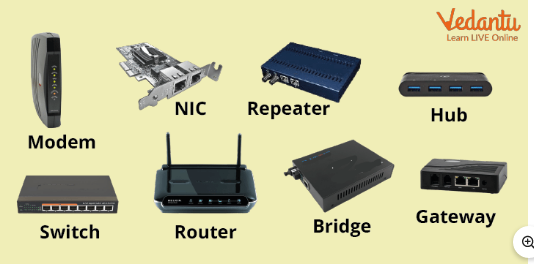

| Component | Function |
|---|---|
| **NIC** (Network Interface Card) | Lets a device connect to the network; holds the MAC address |
| **Hub** | Connects devices; repeats incoming signal to all ports |
| **Switch** | Connects devices in a LAN; forwards frames only to the intended port |
| **Repeater** | Regenerates a weak signal to extend distance |
| **Bridge** | Connects two LAN segments; filters by MAC address |
| **Router** | Connects different networks; forwards packets by IP address |
| **Modem** | Converts digital ↔ analog signals |
| **Gateway** | Connects networks that use *different protocols* |

---

## 4. Types of Networks — LAN, MAN, WAN ★★★

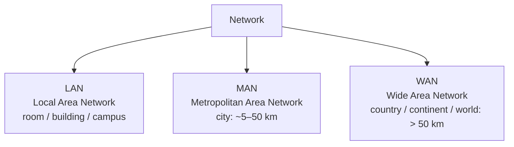

### 4.1 Local Area Network (LAN)
A LAN connects computers and devices within a **small geographical area** — a room, office, building, school or campus. It is a **high-speed** network for sharing resources among devices in a limited area.

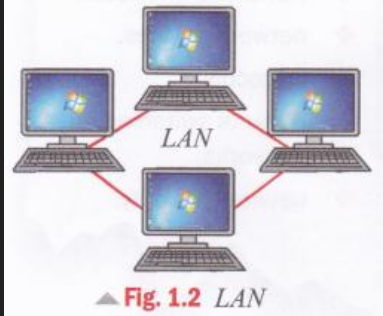
*A LAN can be built (a) on a shared Ethernet cable, (b) around a switch, or (c) with Wi-Fi.*

- **Characteristics:** small area; high data rate; usually owned by a single organisation; uses Ethernet, switches and Wi-Fi; shares printers, files and Internet connection.
- **Components:** workstations, NIC, switch/hub, transmission media (Ethernet cable or wireless), server, router (to connect to other networks/Internet).
- **Disadvantages:** limited coverage; failure of central device affects all; needs administration; viruses spread quickly.
- **Applications:** college labs, offices, banks, hospitals, libraries, home networks.

### 4.2 Metropolitan Area Network (MAN)
A MAN connects **multiple LANs within a city**. It covers more than a LAN but less than a WAN, and is used by universities, government offices and ISPs to link sites across a city.

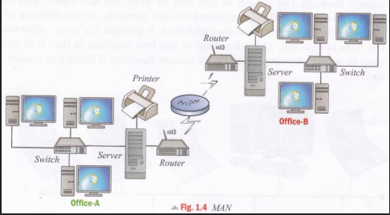

- **Characteristics:** city-wide; interconnects LANs; high-speed; usually **fiber-optic** or high-speed wireless links; owned by a private organisation or service provider.
- **Components:** routers, switches, fiber-optic cables, wireless links (microwave/radio), NICs, servers, modems, gateways, transmission media, network-management systems.
- **Disadvantages:** costlier than LAN; more complex; security concerns over a larger area; one failure affects many users.
- **Applications:** connecting university campuses, bank branches, government offices, cable-TV networks, ISP networks.

### 4.3 Wide Area Network (WAN)
A WAN connects computers, LANs and MANs over a **very large geographical area** — countries, continents or the whole world.

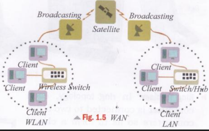

- **Characteristics:** very large area; connects many LANs/MANs; uses public and private communication networks; long-distance; usually managed by telecom companies/ISPs.
- **Components:** routers, switches, modems, transmission media (fiber, satellite, microwave, leased lines), servers, gateways, communication satellites, NMS.
- **Disadvantages:** high installation/maintenance cost; lower speed than LAN; complex management; greater security risks.
- **Applications:** the Internet, banking networks, airline reservation, multinational companies, government & defence.

### 4.4 Comparison
| Feature | LAN | MAN | WAN |
|---|---|---|---|
| Full form | Local Area Network | Metropolitan Area Network | Wide Area Network |
| Range | Up to a few km (room/building/campus) | ≈ 5 km – 50 km (a city) | > 50 km (country/continent/world) |
| Speed | Highest | High | Lower |
| Ownership | Single organisation | Private org / service provider | Telecom companies / ISPs (public + private) |
| Cost | Low | Medium | High |
| Media | Ethernet, Wi-Fi | Fiber, wireless links | Fiber, satellite, microwave, leased lines |
| Example | College lab | Cable TV, city bank branches | Internet |

---

## 5. Network Topologies ★★★

**Topology** = the arrangement (layout) of nodes so that all nodes can communicate.

- **Physical topology** – the *placement* of nodes. e.g., 5 nodes: 3 on the ground floor, 2 on the first floor.
- **Logical topology** – *how data flows* from one node to another.

Types: **Bus, Ring, Star, Mesh, Hybrid.**

### 5.1 Bus Topology
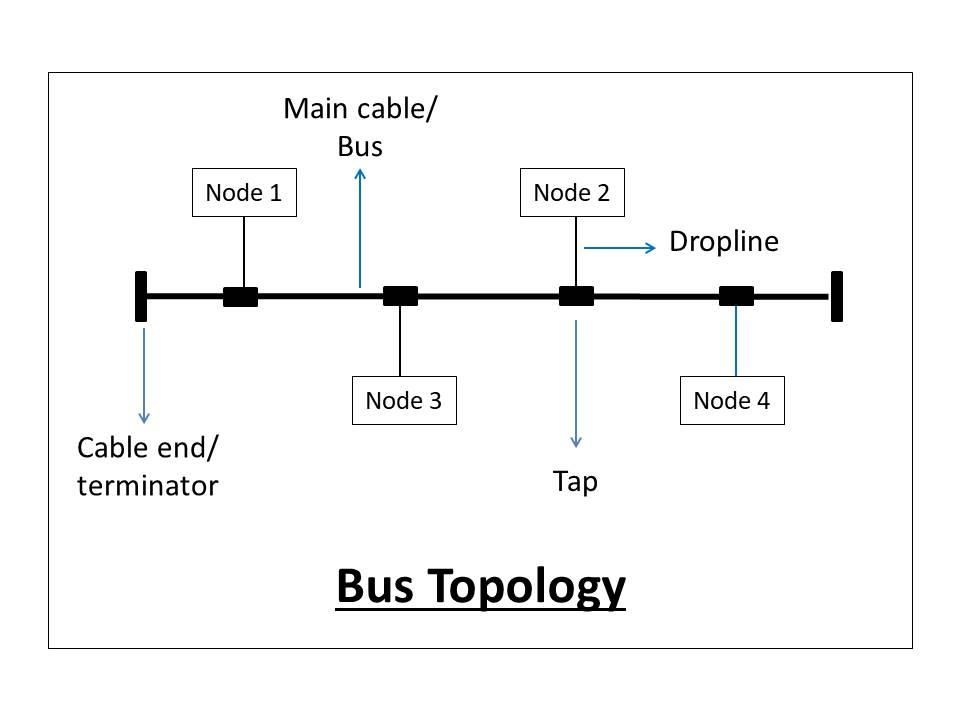

All nodes share a **common transmission medium (bus)** via drop lines and taps; terminators at the cable ends absorb the signal. Data sent by one node reaches *all* nodes, but only the intended receiver accepts it.

| Advantages | Disadvantages |
|---|---|
| Easy to install | Bus failure brings down the entire network |
| Low cost | Limited cable length |
| Needs less cable | Performance drops as devices increase (collisions) |
| | No security (everyone sees the data) |

### 5.2 Ring Topology
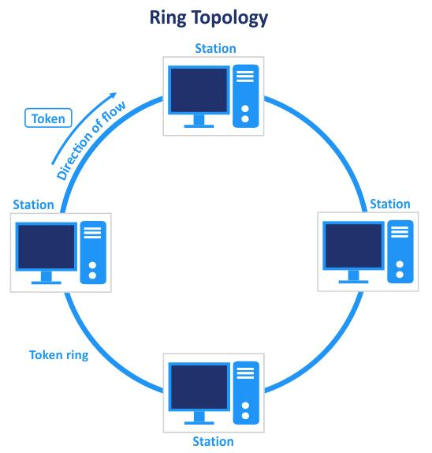

A **bus in a closed loop**. Each node has exactly **two connections** (to its nearest neighbours). Communication is **unidirectional** (clockwise or anticlockwise). Access is controlled by a **token** — only the node holding the token may send; the token is then passed to the next node.

| Advantages | Disadvantages |
|---|---|
| Orderly transmission | Failure of one node/link can break the whole ring |
| No collisions (token) | Difficult to add or remove devices |

### 5.3 Star Topology
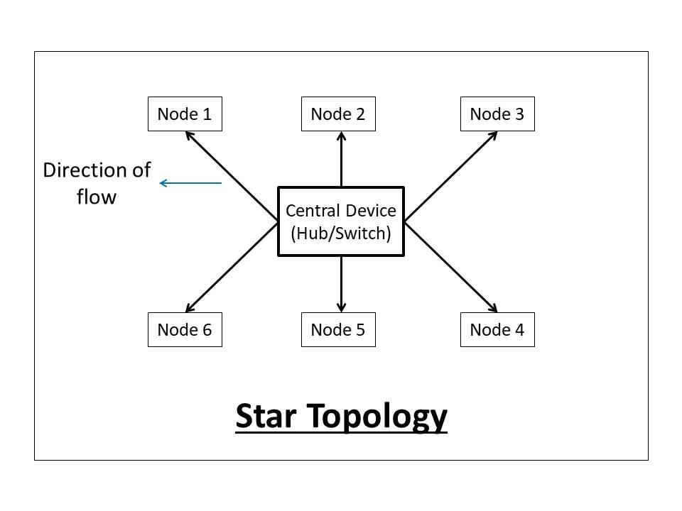

Every node is connected to a **central hub or switch**; all traffic passes through it (centralised management).

| Advantages | Disadvantages |
|---|---|
| Easy to install and manage | Central device failure kills the whole network |
| One device failing does not affect others | Requires more cabling than bus |
| Easy fault detection | |

### 5.4 Mesh Topology
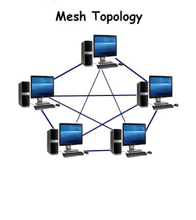

Every node is **directly connected to every other node**.

> **Formulae (important for numericals):** For *n* nodes
> - Number of links = **n(n − 1) / 2** (duplex)
> - I/O ports per node = **n − 1**
>
> *Example:* 6 nodes → 6×5/2 = **15 links**, each node needs **5 ports**.

| Advantages | Disadvantages |
|---|---|
| Highly reliable; good fault tolerance | Expensive |
| Multiple paths for data | Large amount of cabling and ports |
| Privacy/security (dedicated links) | Difficult installation |

### 5.5 Hybrid Topology
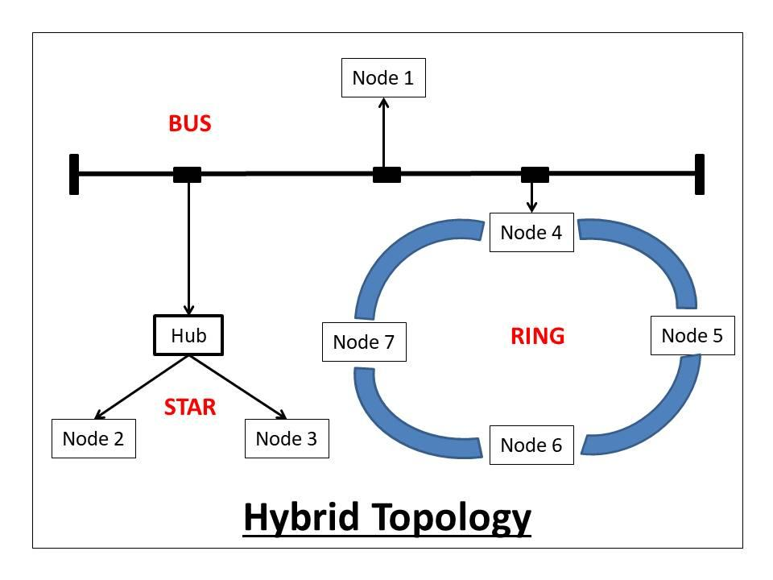

A **combination of two or more topologies** (e.g., star + bus + ring). Flexible, scalable and reliable, but complex to design and costly.

### 5.6 Topology Quick-Compare
| | Bus | Ring | Star | Mesh | Hybrid |
|---|---|---|---|---|---|
| Cable needed | Least | Low | Moderate | Most | Varies |
| Single point of failure | Bus cable | Any node/link | Hub/switch | None | Depends |
| Collisions | Yes | No (token) | Depends (hub yes, switch no) | No | Varies |
| Cost | Low | Low | Moderate | High | High |

---

## 6. Layered Architecture & Key Terms ★★

**Why layers?** Breaking networking into layers reduces complexity; each layer offers services to the layer above and talks to its *peer* layer on the other machine.

**Analogy — sending a letter:**

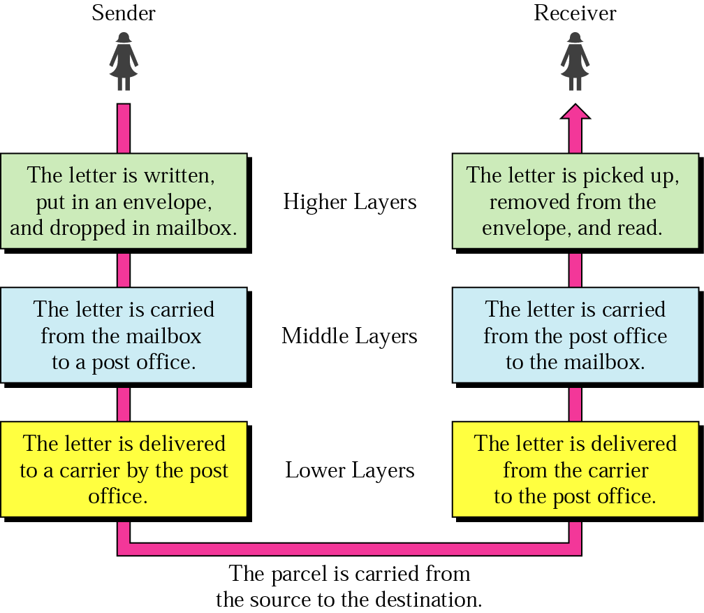

| Layers | Sender | Receiver |
|---|---|---|
| Higher | Letter is written, put in an envelope, dropped in the mailbox | Letter is picked up, removed from envelope, read |
| Middle | Carried from mailbox to post office | Carried from post office to the mailbox |
| Lower | Delivered to a carrier by the post office | Delivered from the carrier to the post office |

### Key terms
- **Protocol** – the rules and conventions used in the conversation between layer *n* on one machine and layer *n* on another (an *agreement* on how communication proceeds).
- **Peers** – the entities comprising the corresponding layers on different machines.
- **Interface** – sits between each pair of adjacent layers; defines the primitive operations/services the lower layer offers the upper one.
- **Network architecture** – a set of layers and protocols.
- **Protocol stack** – the list of protocols used by a system, *one protocol per layer*.

---

## 7. OSI Reference Model ★★★

The **OSI (Open Systems Interconnection) Reference Model** (by ISO) is a conceptual framework that describes how data travels from one computer to another, dividing communication into **seven layers**, each with a specific function.

- **Lower 4 layers (1–4: Physical, Data Link, Network, Transport)** → concerned with end-to-end *flow of data* through the network.
- **Upper 3 layers (5–7: Session, Presentation, Application)** → oriented towards *services to applications*.

> **Mnemonic (top → bottom):** **A**ll **P**eople **S**eem **T**o **N**eed **D**ata **P**rocessing
> **(bottom → top):** **P**lease **D**o **N**ot **T**hrow **S**ausage **P**izza **A**way

### 7.1 Interaction between layers
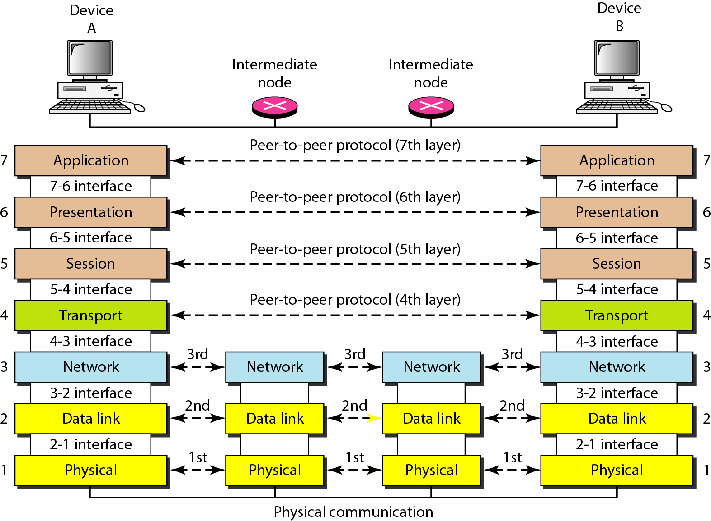

- Each layer talks to its **peer** layer on the other device using a **peer-to-peer protocol** (dashed lines).
- Adjacent layers communicate through **interfaces** (7-6 interface, 6-5 interface …).
- Intermediate nodes (routers) implement only layers **1–3**.

### 7.2 Encapsulation & data units

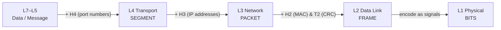

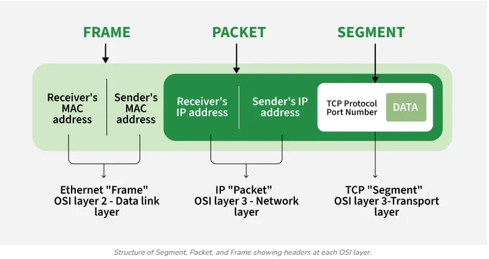

| Layer | PDU name | Address added |
|---|---|---|
| Transport | **Segment** | Port numbers |
| Network | **Packet** | Source/destination IP address |
| Data link | **Frame** | Source/destination MAC address + CRC trailer |
| Physical | **Bits** | — |

At the receiver the process is reversed (**decapsulation**): each layer strips its own header and hands the rest upward.

### 7.3 Layer-by-layer details

#### Layer 7 — Application Layer
- Topmost layer; the **interface between user applications and the network**; provides services directly to the user.
- **Functions:** file transfer, e-mail, web services, remote login, network management.
- **Protocols:** HTTP, HTTPS, FTP, SMTP, POP3, IMAP, DNS, Telnet.
- *Example:* opening a website in a browser uses HTTP/HTTPS at this layer.

#### Layer 6 — Presentation Layer
- Acts as a **translator** between the application layer and lower layers (concerned with **syntax and semantics** of data).
- **Functions:**
  - **Translation** – convert sender data into a common format acceptable to both sides (e.g., ASCII ↔ EBCDIC).
  - **Compression** – reduce data size to save bandwidth and time.
  - **Encryption / Decryption** – convert data into an unreadable coded form for secure transmission (sender), and back (receiver).
- **Protocols/formats:** JPEG, GIF, PNG, SSL, TLS.

#### Layer 5 — Session Layer
- **Establishes, manages and terminates sessions** between applications.
- **Dialog control** – decides half-duplex or full-duplex dialogue.
- **Synchronization** – inserts **checkpoints**; if a failure occurs, only data after the last checkpoint is resent.
  *Example:* a 100-page document is sent as 10 sets of 10 pages, each with a checkpoint.
- **Protocols:** ADSP, RTCP, PPTP, PAP, RPC, SDP (NetBIOS).

#### Layer 4 — Transport Layer
- Responsible for **process-to-process (end-to-end) delivery** of the whole message.
- **Functions:**
  - **Segmentation & reassembly** – divide a message into *segments* (with sequence numbers).
  - **Port (service-point) addressing** – a port number identifies the correct application.
  - **Flow control** – sender does not overwhelm receiver.
  - **Error control** – end-to-end error-free delivery (retransmission).
  - Connection control (connection-oriented / connectionless).
- **Protocols:** TCP (reliable, connection-oriented), UDP (fast, connectionless).

#### Layer 3 — Network Layer
- Delivers **packets from source to destination across multiple networks** (host-to-host).
- A **packet** = segment + header containing **source and destination IP addresses**.
- **Functions:** logical addressing (IP), **routing** (best path), congestion control, fragmentation.
- **Protocols:** IP, ICMP, ARP, RIP, OSPF. **Device:** router.

#### Layer 2 — Data Link Layer
- Moves **frames** from one node to the **next node (hop-to-hop)**.
- **Frame** = packet + header (MAC addresses) + trailer (CRC).
- **Functions:** framing, physical (MAC) addressing, error detection & correction, flow control, access control (MAC).
- **Protocols:** Ethernet (IEEE 802.3), Wi-Fi (IEEE 802.11), PPP, HDLC. **Devices:** switch, bridge.

#### Layer 1 — Physical Layer
- Transmits the **raw bit stream (0s and 1s)** over a physical medium (cable, fiber, wireless).
- **Functions:**
  - Physical characteristics of interface and medium
  - Representation of bits (bits → signals; encoding)
  - Data rate (bits per second)
  - Synchronization of bits (sender & receiver clocks match)
  - Physical topology (layout)
  - Transmission mode (simplex / half-duplex / full-duplex)
- **Standards:** Ethernet PHY (802.3), Wi-Fi PHY (802.11), Bluetooth, USB, RS-232. **Devices:** hub, repeater, cables.

### 7.4 OSI at a glance
| # | Layer | Key responsibility | PDU | Protocols | Device |
|---|---|---|---|---|---|
| 7 | Application | Services to user | Data | HTTP, FTP, SMTP, DNS | Gateway |
| 6 | Presentation | Translation, compression, encryption | Data | JPEG, GIF, SSL/TLS | — |
| 5 | Session | Dialog control, synchronization | Data | RPC, PPTP, NetBIOS | — |
| 4 | Transport | Process-to-process, segmentation, port addressing | Segment | TCP, UDP | — |
| 3 | Network | Logical addressing, routing | Packet | IP, ICMP, ARP, OSPF | Router |
| 2 | Data Link | Framing, MAC addressing, error/flow control | Frame | Ethernet, PPP, HDLC | Switch, Bridge |
| 1 | Physical | Bit transmission over media | Bits | RS-232, 802.3 PHY | Hub, Repeater |

---

## 8. TCP/IP Model ★★★

The **TCP/IP (Transmission Control Protocol / Internet Protocol) model** is the set of communication protocols used on the Internet. It is a **4-layer** practical model (some books use 5 layers by splitting Network Access into Data Link + Physical).

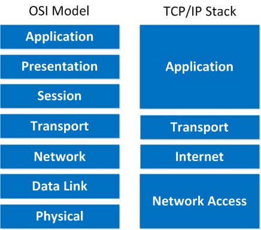

| Layer | Function | Protocols |
|---|---|---|
| **4. Application** | Network services to user applications; combines OSI Application + Presentation + Session | HTTP, HTTPS, FTP, SMTP, DNS, Telnet |
| **3. Transport** | Process-to-process communication; segmentation, flow & error control | **TCP** (reliable), **UDP** (fast, connectionless) |
| **2. Internet** | Logical addressing and routing; best path selection | IP, ICMP, ARP, IGMP |
| **1. Network Access (Link)** | Framing, physical addressing, access to the transmission medium; sends frames | Ethernet, Wi-Fi, PPP |

**Advantages of TCP/IP:** supports heterogeneous networks · highly scalable and robust · the de-facto model of the Internet · reliable communication via TCP.

---

## 9. OSI vs TCP/IP ★★★

| Basis | OSI Model | TCP/IP Model |
|---|---|---|
| Developed by | ISO | US Department of Defense (ARPANET) |
| Layers | 7 | 4 |
| Nature | Conceptual / reference (model came first) | Practical (protocols came first, model described them) |
| Session & Presentation | Separate layers | Merged into Application layer |
| Data Link & Physical | Separate | Merged into Network Access layer |
| Network layer service | Connection-oriented **and** connectionless | Only connectionless (IP) |
| Transport layer | Connection-oriented | Both TCP (conn.-oriented) and UDP (connectionless) |
| Usage | Teaching / reference | Real Internet |

---

## 10. Physical Layer & Transmission Media ★★

The purpose of the physical layer is to **transport a raw bit stream from one machine to another**.

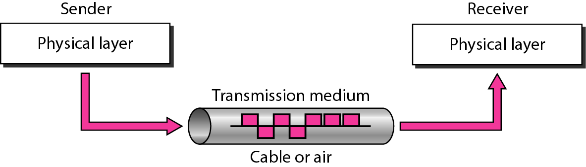

**Transmission medium** = the communication channel that carries data from one device to another.

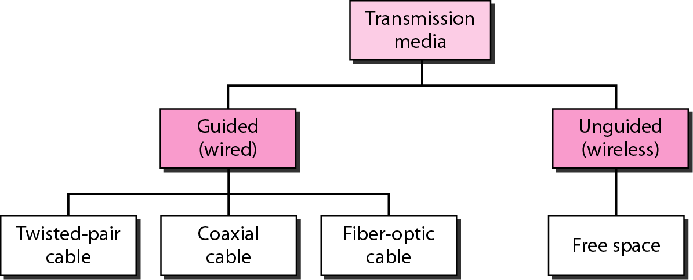

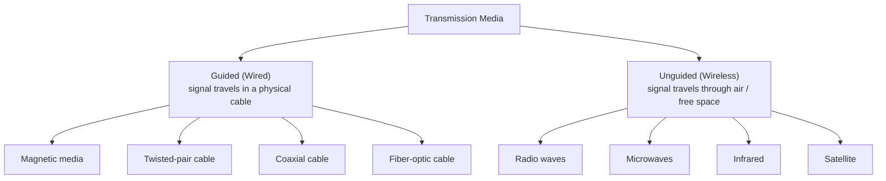

---

## 11. Guided (Wired) Media ★★★

### 11.1 Magnetic Media ★
- Storage medium using magnetic technology to store/retrieve data — **magnetic tapes, hard disks, floppy disks**.
- Data is physically carried ("never underestimate the bandwidth of a station wagon full of tapes") — **very high bandwidth, very high delay**.
- **Not suitable for applications that need an on-line connection.**

### 11.2 Twisted-Pair Cable ★★★
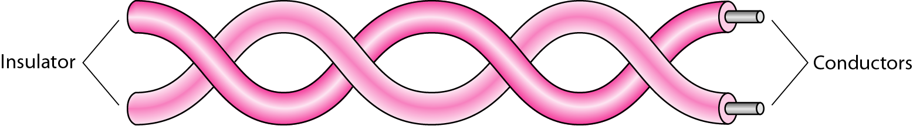

- **Oldest** and **cheapest** transmission medium.
- Two insulated copper wires (~1 mm thick) **twisted together in a helical form**.
- **Why twist?** Two parallel wires act as an antenna and pick up interference; twisting makes the noise on both wires cancel → **reduces interference and crosstalk**. Neighbouring pairs use different twist lengths.
- Used inside buildings and in **telephone networks**; **repeaters** are needed for longer distances.

**Types**

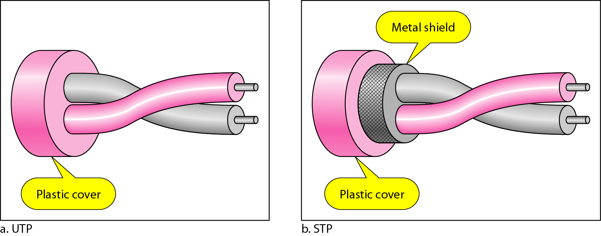

| UTP (Unshielded Twisted Pair) | STP (Shielded Twisted Pair) |
|---|---|
| No metal shield, only plastic cover | Metal foil/braid shield around the pairs |
| Cheaper, flexible, easy to install | Costlier, bulkier |
| More susceptible to EMI | Better noise immunity |
| Used in LANs (Ethernet), telephone | Used in high-interference environments |

**UTP Categories** (Cat 5 has more twists per cm than Cat 3):

| Category | Data rate | Max length | Application |
|---|---|---|---|
| CAT1 | up to 1 Mbps | – | Old telephone cable |
| CAT2 | up to 4 Mbps | – | Token Ring |
| CAT3 | up to 10 Mbps | 100 m | Token Ring & 10BASE-T Ethernet |
| CAT4 | up to 16 Mbps | 100 m | Token Ring |
| CAT5 | up to 100 Mbps | 100 m | Ethernet, Fast Ethernet, Token Ring |
| CAT5e | up to 1 Gbps | 100 m | Ethernet, Fast Ethernet, Gigabit Ethernet |
| CAT6 | up to 10 Gbps | 100 m | Gigabit Ethernet, 10G Ethernet (55 m) |
| CAT6a | up to 10 Gbps | 100 m | Gigabit Ethernet, 10G Ethernet (55 m) |
| CAT7 | up to 10 Gbps | 100 m | Gigabit Ethernet, 10G Ethernet (100 m) |

### 11.3 Coaxial Cable ★★
- A **central copper conductor** surrounded by insulation, a **metallic shield** and an outer protective cover.
- Better shielding than twisted pair → **longer distances, higher speed, less interference**; good combination of **high bandwidth and excellent noise immunity**.
- Widely used for **cable television** and **metropolitan networks**.

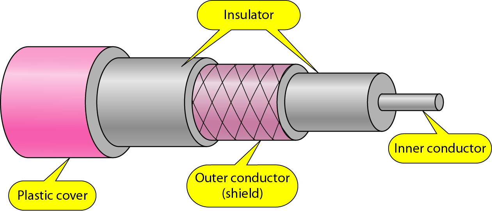

| Part | Purpose |
|---|---|
| Inner conductor | Carries the signal (center) |
| Insulator (dielectric) | Plastic/foam; keeps inner and outer conductors apart; maintains signal quality |
| Outer conductor (shield) | Braided mesh/foil; shields against EMI and noise |
| Plastic cover (jacket) | Protects from physical damage, moisture, environment |

**Categories (RG = Radio Government ratings):**

| Category | Impedance | Use |
|---|---|---|
| RG-59 | 75 Ω | Cable TV |
| RG-58 | 50 Ω | Thin Ethernet |
| RG-11 | 50 Ω | Thick Ethernet |

### 11.4 Fiber-Optic Cable ★★★
A guided medium that transmits data as **light signals** through thin strands of glass or plastic — **very high speed, very high bandwidth, secure, long-distance**.

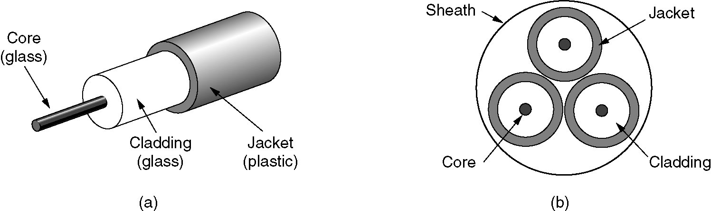
*(a) Side view of a single fiber (b) End view of a sheath with three fibers*

| Component | Function |
|---|---|
| **Core** (glass/plastic) | Central part; carries the light |
| **Cladding** (glass) | Surrounds core; **lower refractive index** than core → reflects light back into the core by **Total Internal Reflection (TIR)** |
| **Jacket** (plastic) | Protects from physical damage and moisture |

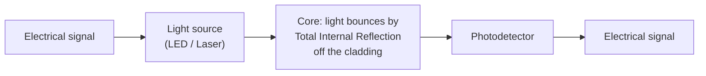

**Advantages:** huge bandwidth, very low attenuation, immune to EMI, thin & light, hard to tap (secure).
**Disadvantages:** costly, fragile, difficult installation/joining, one-way light propagation (needs two fibers for duplex).

### 11.5 Guided media comparison
| Feature | Twisted pair | Coaxial | Fiber optic |
|---|---|---|---|
| Signal | Electrical | Electrical | Light |
| Bandwidth | Low | Moderate | Very high |
| Noise immunity | Low (UTP) | Good | Excellent (no EMI) |
| Distance | Short (≈100 m) | Medium | Very long |
| Cost | Cheapest | Moderate | Highest |
| Use | LAN, telephone | Cable TV, MAN | Backbones, long-haul |

---

## 12. Unguided (Wireless) Media ★★

Wireless media transmit data through **electromagnetic waves without physical cables**.

| Type | Frequency | Key properties | Uses |
|---|---|---|---|
| **Radio waves** | 3 kHz – 1 GHz | Omnidirectional; travel long distances; **penetrate walls** | AM/FM radio, TV broadcasting, mobile communication; **Bluetooth & Wi-Fi** use radio waves |
| **Microwaves** | 1 GHz – 300 GHz | Unidirectional; **line-of-sight** required; long distance | Mobile phone networks, satellite links, Wi-Fi, radar |
| **Infrared (IR)** | 300 GHz – 400 THz | **Short range; cannot pass through walls** (secure, no interference between rooms) | TV remotes, wireless keyboards/mice, short-range data transfer |
| **Satellite** | Microwave bands | Earth station ↔ satellite; covers very large areas | GPS, satellite TV, weather monitoring, global communication |

---

## Unit I — One-Page Summary

| Topic | Key points to remember |
|---|---|
| **Computer network** | Nodes + communication links (wired/wireless). End devices vs intermediary devices. |
| **Uses / applications** | Resource, data & Internet sharing; communication; remote access; collaboration; cost reduction · e-mail, web, FTP, banking, cloud, e-learning. |
| **Disadvantages** | Security risk, virus spread, cost, failure/dependency, complexity, congestion. |
| **LAN** | Room/building/campus; high speed; single owner; Ethernet/Wi-Fi. |
| **MAN** | City (5–50 km); connects LANs; fiber; e.g., cable TV. |
| **WAN** | > 50 km; countries/world; ISPs/telecom; e.g., Internet. |
| **Topology** | Physical (placement) vs Logical (data flow). |
| **Bus** | One backbone cable; cheap; backbone failure kills all; collisions. |
| **Ring** | Closed loop; token passing; unidirectional; no collisions; one break kills all. |
| **Star** | Central hub/switch; easy management; hub is single point of failure. |
| **Mesh** | Every node to every node; **links = n(n−1)/2, ports = n−1**; reliable but costly. |
| **Hybrid** | Mix of topologies; flexible but complex/costly. |
| **Key terms** | Protocol, peers, interface, network architecture, protocol stack. |
| **OSI (7 layers)** | Application · Presentation (translate/compress/encrypt) · Session (dialog, checkpoints) · Transport (segment, port, flow/error) · Network (IP, routing) · Data Link (frame, MAC, CRC) · Physical (bits). "All People Seem To Need Data Processing". |
| **PDUs** | Data → **Segment** (+port) → **Packet** (+IP) → **Frame** (+MAC, CRC) → **Bits**. |
| **TCP/IP (4 layers)** | Application · Transport (TCP/UDP) · Internet (IP, ICMP, ARP, IGMP) · Network Access (Ethernet, Wi-Fi, PPP). |
| **OSI vs TCP/IP** | 7 vs 4 layers; reference vs practical; ISO vs DoD; Session+Presentation merged into Application in TCP/IP. |
| **Transmission media** | Guided (magnetic, twisted pair, coax, fiber) vs Unguided (radio, micro, IR, satellite). |
| **Magnetic media** | Tapes/disks; huge bandwidth but no on-line connection. |
| **Twisted pair** | Twisting cancels interference; UTP vs STP; Cat 3 → Cat 7; ≈100 m. |
| **Coaxial** | Inner conductor, insulator, shield, jacket; RG-59 (75 Ω, TV), RG-58/RG-11 (50 Ω, Ethernet). |
| **Fiber** | Light through core; cladding (lower RI) → total internal reflection; highest bandwidth, EMI-immune. |
| **Wireless** | Radio 3 kHz–1 GHz (penetrates walls) · Microwave 1–300 GHz (line-of-sight) · IR (short, no walls) · Satellite (global). |
