# Unit II — The Data Link Layer

> **Syllabus:** Design issues in the data link layer: framing, flow control, error control. Error detection & correction: Parity, CRC, Checksum, Hamming code. Flow control: Sliding-window protocols. Data link layer protocols: HDLC, PPP.
>
> **Source:** *CN Unit-II Self.pptx* (SNIST)

**Importance legend:** ★★★ = very frequently asked (long answer / numericals) · ★★ = medium · ★ = short answer

---

## Table of Contents
1. [Structure of the Data Link Layer (LLC & MAC)](#1-structure-of-the-data-link-layer-)
2. [Design Issues of the DLL](#2-design-issues-of-the-data-link-layer-)
3. [Services Provided to the Network Layer](#3-services-provided-to-the-network-layer-)
4. [Framing](#4-framing-)
5. [Error Control — Types of Errors & Redundancy](#5-error-control-)
6. [Error Detection: Parity](#6-parity-check-vrc-)
7. [Error Detection: Checksum](#7-checksum-)
8. [Error Detection: CRC](#8-cyclic-redundancy-check-crc-)
9. [Error Correction: Hamming Code](#9-hamming-code-error-correction-)
10. [Flow Control: Stop-and-Wait](#10-flow-control--stop-and-wait-)
11. [Sliding Window: Go-Back-N ARQ](#11-sliding-window--go-back-n-arq-)
12. [Sliding Window: Selective Repeat ARQ](#12-selective-repeat-arq-)
13. [Piggybacking](#13-piggybacking-)
14. [HDLC](#14-hdlc-high-level-data-link-control-)
15. [PPP](#15-ppp-point-to-point-protocol-)
16. [Unit II — One-Page Summary](#unit-ii--one-page-summary)

---

## 1. Structure of the Data Link Layer ★★

The DLL is the **second layer** (just above physical). It receives **packets** from the network layer, encapsulates them into **frames** (header + payload + trailer) and sends them across the physical link **hop-to-hop**.

It is divided into two sub-layers:

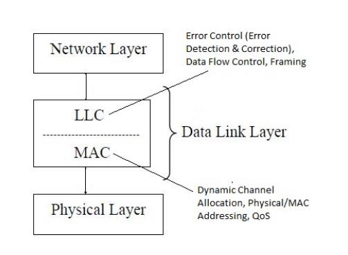

| Sub-layer | Position | Responsibilities |
|---|---|---|
| **LLC – Logical Link Control** | Upper | Communication between two adjacent nodes: **framing, flow control, error control** |
| **MAC – Medium Access Control** | Lower | Coordinates access to a **shared (broadcast) link** using multiple-access protocols; adds **source & destination MAC addresses** to the frame |

---

## 2. Design Issues of the Data Link Layer ★★★

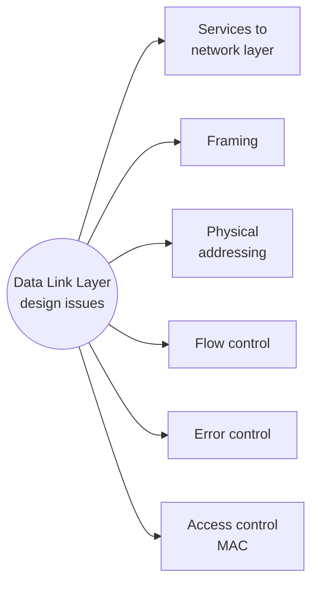

| Issue | What it means | Example |
|---|---|---|
| **Services to network layer** | Unack. connectionless / Ack. connectionless / Ack. connection-oriented | see §3 |
| **Framing** | Divide the bit stream into frames with recognisable boundaries | 5000-byte message → 5 frames of 1000 bytes |
| **Physical addressing** | Put source & destination **MAC addresses** in the header | `00:1A:2B:3C:4D:5E` |
| **Flow control** | Stop a fast sender from overflowing a slow receiver's buffer | Stop-and-Wait, Sliding Window |
| **Error control** | Detect/correct errors; ACK, NAK, retransmission of lost/damaged frames | Frame 5 corrupted → retransmit |
| **Access control** | Decide which device may transmit on a shared medium (avoid collisions) | CSMA/CD (Ethernet), CSMA/CA (Wi-Fi), token passing |

---

## 3. Services Provided to the Network Layer ★★

1. **Unacknowledged connectionless** – frames sent with no connection and no ACK; a lost/corrupt frame is **not** retransmitted. Good for low-error links and real-time traffic (Ethernet, streaming).
2. **Acknowledged connectionless** – no connection, but **each frame is ACKed**; if no ACK within a timeout, retransmit. Good for unreliable links (wireless).
3. **Acknowledged connection-oriented** – connection is **established**, frames are numbered and ACKed, delivered **exactly once and in order**, then the connection is released (file transfer, banking).

| Feature | Unack. connectionless | Ack. connectionless | Ack. connection-oriented |
|---|---|---|---|
| Connection setup | No | No | Yes |
| Acknowledgment | No | Yes | Yes |
| Retransmission | No | Yes | Yes |
| Reliable delivery | No | Yes | Yes |
| Frame ordering | Not guaranteed | Usually independent | **Guaranteed** |
| Speed / overhead | Fastest / Low | Moderate / Medium | Slowest / High |
| Example | Ethernet, streaming | Wireless (Wi-Fi) | File transfer, banking |

---

## 4. Framing ★★★

**Framing** = dividing the data from the network layer into **frames** so the receiver can identify the **beginning and end** of each one.

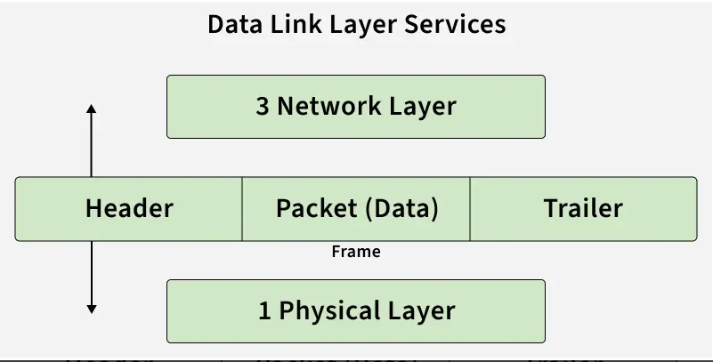

- **Header:** start-of-frame (SOF) delimiter, frame number, frame size, protocol details, sender & receiver MAC (and IP).
- **Payload:** the packet.
- **Trailer:** end-of-frame (EOF) delimiter, error-detection bits (**CRC**).

### 4.1 Fixed-size vs Variable-size framing
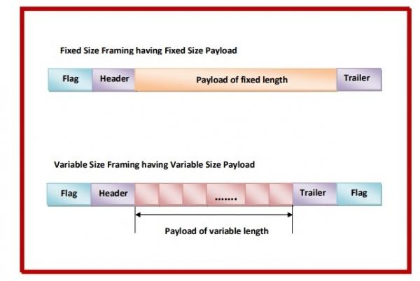

| Fixed-size framing | Variable-size framing |
|---|---|
| All frames have the same predefined size; **padding** fills the last frame | Frame length depends on the data |
| No delimiters/length field needed; easy synchronisation; fast | Needs delimiters or a length field |
| Wastes bandwidth (padding) | Better bandwidth utilisation, no padding |
| e.g., ATM cells | e.g., Ethernet, HDLC, PPP |

Variable-size frame boundaries are found by: **(1) Character count, (2) Byte (character) stuffing, (3) Bit stuffing.**

### 4.2 Character Count ★★
The **first field** of every frame holds the **number of characters (bytes) in the frame**, including the count itself. The receiver reads the count, takes that many bytes, then the next byte is the next frame's count.

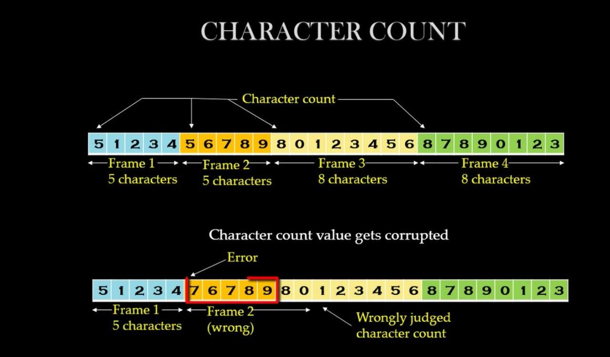

- *Without error:* `5 1 2 3 4 | 5 6 7 8 9 | 8 0 1 2 3 4 5 6 | 8 7 8 9 0 1 2 3` → frames of 5, 5, 8, 8.
- **Drawback:** if a count is corrupted (5 → 7), the receiver **loses synchronisation** and every later frame is misread — and it cannot even find the start of the next frame. Hence rarely used alone.

### 4.3 Byte Stuffing (Character-oriented framing) ★★★
- Each frame starts and ends with a special **FLAG byte**.
- If a FLAG (or ESC) byte appears **inside the data**, the sender inserts an **ESC (escape) byte** before it.
- The receiver removes each ESC and treats the following byte as data.

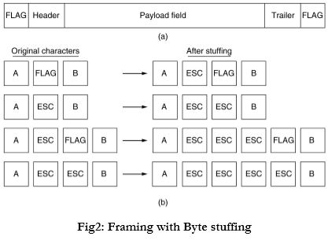

| Original data | After stuffing |
|---|---|
| A FLAG B | A **ESC** FLAG B |
| A ESC B | A **ESC** ESC B |
| A ESC FLAG B | A **ESC** ESC **ESC** FLAG B |
| A ESC ESC B | A **ESC** ESC **ESC** ESC B |

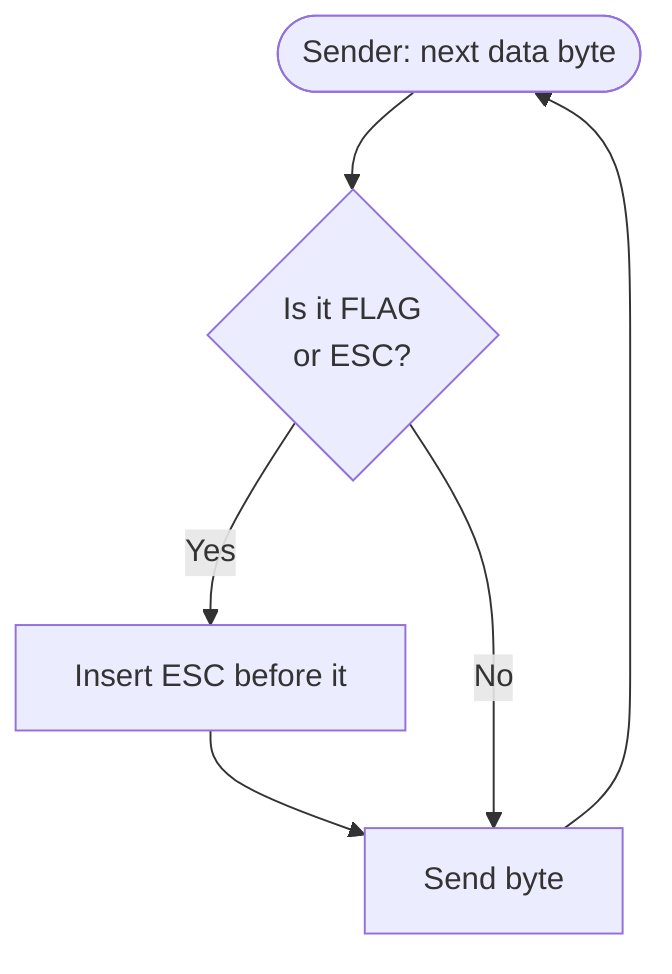

Used by **PPP** (FLAG = `01111110`, ESC = `01111101`). Disadvantage: tied to 8-bit characters.

### 4.4 Bit Stuffing (Bit-oriented framing) ★★★
- Each frame begins and ends with the **flag pattern `01111110`** (six 1s).
- **Sender:** whenever it sees **five consecutive 1s** in the data, it **stuffs a 0** after them.
- **Receiver:** whenever it sees **five consecutive 1s followed by a 0**, it **removes (destuffs)** that 0.
- So the flag pattern can never appear inside the data. Data `01111110` is sent as `011111010` and stored back as `01111110`.

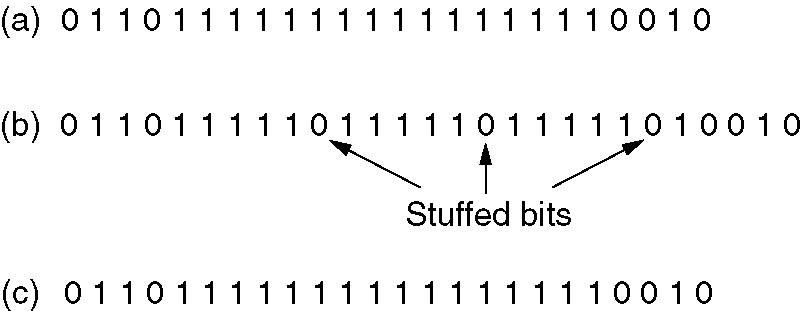

**Worked example**

| Stage | Bits |
|---|---|
| (a) Original data | `0110111111111111111110010` |
| (b) On the line (stuffed 0s in **bold**) | `011011111`**0**`11111`**0**`11111`**0**`10010` |
| (c) After destuffing at receiver | `0110111111111111111110010` |

Used by **HDLC**. Works with any number of bits per frame (not tied to bytes).

---

## 5. Error Control ★★

Error control = **detect** transmission errors and **recover** lost/corrupted frames.

**Process:** sender adds error-detection bits (CRC/checksum) → frame sent → receiver checks → **ACK** if OK, else **NAK** or the sender **retransmits after a timeout**.

### 5.1 Types of errors
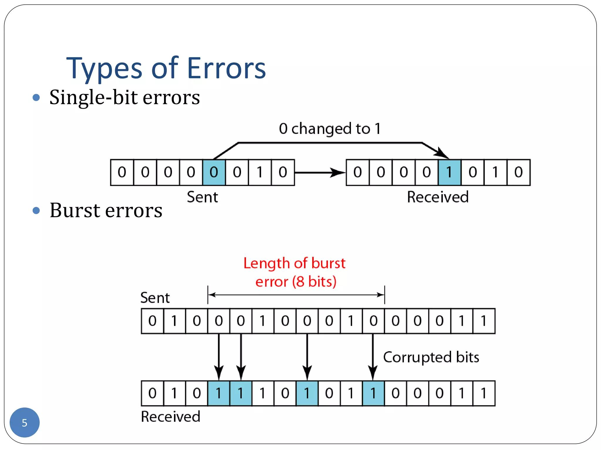

| Single-bit error | Burst error |
|---|---|
| Only **one bit** changes (0→1 or 1→0) | **Two or more bits** change |
| `10110010` → `10100010` | `1011001011` → `1000110011` |
| Rare in serial transmission | More common; **burst length** = from first corrupted bit to last corrupted bit |

### 5.2 Redundancy
Error detection works by adding **redundant bits** at the sender, which are checked and removed at the receiver.

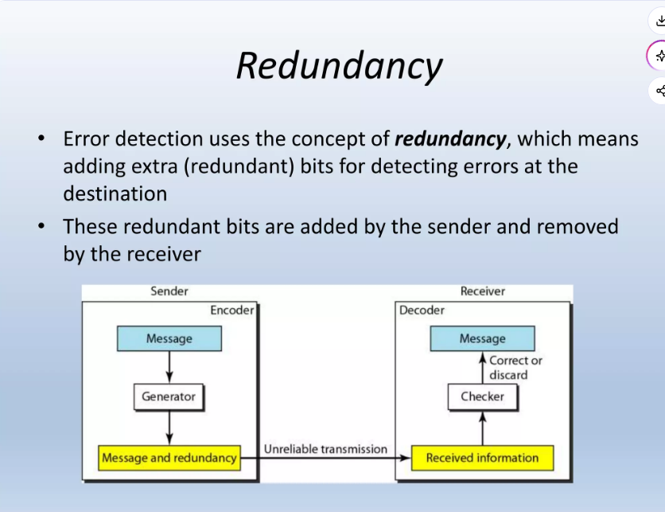

**Detection methods:** Parity (VRC), Checksum, CRC. **Correction method:** Hamming code.

---

## 6. Parity Check (VRC) ★★

Add **one extra parity bit** to the data.

| Even parity | Odd parity |
|---|---|
| Total number of 1s (incl. parity bit) must be **even** | Total number of 1s must be **odd** |
| Count of 1s in data odd → parity = 1; even → parity = 0 | Count of 1s odd → parity = 0; even → parity = 1 |

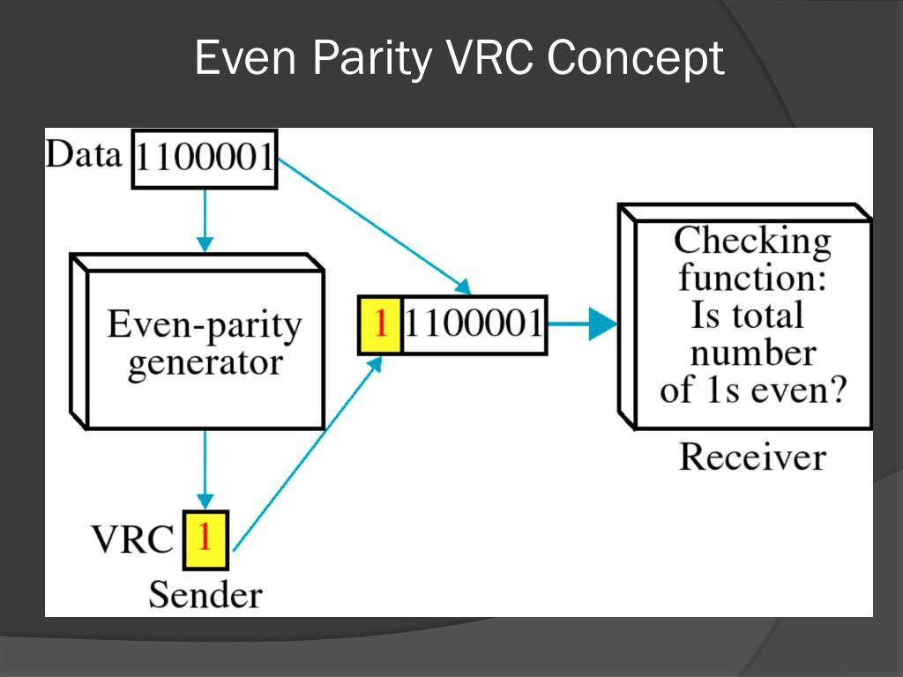

*Example (even parity):* data `1100001` has three 1s → parity bit **1** → send `11100001`. Receiver counts 1s; if even → accept, else reject.

- Detects **all single-bit errors** (and any odd number of errors).
- **Cannot detect an even number of bit errors** (two flips keep parity unchanged).
- *Extension:* **2-D parity (LRC)** — parity per row and per column — detects all 1-, 2- and 3-bit errors and can correct single-bit errors.

---

## 7. Checksum ★★★

A checksum detects (does **not** correct) errors using **1's-complement addition**.

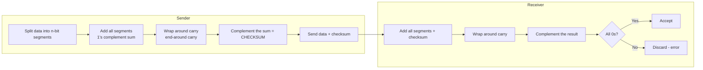

### Worked example (8-bit checksum)
Data: `10011001 11100010 00100100 10000100`

| Step | Value |
|---|---|
| Sum of 4 segments | `10011001 + 11100010 + 00100100 + 10000100 = 10 00100011` (10 bits) |
| Wrap the extra 2 bits | `00100011 + 10 = 00100101` |
| 1's complement → **Checksum** | **`11011010`** |
| Receiver: sum + checksum | `00100101 + 11011010 = 11111111` |
| Complement | `00000000` → **no error, accept** |

**Example 2:** data `10101001 00111001` → sum `11100010` → checksum `00011101`.

**Practice problem:** checksum of the 16-bit segments `1001001110010011` and `1001100001001101`
→ sum (with wrap-around) `0010101111100001` → checksum = **`1101010000011110`**.

> **Limitation:** If two segments change in a way that their changes cancel out (e.g., `10101001 00111001` received as `00101001 10111001`), the sum is unchanged and the **error goes undetected**.

---

## 8. Cyclic Redundancy Check (CRC) ★★★

CRC uses **binary (modulo-2, XOR) polynomial division** instead of addition — much stronger than checksum; detects all single-bit, double-bit, odd-number and burst errors up to the degree of the generator. **Detects only, does not correct.**

**Terms:** *Dataword* (original data) · *Generator / divisor* (agreed binary polynomial) · *CRC* (remainder) · *Codeword* (data + CRC).

### Procedure
**Sender**
1. Generator has **n bits** (degree n−1).
2. Append **n−1 zeros** to the data.
3. Divide by the generator using **modulo-2 division (XOR, no carries/borrows)**.
4. Remainder (n−1 bits) = **CRC**.
5. Replace the appended zeros with the CRC and transmit (the codeword).

**Receiver** – divide the whole received codeword by the same generator: remainder **0 → accept**, non-zero → error → discard.

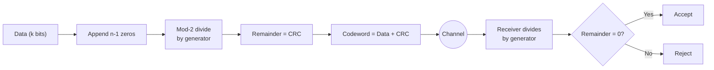

### Worked Problem ★
*Bit stream `1101011011`, generator G(x) = x⁴ + x + 1. Find the transmitted string.*

- G(x) = x⁴ + x + 1 → **`10011`** (5 bits) → append **4 zeros**: `11010110110000`
- Modulo-2 division:

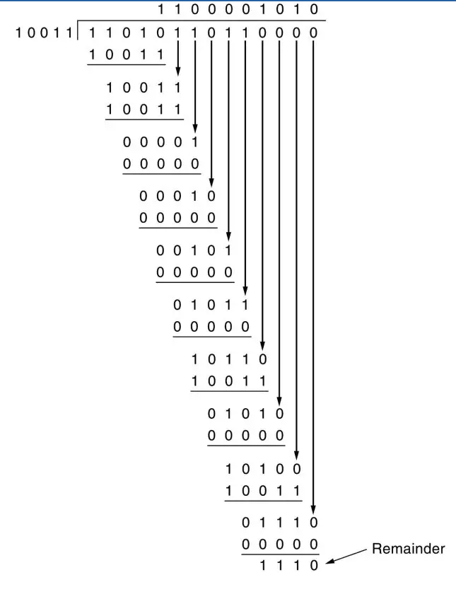

- Remainder = **`1110`**
- **Transmitted codeword = `11010110111110`**

### More problems (answers verified)
| Data | Generator | CRC | Codeword transmitted |
|---|---|---|---|
| `100100` | `1101` | `001` | **`100100001`** |
| `1001010011` | x² + 1 = `101` | `01` | **`100101001101`** |
| `10011101` | x³ + 1 = `1001` | `100` | **`10011101100`** |

*Follow-up:* if the 3rd bit from the left of `10011101100` is inverted → received `10111101100`; dividing by `1001` leaves remainder **`100` ≠ 0**, so the receiver detects the error and asks for retransmission.

> **Polynomial ↔ binary:** write a 1 for every power present. x⁴ + x + 1 = 1·x⁴ + 0·x³ + 0·x² + 1·x¹ + 1·x⁰ = `10011`.

### Checksum vs CRC
| Checksum | CRC |
|---|---|
| 1's-complement addition | Modulo-2 polynomial division |
| Weaker; misses compensating errors | Very strong; detects burst errors |
| Simple, used in software (IP, TCP, UDP) | Done in hardware (Ethernet, HDLC trailers) |

---

## 9. Hamming Code (Error Correction) ★★★

Invented by **Richard Hamming**. Adds several **parity bits** so the receiver can **detect and correct a single-bit error** without retransmission — it finds the **exact position** of the error.

### Number of parity bits
$$2^r \ge m + r + 1$$
*m* = data bits, *r* = parity bits. For m = 4: r = 3 → 2³ = 8 ≥ 4 + 3 + 1 = 8 ✓ → **(7,4) Hamming code**.

### Placement
Parity bits go in positions that are **powers of 2** (1, 2, 4, 8 …). Each parity bit Pₖ checks all positions whose binary index has bit *k* set:

| Parity bit | Checks positions |
|---|---|
| P1 | 1, 3, 5, 7 |
| P2 | 2, 3, 6, 7 |
| P4 | 4, 5, 6, 7 |

### Worked example — data `1011` (even parity)

| Position | 1 | 2 | 3 | 4 | 5 | 6 | 7 |
|---|---|---|---|---|---|---|---|
| Bit | P1 | P2 | 1 | P4 | 0 | 1 | 1 |

- **P1** (1,3,5,7): bits 1,0,1 → two 1s (even) → **P1 = 0**
- **P2** (2,3,6,7): bits 1,1,1 → three 1s (odd) → **P2 = 1**
- **P4** (4,5,6,7): bits 0,1,1 → two 1s (even) → **P4 = 0**

| Position | 1 | 2 | 3 | 4 | 5 | 6 | 7 |
|---|---|---|---|---|---|---|---|
| Code | 0 | 1 | 1 | 0 | 0 | 1 | 1 |

**Transmitted codeword = `0110011`**

### Error detection & correction at the receiver
Received `0110001` (bit 6 flipped). Recompute each check (including the parity bit):

| Check | Positions | Bits | Parity | Syndrome bit |
|---|---|---|---|---|
| S1 | 1,3,5,7 | 0,1,0,1 | even | **0** |
| S2 | 2,3,6,7 | 1,1,0,1 | odd | **1** |
| S4 | 4,5,6,7 | 0,0,0,1 | odd | **1** |

Syndrome **S4 S2 S1 = 110₂ = 6** → error in **position 6** → flip it → `0110011` ✓ (syndrome 000 = no error).

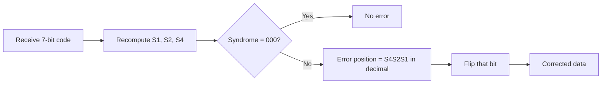

---

## 10. Flow Control — Stop-and-Wait ★★★

**Flow control** = regulating the sender's rate so that a fast sender does not overwhelm a slow receiver (prevents buffer overflow).
*Analogy:* a teacher slows down when students can't write fast enough.

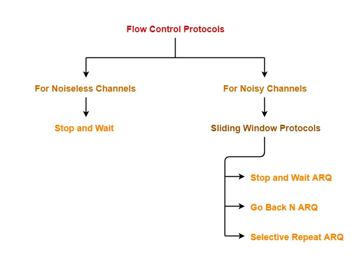

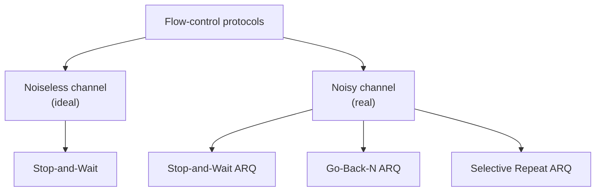

- *Noiseless channel* – idealised: no frames lost, duplicated or corrupted.
- *Noisy channel* – real: frames can be lost, corrupted or duplicated → need **ARQ (Automatic Repeat reQuest)**.

### Stop-and-Wait (ARQ)
- Used in connection-oriented communication, at DLL and transport layer; it is a sliding window with **window size 1**; uses the link like a **half-duplex** link.
- Send **one frame**, then **wait for its ACK** before sending the next.
- If the frame or its ACK is lost, the sender's **timer expires** and it **retransmits** the same frame.
- Frames numbered **0/1** alternately (1-bit sequence number) so duplicates can be recognised.

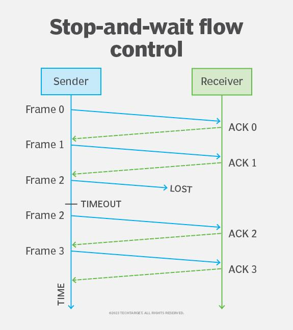

| Step | Event |
|---|---|
| 1 | Sender sends Frame 0 → receiver gets it → ACK 0 |
| 2 | Sender sends Frame 1 → ACK 1 |
| 3 | Sender sends Frame 2 → **LOST**; no ACK 2 |
| 4 | **Timeout** at sender |
| 5 | **Retransmit Frame 2** → ACK 2 |
| 6 | Send Frame 3 → ACK 3 |

**Disadvantages:** poor bandwidth utilisation, long idle waiting time, low throughput (especially on long-delay links).

> Efficiency (no errors) η = 1 / (1 + 2a), where a = propagation delay / transmission delay.

---

## 11. Sliding Window — Go-Back-N ARQ ★★★

**Sliding window protocols** allow **multiple frames** to be "in flight" before ACKs come back — better utilisation, continuous transmission. Sender and receiver each keep a **window** of sequence numbers that slides forward as ACKs arrive.

### Go-Back-N
- Sender window = **N** (≤ 2ᵐ − 1 with m-bit sequence numbers); receiver window = **1**.
- Receiver accepts frames **only in order**; any **out-of-order frame is discarded**.
- **Cumulative ACKs.**
- On timeout of frame *i*, the sender **goes back** and retransmits frame *i* and **all frames sent after it**.

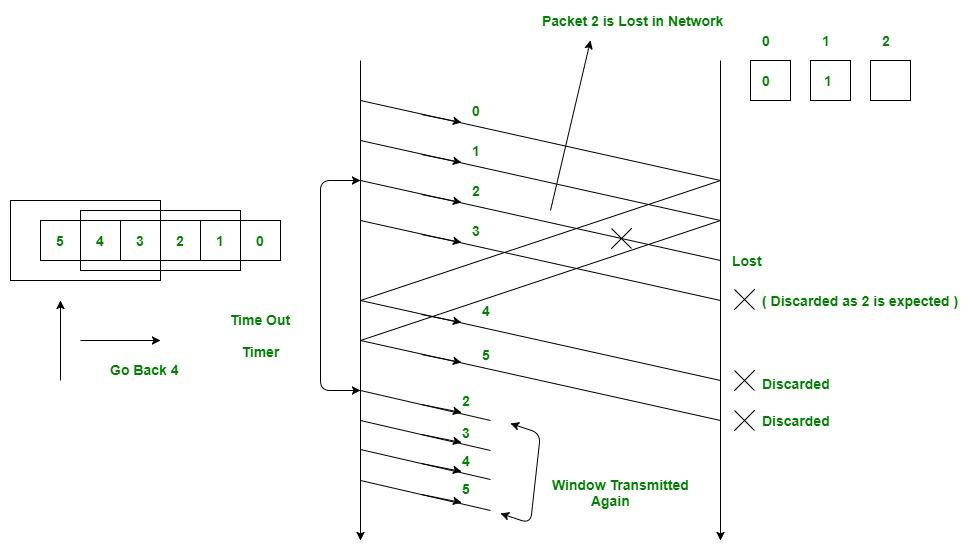

**Walk-through (window = 4, seq 0–5):**
1. Sender sends 0, 1, 2, 3 without waiting.
2. 0 ✓, 1 ✓ accepted; **2 lost**; 3 arrives but receiver expects 2 → **3 discarded**.
3. Timer for 2 expires → sender **goes back to 2** and resends **2, 3, 4, 5**.

| Advantages | Disadvantages |
|---|---|
| Multiple frames without individual ACKs | One loss forces retransmission of **all** subsequent frames, even correct ones |
| Better utilisation than Stop-and-Wait | Wastes bandwidth when error rate is high |
| Simple receiver (no buffering) | Best only for **low-error** links |

---

## 12. Selective Repeat ARQ ★★★

- Both sender and receiver have windows (size ≤ 2ᵐ⁻¹).
- Receiver **accepts and buffers out-of-order frames**.
- **Each frame has its own timer**; only the **lost/damaged frame is retransmitted**.
- Receiver delivers frames to the upper layer **in order** once gaps are filled.

| Figure | What happens |
|---|---|
| 1 | Sender (window 4) sends frames 0,1,2,3 |
| 2 | 0 ✓ 1 ✓, **2 lost**, 3 arrives → **accepted & buffered** (not yet delivered). Receiver sends ACK0, ACK1, ACK3 |
| 3 | ACK0/ACK1 slide the sender window to {2,3,4,5}; sender sends 4, 5 → buffered |
| 4 | Timer of 2 expires → **only frame 2 is resent**. Receiver now has 0–5 consecutive → delivers 0 1 2 3 4 5, sends ACK2; window moves on to 6, 7 |

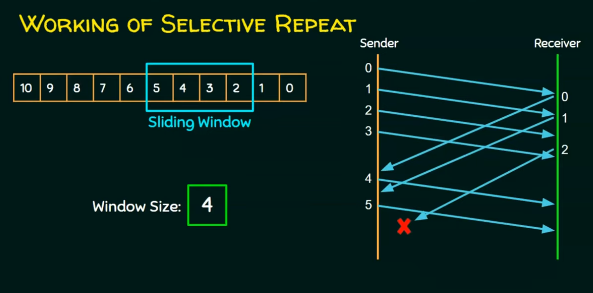
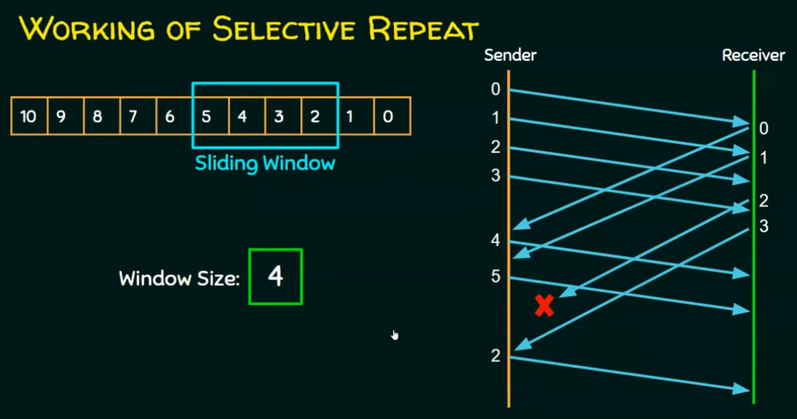

### Comparison of ARQ protocols
| Feature | Stop-and-Wait | Go-Back-N | Selective Repeat |
|---|---|---|---|
| Sender window | 1 | N (≤ 2ᵐ−1) | ≤ 2ᵐ⁻¹ |
| Receiver window | 1 | 1 | Same as sender |
| Out-of-order frames | – | Discarded | Buffered |
| Retransmission | The one frame | Lost frame **+ all after it** | **Only** lost frame |
| ACK type | Individual | Cumulative | Individual (selective) |
| Receiver complexity | Simple | Simple | Complex (buffering, sorting) |
| Efficiency | Lowest | Good (low error rate) | Best (high error rate) |

---

## 13. Piggybacking ★★

In **full-duplex** communication, the **ACK is attached to an outgoing data frame** instead of being sent as a separate frame.

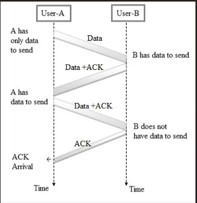

| Without piggybacking (3 frames) | With piggybacking (2 frames) |
|---|---|
| A → B : Data | A → B : Data |
| A ← B : ACK | A ← B : **Data + ACK** |
| A ← B : Data | |

*Example:* A sends Frame 5; B has Frame 8 to send → B sends **Frame 8 + ACK 5**.

| Advantages | Disadvantages |
|---|---|
| Fewer frames; saves bandwidth | ACK may be delayed if B has no data ready |
| Better channel utilisation; less overhead | If delay exceeds a timeout, a separate ACK must still be sent |
| | Not useful for mostly one-way traffic |

---

## 14. HDLC (High-Level Data Link Control) ★★★

- **Bit-oriented, synchronous** DLL protocol developed by **ISO**.
- Error detection with **CRC**, flow control, sliding window; supports **half- and full-duplex**; used mainly on **WAN / point-to-point and multipoint** links.
- Uses **bit stuffing** with flag `01111110`.
- **Station types:** primary, secondary, combined. **Modes:** NRM (Normal Response Mode – primary polls secondaries) and ABM (Asynchronous Balanced Mode – peers, either can start).

### Frame format
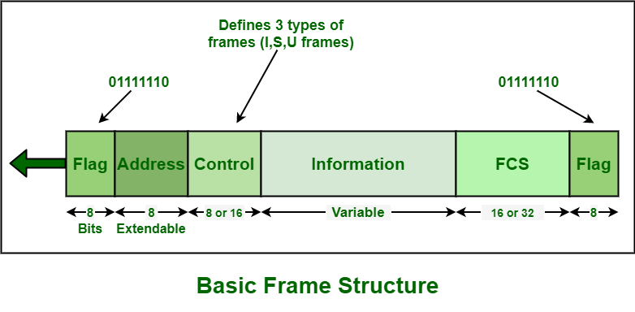

| Field | Size | Purpose |
|---|---|---|
| **Flag** | 8 bits `01111110` | Marks start and end; synchronisation |
| **Address** | 8 bits (extendable) | Address of the secondary station ("to" if from primary, "from" if from secondary) |
| **Control** | 8 or 16 bits | Frame type, sequence numbers, flow & error control |
| **Information** | Variable | User data (or management info) |
| **FCS** | 16 or 32 bits | CRC (ITU-T) for error detection |
| **Flag** | 8 bits | End of frame |

### Three frame types (identified by the first bits of the Control field)
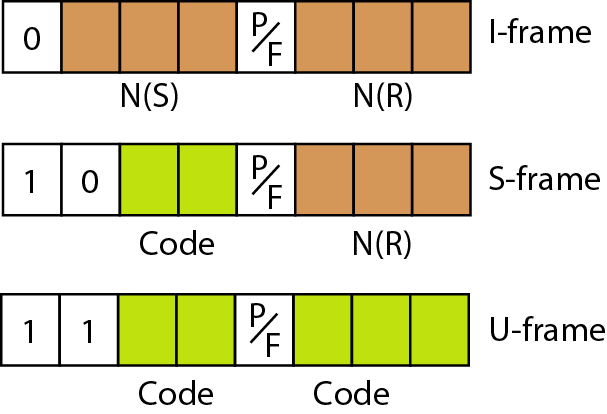

| Frame | Control starts with | Purpose |
|---|---|---|
| **I-frame** (Information) | `0` | Carries **user data** + N(S) send seq. no. + N(R) ack no. → can **piggyback** ACKs (in ABM) |
| **S-frame** (Supervisory) | `10` | **Flow & error control** (RR, RNR, REJ, SREJ); carries only N(R); **no information field** |
| **U-frame** (Unnumbered) | `11` | **Link management** – setup, disconnect (SABM, DISC, UA …); not sequenced; may carry management info |

**P/F bit** – *Poll* when sent by primary, *Final* when sent by secondary.

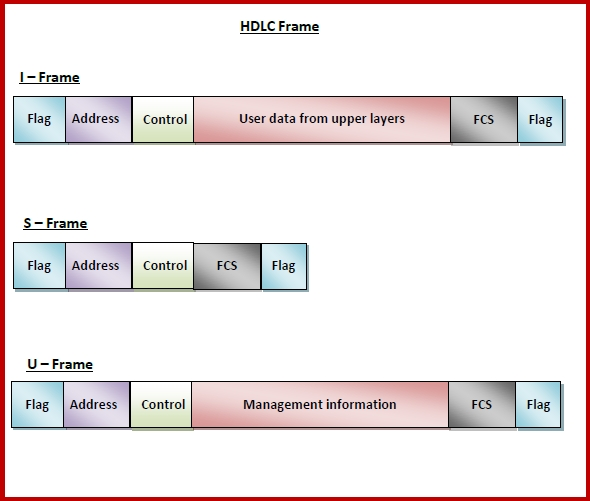

---

## 15. PPP (Point-to-Point Protocol) ★★★

- A **byte-oriented** DLL protocol for a **direct point-to-point link** (dial-up, leased lines, serial links, DSL); used by home users to reach ISPs.
- Error **detection** via FCS; can carry **multiple network-layer protocols** (IP, IPv6 …).
- Provides **no flow control**; error control is limited to detection (no retransmission).
- Sub-protocols: **LCP** (Link Control Protocol – set up/configure/test link), **NCPs** (e.g., IPCP – configure network layer), authentication (**PAP, CHAP**).

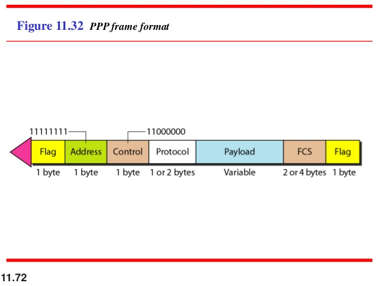

| Field | Size | Value / purpose |
|---|---|---|
| **Flag** | 1 byte | `01111110` — start/end (treated as a byte) |
| **Address** | 1 byte | Constant `11111111` (broadcast); may be omitted after negotiation |
| **Control** | 1 byte | Constant `00000011` (written `11000000` in some texts – imitates HDLC U-frame) |
| **Protocol** | 1–2 bytes | What the payload carries (IP, LCP, NCP …) |
| **Payload** | Variable (default max **1500 bytes**) | User data or control information |
| **FCS** | 2 or 4 bytes | CRC |
| **Flag** | 1 byte | `01111110` |

**Byte stuffing in PPP:** whenever the flag-like byte appears in the payload, the **escape byte `01111101`** is stuffed before it.

### HDLC vs PPP
| HDLC | PPP |
|---|---|
| Bit-oriented | Byte-oriented |
| Bit stuffing | Byte stuffing |
| Flow + error control (sliding window, ACKs) | Only error detection, no flow control |
| Point-to-point & multipoint | Point-to-point only |
| No authentication; single network protocol | Authentication (PAP/CHAP), multiple network protocols |

---

## Unit II — One-Page Summary

| Topic | Key points |
|---|---|
| **DLL structure** | LLC (framing, flow, error control) + MAC (shared-medium access, MAC addresses). Hop-to-hop delivery of frames. |
| **Design issues** | Services to network layer · framing · physical addressing · flow control · error control · access control. |
| **Services** | Unack. connectionless (fast, no ACK) · Ack. connectionless (ACK + retransmit) · Ack. connection-oriented (setup, ordered, reliable). |
| **Framing** | Fixed (padding, ATM) vs variable. Methods: **character count** (count corrupted → sync lost), **byte stuffing** (FLAG/ESC, PPP), **bit stuffing** (flag 01111110, stuff 0 after five 1s, HDLC). |
| **Errors** | Single-bit vs burst. Detection uses redundancy. |
| **Parity** | Even/odd; detects odd number of errors only. 2-D parity improves it. |
| **Checksum** | 1's-complement sum, wrap carry, complement. Receiver result all-0 → OK. Misses compensating errors. |
| **CRC** | Append (n−1) zeros, mod-2 divide by generator, remainder = CRC; receiver remainder 0 → OK. `1101011011` / `10011` → `11010110111110`. |
| **Hamming** | 2ʳ ≥ m + r + 1; parity at 1,2,4…; P1:1,3,5,7 · P2:2,3,6,7 · P4:4,5,6,7; syndrome gives error position. `1011` → `0110011`. |
| **Stop-and-Wait** | Window 1; wait for ACK; timeout → resend; 0/1 numbering; low efficiency. |
| **Go-Back-N** | Sender window N, receiver 1; discard out-of-order; cumulative ACK; resend lost + all after. |
| **Selective Repeat** | Both windows > 1; buffer out-of-order; per-frame timer; resend only the lost frame. |
| **Piggybacking** | ACK rides on reverse data frame (full duplex); fewer frames; possible ACK delay. |
| **HDLC** | ISO, bit-oriented; Flag·Address·Control·Info·FCS·Flag; I-frame (0), S-frame (10), U-frame (11); NRM/ABM. |
| **PPP** | Byte-oriented point-to-point; Flag·Address(FF)·Control(03)·Protocol·Payload(≤1500)·FCS·Flag; ESC 01111101; LCP/NCP, PAP/CHAP; no flow control. |
