# Unit III — The Medium Access Control (MAC) Sub-layer

> **Syllabus:** Channel allocation problem, MAC protocols: ALOHA, CSMA, CSMA/CD, MAC addresses, IEEE 802.X, Standard Ethernet, Wireless LANs, Bridges, Types of bridges.
>
> **Source:** *CN Unit-III Self.pptx* (SNIST). The slide deck ends at *MAC addresses*; sections marked **📘 (textbook supplement)** — IEEE 802.X, Standard Ethernet, Wireless LANs, Bridges — are written from the standard texts (Tanenbaum Ch. 4 / Forouzan) so that every syllabus topic is covered.

**Importance legend:** ★★★ = very frequently asked · ★★ = medium · ★ = short answer

---

## Table of Contents
1. [The MAC Sub-layer](#1-the-mac-sub-layer-)
2. [Channel Allocation Problem](#2-channel-allocation-problem-)
3. [Classification of MAC Protocols](#3-classification-of-multiple-access-protocols-)
4. [ALOHA — Pure & Slotted](#4-aloha-)
5. [CSMA and its persistence methods](#5-csma--carrier-sense-multiple-access-)
6. [CSMA/CD](#6-csmacd--collision-detection-)
7. [CSMA/CA](#7-csmaca--collision-avoidance--)
8. [MAC Addresses](#8-mac-addresses-)
9. [IEEE 802.X Standards](#9-ieee-802x-standards--)
10. [Standard Ethernet (802.3)](#10-standard-ethernet-ieee-8023--)
11. [Wireless LANs (802.11)](#11-wireless-lans-ieee-80211--)
12. [Bridges & Types of Bridges](#12-bridges--types-of-bridges--)
13. [Unit III — One-Page Summary](#unit-iii--one-page-summary)

---

## 1. The MAC Sub-layer ★

When many nodes share **one common link** (a **broadcast link**), someone must decide *who transmits when*. This is the job of the **MAC sub-layer**, the lower half of the data link layer.

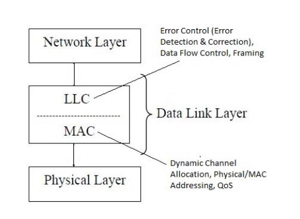

- **LLC (upper):** error control, flow control, framing.
- **MAC (lower):** dynamic channel allocation, physical (MAC) addressing, controls media access & frame transmission. It takes frames from LLC and adds **source & destination MAC addresses**.

---

## 2. Channel Allocation Problem ★★

The **channel allocation problem** = how to assign a single shared channel to many competing users so they transmit efficiently **without interference or collisions**.

> *Analogy:* one whiteboard, many students — if everyone writes together, nobody can read it; the teacher decides who writes and when.
> *Network example:* 10 computers on one network all sending at once → signals collide → data loss.

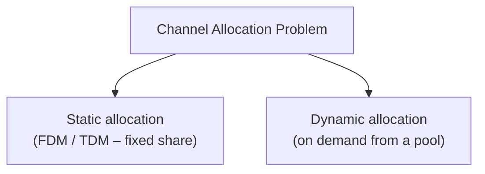

> *Bicycle analogy:* 10 children, 2 bicycles. **Static** = each child owns a bicycle permanently even when not riding (simple, wasteful). **Dynamic** = a bicycle is handed out only when a child needs one.

### 2.1 Static Channel Allocation
- Traditional approach using **FDM** (frequency division) or **TDM** (time division).
- With **N users**, the bandwidth is split into **N equal portions**; each user has a private band → **no interference, no collisions**.
- Channel stays reserved even when the user is idle.

| Advantages | Disadvantages |
|---|---|
| No collisions | Wastes bandwidth when users are idle |
| Easy to implement | Poor utilisation; bad for **bursty** traffic; fails if users > N |

### 2.2 Dynamic Channel Allocation
- Channels are **not permanently assigned**; allotted **on demand** from a central pool and released after use.

| Advantages | Disadvantages |
|---|---|
| Better bandwidth utilisation | More complex to manage |
| Suits modern, **bursty** traffic | Collisions possible if several users request simultaneously |

**Assumptions for dynamic allocation (Tanenbaum):** independent stations · single channel · collisions are detectable · continuous or slotted time · carrier sense or no carrier sense.

---

## 3. Classification of Multiple-Access Protocols ★★★

A **MAC protocol** is the set of rules that decides **who** uses the shared channel and **when**.

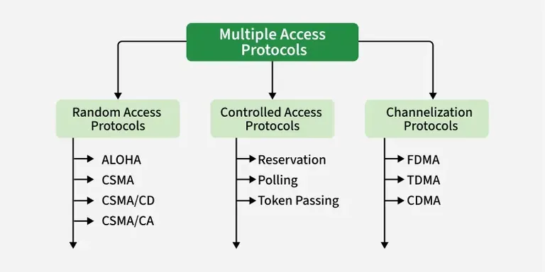

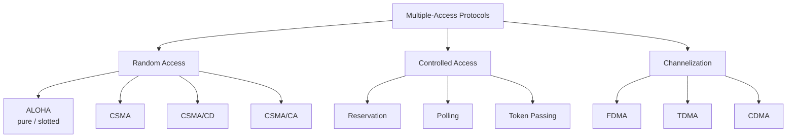

**Random-access protocols** — characteristics:
1. **No central controller**; every station decides for itself.
2. All stations have **equal priority** and share one medium.
3. A station sends whenever it has data → **collisions are possible**.
4. After a collision, retransmit after a **random delay (back-off)**.
5. Simple and decentralised.

---

## 4. ALOHA ★★★

Developed at the University of Hawaii (1970s). A station transmits **without checking whether the channel is idle**. If two frames overlap → collision → both destroyed → each sender retransmits after a random back-off.

### 4.1 Pure ALOHA
- Time is **continuous**; a station sends **as soon as** it has a frame.
- Receiver sends an **ACK**; no ACK within timeout ⇒ assume collision ⇒ wait a **random back-off time** and resend.
- Even if the **first bit of a new frame overlaps the last bit** of an almost-finished frame, *both* are destroyed.

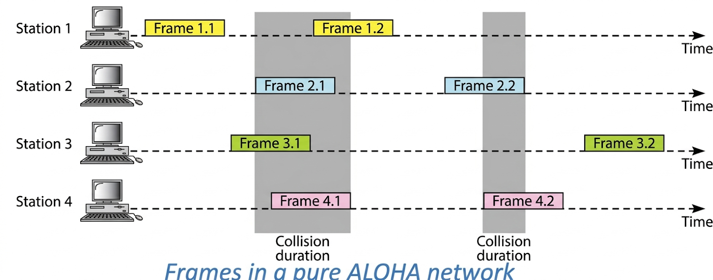

**Vulnerable time** — let T_fr (= t_p in slides) be the frame transmission time. A frame sent at t₀ collides with any frame started in (t₀ − T_fr, t₀ + T_fr):

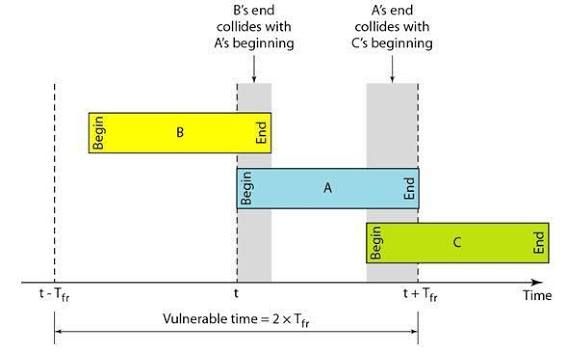

$$\text{Vulnerable time (Pure)} = 2 \times T_{fr}$$

**Throughput:** $S = G\,e^{-2G}$  (G = average frames generated per frame time)
Maximum at **G = 0.5**: $S_{max} = 0.5\,e^{-1} = \mathbf{0.184}$ → **18.4 %** of channel capacity.

| Advantages | Disadvantages |
|---|---|
| Very simple; no synchronisation | Very low efficiency (max 18.4 %) |
| Fine for low traffic | Many collisions under heavy load; unsuitable for real-time guarantees |

### 4.2 Slotted ALOHA
- Time is divided into **slots** equal to one frame time; all stations are **synchronised**.
- A station may transmit **only at the beginning of a slot**.
- Collisions happen only if two stations pick the **same slot** (and then fully overlap).

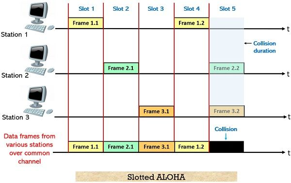

$$\text{Vulnerable time (Slotted)} = T_{fr}$$
**Throughput:** $S = G\,e^{-G}$, maximum at **G = 1**: $S_{max} = 1/e = \mathbf{0.368}$ → **36.8 %** (double pure ALOHA).

### 4.3 Pure vs Slotted ALOHA
| Pure ALOHA | Slotted ALOHA |
|---|---|
| Transmit **any time** | Transmit only at **start of a slot** |
| Continuous time, no global sync | Discrete time, globally synchronised |
| Vulnerable time = **2 × T_fr** | Vulnerable time = **T_fr** |
| S = G·e^(−2G) | S = G·e^(−G) |
| S_max = **18.4 %** at G = 0.5 | S_max = **36.8 %** at G = 1 |
| — | Halves collisions, doubles efficiency |

> **Numerical tip:** A pure-ALOHA channel of 200 kbps with 200-bit frames: T_fr = 1 ms, vulnerable time = 2 ms. If the system produces 1000 frames/s → G = 1 → S = 1·e⁻² ≈ 0.135 → ~135 frames/s survive.

---

## 5. CSMA — Carrier Sense Multiple Access ★★★

**Principle:** *"Sense before transmit" / "Listen before talk."* A station **listens to the channel** first; transmits only if idle.

- **Carrier busy** → someone is transmitting. **Carrier idle** → nobody is transmitting.
- Collisions are **still possible** because of **propagation delay**: a station may sense the medium idle simply because the first bit of another station's frame **has not yet reached it**.

### Persistence methods

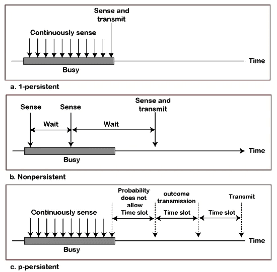

| Method | Channel busy | Channel idle | Pros / cons |
|---|---|---|---|
| **1-persistent** | Keep sensing **continuously** | Transmit **immediately (probability 1)** | Highest collision chance (all waiting stations jump in together); used by Ethernet |
| **Non-persistent** | Wait a **random time**, then sense again | Transmit immediately | Fewer collisions, but channel may sit idle → lower efficiency |
| **p-persistent** | Wait for next slot | Transmit with **probability p**; with q = 1 − p wait for the next slot and repeat | Balances the two; reduces collisions *and* improves efficiency; used with slotted channels (slot ≥ max propagation delay) |

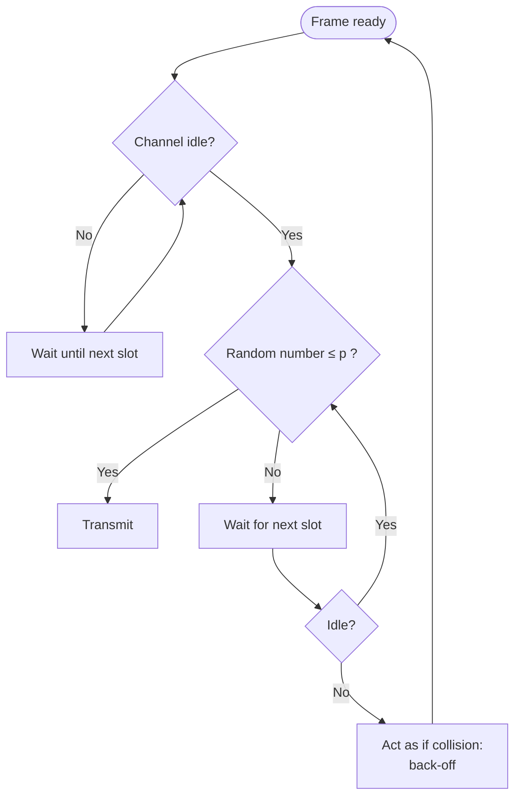

*p-persistent example (p = 0.5, stations A, B, C):* slot 1 → A transmits, B & C wait → **success**. Slot 2 → A and B both decide to transmit → **collision** → both back off. With p = 0.3 a station transmits 30 % of the time and waits 70 %.

### Why does the collision condition need Tt ≥ 2Tp?
Station A starts at 10:00 with propagation delay **Tp = 1 hour** to the farthest station D. At 10:59:59 D senses idle and transmits → collision near D at 11:00. The collision signal takes another hour to return to A (12:00). **A can only notice the collision if it is still transmitting**, so

$$T_t \ge 2\,T_p \quad\Rightarrow\quad L_{min} = 2 \times T_p \times \text{Bandwidth}$$

---

## 6. CSMA/CD — Collision Detection ★★★

Used by classic (wired, shared) **Ethernet**. Sense the carrier, transmit, **keep monitoring** while transmitting; on detecting a collision: **stop, send a jam signal, back off, retry**.

### Algorithm
1. Frame ready → sense the channel.
2. **Busy** → wait until idle (1-persistent).
3. **Idle** → start transmitting and **monitor for collisions**.
4. No collision during transmission → success; reset counters.
5. **Collision detected** → run collision-resolution:
   - Continue for a short time with a **jam signal** (48 bits per the slides) so every station notices.
   - Increment the attempt counter *n*.
   - If *n* = max attempts (15 in Ethernet) → **abort**.
   - Else wait a **back-off time** and restart from step 1.

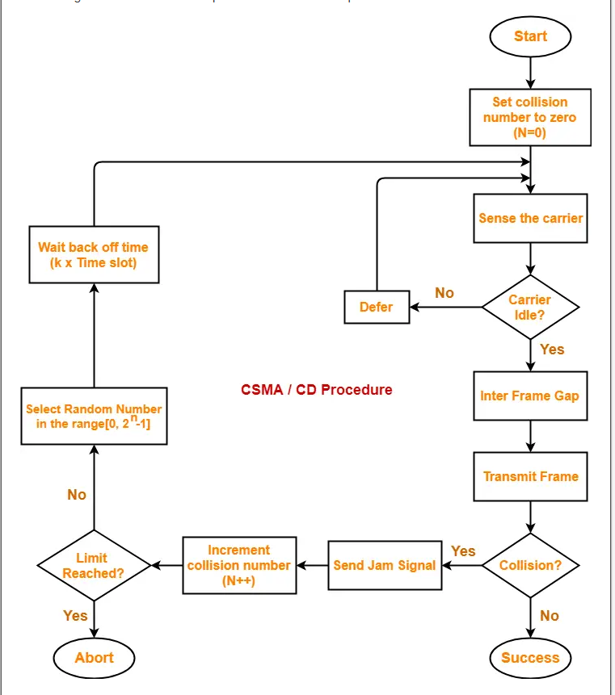

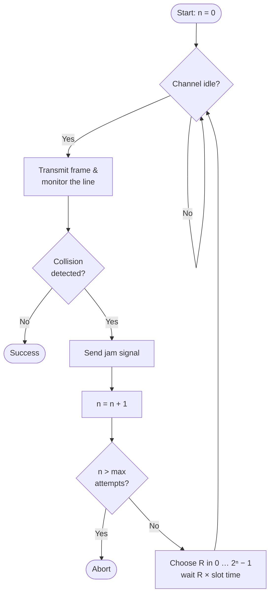

**Binary Exponential Back-off:** after the *n*-th collision choose R randomly from 0 … 2ⁿ − 1 (n capped at 10) and wait R × slot time (51.2 µs in 10 Mbps Ethernet).

### Three states of a CSMA/CD channel
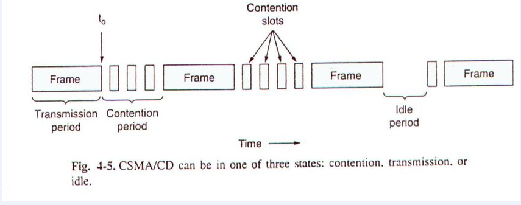

| State | Meaning |
|---|---|
| **Transmission period** | One station has captured the channel and sends the whole frame; no collision |
| **Contention period** | Several stations try at once → collisions → back-off; ends when one station wins |
| **Idle period** | No station has anything to send |

> **Ethernet → CSMA/CD · Wi-Fi → CSMA/CA**

---

## 7. CSMA/CA — Collision Avoidance ★★ 📘

In **wireless** networks a station cannot listen while it transmits, and some stations are hidden from each other, so collisions cannot be detected reliably → **avoid** them instead (IEEE 802.11):

- **IFS (Inter-Frame Space):** after sensing idle, wait an IFS (DIFS) before sending.
- **Contention window:** then wait a random number of slots (binary exponential); the timer pauses while the channel is busy.
- **Acknowledgment:** receiver returns an ACK after SIFS; no ACK ⇒ retransmit.
- **Optional RTS/CTS** handshake + **NAV** (Network Allocation Vector) to solve the **hidden-station problem**.

| CSMA/CD | CSMA/CA |
|---|---|
| Wired (Ethernet) | Wireless (Wi-Fi) |
| Detects collision **after** it happens | Tries to **avoid** collision before it happens |
| Jam signal + back-off | IFS + contention window + ACK (+ RTS/CTS) |

---

## 8. MAC Addresses ★★

A **MAC address** (physical / hardware / Ethernet address) is a **unique 48-bit number** burned into the **NIC** by the manufacturer.

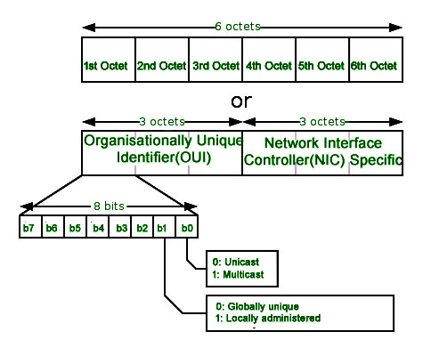

- **48 bits = 6 bytes = 6 octets**, each written as **2 hex digits**, e.g. `00:1A:2B:3C:4D:5E` or `00-1A-2B-3C-4D-5E`.
- **First 3 octets → OUI** (Organisationally Unique Identifier – manufacturer).
- **Last 3 octets → device identifier** (assigned by the manufacturer).
- **Unicast / multicast:** least-significant bit of the first octet = 0 → unicast, 1 → multicast.
- **Globally unique / locally administered:** second-least-significant bit of the first octet = 0 → globally unique (OUI-assigned), 1 → locally administered.
- **Broadcast** = `FF:FF:FF:FF:FF:FF`.

| MAC address | IP address |
|---|---|
| Physical, 48 bits, hex | Logical, 32 bits (IPv4), dotted decimal |
| Burned into NIC, fixed | Assigned by admin/DHCP, changeable |
| Used by DLL (hop-to-hop) | Used by network layer (end-to-end) |
| Mapped from IP by **ARP** | — |

---

## 9. IEEE 802.X Standards ★★ 📘

IEEE **Project 802** standardised LANs/MANs at the **physical and data link layers**, splitting the DLL into **LLC (802.2)** and **MAC** (one per technology).

| Standard | Technology |
|---|---|
| 802.1 | Bridging, internetworking, VLANs, spanning tree |
| 802.2 | Logical Link Control (LLC) |
| **802.3** | **Ethernet (CSMA/CD)** |
| 802.4 | Token Bus |
| **802.5** | **Token Ring** |
| 802.6 | MAN – DQDB |
| **802.11** | **Wireless LAN (Wi-Fi)** |
| 802.15 | Wireless PAN (Bluetooth) |
| 802.16 | Broadband wireless (WiMAX) |

---

## 10. Standard Ethernet (IEEE 802.3) ★★★ 📘

Classic **10 Mbps** Ethernet: bus or star, **CSMA/CD**, **Manchester encoding**, connectionless & unreliable (no ACK at DLL).

### Frame format
```
| Preamble | SFD | Dest addr | Src addr | Type/Length |   Data & Padding   |  CRC  |
|  7 bytes | 1 B |  6 bytes  | 6 bytes  |   2 bytes   |  46 – 1500 bytes   | 4 B   |
```
| Field | Purpose |
|---|---|
| **Preamble** (7 B) | Alternating `10101010…` for receiver clock synchronisation (added by PHY) |
| **SFD** (1 B) | `10101011` – start frame delimiter |
| **Destination / Source address** (6 B each) | MAC addresses |
| **Type / Length** (2 B) | Upper-layer protocol (e.g., 0x0800 = IPv4) or length |
| **Data + Pad** | 46–1500 bytes; padding added if data < 46 |
| **CRC** (4 B) | CRC-32 error detection |

**Frame length:** min **64 bytes** (512 bits — needed so that Tt ≥ 2Tp for collision detection), max **1518 bytes** (excluding preamble/SFD).

### Physical-layer implementations (10 Mbps)
| Name | Medium | Max segment | Topology |
|---|---|---|---|
| **10Base5** (Thick Ethernet) | Thick coax (RG-11) | 500 m | Bus |
| **10Base2** (Thin Ethernet / Cheapernet) | Thin coax (RG-58) | 185 m | Bus |
| **10Base-T** | UTP (Cat 3) | 100 m | Star (hub) |
| **10Base-F** | Fiber | 2000 m | Star |

*"10" = 10 Mbps, "Base" = baseband, last part = medium/length.*

**Evolution:** Fast Ethernet (100 Mbps, 100Base-TX), Gigabit (1000Base-T), 10-Gigabit Ethernet; switched full-duplex Ethernet eliminates collisions altogether.

---

## 11. Wireless LANs (IEEE 802.11) ★★★ 📘

### Architecture
- **BSS (Basic Service Set):** stations + optional **Access Point (AP)**.
  - *Ad-hoc* BSS – no AP, stations talk directly.
  - *Infrastructure* BSS – with an AP.
- **ESS (Extended Service Set):** several BSSs whose APs are joined by a **distribution system** (usually wired Ethernet).
- **Station mobility types:** no-transition, BSS-transition, ESS-transition.

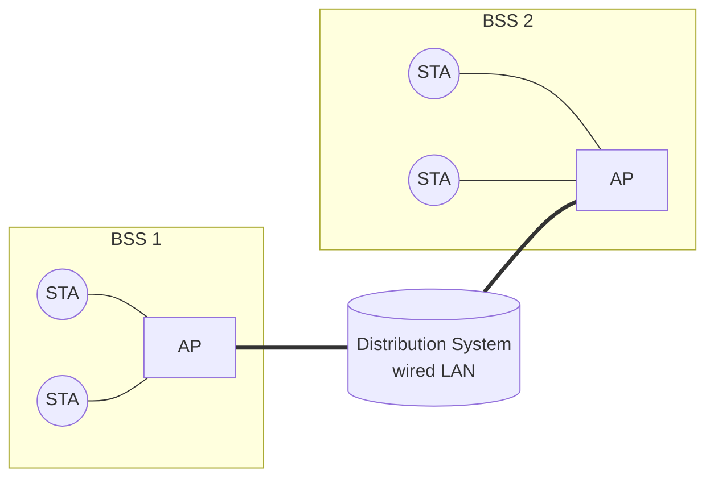

### MAC sub-layer
- **DCF (Distributed Coordination Function)** – contention using **CSMA/CA** (see §7). Mandatory.
- **PCF (Point Coordination Function)** – optional, contention-free **polling** by the AP for time-sensitive traffic.

### Problems in wireless LANs
- **Hidden-station problem:** A and C both reach B but not each other → both send to B → collision undetected. *Fix:* **RTS/CTS** – the CTS from B is heard by C, which defers (sets NAV).
- **Exposed-station problem:** a station wrongly refrains from sending even though its transmission would not interfere.

### Physical layers
| Standard | Band | Max rate |
|---|---|---|
| 802.11 | 2.4 GHz (FHSS/DSSS/IR) | 1–2 Mbps |
| 802.11b | 2.4 GHz (DSSS) | 11 Mbps |
| 802.11a | 5 GHz (OFDM) | 54 Mbps |
| 802.11g | 2.4 GHz (OFDM) | 54 Mbps |
| 802.11n | 2.4/5 GHz (MIMO) | 600 Mbps |
| 802.11ac / ax | 5 GHz / 2.4+5 GHz | Gbps range (Wi-Fi 5 / 6) |

**Frame:** Frame Control · Duration (NAV) · **Address 1–4** · Sequence Control · Body (0–2312 B) · FCS. Four addresses are needed because frames may travel via APs and the distribution system.

---

## 12. Bridges & Types of Bridges ★★★ 📘

A **bridge** is a **data-link-layer (Layer 2) device** that connects two or more LAN segments and **filters/forwards frames using MAC addresses**. It divides a network into separate **collision domains** while keeping one broadcast domain.

### Functions
- **Filtering** – drop a frame if the destination is on the same segment as the source.
- **Forwarding** – send to the port where the destination lives.
- **Flooding** – if destination unknown (or broadcast), send to all ports except the incoming one.
- **Learning** – build the MAC table from the **source addresses** of incoming frames.

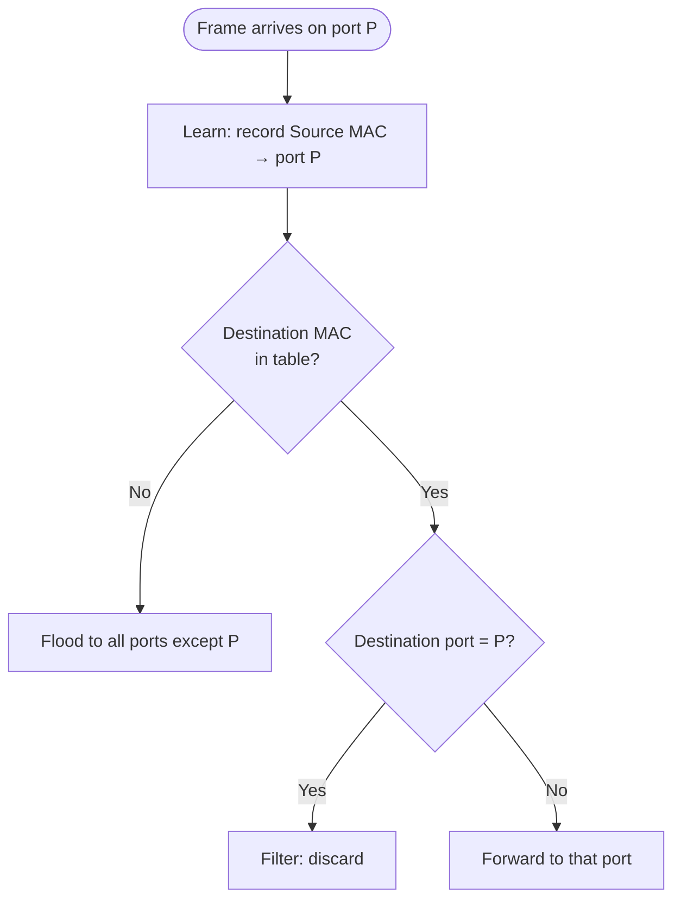

### Types of bridges
| Type | Description |
|---|---|
| **Transparent (learning) bridge** | Invisible to stations; builds its forwarding table automatically by **backward learning**; uses the **Spanning Tree Protocol (IEEE 802.1D)** to remove loops when bridges are connected redundantly. Used in Ethernet. |
| **Source-routing bridge** | The **sending station** determines the full path and places it in the frame; bridges simply follow it. Used in Token Ring (802.5). |
| **Translational bridge** | Connects LANs of **different types** (e.g., Ethernet ↔ Token Ring), converting frame formats. |
| **Local bridge** | Connects LAN segments in the same building/area. |
| **Remote bridge** | Connects distant LANs through a WAN link (pairs of bridges at each end). |
| **Simple (static) bridge** | Table entered **manually** by the administrator. |

**Spanning Tree:** redundant bridges form loops → frames circulate forever and tables oscillate. Bridges elect a **root bridge** (lowest ID), compute shortest paths to it, and **block** ports not on the tree, giving a loop-free logical topology.

### Bridge vs Hub/Repeater vs Switch vs Router
| Device | Layer | Works on | Collision domains |
|---|---|---|---|
| Repeater / Hub | 1 | Bits | One |
| **Bridge** | 2 | MAC address | One per port (few ports, software) |
| Switch | 2 | MAC address | One per port (many ports, hardware — "multiport bridge") |
| Router | 3 | IP address | Separate broadcast domains too |

---

## Unit III — One-Page Summary

| Topic | Key points |
|---|---|
| **MAC sub-layer** | Lower half of DLL; decides who uses a shared broadcast link; adds MAC addresses. |
| **Channel allocation** | Static (FDM/TDM; no collisions, wastes idle bandwidth) vs Dynamic (on demand; efficient for bursty traffic, collisions possible). |
| **MAC protocol classes** | Random access (ALOHA, CSMA, CSMA/CD, CSMA/CA) · Controlled (reservation, polling, token) · Channelization (FDMA, TDMA, CDMA). |
| **Pure ALOHA** | Send anytime; vulnerable time **2T**; S = G·e^(−2G); max **18.4 %** at G = 0.5. |
| **Slotted ALOHA** | Send at slot start; vulnerable time **T**; S = G·e^(−G); max **36.8 %** at G = 1. |
| **CSMA** | Listen before talk; collisions still occur due to propagation delay. |
| **Persistence** | 1-persistent (send at once when idle – most collisions) · non-persistent (random wait when busy – idle waste) · p-persistent (send with prob. p in slot). |
| **Collision condition** | **Tt ≥ 2Tp** → L_min = 2 × Tp × B. |
| **CSMA/CD** | Sense → transmit & monitor → collision → jam → binary exponential back-off → retry (max 15) → abort. States: transmission, contention, idle. Ethernet. |
| **CSMA/CA** | Wireless; IFS + random contention window + ACK; RTS/CTS + NAV for hidden stations. Wi-Fi. |
| **MAC address** | 48-bit, 6 octets in hex; first 3 = OUI (vendor), last 3 = device; broadcast FF:FF:FF:FF:FF:FF. |
| **IEEE 802.x** | 802.2 LLC · **802.3 Ethernet** · 802.4 token bus · **802.5 token ring** · **802.11 WLAN** · 802.15 Bluetooth · 802.16 WiMAX. |
| **Ethernet frame** | Preamble 7 · SFD 1 · Dest 6 · Src 6 · Type 2 · Data 46–1500 · CRC 4; min 64 B, max 1518 B. 10Base5/10Base2/10Base-T/10Base-F. |
| **Wireless LAN** | BSS (ad-hoc / infrastructure), ESS via distribution system; DCF (CSMA/CA) + PCF (polling); hidden & exposed station problems. |
| **Bridges** | Layer-2; filter, forward, flood, learn. Types: transparent (learning + spanning tree), source-routing, translational, local, remote. |
