# Unit IV — The Network Layer: Design Issues, Routing & Internetworking

> **Syllabus:** Network layer design issues, Virtual-circuit vs Datagram subnets, Routing algorithms (optimality principle, shortest path, flooding, distance vector, link state, hierarchical, broadcast, multicast, mobile hosts), Internetworking (how networks differ/connect, concatenated VCs, connectionless internetworking, tunneling, internetwork routing, fragmentation).
>
> **Sources:** *unit-IV.ppt* (Tanenbaum-based figures) + *CN-4-5-6 Imp Questions.docx*

**Importance legend:** ★★★ = very frequently asked (marked ★ in the Imp-Questions doc) · ★★ = medium · ★ = short answer

---

## Table of Contents
1. [Role of the Network Layer](#1-role-of-the-network-layer-)
2. [Design Issues](#2-network-layer-design-issues-)
3. [Connectionless Service – Datagram Subnet](#3-connectionless-service--datagram-subnet-)
4. [Connection-Oriented Service – Virtual-Circuit Subnet](#4-connection-oriented-service--virtual-circuit-subnet-)
5. [Virtual Circuit vs Datagram](#5-virtual-circuit-vs-datagram-subnets-)
6. [Routing Algorithms – Basics](#6-routing-algorithms--basics-)
7. [Optimality Principle & Sink Tree](#7-the-optimality-principle-)
8. [Shortest Path Routing (Dijkstra)](#8-shortest-path-routing--dijkstra-)
9. [Flooding](#9-flooding-)
10. [Distance Vector Routing](#10-distance-vector-routing-)
11. [Link State Routing](#11-link-state-routing-)
12. [Hierarchical Routing](#12-hierarchical-routing-)
13. [Broadcast Routing](#13-broadcast-routing-)
14. [Multicast Routing](#14-multicast-routing-)
15. [Routing for Mobile Hosts](#15-routing-for-mobile-hosts-)
16. [Internetworking](#16-internetworking-)
17. [Unit IV — One-Page Summary](#unit-iv--one-page-summary)

---

## 1. Role of the Network Layer ★

- Gets packets **from the source all the way to the destination** (end-to-end across many hops) — unlike the DLL, which only moves frames across one link.
- Must know the **topology** of the subnet and choose **appropriate paths**.
- Must choose routes that **avoid overloading** some lines/routers while leaving others idle.
- Must handle problems when **source and destination are on different networks** (internetworking).

---

## 2. Network Layer Design Issues ★★★

1. **Store-and-forward packet switching**
2. **Services provided to the transport layer**
3. **Implementation of connectionless service**
4. **Implementation of connection-oriented service**
5. **Comparison of virtual-circuit and datagram subnets**

*(Imp-Q doc also lists:)* routing, congestion control, carrier/user separation and network heterogeneity (different addressing, MTUs → fragmentation).

### 2.1 Store-and-Forward Packet Switching
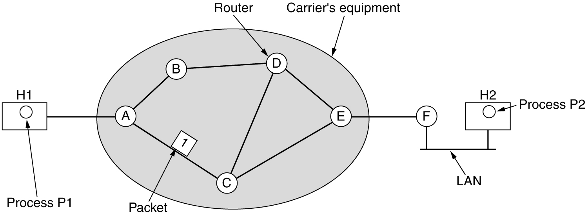

- A host sends its packet to the **nearest router** (on its LAN or over a point-to-point link to the carrier).
- The router **stores** the packet until it has **fully arrived** and the **checksum is verified**,
- then **forwards** it to the next router along the path … until it reaches the destination host.

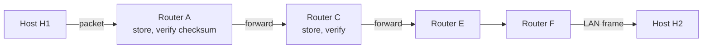

### 2.2 Services Provided to the Transport Layer
Design goals:
1. Services should be **independent of router technology**.
2. The transport layer should be **shielded** from the number, type and topology of routers.
3. Network addresses should use a **uniform numbering plan**, even across LANs and WANs.

Two camps resulted:
- **Connectionless** (Internet community) – subnet is unreliable; hosts do error/flow control. → **datagrams**
- **Connection-oriented** (telephone companies, e.g., **ATM**) – reliable, QoS-friendly service. → **virtual circuits**

---

## 3. Connectionless Service — Datagram Subnet ★★★

- Packets (**datagrams**) are injected **individually** and **routed independently**; **no advance setup**.
- The subnet is called a **datagram subnet**.

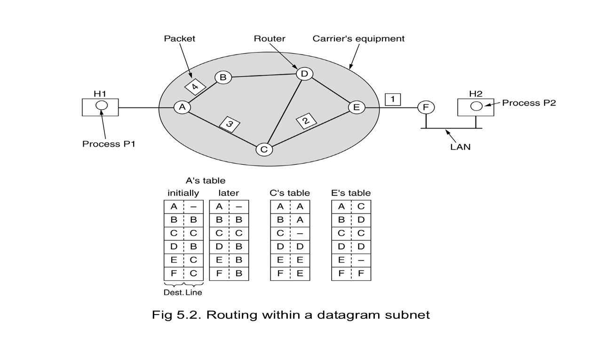

**Example (Fig 5-2):** Process P1 on H1 has a long message for P2 on H2. The transport layer gives it to the network layer, which splits it into packets **1, 2, 3, 4** and sends them to router **A**.
- Every router has a table: *(destination → outgoing line)*. A has lines only to B and C.
- Packets 1, 2, 3 are stored briefly at A (checksum), then sent to **C** (A's table "initially"), then E → F → H2 over the LAN.
- **Packet 4** is sent to **B**, though also bound for F — A learned of a traffic jam on the A-C-E path and updated its table ("later").
- The algorithm that manages the tables and makes these decisions is the **routing algorithm**.

---

## 4. Connection-Oriented Service — Virtual-Circuit Subnet ★★★

- Avoid choosing a new route for every packet: when a **connection is established**, a route is chosen and **stored in tables inside the routers**. All traffic of that connection uses it; the VC is torn down on release.
- Every packet carries a **VC identifier** (connection identifier) rather than the full destination address.

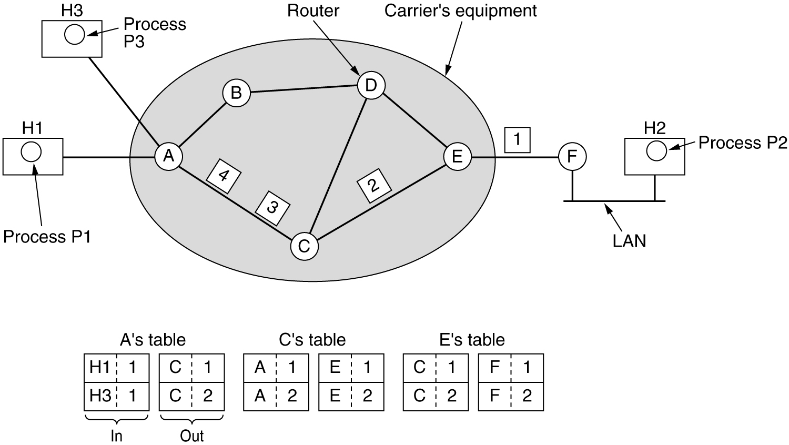

**Example (Fig 5-3):**
- H1 sets up connection **1** to H2. A's table: *in from H1 with VC 1 → out to C with VC 1*; C: → E with VC 1; and so on.
- H3 also opens a connection to H2 and (naturally) also picks identifier **1**. A can tell them apart (different incoming lines) but **C could not** — so **A assigns a different identifier (2)** to the outgoing packets of the second connection.
- Replacing connection identifiers in outgoing packets = **label switching**.

---

## 5. Virtual-Circuit vs Datagram Subnets ★★★

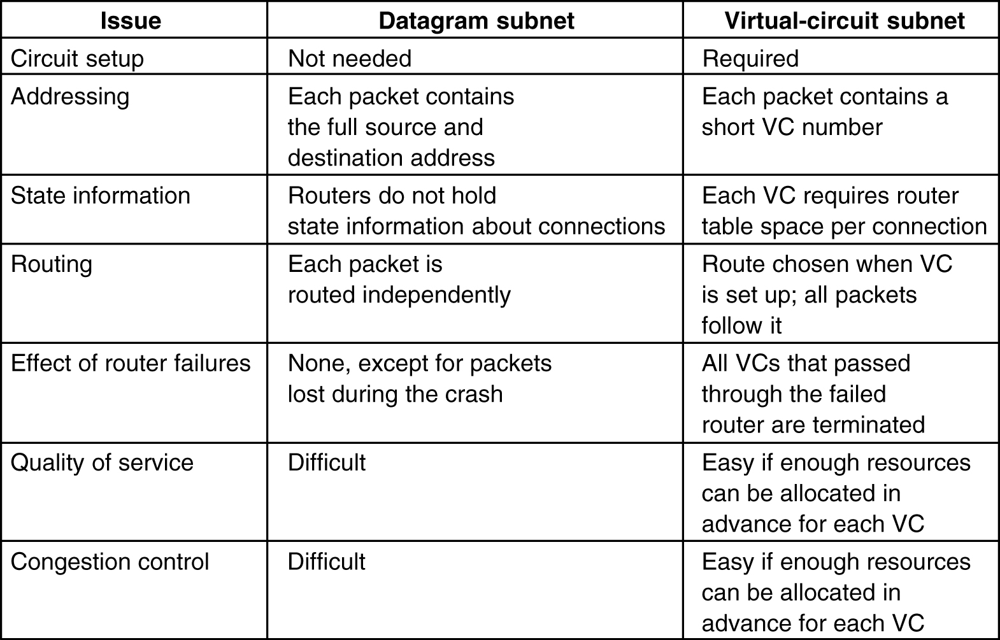

| Issue | Datagram subnet | Virtual-circuit subnet |
|---|---|---|
| Circuit setup | **Not needed** | **Required** |
| Addressing | Each packet carries **full source & destination address** | Each packet carries a **short VC number** |
| State information | Routers hold **no state** about connections | Each VC needs **router table space per connection** |
| Routing | **Each packet routed independently** (may take different paths, arrive out of order) | Route chosen at setup; **all packets follow it** (in order) |
| Effect of router failure | **None**, except packets lost during the crash | **All VCs** through the failed router are terminated |
| Quality of service | **Difficult** | **Easy** if enough resources are reserved in advance |
| Congestion control | **Difficult** | **Easy** if resources reserved in advance |
| Examples | Internet (IP) | ATM, X.25, Frame Relay |

**Trade-offs:** router memory vs bandwidth (VC headers are short but routers keep tables); setup time vs address-parsing time; table space; robustness.

---

## 6. Routing Algorithms — Basics ★★

**Routing algorithm** = the part of the network-layer software responsible for deciding **which output line an incoming packet should be sent on**.

- **Routing** – *filling and updating* the routing tables (the algorithm).
- **Forwarding** – *looking up* the table for each arriving packet and sending it out.

### Desirable properties
| Property | Meaning |
|---|---|
| **Correctness** | Packets must reach the right destination |
| **Simplicity** | Low overhead |
| **Robustness** | Cope with hardware/software failures and topology/traffic changes for years without reboot |
| **Stability** | Converge to equilibrium and stay there |
| **Fairness** | Every node gets a fair chance to send |
| **Optimality** | Minimise mean packet delay / maximise throughput |

**Fairness vs optimality conflict:** if A–A′, B–B′, C–C′ traffic fills the horizontal line, optimal throughput says keep it that way — but then X–X′ never gets a chance.

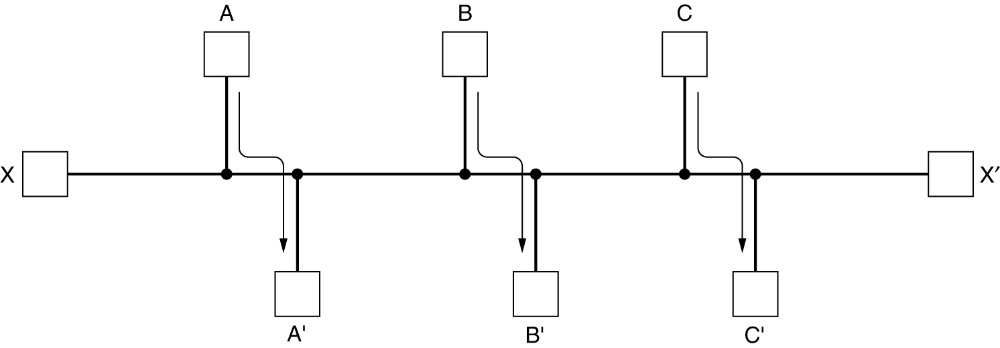

### Classes of routing algorithms
| Non-adaptive (static) | Adaptive (dynamic) |
|---|---|
| Routes **computed in advance**, downloaded to routers at boot | Routes **change** with topology and traffic |
| No measurement of current traffic | Get info locally / from neighbours / from all routers |
| Shortest path, flooding | Distance vector, link state |

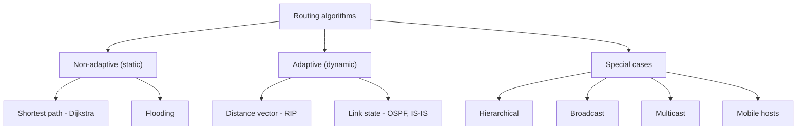

---

## 7. The Optimality Principle ★★

> **If router J is on the optimal path from router I to router K, then the optimal path from J to K also falls along the same route.**

*Proof:* if a better route from J to K existed, joining it with the I→J part would give a better I→K route, contradicting optimality.

**Sink tree:** the set of optimal routes from **all sources to a given destination B** forms a **tree rooted at B**. A sink tree has **no loops**, so every packet is delivered in a finite number of hops. Real routing algorithms aim to discover and use sink trees.

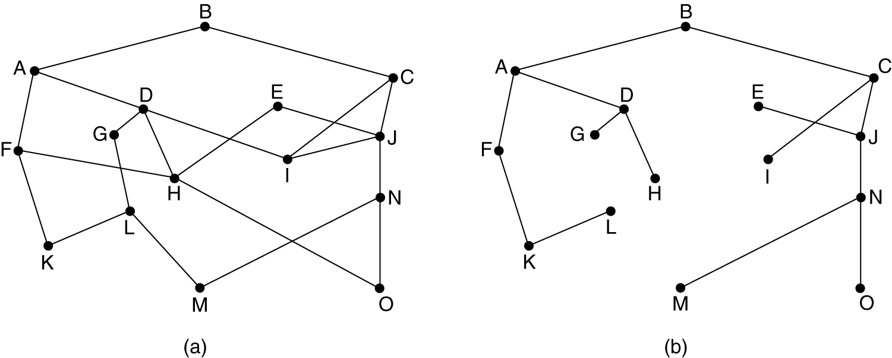

---

## 8. Shortest Path Routing — Dijkstra ★★★

- Build a **graph of the subnet**: each node = router, each edge = communication line.
- Find the shortest path between a pair of routers. "Length" can be: **number of hops**, **geographic distance**, mean queueing + transmission delay, bandwidth, cost, etc.
  *(With hop count, ABC and ABE are equally long; with km, ABC is longer.)*

### Dijkstra's algorithm
1. Label every node with **(distance from source, previous node)**; initially all **∞** and **tentative**.
2. Make the source **permanent** with label (0, –); it is the **working node**.
3. For each tentative neighbour of the working node: *new = dist(working) + edge weight*; if smaller than its label, **relabel** it (and record the working node as predecessor).
4. Among **all** tentative nodes, pick the one with the **smallest label**, make it **permanent** → new working node.
5. Repeat 3–4 until the destination (or all nodes) is permanent. Trace predecessors backwards to read the path.

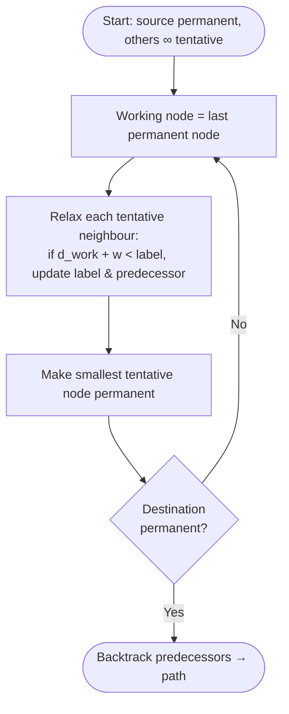

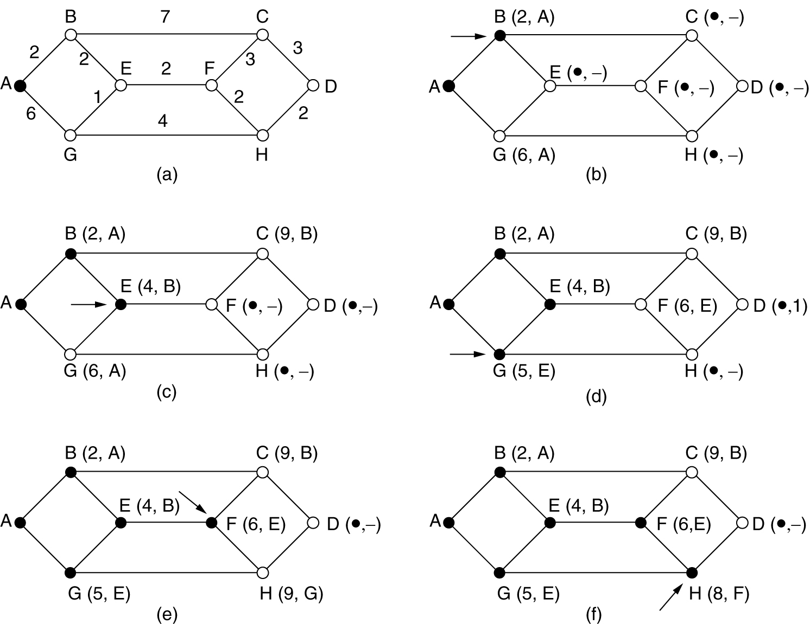

### Worked example (graph of Fig 5-7) — A to D
Edges: A–B 2, A–G 6, B–C 7, B–E 2, E–G 1, E–F 2, F–C 3, F–H 2, G–H 4, H–D 2, C–D 3.

| Step | Working node | Labels updated | Made permanent |
|---|---|---|---|
| 1 | A (0) | B(2,A), G(6,A) | **B (2)** |
| 2 | B | C(9,B), E(4,B) | **E (4)** |
| 3 | E | G(5,E) *(5 < 6)*, F(6,E) | **G (5)** |
| 4 | G | H(9,G) | **F (6)** |
| 5 | F | H(8,F) *(8 < 9)*, C stays 9 | **H (8)** |
| 6 | H | D(10,H) | **C (9)** |
| 7 | C | D via C = 12 > 10 → ignore | **D (10)** |

**Shortest path: A → B → E → F → H → D, cost = 10.**

---

## 9. Flooding ★★

- **Static** algorithm: **every incoming packet is sent out on every outgoing line except the one it arrived on.**
- Generates **vast numbers of duplicates** (infinite unless damped).

**Damping measures**
1. **Hop counter** in the header, decremented at each hop; packet discarded at 0 (initialise to the subnet diameter).
2. **Sequence numbers** — each router remembers which (source, seq) it has already flooded and does not flood it again.
3. **Selective flooding** — send only on lines going *roughly in the right direction*.

| Advantages | Disadvantages |
|---|---|
| Extremely **robust** – reaches destination if any path exists | Huge bandwidth waste (duplicates) |
| Always finds the **shortest path** (one copy takes it) → benchmark for other algorithms | Needs duplicate control |
| No routing tables required | Not scalable |

**Applications:** military networks (routers may be destroyed), distributed databases (update all copies at once), wireless networks (every transmission can be heard), as a **metric/benchmark**, and to distribute link-state packets.

---

## 10. Distance Vector Routing ★★★

- **Dynamic**, distributed algorithm, a.k.a. **distributed Bellman-Ford** / Ford-Fulkerson; used in ARPANET and in **RIP**.
- Each router keeps a **table (vector)** with one entry per router in the subnet: **(best known distance, outgoing line to use)**.
- Tables are updated by **exchanging vectors with neighbours only**.
- Metric: hops, delay (measured with ECHO packets), queue length, etc.

### Update rule
Every **T** msec each router sends its vector to each neighbour. Router J receives from neighbour X the list Xᵢ (X's estimate to reach router *i*). If J's delay to X is *m*, then J can reach *i* via X in **Xᵢ + m**. J computes this for every neighbour and picks the minimum:

$$D_J(i) = \min_{X \in \text{neighbours}} \big( d(J,X) + D_X(i) \big)$$

Note: J's **old table is not used** in the calculation.

### Worked example (Fig 5-9)
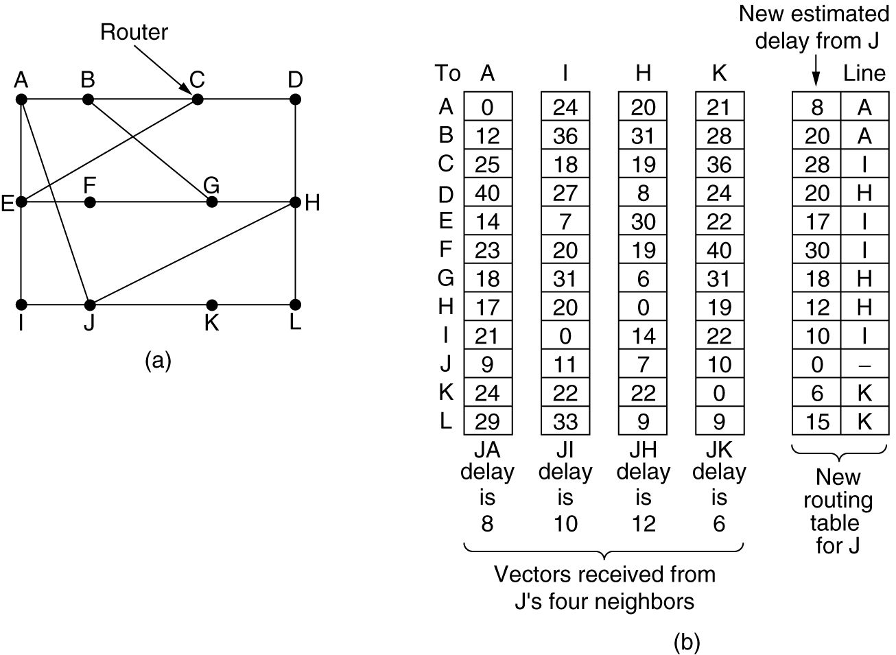

J's measured delays: **JA = 8, JI = 10, JH = 12, JK = 6**. Neighbours' estimates to G: A→G = 18, I→G = 31, H→G = 6, K→G = 31.

| Via | Calculation | Delay to G |
|---|---|---|
| A | 8 + 18 | 26 |
| I | 10 + 31 | 41 |
| **H** | **12 + 6** | **18 ← minimum** |
| K | 6 + 31 | 37 |

→ J's new entry for G: **delay 18 ms, line H**. Repeat for all destinations to build the new table.

### Count-to-Infinity Problem ★★★
DVR reacts **quickly to good news but slowly to bad news**.

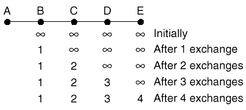
**Good news:** routers A–B–C–D–E in a line; A comes up → B learns 1, C learns 2, D 3, E 4 — one hop per exchange.

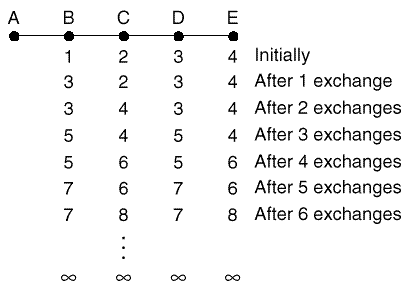
**Bad news:** A goes down. B hears C claim "2 to A" (C's route actually goes through B!) and sets 3; C then sets 4; … values climb slowly: 3,4,5,6… to **∞**. No router ever has a value more than one higher than the minimum of its neighbours.

| | B | C | D | E |
|---|---|---|---|---|
| Initially | 1 | 2 | 3 | 4 |
| After 1 exchange | 3 | 2 | 3 | 4 |
| After 2 | 3 | 4 | 3 | 4 |
| After 3 | 5 | 4 | 5 | 4 |
| After 4 | 5 | 6 | 5 | 6 |
| … | … | … | … | ∞ |

**Partial solutions**
- **Make "infinity" small** – e.g., 16 hops (RIP) = longest path + 1.
- **Split horizon** – don't advertise a route back to the neighbour you learned it from.
- **Split horizon with poison reverse** – advertise it back, but with **infinite** cost.

---

## 11. Link State Routing ★★★

DVR was used in ARPANET until **1979** and replaced because (1) its delay metric (queue length) **ignored line bandwidth**, and (2) it **converged too slowly** (count-to-infinity). Variants of link-state: **IS-IS** and **OSPF**.

### The five steps — each router must:
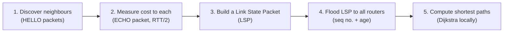

**1. Learning about neighbours** – on boot, send a **HELLO** packet on each point-to-point line; the other end replies with its name. A **LAN** is modelled as an **artificial node** connected to all its routers.

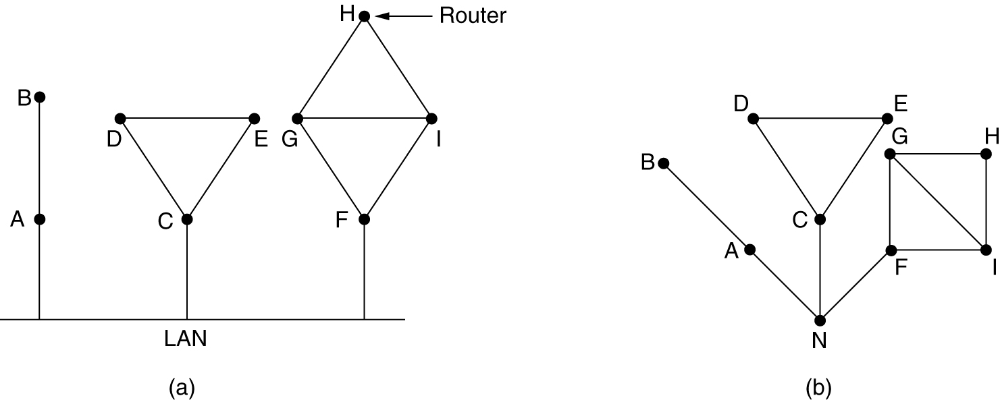

**2. Measuring line cost** – send an **ECHO** packet that the other side returns immediately; delay ≈ **RTT / 2** (average over several tries).
- To *include load*, start the timer when the ECHO packet is **queued**; to *ignore load*, start it when the packet reaches the **front of the queue**. Including load can cause **route oscillation** (traffic flips between the two East–West lines), so load is best spread over multiple lines.

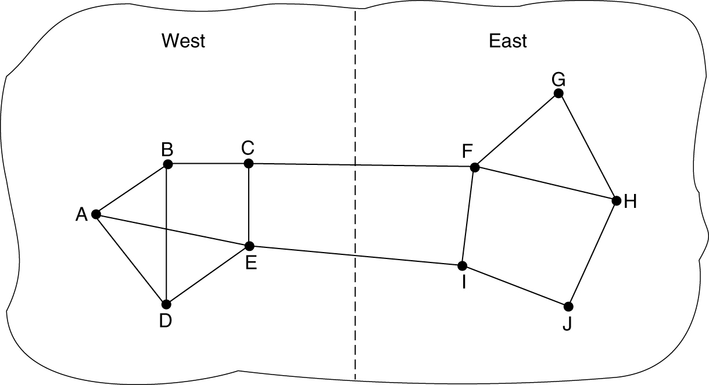

**3. Building link state packets** – LSP contains: **sender identity, sequence number, age, list of neighbours with costs**. Built **periodically** or **when a significant event** occurs (line/neighbour down or up).

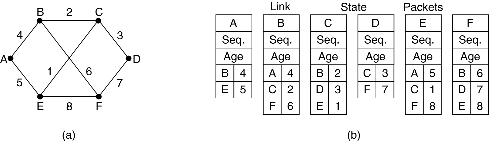

**4. Distributing the LSPs** (the trickiest part) – by **flooding**, controlled by sequence numbers:
- New (higher seq) LSP → install and forward on all lines except the incoming one; duplicate or older → discard.
- *Problems:* sequence numbers wrapping around (use **32-bit** seq → 137 years at 1 LSP/s), router crash resetting seq to 0, corrupted seq (65 540 instead of 4).
- *Fix:* an **age** field decremented every second (and at each hop during flooding); at 0 the info is discarded.
- *Refinements:* LSPs wait briefly in a **holding area** (newer copies replace older ones), and all LSPs are **acknowledged**. Each router keeps a **packet buffer** with send flags & ACK flags per line.

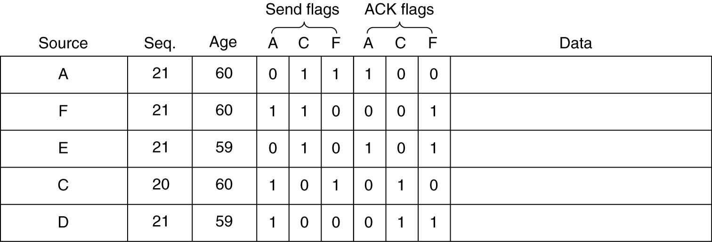

**5. Computing new routes** – with the full set of LSPs a router knows the **entire graph** and runs **Dijkstra** locally. Used in **OSPF** (Internet) and **IS-IS**.

### Distance Vector vs Link State ★★★
| Feature | Distance Vector | Link State |
|---|---|---|
| Information shared | **Whole routing table** (knowledge of entire network) | Only **identity & cost of neighbours** |
| Shared with | **Neighbours only** | **All routers** (flooding) |
| When | Periodically | When something changes (+ periodic refresh) |
| Algorithm | Bellman-Ford | Dijkstra |
| View of network | Partial ("routing by rumour") | Complete topology map |
| Convergence | Slow; **count-to-infinity** | Fast; no count-to-infinity |
| Memory/CPU | Low | Higher |
| Protocols | RIP, (BGP is path-vector) | OSPF, IS-IS |

---

## 12. Hierarchical Routing ★★

As networks grow, routing tables, CPU time and bandwidth for routing updates explode. **Solution:** divide routers into **regions**; each router knows everything about its **own region** but nothing about the inside of other regions — just one entry per remote region. Large networks may use clusters → zones → groups (multi-level).

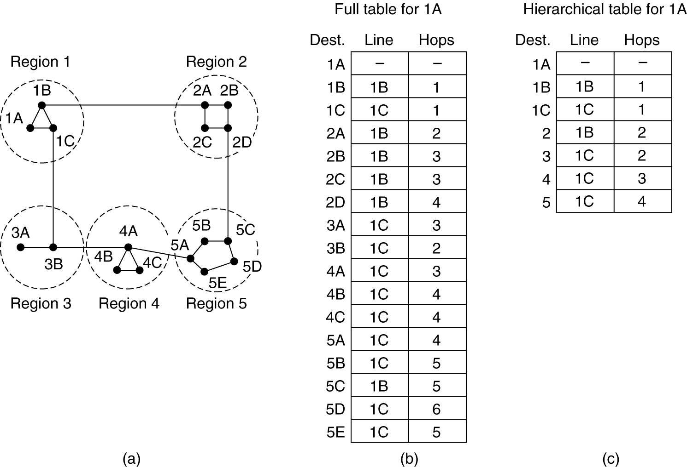

*Example (Fig 5-14):* the full table of router **1A** has **17 entries** (one per router); the hierarchical table has only **7** — one entry for each router in its own region 1, plus one entry for each of the other regions (2, 3, 4, 5).

**Penalty:** increased path length — e.g., best route 1A → 5C is via region 2, but hierarchically all traffic to region 5 goes via region 3.

### Table-size calculation ★
| Design for 720 routers | Entries per router |
|---|---|
| Flat (no hierarchy) | **720** |
| 2-level: 24 regions × 30 routers | 30 local + 23 remote = **53** |
| 3-level: 8 clusters × 9 regions × 10 routers | 10 local + 8 regions + 7 clusters = **25** |

**Kamoun & Kleinrock:** optimal number of levels for N routers = **ln N**, needing **e·ln N** entries per router.

---

## 13. Broadcast Routing ★★

Sending a packet to **all** destinations simultaneously (e.g., weather reports, stock prices, live radio).

| Method | How it works | Remarks |
|---|---|---|
| **1. Distinct packet to each destination** | Source sends a separate unicast copy | Wastes bandwidth; source needs the full destination list |
| **2. Flooding** | Forward on all lines except arrival line | Too many duplicate packets |
| **3. Multi-destination routing** | Packet carries a **list/bitmap of destinations**; each router splits the list among output lines, making one copy per line | Efficient partitioning of the destination set |
| **4. Sink tree / spanning tree** | Router copies the packet onto all **spanning-tree lines** except the incoming one | **Minimum** number of packets; needs every router to know a spanning tree |
| **5. Reverse Path Forwarding (RPF)** | If the packet arrived on the line the router normally uses to **send to the source**, forward it on all other lines; otherwise discard it as a likely duplicate | Simple, efficient, needs no spanning-tree knowledge |

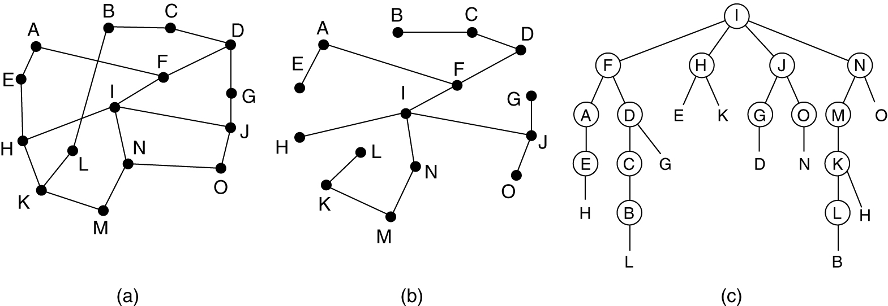

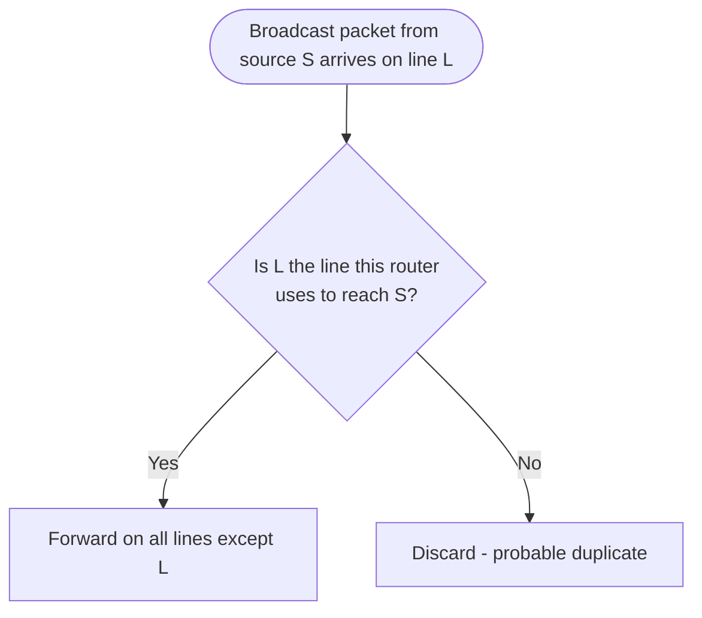

---

## 14. Multicast Routing ★★

Send to a **well-defined group** of receivers (not everyone). Needs **group management** — create/destroy groups, processes join/leave; hosts inform routers (e.g., via **IGMP**) or routers query hosts periodically; routers propagate membership to neighbours.

**Method:** each router computes a **spanning tree** covering all routers, then **prunes** it so only branches leading to **group members** remain.

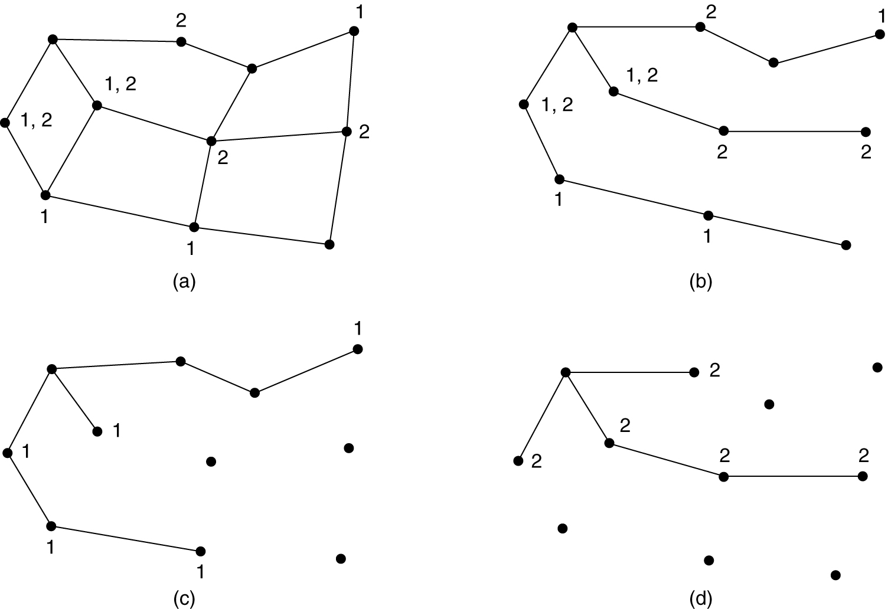
*(a) network (b) spanning tree for leftmost router (c) multicast tree for group 1 (d) multicast tree for group 2*

- **With link-state routing:** each router knows the full topology and membership → prune from the leaves toward the root, removing routers not in the group.
- **With distance-vector routing (reverse-path forwarding):** a router with no interested hosts and no downstream routers replies with a **PRUNE** message to stop that group's multicasts.
- **Scalability:** source-specific trees need **n·m** trees (n groups, m members each). **Core-based trees** use **one tree per group** (n trees) rooted at a core router; senders send to the core.

---

## 15. Routing for Mobile Hosts ★★

Problem: a mobile host has a permanent **home address** but may be anywhere. Each area has a **foreign agent (FA)**; each home network has a **home agent (HA)**.

### Registration procedure
1. Each FA **periodically broadcasts** its existence; or a newcomer broadcasts *"Are there any foreign agents around?"*
2. The mobile host **registers** with the FA: home address, current DLL address, security info.
3. The FA contacts the host's **home agent**: *"One of your hosts is over here"* (with FA address + security info).
4. The HA checks the security info (with a **timestamp**); if satisfied, tells the FA to proceed.
5. The FA gets the ACK, makes a table entry, and informs the mobile host it is **registered**.
   (On leaving, it should deregister — though many users just switch off.)

### Packet routing
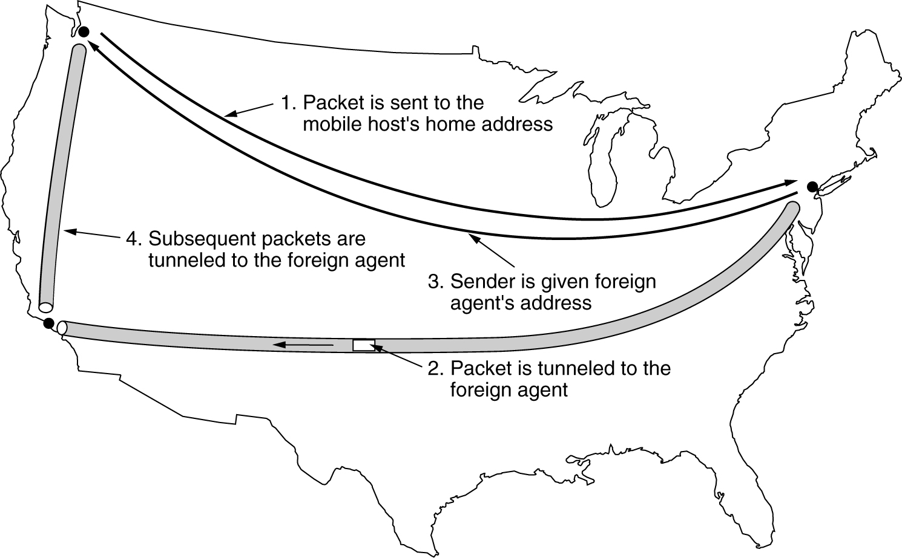

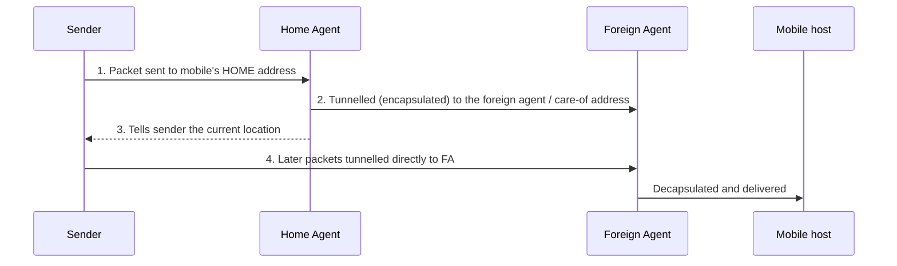

---

## 16. Internetworking ★★★

An **internet** = a collection of interconnected, possibly **different** networks.

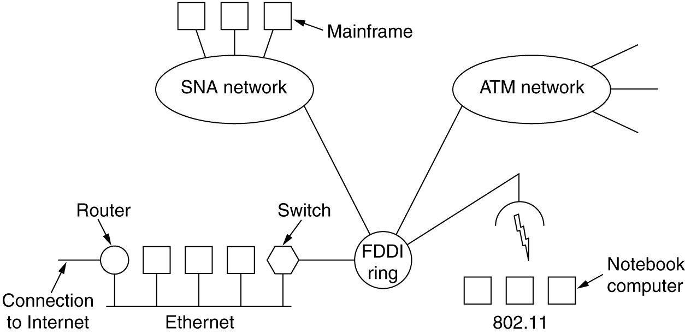

### 16.1 How Networks Differ
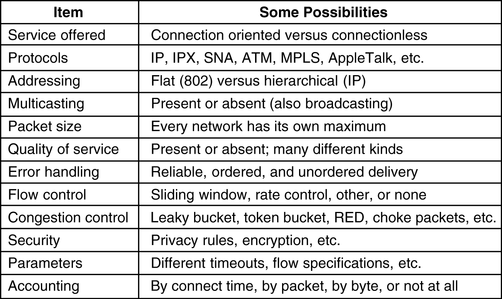

| Item | Some possibilities |
|---|---|
| Service offered | Connection-oriented vs connectionless |
| Protocols | IP, IPX, SNA, ATM, MPLS, AppleTalk … |
| Addressing | Flat (802) vs hierarchical (IP) |
| Multicasting | Present or absent (also broadcasting) |
| Packet size | Every network has its own **maximum** |
| Quality of service | Present or absent; many kinds |
| Error handling | Reliable, ordered, unordered delivery |
| Flow control | Sliding window, rate control, none |
| Congestion control | Leaky bucket, token bucket, RED, choke packets … |
| Security | Privacy rules, encryption … |
| Parameters | Different timeouts, flow specs … |
| Accounting | By connect time, packet, byte, or none |

### 16.2 How Networks Can Be Connected
| Layer | Device | What it does |
|---|---|---|
| Physical | **Repeater, hub** | Copies bits/signals |
| Data link | **Bridge, switch** | Examines MAC addresses; minor translation between LANs |
| Network | **Router** (multiprotocol router) | Forwards packets; can translate between packet formats |
| Transport | **Transport gateway** | Connects e.g. TCP ↔ SNA transport connections |
| Application | **Application gateway** | Translates message semantics (e.g., e-mail formats) |

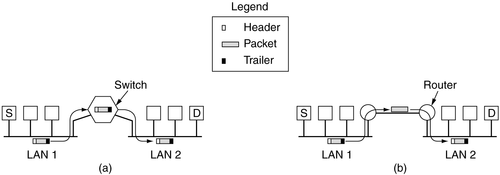
With a **switch**, the *whole frame* is transported by MAC address; with **routers**, the packet is **extracted from the frame** and the IP address is used to route it.

### 16.3 Concatenated Virtual Circuits ★★★
- **Connection-oriented** internetworking. When a host in one network wants a connection to a distant host, the subnet sees it is remote and builds a VC to the nearest **multiprotocol router**, which builds a VC to the next router … a **chain of VCs** stitched end to end.
- Each router keeps tables mapping **incoming VC ↔ outgoing VC**; packets flow **in order** along the same path.

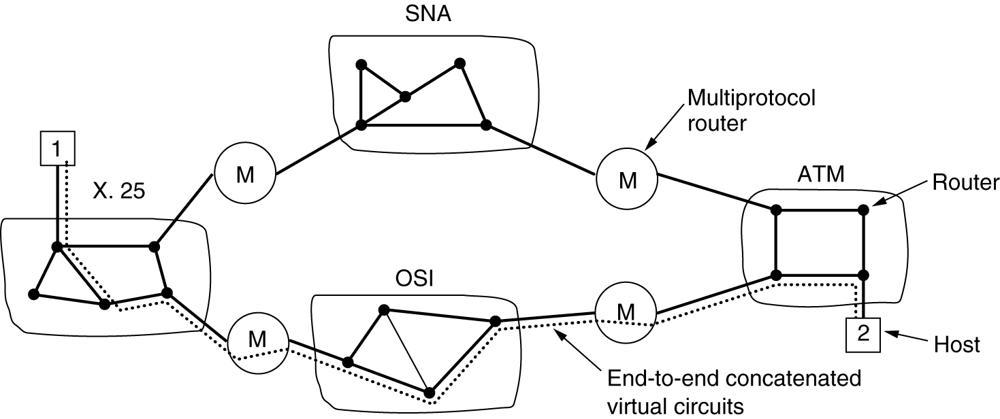

```
[Host 1] ── (Subnet A: VC 1) ── [Gateway: maps VC1 ⇄ VC4] ── (Subnet B: VC 4) ── [Host 2]
```

| Advantages | Disadvantages |
|---|---|
| Buffers can be reserved in advance → **QoS** | Table space per connection in every router |
| Sequencing guaranteed | **No alternate routing** around congestion |
| Short headers (VC numbers) | Vulnerable to router failure along the path |
| Duplicates avoided | Hard if any network in the chain is an unreliable datagram network |

### 16.4 Connectionless Internetworking ★★★
- **Datagram** model (the **IP Internet**): no end-to-end setup; every packet carries the full destination address and is routed **independently** hop by hop by multiprotocol routers ("best effort").
- Packets of one stream may take **different routes** and arrive **out of order**.

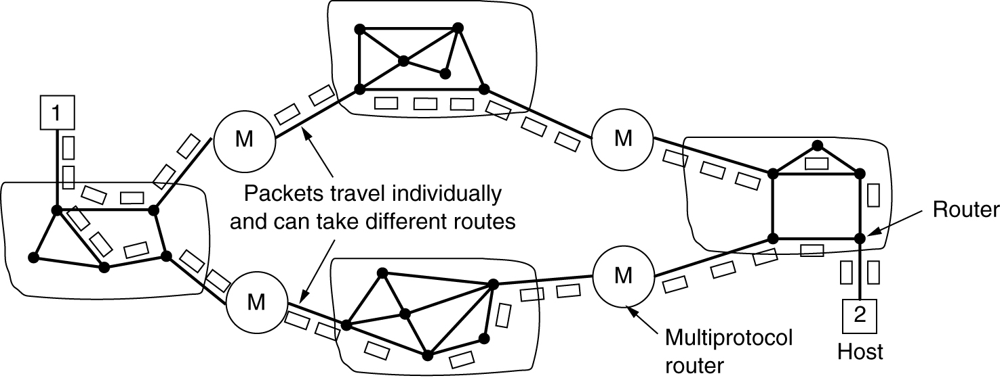

| Concatenated VCs | Connectionless (datagram) internetworking |
|---|---|
| Path set up first, all packets follow it | No setup; each packet routed independently |
| In-order delivery, QoS possible | Out-of-order possible; no guarantees |
| Router failure kills the connection | Traffic reroutes around failures (robust) |
| Needs all networks to support VCs | Works over **any** network, even without VCs |
| Better resource utilisation via reservation | Better use of alternate paths, more robust to congestion |

### 16.5 Tunneling ★★★
Used when **source and destination networks are the same type but a different network lies between them** (e.g., two IPv6/Ethernet sites joined by an IPv4 or WAN backbone).

- The **boundary (multiprotocol) router** takes the *entire original packet* and **encapsulates it as payload** inside a packet of the transit network.
- At the far side the matching router **decapsulates** it and forwards the original packet.

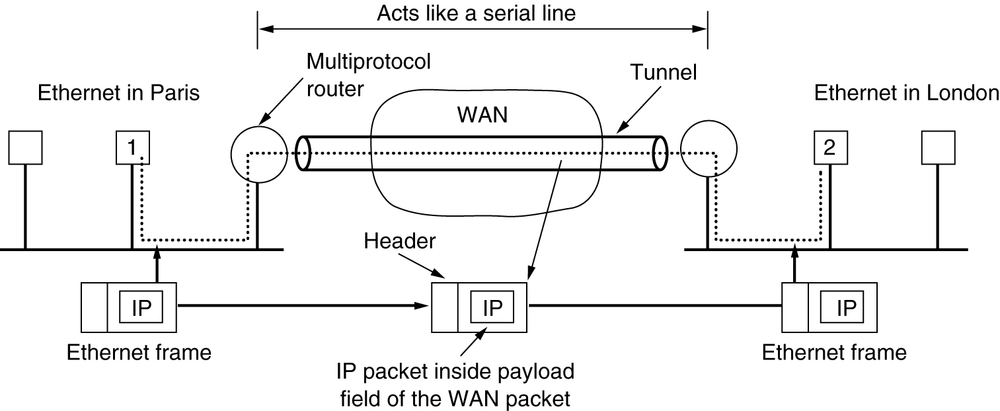
*Analogy:* the **Channel Tunnel** — a car (packet) is loaded onto a train (WAN packet) in France and driven off in England.

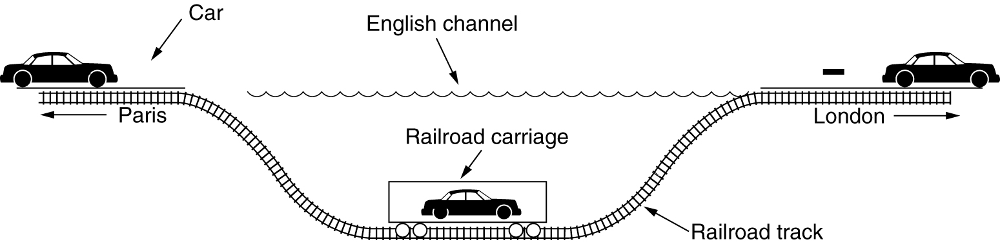

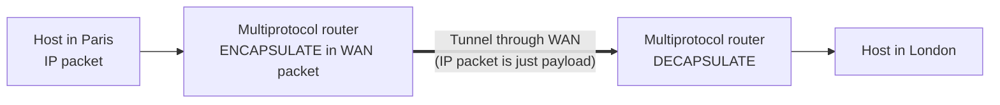

**Applications:** IPv6-over-IPv4 transition, **VPNs**, Mobile IP (HA → FA), multicast backbones (MBone).

### 16.6 Internetwork Routing
- Two-level routing: model the internet as a **graph whose nodes are multiprotocol routers**; any router can reach any other router connected to the same network.
- **Interior gateway protocol** – routing **within** a network (autonomous system), e.g., OSPF, RIP.
- **Exterior gateway protocol** – routing **between** networks/ASes, e.g., **BGP** (also must consider political, economic and security policies).

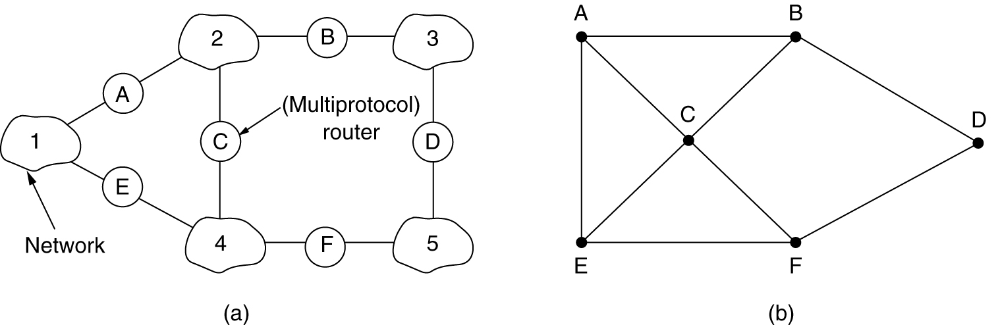

### 16.7 Fragmentation ★★★
Each network has a **maximum packet size (MTU)** — limits come from hardware, OS buffers, protocols, standards, retransmission concerns, channel occupancy. When a large packet must cross a network with a smaller MTU, it is **broken into fragments**.

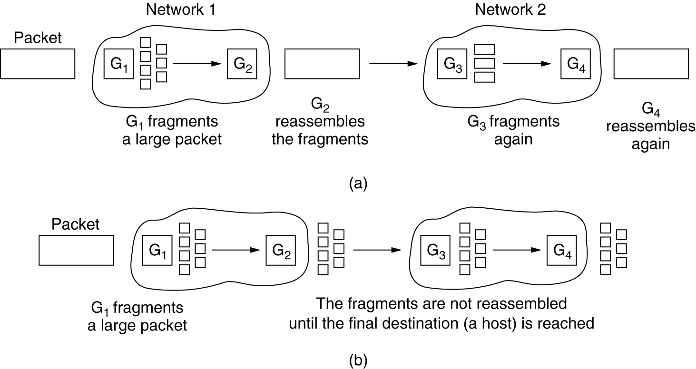

| Transparent fragmentation | Non-transparent fragmentation |
|---|---|
| Fragments are **reassembled at the exit gateway** of the small-packet network; later networks never see fragments | Fragments are **not recombined** at intermediate gateways; each travels as an independent packet and is **reassembled only at the destination host** (used by **IP**) |
| Exit gateway must know when all pieces arrived; all fragments must leave via the same gateway; repeated fragment/reassemble overhead | Every host must be able to reassemble; more header overhead; multiple exit gateways can be used → better performance |

**Numbering fragments (Fig 5-51)** — with an elementary data unit of 1 byte:
- Header fields: **original packet number**, **number of first elementary fragment (offset)**, **end-of-packet bit**.
- *(a)* Original packet: 10 data bytes `A…J`, header (27, 0, 1).
- *(b)* After a network with max **8** payload bytes: (27, 0, 0) A–H and (27, 8, 1) I–J.
- *(c)* After a gateway of size **5**: (27,0,0) A–E, (27,5,0) F–H, (27,8,1) I–J.

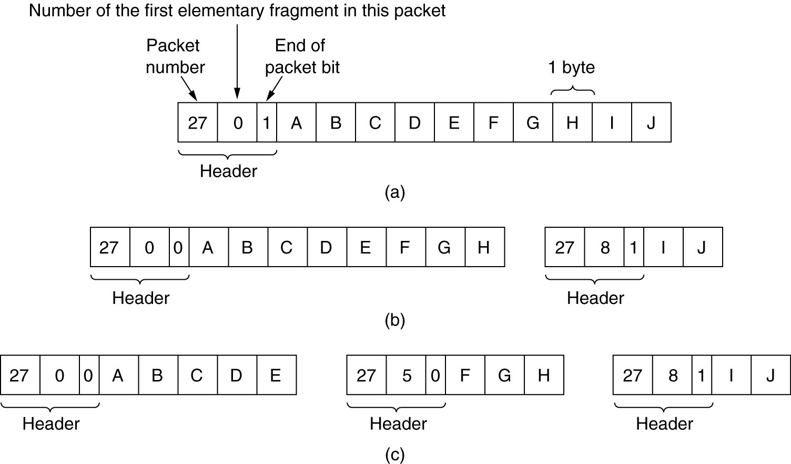

**IP-style numerical example (from Imp-Q doc):** a 2400-byte payload crosses a link with **800-byte** payload MTU → 3 fragments, all with **ID = 102**:

| Fragment | Bytes | MF bit | Offset (bytes / 8) |
|---|---|---|---|
| 1 | 0 – 799 | 1 | 0 |
| 2 | 800 – 1599 | 1 | 100 |
| 3 | 1600 – 2399 | **0** (last) | 200 |

The destination groups fragments by **ID**, orders them by **offset**, and knows the total length when it sees **MF = 0**; then reassembles the original 2400-byte payload.

---

## Unit IV — One-Page Summary

| Topic | Key points |
|---|---|
| **Network layer job** | End-to-end delivery of packets; knows topology; picks paths; balances load; handles different networks. |
| **Design issues** | Store-and-forward switching · services to transport layer (router-independent, shielded, uniform addressing) · connectionless (datagram) · connection-oriented (VC) · VC vs datagram. |
| **Store-and-forward** | Router stores whole packet, verifies checksum, forwards to next hop. |
| **Datagram subnet** | No setup; each packet has full address; routed independently; tables (dest → line) can change (packet 4 via B). |
| **VC subnet** | Route fixed at setup; packets carry VC id; routers rewrite ids = **label switching**. |
| **VC vs datagram** | Setup · addressing · state · routing · failure effect · QoS · congestion control (table §5). |
| **Routing properties** | Correctness, simplicity, robustness, stability, fairness, optimality. Static vs adaptive. |
| **Optimality principle** | Sub-path of an optimal path is optimal → sink tree (no loops). |
| **Dijkstra** | Tentative/permanent labels; A→B→E→F→H→D = 10. |
| **Flooding** | Send on all lines except incoming; hop counter / seq numbers / selective; robust benchmark. |
| **Distance vector** | Bellman-Ford; share full table with neighbours; Dᴊ(i) = min(d(J,X)+Dₓ(i)); J→G = 18 via H; **count-to-infinity** → small ∞ (16), split horizon, poison reverse. RIP. |
| **Link state** | HELLO → ECHO (RTT/2) → LSP (id, seq, age, neighbours) → flood (seq + age, ACKs) → Dijkstra. OSPF, IS-IS. |
| **Hierarchical** | Regions/clusters; 720 routers → 720 / 53 / 25 entries; optimal levels ln N, e·ln N entries; longer paths. |
| **Broadcast** | Distinct packets · flooding · multidestination · spanning tree · **reverse path forwarding**. |
| **Multicast** | Group management (IGMP); pruned spanning trees; PRUNE messages; core-based trees (n trees vs n·m). |
| **Mobile hosts** | Home agent + foreign agent; 5-step registration; HA tunnels packets to FA; sender then tunnels directly. |
| **Networks differ** | Service, protocols, addressing, multicast, packet size, QoS, errors, flow/congestion control, security, accounting. |
| **Connecting devices** | Repeater/hub (L1) · bridge/switch (L2) · router (L3) · transport/application gateways (L4/L7). |
| **Concatenated VCs** | Chain of VCs through multiprotocol routers; in-order, QoS; fragile to failures. |
| **Connectionless internetworking** | IP datagrams routed independently; robust; no guarantees. |
| **Tunneling** | Encapsulate whole packet inside transit-network packet (Paris→London; IPv6 over IPv4, VPN). |
| **Internetwork routing** | Interior (OSPF/RIP) vs exterior (BGP) gateway protocols. |
| **Fragmentation** | Transparent (reassemble at exit gateway) vs non-transparent (at destination – IP); ID, offset (/8), MF bit; 2400 B over 800 B MTU → offsets 0, 100, 200. |
