# Unit V — The Network Layer in the Internet & Congestion Control

> **Syllabus:** Network-layer design principles of the Internet, IPv4 header, IP addressing (classful, special addresses, subnetting, CIDR/supernetting), NAT, IPv6 (header, extension headers, IPv4 vs IPv6), Internet control protocols (ICMP, ARP, RARP, BOOTP, DHCP), Congestion control (principles, prevention policies, VC & datagram subnets: warning bit, choke packets, hop-by-hop choke, load shedding/RED, jitter control), Traffic shaping (leaky bucket, token bucket).
>
> **Sources:** *Unit-V.ppt* + *CN-4-5-6 Imp Questions.docx*

**Importance legend:** ★★★ = very frequently asked (★ in the Imp-Questions doc) · ★★ = medium · ★ = short answer

---

## Table of Contents
1. [Design Principles of the Internet Network Layer](#1-design-principles-the-top-10-)
2. [The Internet as a Collection of ASes](#2-the-internet-as-a-collection-of-networks-)
3. [IPv4 Datagram Header](#3-the-ipv4-header-)
4. [IP Addressing Basics](#4-ip-addresses-)
5. [Classful Addressing](#5-classful-addressing-)
6. [Subnet Masks & Subnetting](#6-subnet-masks--subnetting-)
7. [Classless Addressing (CIDR) & Supernetting](#7-classless-addressing-cidr--supernetting-)
8. [NAT](#8-nat--network-address-translation-)
9. [IPv6](#9-ipv6-)
10. [ICMP](#10-icmp--internet-control-message-protocol-)
11. [ARP, RARP, BOOTP, DHCP](#11-arp-rarp-bootp-dhcp-)
12. [Congestion — Basics](#12-congestion--basics-)
13. [Principles & Prevention Policies](#13-general-principles-of-congestion-control-)
14. [Congestion Control in VC Subnets](#14-congestion-control-in-virtual-circuit-subnets-)
15. [Congestion Control in Datagram Subnets](#15-congestion-control-in-datagram-subnets-)
16. [Traffic Shaping: Leaky & Token Bucket](#16-traffic-shaping-)
17. [Unit V — One-Page Summary](#unit-v--one-page-summary)

---

## 1. Design Principles (the "Top 10") ★★

| # | Principle | Meaning |
|---|---|---|
| 1 | **Make sure it works** | Don't finalise a standard until multiple prototypes have communicated successfully |
| 2 | **Keep it simple** | When in doubt, use the simplest solution; leave out non-essential features |
| 3 | **Make clear choices** | If there are several ways to do something, choose one |
| 4 | **Exploit modularity** | Protocol stacks with independent layers — changing one doesn't affect others |
| 5 | **Expect heterogeneity** | Different hardware, links and applications → design must be simple, general, flexible |
| 6 | **Avoid static options and parameters** | Prefer negotiation (e.g., max packet size) over fixed choices |
| 7 | **Look for a good design; it need not be perfect** | Don't wreck a good design for weird special cases |
| 8 | **Be strict when sending, tolerant when receiving** | Send only fully-conformant packets; cope with imperfect incoming ones |
| 9 | **Think about scalability** | No centralised databases; spread load evenly |
| 10 | **Consider performance and cost** | Poor performance or outrageous cost → nobody uses it |

---

## 2. The Internet as a Collection of Networks ★

At the network layer, the Internet is a collection of **sub-networks / Autonomous Systems (ASes)** interconnected. There is no real structure, but there are several **backbones** (high-bandwidth lines, fast routers); attached to them are **regional (mid-level) networks**, and attached to those are the **LANs** of universities, companies and ISPs. The glue holding it together is **IP (Internet Protocol)** — a best-effort, connectionless datagram service.

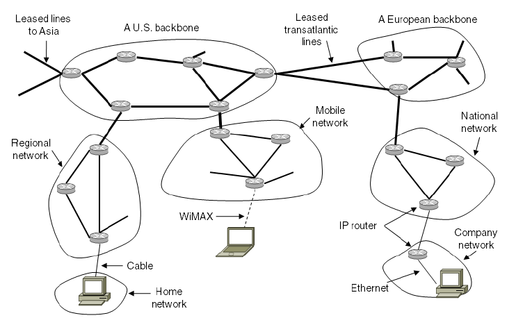

---

## 3. The IPv4 Header ★★★

An IPv4 datagram = **header (20–60 bytes)** + data. The header has a **20-byte fixed part** and an optional variable part, written in 32-bit words.

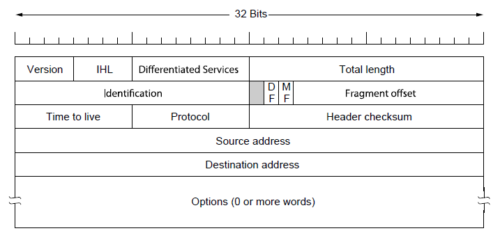

```
 0       4       8              16      19                     31
+-------+-------+---------------+-------------------------------+
|Version|  IHL  |Type of service|         Total length          |
+-------+-------+---------------+---+---------------------------+
|        Identification         | DF|MF|    Fragment offset     |
+---------------+---------------+---+---------------------------+
| Time to live  |   Protocol    |        Header checksum        |
+---------------+---------------+-------------------------------+
|                       Source address                          |
+---------------------------------------------------------------+
|                    Destination address                        |
+---------------------------------------------------------------+
|                 Options (0 or more words)                     |
+---------------------------------------------------------------+
```

| Field | Bits | Purpose |
|---|---|---|
| **Version** | 4 | Protocol version (4 → `0100`) |
| **IHL** (Internet Header Length) | 4 | Header length in **32-bit words**; min **5** (20 B), max **15** (60 B) → options ≤ 40 B |
| **Type of Service** | 8 | Class of service. Originally 3-bit **Precedence** (0 normal … 7 network control) + flags **D, T, R** (Delay, Throughput, Reliability). Now DiffServ. Voice → fast delivery; file transfer → error-free |
| **Total Length** | 16 | Header + data; max **65 535 bytes** |
| **Identification** | 16 | Same for all fragments of one datagram (reassembly) |
| **Flags** | 3 | unused · **DF** (Don't Fragment) · **MF** (More Fragments – 1 on all but the last fragment) |
| **Fragment Offset** | 13 | Position of the fragment in the original datagram (units of **8 bytes**) |
| **Time To Live (TTL)** | 8 | Limits packet lifetime (max 255); decremented at each hop; at **0 → discard** and send ICMP warning to source |
| **Protocol** | 8 | Which transport process gets it — **6 = TCP, 17 = UDP, 1 = ICMP**, 2 = IGMP, 89 = OSPF |
| **Header Checksum** | 16 | Verifies **header only**; recomputed at each hop (TTL changes) |
| **Source / Destination Address** | 32 each | IP addresses |
| **Options** | variable | Padded to a multiple of 4 bytes (see below) |

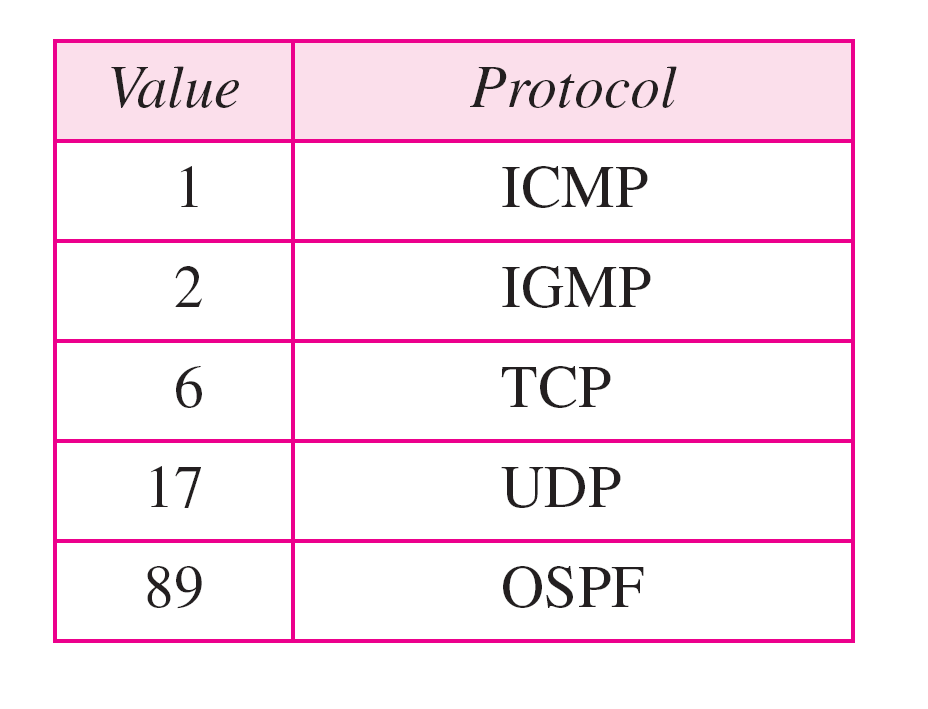

### IP Options
| Option | Description |
|---|---|
| **Security** | Specifies how secret the datagram is |
| **Strict source routing** | Gives the **complete path** to follow |
| **Loose source routing** | Gives a list of routers that **must** be visited (in order), others allowed in between |
| **Record route** | Each router appends its IP address (debugging routing algorithms) |
| **Timestamp** | Each router appends its address **and a 32-bit timestamp** |

---

## 4. IP Addresses ★★★

- An **IP address** is a **32-bit**, globally **unique and universal** address of a network **interface**.
- Address space = **2³² = 4 294 967 296**.
- Two parts: **network number (prefix / netid)** + **host number (hostid)**.
- Written in **dotted-decimal notation** — each byte as a decimal 0–255.

| Binary | Dotted decimal |
|---|---|
| `10000000 10001111 10001001 10010000` | **128.143.137.144** |
| `01110101 10010101 00011101 00000010` | **117.149.29.2** |
| `10000001 00001011 00001011 11101111` | **129.11.11.239** |
| `11111001 10011011 11111011 00001111` | **249.155.251.15** |

*128.143.137.144 with a 16-bit prefix → network 128.143, host 137.144.*

---

## 5. Classful Addressing ★★★

The address space was divided into five classes (introduced 1981; replaced by classless addressing in the mid-1990s).

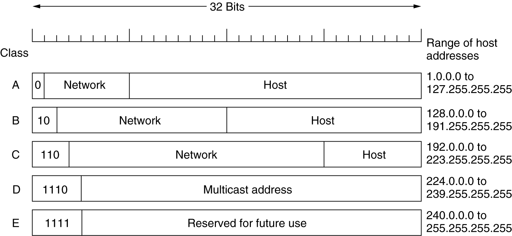

| Class | Leading bits | 1st byte range | Netid.Hostid | Default mask | # Networks | Hosts / network | Use |
|---|---|---|---|---|---|---|---|
| **A** | `0` | 0 – 127 | N.H.H.H | 255.0.0.0 (/8) | 128 (2⁷) | 16 777 214 (2²⁴ − 2) | Unicast, huge orgs |
| **B** | `10` | 128 – 191 | N.N.H.H | 255.255.0.0 (/16) | 16 384 (2¹⁴) | 65 534 (2¹⁶ − 2) | Unicast, medium |
| **C** | `110` | 192 – 223 | N.N.N.H | 255.255.255.0 (/24) | 2 097 152 (2²¹) | 254 (2⁸ − 2) | Unicast, small |
| **D** | `1110` | 224 – 239 | — | — | 2²⁸ groups | — | **Multicast** |
| **E** | `1111` | 240 – 255 | — | — | — | — | **Reserved / experimental** |

> In classful addressing, **a large part of the address space was wasted** — a class A block (16.7 M addresses) is too big for almost any organisation, and a class C (256) is too small for many.

**Finding the class (examples):**
| Address | Reasoning | Class |
|---|---|---|
| `00000001 00001011 00001011 11101111` | first bit 0 | **A** |
| `11000001 10000011 00011011 11111111` | first two bits 1, third 0 | **C** |
| 14.23.120.8 | first byte 14 | **A** |
| 252.5.15.111 | first byte 252 | **E** |

### Special IP addresses
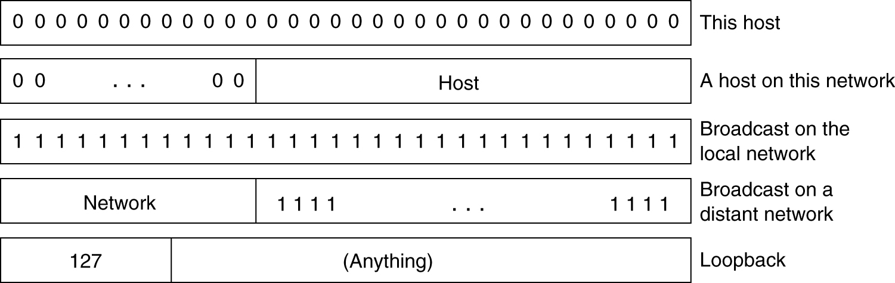

| Address | Meaning |
|---|---|
| `0.0.0.0` (all 0s) | This host (used at boot) |
| netid all 0s + host | A host on **this** network |
| `255.255.255.255` (all 1s) | **Limited broadcast** on the local network |
| network + hostid all 1s | **Directed broadcast** to a distant network |
| `127.x.y.z` | **Loopback** (testing) |

**Private address space** (not routed on the Internet; used with NAT):
`10.0.0.0 – 10.255.255.255` (class A) · `172.16.0.0 – 172.31.255.255` (class B) · `192.168.0.0 – 192.168.255.255` (class C).

---

## 6. Subnet Masks & Subnetting ★★★

### 6.1 Masks
A **mask** is a 32-bit pattern of **contiguous 1s (network part) followed by 0s (host part)**. **ANDing** an address with the mask gives the **network address**.

| Class | Default mask (binary) | Dotted decimal | CIDR |
|---|---|---|---|
| A | `11111111 00000000 00000000 00000000` | 255.0.0.0 | /8 |
| B | `11111111 11111111 00000000 00000000` | 255.255.0.0 | /16 |
| C | `11111111 11111111 11111111 00000000` | 255.255.255.0 | /24 |

*Same or different network?* 10.10.10.1 and 10.10.20.16 → with 255.0.0.0 **same** network; with 255.255.255.0 **different** networks.

**Example:** a host in a class C network has IP **192.168.17.9**. Mask /24 → network 192.168.17.0 – 192.168.17.255; number of addresses 2⁸ = **256**, usable **254**; first address **192.168.17.0** (network address), last **192.168.17.255** (broadcast).

### 6.2 Subnetting
**Subnetting** = dividing **one large network** into several **smaller networks (subnets)** by **borrowing bits from the host part** → **increases the number of 1s in the mask**. Outside the organisation the network still looks like one; internally routers use the **subnet mask**.

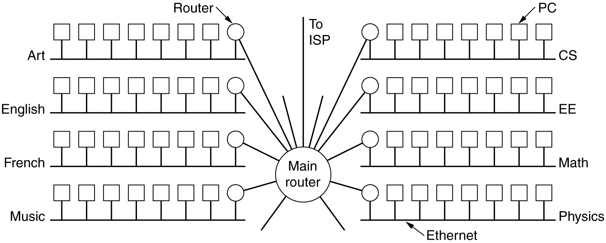
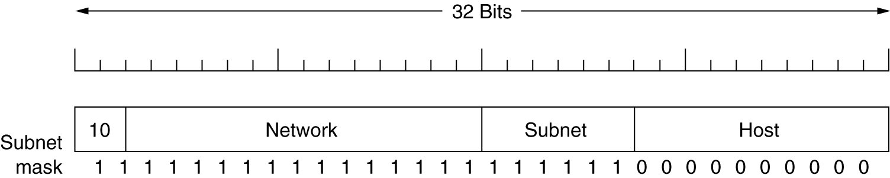
*Class B 130.50.0.0 with mask 255.255.252.0: 6 subnet bits → 64 subnets, 10 host bits → 1022 hosts each.*

**Formulas**
- Number of subnets = **2ˢ** (s = borrowed bits)
- Addresses per subnet = **2ʰ**; usable hosts = **2ʰ − 2** (h = remaining host bits)

*Borrow 3 bits from a class C:* 2³ = **8 subnets**, 2⁵ = 32 addresses → **30 usable hosts** each.
*Borrow 2 bits (195.223.50.0):* 2² = **4 subnets**, 2⁶ − 2 = **62 hosts** each.

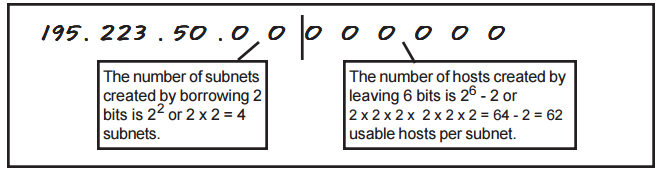

### 6.3 Worked subnetting problem ★★★ (Imp-Q doc)
*Split 192.168.1.0/24 into 4 equal subnets.*
1. 2ⁿ = 4 → **n = 2** borrowed bits → new mask **/26** = `11111111.11111111.11111111.11000000` = **255.255.255.192**.
2. Host bits = 6 → block size **2⁶ = 64**; usable hosts **62**.
3. Ranges:

| Subnet | Network address | Usable host range | Broadcast |
|---|---|---|---|
| 1 | 192.168.1.0 | .1 – .62 | 192.168.1.63 |
| 2 | 192.168.1.64 | .65 – .126 | 192.168.1.127 |
| 3 | 192.168.1.128 | .129 – .190 | 192.168.1.191 |
| 4 | 192.168.1.192 | .193 – .254 | 192.168.1.255 |

### 6.4 ANDing with a custom subnet mask
192.100.10.0 with mask **255.255.255.240** (4 borrowed bits) → 16 subnets of 16 addresses (14 usable): 192.100.10.0–15, .16–31, .32–47, … .240–255.
For host **192.100.10.33**: `00100001 AND 11110000 = 00100000` → it belongs to subnet **192.100.10.32**.

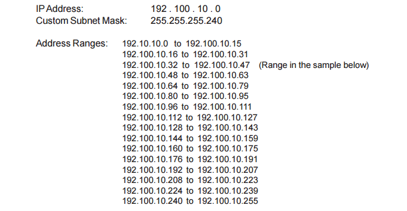

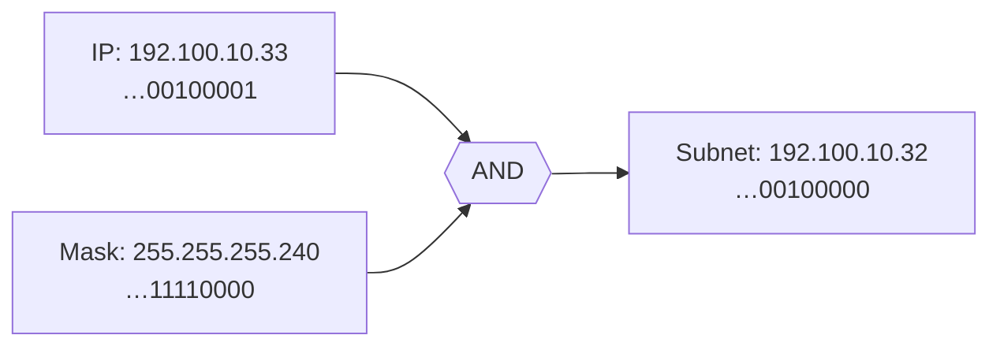

### 6.5 Hierarchy
- **Two-level (no subnetting):** leftmost *n* bits = network prefix, remaining 32 − n bits = host (like a phone number: area code + subscriber).
- **Three-level (subnetting):** **network prefix + subnet + host** — like area code + exchange + subscriber.

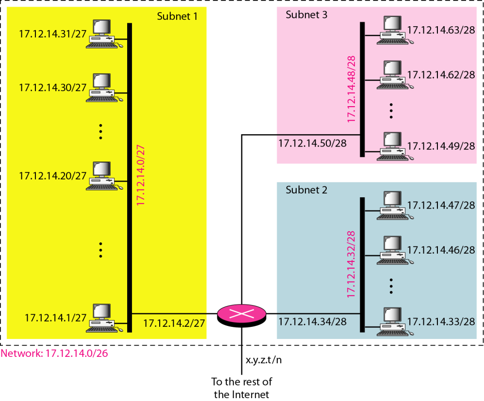

---

## 7. Classless Addressing (CIDR) & Supernetting ★★★

**Why?** Classful addressing wasted addresses and exhausted the space; ISPs needed flexible block sizes. **CIDR (Classless Inter-Domain Routing)** uses **variable-length blocks that belong to no class**, written **x.y.z.t/n** (n = prefix length = number of 1s in the mask).

**Three restrictions on a block**
1. Addresses must be **contiguous**.
2. Number of addresses must be a **power of 2**.
3. The **first address must be evenly divisible** by the number of addresses.

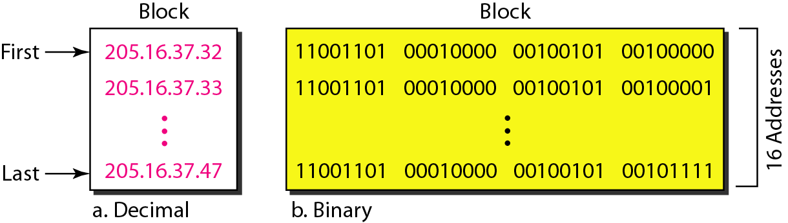

### Finding first, last and count — x.y.z.t/n
- **First address:** set the rightmost 32 − n bits to **0**.
- **Last address:** set the rightmost 32 − n bits to **1**.
- **Number of addresses:** **2³²⁻ⁿ**.

**Example ★ — 205.16.37.39/28**
- Binary: `11001101 00010000 00100101 00100111`
- First: `11001101 00010000 00100101 0010`**`0000`** → **205.16.37.32**
- Last: `11001101 00010000 00100101 0010`**`1111`** → **205.16.37.47**
- Count: 2³²⁻²⁸ = **16** addresses

### Supernetting
**Supernetting** = combining **several contiguous smaller blocks** (e.g., class C blocks) into **one larger block** → **decreases the number of 1s in the mask** (e.g., /24 → /22 joins four class C networks). It is the inverse of subnetting and lets a single routing-table entry represent many networks (**route aggregation**), shrinking core routing tables.

*Example:* 200.10.0.0/24, 200.10.1.0/24, 200.10.2.0/24, 200.10.3.0/24 → one supernet **200.10.0.0/22** (1024 addresses).

| Subnetting | Supernetting |
|---|---|
| Divide one network into many smaller ones | Combine many networks into one larger block |
| Borrow host bits → mask gets **more** 1s | Borrow network bits → mask gets **fewer** 1s |
| Reduces broadcast domain, better address use inside an org | Reduces routing-table size (route aggregation) |

---

## 8. NAT — Network Address Translation ★★★

- **RFC 1631.** A **short-term** fix for IPv4 address depletion (long-term fix: **IPv6**; CIDR is another short-term fix).
- **Hides many hosts behind one (or a few) public IP address(es).** Internally hosts use **private addresses** (10/8, 172.16/12, 192.168/16).

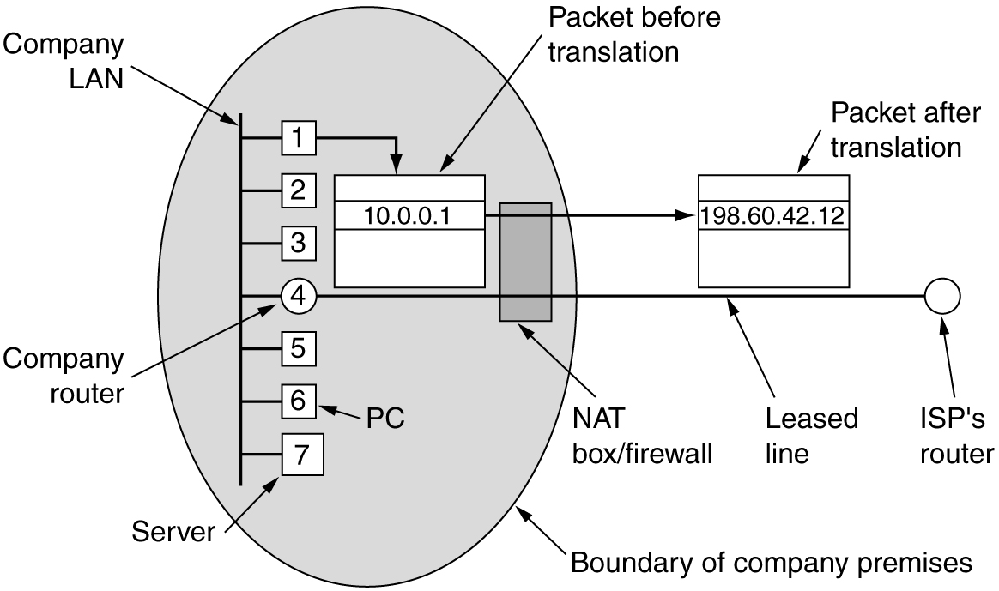

### Operation
1. Internal host 10.0.0.1 sends a packet; it reaches the **NAT box** at the company boundary.
2. NAT replaces the **source IP** with the company's public IP (e.g., 198.60.42.12) and the **source port** with an index into its **translation table** (storing the original private IP + port).
3. Reply arrives at the public IP/port → NAT looks up the port index, restores the **private IP and port**, and forwards into the LAN.

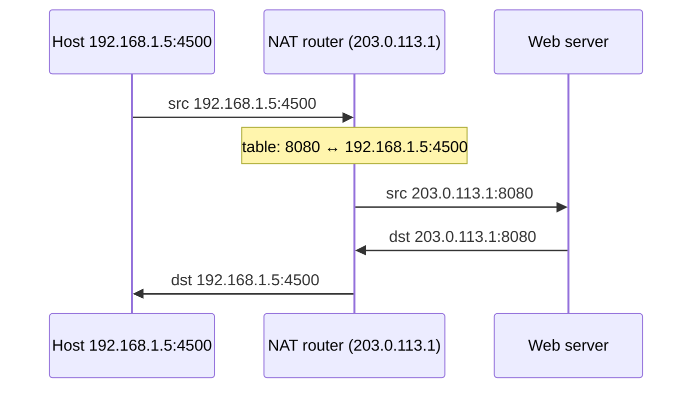

### Types of NAT
| Type | Mapping | Use |
|---|---|---|
| **Static NAT** | One private ↔ one public, permanent (1:1) | Internal servers visible from outside |
| **Dynamic NAT** | Private → any free address from a **pool** of public IPs | Medium organisations |
| **PAT / NAPT (NAT overload)** | Many private → **one** public IP, distinguished by **port numbers** | Home routers – most common |

**Criticisms:** violates the IP model of unique addresses; breaks end-to-end connectivity; makes the router layer-4-aware; only works with TCP/UDP; problematic for protocols that carry IP addresses in their payload (FTP, H.323); limited to ~61 440 ports per address.

---

## 9. IPv6 ★★★

### Why IPv6? (problems with IPv4)
- Address space is **inefficiently used** and running out.
- Real-time audio/video needs **minimum-delay strategies and resource reservation**.
- **No built-in security** (encryption/authentication).

### Features of IPv6 (IPng)
- **128-bit addresses** (written in hexadecimal colon notation, e.g., `8000:0000:0000:0000:0123:4567:89AB:CDEF` → `8000::123:4567:89AB:CDEF`).
- **Simplified, fixed 40-byte header** (7 fields vs 13 in IPv4) → faster processing.
- **New options** via **extension headers**; **allowance for extension**.
- **Flow label** for resource allocation / special handling.
- **Better security** (IPsec built in).
- Three address types: **unicast, anycast** (deliver to *one* of a group sharing a prefix), **multicast** (no broadcast).

### IPv6 fixed header (40 bytes)
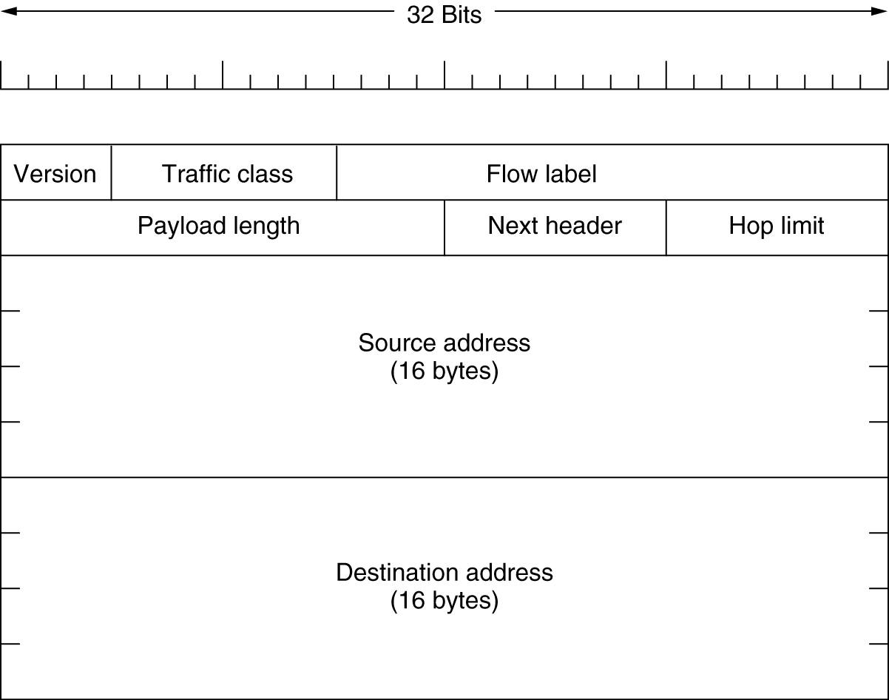

| Field | Size | Purpose |
|---|---|---|
| **Version** | 4 bits | 6 |
| **Traffic class / Priority** | 4–8 bits | Priority w.r.t. congestion (0–7 congestion-controlled, 8–15 non-congestion-controlled real-time) |
| **Flow label** | 20 bits (slides: "3 bytes") | Identifies a flow needing special handling (pseudo-connection) |
| **Payload length** | 16 bits | Bytes after the 40-byte header (max 65 535) |
| **Next header** | 8 bits | Type of the next extension header, or the transport protocol (TCP/UDP) |
| **Hop limit** | 8 bits | Same as **TTL** in IPv4 |
| **Source / Destination address** | 16 bytes each | 128-bit addresses |

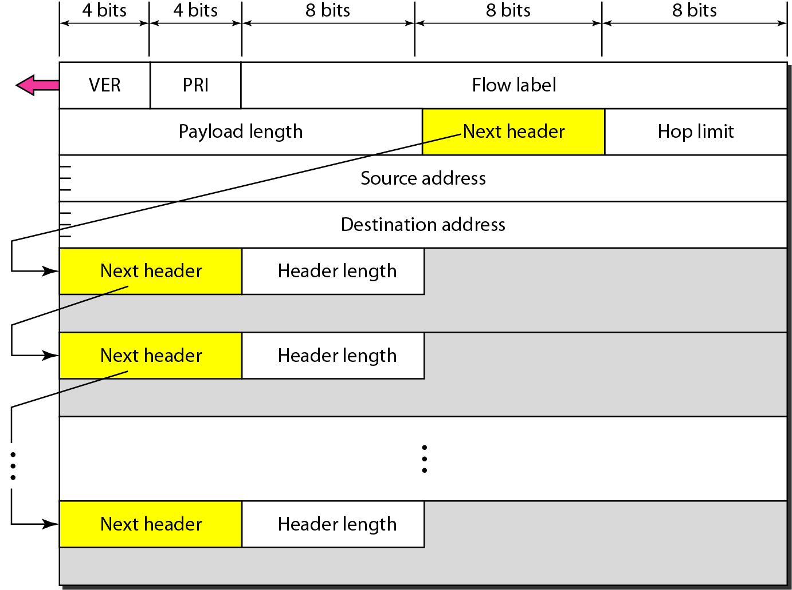

### Extension headers
| Extension header | Description |
|---|---|
| **Hop-by-hop options** | Info for every router on the path (e.g., **jumbograms** > 64 KB) |
| **Destination options** | Info for the destination only |
| **Routing** | List of routers to visit (loose source routing) |
| **Fragmentation** | Management of fragments (**only the source fragments**) |
| **Authentication** | Verifies the sender's identity |
| **Encrypted security payload** | Information about the encrypted contents |

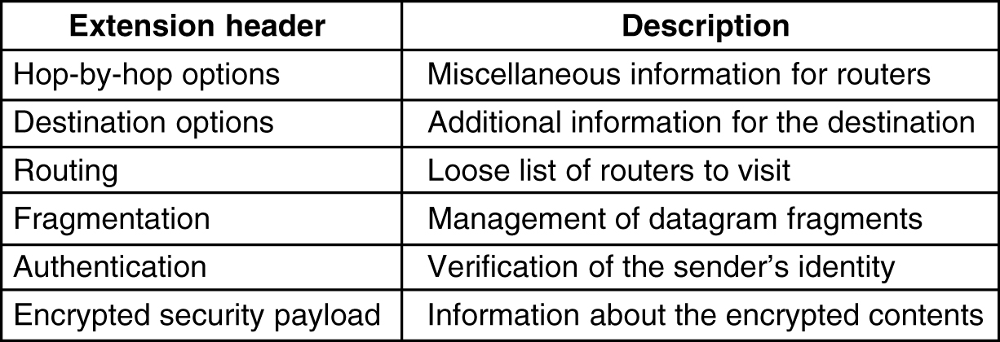

### IPv4 vs IPv6 ★★★
| IPv4 | IPv6 |
|---|---|
| **32-bit** addresses (≈ 4.3 × 10⁹) | **128-bit** addresses (≈ 3.4 × 10³⁸) |
| Dotted **decimal** | Colon **hexadecimal** |
| Header 20–60 bytes, 13 fields | Fixed **40-byte** header, 8 fields |
| **Checksum** in header | **No header checksum** |
| **Options** field in header | **Extension headers** instead of options |
| Fragmentation by **sender and routers** | Fragmentation **only by sender** |
| IPsec optional | **IPsec built in** |
| No flow identification | **Flow label** field |
| Broadcast supported | No broadcast; **anycast** added |
| ARP for address resolution | Neighbour Discovery (ICMPv6) |
| Manual / DHCP configuration | Auto-configuration (SLAAC) + DHCPv6 |

---

## 10. ICMP — Internet Control Message Protocol ★★

Routers monitor the Internet; when something unexpected happens, the event is **reported back to the source via ICMP**. ICMP is also used to **test** the Internet (ping, traceroute). ICMP messages are carried **inside IP packets** (protocol = 1).

| Message type | Description |
|---|---|
| **Destination unreachable** | Packet could not be delivered (no route; or DF set but must fragment) |
| **Time exceeded** | **TTL reached 0** (used by *traceroute*) |
| **Parameter problem** | Invalid header field |
| **Source quench** | Choke packet – asks the source to slow down (deprecated) |
| **Redirect** | Tell a router/host about a better route |
| **Echo request / Echo reply** | Ask a machine if it is alive (*ping*) |
| **Timestamp request / reply** | Same as echo but with timestamps (delay measurement) |

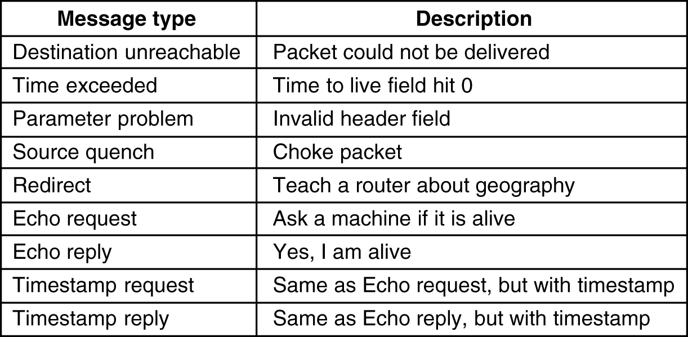

---

## 11. ARP, RARP, BOOTP, DHCP ★★★

### 11.1 ARP — Address Resolution Protocol
**Problem:** IP addresses can't be used directly to send frames — the DLL hardware (Ethernet NIC) only understands **48-bit MAC addresses**. How do we map **IP → MAC**? (A config file would be error-prone.)

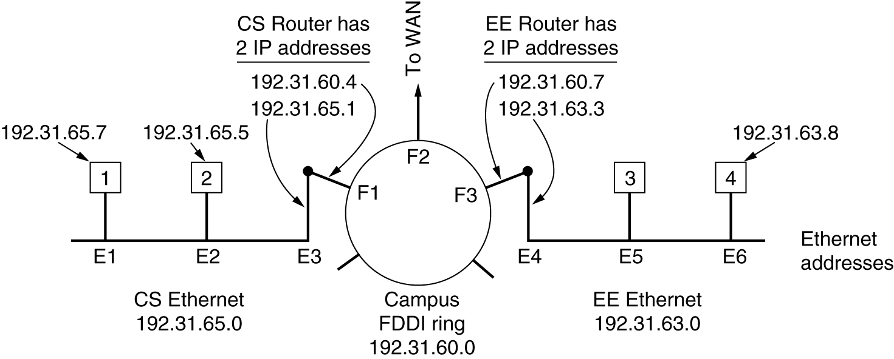

**Operation (H1 → H2 on the same LAN):**
1. H1 finds H2's IP via DNS.
2. H1 **broadcasts** an ARP request on the Ethernet: *"Who owns IP 192.31.65.5?"*
3. Only H2 recognises its own IP and replies (**unicast**) with its **Ethernet address**.
4. H1 sends the IP packet inside an Ethernet frame to that MAC.

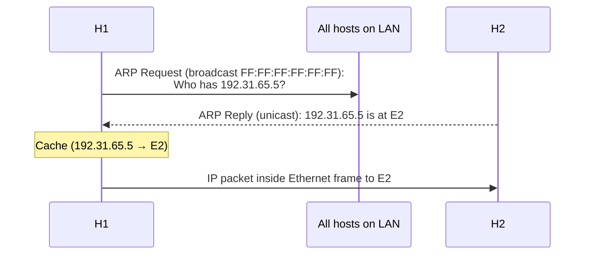

**Optimisations:** **ARP cache** (no repeat broadcast); the target also caches the sender's mapping; every machine **broadcasts its mapping at boot** (gratuitous ARP); cache entries time out.

**Remote destination (H1 → H4 on another network):** the ARP broadcast won't cross the router. Two solutions:
1. **Proxy ARP** — the CS router answers ARP requests for network 192.31.63.0 with its own MAC (E3); H1 caches (192.31.63.8 → E3) and sends all such traffic to the router.
2. **Default gateway** — H1 sees the destination is remote and sends to a default Ethernet address (the router's, E3) for all remote traffic.

### 11.2 RARP — Reverse ARP
- Maps **MAC → IP**: a newly booted **diskless workstation** broadcasts its Ethernet address; the **RARP server** looks it up in its configuration file and returns the IP.
- **Drawback:** uses an all-1s broadcast that routers don't forward → a RARP server is needed **on every network**.

### 11.3 BOOTP
- Uses **UDP** messages, which **are forwarded by routers** → one server for many networks.
- Supplies a diskless workstation with: its IP address, the **file server** holding the memory image, the **default router**, and the **subnet mask**.
- **Drawback:** requires **manual configuration** of IP ↔ Ethernet tables.

### 11.4 DHCP — Dynamic Host Configuration Protocol
- Allows both **manual** and **automatic** IP assignment from a pool; supplies IP, subnet mask, default gateway, DNS server.
- The DHCP server need not be on the same LAN; a **DHCP relay agent** on each LAN forwards broadcasts as **unicast** to the server (relay agent knows the server's IP).
- **Leasing:** addresses are given for a fixed time; the client must renew before expiry, else the address returns to the pool.

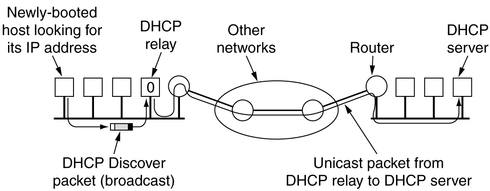

**DORA process**
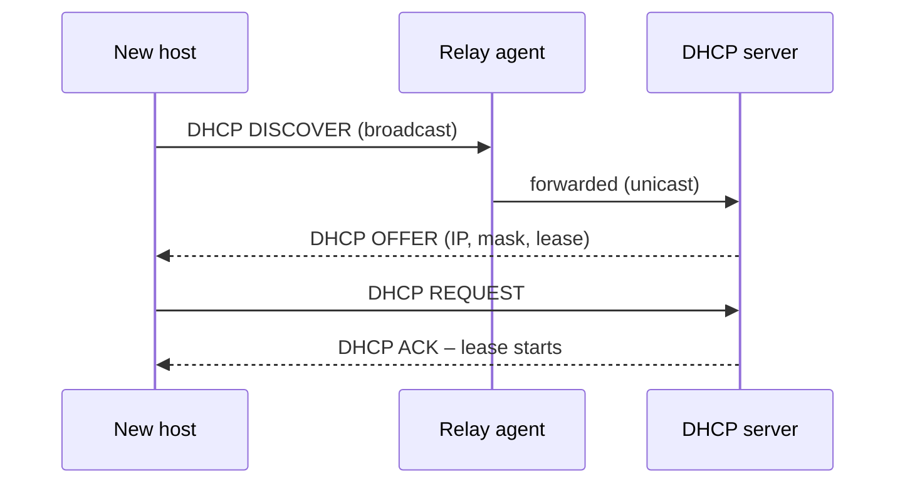

### 11.5 Comparison ★★★
| Feature | ARP | RARP | BOOTP | DHCP |
|---|---|---|---|---|
| Resolves | IP → **MAC** | MAC → **IP** | MAC → IP + config | MAC → IP + full config |
| Layer | 2/3 boundary | 2/3 boundary | Application (UDP) | Application (UDP 67/68) |
| Request | Broadcast | Broadcast | Broadcast (UDP; routed) | Broadcast (DORA), relayed |
| Reply | Unicast | Unicast | Unicast | Unicast/broadcast |
| Server | None (target answers; caches) | RARP server **per network** | Central; **manual tables** | Central; **automatic pool + lease** |
| Status | In use (IPv4) | Obsolete | Obsolete | In use |

---

## 12. Congestion — Basics ★★★

**Congestion:** when too many packets are present in (a part of) the subnet, performance degrades. Routers receive packets faster than they can forward them, so either
- the subnet must **prevent additional packets** from entering the congested region, or
- congested routers must **discard** queued packets to make room.

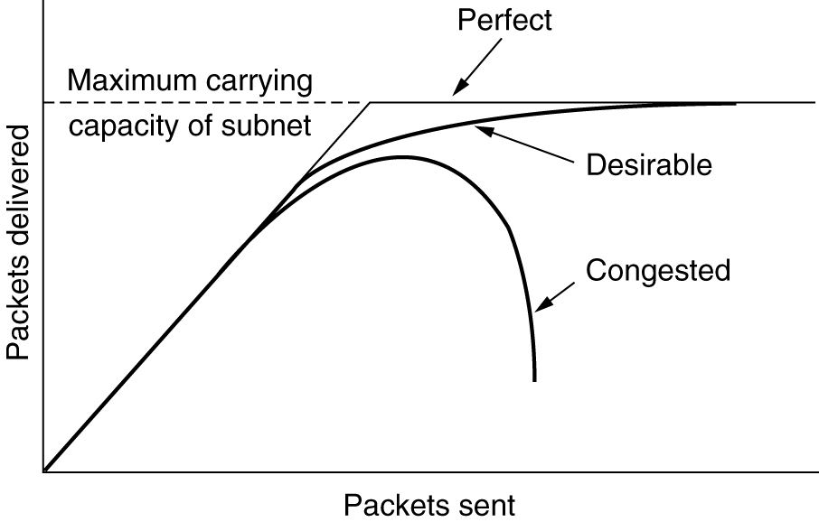
*Perfect network: delivered = offered up to capacity. Real network: throughput rises, then **collapses** as load grows (congestive collapse).*

**Causes:** packet arrival rate exceeds outgoing-link capacity · insufficient router memory (buffers) · **bursty** traffic · slow processors · (low-bandwidth lines).
*Note:* adding infinite memory doesn't help — packets time out in queues and duplicates are sent (Nagle).

### Congestion control vs Flow control ★★
| Congestion control | Flow control |
|---|---|
| **Global** issue — whole subnet, all hosts & routers | **Point-to-point** — between one sender and one receiver |
| Ensures the **network** can carry the offered traffic | Ensures a fast sender doesn't overwhelm a slow **receiver** |
| e.g., choke packets, load shedding, traffic shaping | e.g., sliding window, stop-and-wait |

---

## 13. General Principles of Congestion Control ★★★

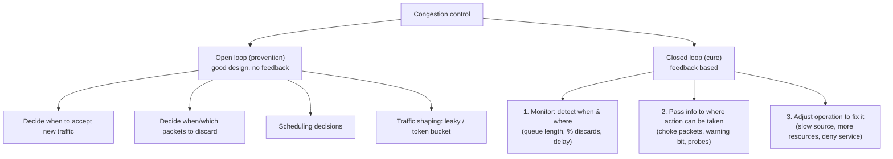

- **Open loop** — solve the problem by **good design**; make sure congestion doesn't happen. Includes deciding when to accept new traffic, when to discard packets and which ones, and scheduling decisions — **without regard to the current state** of the network.
- **Closed loop** — based on a **feedback loop**: monitor → pass information → adjust. Metrics: % packets discarded, average queue length, packets timing out/retransmitted, average delay and its deviation. *Explicit feedback* (router sends warning) vs *implicit* (source infers from losses/delay — TCP).

### Congestion Prevention Policies (open loop) ★★
| Layer | Policies |
|---|---|
| **Transport** | Retransmission policy · Out-of-order caching policy · Acknowledgement policy · Flow-control policy · Timeout determination |
| **Network** | Virtual circuits vs datagrams inside the subnet · Packet queueing and service policy · Packet discard policy · Routing algorithm · Packet lifetime management |
| **Data link** | Retransmission policy · Out-of-order caching policy · Acknowledgement policy · Flow-control policy |

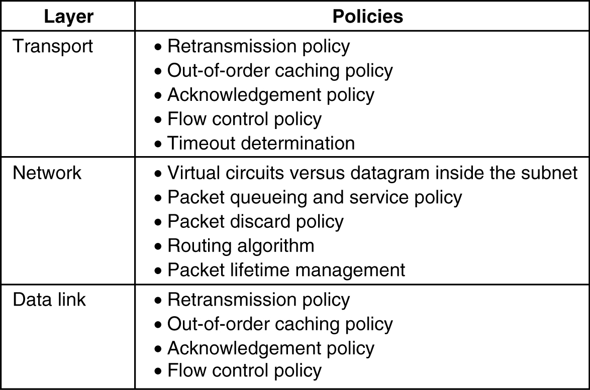

*e.g.* a jumpy sender that times out quickly and uses Go-Back-N puts more load on the network than one using Selective Repeat; piggybacked ACKs reduce extra traffic; tight flow-control windows reduce data rate.

---

## 14. Congestion Control in Virtual-Circuit Subnets ★★

1. **Admission control** — once congestion is signalled, **no new virtual circuits** are set up until it clears (like a telephone exchange giving busy tone).
2. **Route around trouble** — allow new VCs but **route them carefully around congested areas**.
3. **Resource reservation** — negotiate traffic volume, shape and QoS when the VC is set up; the subnet **reserves buffers/bandwidth** along the path.

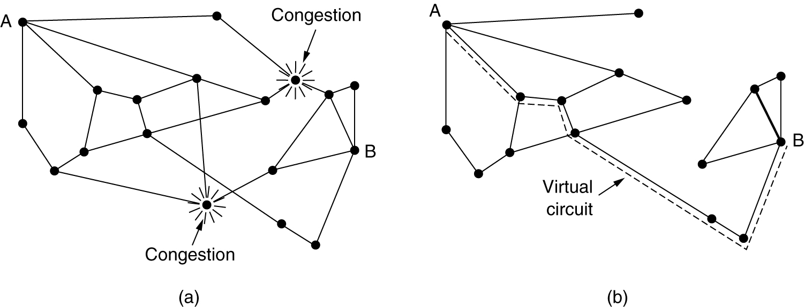
*(a) A congested subnet. (b) Redrawn subnet that omits the congested routers so a VC from A to B avoids them.*

---

## 15. Congestion Control in Datagram Subnets ★★★

Each router monitors **output-line utilisation** *u* using an exponentially weighted average: **u_new = a·u_old + (1 − a)·f** (f = 0/1 sample, a = forgetting factor). If *u* crosses a threshold, the line is in a **warning state** and an action is taken:

### 15.1 Warning Bit
- Used in **DECNET** and **frame relay**.
- The router sets a **special bit in the packet header**; the destination **copies it into the next ACK** back to the source.
- The source monitors the **fraction of ACKs with the bit set**: many → reduce rate; few → increase rate.
- *Problems:* relies on **voluntary** action by hosts; may not pick the right source.

### 15.2 Choke Packets ★★★
- A more **direct** way: the congested router **sends a choke packet directly back to the source host**, giving the destination found in the packet. The original packet is **tagged** so it won't trigger more choke packets downstream.
- The source must **reduce its traffic to that destination by X %** (e.g., 50 %), then **ignore further choke packets** for a fixed interval (so its reduction can take effect).
- After the interval: more choke packets → reduce further; none → **increase traffic** again.
- *Example:* **ICMP Source Quench**.

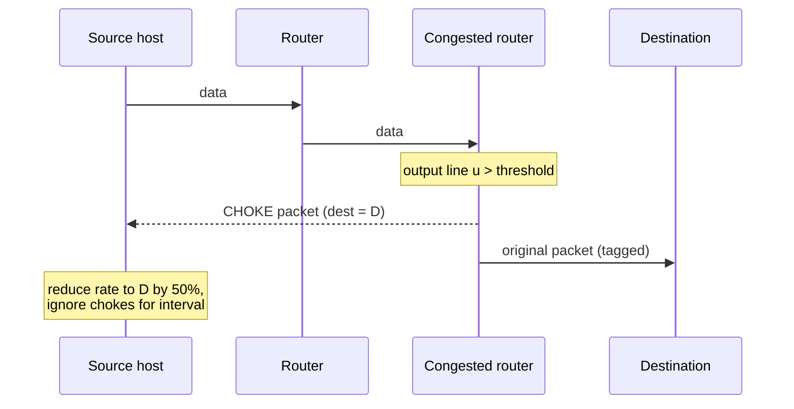

### 15.3 Hop-by-Hop Choke Packets ★★
- Over **long distances / high speeds**, a plain choke packet reacts too slowly — many packets are already in flight (e.g., San Francisco → New York at 155 Mbps: ~4.6 MB sent during the 30 ms it takes to slow down).
- **Solution:** the choke packet **takes effect at every hop** it passes — each intermediate router immediately reduces its flow toward the congested router.
- Gives **quick relief** at the congested point, but upstream routers need **more buffers**.

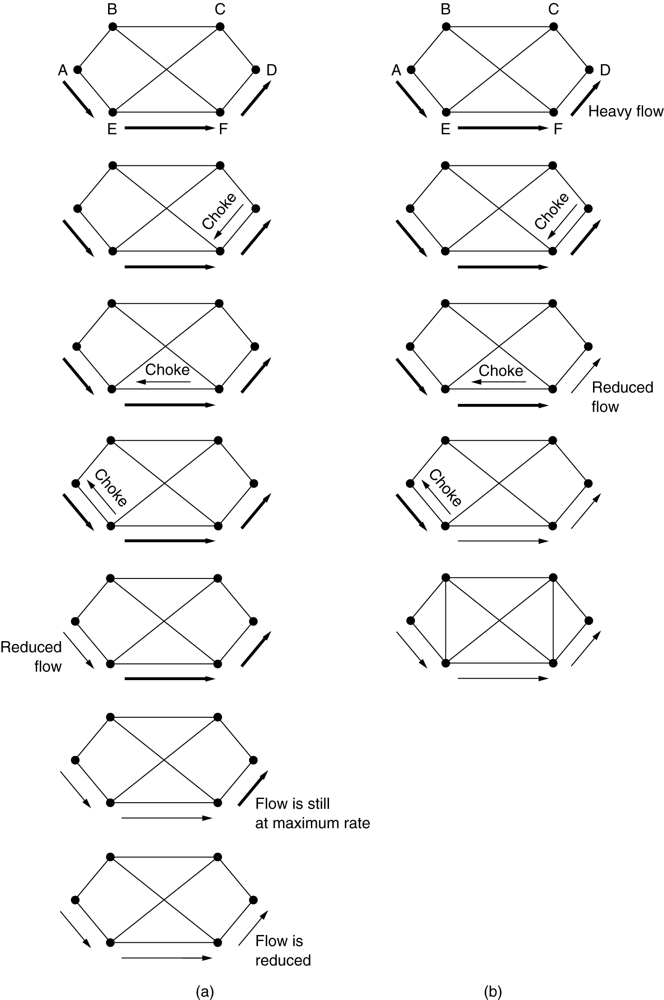
*(a) A choke packet that affects only the source. (b) A choke packet that affects each hop it passes through.*

### 15.4 Load Shedding ★★★
When routers are **flooded beyond capacity**, they simply **throw packets away**. **Which packet?**
- **Random** selection.
- **Application-based:**
  - **Wine policy** (old is better than new) – **file transfer**: drop *new* packets (dropping an old one creates a gap that forces retransmission of everything after it).
  - **Milk policy** (new is better than old) – **real-time multimedia**: drop *old* packets.
- **Priority marking by the sender** (low / high priority); incentives: cheaper price for low priority, or allowing hosts to exceed limits if excess is marked low priority.

### 15.5 Random Early Detection (RED) ★★
Proactive: **discard packets before the buffer is completely full**, because sources (TCP) slow down when they detect loss.
- Routers keep a **running average of queue length** *avg*.
- *avg* < **lower threshold** → queue the packet (no congestion).
- *avg* > **upper threshold** → **discard** the packet (serious congestion).
- In between → discard with a **probability** that grows with *avg* (onset of congestion).
- The source is not informed explicitly (a choke packet would add load); the **lost packet itself is the signal**.

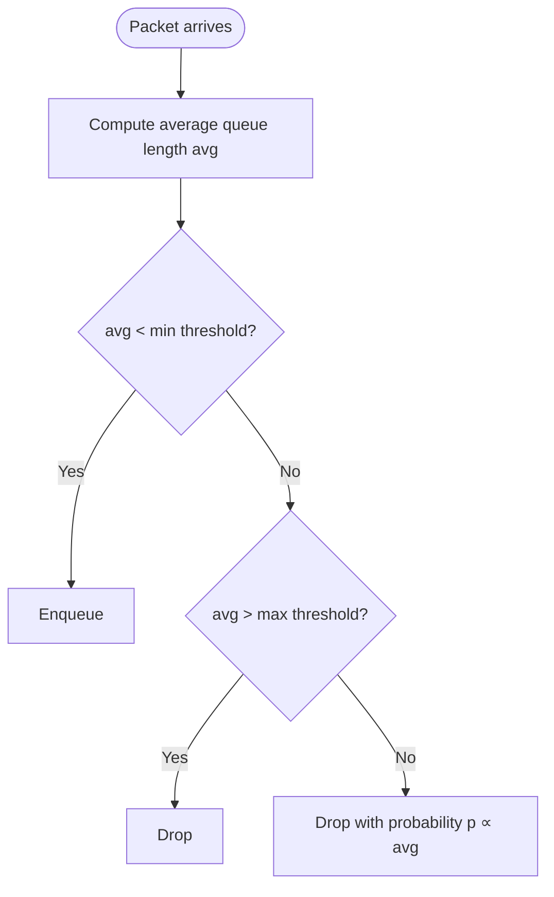

### 15.6 Jitter Control ★★
- **Jitter** = **variation in packet delay** (standard deviation of transit time). For audio/video, *variance* matters more than the *mean* delay.

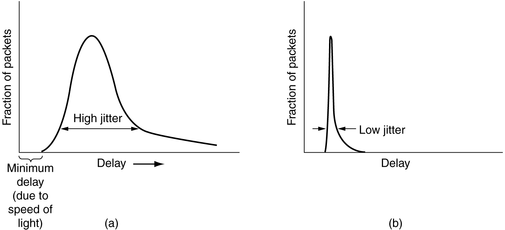

- **Control:** compute the **expected transit time for each hop**; each router checks whether the packet is **behind or ahead of schedule**:
  - **Behind** → forward it **as soon as possible** (ahead of others).
  - **Ahead** → **hold it back** to get it on schedule.
- Alternatively **buffer at the receiver** — fine for **video on demand**, not acceptable for **video-conferencing** (interactive).

---

## 16. Traffic Shaping ★★★

Congestion is often caused by **bursty** traffic. **Traffic shaping** (open loop) regulates the **average rate *and* burstiness** of data entering the network. At connection setup the sender and carrier negotiate a **traffic pattern (shape)**; the carrier monitors it (**traffic policing**). Used in ATM and Integrated Services networks.

### 16.1 Leaky Bucket Algorithm ★★★
- Picture a bucket with a **small hole**: water pours in at any rate, but **leaks out at a constant rate**; if the bucket is full, extra water **overflows (is lost)**.
- Implemented as a **single-server queue with constant service time**: the host may put **one packet per clock tick** onto the network. Full queue → **packets discarded**.
- Turns an uneven, bursty flow into a **smooth, constant-rate** flow.

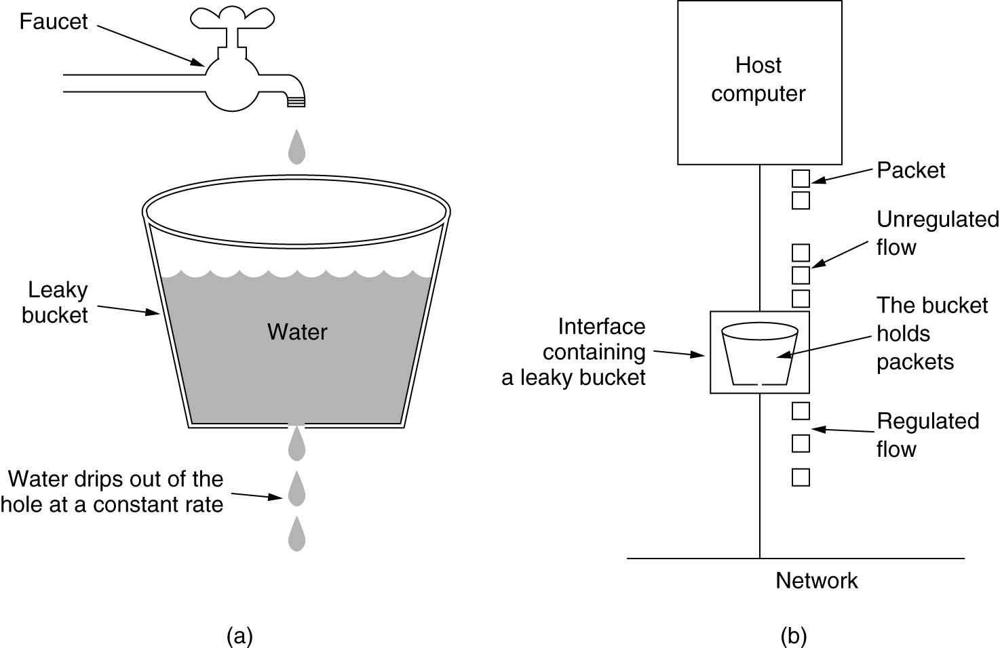

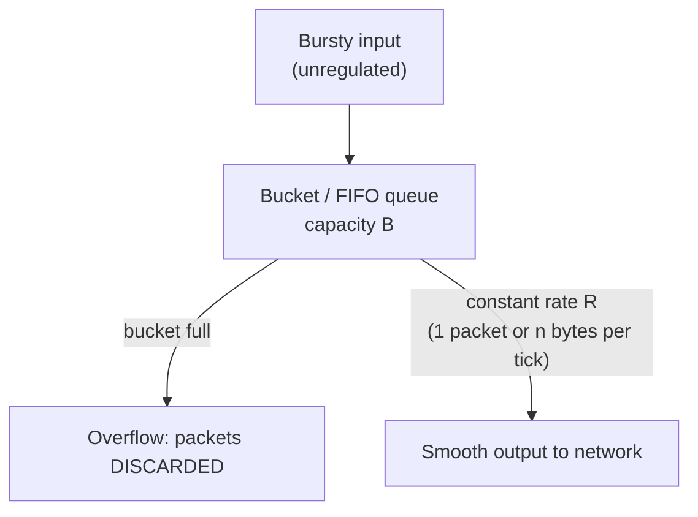

**Byte-counting version (variable-length packets):**
1. At each clock tick initialise a counter to **n**.
2. While the packet at the head of the queue has size ≤ counter: **send it** and **counter −= packet size**.
3. When the head packet is larger than the counter, stop; wait for the next tick (reset counter to *n*).

**Example ★:** n = 1000 bytes per tick; queue (front first) = **200, 400, 450, 500, 700, 200**.
| Tick | Counter | Action |
|---|---|---|
| 1 | 1000 | send 200 → 800; send 400 → 400; head 450 > 400 → stop |
| 2 | 1000 | send 450 → 550; send 500 → 50; head 700 > 50 → stop |
| 3 | 1000 | send 700 → 300; send 200 → 100; queue empty |

**Imp-Q example:** bucket B = 10 MB, leak rate R = 2 MB/s. An 8 MB burst fits (8 ≤ 10) and leaves smoothly at 2 MB/s over 4 s; a further 5 MB arriving while 4 MB remain gives 9 MB — still ≤ 10, so nothing is lost.

### 16.2 Token Bucket Algorithm ★★★
- The bucket holds **tokens**, generated by a clock at **one token every ΔT** (rate R), up to a maximum of **b tokens** (tokens arriving at a full bucket are discarded).
- To send a packet (or a byte), the host must **capture and destroy a token** (*m* bytes ⇒ *m* tokens).
- **Idle hosts save up tokens** (up to *b*) and can later send a **burst** at full speed.
- If too few tokens: the packet is **non-conformant** — it **waits in the queue** until enough tokens accumulate (it is **not** discarded).

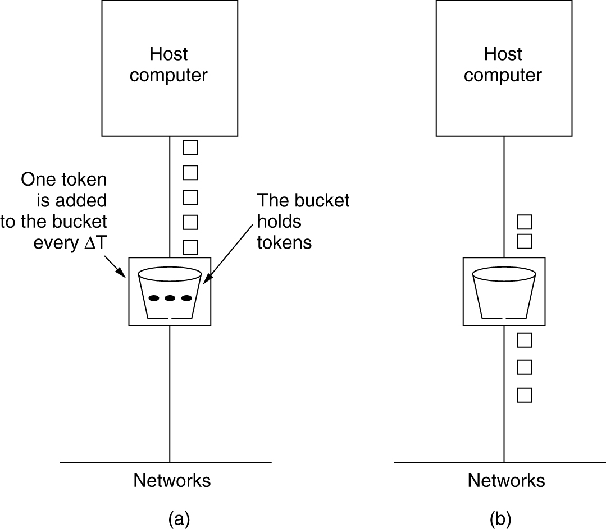
*(a) Before: 3 tokens, 5 packets waiting. (b) After: 3 packets sent using the 3 tokens; 2 wait for new tokens.*

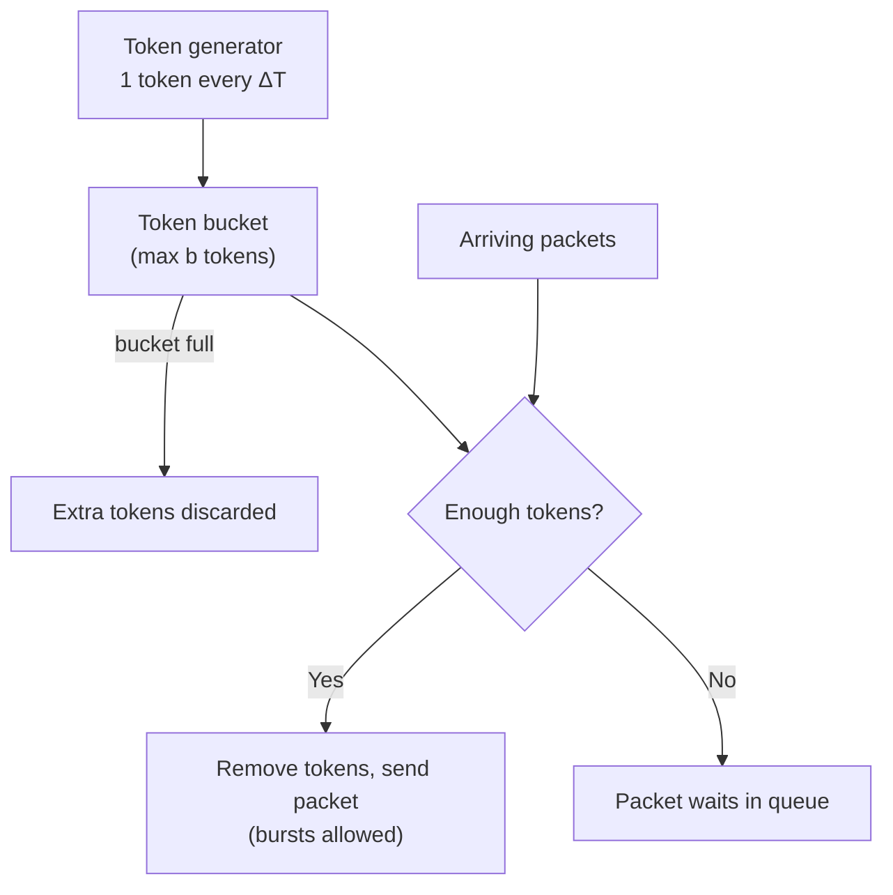

**Maximum burst length:** with bucket capacity **C** bytes, token rate **ρ** bytes/s and maximum output rate **M** bytes/s, a burst lasts **S = C / (M − ρ)** seconds.
*Example:* C = 250 KB, M = 25 MB/s, ρ = 2 MB/s → S = 250 KB / 23 MB/s ≈ **11 ms**.

**Imp-Q example:** B = 5 MB of tokens, R = 2 MB/s, line speed 10 MB/s. A full bucket lets a 5 MB block go out at 10 MB/s in **0.5 s** — impossible with a leaky bucket.

**Token bucket + leaky bucket:** placing a leaky bucket **after** the token bucket (with a faster leak rate than ρ but slower than M) allows bursts while capping the peak rate.

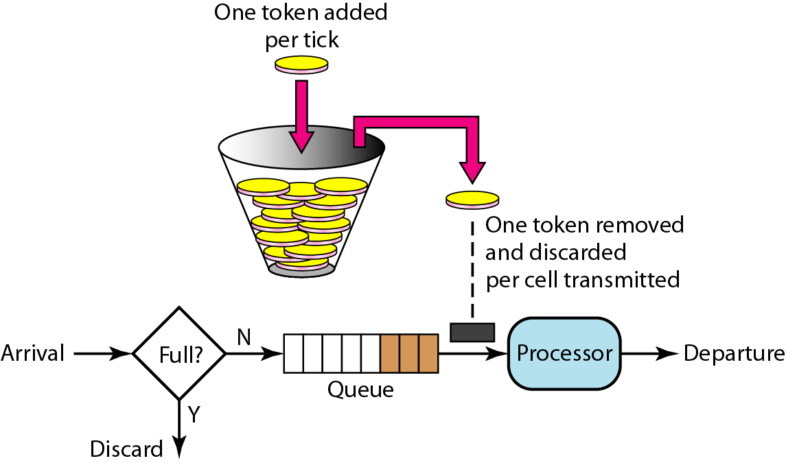

### 16.3 Leaky Bucket vs Token Bucket ★★★
| Feature | Leaky Bucket | Token Bucket |
|---|---|---|
| Output | **Strictly constant** rate; removes all burstiness | **Variable**; bursts allowed up to bucket size |
| Holds | **Packets** | **Tokens** (permissions) |
| On overflow | **Discards packets** | **Discards tokens**, never packets (packets wait) |
| Idle periods | No benefit — cannot save up | **Saves tokens** for future bursts |
| Max output speed | Fixed leak rate R | Full line speed while tokens last |
| Sending condition | One packet (or n bytes) per tick | Only if enough tokens to cover the packet's length |
| Implementation | Simple FIFO queue | Needs token counter & timer |

---

## Unit V — One-Page Summary

| Topic | Key points |
|---|---|
| **Design principles** | Make it work · keep it simple · clear choices · modularity · heterogeneity · no static options · good not perfect · strict send/tolerant receive · scalability · performance & cost. |
| **IPv4 header** | 20–60 B; Version, IHL (×4 B), ToS, Total length (≤ 65 535), ID, DF/MF, Fragment offset (×8 B), TTL, Protocol (6 TCP, 17 UDP, 1 ICMP), Header checksum, Src/Dst, Options (security, strict/loose source route, record route, timestamp). |
| **IP address** | 32 bits, dotted decimal, netid + hostid, 2³² addresses. |
| **Classes** | A 0–127 /8 · B 128–191 /16 · C 192–223 /24 · D 224–239 multicast · E 240–255 reserved. Private: 10/8, 172.16/12, 192.168/16; loopback 127. |
| **Subnetting** | Borrow host bits → more 1s in mask; subnets 2ˢ, hosts 2ʰ − 2. 192.168.1.0/24 → 4 × /26 (255.255.255.192; 62 hosts each). AND address with mask → subnet. |
| **CIDR** | x.y.z.t/n; first = host bits 0, last = host bits 1, count = 2³²⁻ⁿ. 205.16.37.39/28 → .32 – .47 (16). Blocks contiguous, power of 2, aligned. |
| **Supernetting** | Combine contiguous blocks (fewer 1s, /24 → /22) → route aggregation. |
| **NAT** | Private ↔ public translation using port-indexed table; static, dynamic, PAT; RFC 1631; short-term fix. |
| **IPv6** | 128-bit hex addresses; fixed 40-B header (Version, Traffic class, Flow label, Payload length, Next header, Hop limit, Src, Dst); extension headers; no checksum; source-only fragmentation; IPsec; unicast/anycast/multicast. |
| **ICMP** | Error/test messages: dest. unreachable, time exceeded, parameter problem, source quench, redirect, echo (ping), timestamp. |
| **ARP / RARP / BOOTP / DHCP** | ARP IP→MAC (broadcast req., unicast reply, cache, proxy ARP) · RARP MAC→IP (server per LAN) · BOOTP over UDP, manual tables · DHCP automatic, relay agent, **lease**, DORA. |
| **Congestion** | Too many packets → throughput collapses. Causes: rate > capacity, little memory, bursts, slow CPU. Global (vs flow control = point-to-point). |
| **Principles** | Open loop (prevention by design) vs closed loop (monitor → inform → adjust). Prevention policies at transport, network, DLL. |
| **VC subnets** | Admission control · route around congestion · resource reservation. |
| **Datagram subnets** | Warning bit (DECNET; copied into ACKs) · choke packets (ICMP source quench; cut rate, ignore interval) · hop-by-hop choke (relief at each hop) · load shedding (wine vs milk, priorities) · RED (avg queue thresholds) · jitter control (ahead → hold, behind → rush). |
| **Leaky bucket** | Constant output; discards packets on overflow; 1 packet or n bytes per tick. |
| **Token bucket** | Tokens at rate ρ up to b; packets need tokens; bursts allowed; discards tokens not packets; burst S = C/(M − ρ). |
