# Unit VI — The Transport Layer & The Application Layer

> **Syllabus:** *Transport layer:* transport service (services to upper layers, primitives, Berkeley sockets), elements of transport protocols (addressing, connection establishment, connection release), Internet transport protocols — UDP and TCP (service model, segment header, connection establishment & release). *Application layer:* DNS (name space, resource records, name servers), WWW (architecture, static & dynamic documents, HTTP, caching), FTP, Electronic mail (UA, MTA/SMTP, POP3, IMAP4, MIME).
>
> **Sources:** *Unit-VI-PART-1.ppt* (Transport), *Unit-VI-PART-2.ppt* (Application) + *CN-4-5-6 Imp Questions.docx*

**Importance legend:** ★★★ = very frequently asked (★ in Imp-Questions doc) · ★★ = medium · ★ = short answer

---

## Table of Contents
**Part A — Transport Layer**
1. [Services Provided to the Upper Layers](#1-services-provided-to-the-upper-layers-)
2. [Transport Service Primitives](#2-transport-service-primitives-)
3. [Berkeley Sockets](#3-berkeley-sockets-)
4. [Elements of Transport Protocols](#4-elements-of-transport-protocols-)
5. [UDP](#5-udp--user-datagram-protocol-)
6. [TCP Service Model & Ports](#6-tcp--service-model-)
7. [TCP Segment Header](#7-tcp-segment-header-)
8. [TCP Connection Establishment (3-way handshake)](#8-tcp-connection-establishment--three-way-handshake-)
9. [TCP Connection Release](#9-tcp-connection-release-)
10. [TCP vs UDP](#10-tcp-vs-udp-)

**Part B — Application Layer**
11. [DNS](#11-dns--domain-name-system-)
12. [World Wide Web](#12-the-world-wide-web-)
13. [HTTP](#13-http--hypertext-transfer-protocol-)
14. [FTP](#14-ftp--file-transfer-protocol-)
15. [Electronic Mail (SMTP, POP3, IMAP4, MIME)](#15-electronic-mail-)
16. [Comparison of Application Protocols](#16-comparison-http-vs-ftp-vs-smtp-vs-dns-)
17. [Unit VI — One-Page Summary](#unit-vi--one-page-summary)

---

# PART A — THE TRANSPORT LAYER

## 1. Services Provided to the Upper Layers ★★★

The transport layer is the **heart of the protocol hierarchy**: it provides **efficient, reliable, cost-effective, process-to-process (end-to-end)** data transport to the application layer, **independent of the physical networks** in use. The hardware/software doing this is the **transport entity** (in the OS kernel, a library or the NIC).

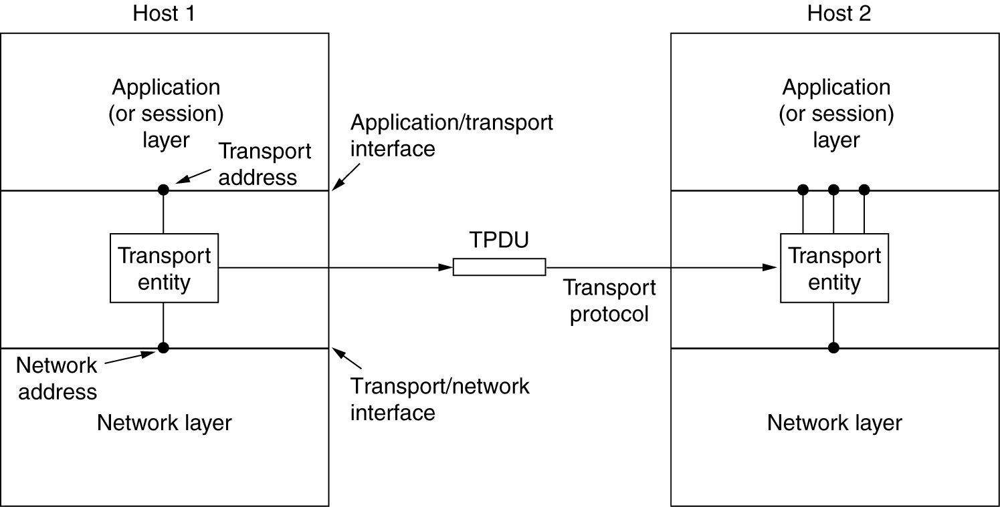

- **Network layer** = host-to-host delivery, runs on routers (operated by the **carrier**).
- **Transport layer** = process-to-process delivery, runs **only on hosts** (owned by **users**) → users can improve on poor network service (lost packets, router crashes) by retransmission, etc.
- Gives applications a **standard set of primitives** that hides network differences.

### Services / functions
| Service | Description |
|---|---|
| **Process-to-process delivery** | **Port numbers** deliver data to the right application |
| **Connection management** | Establish, maintain, release connections |
| **Segmentation & reassembly** | Split messages into segments (with sequence numbers) and reassemble in order |
| **Flow control** | Sliding window so a fast sender doesn't swamp a slow receiver |
| **Error control** | Checksums, ACKs, retransmission → no loss, damage or duplication |
| **Congestion control** | Throttle sending rate when the network is congested (TCP) |
| **Multiplexing / demultiplexing** | Many applications share one network connection |
| Two kinds of service | **Connection-oriented** (TCP) and **connectionless** (UDP) |

---

## 2. Transport Service Primitives ★★

Primitives = the operations an application uses to access the transport service.

| Primitive | Packet (TPDU) sent | Meaning |
|---|---|---|
| **LISTEN** | (none) | Block until some process tries to connect |
| **CONNECT** | CONNECTION REQ. | Actively attempt to establish a connection |
| **SEND** | DATA | Send information |
| **RECEIVE** | (none) | Block until a DATA packet arrives |
| **DISCONNECT** | DISCONNECTION REQ. | This side wants to release the connection |

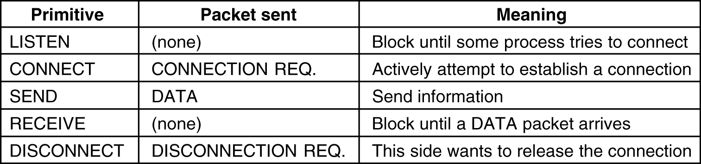

### Nesting of TPDUs, packets and frames
A **TPDU (Transport Protocol Data Unit)** — today called a **segment** — is carried inside a network-layer **packet**, which is carried inside a data-link **frame**.

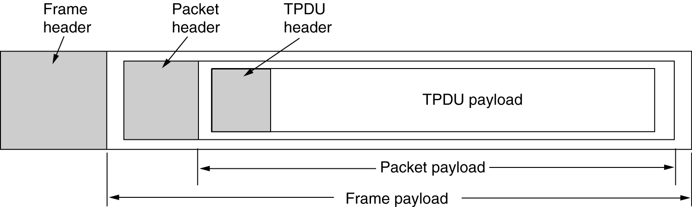

```
| Frame header | Packet header | TPDU header |   TPDU payload   | Frame trailer |
               |<------------- packet payload ----------------->|
|<----------------------------- frame payload ------------------->|
```

### Connection-management state diagram
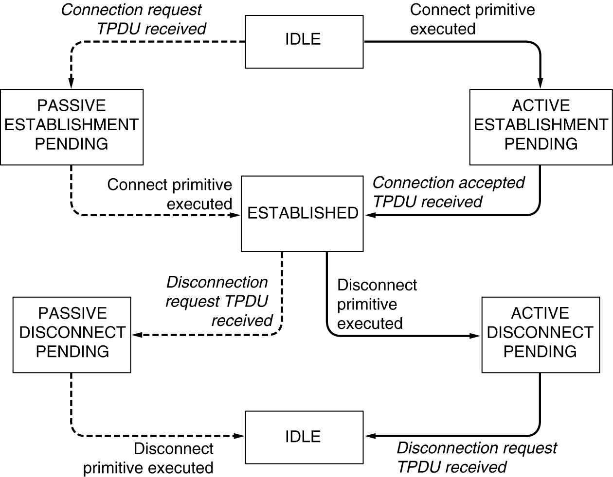
Client: IDLE → (CONNECT) → ACTIVE ESTABLISHMENT PENDING → (connection accepted) → ESTABLISHED → (DISCONNECT) → ACTIVE DISCONNECT PENDING → IDLE. Server: IDLE → (connection request TPDU) → PASSIVE ESTABLISHMENT PENDING → (CONNECT) → ESTABLISHED → … Transitions in italics are caused by packet arrivals.

---

## 3. Berkeley Sockets ★★

**Socket** = an endpoint of communication = **IP address + port number** (e.g., 192.168.1.100:80). A pair of sockets (source, destination) uniquely identifies a TCP connection. Berkeley (UNIX) sockets are the standard programming interface for TCP.

| Primitive | Meaning |
|---|---|
| **SOCKET** | Create a new communication endpoint |
| **BIND** | Attach a local address (IP + port) to a socket |
| **LISTEN** | Announce willingness to accept connections; give queue size |
| **ACCEPT** | Block the caller until a connection attempt arrives |
| **CONNECT** | Actively attempt to establish a connection |
| **SEND** | Send some data over the connection |
| **RECEIVE** | Receive some data from the connection |
| **CLOSE** | Release the connection |

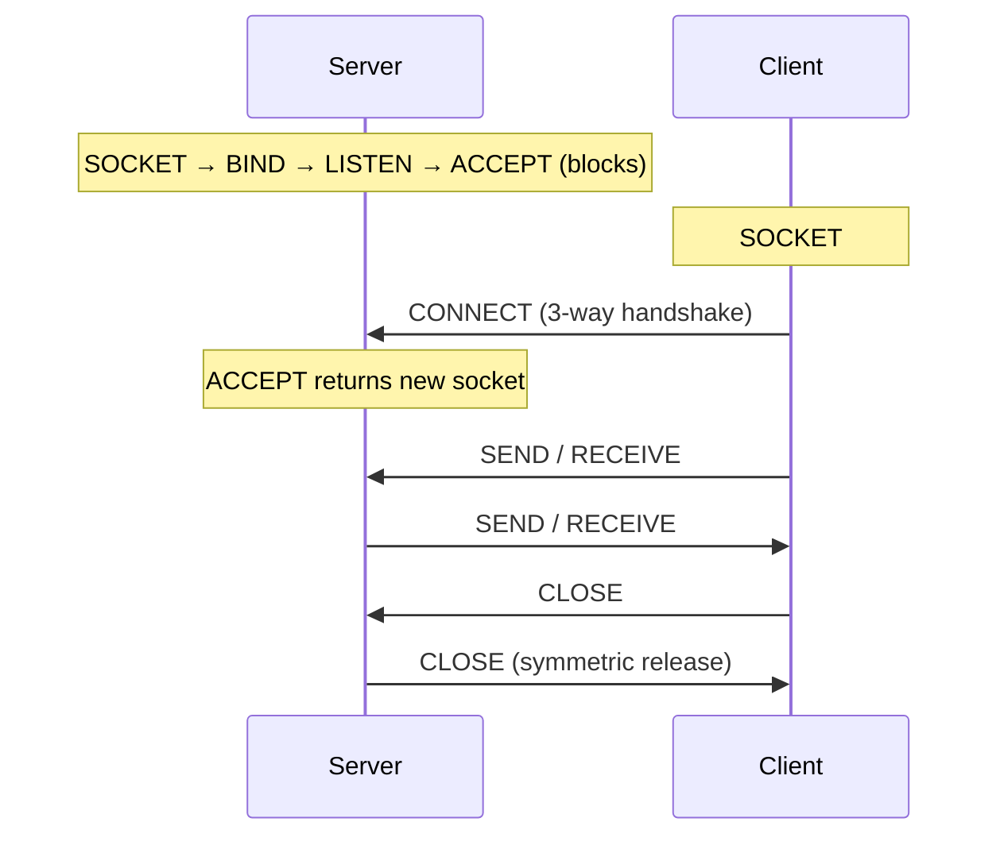

---

## 4. Elements of Transport Protocols ★★

Transport protocols resemble DLL protocols (error control, sequencing, flow control) but the **environment differs**:

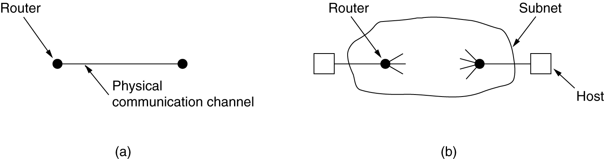

| Data link layer | Transport layer |
|---|---|
| Two routers talk over a **physical channel** | Two hosts talk over the **entire subnet** |
| Destination implicit (other end of wire) | **Explicit addressing** of destination needed |
| Connection setup simple | Connection establishment is complicated |
| No storage in the wire | Subnet can **store, delay and duplicate** packets |
| Fixed buffers per line | Many connections → dynamic buffer management |

### 4.1 Addressing
- Applications listen on **TSAPs (Transport Service Access Points)** — in the Internet, **ports**.
- Network-layer endpoints are **NSAPs** — in the Internet, **IP addresses**.

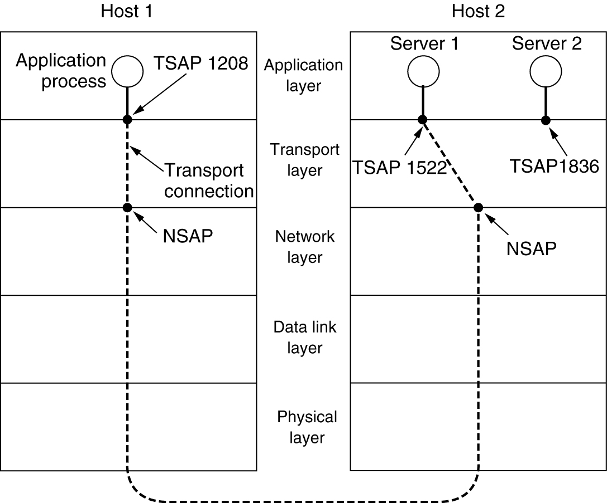

*How does a client know the server's TSAP?* Well-known ports (e.g., 80 for HTTP), a **process server** (inetd) that listens on many ports and spawns the right server, or a **name server / portmapper** directory.

### 4.2 Connection Establishment
- **Problem:** the network can **lose, delay, duplicate** packets → **delayed duplicates** could create bogus connections.
- **Solutions:** throw-away TSAP addresses, connection identifiers, **limiting packet lifetime** (hop counter / timestamp), **sequence numbers that don't wrap within a packet's lifetime**, and the **three-way handshake** (Tomlinson) with initial sequence numbers chosen by both sides — duplicates are then rejected because they carry the wrong ACK number.

### 4.3 Connection Release
- **Asymmetric release** (like hanging up a phone) — abrupt; may **lose data** in flight.
- **Symmetric release** — each direction released independently (two simplex connections).
- **Two-army problem:** two blue armies must agree to attack together through an unreliable messenger — **no protocol can guarantee agreement** (the last messenger may always be lost). Practical solution: three-way release with **timers** — if no response to a FIN/DR within the timeout, release anyway.

---

## 5. UDP — User Datagram Protocol ★★★

- **Connectionless, unreliable, best-effort** transport (RFC 768). Sends **datagrams** without setup.
- **No** flow control, error recovery, retransmission, ordering or congestion control. It just provides **ports (multiplexing/demultiplexing)** and an optional **checksum**.
- Very **low overhead** (8-byte header) and **low latency**.

### UDP header (8 bytes)
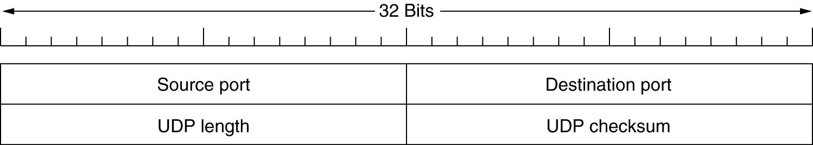

```
 0                16               31
+-----------------+-----------------+
|   Source port   | Destination port|
+-----------------+-----------------+
|   UDP length    |  UDP checksum   |
+-----------------+-----------------+
|              Data ...             |
```

| Field | Size | Purpose |
|---|---|---|
| **Source port** | 16 bits | Port of the sender (needed for replies; optional) |
| **Destination port** | 16 bits | Delivers the payload to the correct process |
| **Length** | 16 bits | Header + data in bytes (minimum **8**) |
| **Checksum** | 16 bits | Optional; covers header, data and an IP **pseudo-header** |

### Applications of UDP
- **Real-time multimedia** — VoIP, video conferencing, live streaming, online games (a late packet is useless; retransmission causes lag).
- **Simple request–reply** — **DNS** (port 53), **SNMP**, NTP.
- **Bootstrapping** — **DHCP / BOOTP** (67/68), **TFTP** (69).
- **Routing updates** — **RIP** (520).
- **RPC** (remote procedure call), RTP (real-time transport protocol) runs over UDP.
- **Multicast / broadcast** (TCP can't).

---

## 6. TCP — Service Model ★★★

**TCP (Transmission Control Protocol)** provides a **reliable, connection-oriented, full-duplex, point-to-point, end-to-end byte stream** over an unreliable internetwork (RFC 793).

- Service is obtained by creating **sockets** at both ends; a connection is identified by **(socket 1, socket 2)**.
- **Ports < 1024** are **well-known ports** reserved for standard services (0–1023 well-known, 1024–49151 registered, 49152–65535 dynamic).
- **Byte stream, not message stream** — message boundaries are **not preserved**: four 512-byte writes may be delivered as one 2048-byte read.

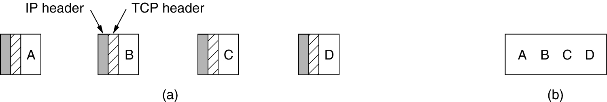

- **PUSH** flag forces data to be sent immediately; **URGENT** data (e.g., Ctrl-C) is signalled by the urgent pointer.

### Some assigned (well-known) ports
| Port | Protocol | Use |
|---|---|---|
| 20 / 21 | **FTP** | File transfer (data / control) |
| 22 | SSH | Secure remote login |
| 23 | **Telnet** | Remote login |
| 25 | **SMTP** | E-mail |
| 53 | **DNS** | Name resolution (UDP/TCP) |
| 69 | TFTP | Trivial File Transfer Protocol (UDP) |
| 79 | Finger | Look up info about a user |
| 80 | **HTTP** | World Wide Web |
| 110 | **POP-3** | Remote e-mail access |
| 119 | NNTP | USENET news |
| 143 | IMAP | E-mail access |
| 443 | HTTPS | Secure web |

---

## 7. TCP Segment Header ★★★

Every segment has a **20-byte fixed header** + options (up to 40 bytes) + data (up to 65 535 − 20 − 20 = 65 495 bytes).

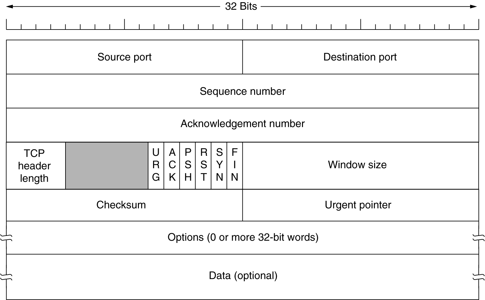

```
 0               8               16              24             31
+---------------------------------+-------------------------------+
|          Source port            |        Destination port       |
+---------------------------------+-------------------------------+
|                        Sequence number                          |
+-----------------------------------------------------------------+
|                     Acknowledgement number                      |
+--------+-------+-+-+-+-+-+-+----+-------------------------------+
| Header | Rsvd  |U|A|P|R|S|F|    |          Window size          |
| length |       |R|C|S|S|Y|I|    |                               |
+---------------------------------+-------------------------------+
|           Checksum              |        Urgent pointer         |
+---------------------------------+-------------------------------+
|                Options (0 or more 32-bit words)                 |
+-----------------------------------------------------------------+
|                         Data (optional)                         |
```

| Field | Size | Purpose |
|---|---|---|
| **Source port / Destination port** | 16 + 16 bits | Identify the endpoints (processes) |
| **Sequence number** | 32 bits | Number of the **first data byte** in this segment (if SYN is set, seq = ISN *n* and first data byte is *n* + 1) |
| **Acknowledgement number** | 32 bits | **Next byte expected** by the receiver (valid when ACK = 1) — cumulative |
| **Header length (data offset)** | 4 bits | Header size in 32-bit words → where data begins |
| **Reserved** | 6 bits | Future use |
| **URG** | 1 | Urgent pointer is valid |
| **ACK** | 1 | Acknowledgement number is valid |
| **PSH** | 1 | **Push** — deliver data to the application immediately |
| **RST** | 1 | **Reset** the connection (error, refuse a connection) |
| **SYN** | 1 | **Synchronise** sequence numbers — establish a connection |
| **FIN** | 1 | Sender has **finished** sending — release |
| **Window size** | 16 bits | **Flow control:** number of bytes (from the ACK number onwards) the receiver can accept |
| **Checksum** | 16 bits | Covers header + data + **pseudo-header** |
| **Urgent pointer** | 16 bits | Offset from seq. number to the end of urgent data |
| **Options** | ≤ 40 bytes | e.g., **MSS (Maximum Segment Size)**, window scale, timestamp, SACK |

### Pseudo-header for checksum
The TCP (and UDP) checksum also covers a **pseudo-header**: source IP, destination IP, zero byte, **protocol = 6**, TCP segment length. This guards against mis-delivered segments (violates layering but catches routing errors).

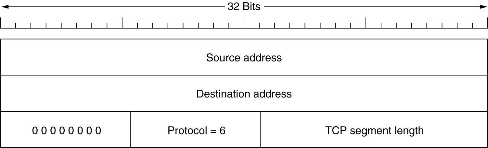

---

## 8. TCP Connection Establishment — Three-Way Handshake ★★★

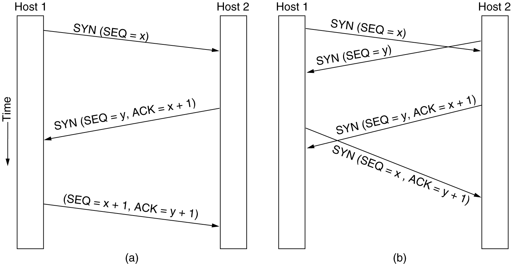
*(a) Normal case (b) Call collision — both sides open simultaneously; only **one** connection results because connections are identified by their endpoints.*

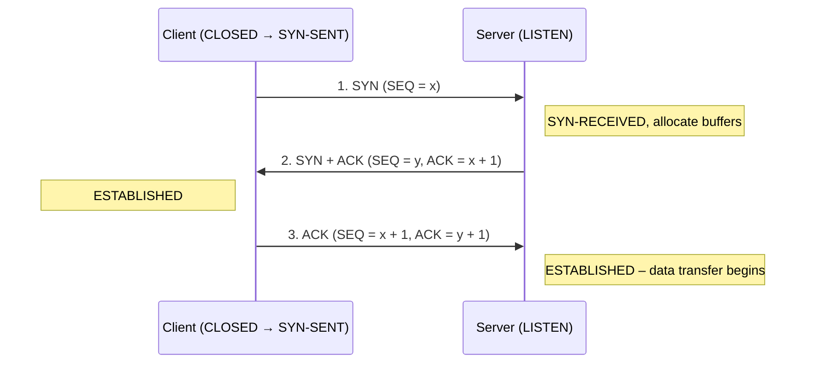

| Step | Segment | Explanation |
|---|---|---|
| 1 | **SYN**, seq = x | Client (active open via CONNECT) picks a random **ISN x** and asks to open a connection. Server did a passive open (LISTEN/ACCEPT). |
| 2 | **SYN + ACK**, seq = y, ack = x + 1 | Server accepts, picks its own ISN **y**, acknowledges x. (If no process is listening → reply with **RST**.) |
| 3 | **ACK**, seq = x + 1, ack = y + 1 | Client acknowledges y. Both sides **ESTABLISHED**; data may flow. |

*Why three ways?* Both sides must **agree on both initial sequence numbers**, and delayed duplicate SYNs must not create bogus connections. (SYN-flood attacks exploit step 2 — defended with SYN cookies.)

---

## 9. TCP Connection Release ★★★

- TCP connections are **full duplex**, but to understand release think of them as **two simplex connections**, each released independently.
- Either side sends a segment with **FIN** = "I have no more data to send". When the FIN is **ACKed**, that direction is shut down; data may still flow the **other way**.
- When **both directions** are shut down, the connection is released.
- Normally **four segments** (FIN, ACK, FIN, ACK); if the first ACK and second FIN are combined → **three segments**.

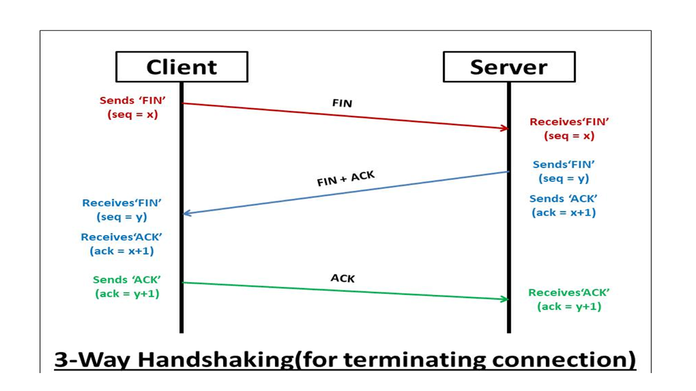

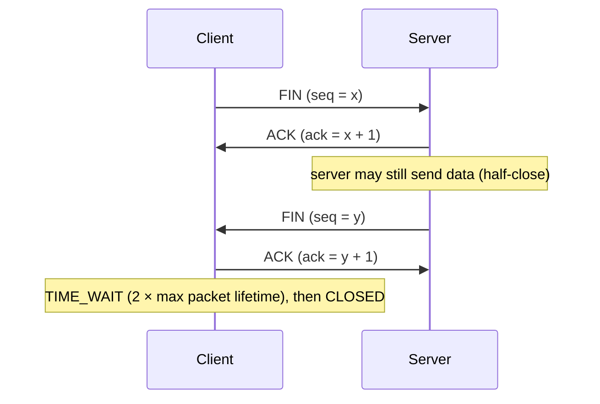

**Two-army problem & timers:** if a response to a FIN is not forthcoming within **two maximum packet lifetimes**, the sender of the FIN **releases the connection anyway**; the other side eventually notices nobody is listening and times out too.

---

## 10. TCP vs UDP ★★★

| Feature | TCP | UDP |
|---|---|---|
| Connection | **Connection-oriented** (3-way handshake setup, 4-way release) | **Connectionless** — no setup |
| Reliability | **Reliable**: ACKs, retransmission, sequencing, duplicate removal | **Unreliable**, best effort |
| Ordering | In-order delivery guaranteed | No ordering |
| Data unit | **Byte stream** (no message boundaries) | **Datagrams** (boundaries preserved) |
| Header | **20–60 bytes** | **8 bytes** fixed |
| Flow control | Yes (sliding window, window field) | No |
| Congestion control | Yes (slow start, AIMD) | No |
| Speed / latency | Slower | Faster, low latency |
| Communication | Unicast, point-to-point | Unicast, multicast, broadcast |
| Applications | HTTP/HTTPS, FTP, SMTP, Telnet, SSH, POP3, IMAP | DNS, DHCP, TFTP, SNMP, RIP, VoIP, streaming, gaming |

---

# PART B — THE APPLICATION LAYER

## 11. DNS — Domain Name System ★★★

**DNS** = a **hierarchical, domain-based naming scheme** plus a **distributed database** implementing it ("phone book of the Internet"). It maps **host names → IP addresses** (and e-mail destinations).

**How it is used:** the application calls a library procedure, the **resolver**, passing the name. The resolver sends a **UDP** packet (port 53) to the **local DNS server**, which looks up the name and returns the **IP address**; the program then opens a TCP connection or sends UDP packets to that address.

### 11.1 The DNS Name Space ★★★
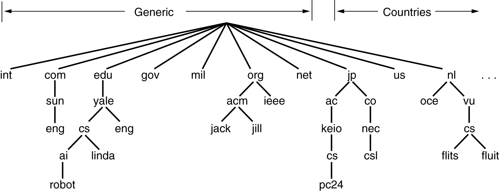

- An inverted **tree** with an unnamed **root**. The Internet is divided into **top-level domains (TLDs)**, each partitioned into **subdomains**, and so on.
  - **Generic TLDs:** com (commercial), edu (educational), gov (US government), int (international organisations), mil (US military), net (network providers), org (non-profit) … plus newer ones (biz, info, name, pro, aero, coop, museum).
  - **Country TLDs:** one per country (in, uk, jp, nl, …).
- A domain is named by the **path upward from it to the root**, labels separated by dots, e.g., `eng.sun.com`.
- **Absolute** names end with a period (`eng.sun.com.`); **relative** names don't. Names are **case-insensitive**; labels ≤ 63 chars, full name ≤ 255 chars.
- **Delegation:** each domain controls how it allocates the domains under it. To create a new domain, **permission is needed from the parent domain** (avoids name conflicts). Once registered, a domain can create sub-domains **without asking anyone higher up**.

### 11.2 Resource Records ★★★
Every domain has a set of **resource records (RRs)**; the real function of DNS is to **map domain names onto resource records**. An RR is a **five-tuple**:

```
Domain_name    Time_to_live    Class    Type    Value
```

| Field | Meaning |
|---|---|
| **Domain_name** | The domain the record applies to (primary search key) |
| **Time_to_live** | How stable the record is (seconds it may be cached; e.g., 86 400 = 1 day) |
| **Class** | **IN** for Internet information |
| **Type** | Kind of record (see below) |
| **Value** | Number, domain name or ASCII string |

**Principal RR types**
| Type | Meaning | Value |
|---|---|---|
| **SOA** | Start of Authority | Parameters for this zone (primary name server, admin e-mail, serial no., timers) |
| **A** | IPv4 address of a host | 32-bit integer |
| **AAAA** | IPv6 address | 128-bit |
| **MX** | Mail exchange | Priority, domain willing to accept e-mail |
| **NS** | Name server | Name of a server for this domain |
| **CNAME** | Canonical name | Alias → real domain name |
| **PTR** | Pointer | Alias for an IP address (reverse lookup) |
| **HINFO** | Host description | CPU and OS in ASCII |
| **TXT** | Text | Uninterpreted ASCII text |

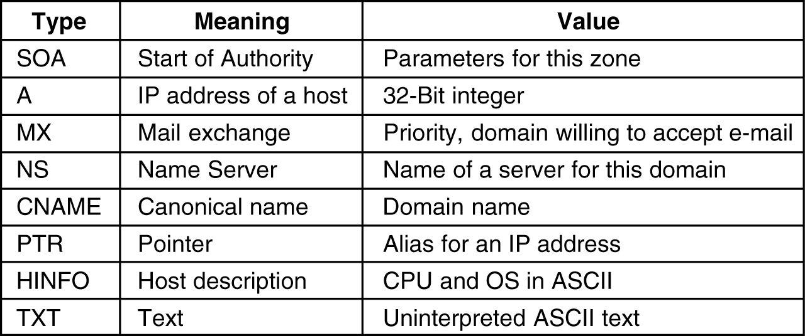

*Sample database for cs.vu.nl:* `cs.vu.nl. 86400 IN MX 1 zephyr` · `zephyr.cs.vu.nl. 86400 IN A 130.37.20.10` · `www.cs.vu.nl. 86400 IN CNAME star.cs.vu.nl` …

### 11.3 Name Servers ★★★
- One server for the whole Internet would be overloaded and a single point of failure → the name space is divided into non-overlapping **zones**, each with a **primary** name server (reads data from a file) and **secondary** servers (get data from the primary).

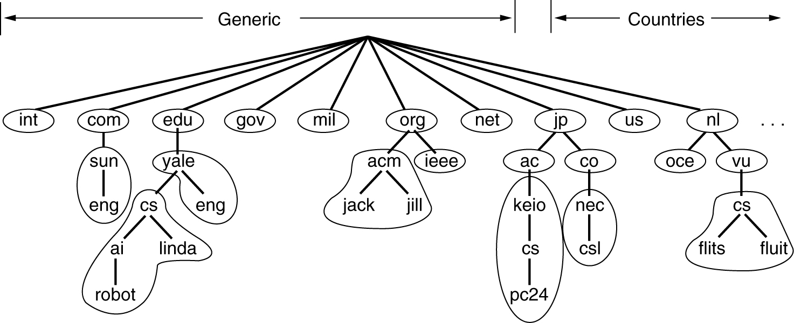

- **Hierarchy of servers:** **root servers** (know the TLD servers) → **TLD servers** (.com, .edu, .in …) → **authoritative servers** for each domain. The **local DNS server** (ISP) answers clients and caches results.
- **Authoritative record** = from the authority managing the record (always correct); **cached record** may be out of date (hence TTL).

### Name resolution — 8 steps ★★★
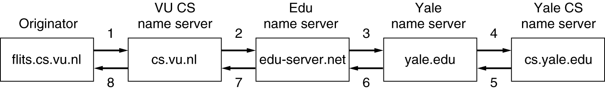

*flits.cs.vu.nl wants the IP of linda.cs.yale.edu:*

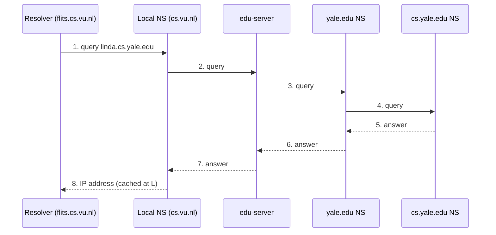

- **Recursive query:** the server obtains the complete answer itself (as above).
- **Iterative query:** the server replies with a **referral** ("ask this server next"), and the local server contacts each one in turn (root → TLD → authoritative) — the common modern behaviour for root/TLD servers.
- Answers are **cached** at the local server for the TTL.

---

## 12. The World Wide Web ★★★

The **WWW** is an architectural framework for accessing **linked content** spread over millions of machines — a **distributed client/server service**. Key pieces: **URL** (naming), **HTTP** (transfer), **HTML** (format).

### 12.1 Architectural overview

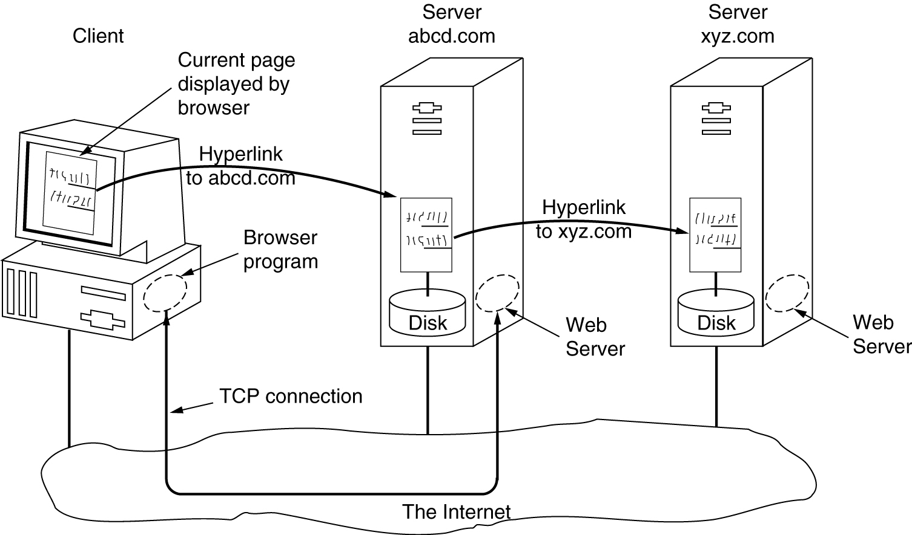

- A **page** may contain **hyperlinks** to other pages (hypertext). Users follow links with a **browser**.
- The browser fetches the page from a **web server** using HTTP and displays it.

### 12.2 The Client Side (browser)
When a link (URL) is clicked, e.g., `http://www.itu.org/home/index.html`:
1. Browser determines the URL.
2. Asks **DNS** for the IP of www.itu.org.
3. DNS replies 156.106.192.32.
4. Browser makes a **TCP connection to port 80**.
5. Sends an HTTP request for `/home/index.html`.
6. Server sends the file.
7. TCP connection is released (HTTP/1.0).
8. Browser displays all the text of index.html.
9. Browser fetches and displays all images on the page.

Non-HTML content (PDF, video…) is handled via **MIME types** by a **plug-in** (runs inside the browser) or a **helper application** (separate program).

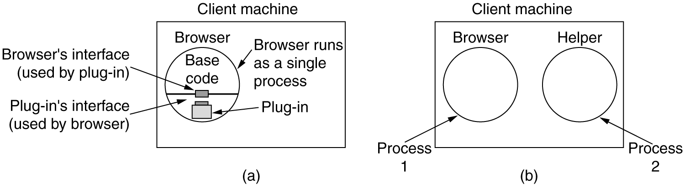

### 12.3 The Server Side
Server loop: accept TCP connection → get file name → get file (from disk/cache) → send to client → release connection.

- **Multithreaded server:** a **front end** accepts requests and hands them to **processing modules (threads)** with a shared cache.

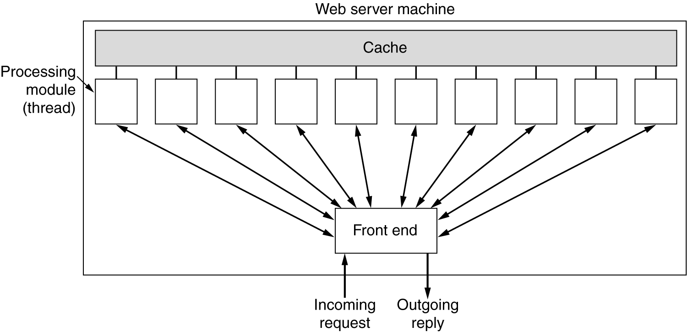

- **Server farm:** many machines behind a **front end** that distributes requests; **TCP handoff** lets the chosen back-end node reply directly.

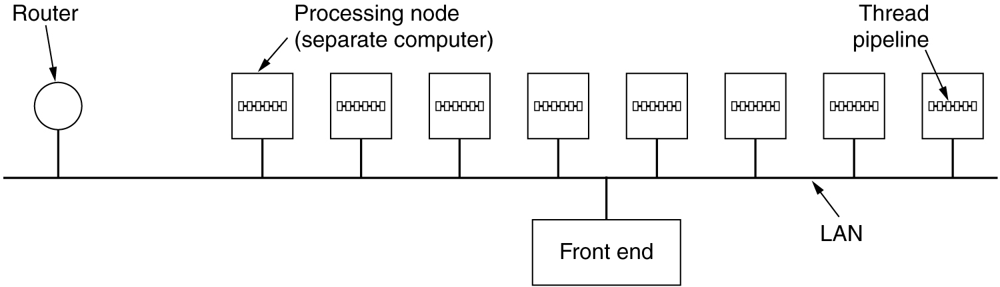

### 12.4 URLs ★★
A **URL (Uniform Resource Locator)** has three parts: **protocol (scheme)** + **DNS name of the host** + **path/file name** (plus optional port).

```
http://www.abcd.com:80/products/index.html
└┬─┘   └─────┬────┘ └┬┘└─────────┬────────┘
protocol    host    port       path
```

| Scheme | Used for | Example |
|---|---|---|
| http | Hypertext (HTML) | http://www.cs.vu.nl/~ast/ |
| https | Secure hypertext | https://www.bank.com/ |
| ftp | FTP | ftp://ftp.cs.vu.nl/pub/minix/README |
| file | Local file | file:///usr/suzanne/prog.c |
| mailto | Sending e-mail | mailto:JohnUser@acm.org |
| telnet | Remote login | telnet://www.w3.org:80 |
| news | Newsgroup | news:comp.os.minix |

### 12.5 Statelessness and Cookies ★★
HTTP is **stateless** — the server doesn't remember previous requests. **Cookies** (Netscape, RFC 2109) give state: the server sends a small named string (**Set-Cookie**) which the browser stores and sends back (**Cookie**) on later requests.

**Cookie fields:** Domain · Path · Content (name=value) · Expires · Secure. *Uses:* login sessions, shopping carts, personalisation, tracking. **Non-persistent** (session) vs **persistent** cookies.

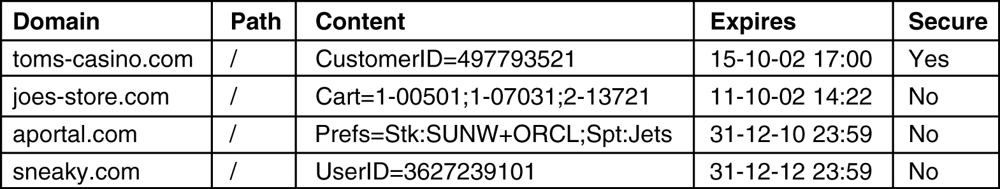

### 12.6 Static vs Dynamic vs Active Documents ★★★
| Static document | Dynamic document | Active document |
|---|---|---|
| Fixed file stored on the server (**HTML**) | Created by the server **at request time** | Program/script sent to and **run at the client** |
| Same content for every request | Content changes per request (forms, DB lookups) | Interactive/animated content |
| HTML | **CGI**, server-side scripts (**PHP**, JSP, ASP) | **Java applets**, **JavaScript** (client-side) |

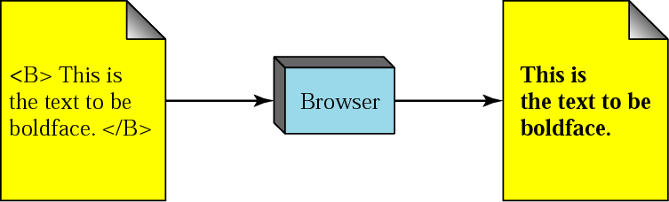

**Server-side dynamic generation** — processing an HTML form: browser sends form data → server passes it to a **CGI script / PHP** → script queries a database → generates an HTML page → returned to the browser.

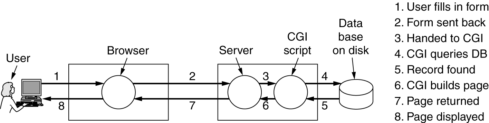

**Client-side generation** — **JavaScript** embedded in the page runs in the browser (validating forms, factorial calculators, mouse-over effects); **Java applets** are compiled programs downloaded and run in a sandbox.

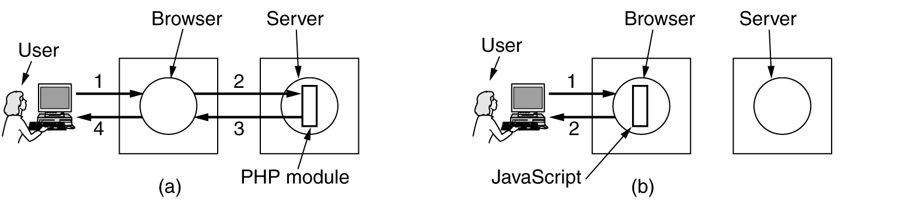
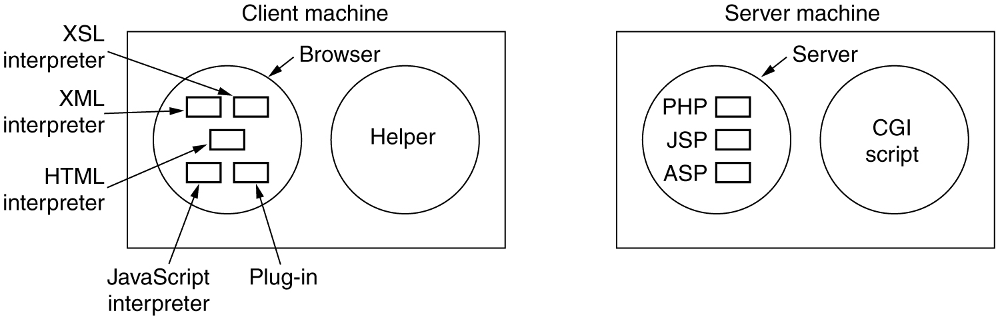

### 12.7 Caching (performance enhancement) ★
- **Browser cache** and **proxy caches**; **hierarchical caching** with client, client-side LAN and ISP-LAN proxies.
- Validity: **Expires** header, or a **conditional GET** (*If-Modified-Since*) → `304 Not Modified`.
- Other enhancements: **server replication / mirroring**, **CDNs** (content delivery networks).

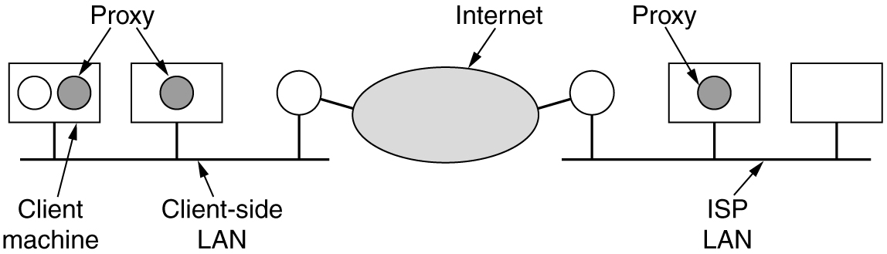

---

## 13. HTTP — HyperText Transfer Protocol ★★★

- Application-layer **request–response** protocol used to access data on the WWW; runs over **TCP, well-known port 80** (HTTPS 443).
- **Stateless.** Text (ASCII) messages.
- **HTTP/1.0:** **non-persistent** — one TCP connection per object. **HTTP/1.1:** **persistent** connections (reuse) + **pipelining**. HTTP/2: multiplexed binary frames.

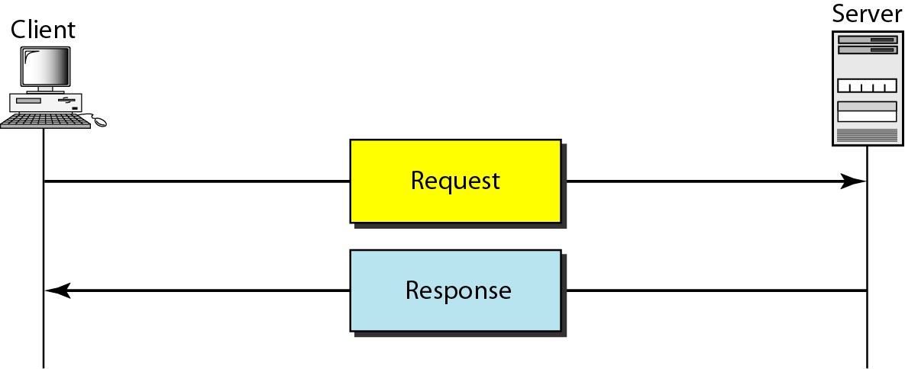

### 13.1 Message formats
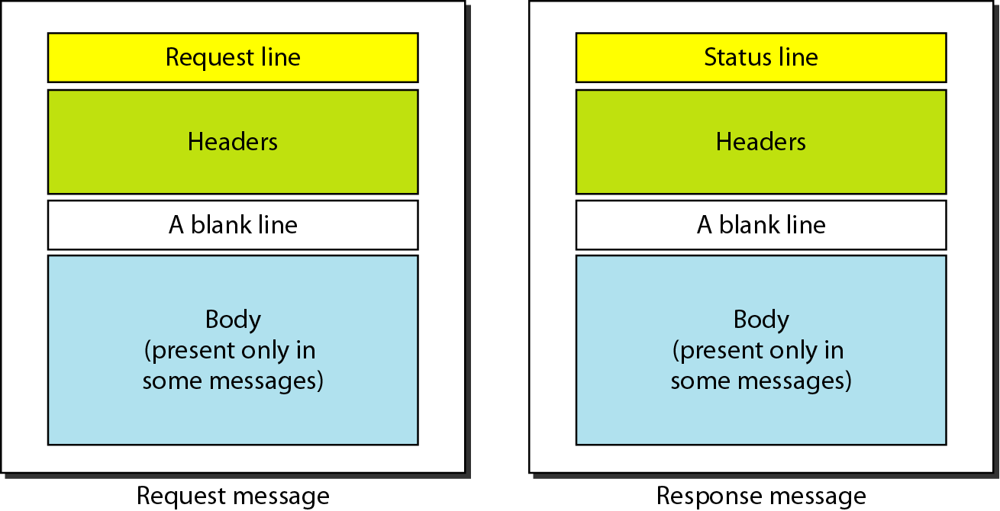

```
REQUEST                                   RESPONSE
GET /usr/bin/image1 HTTP/1.1   ← request line    HTTP/1.1 200 OK            ← status line
Host: www.example.com          ┐                 Date: Mon, 07-Jan-02 …     ┐
Accept: image/gif              ├ headers         Server: Challenger          ├ headers
Accept: image/jpeg             ┘                 Content-Length: 2048        ┘
(blank line)                                     (blank line)
[body – used by POST]                            [body – the document]
```

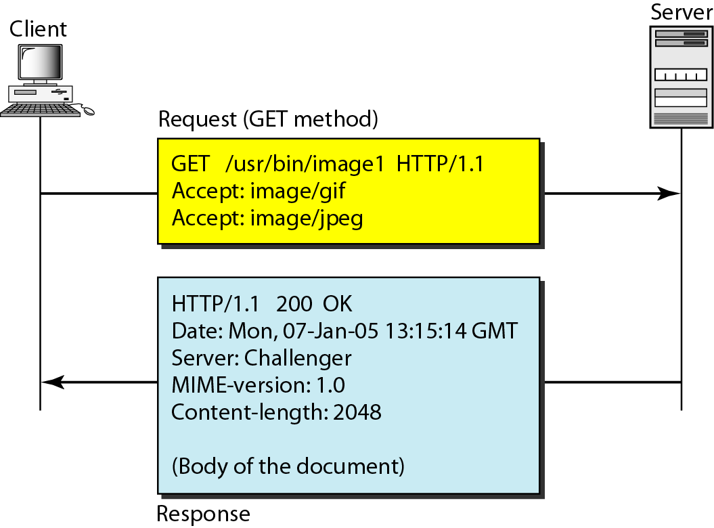
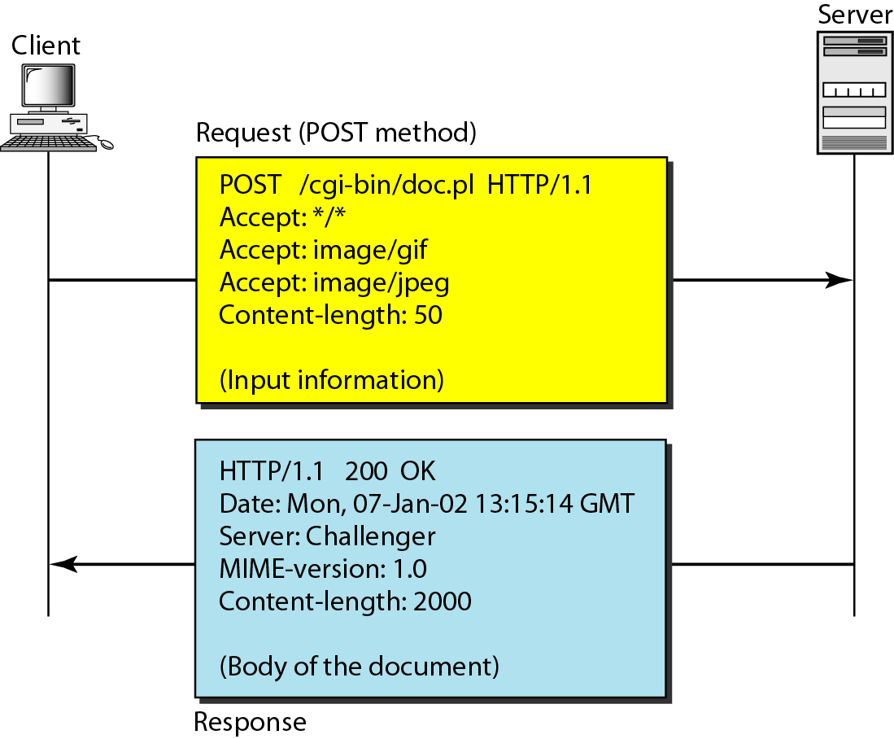

### 13.2 Request methods ★★★
| Method | Description |
|---|---|
| **GET** | Request to **read** a web page |
| **HEAD** | Request to read a web page's **header** only |
| **PUT** | Request to **store** a web page |
| **POST** | **Append** to a named resource (e.g., submit form data) |
| **DELETE** | **Remove** the web page |
| **TRACE** | **Echo** the incoming request (debugging) |
| **CONNECT** | Reserved for future use (tunnelling via proxies) |
| **OPTIONS** | **Query** certain options |

### 13.3 Status code groups ★★★
| Code | Meaning | Examples |
|---|---|---|
| **1xx** | Information | 100 = server agrees to handle the client's request |
| **2xx** | Success | **200** = request succeeded; 204 = no content present |
| **3xx** | Redirection | **301** = page moved; **304** = cached page still valid |
| **4xx** | Client error | **403** = forbidden; **404** = page not found |
| **5xx** | Server error | **500** = internal server error; 503 = try again later |

### 13.4 Common message headers
| Header | Type | Contents |
|---|---|---|
| User-Agent | Request | Information about the browser and its platform |
| Accept / Accept-Charset / Accept-Encoding / Accept-Language | Request | Page types, character sets, encodings, languages the client can handle |
| Host | Request | The server's DNS name |
| Authorization | Request | Client's credentials |
| Cookie | Request | Sends a previously set cookie back |
| If-Modified-Since | Request | Conditional GET |
| Date | Both | Date and time the message was sent |
| Upgrade | Both | Protocol the sender wants to switch to |
| Server | Response | Information about the server |
| Content-Encoding / Language / Length / Type | Response | How/what the content is (e.g., gzip, length, MIME type) |
| Last-Modified / Expires | Response | Time the page was last changed / cache expiry |
| Location | Response | Redirect the client elsewhere |
| Accept-Ranges | Response | Server accepts byte-range requests |
| Set-Cookie | Response | Server wants the client to save a cookie |

### 13.5 HTTP working (end to end) ★★★
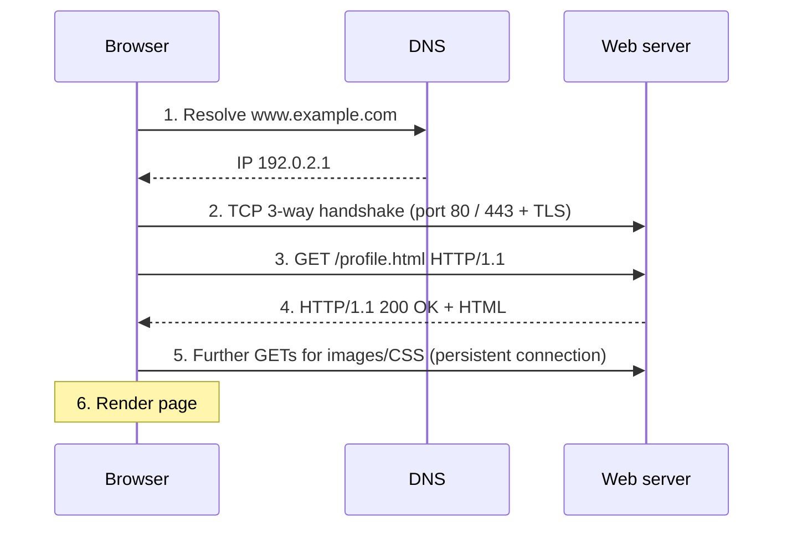

---

## 14. FTP — File Transfer Protocol ★★

- Transfers files between client and server over **TCP**, using **two connections**:
  - **Control connection — port 21:** commands and responses (NVT ASCII); stays open for the **whole session**.
  - **Data connection — port 20:** opened **for each file transfer** (or directory listing) and closed afterwards.
- *Why two?* Commands are short and simple; data transfers are large and varied — separating them makes FTP efficient (**out-of-band control**).

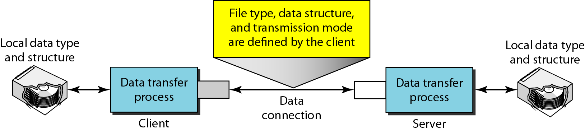

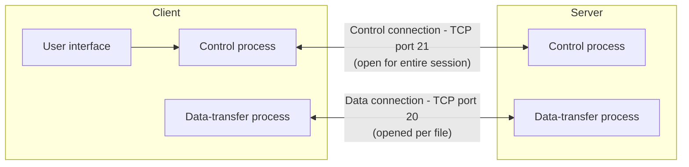

**Communication issues handled:** file type (ASCII, EBCDIC, image/binary), data structure (file, record, page), transmission mode (stream, block, compressed) — all specified by the client over the control connection.
**Common commands:** USER, PASS, LIST, RETR (get), STOR (put), QUIT. **Modes:** active vs passive. *(TFTP — trivial FTP — uses UDP port 69, no authentication.)*

---

## 15. Electronic Mail ★★★

### 15.1 Architecture — UA, MTA, MAA
| Component | Role | Examples |
|---|---|---|
| **UA (User Agent)** | Compose, read, reply, forward messages; handle mailboxes | Command-driven: mail, pine, elm · GUI: Eudora, Outlook, Netscape, Thunderbird |
| **MTA (Message Transfer Agent)** | **Transfer** mail across the Internet (client & server) — **SMTP** | sendmail, Postfix |
| **MAA (Message Access Agent)** | **Pull** mail from the mail server to the user — **POP3 / IMAP4** | — |

**Four scenarios (Forouzan):**
1. Sender and receiver on the **same system** → only **2 UAs**.
2. On **different systems** → 2 UAs + **1 pair of MTAs** (client & server).
3. Sender connected to its mail server via LAN/WAN → 2 UAs + **2 pairs of MTAs**.
4. **Both** connected to mail servers via LAN/WAN (the **most common** case) → **2 UAs + 2 pairs of MTAs + 1 pair of MAAs**.

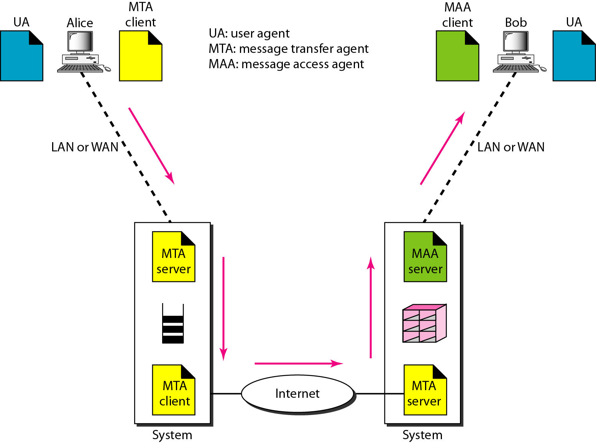

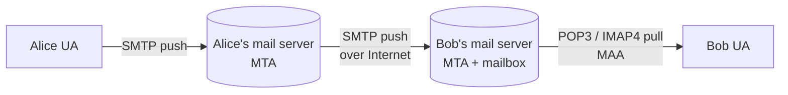

**User agent services:** composing, reading, replying to, forwarding messages; handling mailboxes (inbox, outbox).

### 15.2 Format of an e-mail & address
- A message has an **envelope** (sender & receiver addresses — used by MTAs, like a postal envelope) and the **message** = **header** (From, To, Date, Subject, Cc …) + blank line + **body**.

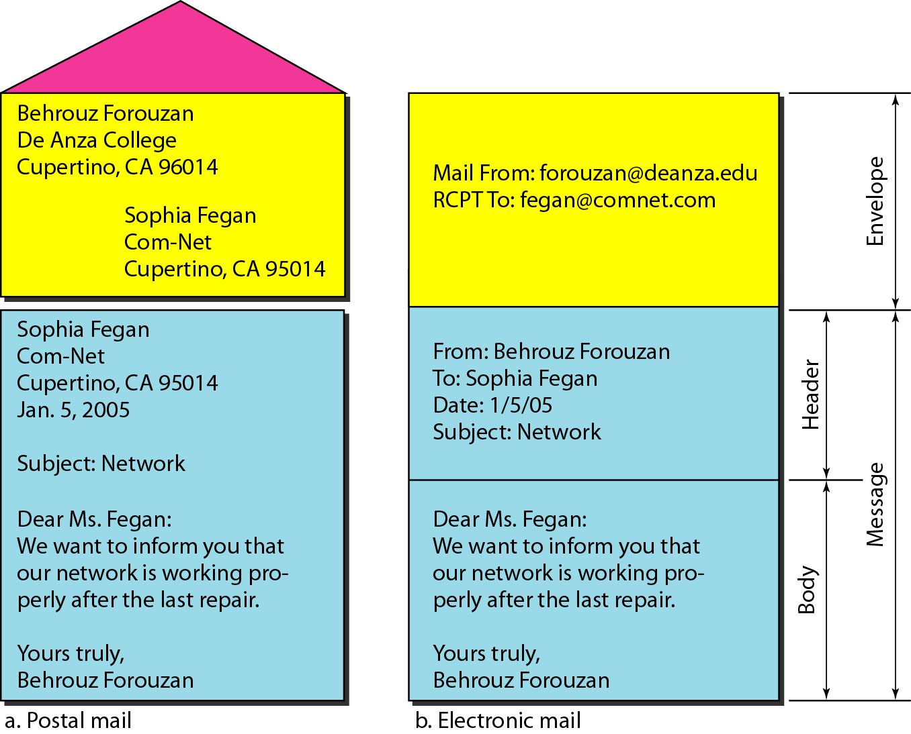

- **Address:** `local-part@domain-name` — the **local part** names the user **mailbox** (a special file on the mail server where received mail is stored); the **domain name** is the mail server's domain (found via DNS **MX** record).

### 15.3 SMTP — Simple Mail Transfer Protocol ★★★
- Standard **push** protocol used by MTAs (client → server) on **TCP port 25**. Used twice: sender's UA → sender's server, and sender's server → receiver's server.
- To send mail a system needs a **client MTA**; to receive mail it needs a **server MTA**.
- Uses simple **commands** (HELO, MAIL FROM, RCPT TO, DATA, QUIT) and numeric **responses** (220 service ready, 250 OK, 354 start mail input, 221 service closed).

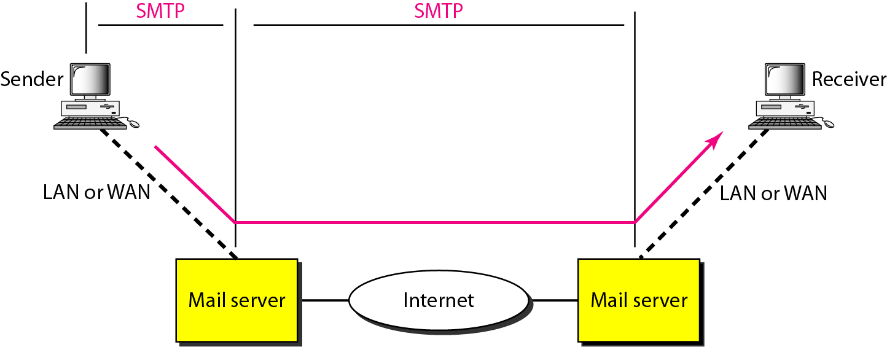

**Three phases of mail transfer**
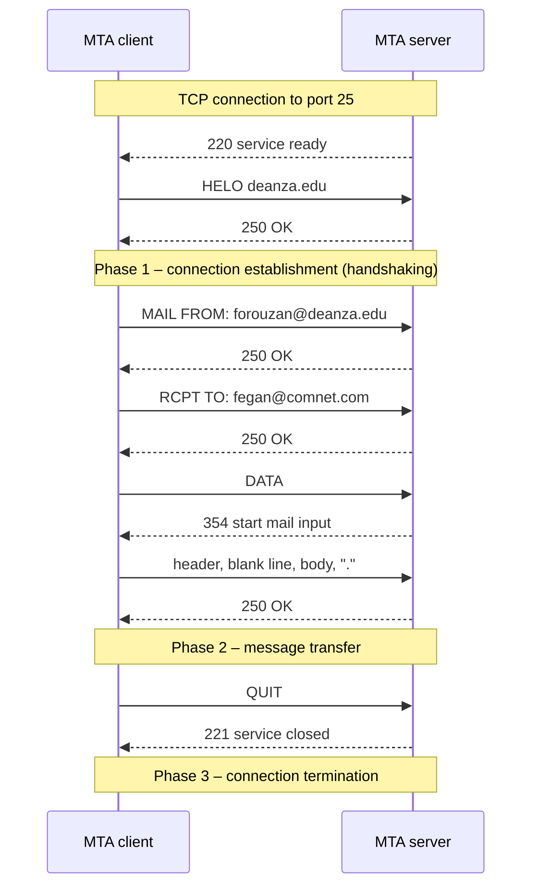

### 15.4 POP3 and IMAP4 (Mail Access) ★★★
SMTP is a **push** protocol; the final stage (server → recipient) needs a **pull** protocol.

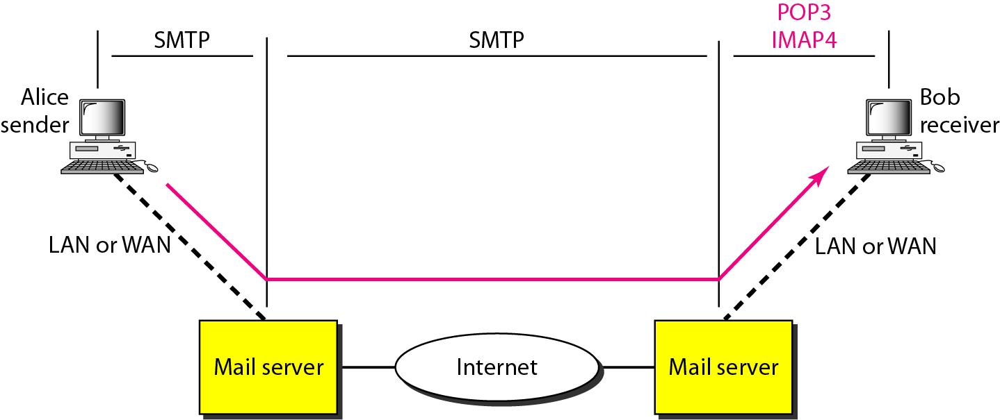

**POP3 (Post Office Protocol v3)** — **TCP port 110**, simple, limited. Client opens a connection, sends **user name and password**, then **lists** and **retrieves** messages one by one.
- **Delete mode** — mail is deleted from the server after retrieval (one fixed computer).
- **Keep mode** — mail stays on the server (read from several computers).

**IMAP4 (Internet Mail Access Protocol v4)** — **TCP port 143**, more powerful:
- Check the **e-mail header before downloading**.
- **Search** message contents for a string before downloading.
- **Partially download** messages (useful with low bandwidth / large attachments).
- **Create, delete, rename mailboxes** on the server; create a **hierarchy of folders**.
- Mail flags (answered, draft, deleted, seen, recent); multiple simultaneous connections.

| POP3 | IMAP4 |
|---|---|
| Simple, limited | Feature-rich, complex |
| Mail **downloaded** to the PC and (usually) **deleted** from server | Mail **stays on the server** |
| One folder (Inbox) on the client | **Multiple server-side folders** created by the user |
| Old mail visible only on the PC where it was downloaded | Same view from **any device** |
| Port 110 | Port 143 |

### 15.5 MIME — Multipurpose Internet Mail Extensions ★★★
**Problem:** SMTP can only carry **7-bit NVT ASCII** — no non-English text, binary files, images, audio or video.
**MIME** is a **supplementary protocol** that **transforms non-ASCII data to NVT ASCII** at the sender and back at the receiver.

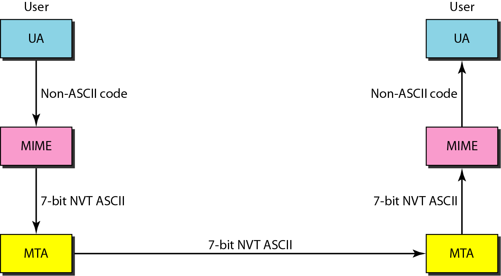

**MIME headers** (added to the e-mail header):
| Header | Purpose |
|---|---|
| **MIME-Version** | e.g., 1.1 |
| **Content-Type** | type/subtype — **text** (plain, html), **multipart** (mixed, alternative…), **message** (rfc822, partial), **image** (jpeg, gif), **video** (mpeg), **audio** (basic), **application** (postscript, octet-stream) |
| **Content-Transfer-Encoding** | How the body is encoded: **7bit**, **8bit**, **binary**, **base64**, **quoted-printable** |
| **Content-Id** | Unique identifier for the whole message |
| **Content-Description** | Text description (image, audio, video…) |

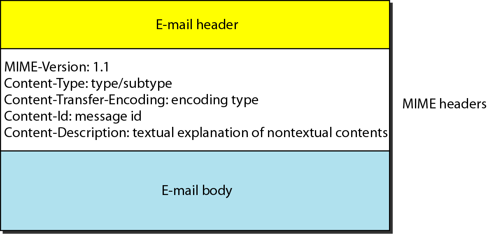

**Base64 encoding:** split binary data into **24-bit blocks**, each into **four 6-bit groups**, each mapped to a printable character (A–Z, a–z, 0–9, +, /) → 33 % overhead. **Quoted-printable:** for mostly-ASCII text — non-ASCII bytes sent as `=` + two hex digits.

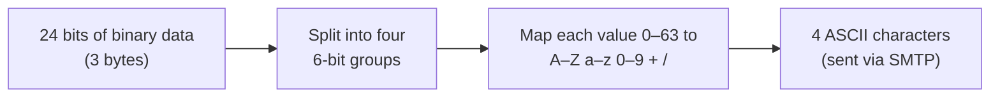

---

## 16. Comparison: HTTP vs FTP vs SMTP vs DNS ★★

| Feature | HTTP | FTP | SMTP | DNS |
|---|---|---|---|---|
| Purpose | Transfer web pages/objects | Transfer files | Send/relay e-mail | Name → IP resolution |
| Transport | TCP | TCP | TCP | **UDP** (TCP for zone transfers / large replies) |
| Port(s) | 80 (443 HTTPS) | 21 control, 20 data | 25 | 53 |
| Connections | One (persistent in 1.1) | **Two** (control + data) | One | Usually connectionless |
| Push / pull | Pull (mostly) | Both (get/put) | **Push** | Query/response |
| State | Stateless (cookies add state) | Stateful session | Stateful session | Stateless |
| Control info | In-band (headers) | **Out-of-band** | In-band | — |

---

## Unit VI — One-Page Summary

| Topic | Key points |
|---|---|
| **Transport services** | Process-to-process delivery (ports), connection mgmt, segmentation/reassembly, flow, error & congestion control; runs only on hosts; hides network. |
| **Primitives** | LISTEN, CONNECT, SEND, RECEIVE, DISCONNECT; TPDU inside packet inside frame. |
| **Berkeley sockets** | SOCKET, BIND, LISTEN, ACCEPT, CONNECT, SEND, RECEIVE, CLOSE; socket = IP + port. |
| **Elements** | Addressing (TSAP/port vs NSAP/IP; well-known ports, process server) · establishment (delayed duplicates → 3-way handshake, packet lifetime) · release (asymmetric vs symmetric; two-army problem → timers). |
| **UDP** | Connectionless, unreliable, 8-byte header (src port, dst port, length, checksum); DNS, DHCP, TFTP, RIP, VoIP, streaming. |
| **TCP service** | Reliable, connection-oriented, full-duplex byte stream; ports < 1024 well-known (21 FTP, 23 Telnet, 25 SMTP, 80 HTTP, 110 POP3). |
| **TCP header** | 20 B fixed: ports, seq, ack, header length, URG/ACK/PSH/RST/SYN/FIN, window, checksum (+ pseudo-header), urgent pointer, options (MSS). |
| **3-way handshake** | SYN(x) → SYN+ACK(y, x+1) → ACK(y+1); call collision gives one connection. |
| **Release** | FIN/ACK each direction (4 segments, or 3 combined); half-close; timers (2 × max lifetime). |
| **TCP vs UDP** | Conn.-oriented vs connectionless; reliable vs best effort; stream vs datagram; 20 B vs 8 B; flow/congestion control vs none. |
| **DNS** | Hierarchical name space (root → TLD generic/country → subdomains); RR = (name, TTL, class IN, type, value); types SOA, A, AAAA, MX, NS, CNAME, PTR, HINFO, TXT; zones; root/TLD/authoritative servers; recursive vs iterative; 8-step lookup; UDP 53. |
| **WWW** | Client (browser, plug-ins/helpers) – server (multithreaded, farms); URL = protocol://host:port/path; stateless + cookies; static (HTML) vs dynamic (CGI/PHP) vs active (applets/JavaScript); caching & proxies. |
| **HTTP** | TCP 80; request line + headers + body; GET, HEAD, PUT, POST, DELETE, TRACE, CONNECT, OPTIONS; status 1xx–5xx (200, 301, 304, 403, 404, 500); persistent in 1.1. |
| **FTP** | TCP; control port 21 (whole session) + data port 20 (per file); file type, structure, mode. |
| **E-mail** | UA (compose/read) · MTA (SMTP push, port 25: HELO, MAIL FROM, RCPT TO, DATA, QUIT) · MAA (POP3 port 110 download/delete; IMAP4 port 143 server folders, search, partial download). Envelope + header + body; local-part@domain. |
| **MIME** | Non-ASCII → NVT ASCII; headers MIME-Version, Content-Type, Content-Transfer-Encoding (7bit, 8bit, binary, base64, quoted-printable), Content-Id, Content-Description. |
