# Unit I — Design Thinking Foundations

> **Syllabus:** The Design Double Diamond: Discover–Define–Develop–Deliver. User-centric design approaches: importance of user-centricity for design, empathisation, empathy maps, data collection from users and for users, data validation. Responsible innovation and ethical design.
>
> **Source:** *Unit 1.pptx* (Design Thinking, Professional Elective-I, 9LC13, SNIST) — including the Unit I question bank on the slides.

**Importance legend:** ★★★ = very frequently asked (long answer) · ★★ = medium · ★ = short answer

---

## Table of Contents
1. [What is Design?](#1-what-is-design-)
2. [What is Design Thinking?](#2-what-is-design-thinking-)
3. [Origin & Principles of Design Thinking](#3-origin--principles-of-design-thinking-)
4. [The Five-Stage Design Thinking Process](#4-the-five-stage-design-thinking-process-)
5. [Design Thinking vs Other Problem-Solving Models](#5-design-thinking-vs-other-problem-solving-models-)
6. [Three Laws of Design Thinking](#6-three-laws-of-design-thinking-)
7. [The Double Diamond Model](#7-the-double-diamond-model-)
8. [User-Centric Design](#8-user-centric-design-ucd-)
9. [Importance of User-Centricity](#9-importance-of-user-centricity-)
10. [Empathisation](#10-empathisation-)
11. [Methods of Empathising](#11-core-methods-of-empathising-)
12. [Empathy Maps](#12-empathy-maps-)
13. [Data Collection from Users and for Users](#13-data-collection-)
14. [Data Validation](#14-data-validation-)
15. [Responsible Innovation](#15-responsible-innovation-)
16. [Ethical Design](#16-ethical-design-)
17. [Unit I Question Bank](#17-unit-i-question-bank-)
18. [Unit I — One-Page Summary](#unit-i--one-page-summary)

**Course outcomes:** CO1 develop design-thinking and creative-thinking skills (L3) · CO2 explain design phases for successful product development (L2) · CO3 explore design-thinking phases for good service design (L3) · CO4 analyse case studies of design-thinking processes (L4).

---

## 1. What is Design? ★★

- **Design** is how you decide to make something **useful and easy to use** — "turning **confusion into clarity**".
- **Formal definition:** design is a **systematic and iterative process** of **identifying problems, generating solutions** and developing **artifacts** that meet specified **functional, aesthetic (attractive) and user requirements** within given **constraints**.
- Design is the **structured process of transforming requirements into solutions** through **analysis, synthesis and evaluation** — converting ideas into **practical, usable** solutions.
- "From code to circuits to cells — design is what makes every system work efficiently and intelligently." "From a simple door handle to a complex AI system — design is what makes things understandable, usable and impactful."
- **Rule of thumb:** *If something frustrates you, it's bad design. If it feels effortless, that's great design.* (e.g., a door whose handle says "pull" but must be pushed.)
- Creativity **starts** the journey, design **gives it shape**, and that makes innovation **impactful**.

---

## 2. What is Design Thinking? ★★★

> "DT is a **user-focused, prototype-based development tool** that can make our organisation **adapt to the fast-changing external environment**. Building a design-led organisation requires **creativity, empathy**, skill to **synthesise** different ideas, and even a strategy can be a tangible outcome of design." — **Kishore Biyani**, Founder & CEO, Future Group (Pantaloon Retail, Big Bazaar)

> **Design Thinking is a human-centred approach to innovation that integrates three factors — desirability (human needs), feasibility (technology) and viability (business) — to create meaningful solutions.**

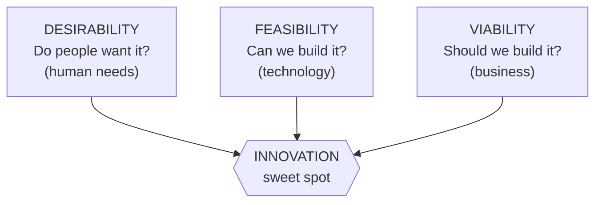

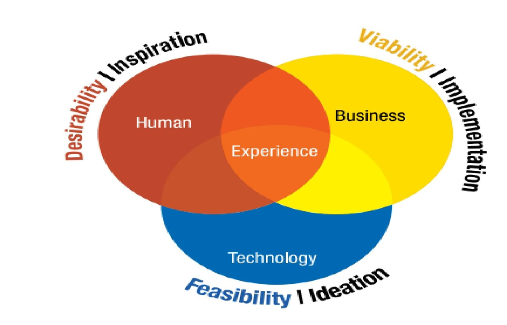

**Design thinking moves knowledge from mystery to heuristic to algorithm** (Roger Martin, *The Design of Business*, 2009):

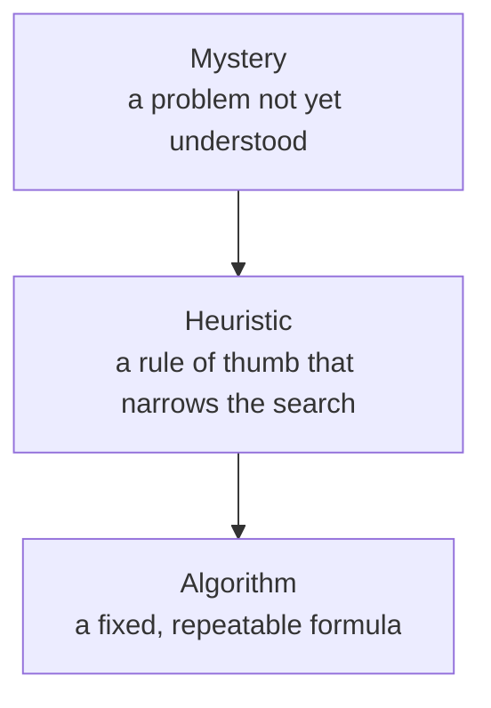

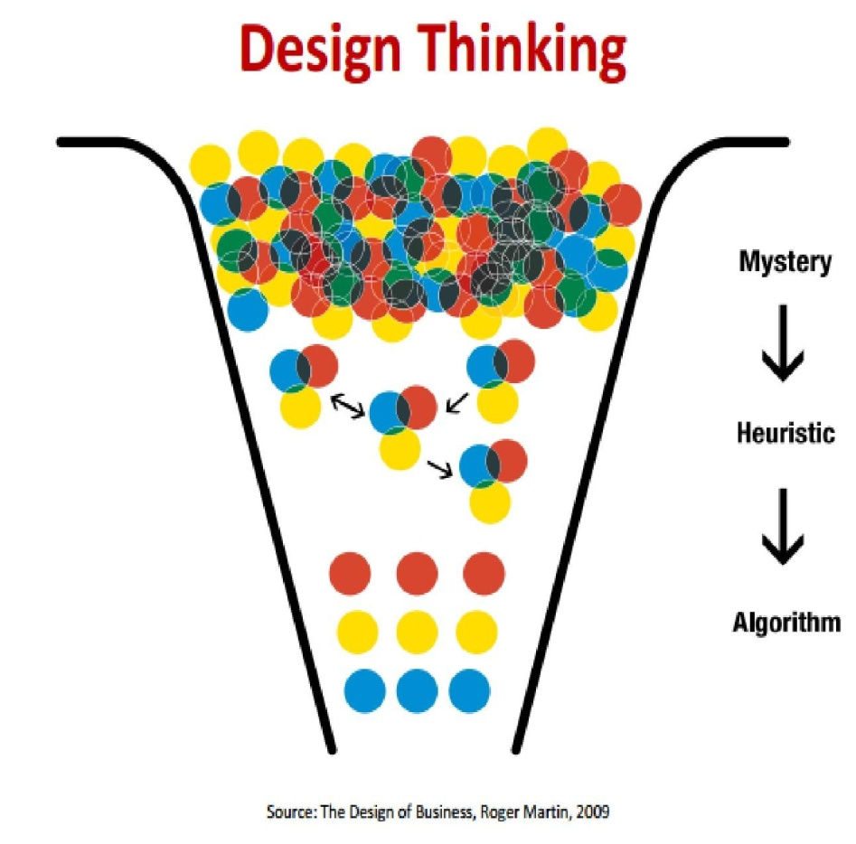

**What design thinking involves:**
| Activity | Moves from … to … |
|---|---|
| **Understanding requirements** | Stated → **unstated** needs |
| **Observing** | Patterns → **anti-patterns** |
| **Connecting the dots** | Within the box → **outside the box** |
| **Unearthing blind spots** | "Don't know what I don't know" |

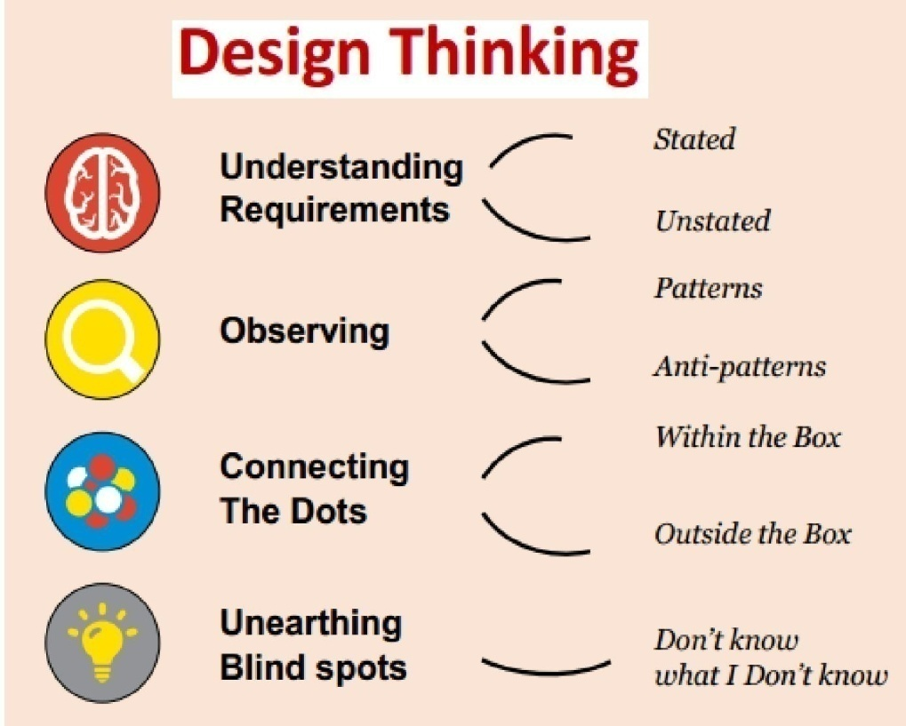

**Mindsets, skill sets and toolsets:** practising design thinking needs the **mindset (why?)**, **skill set (how?)** and **toolset (what?)** together.

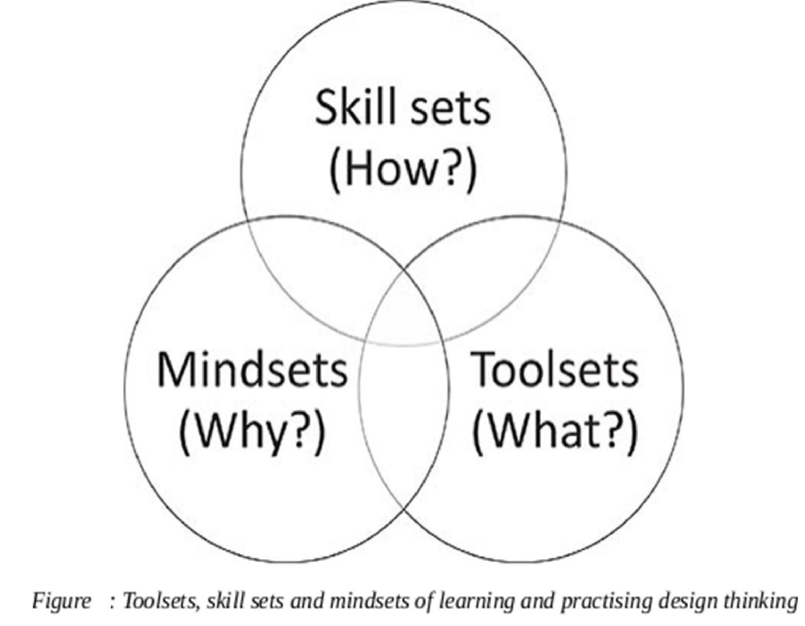

---

## 3. Origin & Principles of Design Thinking ★★

- **Origin:** began in **industrial design**; popularised by **IDEO** and **Stanford d.school** — a step-by-step approach to solve problems creatively by understanding what users need and want.
- *Example:* students find it hard to carry many books → talk to students first, then think of ideas such as **digital textbooks** or **lightweight bags**.

**Principles:** Design Thinking focuses on
1. **Understanding users** (human-centred, empathy);
2. **Testing ideas** (prototype early, fail fast);
3. **Teamwork** (multidisciplinary collaboration);
4. **Improving solutions continuously** (iteration);
5. **Meeting user needs** (solution must be useful).

---

## 4. The Five-Stage Design Thinking Process ★★★

**Stanford d.school model:** Empathize → Define → Ideate → Prototype → Test.

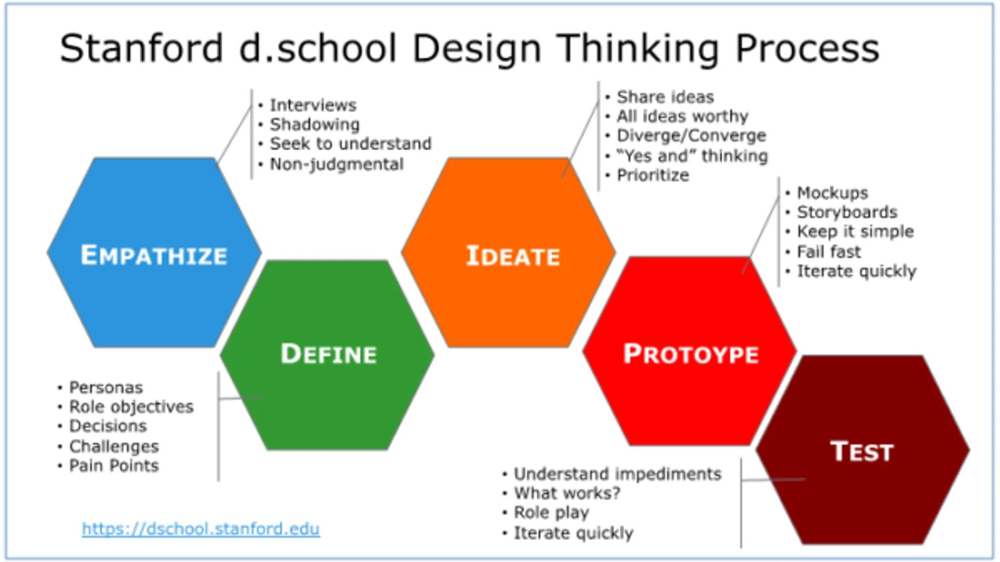

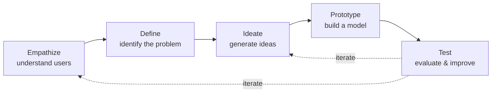

| Step | Meaning | d.school activities | Example (heavy school bags) |
|---|---|---|---|
| **Empathize** | Understand users | Interviews, shadowing, seek to understand, non-judgmental | Talk to students about heavy bags |
| **Define** | Find the exact problem | Personas, role objectives, decisions, challenges, **pain points** | "Bags are too heavy" |
| **Ideate** | Generate ideas | Share ideas, all ideas worthy, diverge/converge, "Yes, and" thinking, prioritise | Digital books, lockers, tablets |
| **Prototype** | Create a sample | Mock-ups, storyboards, keep it simple, fail fast, iterate quickly | Make a simple app |
| **Test** | Get feedback | Understand impediments, what works?, role play, iterate quickly | Students try the app and suggest improvements |

**Easy formula:** Understand → Define → Think → Build → Test ✅

**Extended model:** **Inspire → Empathise & Define → Ideate → Prototype & Test → Scale** (a creative problem-solving loop).

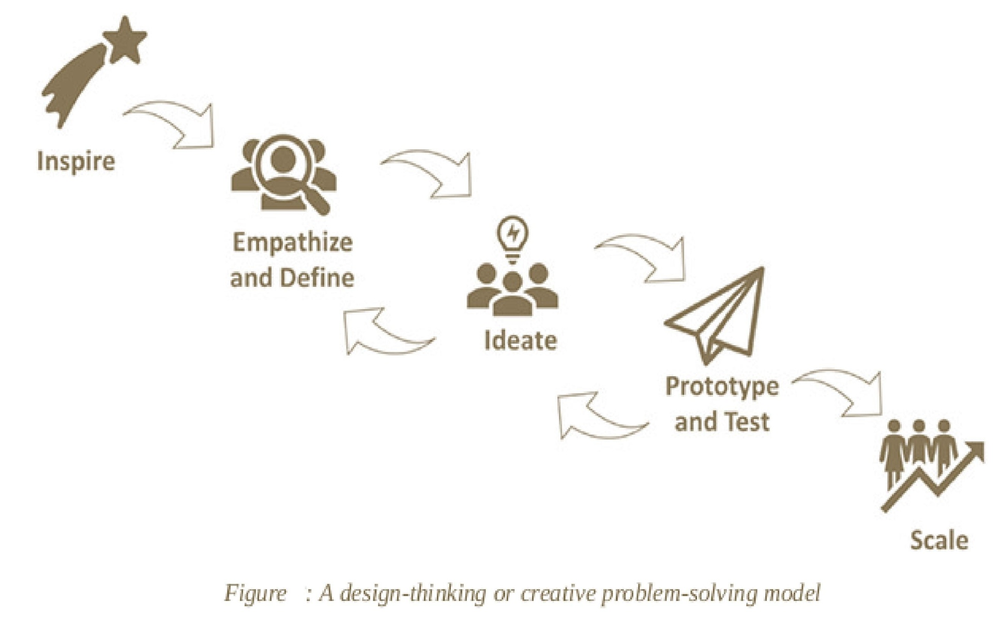

---

## 5. Design Thinking vs Other Problem-Solving Models ★★★

Problem-solving approaches can be placed on a 2 × 2 grid of **whether the problem is known** and **whether the solution is known**:

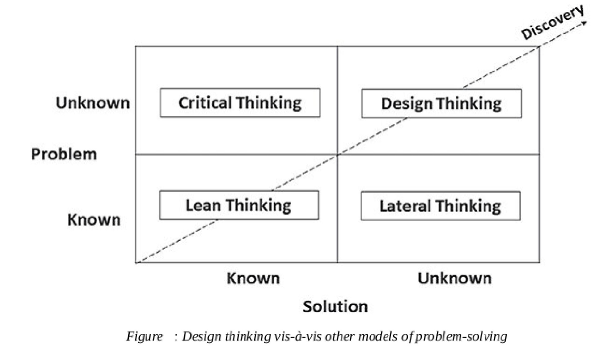

| | **Solution known** | **Solution unknown** |
|---|---|---|
| **Problem unknown** | **Critical thinking** | **Design thinking** |
| **Problem known** | **Lean thinking** | **Lateral thinking** |

| Model | Memory line | Example |
|---|---|---|
| **Lean thinking** | "I **know the problem** and I **know the solution**." | College library — students waste time finding books → arrange by subject and label shelves |
| **Critical thinking** | "I know **possible solutions**, but I must find the **real problem** (root cause)." | Low marks — options: more homework, extra classes, new methods → analysis shows the real problem is weak **basics** |
| **Lateral thinking** | "I know the problem, but I need **creative solutions**." | Students forget to submit assignments → mobile reminders, **gamification** with reward points, assignment-tracking app |
| **Design thinking** | "I **don't fully know** the problem **or** the solution — I must **discover both**." | College wants better learning → interviews reveal lack of **interactive learning** → build an interactive platform with quizzes and videos |

---

## 6. Three Laws of Design Thinking ★★

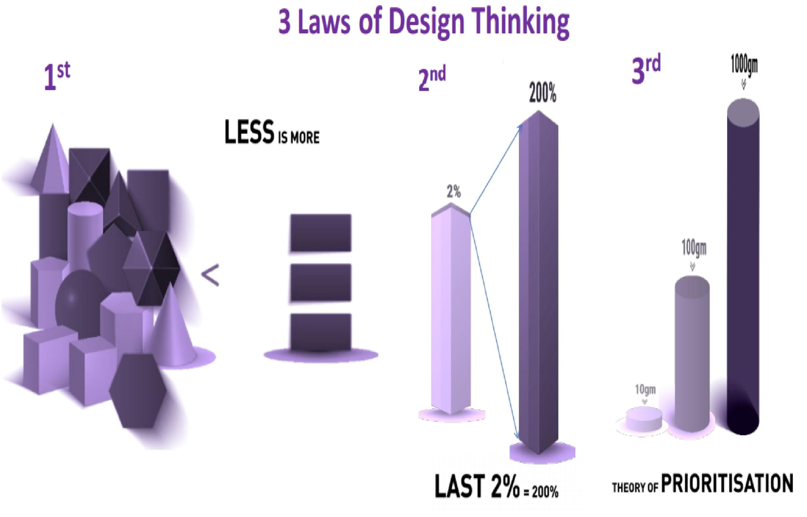

| Law | Meaning | Example | Simple rule |
|---|---|---|---|
| **1. Less is More** | Keep designs **simple**; remove unnecessary features — too many features confuse users | An app with 3 important buttons beats one with 20; 5 clear slides beat 50 crowded ones | Simplicity > complexity |
| **2. Last 2 % = 200 %** | **Small final improvements** create a **large impact**; attend to details | Fixing small bugs and polishing a 98 %-done project makes it professional; proofreading and formatting a report | Finishing touches matter |
| **3. Theory of Prioritisation** | Focus on the **most important user needs first**; solve **high-impact** problems before minor ones | Fix **critical (red)** bugs before adding features; finish the assignment due tomorrow first | Do important things first |

**Memory trick:** 🟣 **Simple → Refine → Prioritise**

---

## 7. The Double Diamond Model ★★★

The **Double Diamond**, introduced by the **UK Design Council (2005)**, divides problem-solving into four phases — **Discover, Define, Develop, Deliver** — alternating **divergent (explore widely)** and **convergent (focus)** thinking. The first diamond is the **problem space**; the second is the **solution space**.

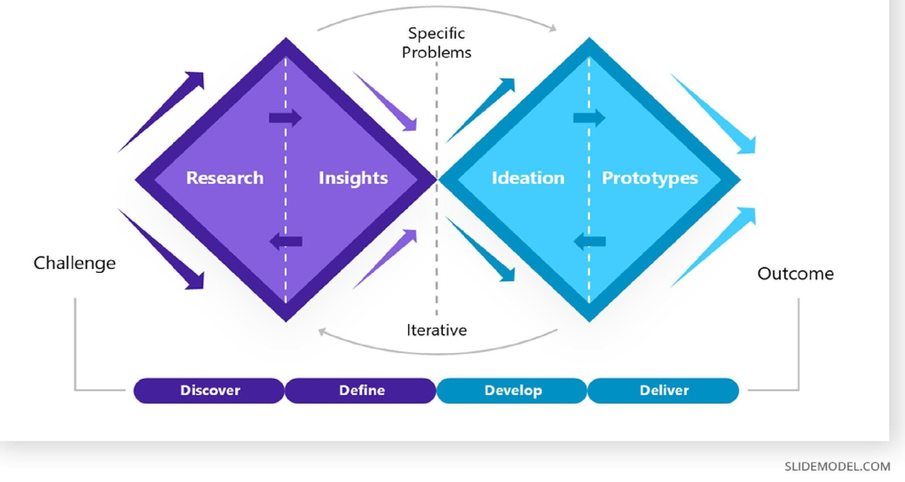

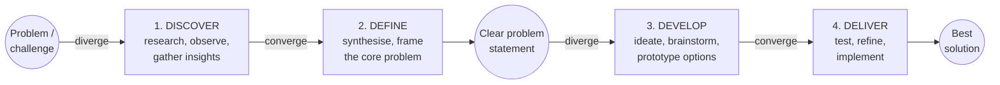

| Phase | Thinking | What happens | Tools |
|---|---|---|---|
| **1. Discover** | Divergent | Explore the **problem space** — user research, observation, data gathering; gain insights into user needs and challenges | Interviews, observation, surveys, empathy maps |
| **2. Define** | Convergent | **Synthesise** Discover insights to **clearly define the core problem** in a user-centred way | Affinity mapping, personas, problem statements, HMW questions |
| **3. Develop** | Divergent | **Ideation** — generate **multiple solutions**; brainstorming and prototyping explore possibilities | Brainstorming, sketching, low-fi prototypes |
| **4. Deliver** | Convergent | **Test, refine and implement**; **user feedback** ensures effectiveness and usability | Usability testing, pilots, launch |

**Where it is useful:** when the **problem is not clearly defined** and the **right solution is not known** — product design & development (new water bottle), service design (hospital patient experience), digital products & apps (student learning app), business strategy & innovation (new business ideas), public policy & social problems (public transport), education (redesigning classroom learning).

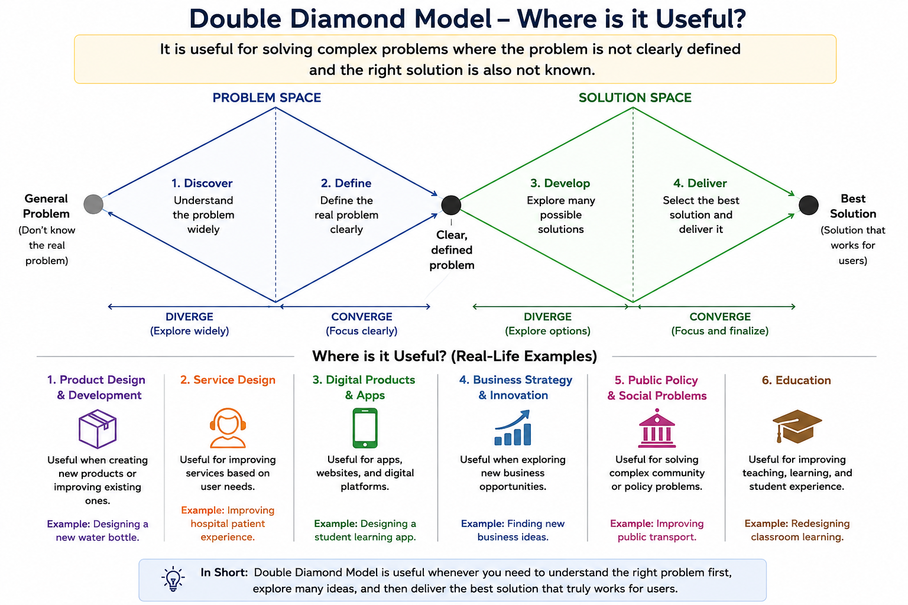

**Easy example — students skipping online classes:** understand **why** they're absent → generate many ideas → choose the best (interactive classes) → test and improve → better participation ✅.

| Advantages | Disadvantages |
|---|---|
| **Structured approach**; clear problem definition | **Time-consuming** |
| Encourages **divergent thinking** & creativity | **Resource-intensive** |
| **User-centric** design | **Complex for beginners** |
| **Reduces risk of failure** (early testing) | **Not suitable for small projects** |
| **Iterative** and flexible | **Depends on user research** quality |
| Better **collaboration**/teamwork | **Slower decision-making** |
| **Improved final outcomes** | Difficult team management; non-linear complexity |
| | Risk of **over-thinking**; implementation challenges |

---

## 8. User-Centric Design (UCD) ★★★

- **User-centric design** places the **user at the centre** of the design process so products meet **real user needs**.
- **UCD is an iterative, empathy-driven process** that prioritises users' **needs, behaviours and pain points** throughout the **entire product-development life cycle**.

### 8.1 Foundational principles
| Principle | Meaning |
|---|---|
| **Empathy-driven research** | Understand the human behind the screen — emotions, motivations, frustrations. **Empathy = Understand + Feel + Care** |
| **Understand the context of use** | Environment, conditions and situations in which the product is used |
| **Involve users early & often** | Include users from initial planning instead of relying on assumptions |
| **Define user personas** | Detailed profiles representing key audience segments |
| **Map user journeys** | Visual/narrative representation of the whole experience, from awareness to final goal |

| Sympathy | Empathy |
|---|---|
| "I feel bad for you." | "I understand what you're going through." |
| Feeling *for* someone | Feeling *with* someone |

### 8.2 Design & usability principles
| Principle | Meaning |
|---|---|
| **Accessibility** | Usable by people of all abilities — follow standards like **WCAG** |
| **Visibility** | Users instantly see what they can do and how |
| **Consistency** | Same patterns, terminology and visuals throughout |
| **Clear feedback** | Tell users the result of their actions |
| **Simple, plain language** | Avoid jargon |
| **Prevent errors & permit reversal** | Minimise errors; allow undo |

### 8.3 Implementation & optimisation
- **Iterative prototyping & testing** — test with real users, refine; don't aim for perfection in the first draft.
- **Data-driven decisions** — analytics, heat maps, session recordings rather than opinions.
- **Multidisciplinary collaboration** — designers, developers, stakeholders.
- **Balance user and business goals** — user-friendly *and* profitable.

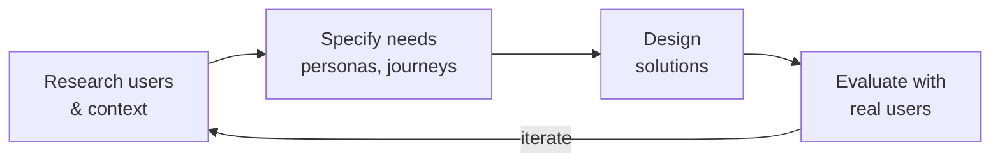

---

## 9. Importance of User-Centricity ★★★

| Benefit | Explanation | Key outcome |
|---|---|---|
| **Increased revenue & profit** | Products aligned with real needs → higher conversion, repeat purchases, higher **customer lifetime value (CLV)** | Higher sales, better ROI |
| **Enhanced customer loyalty** | Trust and long-term relationships by prioritising user needs | Higher retention, less churn |
| **Competitive advantage** | Superior, personalised experiences differentiate the brand | Brand becomes a "trusted partner" |
| **Reduced costs & efficiency** | Avoids building unwanted features; finds issues early; fewer support calls | Operational efficiency |
| **Innovation & adaptability** | Continuous feedback adapts to changing preferences | New growth opportunities |
| **Improved user experience** | Intuitive, engaging, enjoyable interfaces | Higher engagement |
| **Stronger brand reputation** | Satisfied customers become advocates (word of mouth) | Positive brand perception |

---

## 10. Empathisation ★★★

- **Empathising** = understanding and sharing the **emotional experiences, thoughts or situation** of another person — "**putting oneself in another's shoes**"; recognising emotions and responding with concern (unlike sympathy, which only pities).
- **Empathy is the backbone of design thinking** — it ensures you solve the **right problem for the right people**, not just make something that looks good or works technically.

**Why empathy is important:**
- Identifies **real user needs** instead of assumptions.
- Leads to **user-centred, meaningful** solutions.
- Uncovers **hidden problems and pain points**.
- Enhances **innovation and creativity**.
- **Reduces risk** of product failure.
- Builds **emotional connection and trust**.

*Example:* during **demonetisation (India, 2016)** small shopkeepers and common people struggled with cash transactions — empathy with this pain drove the rapid adoption of **UPI / digital wallets (e.g., Paytm, BHIM, PhonePe)** with simple QR-code payments.

---

## 11. Core Methods of Empathising ★★★

| Method | Description |
|---|---|
| **1. Interviews** | One-on-one conversations with **open-ended questions** to understand feelings, needs, experiences |
| **2. Empathy mapping** | Visual tool organising insights into **Says, Does, Thinks, Feels** |
| **3. Observation ("fly on the wall")** | Watch users in their **natural environment** — actual behaviour, not just what they say |
| **4. Immersion / role-playing** | Designers **experience the user's situation directly** for deeper understanding |
| **5. Extreme users** | Study users with unusual or extreme behaviour — reveals **hidden needs** and innovative opportunities |
| **6. Photo/video journals** | Users record daily experiences — real-time emotions and challenges |
| **7. What–How–Why method** | **What** is the user doing? **How** are they doing it? **Why** are they behaving this way? |
| **8. Journey mapping** | Map the complete interaction — **touchpoints, pain points, opportunities** |
| **9. Pain–Gain analysis** | **Pains** = frustrations/problems; **gains** = desired benefits |
| **10. Error analysis** | Study **mistakes** users make to improve usability and intuitiveness |

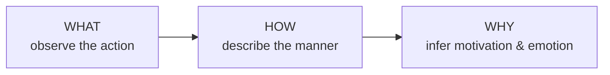

---

## 12. Empathy Maps ★★★

An **empathy map** is a **collaborative, visual** design-thinking tool to understand **user behaviours, needs and emotions**, typically created in the **Empathise** phase.

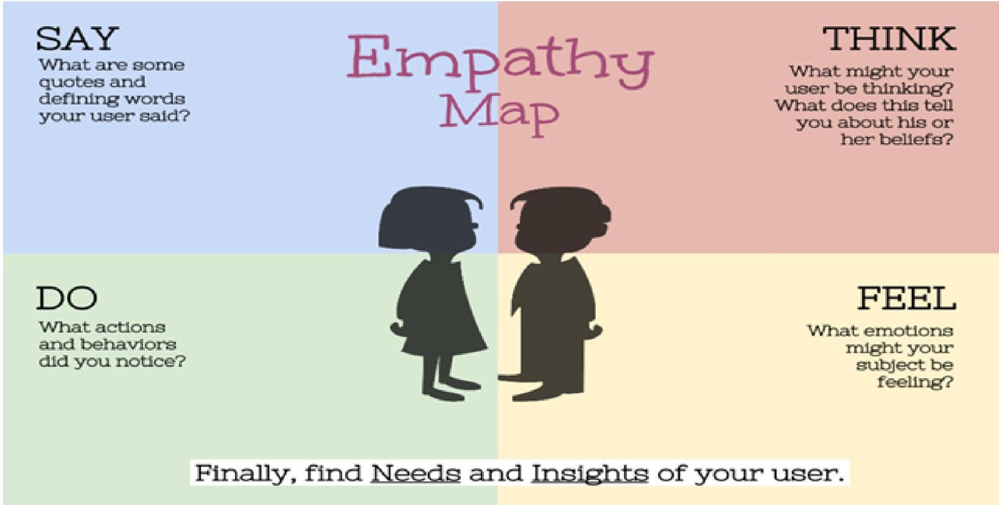

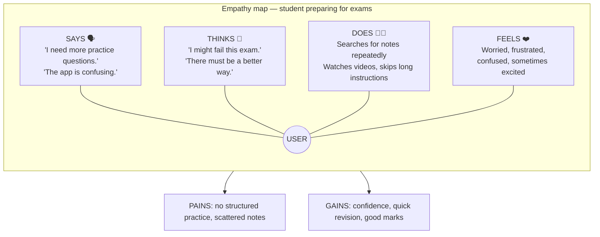

### 12.1 Components
| Quadrant | Captures | Examples |
|---|---|---|
| **Says** | Direct **quotes** and explicit phrases from interviews | "The website is slow." |
| **Thinks** | Beliefs, motivations, **implicit thoughts** not said aloud | "This should be easier." |
| **Does** | **Actions and behaviours** observed | Searches for notes; skips instructions |
| **Feels** | **Emotional states** (adjectives) | Frustrated, confused, worried, happy |
| **Pains & Gains** (optional) | Challenges and goals | — |

### 12.2 Why use empathy maps?
- **Shared understanding** — aligns the team on the user; prevents biases and assumptions.
- **Uncover user needs** — go beyond obvious behaviour to the **"why"**.
- **Highlight research gaps** — e.g., an empty "Feels" quadrant shows more research is needed.
- **Guide design decisions** — a quick, actionable summary.

### 12.3 How to create one
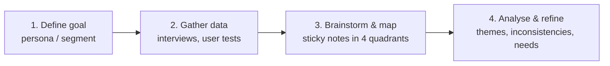

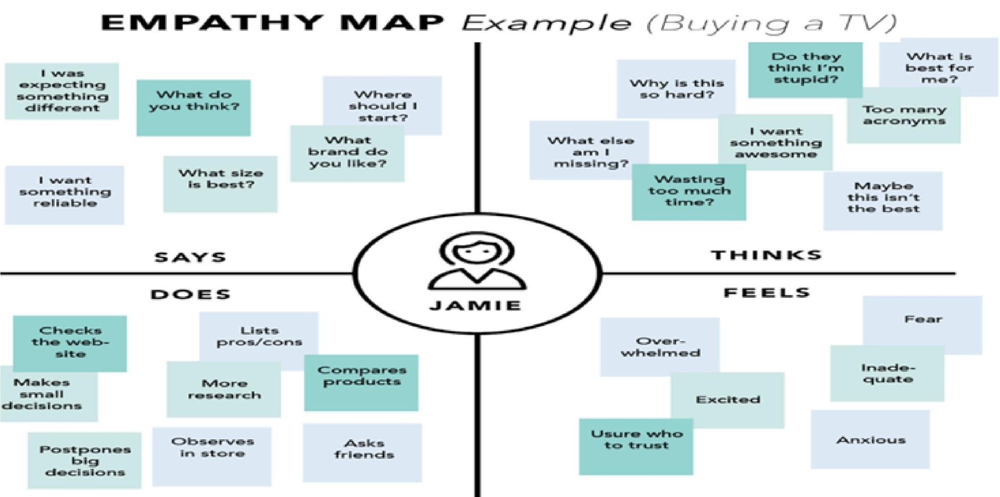

---

## 13. Data Collection ★★★

Data collection in design thinking **bridges empathy with evidence**, using **mixed methods** — qualitative **"why"** (interviews, observation) and quantitative **"what"** (analytics, surveys) — to understand behaviours, pain points and motivations and to **validate design decisions**.

| Method | Type | Purpose |
|---|---|---|
| **User interviews** (structured/unstructured) | Qualitative | Motivations, emotions, needs |
| **Contextual inquiry / observation** | Qualitative | Watch users in their environment; find pain points |
| **Focus groups** | Qualitative | Diverse, subjective opinions from group discussion |
| **Surveys / questionnaires** | Quantitative | Structured feedback from many users; measure preferences |
| **Analytics / log data** | Quantitative | Track behaviour; see where users struggle |
| **A/B testing** | Quantitative | Compare **two versions** to see which performs better |
| **Contextualised collection** | Both | Invite feedback **at the moment** the user hits an issue (in-app prompts) |

**"From users" vs "for users":** data is collected **from** users (research, feedback, behaviour) and turned into insights used **for** users (better features, personalisation, accessibility).

**Best practices:** turn raw data into **actionable insights**; store research (recordings, transcripts, notes) in a **shared, organised repository**; protect privacy and obtain consent.

*Real-world scenario — improving a canteen app:* interviews with students (why they skip it), observation at lunch rush, a survey of 300 students on preferred features, app analytics showing drop-off at payment, an A/B test of a one-tap UPI checkout.

---

## 14. Data Validation ★★★

**Data validation** ensures insights, prototypes and solutions are **accurate, reliable** and **truly solve user needs** before full-scale implementation — via testing, user feedback and analysis, refined iteratively.

**Validation checklist:**
- **Accuracy** — is the data clean and reliable?
- **Relevance** — does the solution solve the core problem found in Empathise?
- **Consistency** — are findings consistent across users and scenarios?

**Key aspects:**
| Aspect | Meaning |
|---|---|
| **Iterative testing** | Test early and often before investing in the final product |
| **User-centric validation** | Involve real target users to confirm real (not assumed) pain points |
| **Prototyping** | Low-fidelity models for actionable feedback |
| **Qualitative + quantitative** | Combine emotions/usability feedback with metrics and usage rates |
| **Expert review** | Experienced designers evaluate when user testing isn't yet feasible |

**Techniques:** **prototype testing**; **user observation/interviews** (check qualitative insights match usage data); **data triangulation** (compare surveys, interviews, analytics to find inconsistencies).

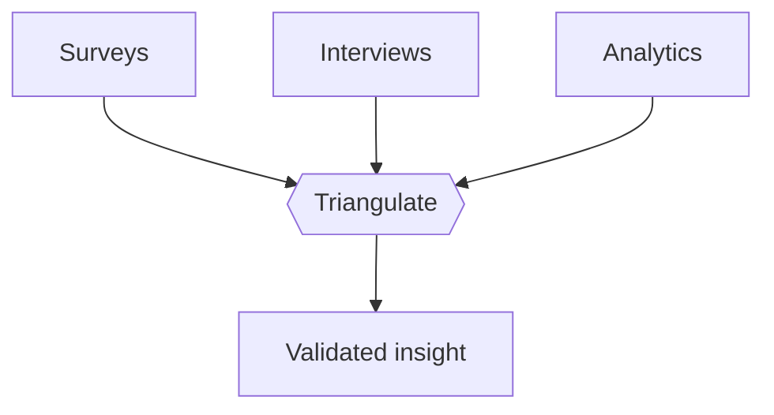

**Benefits:** ensures user-centricity · **mitigates risk and saves time** · improves decision-making · prevents data errors · enhances collaboration · builds trust in findings.

---

## 15. Responsible Innovation ★★★

- **Responsible Innovation (RI)** integrates **ethical, social and environmental** considerations into the product-development life cycle — beyond desirability and feasibility — embedding **stewardship, inclusivity and sustainability** into the five design-thinking stages.

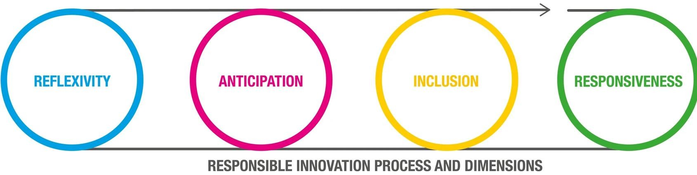

**Key components:**
- **Three pillars:** **Ethics, Inclusivity, Sustainability**.
- **Anticipatory approach:** proactively identify potential **harms** (e.g., **harms modelling**) rather than reacting to failures.
- **Ethical evaluation:** shift from "**Can** we build it?" to "**Should** we build it?"

**Tools:** **harms modelling** (identify who could be hurt and how), **community jury** (stakeholders deliberate on a product's impact), **ethical frameworks** (principles/checklists).

*Examples:* designing an AI hiring tool with bias audits; an EV company planning battery recycling; a social app limiting endless scroll for teenagers.

---

## 16. Ethical Design ★★★

**Ethical design** embeds **responsibility, transparency and human-centric values** into the creative process so products **enhance lives without causing harm** — considering societal impact, accessibility, privacy and long-term well-being.

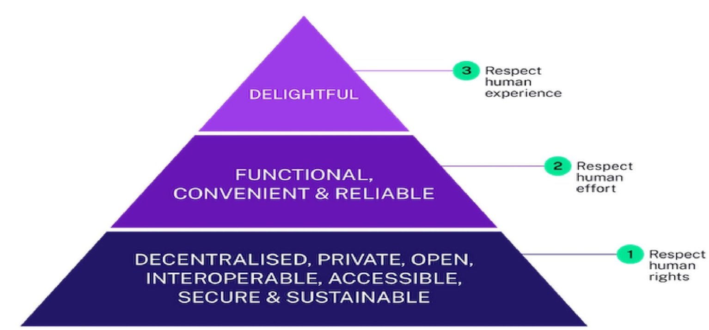

| Dimension | Meaning | Example |
|---|---|---|
| **Usability** | Intuitive and **safe** products | Clear error messages, safe defaults |
| **Accessibility** | Access for **people with disabilities** | Screen-reader support, captions, contrast |
| **Privacy** | Proactive, preventive, **end-to-end security** | Minimal data collection, encryption, consent |
| **Persuasion** | **Transparency** for informed choices — no dark patterns | Clear cancellation, honest pricing |
| **Focus** | Counter the **addictive** digital landscape | Screen-time controls, no infinite-scroll traps |
| **User involvement** | Involve users early and continuously | Co-design sessions |
| **Sustainability & society** | Consider climate change, pandemics, inequality | Energy-efficient design, inclusive pricing |

### 16.1 Design guidelines incorporating ethics (long-answer framework)
1. Collect only **necessary data**, with **informed consent**.
2. Make privacy settings **default-on** and easy to change.
3. Design for **accessibility** (WCAG) from day one.
4. Avoid **dark patterns** — no hidden costs, forced continuity or confirm-shaming.
5. Be **transparent** about algorithms and recommendations.
6. Test for **bias** across user groups.
7. Promote **digital well-being** (usage limits, breaks).
8. Choose **sustainable** materials/infrastructure; plan end-of-life.
9. Provide **easy reversal** and human support channels.
10. Review products periodically with **harms modelling**.

---

## 17. Unit I Question Bank ★★★

### Short answer (2 marks)
| # | Question | See |
|---|---|---|
| 1 | Identify the concept of Design Thinking (L1) | §2 |
| 2 | List the stages of the Double Diamond model (L1) | §7 |
| 3 | Outline the idea of user-centric design (L2) | §8 |
| 4 | State the role of empathy in design thinking (L1) | §10 |
| 5 | Recognise the purpose of an empathy map (L1) | §12 |
| 6 | Enumerate the components of an empathy map (L1) | §12.1 |
| 7 | Summarise the process of data collection (L2) | §13 |
| 8 | Highlight the need for data validation in design thinking (L2) | §14 |
| 9 | Point out the idea of ethical design (L1) | §16 |
| 10 | Indicate the concept of responsible innovation (L1) | §15 |

### Long answer
| # | Question | See |
|---|---|---|
| 1 | Illustrate the Double Diamond model (Discover–Define–Develop–Deliver) with a neat diagram (L2) | §7 |
| 2 | Discuss the importance of user-centric design approaches in product development (L3) | §8, §9 |
| 3 | Interpret the role of empathisation in design thinking (L2) | §10, §11 |
| 4 | Demonstrate the use of empathy mapping with a suitable example (L3) | §12 |
| 5 | Apply different methods of data collection from users in a real-world scenario (L3) | §13 |
| 6 | Examine the significance of data validation in the design process (L4) | §14 |
| 7 | Evaluate responsible innovation and ethical design with relevant examples (L5) | §15, §16 |
| 8 | Analyse how empathy maps contribute to understanding user needs (L4) | §12.2 |
| 9 | Assess the role of user data in improving design decisions (L5) | §13, §14, §8.3 |
| 10 | Formulate design guidelines incorporating ethical considerations for modern products (L6) | §16.1 |

---

## Unit I — One-Page Summary

| Topic | Key points |
|---|---|
| **Design** | Systematic, iterative process of identifying problems and building artifacts meeting functional, aesthetic and user needs within constraints; "confusion → clarity". Frustrating = bad design. |
| **Design thinking** | Human-centred innovation balancing **desirability, feasibility, viability** (Kishore Biyani quote). Mystery → heuristic → algorithm. Stated → unstated needs; patterns → anti-patterns; outside the box; blind spots. Mindset, skill set, toolset. |
| **Origin & principles** | Industrial design → IDEO, Stanford d.school. Understand users, test ideas, teamwork, iterate, meet needs. |
| **5 stages** | Empathize → Define → Ideate → Prototype → Test (school-bag example); Inspire … Scale. |
| **vs other models** | Lean (problem & solution known), critical (solution known, find problem), lateral (problem known, creative solution), **design (both unknown)**. |
| **3 laws** | Less is more · Last 2 % = 200 % · Prioritisation (Simple → Refine → Prioritise). |
| **Double diamond** | Design Council: **Discover** (diverge) → **Define** (converge) → **Develop** (diverge) → **Deliver** (converge); problem space vs solution space. Pros: structured, creative, user-centric, less risk. Cons: slow, resource-heavy, complex, research-dependent. |
| **User-centric design** | Users at the centre; empathy research, context of use, early involvement, personas, journeys; accessibility (WCAG), visibility, consistency, feedback, plain language, error prevention; iterate, data-driven, multidisciplinary, balance business goals. |
| **Importance** | Revenue, loyalty, competitive edge, lower costs, innovation, better UX, reputation. |
| **Empathy** | Understand + feel + care; sympathy vs empathy; real needs, hidden pains, less failure risk (UPI after demonetisation). |
| **Methods** | Interviews, empathy maps, observation, immersion, extreme users, photo journals, What–How–Why, journey maps, pain–gain, error analysis. |
| **Empathy map** | Says, Thinks, Does, Feels (+ pains/gains); shared understanding, needs, research gaps, decisions; define → gather → map → refine. |
| **Data collection** | Qualitative why + quantitative what: interviews, contextual inquiry, focus groups, surveys, analytics, A/B tests, contextual feedback; shared repositories. |
| **Data validation** | Accuracy, relevance, consistency; iterative testing, real users, prototypes, mixed data, expert review; triangulation; reduces risk. |
| **Responsible innovation** | Ethics, inclusivity, sustainability; anticipate harms; "should we build it?"; harms modelling, community jury, frameworks. |
| **Ethical design** | Usability, accessibility, privacy, transparent persuasion, healthy focus, user involvement, sustainability; 10 ethical guidelines. |
