# Unit II — Design Thinking: Principles, Tools & Techniques

> **Topics:** Introduction and characteristics of design thinking, need, principles (empathy, collaboration, experimentation, iteration, user-centricity), benefits, applications (education, healthcare, social innovation), impact; tools and techniques by stage: customer journey maps, POV statements, How Might We questions, brainstorming, mind mapping, SCAMPER, sketching/Crazy 8s, rapid/paper prototyping, storyboards, physical mock-ups, user testing, assumption testing, feedback capture matrix, personas, SWOT; innovation types; case studies (Apple, Airbnb); challenges and future.
>
> **Source:** *Unit 2.pptx* (Design Thinking, 9LC13, SNIST), including the Unit II question bank. Many tool slides carry only a picture; those pictures were read and their content written out below. 📘 = explanation added from standard design-thinking references (IDEO / d.school / IDF).

**Importance legend:** ★★★ = very frequently asked (long answer) · ★★ = medium · ★ = short answer

---

## Table of Contents
1. [Introduction to Design Thinking](#1-introduction-to-design-thinking-)
2. [Characteristics of Design Thinking](#2-characteristics-of-design-thinking-)
3. [Need for Design Thinking](#3-need-for-design-thinking-)
4. [Principles of Design Thinking](#4-principles-of-design-thinking-)
5. [Benefits of Design Thinking](#5-benefits-of-design-thinking-)
6. [Applications: Education, Healthcare, Social Innovation](#6-applications-of-design-thinking-)
7. [Impact of Design Thinking](#7-impact-of-design-thinking-)
8. [Tools & Techniques by Stage](#8-tools--techniques-by-stage-)
9. [Customer Journey Mapping](#9-customer-journey-mapping-)
10. [Point of View (POV) Statements](#10-point-of-view-pov-statements-)
11. [How Might We (HMW) Questions](#11-how-might-we-hmw-questions-)
12. [Brainstorming](#12-brainstorming-)
13. [Mind Mapping](#13-mind-mapping-)
14. [SCAMPER](#14-scamper-technique-)
15. [Sketching & Crazy 8s](#15-sketching--crazy-8s-)
16. [Prototyping: Rapid, Paper, Storyboards, Physical Mock-ups](#16-prototyping-)
17. [Testing: User Testing, Assumption Testing, Feedback Capture Matrix](#17-testing-techniques-)
18. [Personas & SWOT Analysis](#18-personas--swot-analysis-)
19. [Innovation and Design Thinking](#19-innovation-and-design-thinking-)
20. [Case Studies: Apple & Airbnb](#20-case-studies-)
21. [Challenges & Future of Design Thinking](#21-challenges--future-of-design-thinking-)
22. [Unit II Question Bank](#22-unit-ii-question-bank-)
23. [Unit II — One-Page Summary](#unit-ii--one-page-summary)

---

## 1. Introduction to Design Thinking ★★

- **Design Thinking (DT)** is a **systematic, user-centred approach to solving complex problems**. It combines **empathy, creativity, experimentation and rationality** to create innovative solutions that satisfy **user needs**.
- *"Design thinking integrates **analytical thinking with creative thinking** for effective innovation."* — **Balagurusamy**

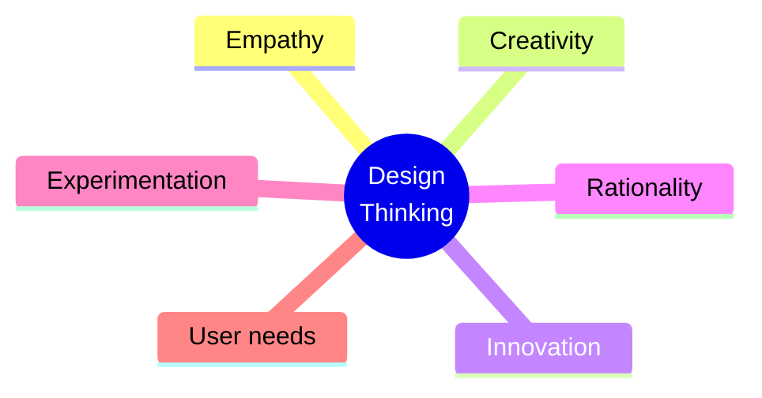

**Innovation (in DT)** 📘 = turning a **new idea into a useful product, service or process** that creates **value for users** and is adopted in practice. DT is a structured route to innovation because ideas are rooted in real needs and tested before scaling.

| Invention 📘 | Innovation 📘 |
|---|---|
| Creation of a **new idea/device** for the first time | **Commercial / practical application** of an idea that creates value |
| Focus on **novelty** | Focus on **usefulness, adoption, value** |
| May never reach the market | Must reach users to count |
| Usually by scientists/inventors | By entrepreneurs, designers, organisations |
| *Telephone (Bell)* | *Smartphone combining phone + camera + internet* |

---

## 2. Characteristics of Design Thinking ★★

1. **Human-centred approach** — starts with people and their needs.
2. **Collaborative and interdisciplinary** — teams from different fields.
3. **Iterative and experimental** — repeated cycles of build–test–learn.
4. **Focused on innovation** — seeks new, better solutions.
5. **Encourages prototyping and testing** — learn by making.

These help organisations develop **practical and meaningful** solutions. *Keywords:* Human · Teamwork · Iteration · Prototype · Innovation.

---

## 3. Need for Design Thinking ★

Modern organisations face **rapidly changing technologies, customer expectations and competitive markets**; traditional problem-solving is often insufficient. DT helps to:
- **understand users deeply**,
- **reduce product failure**,
- **improve customer satisfaction**,
- **encourage innovation**.

---

## 4. Principles of Design Thinking ★★★

| Principle | Meaning | Example | Slogan |
|---|---|---|---|
| **Empathy** | Understand users' emotions, motivations, challenges | Healthcare apps for elderly use **large buttons & voice support** | — |
| **Collaboration** | Involve multiple perspectives; combine knowledge from different fields | Engineers, designers and customers developing a smart product | "Great ideas grow through collaboration." |
| **Experimentation** | Test ideas rapidly; quick prototyping finds strengths/weaknesses early and reduces risk | Multiple prototype models before launch | "Experimentation turns ideas into innovation." |
| **Iteration** | Continuous step-by-step improvement; feedback refines solutions; mistakes = learning | Regular software updates based on user feedback | "Iteration is the path to perfection." |
| **User-centricity** | Users remain at the centre; solutions built on real requirements; better usability & accessibility | Easy online payment system for beginners | "Design for users, not just for technology." |

### 4.1 Empathy methods
| Method | What it is | Why | Example |
|---|---|---|---|
| **Observation** | Watching users in real-life situations | Reveals behaviour, habits, **hidden problems** | Observing customers using an **ATM** |
| **Interviews** | Direct questions (structured or open-ended) | Collect opinions, needs, expectations | Students on **online-learning challenges** |
| **Shadowing** | Following users through their daily activities | Shows real workflow; issues users don't voice | Shadowing a **nurse** in a hospital |
| **User interaction studies** | Analysing how users interact with a product | Measures ease of use and satisfaction; finds usability problems | How users **navigate a mobile app** |

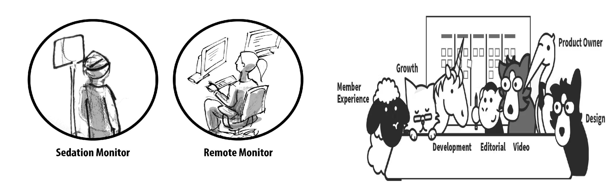

Two approaches to user research: **attitudinal** — *listen to what users say*; **behavioural** — *observe what users do*.

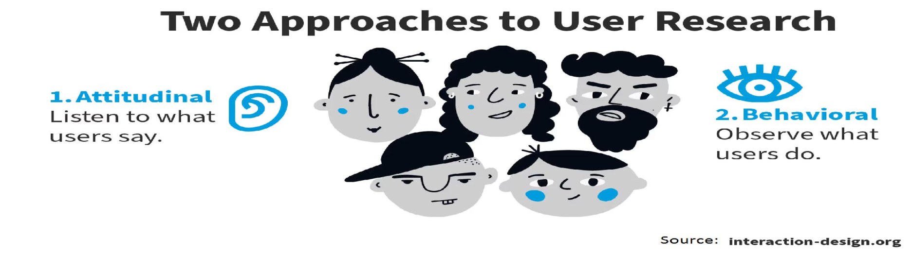

### 4.2 Collaboration — the many perspectives in a workshop
Participants, organisers, facilitator, support team, external resource persons, and people with a stake who are not present.

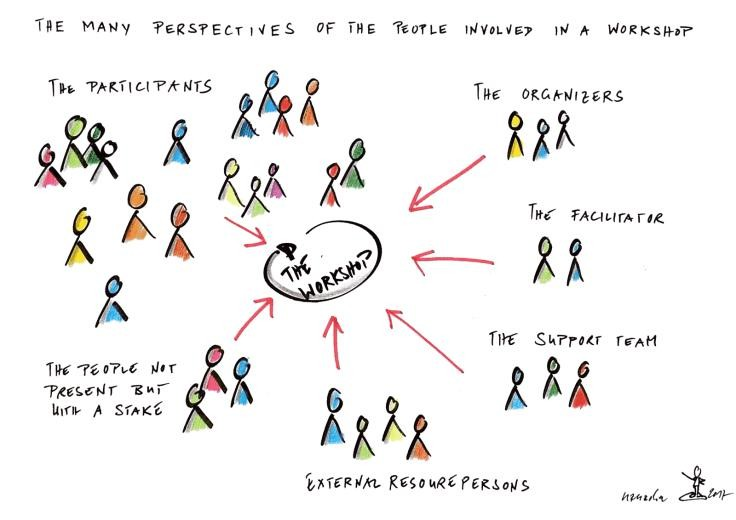

### 4.3 Experimentation, Iteration, User-centricity
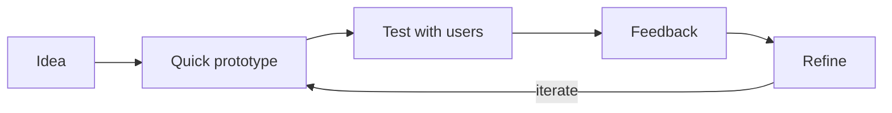

### 4.4 Importance of collaboration in DT teams ★
- Brings **diverse skills & viewpoints** → more and better ideas.
- Reduces individual **bias** and blind spots.
- Speeds decisions and **shared ownership** of the solution.
- Mirrors the **multidisciplinary** nature of real products (tech + business + design).

---

## 5. Benefits of Design Thinking ★★

| Benefit | Explanation |
|---|---|
| **Faster innovation** | Rapid prototypes shorten idea-to-market time |
| **Better teamwork** | Cross-functional collaboration |
| **Reduced development cost** | Problems caught early through cheap prototypes |
| **Improved customer loyalty** | Products fit real needs |
| **Better decision-making** | Decisions based on user evidence |
| **Creative confidence** | Teams become comfortable with experimentation |

Organisations such as **Apple** and **IBM** widely adopt DT.

**Advantages in business organisations** (short answer): customer focus, lower risk of failure, innovation culture, competitive advantage, cost savings, better employee collaboration.

---

## 6. Applications of Design Thinking ★★★

DT is applied in **education, healthcare, banking, technology, government services, retail & e-commerce** — improving user experience and service quality.

| Domain | Applications | Example |
|---|---|---|
| **Education** | Student-centred learning, smart classrooms, **gamification**, digital learning | **Duolingo** uses gamification and user feedback to boost engagement |
| **Healthcare** | Telemedicine, digital health records, patient-friendly interfaces, medical-device innovation | Hospitals **redesign waiting areas** to reduce patient anxiety |
| **Banking** | Simple mobile banking, UPI flows | One-tap payments |
| **Government** | Citizen services, e-governance portals | Online certificates, smart-city services |
| **Retail/e-commerce** | Easy checkout, personalisation | Journey-mapped shopping apps |

### 6.1 Social innovation ★★★
**Social innovation** = innovative solutions to **societal challenges** — **poverty reduction, education access, environmental sustainability, rural healthcare**. DT creates **inclusive and sustainable** solutions because it starts with the lived experience of the affected community.

**Contribution of DT to social problem-solving** (short): it empathises with marginalised users, co-creates with communities, tests low-cost prototypes in the field, and scales what works (e.g., low-cost water filters, telemedicine kiosks in villages).

**Evaluating DT's effectiveness for societal challenges (long answer outline):**
| Strengths | Limitations |
|---|---|
| Deep understanding of affected people | Needs time and access to communities |
| Co-creation → solutions people adopt | Systemic problems (policy, funding) go beyond design |
| Cheap prototypes reduce risk | Scaling pilots is hard |
| Inclusivity & sustainability built in | Measuring social impact is difficult |

**DT for sustainable & socially responsible innovation:** include environmental impact in Define, prefer reusable/low-energy concepts in Ideate, test with diverse users, think of the full product life cycle (see Unit I §15 Responsible innovation).

---

## 7. Impact of Design Thinking ★★

| On organisations | On society |
|---|---|
| Improved **innovation culture** | **Inclusive** technologies |
| Increased **profitability** | Improved **public services** |
| Better **customer engagement** | **Sustainable** solutions |

---

## 8. Tools & Techniques by Stage ★★★

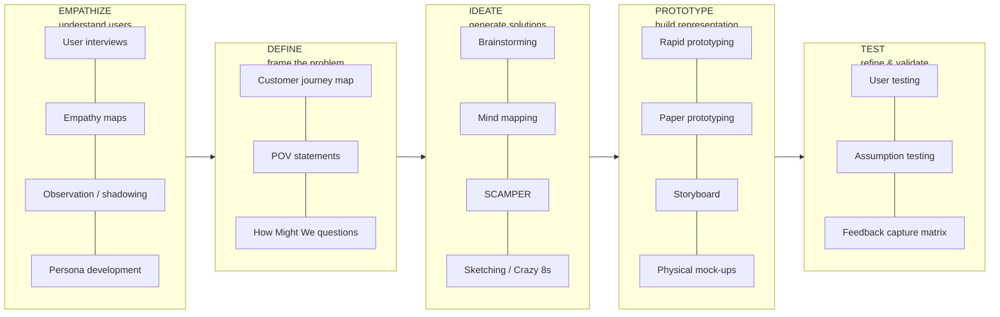

**Need for DT tools in product development** (short): tools turn abstract steps into **concrete, repeatable activities**, make thinking **visible** to the whole team, speed up work and make decisions **evidence-based**.

**Technical vs non-technical fields (long answer outline):**
| | Technical (software, engineering) | Non-technical (services, education, social sector) |
|---|---|---|
| Empathise | Usability tests, analytics, logs | Interviews, shadowing, ethnography |
| Define | User stories, journey maps | Journey maps, POV, community needs |
| Ideate | SCAMPER, architecture sketches | Brainstorming, mind maps, role-play |
| Prototype | Wireframes, MVPs, 3-D prints | Storyboards, role-play, service blueprints |
| Test | A/B tests, beta releases | Pilots, feedback matrix, focus groups |

---

## 9. Customer Journey Mapping ★★★

A **customer journey map** visually represents **every interaction (touchpoint)** a user has with a product or service, together with their actions, thoughts, emotions and pain points. Widely used in **banking and e-commerce**.

**Benefits:** identifies **pain points**, improves customer experience, supports **service redesign**, aligns teams on the user's view.

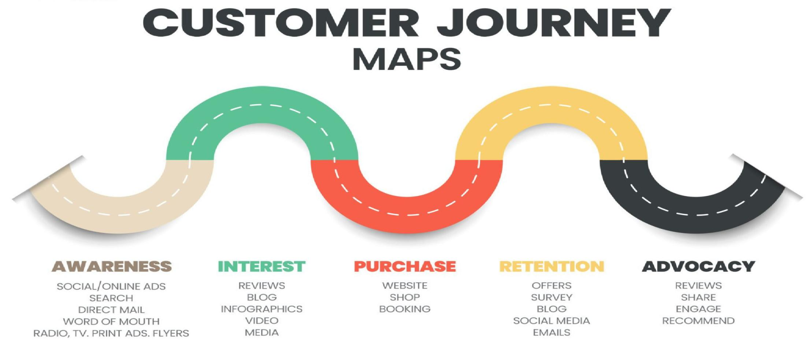

**Typical stages:** **Awareness** (ads, search, word of mouth) → **Interest** (reviews, blogs, videos) → **Purchase** (website, shop, booking) → **Retention** (offers, surveys, emails) → **Advocacy** (reviews, sharing, recommending).

**Rows of a journey-map grid:** stages · **actions** · **touchpoints** · **pain points** · **opportunities** · **experience (emotion) curve**.

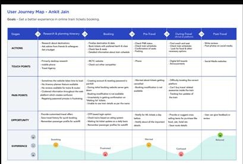

### 9.1 Case study — Rethinking the IRCTC app (Behance)
The redesign study followed a full design process: **research → user interviews → persona → empathy map → user journey map → user flow → wireframes → visual design**. Pain points found included checking ticket availability **only after login** and confusing timelines; the redesign allowed **checking availability without login** and a clearer **upcoming-trips** view.

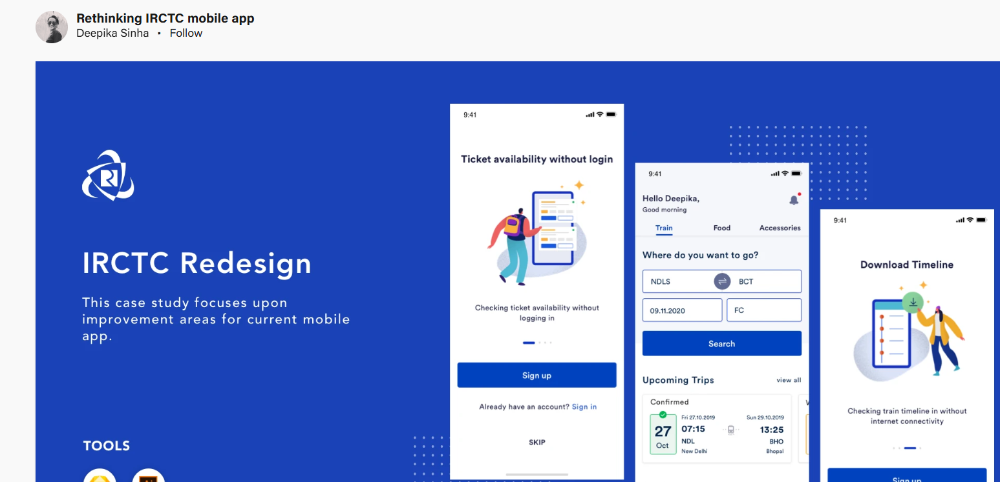

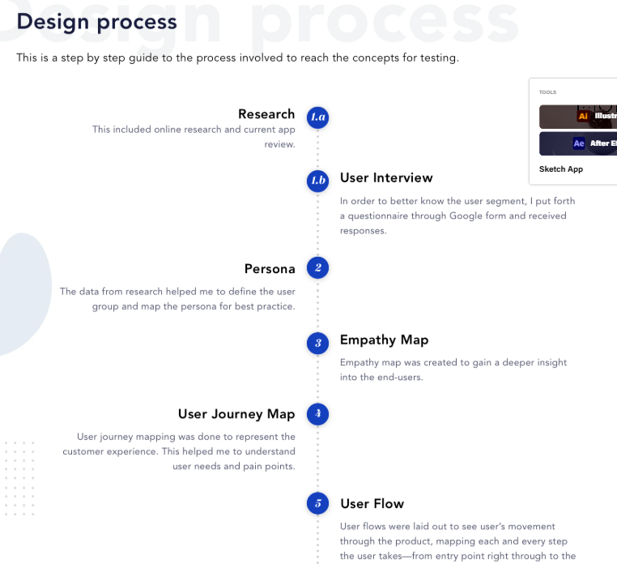

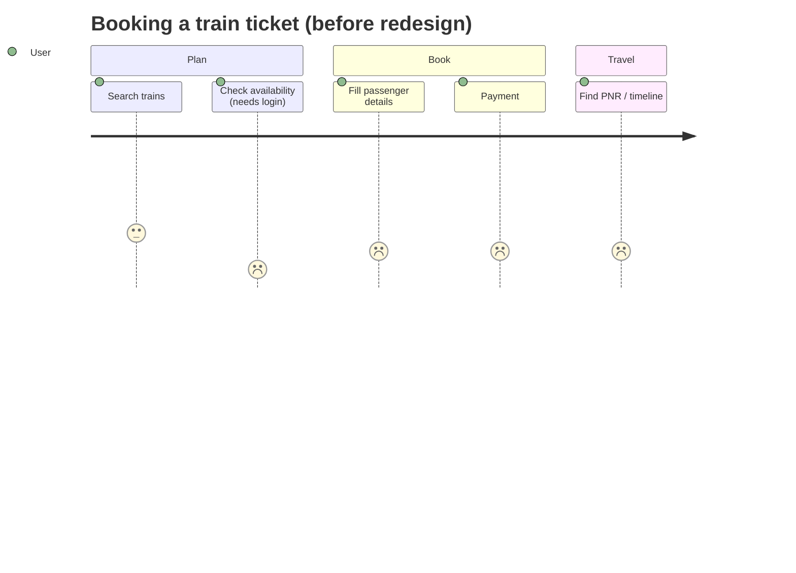

---

## 10. Point of View (POV) Statements ★★★

- A **POV** is a meaningful, actionable **problem statement** that captures **who the user is, what they need, and why (insight)** — it reframes research into a design challenge. It is a **storytelling format that puts the audience in the scene** — relatable, immersive, conversational, validating.

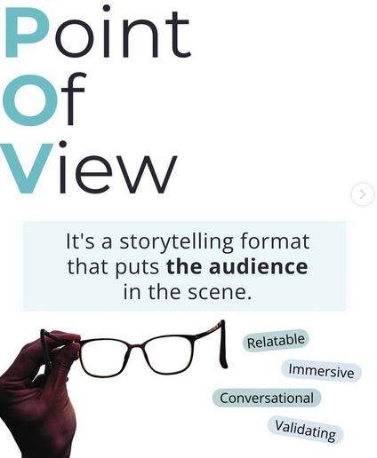

**Formula:** **[User] needs [need] because [insight].**

*Example:* "A first-year hostel student **needs** a quick way to find affordable, healthy meals near campus **because** they skip breakfast when the mess queue is long and feel tired in class."

**Creating strong POV statements:**
- **Human-centred** — about a specific user, not the product.
- **Broad enough** for creative freedom, **narrow enough** to be manageable.
- Based on **real research insights**, not assumptions.
- Use **verbs for needs** (to feel safe, to save time), not nouns/solutions.

---

## 11. How Might We (HMW) Questions ★★★

**HMW questions** are **human-centred questions** that act as the **backdrop for brainstorming and ideation**. They convert a POV/problem into an **opportunity**: "**How** (assumes a solution exists) **Might** (permission to explore, it may or may not work) **We** (collaborative)".

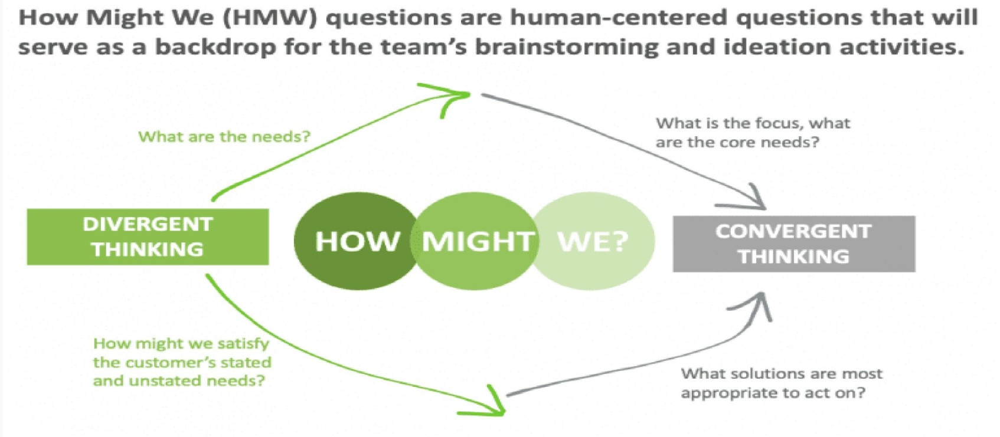

- **Divergent side:** "What are the needs?" "How might we satisfy the customer's **stated and unstated** needs?"
- **Convergent side:** "What is the focus, what are the core needs?" "What solutions are most appropriate to act on?"

**HMW formula:** **How might we** + *intended action (verb)* + **for** + *potential user* + **so that** + *desired outcome*?

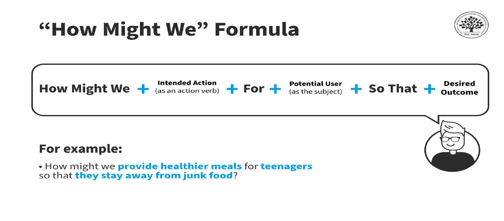

*Example:* "How might we **provide healthier meals** for **teenagers** so that **they stay away from junk food**?"

**Writing effective HMW questions:** start from the POV; not too broad ("…improve education?") or too narrow (already containing a solution); focus on the **desired outcome**; stay positive; generate several HMWs and pick the best.

---

## 12. Brainstorming ★★★

**Brainstorming** is a creativity technique for generating a **large number of ideas** in a group. It promotes creative confidence and teamwork.

**Rules (IDEO):**
1. **No criticism** — defer judgment.
2. **Encourage wild ideas**.
3. **Focus on quantity** (quantity breeds quality).
4. **Build on others' ideas** ("Yes, and…").
5. 📘 Stay focused on the topic; one conversation at a time; be visual.

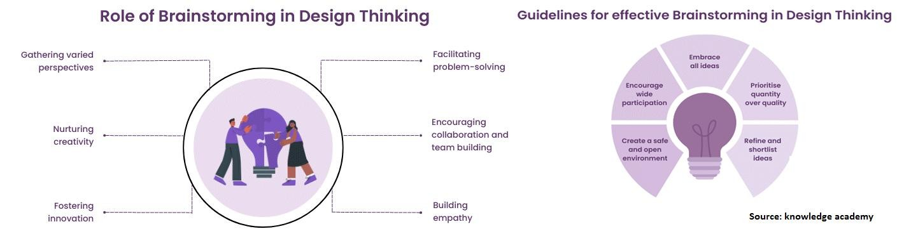

| Role of brainstorming in DT | Guidelines for effective brainstorming |
|---|---|
| Gathering varied perspectives | Embrace all ideas |
| Nurturing creativity | Encourage wide participation |
| Fostering innovation | Create a safe and open environment |
| Facilitating problem-solving | Prioritise quantity over quality (at first) |
| Encouraging collaboration & team building | Refine and shortlist ideas at the end |
| Building empathy | — |

**Brainstorming tools & techniques:** mind mapping, post-it notes, **brainwriting** (write ideas silently, pass on), role play, online brainstorming tools, **Six Thinking Hats**.

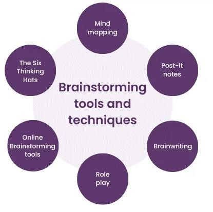

**Advantages:** many ideas quickly, everyone contributes, diverse views combine, builds team spirit, cheap and simple. **Limitations:** dominant voices, groupthink, fear of judgment (brainwriting helps).

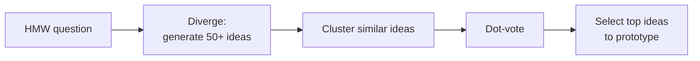

---

## 13. Mind Mapping ★★★

**Mind mapping** visually organises ideas and their relationships around a **central idea** with **branches** and **sub-branches** (connections). Widely used in product design and research.

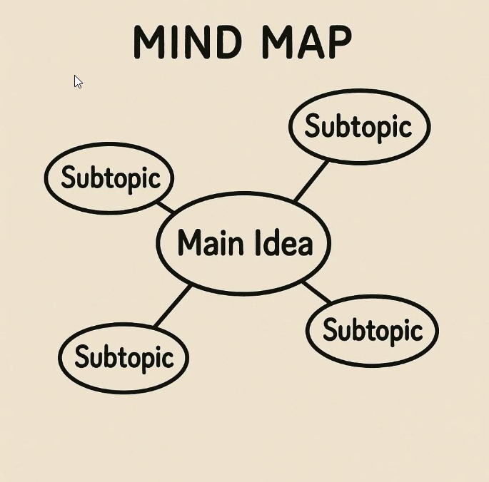

**Advantages / benefits:** simplifies complex information · encourages creativity (non-linear) · improves **memory** · supports **planning** · shows relationships at a glance · good for group thinking.

**How to make one:** 1) write the central topic in the middle; 2) draw main branches for key themes; 3) add sub-branches with keywords/images; 4) use colours and icons; 5) look for links between branches.

*Example — Software development project:* Planning (specification, decomposition, PERT diagram, planning approval) · Designing (features, database architecture, user interface) · Production (development, manual, bug fixing, alpha testing) · Implementation (training, beta testing, bug fixing).

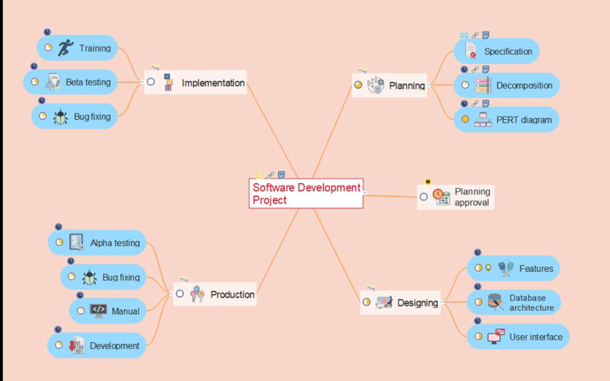

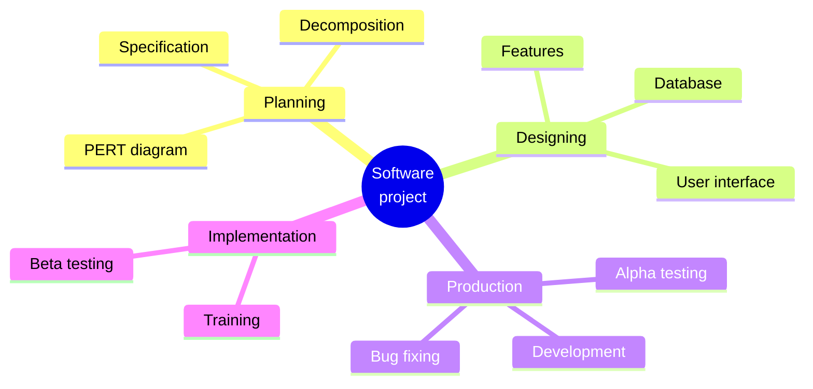

Further examples on the slides: strategies for **plant-based living** and a photo-shoot **location** mind map.

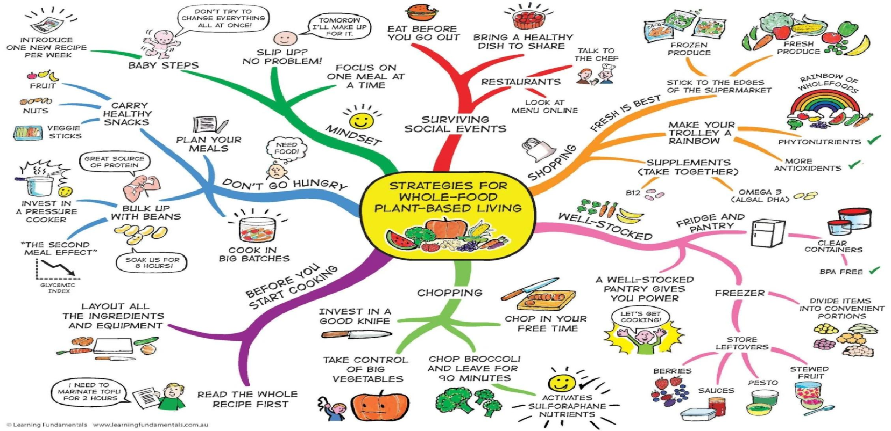

---

## 14. SCAMPER Technique ★★★

**SCAMPER** (Bob Eberle, from Alex Osborn's checklist) is a **creative checklist** that asks seven kinds of questions about an existing product to generate new ideas.

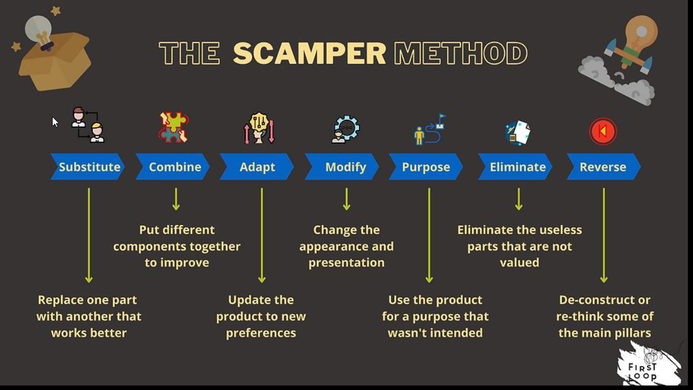

| Letter | Prompt | Question | Oreo example (slide) |
|---|---|---|---|
| **S — Substitute** | Replace one part with another that works better | What can I replace? | Replace the cream filling with **peanut butter** |
| **C — Combine** | Put different components together | What can be merged? | Oreos + ice cream → **Oreo milkshake / ice cream** |
| **A — Adapt** | Adjust to another context | What else is like this? | Crush Oreos into a **pie crust** |
| **M — Modify / Magnify / Minify** | Change size, shape, appearance | Bigger, smaller, different? | **Mini Oreos**, triple-double Oreo, Oreo sticks |
| **P — Put to another use** | Use for a purpose not intended | Other uses? | Use Oreos to teach the **phases of the moon** |
| **E — Eliminate** | Remove parts that aren't valued | What can be removed? | Remove the filling → plain cookie |
| **R — Reverse / Rearrange** | Change order, turn inside out | What if reversed? | **Inside-out Oreo** (white cookie, dark cream) |

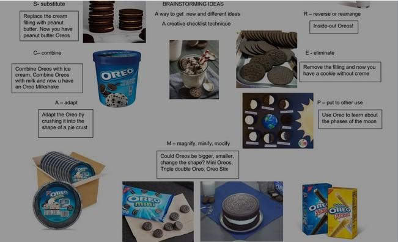

**Applications:** improving existing products (the slide shows the landline telephone → **smartphone** by combining camera, maps, music…), services, processes, marketing campaigns and business models.

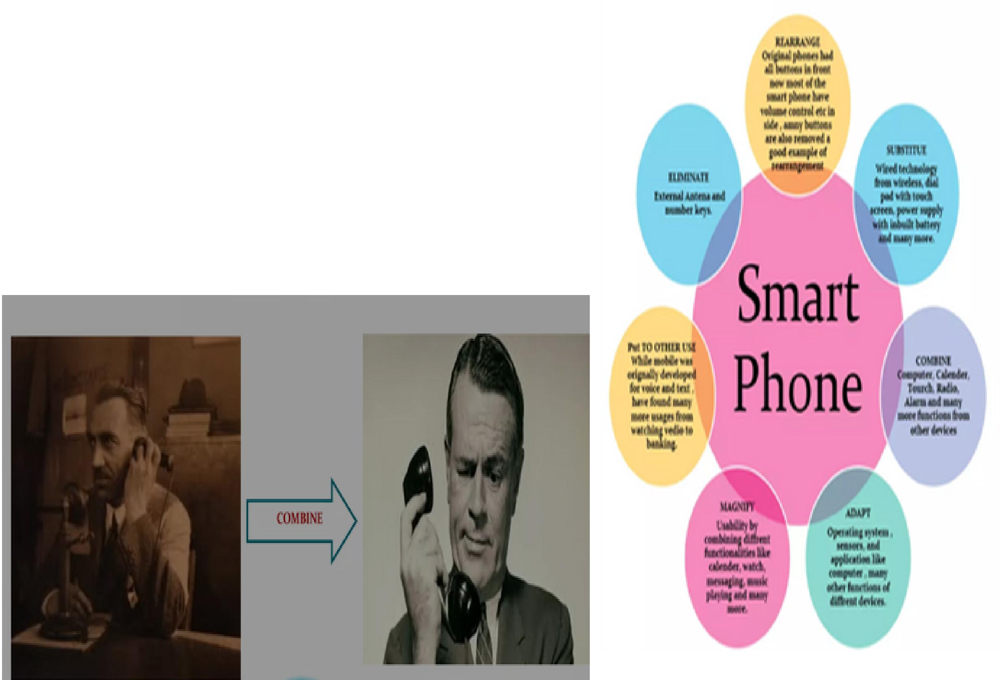

---

## 15. Sketching & Crazy 8s ★★

- **Sketching** = quick, rough drawings to make ideas visible; quality of art does not matter.
- **Crazy 8s** = fold a sheet into **8 panels** and sketch **8 different ideas in 8 minutes** (1 minute each) — forces quantity and pushes past the first obvious idea.

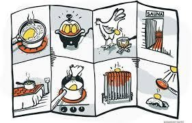

**Benefits of Crazy 8s:** boosts creativity, anyone can draw them, **less intimidating**, helps keep track of ideas, team building, low cost.

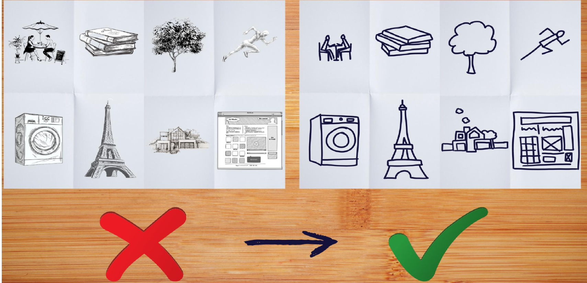

---

## 16. Prototyping ★★★

**Purpose of prototyping** (short): make ideas **tangible** so they can be tested, **learn quickly and cheaply**, communicate ideas, reveal flaws early, and gather user feedback before costly development.

### 16.1 Rapid prototyping
Quickly creating **low-cost models** of solutions. **Types:** paper prototypes, wireframes, digital mock-ups, interactive prototypes. It **reduces development risk** and supports **early feedback**.

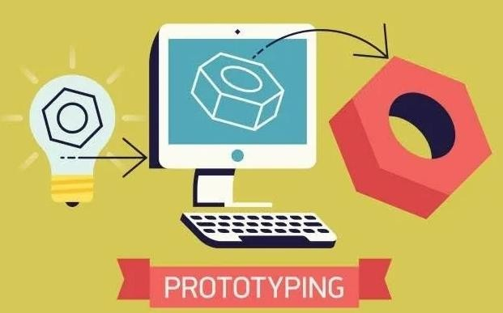

**Benefits:** better communication · reduced development costs · improved product quality and design · shortened development cycle · improved confidentiality (built in-house).

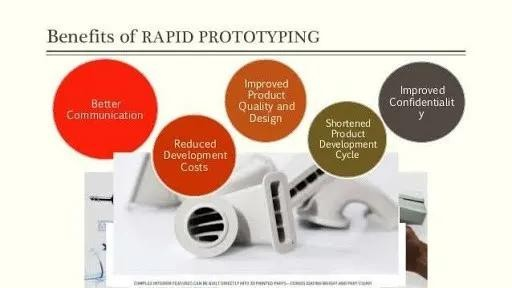

| Fidelity 📘 | Examples | Use |
|---|---|---|
| **Low** | Paper sketches, cardboard | Early concepts, fast iteration |
| **Medium** | Wireframes, clickable mock-ups | Flow & layout testing |
| **High** | Coded prototype, 3-D print | Final validation |

### 16.2 Paper prototyping
Hand-drawn screens/interfaces on paper that users "click" by pointing while a facilitator swaps sheets. Example on slide: a hand-drawn **flight-search app** (from/to, dates, passengers).

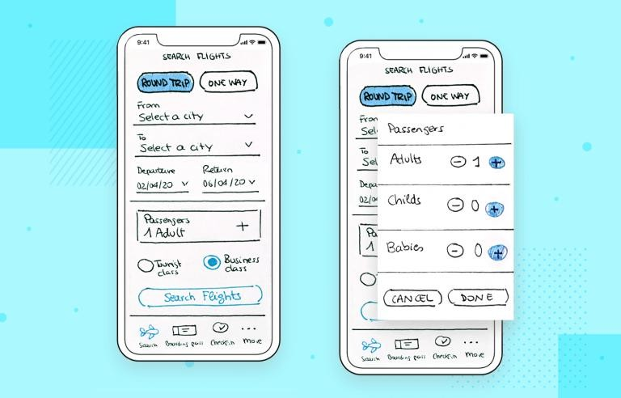

**Benefits:** very cheap and fast, no technical skills, easy to change, users comment freely on something that looks unfinished, finds usability issues early.

### 16.3 Storyboards
A **comic-strip sequence of panels** showing how a user experiences a problem and the solution over time (scene, action, emotion). Example: a café visit — before going, on the way, in the café — with an emotion curve.

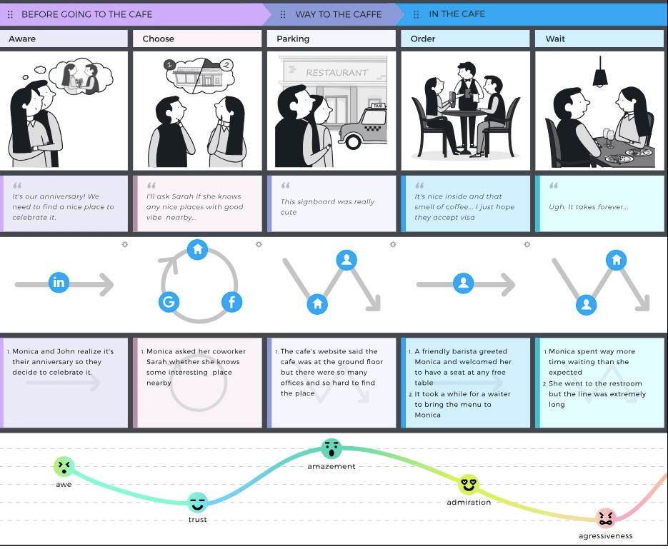

**Benefits of storyboarding:** communicates the **user's story and context**, shows emotions, spots gaps in the flow, cheap, aligns the team. (Slide example: a hare-and-tortoise story drawn as a storyboard.)

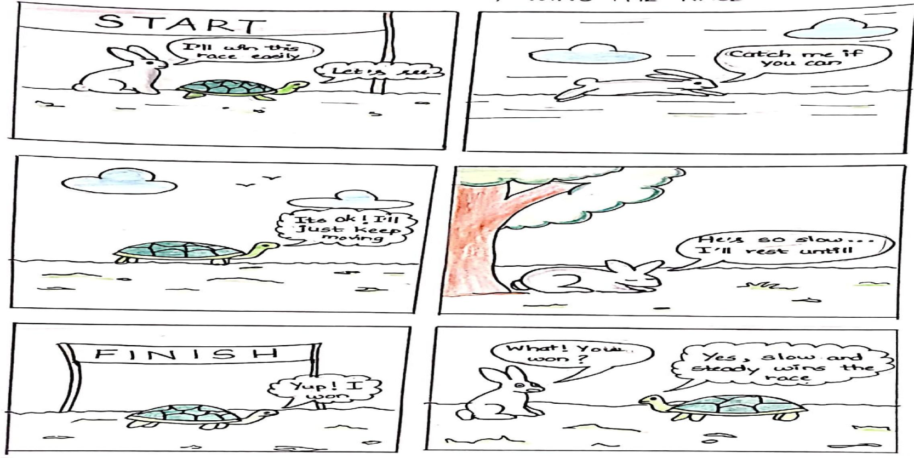

### 16.4 Physical mock-ups
Rough **3-D models** (cardboard, foam, clay, 3-D print) of physical products used to test size, shape, ergonomics and use. Example sketches: a portable coffee-press design.

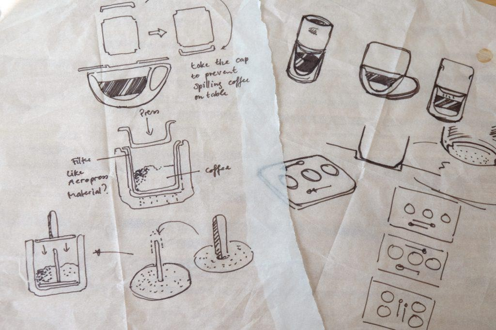

---

## 17. Testing Techniques ★★★

### 17.1 User testing
Real users try the prototype while the team **observes**, asks questions and gathers insights; results drive refinement and iteration.

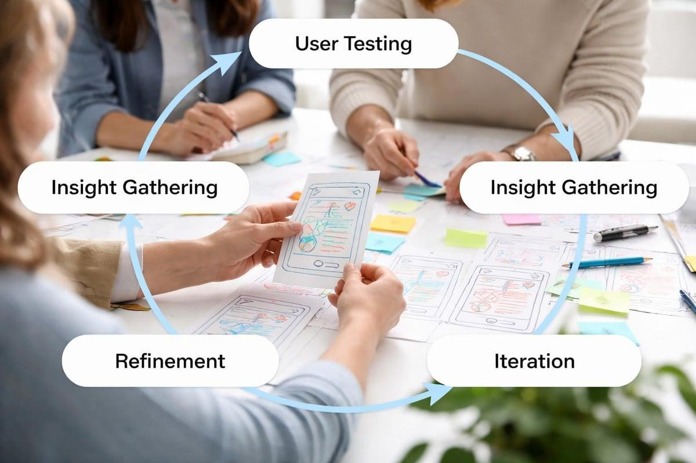

**Importance:** finds real usability problems, validates assumptions, reduces risk before launch, improves satisfaction.

*Example (library app):* five students use the app → observe how they search for books → collect feedback → improve the app based on suggestions.

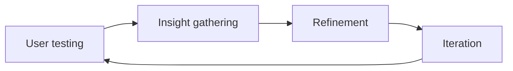

### 17.2 Assumption testing
Identify the **riskiest assumptions** behind an idea and test them with evidence before investing.

*Example:* **Assumption:** students prefer online learning over classroom learning. **Test:** survey of **200 students**. **Result:** only **55 %** prefer online learning → the assumption is **only partially correct**.

**Benefits:** reduces business risk, saves time and money, validates ideas early, improves product quality, prevents wrong investments, builds products users actually need.

### 17.3 Feedback capture matrix
A 2 × 2 grid to capture feedback during or after testing:

| **Likes** 👍 (what worked) | **Ideas** 💡 (new ideas sparked) |
|---|---|
| **Challenges / criticisms** ❗ (what didn't work) | **Questions** ❓ (what was unclear) |

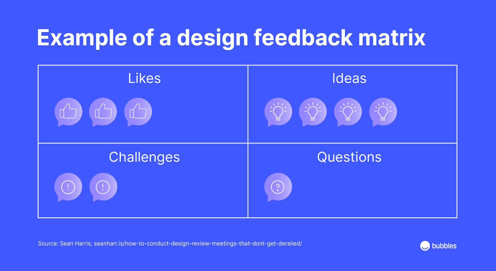

A simpler version is **I Like / I Wish** (/ What If).

**Benefits:** organises feedback clearly, helps prioritise improvements, identifies common problems, encourages collaboration, makes decisions easier, improves prototype quality.

---

## 18. Personas & SWOT Analysis ★★

### 18.1 Personas
**Personas** are **fictional representations of target users** based on research data. **Components:** name/photo, **age, occupation, goals, frustrations, needs**, behaviours. They help designers understand user behaviour and expectations and keep the team focused on a real person.

| Persona: "Ravi, 20" | |
|---|---|
| Occupation | B.Tech student, hostel |
| Goals | Prepare for placements, save money |
| Frustrations | Scattered notes, slow college portal |
| Needs | Quick revision, mobile-friendly content |

### 18.2 SWOT analysis
Evaluates **Strengths, Weaknesses** (internal) and **Opportunities, Threats** (external) to analyse innovation strategies and competitive advantage.

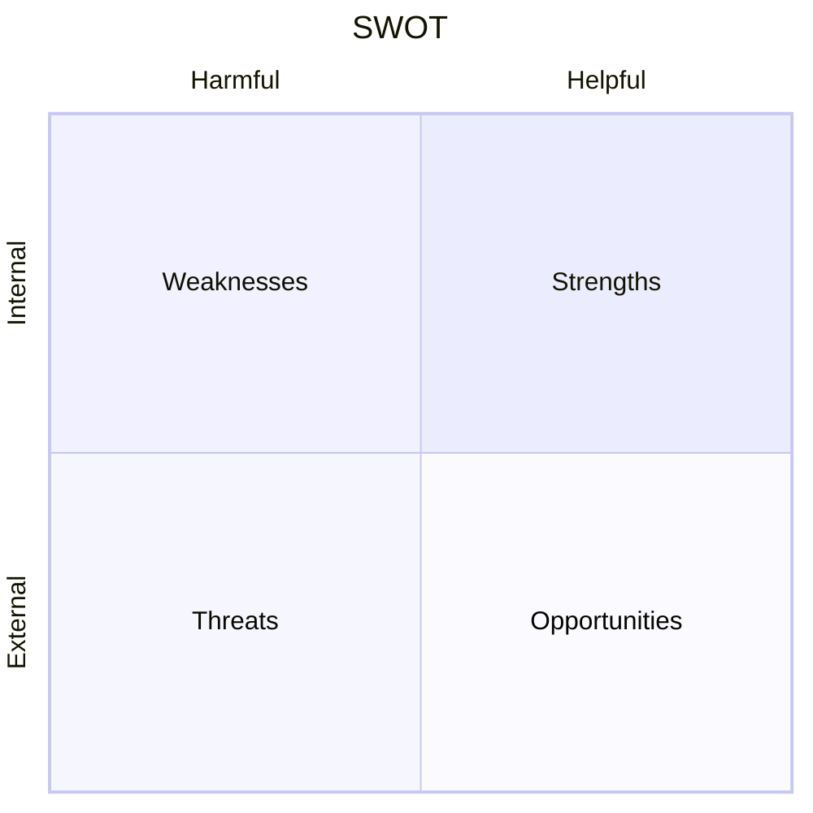

---

## 19. Innovation and Design Thinking ★★★

DT supports innovation by encouraging **experimentation** and **user-centred** solutions. **Types of innovation:**
| Type | Example |
|---|---|
| **Product** | iPhone |
| **Service** | Telemedicine consultation |
| **Process** | Online registration replacing queues |
| **Business model** | Airbnb (platform of hosts, no hotels owned) |

Innovation creates **long-term competitive advantage**.

### 19.1 How DT supports innovative decision-making in organisations (long answer)
1. Decisions are grounded in **user evidence** (empathy research) rather than opinion.
2. **Divergent → convergent** thinking explores many options before choosing.
3. **Prototypes and tests** turn big decisions into small, reversible experiments.
4. **Cross-functional teams** bring business, tech and design views.
5. **Iteration** lets decisions be revised as data arrives → lower risk.

### 19.2 Human-centred approaches & customer satisfaction
Understanding real needs (empathy, journey maps, personas) → designs that remove pain points → higher satisfaction, loyalty and better UX. Examples: elderly-friendly health apps, IRCTC redesign, Duolingo.

### 19.3 Experimentation and iteration in innovation
Cheap experiments expose **wrong assumptions early**, iteration **compounds learning**, failures become lessons ("fail fast, fail cheap"), and the final product is validated by real users.

### 19.4 DT and entrepreneurship / start-ups
Start-ups use DT to find a real **problem worth solving**, design an **MVP** (prototype), validate with customers (assumption testing), and **pivot** quickly — closely linked to **Lean Startup** (build–measure–learn). Examples: Airbnb, Swiggy, Paytm.

### 19.5 DT solution for public services in smart cities (long answer — sample)
| Stage | Smart-city bus service example |
|---|---|
| Empathise | Shadow commuters; interview elderly/disabled riders |
| Define | "Daily commuters need reliable arrival information because waiting uncertainty makes them choose private vehicles." |
| HMW | How might we make bus arrivals predictable for commuters so that more people use public transport? |
| Ideate | Live GPS tracking app, digital displays at stops, SMS for non-smartphone users, integrated metro-bus pass |
| Prototype | Clickable app mock-up; one pilot bus stop display |
| Test | Pilot on one route; feedback capture matrix; measure ridership |

---

## 20. Case Studies ★★

| Apple | Airbnb |
|---|---|
| **Simplicity** in design | Customer **trust** problem in early days |
| Strong **emotional connection** | **Better photography** of listings (founders photographed homes themselves) |
| **User-friendly interfaces** | Improved **booking experience** |
| **Continuous innovation** | **User-feedback integration** |
| iPhone, iPad — successful human-centred design | **Result:** significant increase in bookings and satisfaction |

---

## 21. Challenges & Future of Design Thinking ★★

**Challenges:** resistance to change · time limitations · lack of collaboration · poor user research · limited resources. **Solutions:** leadership support, training, iterative learning.

**Future trends:** AI integration · sustainable innovation · smart cities · human–AI collaboration · inclusive technologies.

**Conclusion:** DT is not only a process but a **mindset** promoting empathy, innovation, collaboration and experimentation, enabling meaningful, sustainable, user-friendly solutions.

---

## 22. Unit II Question Bank ★★★

### Short answer (2 marks)
| # | Question | See |
|---|---|---|
| 1 | Define innovation in the context of DT | §1 |
| 2 | Mention any four characteristics of DT | §2 |
| 3 | Explain the significance of creativity in DT — creativity generates many options in Ideate, finds non-obvious solutions to "mystery" problems, and turns insights into innovation | §1, §12 |
| 4 | Identify the role of brainstorming in idea generation | §12 |
| 5 | Differentiate innovation and invention | §1 |
| 6 | Advantages of DT in business organisations | §5 |
| 7 | Purpose of prototyping in DT | §16 |
| 8 | Contribution of DT to social problem solving | §6.1 |
| 9 | Importance of collaboration in DT teams | §4.4 |
| 10 | Need for DT tools in product development | §8 |

### Long answer (10 marks)
| # | Question | See |
|---|---|---|
| 1 | How DT supports innovative decision-making in organisations | §19.1 |
| 2 | Importance of human-centred approaches in DT with examples | §4, §19.2 |
| 3 | Role of DT in improving customer satisfaction and UX | §9, §19.2 |
| 4 | Idea-generation techniques in DT | §12–§15 |
| 5 | Effectiveness of DT in addressing societal challenges | §6.1 |
| 6 | Importance of experimentation and iteration in innovation | §4, §17, §19.3 |
| 7 | Impact of DT on entrepreneurship and start-up culture | §19.4 |
| 8 | Compare DT techniques in technical and non-technical fields | §8 |
| 9 | DT-based solution for public services in smart cities | §19.5 |
| 10 | DT for sustainable and socially responsible innovations | §6.1, Unit I §15 |

---

## Unit II — One-Page Summary

| Topic | Key points |
|---|---|
| **DT intro** | Systematic, user-centred problem solving: empathy + creativity + experimentation + rationality; analytical + creative thinking (Balagurusamy). Innovation = idea put to valuable use; invention = new idea/device. |
| **Characteristics** | Human-centred, collaborative/interdisciplinary, iterative/experimental, innovation-focused, prototype & test. |
| **Need** | Fast-changing tech & markets; understand users, reduce failure, satisfaction, innovation. |
| **Principles** | Empathy (observation, interviews, shadowing, interaction studies), collaboration, experimentation, iteration, user-centricity. |
| **Benefits** | Faster innovation, teamwork, lower cost, loyalty, better decisions, creative confidence (Apple, IBM). |
| **Applications** | Education (Duolingo), healthcare (waiting rooms, telemedicine), banking, govt, retail; social innovation (poverty, education, environment, rural health). |
| **Impact** | Organisations: innovation culture, profit, engagement. Society: inclusive tech, public services, sustainability. |
| **Tools by stage** | Empathise: interviews, empathy maps, shadowing, personas · Define: journey map, POV, HMW · Ideate: brainstorming, mind map, SCAMPER, Crazy 8s · Prototype: rapid, paper, storyboard, mock-ups · Test: user testing, assumption testing, feedback matrix. |
| **Journey map** | Touchpoints across awareness → interest → purchase → retention → advocacy; actions, pain points, opportunities, emotion curve (IRCTC case). |
| **POV / HMW** | POV: user + need + insight. HMW: How might we + action + for user + so that outcome; bridges divergent and convergent thinking. |
| **Brainstorming** | No criticism, wild ideas, quantity, build on ideas; brainwriting, six hats, post-its. |
| **Mind map** | Central idea, branches; simplifies, creative, memory, planning. |
| **SCAMPER** | Substitute, Combine, Adapt, Modify, Put to other use, Eliminate, Reverse (Oreo, phone→smartphone). |
| **Crazy 8s** | 8 ideas in 8 minutes; low cost, less intimidating. |
| **Prototyping** | Rapid (paper, wireframe, digital, interactive), paper prototypes, storyboards, physical mock-ups; reduce risk, early feedback. |
| **Testing** | User testing cycle; assumption testing (200 students, 55 %); feedback matrix (likes, ideas, challenges, questions). |
| **Personas / SWOT** | Fictional research-based users (age, job, goals, frustrations, needs); strengths, weaknesses, opportunities, threats. |
| **Innovation** | Product, service, process, business model; DT and start-ups (MVP, pivot); smart-city bus example. |
| **Cases** | Apple (simplicity, emotion, UI); Airbnb (photos, booking, feedback → trust, bookings). |
| **Challenges / future** | Resistance, time, poor research, resources → leadership, training; AI, sustainability, smart cities, inclusive tech. |
