# Unit III — Idea Generation

> **Syllabus:** New idea-generation methods — principles of idea generation, techniques, creative-thinking techniques and tools, types of creative thinking, selecting ideas from ideation methods.
>
> **Source:** *Unit 3.pptx* (Design Thinking, 9LC13, SNIST), including the Unit III question bank (the slide headings say "UNIT–II" by mistake). 📘 = explanation added from standard references.

**Importance legend:** ★★★ = very frequently asked (long answer) · ★★ = medium · ★ = short answer

---

## Table of Contents
1. [Introduction to Idea Generation](#1-introduction-to-idea-generation-)
2. [Idea Management (Innovation) Funnel](#2-idea-management-innovation-funnel-)
3. [Need & Importance of Idea Generation](#3-need--importance-of-idea-generation-)
4. [Process of Idea Generation](#4-process-of-idea-generation-)
5. [Principles of Idea Generation](#5-principles-of-idea-generation-)
6. [Idea-Generation Techniques](#6-idea-generation-techniques-)
7. [Brainstorming & Brainwriting](#7-brainstorming--brainwriting-)
8. [Six Thinking Hats](#8-six-thinking-hats-)
9. [Other Techniques: SCAMPER, Mind Map, Crazy 8s, Role Play, Reverse, Storyboard, Lotus Blossom, Random Word](#9-other-techniques-)
10. [Creative Thinking](#10-creative-thinking-)
11. [Types of Creative Thinking](#11-types-of-creative-thinking-)
12. [Selecting Ideas from Ideation Methods](#12-selecting-ideas-from-ideation-methods-)
13. [Applications, Challenges & Improving Creativity](#13-applications-challenges--improving-creativity-)
14. [Unit III Question Bank](#14-unit-iii-question-bank-)
15. [Unit III — One-Page Summary](#unit-iii--one-page-summary)

---

## 1. Introduction to Idea Generation ★★★

- **Idea generation** is the process of **creating, developing and communicating new ideas** — the act of **conceiving, evolving and expressing abstract, tangible or visual concepts** at the **start of the idea-management funnel**.
- It aims to proactively generate **potential responses to recognised challenges and opportunities**, devising creative solutions for both **perceived and actual** problems.
- It helps organisations solve problems creatively, is widely used in **design thinking** (the **Ideate** stage), and builds an **innovation culture**.
- **Key features:** creativity · innovation · problem solving · user focus · collaboration.
- *Example:* start-ups generate ideas for new mobile applications.
- *"Imagination is more important than knowledge."* — Einstein · *"Ideas are the starting point of every great success."* — Napoleon Hill

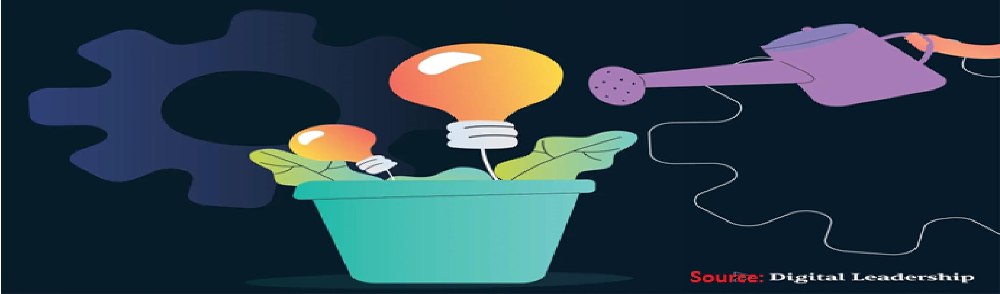

**Idea vs concept:** an **idea** is a seed (a single thought); a **concept** is a developed, structured idea with roots and branches — features, users, feasibility.

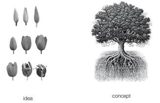

---

## 2. Idea Management (Innovation) Funnel ★★★

An **idea management funnel** is a **structured process to collect, evaluate and implement the best ideas**. Many ideas enter at the wide end; only the most **feasible and valuable** move forward. **As ideas progress, their number decreases but their quality and feasibility increase.**

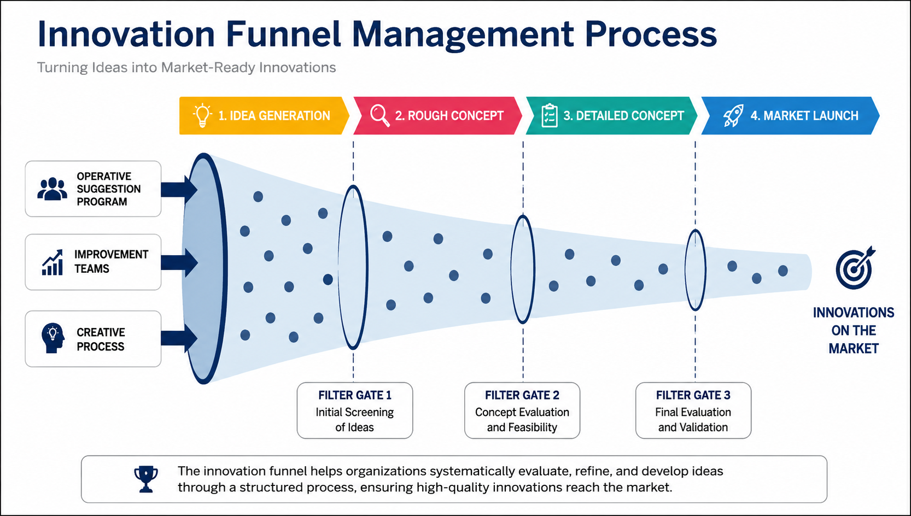

Inputs (suggestion programmes, improvement teams, creative processes) → **1. idea generation → filter gate 1 (initial screening) → 2. rough concept → filter gate 2 (concept evaluation & feasibility) → 3. detailed concept → filter gate 3 (final evaluation & validation) → 4. market launch**.

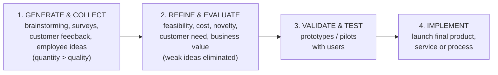

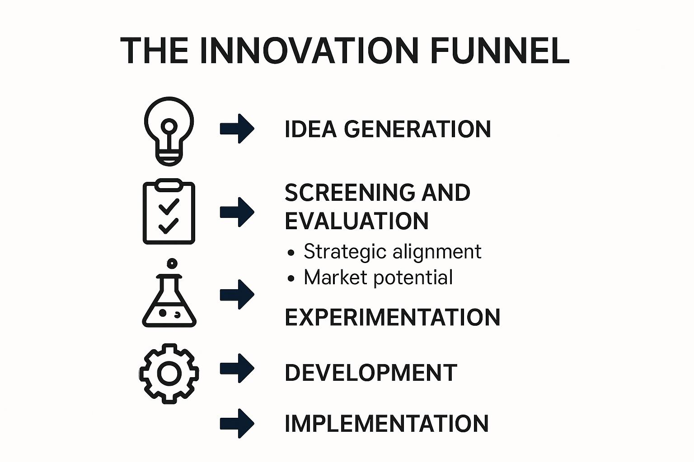

Alternative form: **Idea generation → Screening & evaluation (strategic alignment, market potential) → Experimentation → Development → Implementation.**

---

## 3. Need & Importance of Idea Generation ★★

**Need:** improves products and services · creates **competitive advantage** · encourages experimentation · supports business growth · enhances customer satisfaction · helps solve complex problems. *Companies innovate to survive changing markets.* "Every problem is an opportunity in disguise."

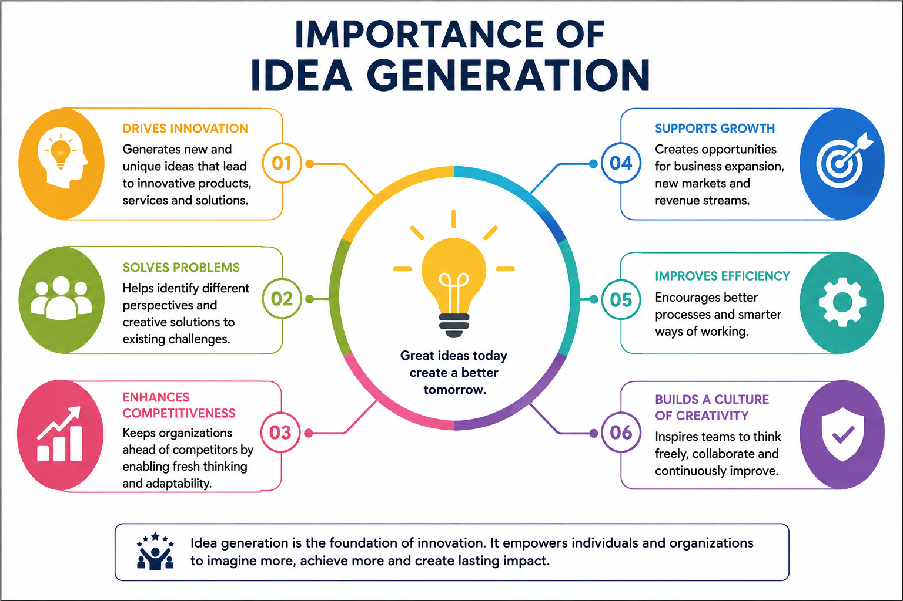

**Importance (six points on the slide):** drives innovation · solves problems · enhances competitiveness · supports growth (new markets, revenue) · improves efficiency · builds a culture of creativity.

**Why ideation is the "engine" of design thinking** (it turns user research into actual solutions):
| Reason | Meaning |
|---|---|
| Expands the solution space | More options than the first obvious answer |
| Mitigates risk | Alternatives exist if one idea fails |
| Breaks mental blocks | Escapes habitual thinking |
| Encourages diversity | Many viewpoints and idea types |
| Fuel for prototyping | Supplies concepts to build |
| Aligns the team | Shared ownership of ideas |
| Shifts analysis → creation | Moves from understanding to making |
| Encourages radical thinking | Room for breakthrough ideas |
| Identifies constraints early | Unrealistic ideas surface quickly |
| Increases solution "stickiness" | Ideas people helped create get adopted |
| Promotes iteration | Ideas are revisited and improved |

---

## 4. Process of Idea Generation ★★★

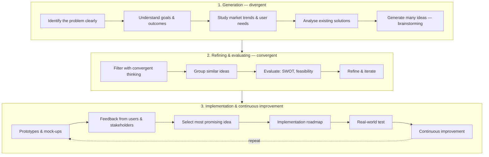

- Phase 1: **Problem → Research → Brainstorming → Divergent thinking.** "Every great innovation begins with a clear understanding of the problem."
- Phase 2: **Many ideas → Evaluation → Refinement → Best ideas.** "Creativity is thinking of new things; innovation is doing new things."
- Phase 3: **Prototype → Feedback → Improve → Implement → Repeat.** "Innovation is a continuous journey, not a one-time event."

---

## 5. Principles of Idea Generation ★★★

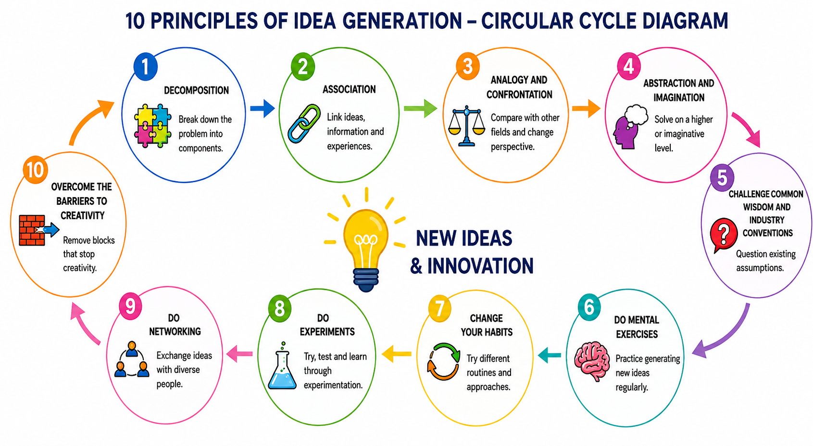

| # | Principle | Meaning | Example |
|---|---|---|---|
| 1 | **Decomposition** | Break a problem/product into smaller components and **recombine** them | Improve a smartphone by redesigning **battery, camera and software** separately |
| 2 | **Association** | Connect ideas, emotions and information | Combine **gaming** concepts with **education** apps |
| 3 | **Analogy & confrontation** | Borrow comparisons from other fields; change perspective | **Bullet-train** nose inspired by the **kingfisher's beak** (biomimicry) |
| 4 | **Abstraction & imagination** | Solve at a higher, imaginative level | Imagining **smart classrooms** of the future |
| 5 | **Challenge common wisdom & industry conventions** | Question traditional methods and assumptions | **Online shopping** replacing physical stores |
| 6 | **Do mental exercises** | Practise idea generation regularly | Generate **10 new ideas daily** |
| 7 | **Change your habits** | Try new routines for fresh thinking | Work in a **different environment** |
| 8 | **Do experiments** | Test ideas by trial and error | Scientific discoveries through repeated experiments |
| 9 | **Do networking** | Share ideas with people from different backgrounds | **Engineers + doctors** building medical apps |
| 10 | **Overcome barriers to creativity** | Remove fear, stress, negative thinking | A **positive workplace** for innovation |

**Memory chain:** Decompose → Associate → Analogise → Abstract → Challenge → Exercise → Change habits → Experiment → Network → Overcome barriers.

---

## 6. Idea-Generation Techniques ★★★

**Ten techniques on the slides:** Brainstorming · Brainwriting · Mind Mapping · SCAMPER · Six Thinking Hats · Role Playing · Reverse Thinking (reverse brainstorming) · Storyboarding · Lotus Blossom · Random Word — plus **Crazy 8s** sketching.

| Technique | Definition | Application | Example |
|---|---|---|---|
| **Brainstorming** | Group freely shares ideas **without criticism** | Product development, business innovation | Ideas for improving **online classes** |
| **Brainwriting** | Participants **write ideas individually** and exchange them to build more | Silent idea generation | Employees exchange written marketing ideas |
| **Mind mapping** | Visual organisation of ideas around a **central topic** | Project planning, creative thinking | Mind map for **smart-city** development |
| **SCAMPER** | Substitute, Combine, Adapt, Modify, Put to another use, Eliminate, Reverse | Product redesign, service improvement | **Bicycle → electric bicycle** |
| **Six Thinking Hats** | Thinking from **six perspectives** (de Bono) | Strategic planning, decision making | Analysing a business idea from multiple viewpoints |
| **Role playing** | Participants **act as users/customers** | Service design, UX testing | **Restaurant customer** simulation |
| **Reverse thinking** | Think how to **create** the problem instead of solving it | Innovation challenges | "How can we make customers **dislike** our app?" → then invert answers |
| **Storyboarding** | Ideas presented as **sketches / visual stories** | User journeys, app design | **Food-delivery app** user journey |
| **Lotus blossom** | Structured brainstorming expanding **outward from a central idea** | Innovation workshops, strategy | **Eco-friendly transportation** ideas |
| **Random word** | A **random word** triggers creative associations | Advertising, product innovation | Word "**tree**" → eco-friendly office ideas |
| **Crazy 8s** | Sketch **8 ideas in 8 minutes** | Rapid UI/concept ideas | — |

---

## 7. Brainstorming & Brainwriting ★★★

### 7.1 Brainstorming
Group creativity technique (Alex Osborn) — participants freely share ideas without criticism.

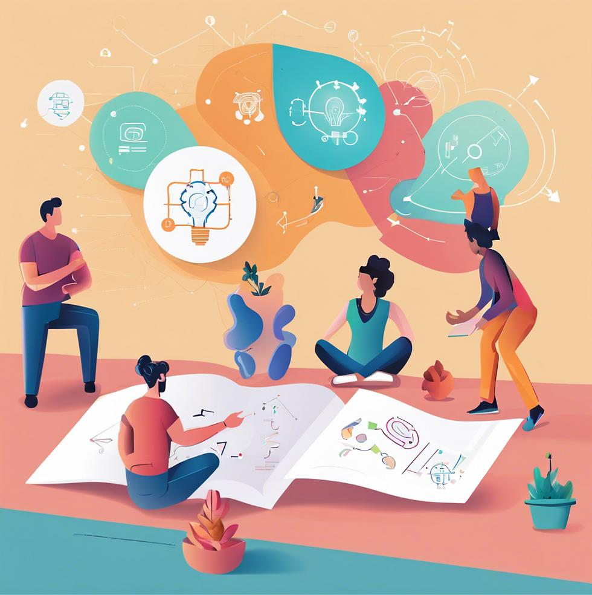

**Rules:** defer judgment · go for quantity · encourage wild ideas · build on others' ideas · one conversation at a time · stay on topic.

**Role of brainstorming in innovation (long answer):**
1. **Generates volume** — many ideas fast, raising the chance of a breakthrough.
2. **Combines diverse knowledge** — cross-functional associations.
3. **Builds on ideas** — "Yes, and…" creates novel combinations.
4. **Psychological safety** — no criticism encourages risk-taking.
5. **Team ownership** — people support ideas they helped create.
6. **Feeds the funnel** — the raw material for screening, prototyping and launch.
7. *Limitations:* dominant voices, groupthink, production blocking → mitigated by **brainwriting** and **reverse brainstorming**.

### 7.2 Brainwriting — the 6-3-5 method
**6** participants each write **3** ideas in **5** minutes, then pass the sheet on; the next person builds on them. After 6 rounds → up to **108 ideas in 30 minutes**.

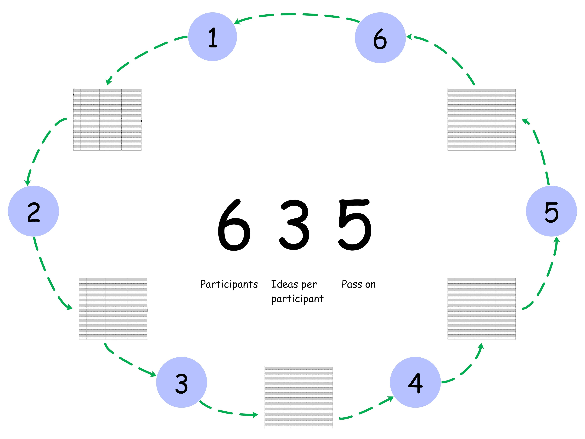

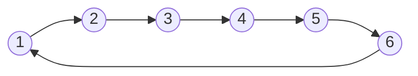

**Advantages:** everyone contributes equally, introverts not drowned out, no anchoring on the first speaker, written record.

---

## 8. Six Thinking Hats ★★★

Developed by **Edward de Bono** — the group looks at a problem from **six perspectives**, one "hat" at a time (parallel thinking).

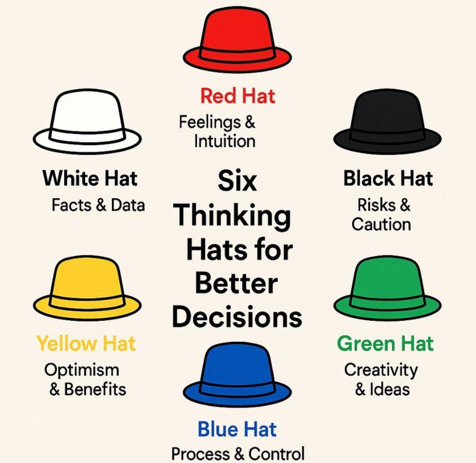

| Hat | Focus | Questions / role |
|---|---|---|
| ⚪ **White** | **Facts & data** — objectivity | What information do we have? What is missing? |
| 🔴 **Red** | **Feelings & intuition** — emotions, gut reaction | How do I feel about this? |
| ⚫ **Black** | **Risks & caution** — critical judgment | What could go wrong? |
| 🟡 **Yellow** | **Optimism & benefits** | What are the advantages? |
| 🟢 **Green** | **Creativity & new ideas** | What alternatives are possible? |
| 🔵 **Blue** | **Process & control** — managing the thinking | What is the agenda? What next? Summarise |

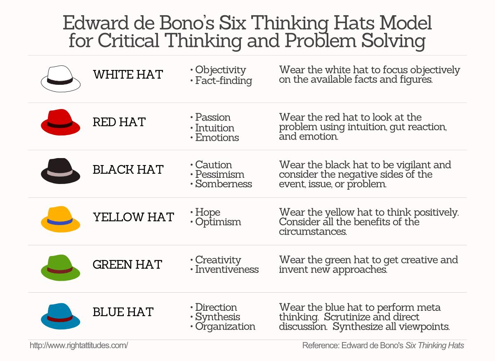

*Example — launching a campus food-delivery app:* White: 2,000 hostel students, mess closes at 9 pm · Red: students feel hungry and frustrated at night · Black: food safety, delivery cost · Yellow: steady demand, low competition · Green: pre-order slots, shared delivery points · Blue: pilot in one hostel for two weeks.

---

## 9. Other Techniques ★★

### 9.1 SCAMPER ★★★
**Purpose:** a checklist of seven question prompts to **systematically improve an existing product, service or process**.

| | Prompt | Bicycle example |
|---|---|---|
| **S** | Substitute | Steel frame → carbon fibre |
| **C** | Combine | Bicycle + motor → **e-bike** |
| **A** | Adapt | Adapt car-style gears / disc brakes |
| **M** | Modify / magnify / minify | Foldable compact bicycle |
| **P** | Put to another use | Stationary bike to **generate electricity** |
| **E** | Eliminate | Chainless (belt-drive) bike |
| **R** | Reverse / rearrange | Recumbent bike (rider leans back) |

(More SCAMPER examples — Oreo, telephone → smartphone — are in Unit II §14.)

### 9.2 Mind mapping
A **visual technique organising ideas around a central topic** with main branches (themes) and sub-branches (details).

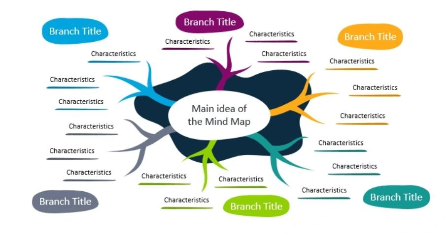

### 9.3 Crazy 8s
"Quickly sketching **eight different solution ideas in eight minutes**." A full sprint sequence: **Notes** (gather key info, 20 min) → **Ideas** (doodle rough solutions, 20 min) → **Crazy 8s** (try rapid variations, 8 min) → **Solution sketch** (figure out the details, 30+ min).

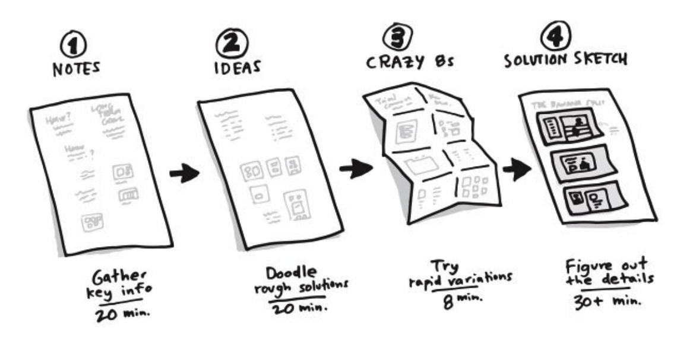

### 9.4 Storyboarding
"Visualising a user experience or solution through a **sequence of sketches**."

### 9.5 Reverse brainstorming 📘
1. State the problem. 2. **Reverse** it ("How could we cause / worsen it?"). 3. Brainstorm reverse ideas. 4. **Flip** each into a solution. *E.g., "make customers dislike our app" → slow loading, hidden fees, spam → so: speed up, transparent pricing, opt-in notifications.*

### 9.6 Lotus blossom 📘
Write the central theme in the middle of a 3 × 3 grid, 8 sub-themes around it; each sub-theme becomes the centre of a new 3 × 3 grid → **64 ideas** in a structured way.

### 9.7 Describing idea-generation tools (long answer outline)
Group them by type: **verbal** (brainstorming, brainwriting, random word), **visual** (mind maps, storyboards, Crazy 8s, lotus blossom), **checklist / structured** (SCAMPER, six hats, reverse thinking), **experiential** (role play) — and give definition, steps, example and advantage for each.

---

## 10. Creative Thinking ★★★

**Creativity / creative thinking** is the **ability to generate new, original and useful ideas** and solve problems in innovative ways. It involves **imagination, curiosity, flexibility and experimentation**, and is essential in business, education, engineering, arts and technology.

**Importance of creative thinking:**
- Encourages **innovation and invention**.
- Improves **problem-solving** skills.
- Helps **adapt to changing environments**.
- Builds **confidence and independent thinking**.
- Enhances **teamwork and collaboration**.
- Creates **personal and professional growth** opportunities.
- Supports **competitive advantage**.

**Importance of creativity in organisations (evaluate — long answer):** new products and revenue streams; process efficiency; differentiation from competitors; employee engagement and retention; adaptability in crises; better customer experience. *Caveats:* creativity must be **channelled** through selection and implementation (funnel), otherwise ideas stay unused; needs a supportive culture (time, safety to fail, rewards). Examples: Google's 20 % time → Gmail; 3M's Post-it notes.

**Characteristics of creative thinkers:** open-minded and curious · willing to take risks and experiment · good observation and analytical skills · ability to **connect unrelated ideas** · strong imagination and visualisation · **persistence** with complex problems.

---

## 11. Types of Creative Thinking ★★★

| Type | Description |
|---|---|
| **Divergent thinking** | Generating **multiple ideas and possibilities** |
| **Convergent thinking** | **Selecting the best** possible solution |
| **Lateral thinking** | Approaching problems from **unusual perspectives** |
| **Critical thinking** | **Evaluating** ideas logically and objectively |
| **Visual thinking** | Using **diagrams, images and patterns** |
| **Design thinking** | **Human-centred** innovation process |

### 11.1 Divergent vs convergent thinking ★★★

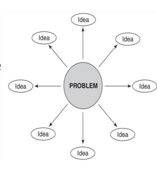 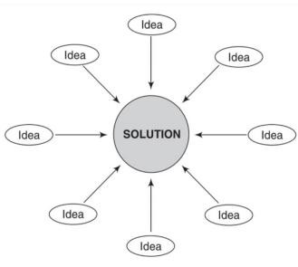

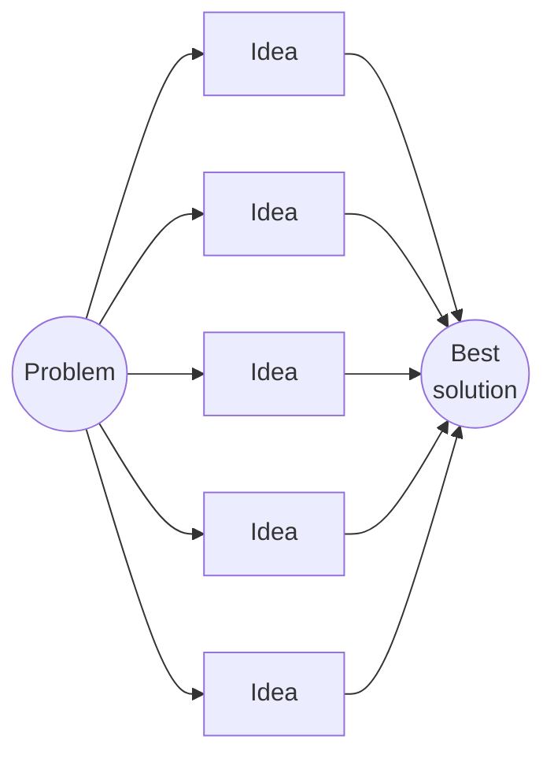

| Basis | **Divergent thinking** | **Convergent thinking** |
|---|---|---|
| Aim | Generate **many different** ideas | Select the **one best** solution |
| Direction | Outward from one problem to many ideas | Inward from many ideas to one solution |
| Style | Free, spontaneous, **no judgment** | Logical, analytical, **decision-making** |
| Stage | **Early** stages of innovation (Discover, Ideate) | **Implementation & execution** (Define, Deliver) |
| Qualities | Flexibility, originality, fluency | Accuracy, efficiency, clarity |
| Tools | Brainstorming, mind maps, SCAMPER | Dot voting, matrices, SWOT |
| Example | **Many uses of a paper clip** | Choosing the **most practical business strategy** |

Both are needed: diverge to explore, then converge to decide (the shape of the Double Diamond).

### 11.2 Lateral thinking ★★
**Lateral thinking** (term by **Edward de Bono**) solves problems by an **indirect and creative** approach — breaking traditional patterns of thinking to discover hidden opportunities. *Example:* solving puzzles using unexpected methods; tools include random word, provocation ("Po"), challenge and reversal.

| Vertical (logical) thinking | Lateral thinking |
|---|---|
| Step-by-step, sequential | Jumps, restructures the problem |
| Selects the right path | Generates new paths |
| Each step must be correct | Wrong steps allowed to reach new ideas |

---

## 12. Selecting Ideas from Ideation Methods ★★★

**Idea selection** = evaluating generated ideas and choosing the best for development. It ensures **feasibility and effectiveness**, based on **innovation, cost, practicality, impact and user needs** — combining creativity with **critical evaluation**.

**Methods:**
| Method | How it works |
|---|---|
| **Dot voting** | Each member gets a few dots/stickers and votes for preferred ideas |
| **Impact vs feasibility matrix** | Plot ideas by usefulness and practicality |
| **SWOT analysis** | Strengths, weaknesses, opportunities, threats of each idea |
| **Prototyping** | Test ideas through models/samples |
| **User feedback** | Opinions from target users |
| **Decision matrix** | Score ideas against weighted criteria |

### 12.1 Impact vs feasibility matrix
```mermaid
quadrantChart
    title Impact vs feasibility
    x-axis Low feasibility --> High feasibility
    y-axis Low impact --> High impact
    quadrant-1 Implement first (best ideas)
    quadrant-2 Future opportunities
    quadrant-3 Usually rejected
    quadrant-4 Easy but less valuable
```

| | High feasibility | Low feasibility |
|---|---|---|
| **High impact** | **Best ideas to implement** | **Future opportunities** |
| **Low impact** | Easy but less valuable ("quick wins") | **Usually rejected** |

### 12.2 Decision matrix example 📘
| Idea | User need (×3) | Cost (×2) | Feasibility (×2) | Novelty (×1) | **Total** |
|---|---|---|---|---|---|
| Canteen pre-order app | 5 → 15 | 4 → 8 | 4 → 8 | 3 → 3 | **34** |
| Robot waiter | 3 → 9 | 1 → 2 | 2 → 4 | 5 → 5 | **20** |
| Extra serving counter | 4 → 12 | 3 → 6 | 5 → 10 | 1 → 1 | **29** |

→ Pre-order app selected.

### 12.3 Process of selecting innovative ideas (long answer)
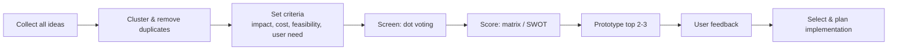

---

## 13. Applications, Challenges & Improving Creativity ★★

| Applications | Challenges | Ways to improve |
|---|---|---|
| Business innovation & entrepreneurship | Fear of failure & criticism | Read widely, explore new experiences |
| Product & service development | Lack of confidence & motivation | Practise brainstorming regularly |
| Education & research | Rigid thinking patterns | Collaborate with diverse people |
| Advertising & marketing | Time & resource limitations | Keep an **idea journal** |
| Engineering & technology | Poor team communication | Challenge assumptions & routines |
| Social problem-solving & public policy | Resistance to change | Creativity exercises & games |

### 13.1 Creative solution for a real-world problem (L6 — sample answer)
**Problem:** traffic congestion near the college gate at 9 am.
1. **Empathise/define:** students, buses and two-wheelers arrive together; POV: "Day scholars need a smooth entry because 15-minute queues make them late."
2. **Diverge (brainstorm + SCAMPER + reverse):** staggered class timings, separate bus bay, bike-parking app with live slots, shuttle from metro, carpool rewards, second gate for two-wheelers.
3. **Converge (impact–feasibility):** staggered timings and second gate = high impact/high feasibility.
4. **Prototype:** one-week trial of a second gate with volunteers.
5. **Test:** measure queue time and collect feedback; iterate.

---

## 14. Unit III Question Bank ★★★

### Short answer (2 marks)
| # | Question | See |
|---|---|---|
| 1 | Define idea generation | §1 |
| 2 | What is creativity? | §10 |
| 3 | List any four ideation techniques | §6 |
| 4 | What is brainstorming? | §7.1 |
| 5 | Define lateral thinking | §11.2 |
| 6 | Importance of creativity | §10 |
| 7 | What is convergent thinking? | §11.1 |
| 8 | Purpose of SCAMPER | §9.1 |
| 9 | Define mind mapping | §9.2 |
| 10 | What is idea selection? | §12 |

### Long answer (10 marks)
| # | Question | See |
|---|---|---|
| 1 | Principles of idea generation | §5 |
| 2 | Creativity-thinking techniques | §6–§9 |
| 3 | Role of brainstorming in innovation | §7.1 |
| 4 | Compare convergent and divergent thinking | §11.1 |
| 5 | SCAMPER with examples | §9.1, Unit II §14 |
| 6 | Idea-generation tools | §6, §9.7 |
| 7 | Process of selecting innovative ideas | §12.3 |
| 8 | Importance of creativity in organisations | §10 |
| 9 | Types of creative thinking | §11 |
| 10 | Creative solutions for a real-world problem | §13.1 |

---

## Unit III — One-Page Summary

| Topic | Key points |
|---|---|
| **Idea generation** | Creating, developing, communicating new ideas; start of the idea-management funnel; responses to perceived & actual problems. Features: creativity, innovation, problem solving, user focus, collaboration. Idea = seed, concept = developed idea. |
| **Funnel** | Many ideas → fewer, better ideas. Generate & collect (quantity) → refine & evaluate (feasibility, cost, value) → validate & test (prototypes, pilots) → implement. Filter gates between stages. |
| **Need / importance** | Better products, competitive advantage, experimentation, growth, satisfaction, complex problems. Ideation = engine of DT: expands solution space, mitigates risk, breaks blocks, fuels prototyping, aligns team, promotes iteration. |
| **Process** | Problem → research → brainstorm → diverge; evaluate (convergent, SWOT) → refine; prototype → feedback → implement → repeat. |
| **10 principles** | Decomposition, association, analogy & confrontation (kingfisher → bullet train), abstraction & imagination, challenge conventions, mental exercises, change habits, experiments, networking, overcome barriers. |
| **Techniques** | Brainstorming, brainwriting (6-3-5), mind mapping, SCAMPER (bicycle → e-bike), six thinking hats, role play, reverse thinking, storyboarding, lotus blossom, random word, Crazy 8s. |
| **Six hats** | White facts, red feelings, black caution, yellow benefits, green creativity, blue process (de Bono). |
| **Creative thinking** | Ability to generate new, original, useful ideas; imagination, curiosity, flexibility, experimentation. Creative thinkers: curious, risk-taking, observant, connect unrelated ideas, persistent. |
| **Types** | Divergent (many ideas, paper-clip uses), convergent (best solution), lateral (unusual angle, de Bono), critical (logical evaluation), visual, design thinking. |
| **Idea selection** | Criteria: innovation, cost, practicality, impact, user need. Dot voting, impact–feasibility matrix (high/high = implement; high/low = future; low/high = easy; low/low = reject), SWOT, prototyping, user feedback, decision matrix. |
| **Applications / challenges** | Business, products, education, marketing, engineering, policy · fear of failure, low confidence, rigidity, time, communication, resistance → read, practise, collaborate, journal, challenge assumptions, games. |
