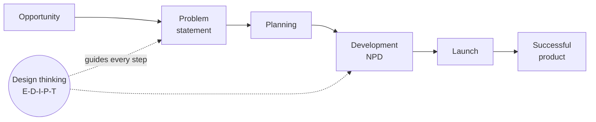
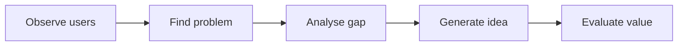
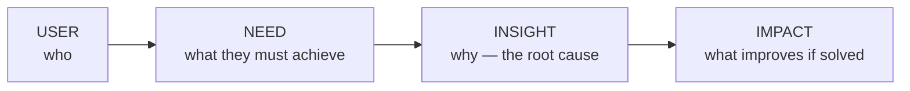
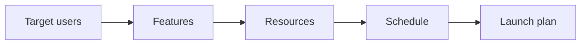
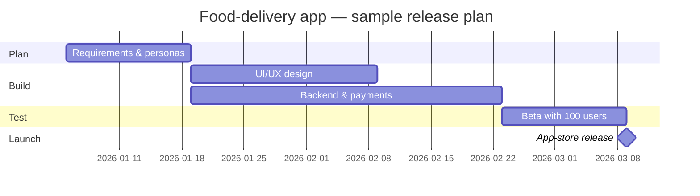
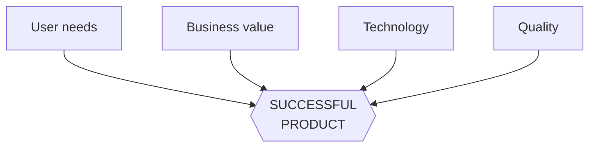
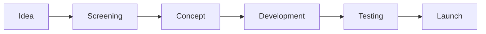
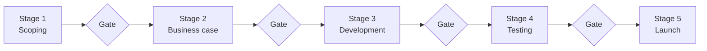
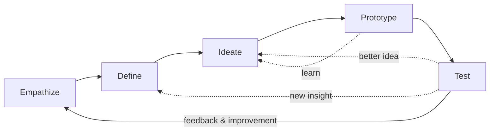

# Unit IV — Product Design Process

> **Syllabus:** Identification of opportunities, problem statement, product planning, characteristics of successful product development, new product development (NPD) process, Stanford design-thinking iterative model.
>
> **Source:** *Unit 4.pptx* (22 slides, B.Tech CSE-AI&ML III-I). The deck is short and has no question bank, so sections marked 📘 add explanation from standard product-design references (Ulrich & Eppinger, *Product Design and Development*; Cooper's Stage-Gate), and §8 lists likely exam questions.

**Importance legend:** ★★★ = very frequently asked (long answer) · ★★ = medium · ★ = short answer

---

## Table of Contents
1. [Overview — the Product Design Process](#1-overview--the-product-design-process-)
2. [Identification of Opportunities](#2-identification-of-opportunities-)
3. [Problem Statement](#3-problem-statement-)
4. [Product Planning](#4-product-planning-)
5. [Characteristics of Successful Product Development](#5-characteristics-of-successful-product-development-)
6. [New Product Development (NPD) Process](#6-new-product-development-npd-process-)
7. [Stanford Design Thinking Iterative Model](#7-stanford-design-thinking-iterative-model-)
8. [Expected Questions](#8-expected-questions-)
9. [Unit IV — One-Page Summary](#unit-iv--one-page-summary)

---

## 1. Overview — the Product Design Process ★★

| Term | Definition (slide) |
|---|---|
| **Identification of opportunities** | Identifying **customer needs, problems or market gaps** that can be converted into product opportunities |
| **Problem statement** | A **clear, concise description** of the problem to be solved for a specific user or group |
| **Product planning** | Deciding the **features, target users, resources and development plan** before building the product |
| **Characteristics of successful product development** | Customer-focused, innovative, high-quality, reliable, easy to use, cost-effective |
| **New product development process** | The **systematic process of converting a new idea** into a developed, tested, market-ready product |
| **Stanford DT iterative model** | Human-centred model: **Empathize, Define, Ideate, Prototype, Test**, with continuous improvement from feedback |

---

## 2. Identification of Opportunities ★★★

**Meaning:** finding **needs, gaps and problems that can become valuable products** —
- discover a **customer need or problem**,
- identify a **gap in the market**,
- use **technology** to create a better solution.

**Sources of opportunities:**
| Source | Example |
|---|---|
| **Customer complaints** | "The bank app logs me out too often" |
| **New technologies** | AI, UPI, IoT, 5G enabling new services |
| **Market trends** | Online learning, quick commerce |
| **Competitor limitations** | Competitor app has no regional-language support |
| **Unmet user needs** | Students have no single place to track deadlines |

### 2.1 Opportunity identification process

> **Key idea:** a good opportunity is **not simply a new idea** — it must **solve a real user problem** and provide **useful value**.

📘 **Evaluating an opportunity:** size of the market, urgency of the pain, willingness to pay, fit with the organisation's capabilities, competition, and technical feasibility.

### 2.2 Software-industry example — Smart Student Reminder App
| Problem | Opportunity | Software product |
|---|---|---|
| Students forget assignments | Need for **automatic reminders** | Mobile app |
| Deadlines are missed | **Centralised task tracking** | Calendar integration |
| Manual reminders are ineffective | **Personalised notifications** | Push notifications, **AI-based suggestions** |

---

## 3. Problem Statement ★★★

A **problem statement** is a **clear description of what needs to be solved**, answering:
- **WHO** is affected? (user)
- **WHAT** is the problem?
- **WHY** is it important? (insight)
- **WHAT** needs to be solved? (need)

**Simple format:** **[User] needs a way to [need] because [insight / reason].**

*Example:* "**Students** need an easy way to **track assignment deadlines** because **manual reminders are often missed**."

### 3.1 Components of a good problem statement

> **Good problem statement = Specific + User-focused + Actionable.**

| Weak ❌ | Strong ✅ |
|---|---|
| "We need a task app." (solution, no user) | "College students need an easy way to organise tasks and receive reminders because important academic deadlines are frequently missed." |
| "Improve education." (too broad) | Specific user, need and reason |

📘 **Why a problem statement matters:** focuses the team on the **right problem**, aligns stakeholders, guides ideation (it becomes the HMW question — Unit II §11) and gives a yardstick to judge solutions.

**Software example:** Smart Task Management App — Students → missed deadlines → smart task app → notifications.

---

## 4. Product Planning ★★★

**Product planning** = **deciding what to build, for whom, and how**. It **reduces uncertainty** before development begins.

| Planning questions | Planning outputs |
|---|---|
| Who is the **target user**? | **Product requirements** |
| What **features** are needed? | **Feature list** |
| What **resources** are required? | **Budget and resources** |
| What is the development **schedule**? | **Development roadmap** |
| — | **Release plan** |

**Product planning roadmap:**

### 4.1 Software example — Online Food Delivery App
| Users | Features | Resources |
|---|---|---|
| Customers | Search food | Developers |
| Restaurants | Place order | UI/UX designers |
| Delivery partners | Online payment | Database |
| — | Order tracking | Cloud platform |

📘 **Planning tools:** feature prioritisation (**MoSCoW** — Must, Should, Could, Won't), product roadmap, Gantt chart for schedule, budget estimate, risk list, and an **MVP** (minimum viable product) for the first release.

---

## 5. Characteristics of Successful Product Development ★★★

**What makes a product successful?**
| Characteristic | Meaning |
|---|---|
| 👥 **Customer value** | Solves a real user problem worth paying for |
| 💡 **Innovation** | Offers something new or better than alternatives |
| ⭐ **Quality** | Meets specifications, few defects |
| 🖱️ **Usability** | Easy to learn and use |
| 🛡️ **Reliability** | Works consistently without failure |
| 💰 **Cost effectiveness** | Affordable to build and to buy |
| 📈 **Scalability** | Can grow with more users/features |

**Successful product = balanced product** — a balance of **user needs, business value, technology and quality**.

📘 Ulrich & Eppinger measure **successful product development** by five dimensions: **product quality**, **product cost**, **development time**, **development cost**, and **development capability** (the team gets better for future projects).

### 5.1 Example — successful online banking application
**Secure · easy to use · fast · reliable · available 24/7** → **Result:** higher trust + better user experience + increased customer satisfaction.

---

## 6. New Product Development (NPD) Process ★★★

**NPD** = **transforming an idea into a market-ready product**. It connects **creativity, engineering, testing and commercialisation**.

### 6.1 Stage-wise view
| Phase | Activities |
|---|---|
| **Front end** ("fuzzy front end") | Idea generation · opportunity analysis · idea screening |
| **Development** | Concept design · product development · prototype creation |
| **Market entry** | Testing · refinement · product launch |

### 6.2 Detailed NPD stages 📘
| # | Stage | What happens | Output |
|---|---|---|---|
| 1 | **Idea generation** | Ideas from customers, employees, R&D, competitors, brainstorming | Pool of ideas |
| 2 | **Idea screening** | Drop ideas that don't fit strategy, market or capability | Shortlist |
| 3 | **Concept development & testing** | Turn ideas into detailed concepts; test with target customers | Chosen concept |
| 4 | **Business analysis** | Estimate demand, cost, price, profit, risk | Go/no-go decision |
| 5 | **Product development** | Engineering, design, prototypes | Working product |
| 6 | **Test marketing / testing** | Pilot in a limited market; beta tests | Feedback, fixes |
| 7 | **Commercialisation / launch** | Full-scale production, marketing, distribution | Product in market |
| 8 | **Post-launch review** | Monitor sales, feedback, improvements | Updates, next version |

📘 **Stage-Gate model (Cooper):** each stage is followed by a **gate** where management decides **Go / Kill / Hold / Recycle** — the same filtering idea as the innovation funnel (Unit III §2).

### 6.3 Software example — e-commerce mobile app
**Need:** online shopping → **Idea:** mobile app → **Build:** prototype → **Test:** with users → **Launch:** app store.
**Outcome:** a new software product is created through **repeated design, development and testing**.

### 6.4 How design thinking strengthens NPD 📘
| NPD stage | DT contribution |
|---|---|
| Idea generation | Empathy research finds real problems |
| Screening | Desirability–feasibility–viability lens |
| Concept | POV and HMW give focus |
| Development | Rapid prototypes, iteration |
| Testing | User testing, feedback matrix |
| Launch | Journey maps for onboarding and support |

---

## 7. Stanford Design Thinking Iterative Model ★★★

A **human-centred approach to problem solving** from the **Stanford d.school (Hasso Plattner Institute of Design)**:

| Stage | Purpose |
|---|---|
| 👥 **Empathize** | Understand users — observe, engage, immerse |
| 🎯 **Define** | Frame the right problem — POV statement |
| 💡 **Ideate** | Generate many ideas — brainstorming, SCAMPER |
| 🧩 **Prototype** | Build quick, cheap representations |
| 🧪 **Test** | Try with users; learn and refine |

**Learn from users → create solutions → test → improve → repeat.**

### 7.1 The iterative cycle
Feedback causes the process to repeat — stages are **not strictly linear**; testing can send the team back to Define or Ideate.

### 7.2 Software example — College Attendance Mobile App
| Stage | Activity |
|---|---|
| 1. Empathize | Understand **teachers and students** |
| 2. Define | **Manual attendance wastes time** |
| 3. Ideate | Generate digital attendance ideas (QR code, face recognition, Bluetooth proximity) |
| 4. Prototype | Build an **app model** |
| 5. Test | **Collect feedback and improve** |

📘 **Why iterative?** Early versions are always wrong in some way; small cycles catch mistakes cheaply, keep the user involved, and adapt to changing requirements — the same idea as agile software development.

---

## 8. Expected Questions ★★

**Short:** define opportunity identification · sources of opportunities · what is a problem statement (format) · components of a good problem statement · product planning outputs · characteristics of a successful product · define NPD · stages of the Stanford model.

**Long:**
1. Explain the opportunity-identification process with a software example (§2).
2. How do you write a good problem statement? Give components and examples (§3).
3. Explain product planning with the food-delivery example (§4).
4. Discuss the characteristics of successful product development (§5).
5. Explain the NPD process in detail with a neat diagram (§6).
6. Explain the Stanford design-thinking iterative model with an example (§7).
7. Show how design thinking supports new product development (§6.4).

---

## Unit IV — One-Page Summary

| Topic | Key points |
|---|---|
| **Process overview** | Opportunity → problem → planning → development (NPD) → launch → successful product, guided by design thinking. |
| **Opportunity identification** | Find needs, market gaps, technology fixes. Sources: complaints, new tech, trends, competitor limits, unmet needs. Observe → find problem → analyse gap → generate idea → evaluate value. Must solve a real problem with value (smart reminder app). |
| **Problem statement** | Who, what, why, need. "[User] needs a way to [need] because [insight]." Components: user, need, insight, impact. Specific + user-focused + actionable. |
| **Product planning** | What to build, for whom, how. Questions: users, features, resources, schedule. Outputs: requirements, feature list, budget, roadmap, release plan (food-delivery app). Reduces uncertainty. |
| **Successful product** | Customer value, innovation, quality, usability, reliability, cost-effectiveness, scalability. Balance of user needs, business value, technology, quality (online banking). |
| **NPD** | Idea → screening → concept → development → testing → launch. Front end / development / market entry. Stage-Gate: go/kill/hold/recycle (e-commerce app). |
| **Stanford model** | Empathize → Define → Ideate → Prototype → Test; feedback repeats the cycle (attendance app). |
