# Unit V — Design Thinking for Service Design

> **Syllabus:** Attributes of a good service design; service design tools — blueprint, customer journey mapping; identifying user needs in a service-driven economy; process flows and customer-experience considerations for designing and improving services; 5 Whys; service delivery pathways.
>
> **Source:** *Unit 5.pptx* (Design Thinking, 9LC13, SNIST), including its 40-question bank (20 short, 20 long). Most of the slide figures are icons, so the structures are redrawn here as Mermaid diagrams. 📘 = added from standard service-design references.

**Importance legend:** ★★★ = very frequently asked (long answer) · ★★ = medium · ★ = short answer

**Learning objectives:** define service design and why it matters · identify attributes of good service design and turn user needs into requirements · build and read journey maps and blueprints · model processes with flows, touchpoints, backstage and support · use 5 Whys for root causes · design delivery pathways that improve experience, efficiency, accessibility and value.

---

## Table of Contents
1. [What is a Service?](#1-what-is-a-service-)
2. [Product, Service & Experience](#2-product-service--experience-)
3. [Service Design — Definition, vs Product Design, Why it Matters](#3-service-design-)
4. [Characteristics of a Service](#4-characteristics-of-a-service-)
5. [Attributes of a Good Service Design](#5-attributes-of-a-good-service-design-)
6. [Service Quality Dimensions](#6-service-quality-dimensions-)
7. [Applications, Advantages & Limitations](#7-applications-advantages--limitations-)
8. [Service Design as a System & Human-Centred Service Design](#8-service-design-as-a-system-)
9. [Identifying User Needs in a Service-Driven Economy](#9-identifying-user-needs-in-a-service-driven-economy-)
10. [Customer Journey Mapping](#10-customer-journey-mapping-)
11. [Service Blueprint](#11-service-blueprint-)
12. [Journey Map vs Service Blueprint](#12-journey-map-vs-service-blueprint-)
13. [Process Flows](#13-process-flows-)
14. [Customer Experience (CX) Considerations](#14-customer-experience-cx-considerations-)
15. [5 Whys](#15-5-whys-)
16. [Service Delivery Pathways](#16-service-delivery-pathways-)
17. [Integrated Case & End-to-End Toolkit](#17-integrated-case--end-to-end-toolkit-)
18. [Question Bank with Answer Pointers](#18-question-bank-)
19. [Unit V — One-Page Summary](#unit-v--one-page-summary)

---

## 1. What is a Service? ★★

A **service** is an **activity or process that creates value for a customer through an experience, interaction or outcome**.

- **Examples:** banking, healthcare, education, transport, food delivery, e-commerce.
- **Customer is involved:** the customer often **participates** in the service process rather than simply receiving a finished object.
- **Experience matters:** value depends not only on the final outcome but also on **waiting, communication, convenience and trust**.

> *Think:* is an online food order only the food, or the **complete experience from search to delivery**?

---

## 2. Product, Service & Experience ★★

| Product | Service | Experience |
|---|---|---|
| A **tangible** (physical) item designed to perform a function | An **activity/process** delivered to create value | The user's **overall perception across interactions** |

**Service design connects the three:** a **product may enable a service**, and the **service creates the experience** (e.g., a phone + Swiggy app → food-delivery service → the "it was quick and easy" experience).

**Product experience vs service experience** (short):
| Product experience | Service experience |
|---|---|
| Tangible, owned | Intangible, experienced |
| Judged mainly at purchase & use | Judged across many touchpoints over time |
| Quality consistent (factory-made) | Varies with staff, context, user |

---

## 3. Service Design ★★★

### 3.1 Definition
**Service design** is the **systematic design of people, processes, technologies and touchpoints** so that a service delivers **useful, usable, desirable and feasible** experiences.

**Core idea:** don't design only the app, counter, form or employee script — design the **entire journey from the user's need to the outcome they value**: **Need → Interaction → Process → Outcome → Relationship**. It is a **design-thinking approach focused on the complete service experience**.

**Purpose & expected outcome** (short): purpose — make services **easy, efficient and valuable** for users while feasible for the organisation; outcome — e.g., **shorter waiting time, fewer repeat visits, higher satisfaction**.

### 3.2 Service design vs product design
| Product design | Service design |
|---|---|
| Focuses on a **tangible artefact** | Focuses on an **evolving experience over time** |
| Success judged by **performance, quality, usability** | Success depends on **people + process + technology + context** |
| Interaction concentrated around **purchase and use** | **Multiple touchpoints** form one journey |
| *Designing a refrigerator control panel* | *Designing the complete hospital appointment experience* |

### 3.3 Why service design matters today
- **Services dominate** modern economies — banking, healthcare, education, travel, retail, logistics, digital platforms.
- Customers **compare experiences across industries**, not only within one sector.
- Digital channels create **more touchpoints — and more friction**.
- **Operational efficiency alone is insufficient** if users face confusion, waiting or repeated effort.
- Good service design **aligns customer value with organisational capability** and business goals.

**Service-economy lens — value is co-created:**
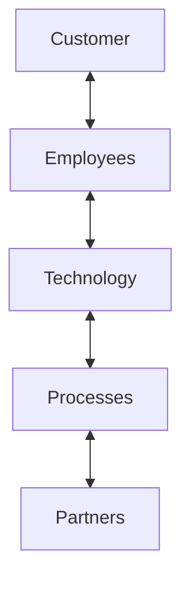
The user experiences **the whole system**, not individual departments.

---

## 4. Characteristics of a Service ★★★

Services are **experiences and processes**, not just outputs.

| Characteristic | Meaning | Design consideration 📘 |
|---|---|---|
| **Intangible** | Value is experienced rather than owned | Provide **physical/digital evidence** — receipts, status screens, confirmations |
| **Inseparable** | Production and consumption happen together | Train frontline staff; design the live interaction |
| **Variable** | Different staff, contexts, users → different experiences | **Standardise** critical steps, scripts, checklists |
| **Perishable** | Unused capacity (an empty appointment slot) can't be stored | Demand management — booking, reminders, dynamic pricing |
| **Participatory** | Customers contribute information, decisions, effort | Make customer tasks **simple**; reuse known data |
| **Time-dependent** | Waiting, speed and sequence shape perceived value | Show **status**, reduce waits, set expectations |

---

## 5. Attributes of a Good Service Design ★★★

> **Design quality = user value + operational feasibility + sustainable outcomes.**

| Attribute | Meaning |
|---|---|
| **Useful** | Solves a **meaningful user problem** |
| **Usable** | Easy to understand and complete |
| **Desirable** | Creates **trust** and positive experience |
| **Feasible** | Can be delivered with **available resources** |
| **Viable** | Supports **organisational/business goals** |
| **Accessible** | Works for **diverse users and contexts** |
| **Consistent** | Quality is **dependable across touchpoints** |
| **Adaptable** | Can evolve with needs, technology and policy |

**Food-delivery illustration (slide infographic):** **user-friendly** (easy to select food and order), **convenient** (order from home), **reliable** (delivered safely and on time), **responsive** (complaints handled quickly), **personalised** (suggestions based on preferences) — e.g., **Swiggy / Zomato** let customers order, track delivery and pay online easily.

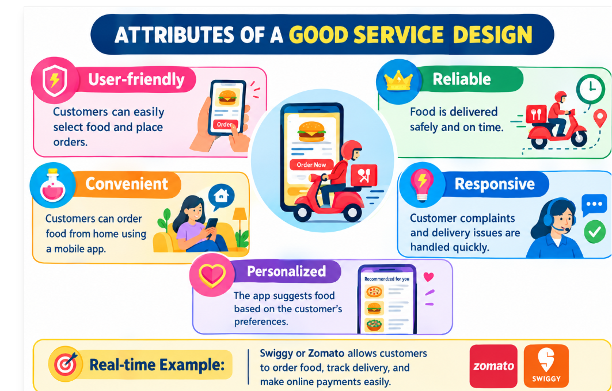

### 5.1 Why accessibility is a core attribute (evaluate) ★★
- Services are often **essential** (health, banking, government) — exclusion causes real harm.
- Users vary in **ability, age, language, device, connectivity, literacy**.
- Accessible design (clear language, screen-reader support, assisted channels) **helps everyone** (the "curb-cut effect").
- Legal/ethical obligations (accessibility standards, RPwD Act in India) and larger market reach.

---

## 6. Service Quality Dimensions ★★

| Dimension | Shown by | Example |
|---|---|---|
| **Reliability** | Promise delivered correctly, accurate information, predictable process | A bank transfer completes correctly |
| **Responsiveness** | Quick help, shorter queues, clear status updates | Live delivery tracking |
| **Assurance & empathy** | Trust and competence, respectful communication, understanding special needs | Compassionate hospital support |

📘 These come from the **SERVQUAL** model (Parasuraman et al.) — **Tangibles, Reliability, Responsiveness, Assurance, Empathy** (RATER).

---

## 7. Applications, Advantages & Limitations ★★

| Sector | Service-design applications |
|---|---|
| **Healthcare** | Appointments, diagnostics, discharge, telemedicine |
| **Banking** | Account opening, loans, complaints, digital payments |
| **Education** | Admissions, LMS, advising, examination services |
| **Travel** | Search → booking → check-in → journey → support |
| **Government** | Citizen certificates, benefits, grievance services |
| **Retail** | Discovery, purchase, delivery, returns, loyalty |

| Advantages | Limitations |
|---|---|
| Reveals **hidden pain points** | Needs **cross-functional collaboration** |
| Improves satisfaction and **loyalty** | Mapping can become **too complex** |
| Reduces **rework, errors, unnecessary steps** | Insights may be **biased** if research is weak |
| **Aligns frontstage and backstage** operations | Improvements may need **policy/technology changes** |
| Creates **shared understanding** across teams | **A good map ≠ good implementation** |

---

## 8. Service Design as a System ★★

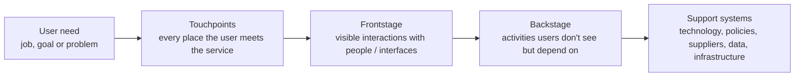

### 8.1 Human-centred service design
**Start with people, not organisational departments.**

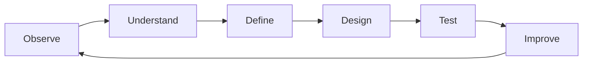

- **Ask:** What is the user trying to accomplish? What creates **anxiety, delay or effort**? What does success look like?
- **Look for:** needs · behaviours · context · constraints · emotions · **workarounds**.
- **Validate:** prototype the service, observe real use, measure whether the experience improves.

---

## 9. Identifying User Needs in a Service-Driven Economy ★★★

### 9.1 Types of user needs
| Need type | Meaning | Admission example |
|---|---|---|
| **Functional** | What the user must accomplish | Submit the application |
| **Emotional** | How they want to feel — confident, respected, safe, relieved | Reassured it was received |
| **Social** | Identity, recognition, belonging, status | Parents see a professional process |
| **Contextual** | Device, location, time pressure, language, accessibility, environment | Apply from a phone in a village with Telugu interface |
| **Unarticulated** | Problems users don't mention because they've **normalised** them | Repeated trips to the office "are normal" |
| **Business/system** | Requirements for sustainable delivery without compromising user value | Verified documents, fee collection |

**Example — college admission:**
- **Stated need:** "Submit my application."
- **Deeper needs:** know exactly which documents are required · avoid repeated visits · get confirmation immediately · understand status · get help when stuck.
- **Design implication:** **one checklist + guided form + status tracker + escalation channel.**

### 9.2 Why identifying user needs is critical (analyse) ★★★
- Services are **intangible** — value lies in how needs are met, not in a physical product.
- Customers compare experiences **across industries** (expecting app-like ease from government offices).
- Unmet needs lead to **drop-offs, complaints, repeat visits and costs**.
- Correct needs → **right requirements → efficient operations**.
- *Examples:* UPI succeeded by meeting the need for instant, simple, free transfers; IRCTC redesign (availability without login).

### 9.3 From user statements to design requirements
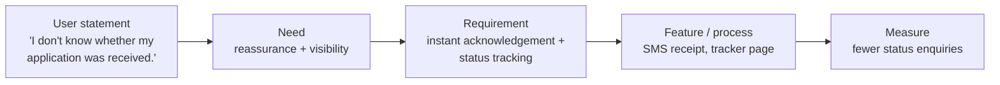

**Translating needs into measurable requirements** (short — two examples):
| Need | Measurable requirement |
|---|---|
| "I want my food on time" | 95 % of orders delivered within the displayed ETA ± 5 min |
| "I don't want to visit the office repeatedly" | 90 % of applications completed in **one** visit / fully online |

### 9.4 User-research inputs
| Method | Question it answers |
|---|---|
| **Interviews** | **Why** do people behave this way? |
| **Observation** | What happens in the **real context**? |
| **Surveys** | **How common** is the issue? |
| **Analytics** | **Where** do users drop off? |
| **Complaints** | What **repeatedly** frustrates users? |
| **Frontline staff** | What **workarounds and failure points** do employees see? |

**Selecting methods (evaluate):** *college service* → observation at the admission office, student interviews, form analytics, complaint logs. *Banking service* → app analytics (drop-off in KYC), complaint data, branch-staff interviews, short in-app surveys.

### 9.5 Pain points & opportunity areas
| Pain-point signals | Opportunity questions |
|---|---|
| Long waiting time | Can we **remove a step**? |
| Repeated data entry | Can information be **reused**? |
| Unclear instructions | Can we **show progress**? |
| Handoffs between departments | Can we **prevent the error earlier**? |
| Unexpected fees | Can we make the **handoff invisible**? |
| No visibility after submission | Can users **self-serve safely**? |

---

## 10. Customer Journey Mapping ★★★

**Definition:** a customer journey map represents the **sequence of stages, interactions, thoughts, emotions, pain points and opportunities** experienced by a user while pursuing a goal — **visualising the service from the customer's point of view**.

- **Typical stages:** **Discover → Consider → Use → Resolve → Return**.
- **Typical layers:** goals, actions, touchpoints, emotions, pain points, backstage dependencies, opportunities.
- Best used when the service **spans multiple channels or departments**.

### 10.1 Elements
| Element | Question |
|---|---|
| **Persona / user** | Whose journey is mapped? |
| **Scenario & goal** | What situation and outcome are considered? |
| **Stages** | Major phases of the journey |
| **Actions** | What the customer actually does |
| **Touchpoints** | People, channels, systems, physical locations |
| **Emotion** | How the experience feels over time |
| **Pain points** | Where effort, uncertainty or failure occurs |
| **Opportunities** | Where redesign can create value |

### 10.2 Example — Online food delivery ★★★
| Stage | Search | Order | Wait | Receive | After-sales |
|---|---|---|---|---|---|
| **User action** | Browse → select | Pay → confirm | Track | Receive | Rate / complain |
| **Emotion** | Curious 🙂 | Confident 😀 | Anxious 😟 | Relieved 😌 | Satisfied 😀 / frustrated 😠 |
| **Pain point** | Too many choices | Payment failure | Late delivery | Missing item | Slow resolution |
| **Opportunity** | Personalised filters | Clear confirmation | Accurate ETA | Easy issue reporting | Instant credit/refund |

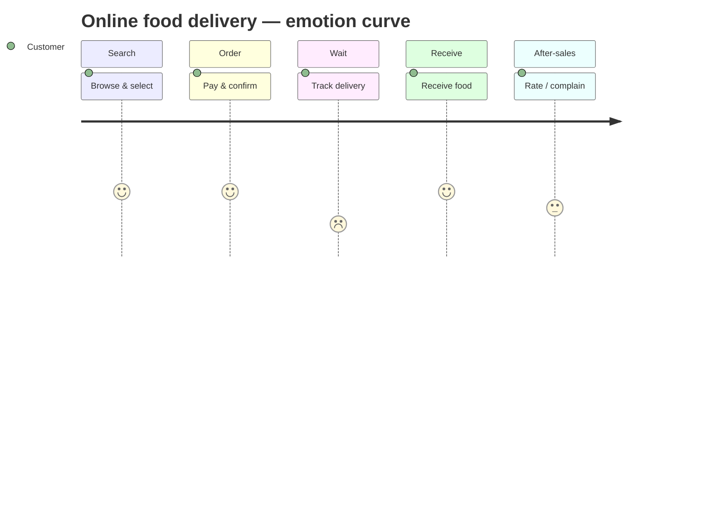

**Prioritising pain points (long Q14):** rank by **frequency × impact on emotion/trust**: (1) late delivery with wrong ETA — frequent and high anxiety; (2) payment failure — money at risk, high trust impact; (3) missing item / slow refund — causes churn. Lower priority: too many choices.

### 10.3 Touchpoints, emotions & expectations (analyse)
At **Discover** the user expects choice and fair prices (curious); at **Order**, security and confirmation (confident or anxious if payment hangs); at **Wait**, accurate status (anxiety rises with uncertainty); at **Receive**, correctness and quality (relief); at **After-sales**, quick, fair resolution (loyalty or anger). Each touchpoint either **meets, exceeds or breaks** the expectation, moving the emotion curve.

### 10.4 Advantages & disadvantages / strengths & limitations ★★
| Advantages | Disadvantages |
|---|---|
| **Shared customer-centred view** | Can become a **decorative poster** without evidence |
| Makes **emotions and pain points visible** | Different personas need **different maps** |
| Reveals **cross-channel gaps** | Journey boundaries can be **arbitrary** |
| **Prioritises** improvement opportunities | Emotion ratings are **subjective** |
| Useful for **workshops and storytelling** | Must be **validated** with real users/data; doesn't show backstage causes |

---

## 11. Service Blueprint ★★★

**Definition:** a **service blueprint** is a **structured visual representation of how a service is delivered**, connecting **customer actions** with **frontstage interactions**, **backstage activities** and **supporting processes** — "**making the invisible service system visible**". Use it to identify **handoffs, dependencies, failure points** and redesign opportunities.

### 11.1 Anatomy
| Lane | Content |
|---|---|
| **Physical / digital evidence** | Screens, forms, tickets, signs, messages |
| **Customer actions** | What the customer does |
| ─ *Line of interaction* ─ | |
| **Frontstage** | **Visible** employee/system interaction |
| ━ **Line of visibility** ━ | Separates what the customer **sees (above)** from what they **don't see (below)** |
| **Backstage** | **Invisible** employee/system activity |
| ─ *Line of internal interaction* ─ | |
| **Support processes** | IT, policy, vendors, data, finance |

**Frontstage vs backstage (short):** frontstage = visible to the customer (receptionist confirming an appointment, app screen); backstage = invisible but needed (slot allocation, eligibility check, kitchen preparing food).

### 11.2 Example — Hospital appointment ★★★
| | **Search** | **Book** | **Confirm** | **Visit** | **Follow-up** |
|---|---|---|---|---|---|
| **Evidence** | Website / doctor list | Booking form | SMS confirmation | Token slip | Prescription / report |
| **Customer** | Chooses doctor | Shares details | Receives confirmation | Arrives, receives care | Gets instructions |
| **Frontstage** | Website / call centre | Booking screen / agent | Confirmation message | Reception, clinician interaction | Message / call |
| ━ *line of visibility* ━ | | | | | |
| **Backstage** | Slot allocation | Eligibility check | Queue management | Clinical records | Report processing |
| **Support** | Staff roster | **EHR**, payments | **SMS gateway** | EHR | Lab / pharmacy |

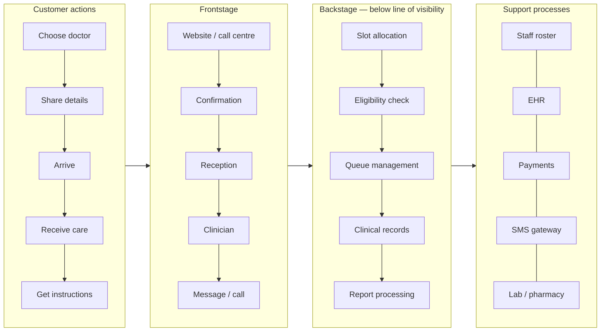

**Simple-service blueprint (short) — coffee shop 📘:** customer orders → cashier takes order (front) → barista prepares (back) → POS & inventory (support).

### 11.3 How to build a service blueprint
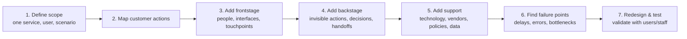

### 11.4 Failure points & service recovery
- **Failure point** = a place where the service can **break, delay, confuse or disappoint** — incorrect data, unavailable slot, payment failure, lost handoff, duplicate request, unclear responsibility.
- **Service recovery:** **Detect → Acknowledge → Resolve → Update (communicate) → Learn.**
- *Example (bank loan stalls — missing document):* detect automatically → tell the customer exactly what is missing → provide an upload path → confirm receipt → analyse why the requirement was unclear.

### 11.5 Role of support processes (analyse)
Support processes (IT systems, data, policies, suppliers, staff rosters) **underpin consistency**: if the SMS gateway or EHR fails, every frontstage interaction suffers regardless of how polite staff are. Standard policies and shared data ensure the **same quality across channels and staff**, reducing variability (a key service characteristic).

---

## 12. Journey Map vs Service Blueprint ★★★

| Basis | **Customer journey map** | **Service blueprint** |
|---|---|---|
| Viewpoint | **Customer** | **Service / organisation (system)** |
| Purpose | Understand experience & emotions | Redesign delivery operations |
| Shows | Stages, actions, touchpoints, thoughts & **emotions**, pain points, opportunities | Customer actions, **frontstage, backstage, support**, evidence/systems |
| Question answered | "**What does the customer experience?**" | "**How must the organisation work to deliver it?**" |
| Outcome | Prioritised pain points, problem framing | Located root causes, ownership, implementation plan |

**When to use which:**
| Use a journey map when… | Use a blueprint when… |
|---|---|
| You need to understand **experience and emotions** | You need to **redesign delivery operations** |
| The problem **crosses channels** | **Many departments or systems** are involved |
| You are **framing the problem** from the customer's view | You need to locate **backstage causes** |
| You need to **prioritise pain points** | You are planning **implementation and ownership** |

**Hospital service — which is more suitable? (evaluate Q20):** if the complaint is *how patients feel* (anxiety, confusion while waiting) → start with a **journey map**; if the problem is *operational* (long waits caused by slot allocation, records, lab handoffs across departments) → a **blueprint** is better. Best practice: journey map first to find the painful moments, then blueprint to fix the backstage causes.

---

## 13. Process Flows ★★★

**Definition:** a **process flow** is a visual representation of the **sequence of activities, decisions, handoffs and outcomes** required to deliver a service.

**Purpose:** understand sequence · **find bottlenecks** · clarify **ownership** · **standardise** critical steps · identify **automation** opportunities.

### 13.1 Common symbols
| Symbol | Shape | Meaning |
|---|---|---|
| **Start / End** | Rounded terminator | Beginning or end |
| **Activity** | Rectangle | Task / action |
| **Decision** | Diamond | Yes / No branch |
| **Input / Output** | Parallelogram | Information or result |
| **Handoff** | Arrow between lanes | Work passes to another person/department |

> **Rule of thumb:** a flowchart should make the **next action and decision responsibility obvious**.

### 13.2 Example — Bank account opening
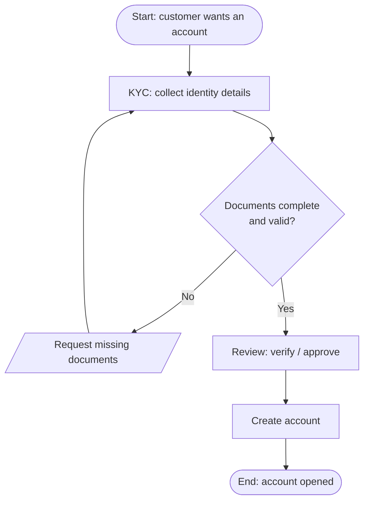

### 13.3 Process flow for booking a service (short) / online appointment service (long)
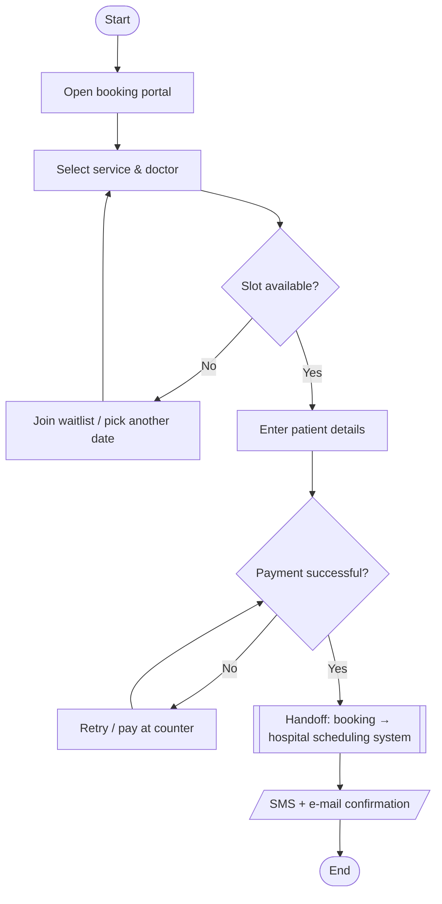
**Bottlenecks:** slot availability (capacity), payment gateway failures, manual verification of details. **Decision points:** slot available? payment OK? **Handoffs:** portal → scheduling system → reception.

### 13.4 Exposing delays, bottlenecks & handoffs (apply)
Drawing the flow **with swim-lanes** (customer, front office, department, system) and **timing** each step shows: steps where work **waits** (queues), **loops** (rework when documents are missing), **many lane crossings** (handoffs where information is lost), and **steps adding no value** (duplicate checks).

### 13.5 Diagnosing a college admission service (long Q16)
| Current flow problem | Recommendation |
|---|---|
| Student visits admission office, then accounts, then department — 3 queues | **Single window / online portal** with one case ID |
| Documents rejected late → repeat visit | **Checklist + upload pre-check** at the start |
| Manual fee verification | **Online payment** with automatic reconciliation |
| No status visibility → enquiries | **Status tracker + SMS** |
| Certificates verified twice | **Verify once, share digitally** with departments |

---

## 14. Customer Experience (CX) Considerations ★★★

| Consideration | Question |
|---|---|
| **Effort** | How hard is it to complete the task? |
| **Time** | How long do users wait or repeat steps? |
| **Clarity** | Do users know **what to do next**? |
| **Control** | Can users **change, cancel or recover**? |
| **Trust** | Do users feel **safe and informed**? |
| **Emotion** | What **feeling remains** after the interaction? |

**Factors influencing customer experience (short — any four):** waiting time, staff behaviour, ease of use, communication/clarity, reliability, price transparency, trust/security.

### 14.1 Moments that matter
Not every touchpoint has equal impact. Moments such as **first contact, payment, unexpected delay, service failure, complaint handling and final outcome** strongly influence trust and loyalty. **Prioritise high-emotion + high-consequence moments** before polishing low-impact details.

| High impact ↑ | Low impact ↓ |
|---|---|
| Payment confirmation · safety communication · complaint resolution | Decorative animation · minor visual preferences |

> **Design effort should follow user impact, not novelty.**

### 14.2 Reducing customer effort
**Identify effort → Remove → Simplify → Guide → Automate → Recover.**

| High-effort signals | Design responses |
|---|---|
| Repeated information | **Reuse known data** |
| Too many screens/forms | **Progressive disclosure** |
| Unclear eligibility | **Eligibility pre-check** |
| Multiple visits | **Digital + assisted options** |
| Waiting without updates | **Proactive status updates** |
| Customers doing internal coordination | **One accountable owner** |

### 14.3 Omnichannel service experience
Channels: website · app · call · branch/store · email/SMS.
- **Consistency** — same core information, policy and status across channels.
- **Continuity** — users shouldn't **restart the journey** when switching channels.
- **Choice** — offer channels by user context, accessibility and task complexity.

---

## 15. 5 Whys ★★★

**Definition:** **5 Whys** is a **root-cause analysis technique** in which the team repeatedly asks "**Why did this happen?**" to move from an **observed problem (visible symptom)** to an **underlying, controllable root cause**. (Originated at Toyota — Sakichi Ichida/Taiichi Ohno 📘.)

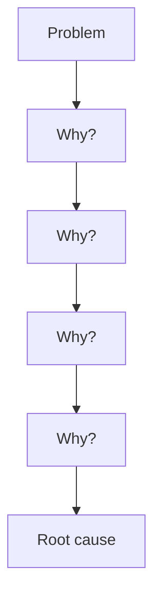

- Not necessarily **exactly five** questions.
- Each answer must be **evidence-based**, not a guess.
- Goal: a cause the team can fix by **changing the system**.

### 15.1 Example — Hospital appointment delay
| Level | Answer |
|---|---|
| **Problem** | Patients wait **45 minutes** after appointment time |
| **Why 1** | Doctor starts late because **previous consultations overrun** |
| **Why 2** | Consultations overrun because **complex cases are booked in standard slots** |
| **Why 3** | **Complexity is not known** when appointments are created |
| **Why 4** | Booking captures only **visit type**, not complexity indicators |
| **Why 5 (root)** | The service was designed around **clinic capacity, not variation in case needs** |

**Corrective action:** add complexity questions at booking → allocate longer slots for complex cases; buffer slots.

### 15.2 Example — repeated account-opening delays in a bank (long Q17)
| Why | Answer |
|---|---|
| Problem | Accounts take 7 days instead of 2 |
| Why 1 | Applications are returned for missing documents |
| Why 2 | Customers don't know which address proof is acceptable |
| Why 3 | The website checklist is outdated and branch staff give different answers |
| Why 4 | Policy updates are not communicated to the web team or branches |
| Why 5 (root) | No owner for maintaining the KYC requirement list across channels |

**Corrective actions:** assign a **single owner** for KYC rules; one shared checklist across web/app/branch; **upload-time validation**; automated notification of missing items.

### 15.3 Service complaint traced through five levels (Q11 — food delivery)
Cold food → long delivery → rider assigned late → restaurant marks order "ready" late → kitchen tablet alerts are missed at peak → **root:** no peak-time alert process/staffing for online orders → fix: louder alerts, dedicated online-order staff at peak.

### 15.4 Good practice & pitfalls
| Good practice | Pitfalls |
|---|---|
| Define **one specific problem** | **Stopping** at the first explanation |
| Use **observable facts** | **Blaming an employee** instead of the system |
| Ask "why" about the **system/process, not people** | Assuming a **single cause** when many exist |
| Stop when the cause is **actionable and evidence-supported** | **Forcing exactly five** levels |
| **Validate** the chain with stakeholders | Confusing **correlation** with root cause |

### 15.5 When it is useful — and when not (critique, Q12)
| Useful for | Use other methods (fishbone, Pareto, FMEA, statistical RCA) when |
|---|---|
| Simple/moderate **recurring** problems | **Many interacting causes** exist |
| Failures with a **clear starting symptom** | **Data** is needed to quantify relationships |
| **Workshop** root-cause exploration | **Safety / high-risk** systems need rigour |
| **Quick diagnosis** before deeper analysis | Causes **branch** into multiple pathways |
| Linking customer pain to process causes | **Statistical validation** is required |

---

## 16. Service Delivery Pathways ★★★

**Definition:** a **service delivery pathway** is the **end-to-end route** through which a user moves to obtain a service outcome, including **channels, decisions, interactions, handoffs and supporting resources** — the route by which value moves from **need → service → outcome**.

**Major stages:**
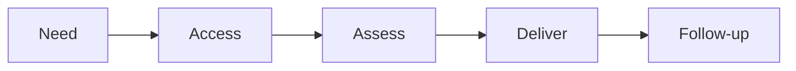
A pathway can be **linear, branching, self-service, assisted or hybrid**.

### 16.1 Types of pathways
| Type | Description | Example |
|---|---|---|
| **Self-service** | User completes most steps independently | Online bill payment |
| **Assisted** | Employee supports the user | Branch banking |
| **Hybrid** | Digital + human support | Online application + video verification |
| **Referral** | User transferred to another service/provider | Primary care → specialist |
| **Exception** | Special handling for unusual/high-risk cases | Disputed transaction |
| **Proactive** | Service reaches the user **before they ask** | Preventive maintenance alert |

**Suitability (Q13):** **face-to-face** → assisted/referral pathways for complex, emotional or high-risk tasks; **digital** → self-service/proactive for simple, frequent tasks; **omnichannel** → hybrid pathways with continuity across channels.

### 16.2 Designing a better pathway
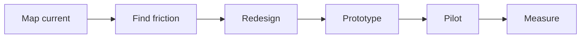
**Design principles:** minimise unnecessary **handoffs** · keep **ownership** clear · make **status visible** · provide **recovery paths** · **match channel to task complexity** · protect **privacy and accessibility** · design for **exceptions**, not only the happy path.

**Two changes that reduce customer effort (Q19):** (1) **pre-fill and reuse** data already held (e.g., Aadhaar/DigiLocker) so users don't re-enter or re-submit; (2) **proactive status notifications** with one accountable contact, removing follow-up calls and visits.

### 16.3 Redesigning a government certificate pathway (Q18)
| Current | Redesigned |
|---|---|
| Visit office to collect form → visit again to submit → visit again to collect | **Online application** at portal / Mee-Seva centre (assisted option) |
| Physical documents verified manually | **DigiLocker** fetch; auto-verification |
| Unknown status | **SMS tracking** with case ID |
| Officer field enquiry delays | Time-bound SLA with escalation |
| Certificate collected in person | **Digitally signed certificate** downloaded |
Result: zero or one visit, shorter waits, less effort.

---

## 17. Integrated Case & End-to-End Toolkit ★★★

### 17.1 Integrated case — redesigning a college student service
| Journey | Need → Search → Apply → Track → Resolve → Complete |
|---|---|
| **Current pain** | Multiple forms · unclear requirements · no status visibility · separate departments · repeated visits |
| **Journey insight** | Students value one checklist, a clear next step, confirmation, predictable response time, one help route |
| **Blueprint response** | Guided portal · **single case ID** · department handoff rules · automated notifications · escalation ownership |
| **Measures** | Completion time · drop-off · repeat visits · complaints · satisfaction |

### 17.2 End-to-end service-design toolkit
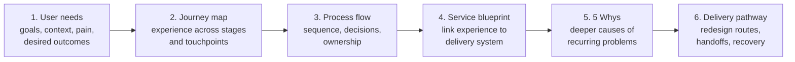

**How the tools work together (Q19):** the **journey map** shows *where* customers suffer; the **process flow** shows the *sequence* behind that moment; the **blueprint** links it to *frontstage/backstage/support* owners; **5 Whys** finds the *root cause*; the redesigned **delivery pathway** implements the fix and is measured — an integrated loop.

**Integrated solution for a selected service (Q20)** — follow the six tools for, e.g., the **canteen / hostel-mess service**: needs (quick meals between classes) → journey (queue → order → pay → collect) → flow (cash counter bottleneck) → blueprint (kitchen backstage, POS support) → 5 Whys (single cash counter because no UPI) → new pathway (pre-order app + UPI + pickup shelf), measured by queue time.

**Classroom design challenge:** pick a service (admission, hospital appointment, bank loan, railway booking, food delivery, government certificate) → persona → 5–7 journey stages → pain points → blueprint → 5 Whys on one failure → **one-page redesign** (new pathway, key touchpoints, backstage changes, CX improvement, 3 success metrics).

> **"Design the service so that the customer sees simplicity — even when the system behind it is complex."**

---

## 18. Question Bank ★★★

### Short answer (2 marks)
| # | Question | See |
|---|---|---|
| 1 | Purpose of service design and one expected outcome | §3.1 |
| 2 | Major stages in a customer journey map | §10 |
| 3 | Four attributes of a good service design | §5 |
| 4 | Basic structure of a service blueprint for a simple service | §11.1, §11.2 |
| 5 | Product experience vs service experience | §2 |
| 6 | Line of visibility — what it separates | §11.1 |
| 7 | Four factors influencing customer experience | §14 |
| 8 | Simple process flow for booking a service | §13.3 |
| 9 | Purpose of 5 Whys | §15 |
| 10 | Major stages of a service delivery pathway | §16 |
| 11 | Frontstage vs backstage with examples | §11.1 |
| 12 | Three pain points in a food-delivery journey | §10.2 |
| 13 | Two user needs → measurable requirements | §9.3 |
| 14 | Why accessibility is a core attribute | §5.1 |
| 15 | Touchpoints vs emotions & expectations | §10.3 |
| 16 | How a process flow exposes delays, bottlenecks, handoffs | §13.4 |
| 17 | Role of support processes in consistent experience | §11.5 |
| 18 | 5 Whys on a simple service failure | §15.3 |
| 19 | Two pathway changes reducing customer effort | §16.2 |
| 20 | Journey map or blueprint for a hospital service? | §12 |

### Long answer (10 marks)
| # | Question | See |
|---|---|---|
| 1 | Service design concept and quality attributes | §3, §5, §6 |
| 2 | Structure of a customer journey map | §10 |
| 3 | Construct and label a service blueprint | §11 |
| 4 | Characteristics of services and design considerations | §4 |
| 5 | Why identifying user needs is critical | §9.2 |
| 6 | Techniques to discover user needs; select for college/banking | §9.4 |
| 7 | Journey mapping vs blueprinting | §12 |
| 8 | Process flow for an online appointment service | §13.3 |
| 9 | Customer-experience considerations | §14 |
| 10 | Strengths and limitations of journey mapping | §10.4 |
| 11 | 5 Whys through five levels | §15.1, §15.3 |
| 12 | Critique 5 Whys for complex failures | §15.4, §15.5 |
| 13 | Classify delivery pathways; face-to-face/digital/omnichannel | §16.1 |
| 14 | Journey map for food delivery and prioritise pain points | §10.2 |
| 15 | Blueprint for a hospital appointment process | §11.2 |
| 16 | Diagnose a college admission service with a process flow | §13.5 |
| 17 | 5 Whys for bank account-opening delays | §15.2 |
| 18 | Redesign a government certificate pathway | §16.3 |
| 19 | Tools as an integrated service-improvement toolkit | §17.2 |
| 20 | Integrated service-design solution for a selected service | §17 |

---

## Unit V — One-Page Summary

| Topic | Key points |
|---|---|
| **Service** | Activity/process creating value through experience, interaction or outcome; customer participates; waiting, communication, convenience, trust matter. |
| **Product / service / experience** | Tangible item / delivered activity / overall perception; product enables service, service creates experience. |
| **Service design** | Systematic design of people, processes, technology, touchpoints for useful, usable, desirable, feasible experiences; whole journey need → outcome; value co-created. Product design = artefact; service design = experience over time across touchpoints. |
| **Characteristics** | Intangible, inseparable, variable, perishable, participatory, time-dependent. |
| **Good service attributes** | Useful, usable, desirable, feasible, viable, accessible, consistent, adaptable (Swiggy/Zomato). Quality = user value + operational feasibility + sustainable outcomes. |
| **Quality dimensions** | Reliability, responsiveness, assurance & empathy (SERVQUAL). |
| **System view** | User need → touchpoints → frontstage → backstage → support systems; observe → understand → define → design → test → improve. |
| **User needs** | Functional, emotional, social, contextual, unarticulated, business. Statement → need → requirement → feature → measure. Research: interviews, observation, surveys, analytics, complaints, frontline staff. |
| **Journey map** | Customer view: persona, scenario, stages, actions, touchpoints, emotions, pain points, opportunities; Discover → Consider → Use → Resolve → Return; food-delivery example. |
| **Blueprint** | System view: evidence, customer actions, frontstage, **line of visibility**, backstage, support; hospital example; 7 build steps; failure points → detect, acknowledge, resolve, update, learn. |
| **Journey vs blueprint** | "What does the customer experience?" vs "How must the organisation deliver it?" |
| **Process flow** | Sequence of activities, decisions, handoffs; symbols: terminator, rectangle, diamond, parallelogram; bank account-opening flow; finds bottlenecks, ownership, automation. |
| **CX considerations** | Effort, time, clarity, control, trust, emotion; moments that matter; reduce effort (reuse data, pre-checks, status updates, one owner); omnichannel consistency, continuity, choice. |
| **5 Whys** | Ask why repeatedly, evidence-based, system not people; hospital 45-min wait → designed for capacity not case variation; pitfalls; unsuitable for multi-cause, high-risk, statistical cases. |
| **Delivery pathways** | Need → access → assess → deliver → follow-up; self-service, assisted, hybrid, referral, exception, proactive; map → find friction → redesign → prototype → pilot → measure. |
| **Toolkit** | User needs → journey map → process flow → blueprint → 5 Whys → delivery pathway (college student service case). |
