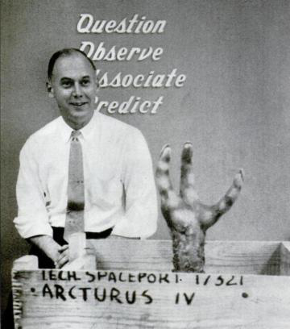
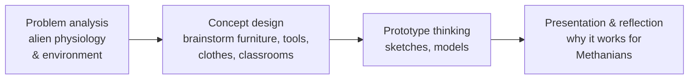
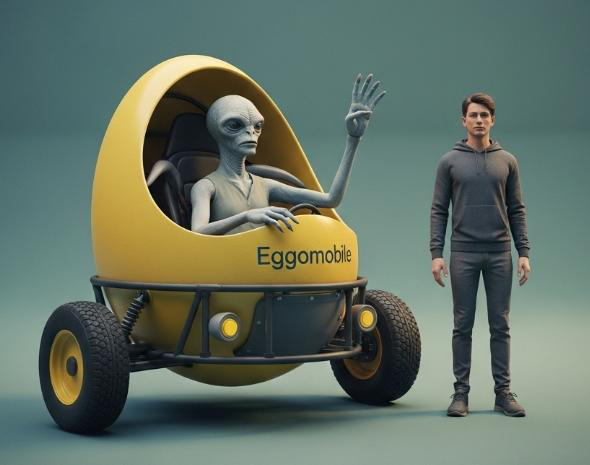
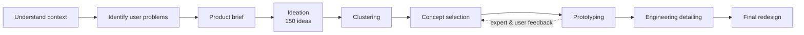
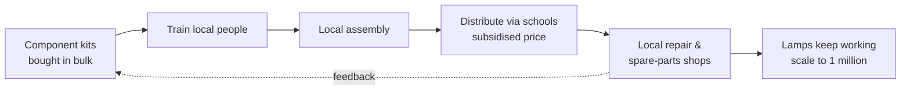
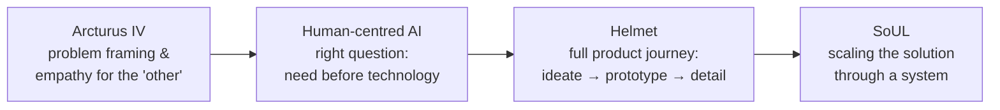
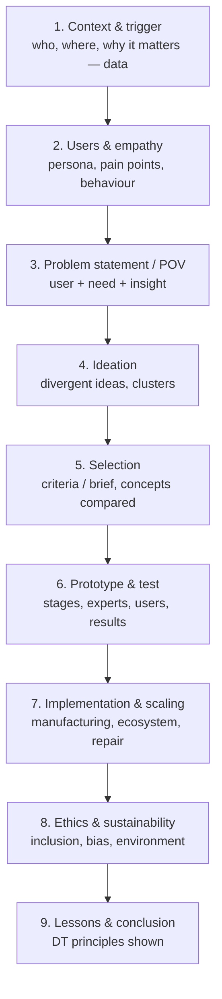

# Unit VI — Case Studies on Design Thinking

> **Syllabus:** Case 1 — *Arcturus IV* by John E. Arnold · Case 2 — *How can we make AI make things better for humans?* · Case 3 — *User-centred Helmet Design* by Prof. B. K. Chakravarthy (Parts 1 & 2) · Case 4 — *Challenges of Reaching a Million Users* by Prof. Chetan Solanki and Prof. Jayendran V.
>
> **Source:** *Unit 6.pdf* (Design Thinking, 9LC13, SNIST; slides by Milan Motta), text extracted from the PDF, including its 40-question bank. 📘 = added from the original NPTEL/IIT Bombay case lectures and standard references, where the slides only name a point.

**Importance legend:** ★★★ = very frequently asked (long answer) · ★★ = medium · ★ = short answer

**Learning objectives:** understand DT principles through real cases · analyse how creativity, user needs, human values and unconventional thinking shape solutions · apply DT stages to AI, product design and large-scale adoption · evaluate solutions for user requirements, ethics, feasibility, scalability and real-world constraints · develop human-centred solutions · assess DT's role in making technology create meaningful value.

---

## Table of Contents
1. [Case 1 — Arcturus IV (John E. Arnold)](#1-case-1--arcturus-iv-)
2. [Case 2 — AI for Human-Life Betterment](#2-case-2--ai-for-human-life-betterment-)
3. [Case 3 — User-Centred Helmet Design (Parts 1 & 2)](#3-case-3--user-centred-helmet-design-)
4. [Case 4 — Reaching a Million Users (SoUL)](#4-case-4--reaching-a-million-users-soul-)
5. [Comparisons & Common Lessons](#5-comparisons--common-lessons-)
6. [Framework for Answering Any Case Study](#6-framework-for-answering-any-case-study-)
7. [Question Bank with Answers](#7-question-bank-)
8. [Unit VI — One-Page Summary](#unit-vi--one-page-summary)

---

## 1. Case 1 — Arcturus IV ★★★

### 1.1 Background
- **John E. Arnold** — pioneer of **creative engineering design**, taught at **MIT** and later **Stanford** (where he founded the design programme 📘). He wrote the **Arcturus IV case in the 1950s** to teach **innovative problem solving in unfamiliar contexts**. His ideas strongly influenced modern design thinking and scholars such as **Donald A. Schön**.
- His motto on the slide: **Question · Observe · Associate · Predict**.

- **Why "Arcturus IV"?** Arcturus is one of the **brightest stars** in the night sky (~37 light-years away); "**IV**" = the fourth planet of an imaginary system. The name sounds **scientific but imaginary**, encouraging **creative yet logical** thinking.

### 1.2 The case
A **simulation exercise**: students imagine alien beings, the **Methanians**, living in a **methane-rich atmosphere**, and must **design products, tools and environments adapted to non-human needs**. It teaches **user-centred design — designing not for ourselves but for completely different users**.

**The Methanians (constraints):**
| Feature | Design implication 📘 |
|---|---|
| **3 fingers** per hand | Controls/handles for 3-finger grip |
| **3 eyes** (one sees **X-rays**) | Different displays, visibility, privacy |
| Breathe **methane**, not oxygen | No sparks/flames; different materials |
| Very cold: summer **–50 °C**, winter **–110 °C** | Materials that don't become brittle; insulation |
| Gravity **11×** Earth's | Low, strong, heavy-duty structures; seating that supports the body |
| **Low technology level** ("like owning scooters") | Simple, repairable mechanisms |
| 📘 Bird-like, slow-reacting, lay eggs (Arnold's original) | Safety-focused, slow-speed controls |

### 1.3 Purpose
- Step **out of the comfort zone**.
- **Stop assuming Earth rules apply everywhere** — break hidden assumptions.
- Think about **different environments, cultures and needs**.
- Use DT: **empathy + creativity + problem-solving**.

### 1.4 What students did

**Kind of answers:** publicised in newspapers/magazines as a brilliant example of "**thinking beyond Earth**" — e.g., a personal transport vehicle for Methanians: an **egg-shaped pod ("Eggomobile")** in which an alien could sit comfortably.

### 1.5 Design-thinking lessons ★★★
1. **Empathy for the "other"** — users may be radically different from the designer.
2. **Question assumptions** — Earth-based habits (5 fingers, oxygen, gravity) are not universal.
3. **Imagination + logic** — fantasy scenario but every design must follow the constraints.
4. **Constraints drive creativity** — extreme constraints produce original ideas.
5. **Divergent thinking** — many unusual concepts; then justification (convergence).
6. **Transfer** — the same skill applies to real "alien" users: elderly, rural, disabled, other cultures.

**Central lesson (short):** *design for the user's real needs and environment, not your own assumptions — imagination guided by user constraints.* It is **creative DT** because it forces thinking from zero, breaks fixation and makes students invent entirely new forms.

---

## 2. Case 2 — AI for Human-Life Betterment ★★★

### 2.1 The question
Ask "**How can AI make things better for humans?**" — not only "**Where can AI be used?**" The first starts from **human need** (desirability), the second from **technology** (a solution looking for a problem).

**Human-centred AI** = AI designed around people's needs, values and context, which **assists rather than replaces human judgement**, is tested in real settings, and is fair, transparent and inclusive.

| Area | How AI + human need helps |
|---|---|
| **Health & well-being** | Earlier diagnosis, better monitoring, improved access to care |
| **Accessibility** | Bring services to people facing distance or resource barriers |
| **Safety & services** | Faster, safer, more informed decisions |
| **Productivity** | Perform complex tasks more efficiently |
| **Inclusion** | Design around diverse users and real-world constraints |
| **Human agency** | AI **assists people rather than blindly replacing judgement** |

**Human need → AI solution → real-world testing → continuous improvement.**

### 2.2 Case — AI screening for diabetic eye disease
- **Problem:** **diabetic retinopathy** can cause blindness if not detected early; India has a **large diabetic population** and **limited access to specialists**.
- **Human need:** screen people **closer to where they live**, identify those who need specialist attention — especially in **underserved areas**.
- **AI approach:** AI analyses **retinal photographs** and gives a **rapid first-pass screening**, helping clinicians focus their time.
- **Goal:** **extend the reach of specialists — not eliminate them.**

**Design thinking in action:**
| Stage | Activity |
|---|---|
| **Empathise** | Understand patients, screening camps, technicians |
| **Define** | Focus on **limited specialist access and screening speed** — not simply "AI diagnosis" |
| **Ideate** | AI for rapid **first-pass** assessment so specialists can prioritise cases |
| **Prototype** | Train **deep-learning models** on large collections of graded retinal images |
| **Test** | Evaluate in **real clinics** — image quality, lighting, connectivity, workflow |
| **Improve** | Adapt the AI system and process around the **people & infrastructure** using it |

### 2.3 Lessons for AI in human-life betterment
1. **Start with people** — identify a genuine unmet need before choosing the AI.
2. **Keep humans in the loop** — AI supports professional judgement, especially in high-stakes domains.
3. **Test in the real world** — workflow, infrastructure, connectivity, language, behaviour.
4. **Manage risks** — bias, data quality, privacy, false results, over-reliance.
5. **Measure real impact** — beyond accuracy: reach, earlier detection, time saved, trust, outcomes.
6. **Build for inclusion** — work for diverse users and resource-constrained settings.

> **"The best AI enables humans to do more, reach more people, and live better."**

**Responsible innovation in AI (short):** anticipating and preventing harms of AI (bias, privacy loss, opacity, job displacement), keeping humans accountable, and asking "**should** we build it?" — see Unit I §15.

---

## 3. Case 3 — User-Centred Helmet Design ★★★

*Prof. B. K. Chakravarthy (IDC, IIT Bombay) — two lectures documenting one extended project. Theme: "making technology, materials and processes suit the rider."*

### 3.1 Overview
- The starting problem was **not simply helmet safety** but the **gap between safety, comfort, convenience and actual user behaviour**.
- **Core principle:** technology, materials and engineering processes should be **made to suit the user**, while still meeting safety requirements.
- It reframed helmet design from a **compliance problem** (fines) into a **user-centred design challenge**.

### 3.2 Why helmets? — a problem worth solving
| Fact | Figure |
|---|---|
| Road deaths in India (2015) | **~140,000** |
| Share of motor vehicles that are two-wheelers | **69 %** |
| India's rank among two-wheeler makers | **No. 2** |
| Rider behaviour | **Most riders avoid wearing a helmet** |

**The spark (trigger):** in **2007** a student, **Mandar Kale**, arrived late to a product-design course after his friend died in a **head-on collision with a truck** — the friend's **helmet was strapped to the back of the bike**, not worn. **Design question:** *can a helmet be as natural to put on as picking up the key?*

### 3.3 Understand the rider before the helmet (empathy)
| Problem | Observation |
|---|---|
| **Heat & sweat** | Helmet "cooks" in traffic; riders pad it with cloth |
| **Fastening** | Hard to buckle; **~20 % of accidents involve unbuckled helmets** |
| **Storage** | Bulky to carry → stays strapped on the bike |
| **Weight & fit** | Heavy and often loose → wobbles |
| **Vision & hearing** | Big shells block side vision; hard to talk to the pillion |
| **Pollution, price** | Dust and fumes; price must suit the buyer |

**Design opportunity:** make the helmet comfortable without sacrificing safety · encourage use rather than relying on fines · improve ventilation and ease of wear · easier storage · better fit, vision, hearing · reduce resistance to everyday use.

**Why ventilation matters (short):** Indian heat (up to **47 °C** in Delhi) and traffic make closed helmets hot and sweaty — the head "gets cooked" — so riders refuse to wear them; ventilation directly increases **willingness to wear**, which is what saves lives.

### 3.4 How a helmet saves a life
| Layer | Material | Role |
|---|---|---|
| Outer shell | **ABS** plastic | Cracking releases energy |
| Impact liner | **EPS foam** (thermocol) | **The real life-saver** — compresses and slows the head's deceleration; nothing has matched it and it costs almost nothing |
| Padding | **PU** | Comfort layer |

**In a crash:** the head stops suddenly → the brain, floating in fluid, hits the skull → brain death, often with **no outside injury**.

### 3.5 Testing overturned assumptions
Test at the **IIT Delhi biomedical lab** (Prof. **Dinesh Mohan**): a branded helmet vs four roadside helmets.
| | Branded | Roadside |
|---|---|---|
| EPS liner | **18–19 mm**, grooved and curved for style | **22–23 mm**, plain and uniform |
| Shell | Lots of resin → very hard, absorbs less | Less resin → cracks and sheds energy |
| Result | Baseline | **20–40 % better protection** |

**Takeaway:** a helmet needs **≥ 20 mm of EPS**; style had thinned the branded liners.

### 3.6 When standards ignore the user
- Standards committees (professors, visual experts, industry) lean towards **manufacturing and technology** — **no one speaks for comfort or ease of use**.
- Standards are **borrowed from cold countries** (racing, mountains), not Indian heat.
- **Response:** ask the Indian standards body to seat a **member responsible for comfort**; study **parallel products** (Kevlar, polycarbonate, ABS) to reuse material knowledge.

### 3.7 From insight to product brief
1. Easy to **carry and store** · 2. **Encourages** use · 3. Ample **ventilation** · 4. **Lightweight** · 5. **Snug fit** without wobbling · 6. Clear **vision**, easy **hearing** · 7. **Less volume** when not in use · 8. Passes **Indian standards**.
→ The brief becomes the **scoring criteria** every concept must compete against.

### 3.8 Ideation — every problem gets many ideas (diverge)
**~150 ideas from one brainstorm** — rule: **no questions asked, respect every idea**.
| Problem | Ideas explored |
|---|---|
| Fastening | Single-hand side levers · scarf-like ties |
| Sweat | Absorbent headband ring on top |
| Storage | Folding · receding · swivelling · collapsible |
| Ventilation | Openable vents · insect louvres · dimpled foam |
| Pillion bumps | Padding outside the shell |
| Pollution | Helmet with integrated mask |
| Ease of wear | Cap-like ring inspired by a sheikh's cap |

### 3.9 Cluster, then amalgamate (converge)
**150 raw ideas → sort into clusters → amalgamate the best parts → champion concept.**
- **Ventilation cluster** — windows, gaps, slits, dimples.
- **Storage cluster** — short- and long-term: folding, receding, swivelling.
- **Ease-of-wearing cluster** — easy to put on/remove, less resistance.
- Clusters **cross-pollinate** (split ideas and side openings reused inside the EPS liner).

### 3.10 Three concepts compete against the brief
| Concept | Led by | Advantages | Disadvantages |
|---|---|---|---|
| **A** | Ventilation | Good airflow, multiple grips, light, strong style | No volume reduction, hard to make in FRP, dust |
| **B** | Ease of storage | Smaller volume, side ventilation, easy to carry | Moving parts add complexity, weak image |
| **C** ✅ | Ease of use | Smaller volume, ventilation all round | Three-part build, looks fragile, loose parts |

**Winner: Concept C** — best meets storage, ventilation and ease of wear together.

### 3.11 Expert review reshaped the concept
1. **First reaction** — scientists/engineers: "It's horrible" — a helmet *broken* from the start.
2. **Expert verdict** — Dr Dinesh Mohan: make it **two parts**, keep a **shell gap ≥ 4 mm**.
3. **Rework** — a **two-part receding shell** hides the gap and **collapses only for storage**.
A snug-fit helmet protects better from any side — counter-intuitive, so it must **look strong, not broken**, and win users with **evidence and testing**.

### 3.12 Prototype in stages, test with riders
| Stage | Purpose |
|---|---|
| **1. Working rig** | Three large helmets chopped to prove the collapse works (not pretty) |
| **2. Scaled mock-up** | Looks right but doesn't work; shows the idea at small scale |
| **3. Full-scale mock-up** | Photo-realistic, near production — "nobody can change your design intent" |

**Persona:** the **office-going rider** — largest user group with the most problems (daily routine, distance, vehicle, footwear studied). **Mock-up survey:** everyone wanted a **visor**.

**Importance of prototyping (short):** proves the mechanism works, communicates the idea to experts and users, uncovers problems (look of fragility, gasket tightness) early, and protects design intent before costly tooling.

### 3.13 The devil is in the detail
| Detail | Challenge |
|---|---|
| **Rubber gasket** | Keep rain out yet open and collapse — **~3 months** on this one detail |
| **EPS overlap** | Straight cut leaves a weak corner; **22 mm overlap** fixes it but enlarges the helmet |
| **Shell locking** | Must lock without wobble; Indian standards allow **no inner projections** |
| **Strapping** | Took **nearly 2 years** — final: strap runs from the top through slots in the EPS |

### 3.14 Sketch to manufacturable product
**Sketch → CAD → digital sculpting → 3-D print → mould.**
- 3-D printing: hard parts print easily, flexible ones don't; printed gasket too tight → mould it; transparent visors → mould.
- Tooling: shell tool up to **₹8 lakh**, gasket tool ~**₹2,000**; earlier helmet 2 dies, this one 2 plastic + 2 EPS + 1 visor. **"Print to trial, mould to ship."**

### 3.15 Final design answers the brief
| Brief | Final feature |
|---|---|
| Carry & store | **Collapses into a small block** that fits a bag or rack |
| Encourage use | **Cap-like wearing**, elastic strap with **no buckle** |
| Ventilation | Lift the gasket to open **top vents**; ducts for air in/out |
| Clear vision | Large **removable visor** with room for spectacles |
| Snug fit | Adjustable clamp keeps the elastic soft on the chin |
| Weather | Rubber gasket seals the split shell against rain |

**Materials:** shells — ABS, injection-moulded · liner — EPS, two dies · gasket — EPDM rubber or PU · visor — polycarbonate · strap — nylon with latex-free elastic · fasteners — screws, stepped washers, ABS caps. **Ecosystem matters:** innovation needs **world-standard suppliers** (e.g., VIP sources zips/trims globally).

### 3.16 Lessons for designers

### 3.17 Comfort, storage, ventilation & safety (evaluate Q7)
- **Safety** is non-negotiable (EPS ≥ 20 mm, standards) — but a safe helmet **not worn** saves no one.
- **Comfort & ventilation** remove the main reasons for refusal in hot climates.
- **Storage** removes the "where do I keep it" barrier that leaves helmets strapped to bikes.
- Together they shift behaviour from **compliance to voluntary use** — the real measure of success.

---

## 4. Case 4 — Reaching a Million Users (SoUL) ★★★

*Prof. Chetan Solanki & Prof. Jayendran V. (IIT Bombay) — the **Solar Urja Lamp (SoUL)** project: "a good technology is not enough."*

### 4.1 The energy gap
| Fact | Figure |
|---|---|
| People without electricity (2017) | **~1 billion** (13–14 % of the world) |
| People without clean cooking | **~2.8 billion** (~40 %) — biomass, dung, wood, coal |
| Electricity use per person (India) | **~1,000 units/yr** vs **~3,500** for a reasonable HDI |
| Capacity needed | **~800,000 MW** vs **~350,000 MW** today |
| Goal | **SDG 7:** affordable, reliable, sustainable, modern energy for all |

### 4.2 Why study light matters
- School enrolment **258 million — 73 % rural**, 27 % urban; rural dropout curve is much steeper.
- **150 lux** needed on the book for studying; only **5–15 lux** measured in **electrified** homes (2,000+ homes, 6 states).
- Supply is patchy (voltage swings, cuts) → even wired homes need a **solar fallback**.

### 4.3 Two programmes that did not last
| Ekal Vidyalaya (2008–09) | TERI — Light a Billion Lives |
|---|---|
| 500 lamps for informal evening schools | Central charging station, **rented** lamps |
| 5 W CFL replaced kerosene for 20–25 children | Collect charged lamp in the evening, return in morning |
| Light didn't reach everyone (raised lamp shaded itself; hung lamp spread better) | Piloted in 3 villages |
| **Failed in 5–7 months:** dead batteries, blown fuses, **no repairer** | **Stopped in 5–12 months:** lamps costly, **nobody repaired** them |

### 4.4 Why solar-lamp programmes fail
| Model | Consequence | Issue |
|---|---|---|
| **Buy and sell** — make, buy, transport, repeat | Expensive product | **Cost** |
| **No technical support** — a fuse, a solder joint, a battery | Fails prematurely | **Repairability** |
| **No continuity** — 500 supplied, the 501st unavailable | Solution never lasts | **Availability** |

> **Mobile phones work everywhere because someone nearby recharges and repairs them.**

### 4.5 The SoUL idea in three words
| Principle | Meaning |
|---|---|
| **Affordable** | Make the core product cheaper; remove inflated buy-and-sell chains |
| **Localisation** | Involve the **local community to make, sell and repair** |
| **Saturation** | Cover each area fully so **supply and repair never run out** |

**Target:** **1 million student study lamps in one year**, with a model others can copy. 📘 Local (often women's self-help) groups were trained to **assemble** lamps from kits, distribute through schools, and run **repair centres** — creating livelihoods and sustaining the product.

### 4.6 Product vs system innovation (short Q12)
| Product innovation | System innovation |
|---|---|
| A better **lamp** (LED, battery, panel) | A better **way of making, selling, repairing and sustaining** lamps |
| Earlier programmes focused here — and failed | SoUL's real innovation: **local assembly + repair + saturation** |

### 4.7 Why scaling is harder than a prototype (Q9) ★★★
A prototype must only **work once**; a scaled product must work for **a million different users, over years**, at **low cost**, with **supply chains, training, finance, repair and distribution** in place. Failures (fuses, batteries) multiply with numbers; logistics in remote villages is hard; quality must stay consistent; funding must continue. **Scalability is therefore a design issue** — the whole system (people, process, ecosystem) must be designed, not just the object.

### 4.8 Designing for repair = sustainable & responsible design (Q13)
- **Extends product life** → less e-waste and resource use.
- Keeps the **benefit continuing** for users (light to study).
- Creates **local livelihoods** and skills.
- Reduces total cost of ownership for poor users.
- Avoids dependence on distant manufacturers — an ethical choice for vulnerable communities.

**Critique of an advanced, non-repairable lamp (Q16):** high-tech features raise cost and fail with no local repairer → lamp becomes useless in months (exactly the Ekal/TERI failure). Recommend modular, standard components, local spare parts, repair training — **appropriate technology over advanced technology**.

---

## 5. Comparisons & Common Lessons ★★★

### 5.1 Helmet vs Solar lamp (Q12)
| Basis | Helmet case | SoUL case |
|---|---|---|
| Problem | Riders don't wear helmets | Rural students lack reliable study light |
| User insight | Heat, storage, buckling, fit | Cost, repairability, availability |
| Focus | **Product** redesign (object + materials) | **System** redesign (supply, repair, local enterprise) |
| Key method | 150 ideas → clusters → 3 concepts → prototypes | Learn from failed programmes → affordability, localisation, saturation |
| Testing | Lab impact tests, rider mock-up surveys | Field pilots in villages |
| Success measure | Voluntary helmet use | Lamps still working at scale |
| Shared lesson | **Design beyond the object** — behaviour, ecosystem, standards, users |

**"Design beyond the object" (Q17):** the helmet case redesigned **standards, user behaviour and supplier ecosystems**, not just the shell; the solar case designed **local manufacturing, repair and distribution** — success depends on the system around the product.

### 5.2 Arcturus IV vs Helmet — divergent & convergent (Q14)
| | Arcturus IV | Helmet |
|---|---|---|
| Divergent | Wild concepts for alien users ("thinking beyond Earth") | 150 ideas in one brainstorm |
| Convergent | Justify designs against Methanian constraints | Clusters → amalgamation → 3 concepts scored on the brief → Concept C |
| Emphasis | **Mostly divergent** — imagination training | **Both**, with strong convergence to a manufacturable product |

### 5.3 Evolution from problem framing to scalable innovation (Q15)

### 5.4 Design thinking as continuous learning, not a linear procedure (Q20)
- **Helmet:** expert review sent the concept back (two-part shell), the gasket took 3 months and the strap 2 years of iteration, testing overturned assumptions about branded helmets.
- **SoUL:** learnt from failed programmes (Ekal, TERI) before redesigning the system; field feedback improves repair and supply.
- **AI screening:** clinic tests (lighting, connectivity) forced redesign of workflow.
→ Each stage **loops back**; learning continues after launch.

### 5.5 Four (or more) common lessons from all four cases (Q20 short)
1. **Start with real users and their context** (empathy).
2. **Question assumptions** — Earth rules, branded = safe, "AI first", "lamps alone suffice".
3. **Iterate and test** in the real world.
4. **Design the system/ecosystem**, not just the object.
5. **Humans stay central** — technology serves people.

### 5.6 Other short-answer points
- **Empathy in case-study-based DT (Q14):** cases put students in real users' shoes (grieving student, hot-climate rider, rural child, patient) so solutions solve real problems.
- **Identifying a problem statement from a case (Q15):** extract **user, need, insight** from case facts → "Office-going riders need a helmet that is easy to carry and cool to wear because they leave hot, bulky helmets strapped to the bike."
- **Role of iteration (Q16):** repeated build–test–learn cycles improve the solution (helmet strap took 2 years).
- **Why failure is useful (Q19):** failures (Ekal/TERI lamps, "horrible" first helmet concept) reveal hidden problems cheaply and guide redesign — "fail early to succeed sooner".
- **Multiple ideas before selection (Q6):** avoids fixation on the first idea; clusters combine the best parts (Concept C came from amalgamation).
- **Role of local communities (Q11):** assemble, sell and repair lamps → affordability, availability, ownership, livelihoods.

### 5.7 "A good product is not necessarily a good design" (Q18)
A product may be technically good (strong shell, efficient lamp, accurate AI) yet a **poor design** if users **won't or can't use it** — the helmet strapped to the bike, lamps abandoned for want of repair, AI that doesn't fit clinic workflow. Good **design** = desirable + feasible + viable + sustainable + used in real life. Counter-view: good design still needs good engineering — the two must be balanced.

---

## 6. Framework for Answering Any Case Study ★★★

Use headings, a diagram of the DT stages, a table (problem → idea → outcome) and a short conclusion linking to DT principles.

---

## 7. Question Bank ★★★

### Short answer
| # | Question | Answer pointer |
|---|---|---|
| 1 | Central DT lesson of Arcturus IV | Design for the user's needs, not your assumptions — §1.5 |
| 2 | Why Arcturus IV is creative DT | Forces imagination, breaks fixation — §1.5 |
| 3 | User-centred design in the helmet case | Make technology/materials suit the rider — §3.1 |
| 4 | Importance of ventilation | Heat stops riders wearing helmets — §3.3 |
| 5 | Importance of prototyping (helmet) | §3.12 |
| 6 | Many ideas before selecting a concept | §5.6 |
| 7 | Human-centred AI | §2.1 |
| 8 | "Make things better for humans" vs "where to use AI" | §2.1 |
| 9 | Major challenge in reaching a million users | Cost, repairability, availability — §4.4 |
| 10 | Why repairability matters | §4.8 |
| 11 | Role of local communities | §5.6 |
| 12 | Product vs system innovation | §4.6 |
| 13 | Why scalability is a DT issue | §4.7 |
| 14 | Importance of empathy in case-based DT | §5.6 |
| 15 | Case study → problem statement | §5.6 |
| 16 | Role of iteration | §5.4 |
| 17 | "Design beyond the object" | §5.1 |
| 18 | Responsible innovation in AI | §2.3 |
| 19 | Why failure is useful | §5.6 |
| 20 | Four common lessons | §5.5 |

### Long answer
| # | Question | See |
|---|---|---|
| 1 | Arcturus IV and the role of imagination | §1 |
| 2 | DT lessons from Arcturus IV | §1.5 |
| 3 | Human-centred AI case with the DT approach | §2.2 |
| 4 | Why human-centredness is essential for AI | §2.1, §2.3 |
| 5 | AI attendance system with human-centred AI | below ⬇ |
| 6 | Helmet Parts 1 & 2 as an iterative process | §3.1–§3.15 |
| 7 | Comfort, storage, ventilation, safety | §3.17 |
| 8 | Generating, combining, evaluating ideas (helmet) | §3.8–§3.10 |
| 9 | Reaching a million users; why scaling is harder | §4, §4.7 |
| 10 | Problems with earlier solar-lamp approaches and the fix | §4.3–§4.5 |
| 11 | Role of local entrepreneurship | §4.5, §5.6 |
| 12 | Helmet vs solar lamp | §5.1 |
| 13 | Designing for repair as responsible design | §4.8 |
| 14 | Arcturus IV vs helmet — divergent/convergent | §5.2 |
| 15 | Four cases: problem framing → scalable innovation | §5.3 |
| 16 | Critique of a non-repairable advanced lamp | §4.8 |
| 17 | Human-centred, responsible AI recruitment | below ⬇ |
| 18 | "A good product is not necessarily a good design" | §5.7 |
| 19 | Framework for answering any case study | §6 |
| 20 | DT as continuous learning | §5.4 |

**Q5 — AI attendance system for a college (human-centred AI):**
| Stage | Application |
|---|---|
| Empathise | Faculty lose 5–10 min per class; students worry about **privacy** and wrong marking; poor lighting/network in some rooms |
| Define | "Faculty need fast, accurate attendance because manual roll-call wastes teaching time — without compromising student privacy." |
| Ideate | Face recognition, QR + geofence, Bluetooth proximity; **AI suggests, faculty confirm** |
| Prototype | Pilot in two classrooms |
| Test | Accuracy across skin tones/lighting, consent, data storage, network failure fallback |
| Improve | Human override, appeal process, data deletion policy, opt-out alternative |
| Responsible aspects | Consent, bias testing, minimal data, transparency, humans in the loop |

**Q17 — Human-centred, responsible AI recruitment:** start from the need (fair, faster shortlisting, not just cost-cutting) → involve candidates and recruiters → train on **de-biased** data and **audit for bias** by gender, caste, region, disability → **explainable** scores → **human final decision** and appeal → privacy and consent → measure real impact (diversity, time-to-hire, candidate trust) → iterate (lessons from §2.3; Unit I §15).

---

## Unit VI — One-Page Summary

| Case / topic | Key points |
|---|---|
| **Arcturus IV** | John E. Arnold (MIT/Stanford, 1950s); imaginary planet; **Methanians** — 3 fingers, 3 eyes (X-ray), breathe methane, –50 to –110 °C, 11× gravity, low tech. Design products for non-human users → empathy, question assumptions, imagination + logic; Eggomobile pod. Influenced Schön and modern DT. |
| **Human-centred AI** | Ask "how can AI make things better for humans?" Health, accessibility, safety, productivity, inclusion, human agency. **Diabetic-retinopathy screening:** retinal photo → AI first pass → clinician review → care; extend specialists, not replace. Lessons: start with people, humans in loop, real-world testing, manage risks, measure impact, inclusion. |
| **Helmet (B. K. Chakravarthy)** | Trigger: friend died with helmet strapped to bike. Gap between safety, comfort, convenience, behaviour. Problems: heat, buckling (~20 % unbuckled), storage, weight, vision, pollution, price. EPS is the life-saver (≥ 20 mm; roadside 20–40 % better than thin branded). Standards ignore comfort. Brief (8 points) → 150 ideas → clusters → concepts A/B/C → C wins → expert rework (two-part shell, 4 mm gap) → staged prototypes, office-rider persona → details (gasket 3 months, strap 2 years) → collapsible, cap-like, buckle-free, ventilated helmet. |
| **SoUL (Solanki & Jayendran)** | Energy gap: 1 bn without electricity; 150 lux needed vs 5–15 lux. Earlier lamps failed in months (cost, no repair, no continuity). SoUL: **affordable, localisation, saturation** — local assembly, distribution, repair; 1 million lamps in a year. System innovation > product innovation; scaling is a design problem; designing for repair = sustainable. |
| **Comparisons** | Helmet = product redesign; SoUL = system redesign; both "design beyond the object". Arcturus = divergent imagination; helmet = diverge + converge. Evolution: framing → right question → product journey → scaling. DT = continuous learning. |
| **Common lessons** | Users first, question assumptions, iterate & test, design the ecosystem, humans central, failure teaches. |
| **Answer framework** | Context → users → problem statement → ideation → selection → prototype & test → scaling → ethics → lessons. |
