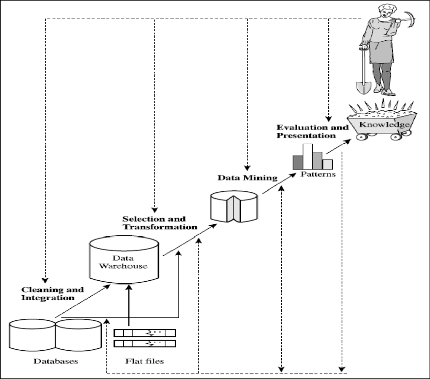
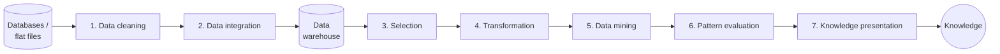
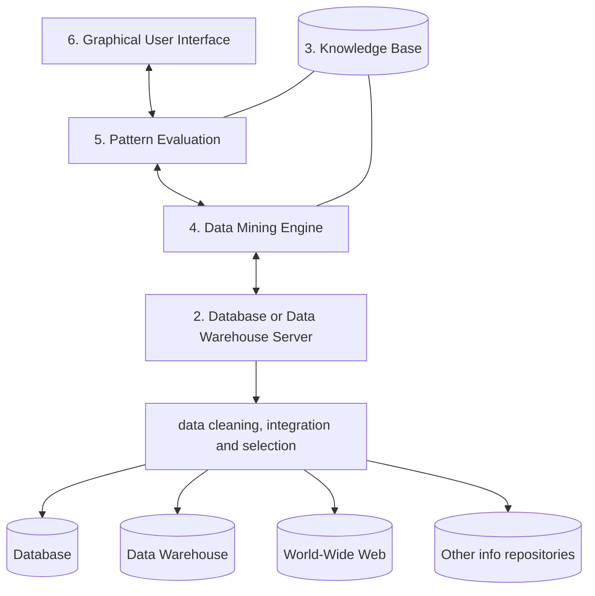
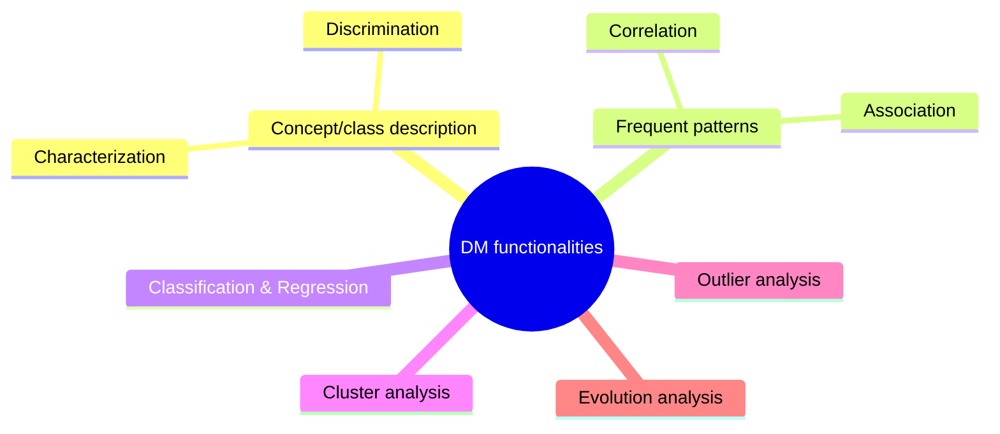
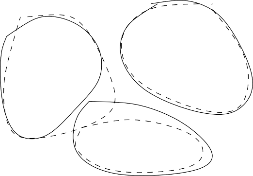
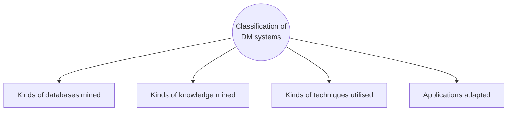
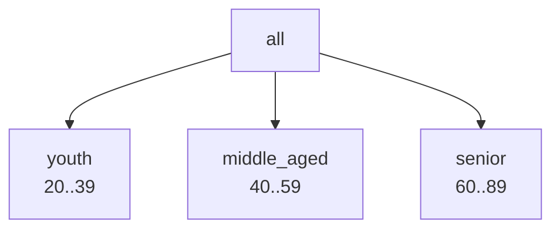
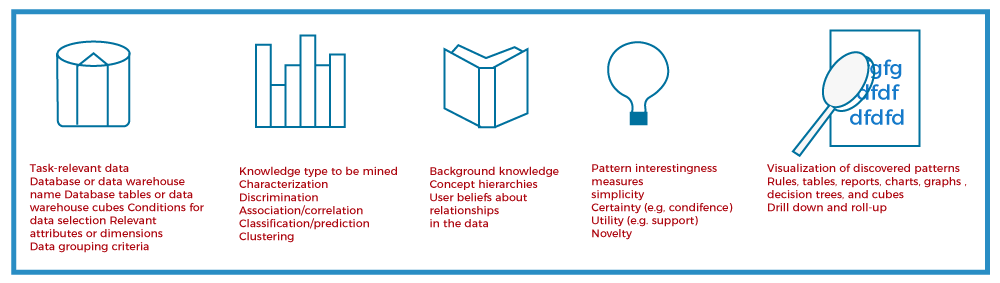
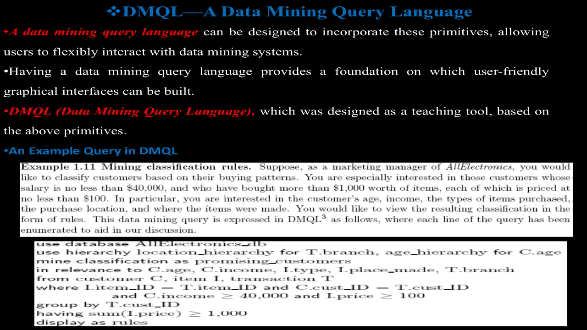
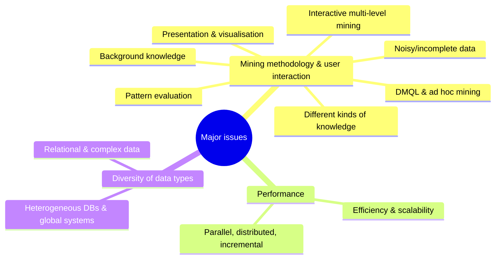

# Unit I — Introduction to Data Mining

> **Syllabus:** Fundamentals of data mining, KDD process, architecture of data mining systems, data mining functionalities, classification of data mining systems, data mining task primitives, integration of a data mining system with a database or data warehouse system, major issues in data mining.
>
> **Source:** *DWDM Unit I 2026.ppt* (SNIST) — based on Han & Kamber, *Data Mining: Concepts and Techniques*

**Importance legend:** ★★★ = very frequently asked (long answer) · ★★ = medium · ★ = short answer

---

## Table of Contents
1. [Data Warehouse — Definition & Characteristics](#1-data-warehouse--definition--characteristics-)
2. [What is Data Mining?](#2-what-is-data-mining-)
3. [KDD Process — Steps in Knowledge Discovery](#3-kdd-process-)
4. [Benefits of Data Warehouses & Advantages of Data Mining](#4-benefits-of-data-warehouses--advantages-of-data-mining-)
5. [Database vs Data Warehouse](#5-database-vs-data-warehouse-)
6. [Architecture of a Data Mining System](#6-architecture-of-a-data-mining-system-)
7. [Data Mining Functionalities](#7-data-mining-functionalities-)
8. [Classification of Data Mining Systems](#8-classification-of-data-mining-systems-)
9. [Data Mining Task Primitives & DMQL](#9-data-mining-task-primitives-)
10. [Integration of DM System with DB/DW — Coupling Schemes](#10-integration-of-a-data-mining-system-with-a-dbdw-)
11. [Major Issues in Data Mining](#11-major-issues-in-data-mining-)
12. [Unit I — One-Page Summary](#unit-i--one-page-summary)

---

## 1. Data Warehouse — Definition & Characteristics ★★★

**Data warehousing** is the process of **collecting, storing, integrating and managing** large volumes of data from **multiple heterogeneous sources** into a **central repository** called a **data warehouse**.

> **Definition (W. H. Inmon):** A data warehouse is a **subject-oriented, integrated, time-variant and non-volatile** collection of data in support of management's **decision-making** process.

| Characteristic | Meaning | Example |
|---|---|---|
| **Subject-oriented** | Organised around **key subjects** (customer, product, sales), not day-to-day operations | Sales warehouse rather than an order-entry system |
| **Integrated** | Combines data from **different sources** with consistent naming, formats, encodings | Gender "M/F" vs "1/0" unified |
| **Time-variant** | Keeps **historical** data (5–10 years); every key structure contains a time element | Quarterly sales for the last 10 years |
| **Non-volatile** | Once entered, data is **not changed**; only **initial loading** and **access** of data | No updates/deletes as in OLTP |

---

## 2. What is Data Mining? ★★★

- **Data mining** = extracting or "**mining**" **knowledge** from **large amounts of data** ("knowledge mining from data" — like mining gold from rocks).
- Many treat data mining as a **synonym for Knowledge Discovery in Databases (KDD)**; others view it as **one essential step** in the KDD process.
- **Definition:** the process of discovering **interesting** (non-trivial, implicit, previously unknown, potentially useful) **knowledge** from large amounts of data stored in **databases, data warehouses or other information repositories**.

Other names: knowledge extraction, data/pattern analysis, data archaeology, data dredging, information harvesting, business intelligence.

---

## 3. KDD Process ★★★





| Step | What it does | Example (college data) |
|---|---|---|
| **0. Data collection** | Gather raw data from databases, files, sensors, the internet | — |
| **1. Data cleaning** (pre-processing) | Remove **noise** and **inconsistencies**; handle **missing values**; eliminate duplicates → better quality | Remove duplicate student entries |
| **2. Data integration** | **Combine multiple sources** into a unified view; resolve conflicts and redundancy | Combine attendance and exam records |
| **3. Data selection** | Retrieve only **task-relevant** data → less data, more efficient mining | Only final-year students for placement analysis |
| **4. Data transformation** | Convert/consolidate data into forms suitable for mining — **normalisation, aggregation**, summarisation | Marks → grades (A, B, C) |
| **5. Data mining** | **Core step**: apply intelligent methods to extract **patterns** — classification, clustering, association, prediction | Predict pass/fail |
| **6. Pattern evaluation** | Identify **truly interesting** patterns using **interestingness measures**; remove redundant ones | Keep only highly accurate rules |
| **7. Knowledge presentation** | **Visualisation** and knowledge-representation techniques (graphs, charts, reports) present results to users | Charts of student performance |

> Steps 1–4 are forms of **data pre-processing**. The user may interact with the system at each step (iterative process).

---

## 4. Benefits of Data Warehouses & Advantages of Data Mining ★★

| Data-warehouse benefits | Data-mining advantages |
|---|---|
| **Better decision making** — accurate, consistent, timely data | **Efficient decision making** — uncovers patterns & trends |
| **Enhanced business intelligence** — integrated data, better reporting | **Market analysis** — consumer behaviour, purchasing patterns |
| **Data quality & consistency** — standardised, cleaned formats | **Fraud detection** — unusual patterns in finance/insurance |
| **Historical analysis** — trends over time | **Cost reduction** — find inefficient processes |
| **High performance** — optimised for queries/reports | **Customer insights** — needs and preferences |
| **Data security** — role-based access | **New opportunities** — unknown relationships |
| **Time saving** — consolidated in one place | |

---

## 5. Database vs Data Warehouse ★★★

| Aspect | Database (operational) | Data Warehouse |
|---|---|---|
| **Purpose** | Day-to-day operations | Analysis and decision making |
| **Processing** | **OLTP** (Online Transaction Processing) | **OLAP** (Online Analytical Processing) |
| **Data nature** | Current, real-time | Historical + current |
| **Volume** | Small to moderate | Very large (GBs/TBs) |
| **Updates** | Frequent (insert, delete, modify) | Periodic (**ETL** loads) |
| **Query type** | Simple (INSERT, UPDATE, DELETE) | Complex (aggregation, joins, trends) |
| **Structure** | Highly **normalised (3NF)** | **Denormalised** (star/snowflake schema) |
| **Users** | Clerks, operators, application users | Managers, analysts, decision makers |
| **Time dimension** | Present state | Long periods (time-variant) |
| **Performance focus** | Fast transaction response | Fast query/analysis response |
| **Examples** | Banking system, payroll | Sales analysis, business reports |

---

## 6. Architecture of a Data Mining System ★★★

The architecture describes the **major components** of a data-mining system and how data flows from storage to knowledge.



| # | Component | Role |
|---|---|---|
| 1 | **Database, data warehouse, WWW or other repositories** | Sources of data — relational DBs, DWs, transaction DBs, data streams, flat files, web, multimedia DBs; data cleaning and integration may be performed here. *E.g., supermarket purchase data.* |
| 2 | **Database or data-warehouse server** | Interface between mining system and repository; **fetches relevant data** based on the user's request; query processing, data integration and selection. *E.g., SQL Server retrieving sales records.* |
| 3 | **Knowledge base** | **Domain knowledge** guiding the search and evaluating interestingness — data dictionaries, **concept hierarchies** (City → State → Country), user beliefs, constraints, metadata, previously discovered patterns |
| 4 | **Data-mining engine** | **Core** — functional modules for characterisation, discrimination, association (Milk → Bread), classification, prediction, clustering, outlier analysis, evolution analysis |
| 5 | **Pattern-evaluation module** | Applies **interestingness measures** (support, confidence, accuracy) and **filters** uninteresting patterns; may be integrated with the mining engine |
| 6 | **Graphical user interface** | Communication between user and system — specify tasks/parameters, browse schemas, view & **visualise** results (charts, graphs, dashboards) |

**Interestingness measures:**
- **Support** — how frequently an itemset appears in the database.
- **Confidence** — reliability of a rule A ⇒ B; how often B occurs when A occurs.
- **Accuracy** — correctness of a classification model's predictions.

---

## 7. Data Mining Functionalities ★★★

Functionalities specify the **kinds of patterns** to be found. Two categories:
- **Descriptive mining** — characterises the **general properties** of the data (what is happening).
- **Predictive mining** — performs **inference** on current data to make **predictions**.



### 7.1 Concept / Class Description — Characterisation & Discrimination
Describing a class or concept in **summarised, concise, yet precise** terms.

**(a) Data characterisation** — **summarisation of the general features** of a **target class**. Output: pie/bar charts, curves, cubes, **characteristic rules**.
*Example:* target class = students scoring > 80 % → most are from AIML, attendance > 85 %, active in technical events, average CGPA > 8.5.

**(b) Data discrimination** — **comparison** of general features of the **target class** with one or more **contrasting classes**. Output: **discriminant rules**.
*Example:* passed vs failed students:

| Passed students | Failed students |
|---|---|
| Attendance > 85 % | Attendance < 60 % |
| Regular assignments | Incomplete assignments |
| Higher study hours | Lower study hours |
| Active in class | Less participation |

### 7.2 Mining Frequent Patterns, Associations & Correlations
**Frequent patterns** occur frequently in data:
- **Frequent itemsets** — items appearing together (market-basket analysis) — {Milk, Bread}.
- **Sequential patterns** — order matters — ⟨Login → Search → Purchase⟩.
- **Frequent substructures** — graphs, trees (chemical compounds, web structures).

**Example (min support 50 % = 2 of 4 transactions):**
| TID | Items |
|---|---|
| T1 | Bread, Milk, Butter |
| T2 | Bread, Milk |
| T3 | Milk, Butter |
| T4 | Bread, Milk, Butter |

{Bread} = 3, {Milk} = 4, {Butter} = 3, {Bread, Milk} = 3, {Milk, Butter} = 3, {Bread, Butter} = 2 → **all frequent**.

**Association rule:** X ⇒ Y [support, confidence], e.g., `buys(X, "computer") ⇒ buys(X, "software") [support = 1 %, confidence = 50 %]`.

**Correlation analysis** — how strongly attributes are related beyond frequency:
| Type | Meaning | Examples |
|---|---|---|
| **Positive** | Both increase/decrease together | Temperature ↑ → ice-cream sales ↑; study hours ↑ → marks ↑ |
| **Negative** | One ↑, the other ↓ | Price ↑ → demand ↓; speed ↑ → fuel efficiency ↓ |
| **Zero** | No relationship | Shoe size vs exam marks |

### 7.3 Classification & Regression (Predictive analysis)
- **Classification** — find a **model** (from **training data** with known labels) that distinguishes **classes**, to predict the class of objects whose label is unknown. Representations: **IF-THEN rules, decision trees, mathematical formulae, neural networks**.
  - Email → spam/not spam; student → pass/fail; patient → disease/no disease.
  - Algorithms: **Decision tree, Naïve Bayes, k-NN, SVM, neural networks**.
- **Regression** — predicts **continuous numeric** values (house price, student marks) — linear, multiple linear regression.

### 7.4 Cluster Analysis
- Groups objects so that objects in the same cluster are **similar** and those in different clusters are **dissimilar** — **maximise intra-class similarity, minimise inter-class similarity**.
- **Unsupervised** (no predefined class labels). E.g., customer segmentation, grouping students by performance.
- Methods: **partitioning** (k-means, k-medoids), **hierarchical** (agglomerative bottom-up, divisive top-down — dendrogram), **density-based** (DBSCAN).



### 7.5 Outlier Analysis
- **Outliers** = data objects that **do not comply** with the general behaviour/model of the data. Most methods discard them as noise, but in **fraud detection** and rare-event analysis they are the most interesting.
- *Example:* marks 65, 68, 70, 72, **15** → 15 is an outlier.
- Detected using statistical tests, distance measures, or deviation-based methods.

### 7.6 Evolution Analysis
Describes and models **regularities or trends** for objects whose behaviour **changes over time** — time-series analysis, sequence/periodicity mining (e.g., stock-market trends).

| Descriptive | Predictive |
|---|---|
| Characterisation, discrimination | Classification |
| Association, correlation | Regression / prediction |
| Clustering | Evolution/trend prediction |
| Summarises existing data | Predicts unknown/future values |

---

## 8. Classification of Data Mining Systems ★★★

Data mining is **interdisciplinary** (database technology, statistics, machine learning, visualisation, information science, etc.). Systems are classified by:



| Criterion | Categories |
|---|---|
| **Kinds of databases mined** | Relational, **data warehouse**, transactional, object-oriented/object-relational, **spatial, temporal/time-series**, text, **multimedia**, heterogeneous/legacy, **WWW** |
| **Kinds of knowledge mined** | Characterisation, discrimination, association, classification/regression, clustering, outlier, evolution; also by **granularity** (generalised, primitive, multilevel) |
| **Kinds of techniques utilised** | By **degree of user interaction** — autonomous, interactive exploratory, query-driven; by **method** — database/warehouse-oriented, machine learning, statistics, visualisation, pattern recognition, neural networks |
| **Applications adapted** | Business (market analysis), finance (fraud detection), healthcare (disease prediction), telecom, web mining (user behaviour), DNA/bio-data, stock market, e-mail |

---

## 9. Data Mining Task Primitives ★★★

A user's data-mining task is specified as a **data mining query**, defined in terms of **task primitives** that let the user communicate interactively with the system.

| # | Primitive | Specifies | Example |
|---|---|---|---|
| 1 | **Task-relevant data** | Portion of the DB/DW to mine — database, tables, **relevant attributes/dimensions**, conditions | Students of the CSE department, attributes: attendance, marks |
| 2 | **Kind of knowledge to be mined** | DM function — characterisation, discrimination, association, classification, regression, clustering, outlier, evolution | "Classify students as pass/fail" |
| 3 | **Background knowledge** | Domain knowledge — **concept hierarchies**, user beliefs | age: all → youth (20..39), middle_aged (40..59), senior (60..89) |
| 4 | **Interestingness measures & thresholds** | Measures to guide mining or evaluate patterns — **support, confidence**, accuracy, novelty | min_support = 5 %, min_confidence = 70 % |
| 5 | **Representation for visualising patterns** | Rules, tables, charts, graphs, **decision trees**, cubes, crosstabs | Show result as a decision tree |





### 9.1 DMQL — Data Mining Query Language
- A **query language** incorporating these primitives so users can flexibly interact with DM systems; a foundation for GUIs (like SQL for databases). **DMQL** was designed (Han et al.) as a teaching tool.

```sql
use database AllElectronics_db
use hierarchy location_hierarchy for T.branch, age_hierarchy for C.age
mine classification as promising_customers
in relevance to C.age, C.income, I.type, I.place_made, T.branch
from customer C, item I, transaction T
where I.item_ID = T.item_ID and C.cust_ID = T.cust_ID
      and C.income >= 40000 and I.price >= 100
group by T.cust_ID
having sum(I.price) >= 1000
display as rules
```



---

## 10. Integration of a Data Mining System with a DB/DW ★★★

**Integration** = how a DM system works with a database/warehouse to access data, mine and store results efficiently. A good architecture lets the DM system use the software environment, finish tasks efficiently, interoperate, adapt to users, and evolve.

**Why integrate:** direct access to data; better performance; less redundancy; large-scale analysis; use DB features (**indexing, query optimisation**); faster, secure decisions.


*(increasing integration, performance and complexity →)*

| Scheme | Description | Advantages | Disadvantages | Example |
|---|---|---|---|---|
| **No coupling** | DM system uses **no DB/DW function**; reads data from a file, mines, stores results in another file | Simple; no DB changes | Poor performance; redundancy; no DB features; small data only — **poor design** | Export MySQL data to CSV, analyse in a standalone ML tool |
| **Loose coupling** | Uses DB/DW **only for data retrieval** (SQL) and storing results; mining done **outside** | Better than no coupling; easy; larger datasets; flexible | Mining outside DB; communication overhead; memory-based → not scalable | Bank fetches transactions via SQL, detects fraud in Python |
| **Semi-tight coupling** | DB/DW also provides **efficient implementations of some essential primitives** — **indexing, sorting, aggregation, histogram, precomputed data cubes** | Faster; efficient use of DB functions; less data transfer | Algorithms still external; more complex | Retailer uses OLAP cubes to summarise sales before association mining |
| **Tight coupling** | DM system **fully integrated** into DB/DW — mining queries optimised and executed **inside** the DB using indexing, query optimisation, parallel processing | Highest efficiency, minimal data movement, best scalability, fastest | Complex, costly to design/implement | Oracle Data Mining, Microsoft SQL Server Analysis Services |

---

## 11. Major Issues in Data Mining ★★★



### 11.1 Mining methodology & user-interaction issues
1. **Mining different kinds of knowledge** — users need different knowledge; DM must cover a broad range of tasks (characterisation, association, classification, clustering…) using the same database differently.
2. **Interactive mining at multiple levels of abstraction** — users focus the search, refine requests based on returned results; drill-down/roll-up on patterns.
3. **Incorporation of background knowledge** — guide discovery and express patterns concisely at multiple abstraction levels (concept hierarchies, constraints).
4. **Data-mining query languages & ad hoc mining** — DMQL integrated with warehouse query languages, optimised for efficient flexible mining.
5. **Presentation and visualisation of results** — express patterns in high-level languages and visual forms easily understood by users.
6. **Handling noisy or incomplete data** — data-cleaning and outlier-handling methods; otherwise accuracy of patterns is poor.
7. **Pattern evaluation — the interestingness problem** — many discovered patterns are uninteresting (common knowledge or lacking novelty); need measures to guide discovery.

### 11.2 Performance issues
8. **Efficiency and scalability** of algorithms — running time must be predictable and acceptable on huge datasets (e.g., millions of online transactions).
9. **Parallel, distributed and incremental mining** — split data into partitions processed in parallel; mine data at different sites; **incremental** algorithms update knowledge as new data arrives without re-mining from scratch (e.g., Google's distributed processing).

### 11.3 Issues relating to the diversity of database types
10. **Handling relational and complex types of data** — hypertext, multimedia, spatial, temporal, transaction data; one system can't mine all kinds.
11. **Mining information from heterogeneous databases and global information systems** — LAN/WAN-connected sources of structured, semi-structured and unstructured data (e.g., **web mining**).

*(Also: social impacts — privacy, data security, and protection of sensitive information.)*

---

## Unit I — One-Page Summary

| Topic | Key points |
|---|---|
| **Data warehouse** | Subject-oriented, integrated, time-variant, non-volatile collection for decision support (Inmon). |
| **Data mining** | Extracting interesting knowledge from large data in DBs/DWs/repositories; ≈ KDD or a step of it. |
| **KDD** | Cleaning → Integration → Selection → Transformation → **Data mining** → Pattern evaluation → Knowledge presentation. |
| **DB vs DW** | OLTP, current, normalised, frequent updates, clerks vs OLAP, historical, denormalised (star/snowflake), periodic ETL, analysts. |
| **Architecture** | Repositories → DB/DW server → DM engine ↔ knowledge base ↔ pattern evaluation → GUI. Measures: support, confidence, accuracy. |
| **Functionalities** | Characterisation (summarise target class) · Discrimination (vs contrasting class) · Frequent patterns/association/correlation (+, −, 0) · Classification & regression · Clustering (unsupervised; partitioning, hierarchical, density) · Outlier analysis · Evolution analysis. Descriptive vs predictive. |
| **Classification of systems** | By databases mined, knowledge mined, techniques (interaction level, methods), applications. |
| **Task primitives** | Task-relevant data · kind of knowledge · background knowledge (concept hierarchies) · interestingness measures & thresholds · visualisation. DMQL. |
| **Coupling** | No (files, poor) · Loose (SQL fetch, mining outside) · Semi-tight (DB provides sorting, indexing, aggregation, cubes) · Tight (mining inside DB — Oracle DM, SSAS). |
| **Issues** | Methodology & interaction (kinds of knowledge, interactive multi-level, background knowledge, DMQL, visualisation, noise, interestingness) · Performance (efficiency/scalability; parallel, distributed, incremental) · Data diversity (complex types; heterogeneous/global sources). |
