# Unit II — Data Preprocessing

> **Syllabus:** Need for preprocessing the data, descriptive data summarisation, data cleaning, data integration, data reduction, data transformation, discretisation and concept hierarchy generation.
>
> **Source:** *DWDM Unit II 2026.ppt* (SNIST) — Han & Kamber, Ch. 2/3. Several slides are full-page worked-example infographics; they are embedded below as figures.

**Importance legend:** ★★★ = very frequently asked (long answer / numericals) · ★★ = medium · ★ = short answer

---

## Table of Contents
1. [Why Preprocess the Data? — Data Quality](#1-why-preprocess-the-data-)
2. [Major Tasks in Data Preprocessing](#2-major-tasks-in-data-preprocessing-)
3. [📘 Descriptive Data Summarisation](#3--descriptive-data-summarisation-)
4. [Data Cleaning — Missing Values](#4-data-cleaning--missing-values-)
5. [Data Cleaning — Noisy Data (Binning, Regression, Clustering)](#5-data-cleaning--noisy-data-)
6. [Data Integration](#6-data-integration-)
7. [Data Reduction](#7-data-reduction-)
8. [Data Transformation & Normalisation](#8-data-transformation-)
9. [Data Discretisation](#9-data-discretisation-)
10. [Concept Hierarchy Generation](#10-concept-hierarchy-generation-)
11. [Unit II — One-Page Summary](#unit-ii--one-page-summary)

---

## 1. Why Preprocess the Data? ★★★

**Data preprocessing** = transforming **raw data** into an **understandable, clean format** suitable for mining.

Real-world data is **dirty**:
| Problem | Meaning | Example |
|---|---|---|
| **Incomplete** | Missing attribute values, missing attributes of interest, or only aggregate data | `Occupation = " "` |
| **Noisy / inaccurate** | Errors, incorrect values or **outliers** | `Salary = "−10"` |
| **Inconsistent** | Discrepancies in codes or names; conflicting values | `Age = "42"` but `Birthday = "03/07/2010"`; rating "1,2,3" changed to "A,B,C"; duplicate records disagree |
| **Intentional (disguised missing)** | Default values standing in for missing data | Jan 1 as everyone's birthday |

Causes: faulty instruments, human/computer error, transmission errors.

> **"No quality data, no quality mining results!"** — quality decisions must be based on quality data; data warehousing needs consistent integration of quality data.

**Measures of data quality:** accuracy, completeness, consistency, timeliness, believability, interpretability.

**Benefits of preprocessing:** improves data quality in the warehouse, increases **efficiency**, eases the mining process, removes noisy/inconsistent/incomplete data.

---

## 2. Major Tasks in Data Preprocessing ★★★

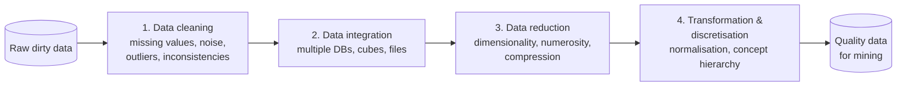

| Task | Purpose |
|---|---|
| **1. Data cleaning** | Fill in missing values, **smooth noisy data**, identify/remove **outliers**, resolve **inconsistencies** |
| **2. Data integration** | Integrate multiple databases, data cubes or files |
| **3. Data reduction** | Obtain a **reduced representation** — dimensionality reduction, numerosity reduction, data compression |
| **4. Data transformation & discretisation** | Convert into forms appropriate for mining — **normalisation** (scale to a range), **discretisation** (values → intervals), **concept-hierarchy generation** (low-level → high-level) |

---

## 3. 📘 Descriptive Data Summarisation ★★
*(listed in the syllabus; summarised from Han & Kamber)*

Descriptive summarisation identifies the typical properties of data and highlights noise/outliers — a prerequisite for cleaning.

| Measure type | Measures | Notes |
|---|---|---|
| **Central tendency** | **Mean** x̄ = Σxᵢ/n (weighted mean, trimmed mean) · **Median** (middle value) · **Mode** (most frequent) · Midrange = (min + max)/2 | Empirical: mean − mode ≈ 3 × (mean − median) |
| **Dispersion** | **Range** = max − min · **Quartiles** Q1, Q3 · **IQR** = Q3 − Q1 · **Variance** σ² = Σ(xᵢ − x̄)²/n · **Standard deviation** σ | Outlier rule: value < Q1 − 1.5·IQR or > Q3 + 1.5·IQR |
| **Five-number summary** | Min, Q1, Median, Q3, Max → **boxplot** | |
| **Graphic displays** | Histograms, quantile plots, q-q plots, **scatter plots**, loess curves | |

*Example:* 4, 8, 15, 21, 21, 24, 25, 28, 34 → mean = 20, median = 21, mode = 21, range = 30.

---

## 4. Data Cleaning — Missing Values ★★★

Data cleaning routines **fill in missing values, smooth out noise while identifying outliers, and correct inconsistencies**.

**Why values are missing:** equipment malfunction; deleted as inconsistent with other data; not entered due to misunderstanding; considered unimportant at entry time; history/changes not registered.

### How to handle missing data
| # | Method | Description | Remark |
|---|---|---|---|
| 1 | **Ignore the tuple** | Remove the record | Usually when the **class label** is missing; poor if many values missing |
| 2 | **Fill manually** | Enter the value by hand | Tedious, often infeasible |
| 3 | **Global constant** | Replace by a constant like "Unknown"/"NA"/−∞ | Mining may treat "Unknown" as an interesting concept |
| 4 | **Attribute mean / median** | Mean for symmetric data, median for skewed | Simple and common |
| 5 | **Class-wise mean/median** | Mean of samples of the **same class** | Smarter than overall mean |
| 6 | **Mode** | Most frequent value (categorical attributes) | |
| 7 | **Most probable value** | **Infer** using regression, Bayesian inference, **decision tree**, k-NN, neural networks | Most popular, uses most information |

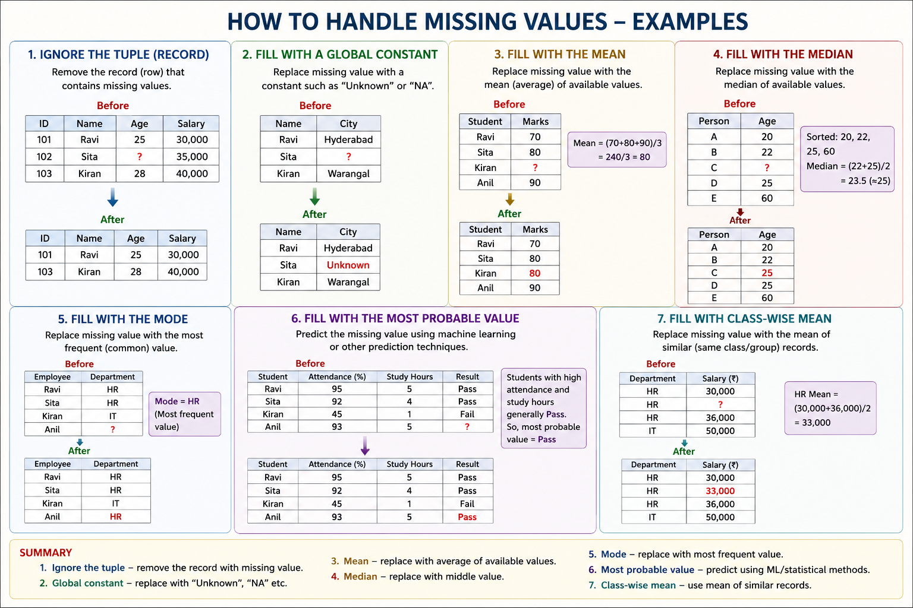

*Example:* Marks = 70, 80, ?, 90 → mean of known values = 80 → fill **80**; median of 20, 22, 25, 60 → **23.5**.

---

## 5. Data Cleaning — Noisy Data ★★★

**Noise** = **random error or variance** in a measured variable — incorrect values or outliers that distort analysis (e.g., Age = 250).

**Causes:** faulty data-collection instruments, data-entry problems, transmission problems, technology limitations, inconsistent naming conventions. Other problems: duplicate, incomplete, inconsistent records.

### 5.1 Binning (smoothing by local neighbourhood) ★★★
1. **Sort** the data.
2. **Partition** into **equal-frequency (equal-depth)** bins.
3. **Smooth** each bin by:
   - **bin means** — every value replaced by the bin mean;
   - **bin medians** — replaced by the bin median;
   - **bin boundaries** — min and max of the bin are boundaries; each value replaced by the **closest boundary**.

**Worked example:** prices = 15, 8, 21, 34, 4, 24, 28, 21, 25 → sorted **4, 8, 15, 21, 21, 24, 25, 28, 34**; 3 bins of 3:

| Bin | Values | By means | By medians | By boundaries |
|---|---|---|---|---|
| Bin 1 | 4, 8, 15 | 9, 9, 9 | 8, 8, 8 | 4, 4, 15 |
| Bin 2 | 21, 21, 24 | 22, 22, 22 | 21, 21, 21 | 21, 21, 24 |
| Bin 3 | 25, 28, 34 | 29, 29, 29 | 28, 28, 28 | 25, 25, 34 |

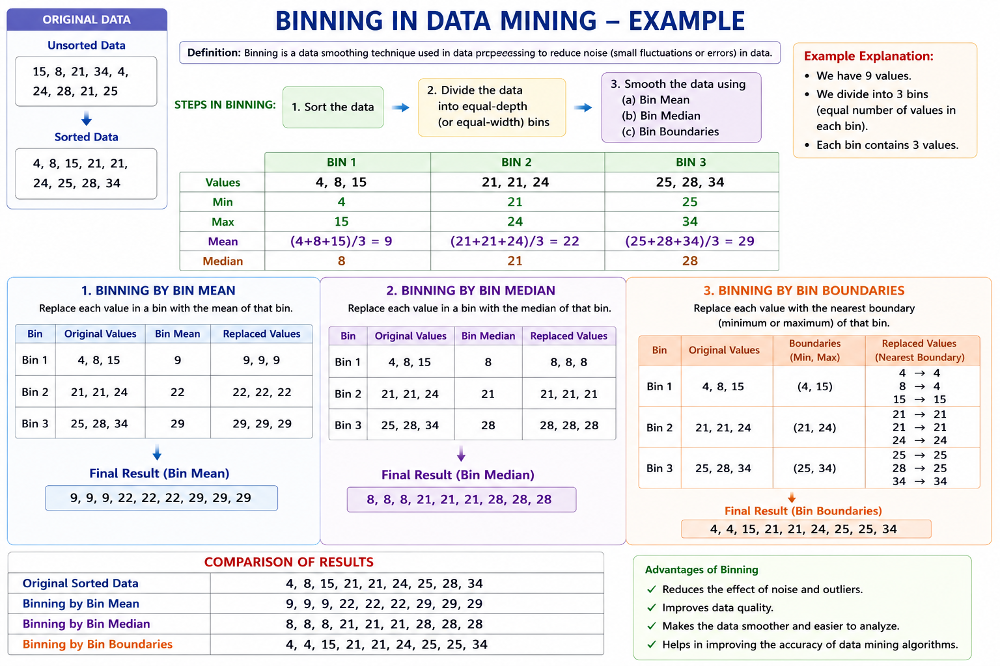

### 5.2 Regression
- **Linear regression** fits the best line to two attributes so one predicts the other; **multiple linear regression** fits a multidimensional surface. Data are smoothed by replacing values with fitted values.

### 5.3 Clustering / Outlier analysis
- Similar values form **clusters**; values falling **outside** clusters are **outliers** → detect and remove.

### 5.4 Combined computer and human inspection
- The computer flags suspicious values; a human checks them.

---

## 6. Data Integration ★★★

**Data integration** merges data from **multiple sources** (databases, data cubes, flat files) into a **coherent data store** (e.g., a data warehouse). Without integration data becomes inconsistent and analysis incorrect. Careful integration **reduces redundancy and inconsistency**.

**Four issues/approaches:**

### 6.1 Entity Identification Problem (record linkage / object identity)
- The **same real-world entity** may be represented differently in different sources.
- **Schema integration:** attribute names differ — `cust_id`, `customer_id`, `cust_no`.
- **Object matching:** structure/value differences — currencies, units, "Ravi Kumar" vs "R. Kumar".
- Use **metadata** (name, meaning, type, range, null rules) to match.

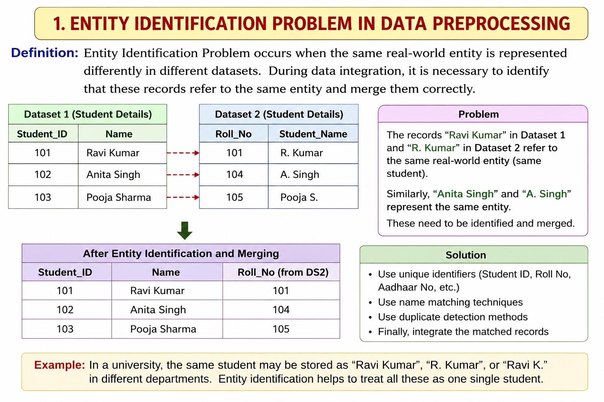

### 6.2 Redundancy and Correlation Analysis ★★★
- An attribute is **redundant** if it can be **derived** from another (DOB → Age; quarterly sales → annual sales).
- Benefits of removal: less storage, better performance, avoids over-fitting, better quality, faster computation.
- **Correlation analysis** measures how strongly two attributes are related; highly correlated attributes → keep one.

**Numeric data — Pearson correlation coefficient:**
$$r_{A,B} = \frac{\sum (a_i - \bar A)(b_i - \bar B)}{n\,\sigma_A\,\sigma_B}$$
- r > 0 → **positive** correlation (A ↑, B ↑); r < 0 → **negative**; r = 0 → **independent**. |r| close to 1 → strong (one may be removed).

**Nominal data — χ² (chi-square) test:**
$$\chi^2 = \sum \frac{(o_{ij} - e_{ij})^2}{e_{ij}},\qquad e_{ij} = \frac{\text{count}(A=a_i)\times \text{count}(B=b_j)}{n}$$
Large χ² → attributes are correlated.

*Example (chi-square):* 1500 people, gender × preferred reading:

| | Male | Female | Total |
|---|---|---|---|
| Fiction | 250 (90) | 200 (360) | 450 |
| Non-fiction | 50 (210) | 1000 (840) | 1050 |
| Total | 300 | 1200 | 1500 |
χ² = (250−90)²/90 + (50−210)²/210 + (200−360)²/360 + (1000−840)²/840 = 284.44 + 121.90 + 71.11 + 30.48 = **507.93** ≫ 10.828 (1 d.o.f., 0.001) → gender and reading preference are **strongly correlated**.

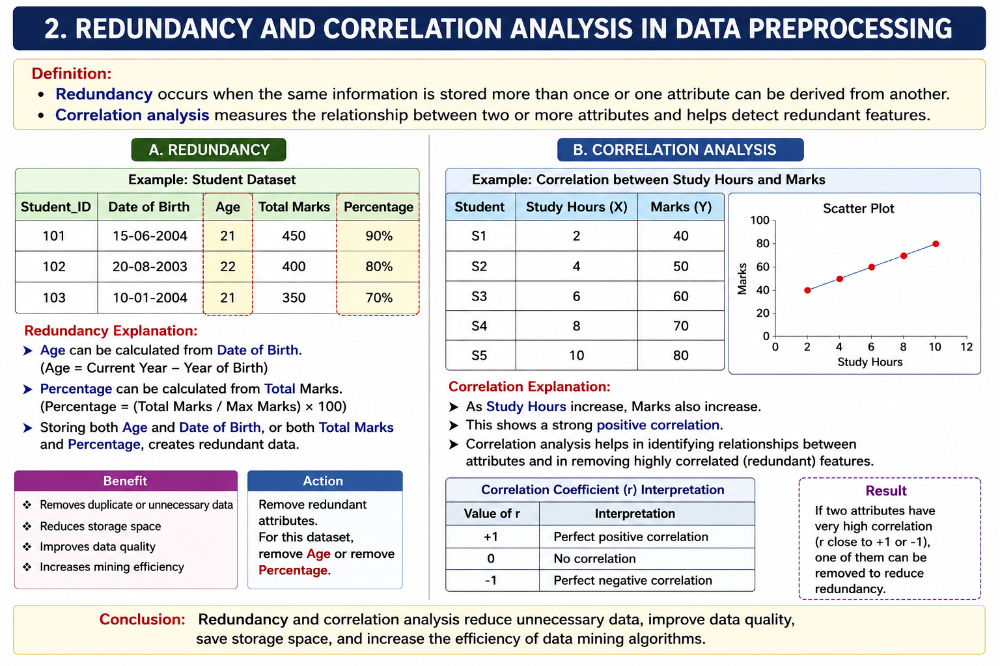

### 6.3 Tuple Duplication
- **Duplicate or near-duplicate records** after combining sources (same student ID twice).
- Causes: multiple sources, different formats/naming, missing unique IDs, spelling variations, data-entry errors; denormalised tables.
- Detect using unique keys, `SELECT DISTINCT`, record-matching algorithms; remove duplicates → better quality, less storage, more accurate mining.

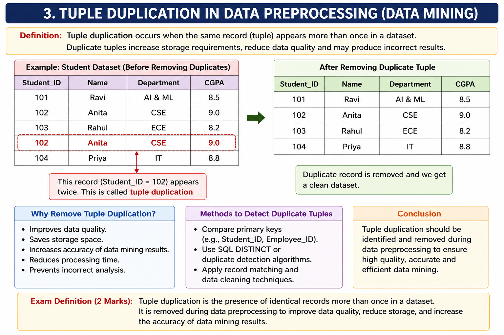

### 6.4 Data Value Conflict Detection & Resolution
- The **same attribute** has **different values** in different sources for the same entity — due to different **representations, scales or encodings** (Male vs M; ₹ vs $; kg vs lb; dates DD/MM vs MM/DD; "AI & ML" vs "Artificial Intelligence & Machine Learning").
- Resolve by **standardising** formats, using data dictionaries/metadata, transformation rules.

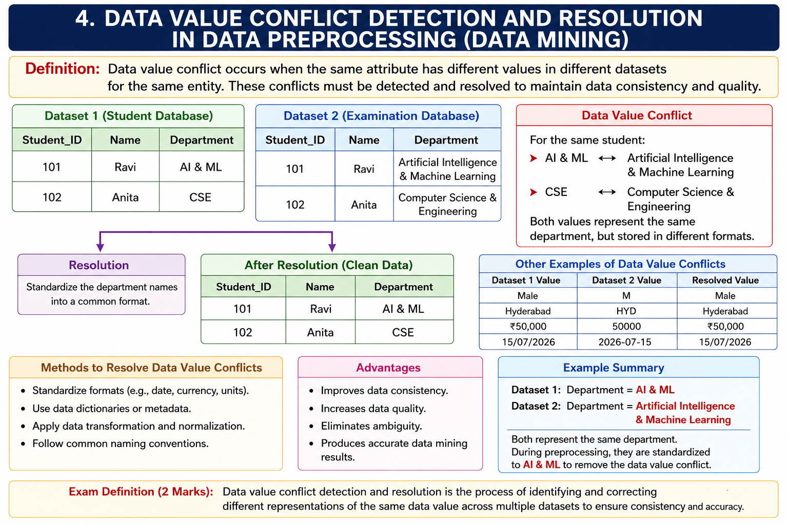

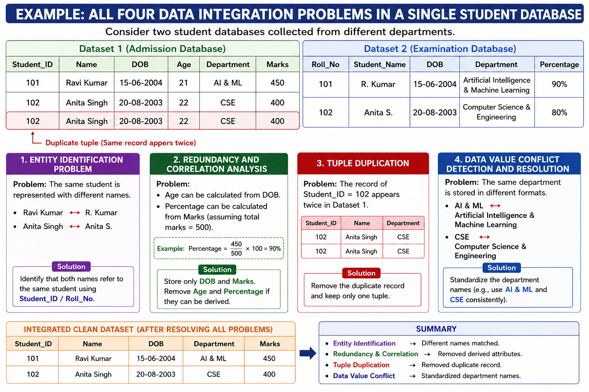

---

## 7. Data Reduction ★★★

**Data reduction** obtains a **reduced representation** of the data set — **much smaller in volume** yet producing (almost) the **same analytical results**.

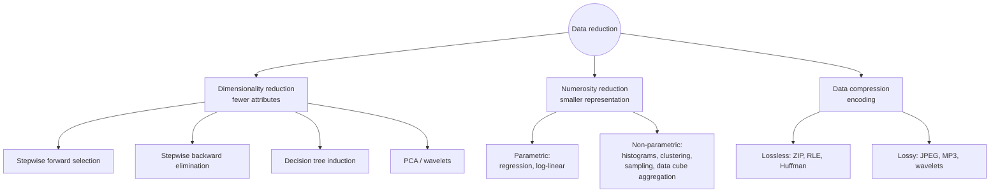

### 7.1 Dimensionality Reduction (attribute subset selection)
Reduces the number of **attributes/features** while preserving important information → better analysis, less storage, faster algorithms, removes irrelevant/redundant features.

| Method | Procedure | Example ({A,B,C,D,E,F}) |
|---|---|---|
| **Stepwise forward selection** | Start with an **empty** set; at each step **add the best** remaining attribute | {} → {C} → {C, E} → **{C, E, B}** |
| **Stepwise backward elimination** | Start with the **full** set; at each step **remove the worst** attribute | {A,B,C,D,E,F} → {A,B,C,D,E} → {A,B,C,E} → **{C, E, B}** |
| **Combined** | Each step adds the best and removes the worst | — |
| **Decision-tree induction** | Build a tree (internal node = test on attribute, branch = outcome, leaf = class); attributes **not appearing** in the tree are irrelevant | Tree uses A4, A1, A6 → reduced set {A1, A4, A6} |

*(Also: Principal Component Analysis, wavelet transforms.)*

### 7.2 Numerosity Reduction
Replace data with **smaller representations** while preserving essential characteristics.

**(a) Parametric** — model the data; store **only the parameters**:
- **Simple linear regression** Y = aX + b.
  | Hours (X) | 1 | 2 | 3 | 4 | 5 |
  |---|---|---|---|---|---|
  | Marks (Y) | 35 | 45 | 55 | 65 | 75 |
  → **Y = 10X + 25**: store only a = 10, b = 25 instead of all records.
- **Multiple linear regression** — two or more independent variables.
- **Log-linear models** — approximate multidimensional probability distributions: log(y) = ax + b.

**(b) Non-parametric** — no model assumed; store actual data or representatives:
| Method | Idea | Example |
|---|---|---|
| **Histograms** | Partition data into **buckets** and store **frequency** per bucket (equal-width / equal-frequency) | Ages 18–19: 2, 20–21: 3, 22–23: 2… |
| **Clustering** | Store only cluster **representatives (centroids)** | Marks 35, 38, 40 → 38; 78, 80, 82 → 80 |
| **Sampling** | A small **random sample** represents the large data (SRSWOR, SRSWR, cluster, stratified) | 500 of 10,000 students |
| **Data cube aggregation** | Store data **summarised** at a higher level | Daily sales → monthly totals |

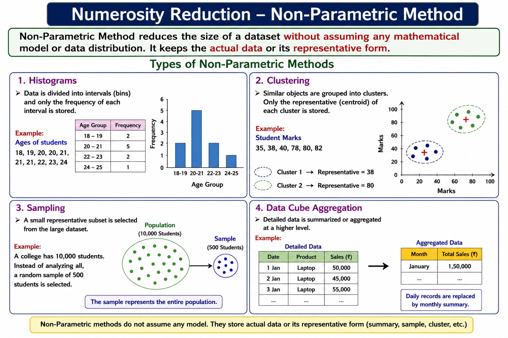

### 7.3 Data Compression
| Lossless | Lossy |
|---|---|
| **No information lost** — perfect reconstruction | **Some information lost** — acceptable when exact reconstruction isn't needed |
| ZIP, **Run-Length Encoding**, **Huffman coding** | **JPEG**, MP3, MPEG, **discrete wavelet transform** (10 MB image → 100 KB) |

---

## 8. Data Transformation ★★★

Data is **converted/consolidated** into a format, structure or scale appropriate for mining.

| # | Technique | Description |
|---|---|---|
| 1 | **Smoothing** | Remove noise — binning, regression, clustering |
| 2 | **Aggregation** | Summary operations — daily sales → monthly/annual totals; used to build **data cubes** at multiple granularities |
| 3 | **Generalisation** | Replace low-level data with **higher-level concepts** via concept hierarchies — street → city → country; age → youth/middle-aged/senior |
| 4 | **Normalisation** | Scale values to a small range like [0, 1] or [−1, 1] |
| 5 | **Attribute (feature) construction** | Construct new attributes to aid mining — area = height × width |
| 6 | **Discretisation** | Raw numeric values → interval or conceptual labels |

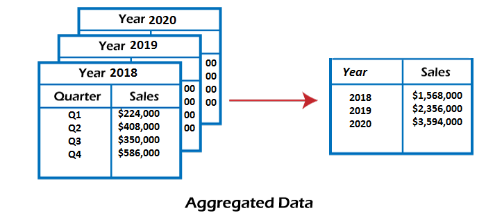

### 8.1 Normalisation Methods ★★★
**Data:** marks 40, 60, 80, 100 (mean = 70, σ = 22.36).

| Method | Formula | Example (A = 40) | B = 60 |
|---|---|---|---|
| **Min-max** (linear to [new_min, new_max]) | v′ = (v − min_A)/(max_A − min_A) × (new_max − new_min) + new_min | (40 − 40)/60 = **0.000** | (60 − 40)/60 = **0.333** |
| **Z-score** (zero-mean) | v′ = (v − Ā)/σ_A | (40 − 70)/22.36 = **−1.34** | **−0.45** |
| **Decimal scaling** | v′ = v / 10ʲ, j = smallest integer with max(\|v′\|) < 1 | 40/1000 = **0.040** | **0.060** |

| Student | Marks | Min-max | Z-score | Decimal scaling (j = 3) |
|---|---|---|---|---|
| A | 40 | 0.000 | −1.34 | 0.040 |
| B | 60 | 0.333 | −0.45 | 0.060 |
| C | 80 | 0.667 | 0.45 | 0.080 |
| D | 100 | 1.000 | 1.34 | 0.100 |

*Classic example:* income range $12,000–$98,000 → min-max of $73,600 to [0, 1] = (73,600 − 12,000)/86,000 = **0.716**; with mean $54,000 and σ $16,000, z = (73,600 − 54,000)/16,000 = **1.225**.

**Benefits:** common scale; better performance of distance-based algorithms (k-NN, clustering, neural nets); prevents large-valued attributes from dominating.

---

## 9. Data Discretisation ★★★

**Discretisation** converts **continuous numeric data** into a **finite number of intervals (bins)** or categories.

**Why:** simplifies data, reduces noise, helps classification/clustering/association, improves interpretability, reduces storage, eases rule learning.

| Method | Description | Pros / Cons |
|---|---|---|
| **Equal-width** | Range divided into intervals of **equal size**: width = (max − min)/k | Simple; may give uneven distributions; sensitive to outliers |
| **Equal-frequency (equal-depth)** | Each interval has ~**same number of records** (100 records, 4 bins → 25 each) | Avoids sparse bins; may group unrelated values |
| **Clustering-based** | k-means etc. forms intervals of similar values | Meaningful, handles skew; more effort |
| **Entropy-based** | Choose split points that **maximise information gain** (supervised, top-down) | Good for classification; computationally intensive |
| **User-defined** | Domain expert defines intervals | Customisable; may not generalise |
| **Histogram / χ²-merging (ChiMerge)** | Bottom-up merging of adjacent intervals with similar class distributions | Supervised |

*Equal-width example:* temperatures 10–50 into 4 intervals of 10 → 10–20, 21–30, 31–40, 41–50.

**Worked example:** ages {21, 35, 28, 42, 50, 18, 70, 30, 40, 70}, 4 equal-width bins:
width = (70 − 18)/4 = 52/4 = **13**
| Bin | Range | Values |
|---|---|---|
| 1 | 18 – 30 | 18, 21, 28, 30 |
| 2 | 31 – 43 | 35, 40, 42 |
| 3 | 44 – 56 | 50 |
| 4 | 57 – 70 | 70, 70 |

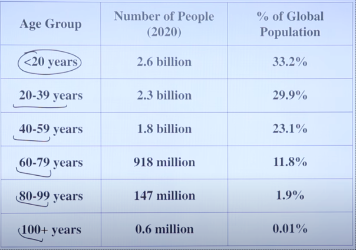

---

## 10. Concept Hierarchy Generation ★★

A **concept hierarchy** organises data values into **multiple levels of abstraction** — from low-level detailed concepts to high-level generalised concepts.

**Purpose:** reduces complexity, supports **multi-level analysis** (roll-up/drill-down in OLAP), discovers patterns at different granularities, better decisions, more efficient mining.

**How created:** identify relationships among values; group lower-level concepts into higher ones; use domain knowledge or data patterns.

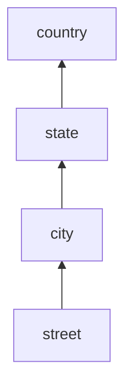
*(e.g., 15 countries ← 365 states ← 3567 cities ← 674,339 streets — fewer distinct values at higher levels)*

**Methods for nominal data (Han & Kamber):**
1. **Partial ordering specified explicitly** by users/experts at schema level — street < city < state < country.
2. **Portion of a hierarchy by explicit data grouping** — {Andhra Pradesh, Telangana, Tamil Nadu} ⊂ South India.
3. **Set of attributes but not their order** — system orders automatically by **number of distinct values** (attribute with most distinct values goes at the lowest level).
4. **Only partial set of attributes** — system uses embedded semantics to complete it.

**For numeric data:** binning, histogram analysis, clustering, entropy-based discretisation, natural partitioning (3-4-5 rule).

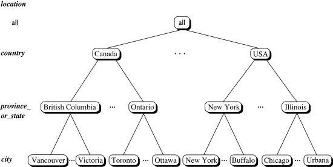

---

## Unit II — One-Page Summary

| Topic | Key points |
|---|---|
| **Why preprocess** | Real data is incomplete, noisy, inconsistent (incl. disguised missing). No quality data → no quality results. |
| **Major tasks** | Cleaning · Integration · Reduction · Transformation & discretisation. |
| **📘 Summarisation** | Mean, median, mode, midrange; range, quartiles, IQR, variance, SD; five-number summary/boxplot; outliers beyond 1.5·IQR. |
| **Missing values** | Ignore tuple · manual · global constant · mean/median · class-wise mean · mode · most probable value (regression, Bayes, decision tree, k-NN). |
| **Noise** | **Binning** (sort → equal-frequency bins → smooth by means/medians/boundaries; 4 8 15 → 9 9 9 / 8 8 8 / 4 4 15) · regression · clustering/outliers · human inspection. |
| **Integration** | Entity identification (schema integration, object matching) · Redundancy & correlation (Pearson r, χ²) · Tuple duplication · Data value conflicts (units, encodings). |
| **Reduction** | Dimensionality (forward selection, backward elimination, decision tree → {C,E,B}) · Numerosity — parametric (regression Y = 10X + 25, log-linear), non-parametric (histograms, clustering, sampling, cube aggregation) · Compression (lossless vs lossy, wavelets). |
| **Transformation** | Smoothing, aggregation, generalisation, normalisation, attribute construction, discretisation. |
| **Normalisation** | Min-max (v−min)/(max−min); Z-score (v−mean)/σ; decimal scaling v/10ʲ. B = 60 → 0.333 / −0.45 / 0.060. |
| **Discretisation** | Equal-width (width = (max−min)/k; ages → 13), equal-frequency, clustering, entropy, user-defined, ChiMerge. |
| **Concept hierarchy** | Multi-level abstraction (street < city < state < country); explicit ordering, grouping, auto-ordering by distinct values. |
