# Unit III — Data Warehousing & OLAP Technology: An Overview

> **Syllabus:** What is a data warehouse, multidimensional data model (data cubes, star/snowflake/fact-constellation schemas, measures, concept hierarchies, OLAP operations), data warehouse architecture (three-tier, warehouse models, back-end tools, metadata, OLAP servers), data warehouse implementation (cube computation, materialisation, indexing), from data warehousing to data mining (OLAM).
>
> **Source:** *DWDM Unit III-2026.ppt* (SNIST) — Han & Kamber, Ch. 3/4

**Importance legend:** ★★★ = very frequently asked (long answer) · ★★ = medium · ★ = short answer

---

## Table of Contents
1. [Introduction & Definition of a Data Warehouse](#1-introduction--definition-of-a-data-warehouse-)
2. [OLTP vs OLAP](#2-oltp-operational-dbms-vs-olap-data-warehouse-)
3. [Multidimensional Data Model & Data Cube](#3-multidimensional-data-model--data-cube-)
4. [Schemas — Star, Snowflake, Fact Constellation](#4-schemas-for-multidimensional-databases-)
5. [Defining Schemas in DMQL](#5-defining-schemas-in-dmql-)
6. [Measures — Distributive, Algebraic, Holistic](#6-measures-distributive-algebraic-holistic-)
7. [Concept Hierarchies](#7-concept-hierarchies-)
8. [OLAP Operations](#8-olap-operations-)
9. [Data Warehouse Architecture — Two-tier & Three-tier](#9-data-warehouse-architecture-)
10. [Data Warehouse Models — Enterprise, Data Mart, Virtual](#10-data-warehouse-models-)
11. [Development Approach, Back-End Tools & Metadata](#11-development-approach-back-end-tools--metadata-)
12. [OLAP Servers — ROLAP, MOLAP, HOLAP](#12-types-of-olap-servers-)
13. [Data Warehouse Implementation — Cube Computation & Materialisation](#13-data-warehouse-implementation-)
14. [Indexing OLAP Data — Bitmap & Join Indices](#14-indexing-olap-data-)
15. [From Data Warehousing to Data Mining — OLAM](#15-from-data-warehousing-to-data-mining-)
16. [Unit III — One-Page Summary](#unit-iii--one-page-summary)

---

## 1. Introduction & Definition of a Data Warehouse ★★★

- Data warehouses **generalise and consolidate** data in **multidimensional space**. Construction involves **data cleaning, integration and transformation** — an important **pre-processing step for data mining**.
- Provide **OLAP tools** for interactive analysis of multidimensional data at varied **granularities**, facilitating generalisation and mining (association, classification, prediction, clustering can be integrated with OLAP).
- Data warehousing provides **architectures and tools** for business executives to **organise, understand and use** their data to make **strategic decisions**.
- A **data warehouse** is a **centralised repository** storing large amounts of data from multiple sources for **reporting, analysis and decision-making**.

> **Inmon:** "A data warehouse is a **subject-oriented, integrated, time-variant, and non-volatile** collection of data in support of management's decision-making process."

| Property | Meaning |
|---|---|
| **Subject-oriented** | Organised around major subjects (sales, customer, product), excluding data not useful for decisions |
| **Integrated** | Multiple heterogeneous sources made consistent (naming, encoding, units) |
| **Time-variant** | Historical perspective (5–10 years); time element in every key structure |
| **Non-volatile** | Physically separate from operational data; only **initial load** and **access** — no update/transaction processing |

**How organisations use warehouse information:** increasing customer focus (buying-pattern analysis) · repositioning products (sales performance) · analysing operations for efficiency · identifying profit opportunities (revenue vs cost) · CRM · responding to market changes · managing assets and reducing costs.

---

## 2. OLTP (Operational DBMS) vs OLAP (Data Warehouse) ★★★

| Feature | **OLTP** | **OLAP** |
|---|---|---|
| Full form | Online Transaction Processing | Online Analytical Processing |
| Purpose | Day-to-day transactions | Analysis & decision making |
| Orientation | **Customer-oriented** | **Market-oriented** |
| Data | Current, detailed, up-to-date | **Historical**, integrated, summarised |
| Users | Clerks, customers, IT professionals | Managers, executives, analysts |
| Operations | Insert, update, delete (short atomic transactions) | Read, analyse, aggregate (complex queries) |
| Access | Read/write, index/hash on primary key | Mostly read, lots of scans |
| Records accessed | Tens | Millions |
| Response time | Milliseconds | Seconds to minutes |
| DB design | **ER model, normalised** (application-oriented) | **Star/snowflake**, denormalised (subject-oriented) |
| Refresh | Continuous, real-time | Periodic batch (ETL) |
| Size | MB–GB | GB–TB–PB |
| Concurrency | Thousands of users | Fewer analytical users |
| Metric | Transaction throughput | Query throughput, response time |
| Examples | ATM, online banking, e-commerce | Sales analysis, BI, forecasting |

**Why a separate data warehouse?** Performance (OLTP tuned for transactions; OLAP queries would degrade it), different functions and data — OLAP needs historical, consolidated data and different structures/methods.

---

## 3. Multidimensional Data Model & Data Cube ★★★

- Data warehouses and OLAP tools are based on a **multidimensional data model** that views data as a **data cube**.
- **Data cube** — multidimensional representation of data allowing analysis along several **dimensions** (time, item, location) quickly.

| Component | Meaning | Example |
|---|---|---|
| **Dimensions** | Perspectives/entities about which data is kept; each has a **dimension table** of descriptive attributes | time (day, week, month, quarter, year), item (item_name, brand, type) |
| **Facts / measures** | **Numeric** quantities to analyse; stored in the **fact table** with keys to each dimension table | dollars_sold, units_sold, profit |

**2-D view** — AllElectronics sales in Vancouver (dollars sold, thousands):
| time (quarter) | home entertainment | computer | phone | security |
|---|---|---|---|---|
| Q1 | 605 | 825 | 14 | 400 |
| Q2 | 680 | 952 | 31 | 512 |
| Q3 | 812 | 1023 | 30 | 501 |
| Q4 | 927 | 1038 | 38 | 580 |

Adding *location* gives a 3-D cube; adding *supplier* a 4-D cube.

### 3.1 Lattice of cuboids
- Each possible **group-by** of dimensions is a **cuboid**.
- **Base cuboid** = n-D cuboid with the lowest level of summarisation.
- **Apex cuboid** = 0-D cuboid (**all**) — highest summarisation.
- The **lattice of cuboids** forms the data cube.

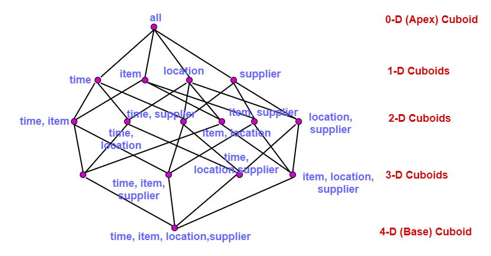

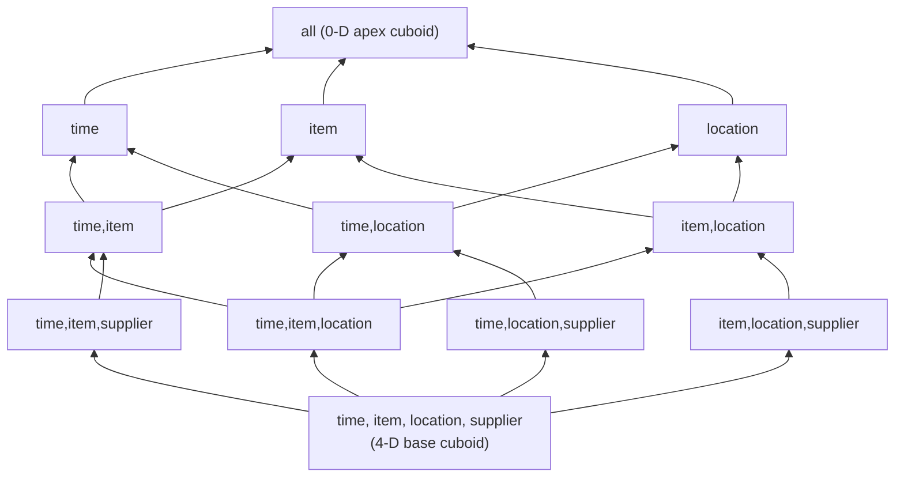

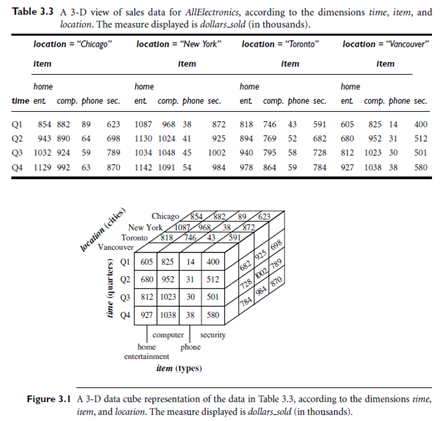

---

## 4. Schemas for Multidimensional Databases ★★★

### 4.1 Star Schema
- **One large central fact table** (bulk of data, no redundancy) + **a set of smaller dimension tables**, one per dimension → star shape.
- Fact table holds measures + foreign keys; dimension tables hold descriptive attributes (**denormalised**).

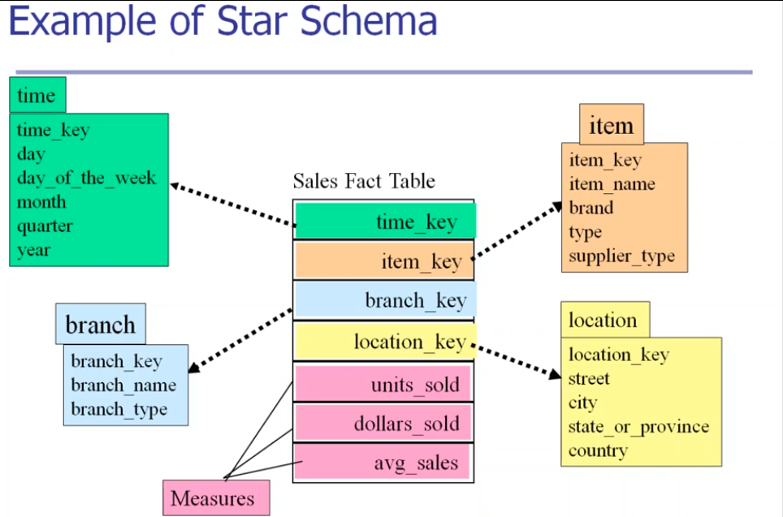

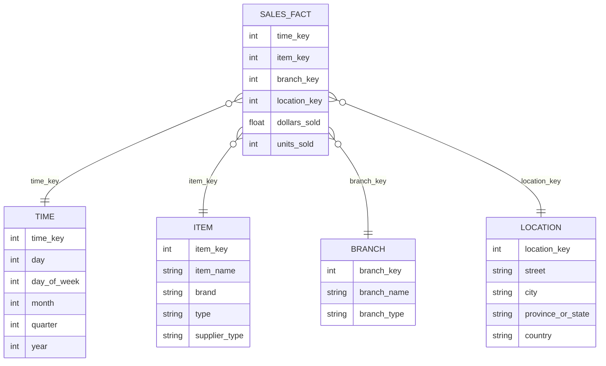

### 4.2 Snowflake Schema
- A **variant** of the star schema in which some **dimension tables are normalised**, splitting data into additional tables → snowflake shape (e.g., item → supplier table; location → city table).

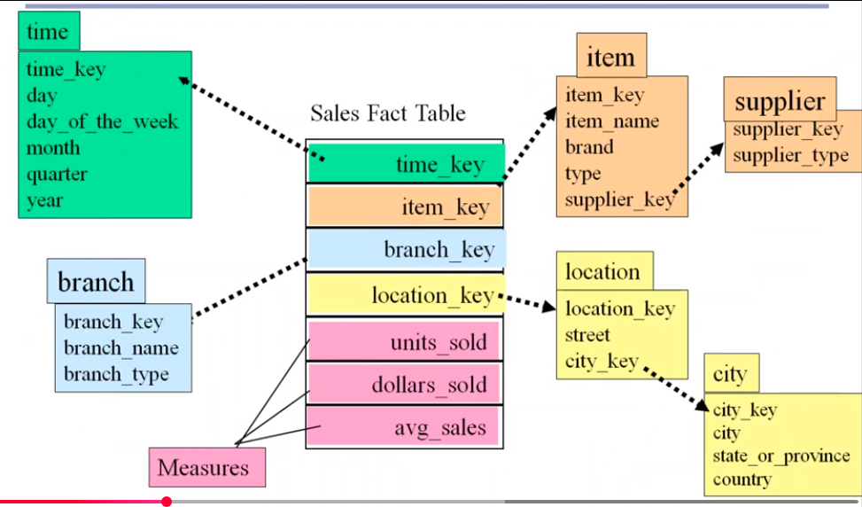

### 4.3 Fact Constellation (Galaxy Schema)
- **Multiple fact tables share dimension tables** — a collection of stars (e.g., *sales* and *shipping* facts sharing time, item, location).

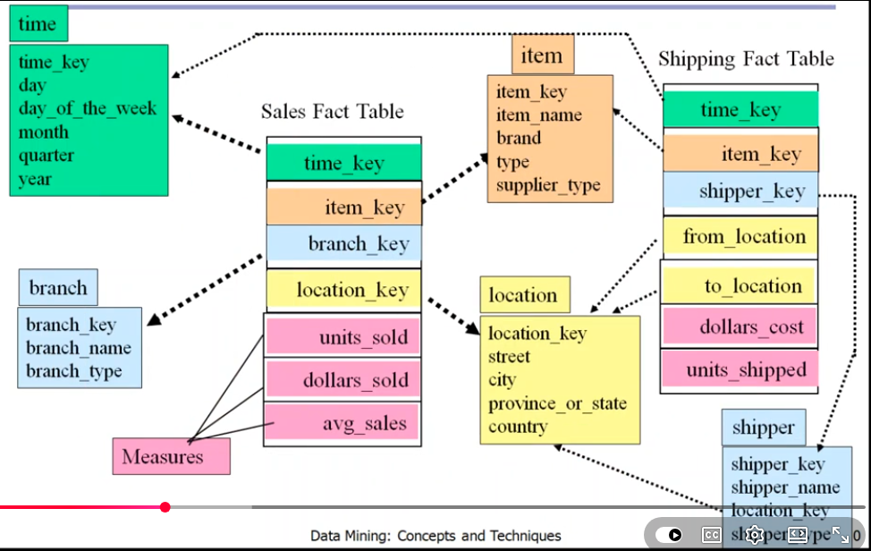

### 4.4 Comparison ★★★
| Aspect | Star | Snowflake | Fact constellation |
|---|---|---|---|
| Structure | 1 fact + denormalised dimensions | 1 fact + **normalised** dimensions | **Multiple facts** sharing dimensions |
| Redundancy | Higher (in dimensions) | Lower | Reduced via shared dimensions |
| Joins / query speed | Fewer joins, **fastest** | More joins, slower | Complex queries |
| Storage | More | Saves space | — |
| Design | Simple, easy to understand | More complex, better integrity, complex hierarchies | Most complex; enterprise-wide |
| Use | Data marts, most common | When dimension tables are large | Enterprise warehouses |

---

## 5. Defining Schemas in DMQL ★

```
define cube <cube_name> [<dimension_list>]: <measure_list>
define dimension <dimension_name> as (<attribute_or_subdimension_list>)
define dimension <name> as <name_first_time> in cube <cube_name_first_time>   -- shared
```

**Star:**
```
define cube sales_star [time, item, branch, location]:
    dollars_sold = sum(sales_in_dollars), units_sold = count(*)
define dimension time as (time_key, day, day_of_week, month, quarter, year)
define dimension item as (item_key, item_name, brand, type, supplier_type)
define dimension branch as (branch_key, branch_name, branch_type)
define dimension location as (location_key, street, city, province_or_state, country)
```
**Snowflake** — normalised sub-dimensions:
```
define dimension item as (item_key, item_name, brand, type, supplier(supplier_key, supplier_type))
define dimension location as (location_key, street, city(city_key, province_or_state, country))
```
**Fact constellation** — a second cube sharing dimensions:
```
define cube shipping [time, item, shipper, from_location, to_location]:
    dollar_cost = sum(cost_in_dollars), unit_shipped = count(*)
define dimension time as time in cube sales
define dimension item as item in cube sales
define dimension shipper as (shipper_key, shipper_name, location as location in cube sales, shipper_type)
define dimension from_location as location in cube sales
define dimension to_location as location in cube sales
```

---

## 6. Measures: Distributive, Algebraic, Holistic ★★★

A **measure** is a numeric function evaluated at each point of the cube.

| Category | Definition | Examples |
|---|---|---|
| **Distributive** | Can be computed by partitioning the data, applying the function to each partition, and **combining** the results with the same function | **SUM, COUNT, MIN, MAX** |
| **Algebraic** | Computed by an **algebraic function of M (bounded) distributive measures** | **AVG = SUM/COUNT**, min_N(), max_N(), **standard deviation** |
| **Holistic** | **No constant bound** on the storage needed to describe a sub-aggregate — needs (nearly) the whole dataset | **MEDIAN, MODE, RANK** |

Distributive and algebraic measures allow **efficient cube computation**; holistic measures are hard (approximations used).

---

## 7. Concept Hierarchies ★★

A **concept hierarchy** defines a sequence of mappings from **low-level (detailed)** concepts to **higher-level (general)** concepts.
- **Location:** street < city < province_or_state < country (Vancouver → British Columbia → Canada; Chicago → Illinois → USA).
- **Time:** day < {month < quarter; week} < year — a **lattice** (partial order), since weeks don't nest in months.
- **Set-grouping hierarchies:** price ranges ($0–$100], ($100–$200]…

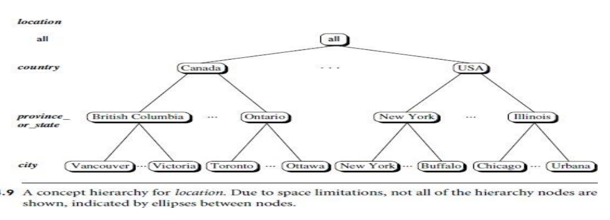

---

## 8. OLAP Operations ★★★

| Operation | What it does | Example |
|---|---|---|
| **Roll-up (drill-up)** | **Aggregates** by **climbing up** a concept hierarchy or by **dimension reduction** → summarised data | location city → **country**; remove time dimension |
| **Drill-down (roll-down)** | Reverse of roll-up — **less detailed → more detailed** by stepping down a hierarchy or **adding a dimension** | time quarter → **month** |
| **Slice** | Selection on **one dimension** → sub-cube | time = "Q1" |
| **Dice** | Selection on **two or more dimensions** → sub-cube | (location = Toronto or Vancouver) and (time = Q1 or Q2) and (item = home entertainment or computer) |
| **Pivot (rotate)** | **Rotates the axes** for an alternative presentation | swap item and location axes in a 2-D slice |
| *Others* | **Drill-across** (across multiple fact tables), **drill-through** (to back-end relational tables), ranking (top-N), moving averages | — |

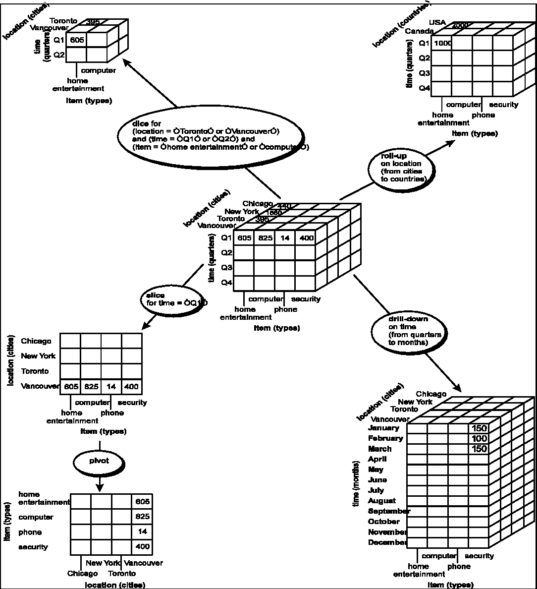

| Roll-up | Drill-down |
|---|---|
| 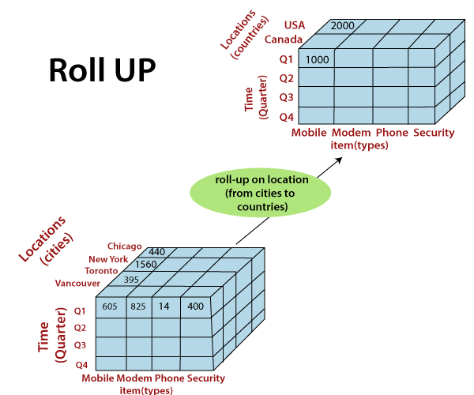 | 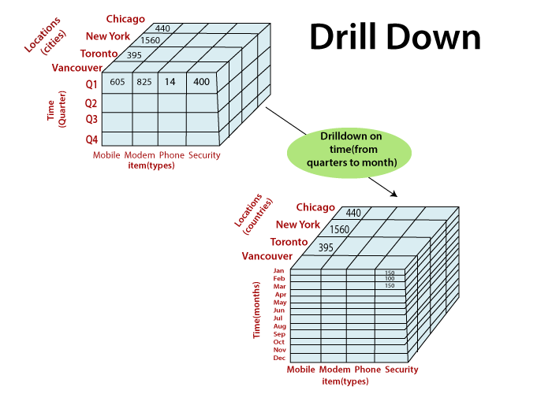 |

| Slice | Dice | Pivot |
|---|---|---|
| 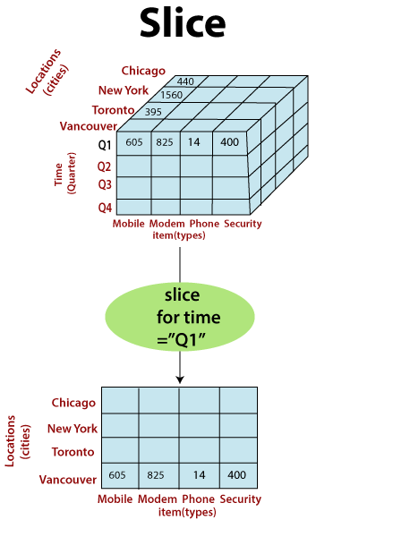 | 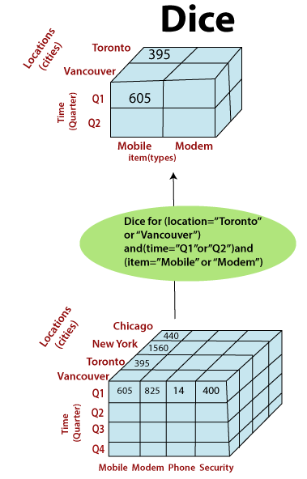 | 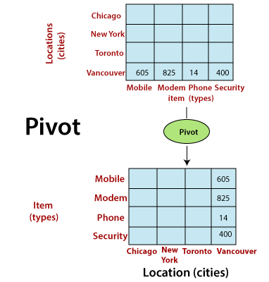 |

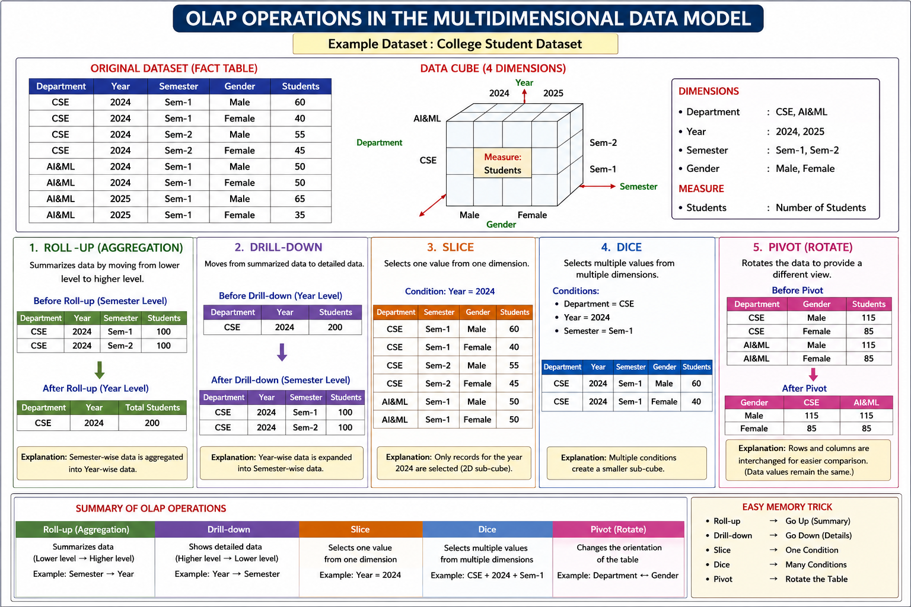

---

## 9. Data Warehouse Architecture ★★★

**Data-warehouse architecture** = the overall design defining how data is **collected** from sources, **processed, stored, managed and accessed** for analysis.

**What business analysts gain:** single source of truth · historical analysis · faster decisions · OLAP (slice, dice, roll-up, drill-down) · better data quality · customer & market insights · KPIs/dashboards · strategic & tactical planning → **competitive advantage, productivity, CRM, cost reduction**.

### 9.1 Two-Tier Architecture
**Client–server**: the warehouse and analysis tools are **directly connected**; for small/medium organisations with few users.

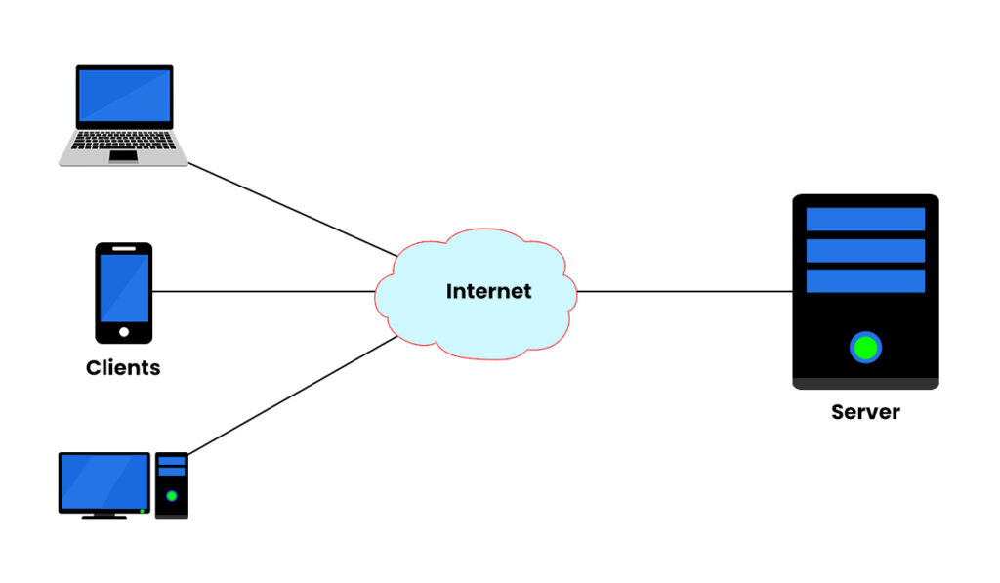

| Advantages | Disadvantages |
|---|---|
| Simple, fast to implement, low cost | Not for large organisations; limited scalability |
| Direct client–warehouse communication; easy maintenance | Direct DB access increases server load; reduced security |
| Fast response with few users | Performance drops with many concurrent users |

### 9.2 Three-Tier Architecture ★★★
The most widely used architecture — separates **storage, processing and presentation**.

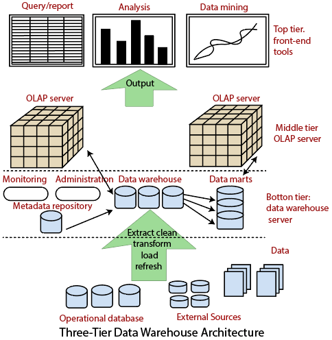

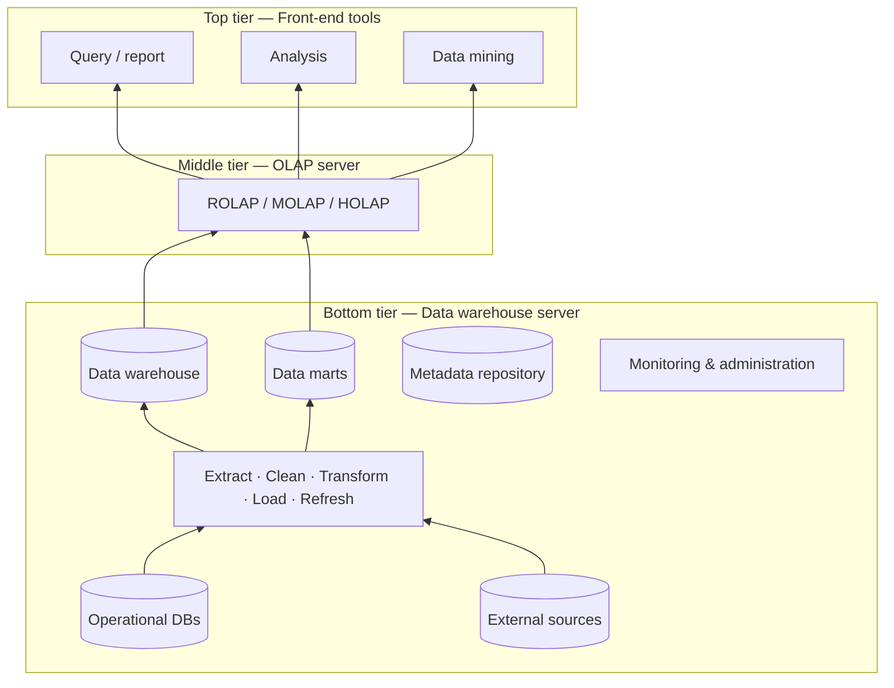

| Tier | Components & role |
|---|---|
| **Bottom — warehouse database server** (usually RDBMS) | Data from **operational DBs** (banking, student info, ERP, CRM) and **external sources** (Excel/CSV, govt DBs, web services, social media, sensors) fed via **back-end tools (ETL)** — extract, clean, transform, load, refresh; **data warehouse** and **data marts**; **metadata repository**; monitoring & administration. Uses **gateways** (ODBC, OLE-DB, JDBC) |
| **Middle — OLAP server** | Implements **ROLAP** (extended RDBMS mapping multidimensional operations to relational ones) or **MOLAP** (special-purpose server directly implementing multidimensional data/operations); converts warehouse data into **cubes** (e.g., dims Time, Course, Department; measure Student Count) |
| **Top — front-end client layer** | **Query & reporting** (monthly sales, results), **analysis** (charts, dashboards, trends), **data mining** (classification, clustering, association, prediction — e.g., predict likely-to-fail students) |

---

## 10. Data Warehouse Models ★★★

| Model | Scope | Characteristics |
|---|---|---|
| **Enterprise warehouse** | **Entire organisation** — all subjects | Corporate-wide integration; detailed + summarised data; GBs–TBs+; mainframes, super-servers, parallel platforms; extensive business modelling; **years** to build |
| **Data mart** | **Subset** of corporate data for a **specific group** (e.g., marketing) | Summarised data; low-cost departmental servers (UNIX/Linux/Windows); **weeks** to implement; may cause integration problems if not planned enterprise-wide. **Independent** (from operational systems/external/local data) vs **Dependent** (sourced from the enterprise warehouse) |
| **Virtual warehouse** | **Set of views** over operational databases | Only some summary views **materialised**; easy to build but needs excess capacity on operational servers |

---

## 11. Development Approach, Back-End Tools & Metadata ★★

### 11.1 Top-down vs Bottom-up
| Top-down (enterprise warehouse first) | Bottom-up (independent data marts first) |
|---|---|
| Systematic; **minimises integration problems** | **Flexible, low cost, rapid ROI** |
| Expensive, long development, inflexible (hard to agree on a common model) | Integrating disparate marts later is problematic |

### 11.2 Recommended approach — incremental & evolutionary
1. Define a **high-level corporate data model** in a short period (1–2 months) — consistent, integrated view.
2. Implement **independent data marts in parallel** with the enterprise warehouse, based on the same model.
3. Build **distributed data marts** integrated via **hub servers**.
4. Construct a **multi-tier data warehouse** — the enterprise warehouse is the **sole custodian** of all data, distributed to **dependent data marts**.

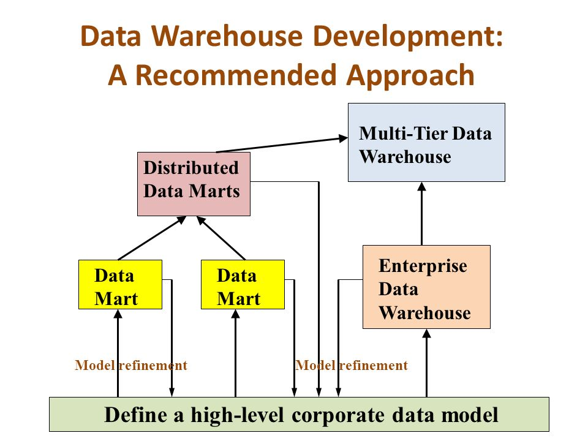

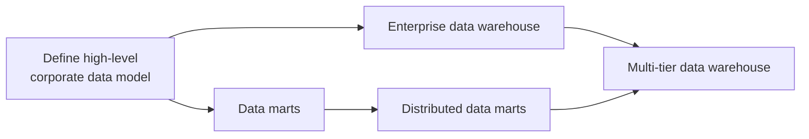

### 11.3 Back-End Tools & Utilities (ETL)
| Function | Description |
|---|---|
| **Data extraction** | Gather data from multiple, heterogeneous and external sources |
| **Data cleaning** | Detect errors in data and rectify them where possible |
| **Data transformation** | Convert data from legacy/host format to warehouse format |
| **Load** | Sort, summarise, consolidate, compute views, check integrity, build indices and partitions |
| **Refresh** | Propagate updates from data sources to the warehouse |

### 11.4 Metadata Repository ★★
**Metadata = data about data** — data that **define warehouse objects** (names, definitions, timestamps of extracted data, source, fields added by cleaning). Stored in the bottom tier. Contains:
1. **Description of the warehouse structure** — schema, views, dimensions, hierarchies, derived-data definitions, data-mart locations & contents.
2. **Operational metadata** — **data lineage** (history & transformation path), **currency** (active, archived, purged), monitoring info (usage statistics, error reports, audit trails).
3. **Summarisation algorithms** — measure & dimension definitions, granularity, partitions, subject areas, aggregation, predefined queries/reports.
4. **Mapping from the operational environment to the warehouse** — source DBs, gateways, partitions, extraction/cleaning/transformation rules, refresh & purge rules, security.
5. **System-performance data** — indices, profiles, refresh/update/replication timing.
6. **Business metadata** — business terms & definitions, data ownership, charging policies.

---

## 12. Types of OLAP Servers ★★★

| Server | Description |
|---|---|
| **ROLAP (Relational OLAP)** | Intermediate servers between a **relational back-end** and front-end tools; use RDBMS/extended RDBMS + OLAP middleware; optimisation per DBMS, aggregation navigation logic; **greater scalability** (e.g., MicroStrategy DSS) |
| **MOLAP (Multidimensional OLAP)** | **Array-based** multidimensional storage engines; map views **directly to cube arrays** → fast indexing to **precomputed summaries**; **two-level storage** — dense sub-cubes as arrays, sparse sub-cubes compressed (e.g., Oracle Essbase, Cognos PowerPlay) |
| **HOLAP (Hybrid OLAP)** | Combines ROLAP **scalability** and MOLAP **speed** — detail data in relational DB, aggregations in MOLAP store (e.g., Microsoft SQL Server Analysis Services) |
| **Specialised SQL servers** | Advanced query language & processing for SQL over star/snowflake schemas in a read-only environment |

| Feature | ROLAP | MOLAP | HOLAP |
|---|---|---|---|
| Storage | Relational tables | Multidimensional cubes | Summaries in cubes + detail in RDB |
| Query performance | Slower (SQL at query time) | **Very fast** (pre-aggregated) | Fast |
| Scalability | **Excellent** for huge data | Limited | Good |
| Storage need | Low | **High** | Moderate |
| Aggregation | At query time | Precomputed | Precomputed summaries + detail on demand |
| Complex calculations | Less efficient | Highly efficient | Efficient |
| Maintenance | Easier | Cube rebuilds | Moderate |

---

## 13. Data Warehouse Implementation ★★★

OLAP queries over huge data must be answered in **seconds** → need efficient **cube computation, indexing and query processing**.

### 13.1 Compute Cube Operator
- Aggregation = SQL **GROUP BY**; each group-by = one **cuboid**; all cuboids = data cube.
- `compute cube` (SQL `GROUP BY CUBE`) computes aggregates over **all subsets** of the given dimensions:
```sql
SELECT city, item, year, SUM(sales)
FROM Sales
GROUP BY CUBE (city, item, year);
```
→ 8 group-bys: (city, item, year), (city, item), (city, year), (item, year), (city), (item), (year), ().
DMQL: `define cube sales_cube [city, item, year]: sum(sales_in_dollars)` then `compute cube sales_cube`.

### 13.2 Curse of Dimensionality ★★★
- Without hierarchies, an n-dimensional cube has **2ⁿ cuboids** (2 → 4, 3 → 8, 4 → 16, 5 → 32, 10 → 1024).
- With hierarchies:
$$T = \prod_{i=1}^{n} (L_i + 1)$$
where Lᵢ = number of levels of dimension i (the +1 is the virtual top level **all**).
  - *Example:* 10 dimensions each with 4 levels → T = 5¹⁰ ≈ **9.8 × 10⁶** cuboids.
- More dimensions, levels and higher **cardinality** → exponential growth in storage and computation → impossible to precompute everything.


### 13.3 Materialisation ★★★
| Option | What is stored | Pros | Cons |
|---|---|---|---|
| **No materialisation** | Only the **base cuboid** (fact table) | Minimum storage, simple | Very slow queries — computed on the fly |
| **Full materialisation** | **All cuboids** (the **full cube**) | **Fastest** queries | Huge storage, long precomputation, costly maintenance |
| **Partial materialisation** | A **selected subset** of cuboids | Balance of space and time; **most common** | Some queries still computed |

Partial-materialisation variants:
- **Iceberg cube** — stores only cells whose aggregate ≥ a **minimum support threshold** (avoids sparse, trivial cells).
- **Shell cube** — precomputes cuboids for only a **small number of dimensions** (3–5); others on demand.

Selection considers workload, query frequency, access cost, update cost, storage. Efficient computation methods: multiway array aggregation (MOLAP), BUC, Star-Cubing.

---

## 14. Indexing OLAP Data ★★★

### 14.1 Bitmap Index
- For each **distinct value v** of an attribute, keep a **bit vector** with one bit per record: **1 if the record has value v**, else 0. Index on a column with *n* distinct values needs *n* bit vectors.

*Example — base table and bitmap on `city`:*
| RID | item | city |
|---|---|---|
| R1 | H | V |
| R2 | C | V |
| R3 | P | V |
| R4 | S | V |
| R5 | H | T |
| R6 | C | T |
| R7 | P | T |
| R8 | S | T |

| RID | V | T |
|---|---|---|
| R1–R4 | 1 | 0 |
| R5–R8 | 0 | 1 |

(H = home entertainment, C = computer, P = phone, S = security; V = Vancouver, T = Toronto.) A query "city = V AND item = C" becomes a **bitwise AND** of two vectors → R2.

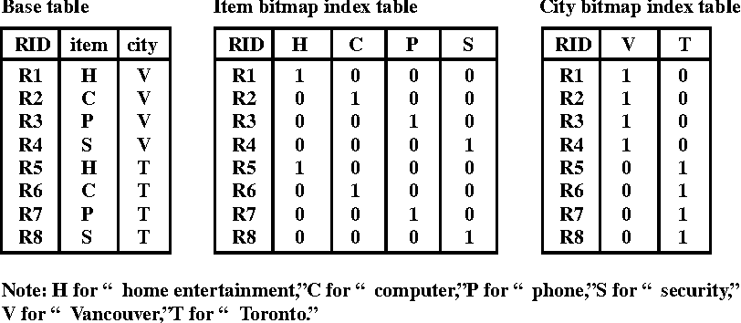

**Advantages:** very fast search (bit operations), less query time, reduced space and I/O, efficient for comparison, join and aggregation; **best for low-cardinality** attributes (gender, city).

### 14.2 Join Index
- Stores **pre-joined relationships** between **fact-table rows and dimension values** — registers joinable rows of two relations; e.g., join index for location "Main Street" lists all sales fact tuples for that location.
- Speeds up **star-schema** joins; **composite (multi-way) join indices** span multiple dimensions. Bitmapped join indices combine both ideas.

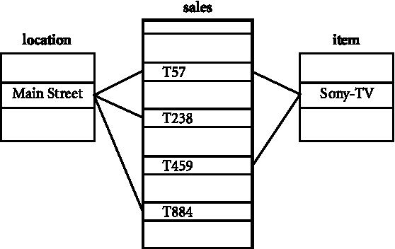

**Efficient query processing:** determine which operations to perform on available cuboids (selection, projection, roll-up) and which **materialised cuboid** to use (the smallest one that can answer the query, cheapest cost).

---

## 15. From Data Warehousing to Data Mining ★★★

### 15.1 Data Warehouse Usage — three kinds of applications
| Application | What it supports | Example |
|---|---|---|
| **Information processing** | Querying, basic statistics, **reporting** with crosstabs, tables, charts | Monthly sales by region |
| **Analytical processing (OLAP)** | Multidimensional analysis — slice, dice, drill-down, roll-up, pivot | Drill from yearly to monthly sales by product & region |
| **Data mining** | **Knowledge discovery** — associations, classification, prediction, clustering; visualisation | Customers buying laptops also buy laptop bags |

### 15.2 Online Analytical Mining (OLAM) — Why? ★★★
**OLAM (OLAP mining)** integrates **OLAP with data mining** — mining knowledge in multidimensional databases.
1. **High quality of data in warehouses** — integrated, consistent, cleaned data → reliable results.
2. **Available information-processing infrastructure** — ODBC, OLE DB, web access, reporting and OLAP tools.
3. **OLAP-based exploratory data analysis** — mine with drill-down, roll-up, slice, dice, pivot at different granularities.
4. **Online selection of data-mining functions** — choose association, classification, clustering, prediction interactively and switch between them.
5. *(Integration of multiple mining functions and algorithms in one environment — e.g., cluster then classify.)*

### 15.3 OLAM Architecture ★★★
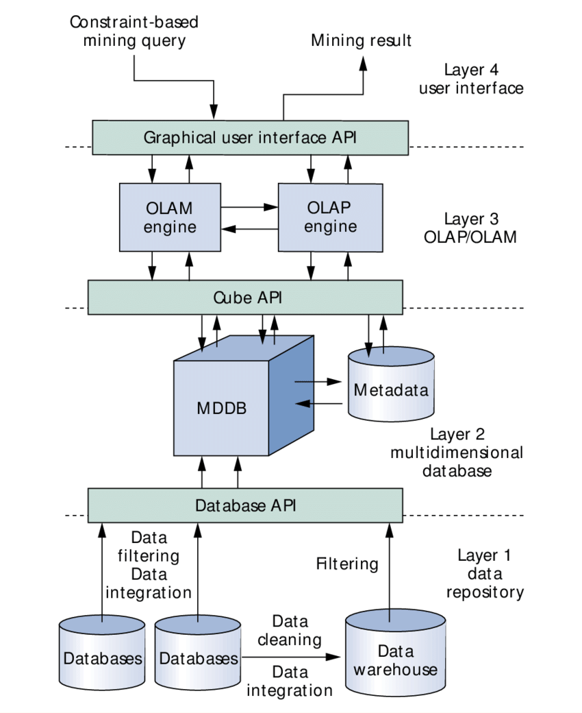

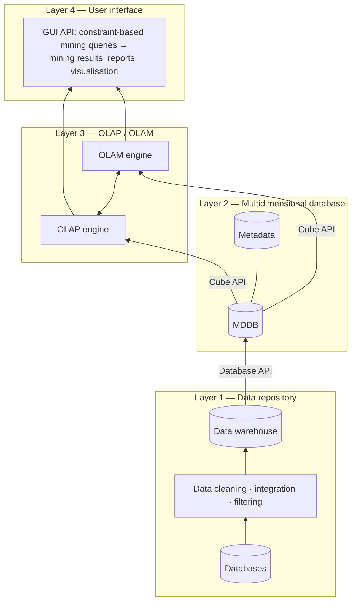

**Flow:** data from operational DBs → cleaned, integrated, filtered → warehouse → multidimensional cubes (MDDB) → **OLAP engine** (multidimensional analysis) and **OLAM engine** (mining) share the **Cube API** and metadata → results via GUI.

**Advantages:** integrates OLAP and mining; uses high-quality warehouse data; interactive, exploratory, **multidimensional/drill-down mining**; constraint-based mining queries; faster, more accurate discovery.

---

## Unit III — One-Page Summary

| Topic | Key points |
|---|---|
| **Data warehouse** | Subject-oriented, integrated, time-variant, non-volatile (Inmon); ETL + OLAP; pre-processing for mining. |
| **OLTP vs OLAP** | Transactions, current, normalised (ER), clerks, ms vs analysis, historical, star/snowflake, analysts, read-mostly, seconds. |
| **Data cube** | Dimensions (tables of descriptive attributes) + facts/measures (fact table). Lattice of cuboids: base (n-D) → apex (0-D, all). |
| **Schemas** | **Star** (1 fact + denormalised dims, fast) · **Snowflake** (normalised dims, less redundancy, more joins) · **Fact constellation/galaxy** (multiple facts share dims). DMQL `define cube … define dimension …`. |
| **Measures** | Distributive (sum, count, min, max) · Algebraic (avg, std dev) · Holistic (median, mode, rank). |
| **Concept hierarchy** | street < city < state < country; time lattice day < month < quarter < year, week. |
| **OLAP ops** | Roll-up (climb hierarchy/reduce dimension) · Drill-down (descend/add dimension) · Slice (one dim) · Dice (≥ 2 dims) · Pivot (rotate) · drill-across/through. |
| **Architecture** | 2-tier (small orgs) · **3-tier**: bottom = warehouse server + ETL + metadata; middle = OLAP server (ROLAP/MOLAP/HOLAP); top = query/report, analysis, mining tools. |
| **Models** | Enterprise warehouse (org-wide, years) · Data mart (department, weeks; dependent/independent) · Virtual warehouse (views). |
| **Development** | Top-down vs bottom-up; recommended incremental: corporate model → data marts + EDW → distributed marts → multi-tier DW. |
| **Back-end & metadata** | Extract, clean, transform, load, refresh. Metadata: structure, operational (lineage, currency), summarisation algorithms, mapping, performance, business. |
| **OLAP servers** | ROLAP (scalable, slower) · MOLAP (arrays, fast, storage-heavy) · HOLAP (both) · specialised SQL servers. |
| **Implementation** | compute cube / GROUP BY CUBE; 2ⁿ cuboids; with hierarchies ∏(Lᵢ + 1). Materialisation: none / full / partial (iceberg, shell cubes). |
| **Indexing** | Bitmap (bit vector per value, low cardinality, bitwise ops) · Join index (pre-joined fact–dimension rows). |
| **DW usage & OLAM** | Information processing · analytical processing · data mining. OLAM: high-quality data, infrastructure, OLAP-based exploration, online function selection; 4-layer architecture (repository, MDDB, OLAP/OLAM engines, GUI). |
