# Unit IV — Mining Frequent Patterns, Associations & Correlations

> **Syllabus:** Basic concepts, frequent-itemset mining methods (Apriori, generating rules, FP-growth, vertical data format/ECLAT, closed itemsets), mining multilevel association rules from transaction databases, mining multidimensional association rules from relational databases and data warehouses, from association mining to correlation analysis, constraint-based association mining.
>
> **Source:** *DWDM Unit IV-2026.ppt* (SNIST) — Han & Kamber, Ch. 5/6. Many worked examples on the slides are images; they are re-solved step-by-step here.

**Importance legend:** ★★★ = very frequently asked (long answer / numericals) · ★★ = medium · ★ = short answer

---

## Table of Contents
1. [Basic Concepts — Frequent Patterns & Market-Basket Analysis](#1-basic-concepts-)
2. [Support, Confidence & Association Rules](#2-support-confidence--association-rules-)
3. [Classification of Frequent Pattern Mining](#3-classification-of-frequent-pattern-mining-)
4. [Apriori Algorithm](#4-apriori-algorithm-)
5. [Apriori — Solved Examples](#5-apriori--solved-examples-)
6. [Generating Association Rules from Frequent Itemsets](#6-generating-association-rules-from-frequent-itemsets-)
7. [Improving Apriori's Efficiency](#7-improving-the-efficiency-of-apriori-)
8. [FP-Growth Algorithm](#8-fp-growth--mining-without-candidate-generation-)
9. [Apriori vs FP-Growth](#9-apriori-vs-fp-growth-)
10. [Vertical Data Format — ECLAT](#10-mining-using-the-vertical-data-format--eclat-)
11. [Closed & Maximal Frequent Itemsets](#11-closed--maximal-frequent-itemsets-)
12. [Mining Multilevel Association Rules](#12-mining-multilevel-association-rules-)
13. [Mining Multidimensional Association Rules](#13-mining-multidimensional-association-rules-)
14. [From Association Mining to Correlation Analysis](#14-from-association-mining-to-correlation-analysis-)
15. [Constraint-Based Association Mining](#15-constraint-based-association-mining-)
16. [Unit IV — One-Page Summary](#unit-iv--one-page-summary)

---

## 1. Basic Concepts ★★

**Frequent patterns** = patterns that appear **frequently** in a dataset.

| Type | Meaning | Example |
|---|---|---|
| **Frequent itemset** | Set of items often bought together | {milk, bread} |
| **Frequent sequential pattern** | Sequence occurring often in order | PC → digital camera → memory card |
| **Frequent structured pattern** | Substructures (graphs, trees, lattices) occurring repeatedly | Common connection pattern in a network |

Frequent-pattern mining is essential for mining **associations, correlations**, classification, clustering etc.
**Applications:** market-basket analysis, web-usage mining, bioinformatics, cross-selling, catalogue design, recommendation systems.

### 1.1 Market-Basket Analysis ★★
Analyses customers' **buying habits** by finding **associations among items in their "shopping baskets"** — "*Which items are frequently purchased together by my customers?*" Helps product placement, promotions, store layout.

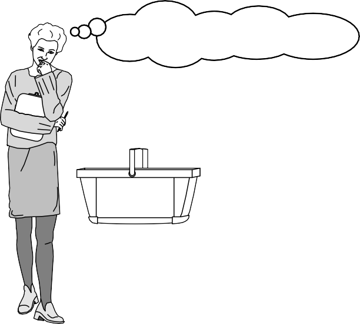

- The **universe** = set of items in the store; each item is a **Boolean variable** (present 1 / absent 0); each basket is a **Boolean vector**.
- Patterns are expressed as **association rules**, e.g.:

`computer ⇒ antivirus_software [support = 2 %, confidence = 60 %]`

- **Support 2 %** → 2 % of all transactions contain both computer and antivirus.
- **Confidence 60 %** → 60 % of customers who bought a computer also bought antivirus.
- Rules are **interesting** if they satisfy both a **minimum support threshold** and a **minimum confidence threshold** set by the user.

---

## 2. Support, Confidence & Association Rules ★★★

Let **I = {I₁, …, Iₘ}** be the set of items, **D** a set of transactions (each T ⊆ I with a TID). An **association rule** is **A ⇒ B** where A, B ⊂ I, A ≠ ∅, B ≠ ∅, A ∩ B = ∅.

$$\text{support}(A \Rightarrow B) = P(A \cup B) = \frac{\text{count}(A \cup B)}{|D|}$$

$$\text{confidence}(A \Rightarrow B) = P(B \mid A) = \frac{\text{support\_count}(A \cup B)}{\text{support\_count}(A)}$$

- **Itemset** — a set of items; **k-itemset** has k items.
- **Support count (frequency)** — number of transactions containing the itemset.
- **Frequent itemset** — support ≥ **min_sup**.
- **Strong rules** — satisfy both **min_sup** and **min_conf**.

**Association rule mining = two-step process:**
1. **Find all frequent itemsets** (support ≥ min_sup) — the costly step.
2. **Generate strong association rules** from them (support ≥ min_sup and confidence ≥ min_conf).

**Types of association rules:** Boolean vs **quantitative** (numeric — age, income), single- vs **multidimensional**, single- vs **multilevel/generalised** (higher-level concepts: "milk" instead of brands), **multi-relational** (across tables).

---

## 3. Classification of Frequent Pattern Mining ★

| Criterion | Categories |
|---|---|
| **Completeness of patterns** | Complete set, **closed**, **maximal**, constrained, approximate, top-k |
| **Levels of abstraction** | Single-level vs **multilevel** rules (`buys(X, "computer")` vs `buys(X, "laptop")`) |
| **Number of dimensions** | **Single-dimensional** (only `buys`) vs **multidimensional** (age, income, buys) |
| **Types of values** | **Boolean** vs **quantitative** |
| **Kinds of rules** | Association rules vs **correlation** rules; strong gradient relationships |
| **Kinds of patterns** | Frequent itemsets, sequential patterns, structured patterns |

---

## 4. Apriori Algorithm ★★★

- Proposed by **R. Agrawal and R. Srikant (1994)** for mining frequent itemsets for **Boolean association rules**.
- Named *Apriori* because it uses **prior knowledge** of frequent-itemset properties.
- **Level-wise, iterative search**: frequent k-itemsets (**Lₖ**) are used to explore (k+1)-itemsets. Each level needs **one full scan** of the database.

### 4.1 Apriori Property (anti-monotone / downward closure) ★★★
> **All non-empty subsets of a frequent itemset must also be frequent.**
> Equivalently: **if an itemset is infrequent, all its supersets are infrequent.**

- If {Milk, Bread, Butter} is frequent → {Milk, Bread}, {Milk, Butter}, {Bread, Butter}, {Milk}, {Bread}, {Butter} are frequent.
- If {Milk, Butter} is infrequent → {Milk, Butter, Bread}, {Milk, Butter, Eggs}, … need not be checked.
- This **prunes the search space** drastically.

### 4.2 Join and Prune Steps
1. **Join step:** Cₖ (candidate k-itemsets) is generated by joining **Lₖ₋₁ with itself**; two itemsets are joinable if their **first (k−2) items are identical**.
   *E.g.,* {Milk, Bread} ⋈ {Milk, Butter} → {Milk, Bread, Butter}.
2. **Prune step:** remove any candidate having a **(k−1)-subset that is not in Lₖ₋₁** (Apriori property). Then **scan D** to count support of remaining candidates → **Lₖ**.
   *E.g.,* {Milk, Bread, Eggs} is pruned if {Milk, Eggs} is not frequent.

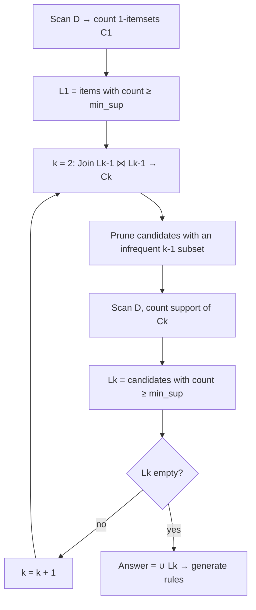

**Pseudo-code:**
```
L1 = find_frequent_1-itemsets(D)
for (k = 2; L(k-1) ≠ ∅; k++) {
    Ck = apriori_gen(L(k-1))          // join + prune
    for each transaction t in D {
        Ct = subset(Ck, t)            // candidates contained in t
        for each candidate c in Ct: c.count++
    }
    Lk = { c in Ck | c.count ≥ min_sup }
}
return L = ∪k Lk
```

---

## 5. Apriori — Solved Examples ★★★

### Example A (textbook — AllElectronics, 9 transactions, min support count = 2)

| TID | Items |
|---|---|
| T100 | I1, I2, I5 |
| T200 | I2, I4 |
| T300 | I2, I3 |
| T400 | I1, I2, I4 |
| T500 | I1, I3 |
| T600 | I2, I3 |
| T700 | I1, I3 |
| T800 | I1, I2, I3, I5 |
| T900 | I1, I2, I3 |

**Scan 1 — C1 → L1:** I1 = 6, I2 = 7, I3 = 6, I4 = 2, I5 = 2 → all frequent.

**C2 (from L1 ⋈ L1) and scan 2:**
| Itemset | Count | | Itemset | Count |
|---|---|---|---|---|
| {I1, I2} | 4 ✓ | | {I2, I4} | 2 ✓ |
| {I1, I3} | 4 ✓ | | {I2, I5} | 2 ✓ |
| {I1, I4} | 1 ✗ | | {I3, I4} | 0 ✗ |
| {I1, I5} | 2 ✓ | | {I3, I5} | 1 ✗ |
| {I2, I3} | 4 ✓ | | {I4, I5} | 0 ✗ |

**L2** = {I1,I2}, {I1,I3}, {I1,I5}, {I2,I3}, {I2,I4}, {I2,I5}.

**C3 — join** L2 on first item: {I1,I2,I3}, {I1,I2,I5}, {I1,I3,I5}, {I2,I3,I4}, {I2,I3,I5}, {I2,I4,I5}.
**Prune:** {I1,I3,I5} ({I3,I5} ✗), {I2,I3,I4} ({I3,I4} ✗), {I2,I3,I5} ({I3,I5} ✗), {I2,I4,I5} ({I4,I5} ✗) removed.
**Scan 3:** {I1,I2,I3} = 2 ✓, {I1,I2,I5} = 2 ✓ → **L3**.

**C4:** {I1,I2,I3,I5} — subset {I2,I3,I5} not frequent → pruned → **C4 = ∅**, stop.

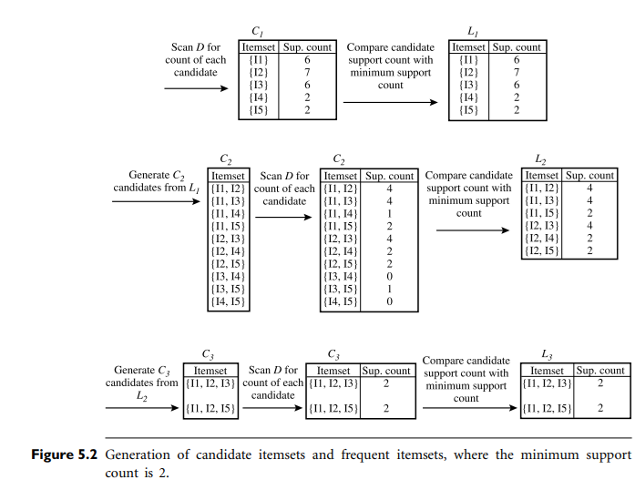

### Example B (slide exercise — min_support = 40 %, min_conf = 70 %)
| TID | Items |
|---|---|
| 1 | Bread, Butter, Milk |
| 2 | Bread, Butter |
| 3 | Beer, Cookies, Diapers |
| 4 | Milk, Diapers, Bread, Butter |
| 5 | Beer, Diapers |

min_sup = 40 % of 5 = **2**.
- **C1:** Bread 3, Butter 3, Milk 2, Beer 2, Cookies 1 ✗, Diapers 3 → **L1** = {Bread, Butter, Milk, Beer, Diapers}.
- **C2 counts:** {Bread,Butter} 3 ✓, {Bread,Milk} 2 ✓, {Butter,Milk} 2 ✓, {Beer,Diapers} 2 ✓; {Bread,Diapers} 1, {Butter,Diapers} 1, {Milk,Diapers} 1, pairs with Beer & Bread/Butter/Milk 0 ✗.
- **C3:** {Bread, Butter, Milk} (all 2-subsets frequent) → count **2** ✓ → **L3**.

**Strong rules (conf ≥ 70 %):**
| Rule | Confidence | Strong? |
|---|---|---|
| Bread ⇒ Butter | 3/3 = 100 % | ✓ |
| Butter ⇒ Bread | 3/3 = 100 % | ✓ |
| Milk ⇒ Bread | 2/2 = 100 % | ✓ |
| Milk ⇒ Butter | 2/2 = 100 % | ✓ |
| Beer ⇒ Diapers | 2/2 = 100 % | ✓ |
| Bread ⇒ Milk / Butter ⇒ Milk / Diapers ⇒ Beer | 2/3 = 67 % | ✗ |
| Bread ∧ Milk ⇒ Butter | 2/2 = 100 % | ✓ |
| Butter ∧ Milk ⇒ Bread | 2/2 = 100 % | ✓ |
| Milk ⇒ Bread ∧ Butter | 2/2 = 100 % | ✓ |
| Bread ∧ Butter ⇒ Milk | 2/3 = 67 % | ✗ |
| Bread ⇒ Butter ∧ Milk, Butter ⇒ Bread ∧ Milk | 2/3 = 67 % | ✗ |

### Example C (Han's TDB, min_sup = 2)
| Tid | Items |
|---|---|
| 10 | A, C, D |
| 20 | B, C, E |
| 30 | A, B, C, E |
| 40 | B, E |

- **L1:** A 2, B 3, C 3, E 3 (D = 1 ✗)
- **C2:** AB 1, AC 2, AE 1, BC 2, BE 3, CE 2 → **L2** = {AC, BC, BE, CE}
- **C3:** {B, C, E} → 2 → **L3** = {B, C, E}

---

## 6. Generating Association Rules from Frequent Itemsets ★★★

For each frequent itemset **l**, generate all non-empty proper subsets **s**; for each, output the rule
**s ⇒ (l − s)** if **support_count(l) / support_count(s) ≥ min_conf**.
(Rules automatically satisfy min_sup because they come from frequent itemsets.)

**Example — l = {I1, I2, I5}** (support count 2) from Example A, min_conf = 70 %:

| Rule | Confidence |
|---|---|
| I1 ∧ I2 ⇒ I5 | 2/4 = 50 % ✗ |
| I1 ∧ I5 ⇒ I2 | 2/2 = **100 %** ✓ |
| I2 ∧ I5 ⇒ I1 | 2/2 = **100 %** ✓ |
| I1 ⇒ I2 ∧ I5 | 2/6 = 33 % ✗ |
| I2 ⇒ I1 ∧ I5 | 2/7 = 29 % ✗ |
| I5 ⇒ I1 ∧ I2 | 2/2 = **100 %** ✓ |

→ **3 strong rules.**

**Slide example (Bread/Butter/Milk, min_conf 60 %):** Bread ⇒ Butter = 2/4 = 50 % ✗; Bread ⇒ Milk = 3/4 = 75 % ✓; Butter ⇒ Milk = 3/3 = 100 % ✓.

---

## 7. Improving the Efficiency of Apriori ★★

**Limitations of Apriori:** generates a **huge number of candidates** (10⁴ frequent 1-itemsets → ~10⁷ candidate 2-itemsets); **repeated database scans** (one per level); tedious support counting.

| Technique | Idea |
|---|---|
| **Hash-based technique** | Hash itemsets into buckets while scanning; a k-itemset whose bucket count < min_sup can't be frequent (shrinks C2) |
| **Transaction reduction** | A transaction containing no frequent k-itemset can't contain any (k+1)-itemset → remove it from later scans |
| **Partitioning** | Divide D into partitions; any frequent itemset must be **locally frequent** in at least one partition; only **two scans** |
| **Sampling** | Mine a random **sample** with a lower threshold; verify on the full data |
| **Dynamic itemset counting (DIC)** | Add new candidates at different start points during a scan |

---

## 8. FP-Growth — Mining without Candidate Generation ★★★

**FP-Growth (Frequent-Pattern Growth)** (Han, Pei, Yin 2000) mines frequent itemsets **without candidate generation**, using a compact **FP-tree** and a **divide-and-conquer** strategy.

**Why better than Apriori:** no candidate generation · only **two database scans** · compressed **FP-tree** · faster · more scalable for large/dense data.

### 8.1 FP-tree Components
| Component | Description |
|---|---|
| **Root** | Labelled **null** |
| **Item node** | Item name + **count** of transactions sharing that prefix path |
| **Header table** | Each frequent item with its support count and a **node-link** to its first occurrence in the tree |
| **Node-link** | Pointer chaining all nodes with the same item name |

### 8.2 Steps
1. **Scan 1:** count support of each item; discard infrequent ones; sort frequent items in **descending support order** → list **L**.
2. **Scan 2 (build the FP-tree):** for each transaction, keep only frequent items **sorted in L order**, and insert as a path from the root. Shared **prefixes** share nodes (increment counts); new items create new branches; update node-links.
3. **Mine the FP-tree** (bottom-up, starting from the **least frequent** item in the header table):
   - Collect its **conditional pattern base** — the set of **prefix paths** ending at that item (with counts).
   - Build its **conditional FP-tree** from the pattern base (keep items meeting min_sup).
   - Generate frequent patterns by concatenating the suffix with patterns from the conditional tree; recurse.

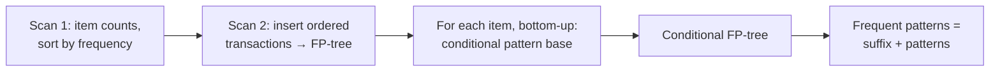

### 8.3 Example 1 (slides) — min_sup = 3
| TID | Items | Ordered frequent items |
|---|---|---|
| T1 | M, N, O, E, K, Y | K, E, M, O, Y |
| T2 | D, O, E, N, Y, K | K, E, O, Y |
| T3 | K, A, M, E | K, E, M |
| T4 | M, C, U, Y, K | K, M, Y |
| T5 | C, O, O, K, E, I | K, E, O |

Item counts: K 5, E 4, M 3, O 3, Y 3 (A, C, D, I, N, U < 3 removed). **L = {K:5, E:4, M:3, O:3, Y:3}**.

**FP-tree after all insertions:**
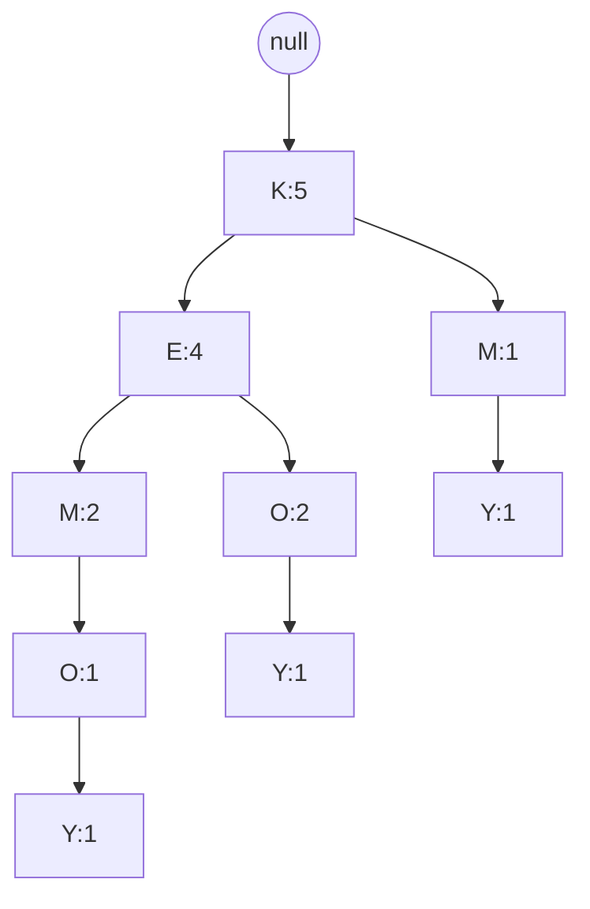

| Item | Conditional pattern base | Conditional FP-tree | Frequent patterns |
|---|---|---|---|
| Y | {K,E,M,O : 1}, {K,E,O : 1}, {K,M : 1} | ⟨K : 3⟩ | {K, Y : 3} |
| O | {K,E,M : 1}, {K,E : 2} | ⟨K : 3, E : 3⟩ | {K, O : 3}, {E, O : 3}, {K, E, O : 3} |
| M | {K,E : 2}, {K : 1} | ⟨K : 3⟩ | {K, M : 3} |
| E | {K : 4} | ⟨K : 4⟩ | {K, E : 4} |
| K | — | — | — |

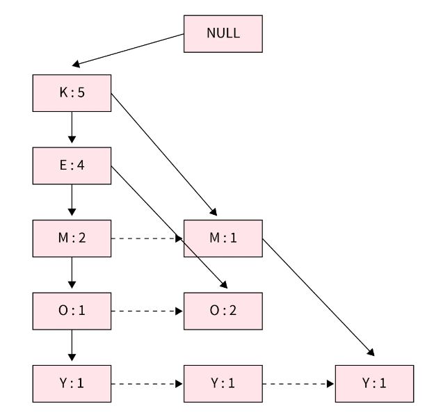

### 8.4 Example 2 (textbook, Example A data, min_sup = 2)
L = {I2:7, I1:6, I3:6, I4:2, I5:2}.

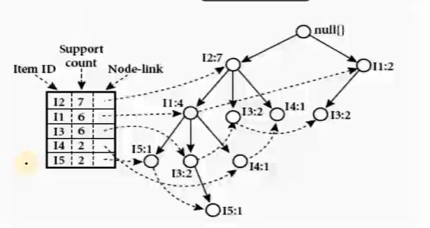

| Item | Conditional pattern base | Conditional FP-tree | Frequent patterns |
|---|---|---|---|
| I5 | {I2, I1 : 1}, {I2, I1, I3 : 1} | ⟨I2 : 2, I1 : 2⟩ | {I2,I5 : 2}, {I1,I5 : 2}, {I2,I1,I5 : 2} |
| I4 | {I2, I1 : 1}, {I2 : 1} | ⟨I2 : 2⟩ | {I2, I4 : 2} |
| I3 | {I2, I1 : 2}, {I2 : 2}, {I1 : 2} | ⟨I2 : 4, I1 : 2⟩, ⟨I1 : 2⟩ | {I2,I3 : 4}, {I1,I3 : 4}, {I2,I1,I3 : 2} |
| I1 | {I2 : 4} | ⟨I2 : 4⟩ | {I2, I1 : 4} |

(Same frequent itemsets as Apriori, without any candidate generation.)

| Advantages | Disadvantages |
|---|---|
| No candidate generation; only 2 scans | Complex to implement |
| Compact tree; faster on large datasets | FP-tree may not fit in memory if many items / little sharing |
| Divide-and-conquer reduces search | Not ideal if transactions share few prefixes |

**Applications:** market-basket analysis, web-usage mining, bioinformatics (gene patterns), intrusion detection, recommender systems.

---

## 9. Apriori vs FP-Growth ★★★

| Apriori | FP-Growth |
|---|---|
| **Generates candidate itemsets** | **No candidate generation** |
| Join-and-prune (breadth-first, level-wise) | **Divide-and-conquer** (depth-first) |
| **Multiple database scans** (one per level) | Usually **two scans** |
| Slower; more memory for candidates | Faster; compressed FP-tree |
| Simple to understand & implement | More complex |
| Inefficient for large/dense datasets | Efficient for large/dense datasets |
| Uses support counting of candidates | Uses FP-tree + conditional pattern bases |

---

## 10. Mining Using the Vertical Data Format — ECLAT ★★

- **Horizontal format:** {TID : itemset}. **Vertical format:** {item : **TID-set**} — the set of transactions containing the item.
- **ECLAT (Equivalence CLAss Transformation)** (Zaki 2000): support of an itemset = **size of its TID-set**; the TID-set of a (k+1)-itemset = **intersection** of TID-sets of its k-subsets. No need to rescan the database.

**Example A in vertical format:**
| Itemset | TID-set | Support |
|---|---|---|
| I1 | {T100, T400, T500, T700, T800, T900} | 6 |
| I2 | {T100, T200, T300, T400, T600, T800, T900} | 7 |
| I3 | {T300, T500, T600, T700, T800, T900} | 6 |
| I4 | {T200, T400} | 2 |
| I5 | {T100, T800} | 2 |

2-itemsets (intersections): {I1,I2} = {T100,T400,T800,T900} (4); {I1,I3} = {T500,T700,T800,T900} (4); {I1,I5} = {T100,T800} (2); {I2,I3} = {T300,T600,T800,T900} (4); {I2,I4} = {T200,T400} (2); {I2,I5} = {T100,T800} (2); {I1,I4} = {T400} (1 ✗); {I3,I5} = {T800} (1 ✗).
3-itemsets: {I1,I2,I3} = {T800,T900} (2); {I1,I2,I5} = {T100,T800} (2).

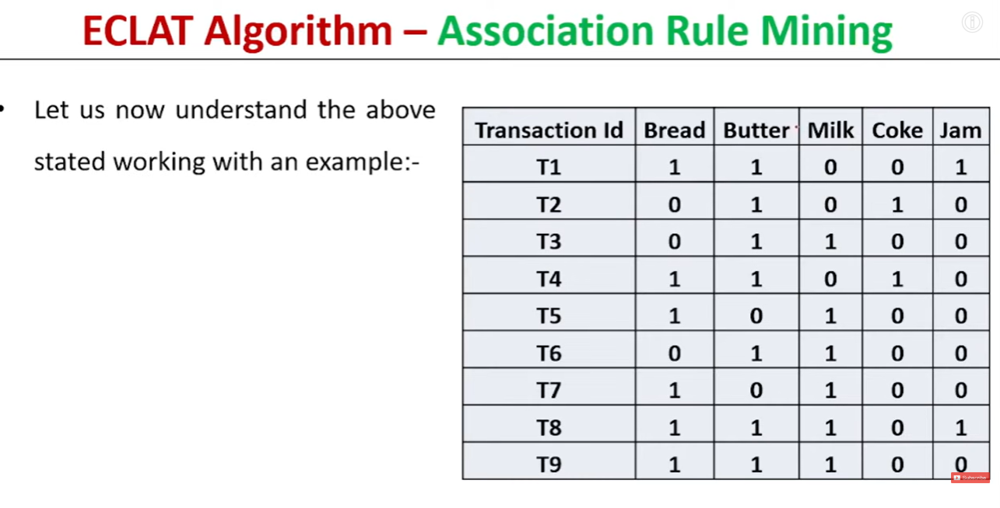

**Pros:** fast support counting by intersection, no rescans. **Cons:** TID-sets can be long and memory-hungry (use **diffsets**).

---

## 11. Closed & Maximal Frequent Itemsets ★★

A long frequent itemset has **2ⁿ − 1** frequent subsets (e.g., 100 items → ~1.27 × 10³⁰) → compact representations:

| Concept | Definition |
|---|---|
| **Frequent itemset** | Support ≥ min_sup |
| **Closed itemset** | **No proper superset has the same support** |
| **Closed frequent itemset** | Frequent **and** closed — a **lossless** compression (all frequent itemsets and their supports can be derived) |
| **Maximal frequent itemset (max-itemset)** | Frequent and **no proper superset is frequent** — more compact but **lossy** (supports of subsets not retained) |

**Relationship:** maximal ⊆ closed ⊆ frequent.

*Example:* D = {⟨a₁…a₁₀₀⟩, ⟨a₁…a₅₀⟩}, min_sup = 1 → closed frequent itemsets: {a₁…a₅₀ : 2}, {a₁…a₁₀₀ : 1}; maximal: only {a₁…a₁₀₀ : 1}.

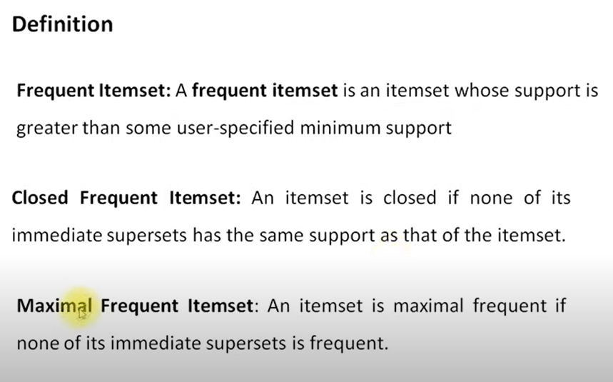

---

## 12. Mining Multilevel Association Rules ★★★

- Items form **concept hierarchies** (computer → laptop / desktop → brand). Strong associations at **low levels** are rare due to **sparsity**; mining at **multiple levels of abstraction** finds more useful knowledge.
- Uses a **top-down**, level-by-level approach: compute frequent itemsets at level 1, then level 2, etc.

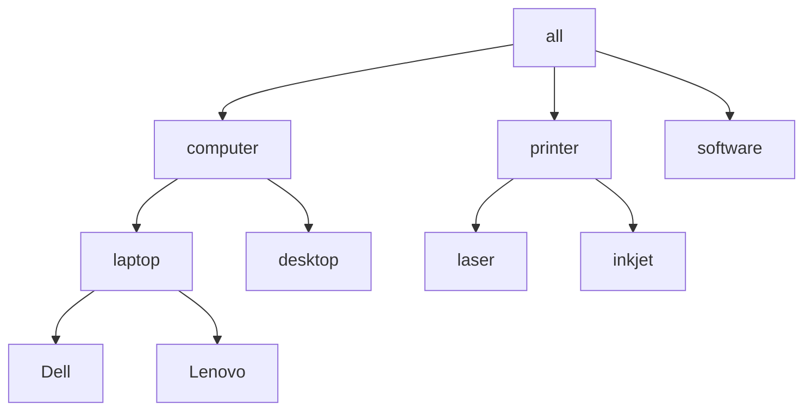

### 12.1 Support strategies
| Strategy | Description | Pros / Cons |
|---|---|---|
| **Uniform minimum support** | **Same min_sup at all levels** | Simple; but too high → misses low-level rules, too low → too many high-level rules |
| **Reduced minimum support at lower levels** | Each lower level has a **smaller** threshold | Finds meaningful low-level rules |
| **Item- or group-based minimum support** | Experts set thresholds **per item/group** (e.g., lower for expensive items like cameras) | Flexible |

*Example:* computer [support 10 %] → laptop [6 %], desktop [4 %].
- **Uniform** min_sup = 5 % at both levels → computer ✓, laptop ✓, **desktop ✗**.
- **Reduced** (level 1: 5 %, level 2: 3 %) → computer ✓, laptop ✓, **desktop ✓**.

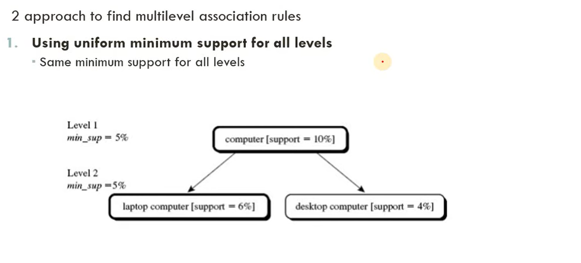

### 12.2 Redundancy among multilevel rules
A rule is **redundant** if its support/confidence is close to the **expected** value derived from an **ancestor** rule.
*E.g.,* rule R1 `buys(X, "laptop") ⇒ buys(X, "HP printer")` [support 2 %, confidence 72 %] is **redundant** given its ancestor R2 `buys(X, "computer") ⇒ buys(X, "HP printer")` [support 8 %, confidence 70 %] when about **one quarter** of all computers sold are laptops — R1's expected support is 8 % × ¼ = 2 % and its confidence ≈ 70 %, so R1 adds no new information.

---

## 13. Mining Multidimensional Association Rules ★★★

| Rule type | Predicates | Example |
|---|---|---|
| **Single-dimensional (intra-dimensional, Boolean)** | One predicate repeated | `buys(X, "IBM laptop") ⇒ buys(X, "HP inkjet printer")` |
| **Multidimensional** | **Two or more distinct predicates/dimensions** | `age(X, "20…29") ∧ occupation(X, "student") ⇒ buys(X, "laptop")` |
| **Inter-dimensional** | No repeated predicates | (above) |
| **Hybrid-dimensional** | A predicate repeated | `age(X, "20…29") ∧ buys(X, "laptop") ⇒ buys(X, "HP printer")` |

Mined from **relational databases and data warehouses**; attributes may be **categorical (nominal)** or **quantitative**.

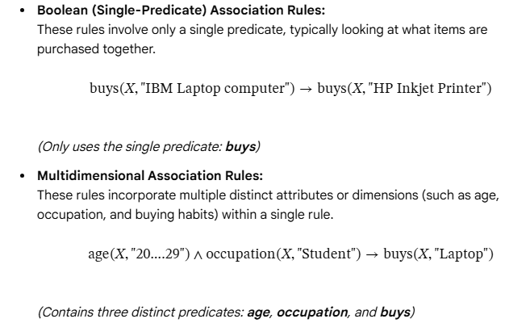

### 13.1 Handling quantitative attributes
1. **Static discretisation** (predefined concept hierarchies) — quantitative attributes discretised **before mining** into fixed intervals; treated as categorical. Data cubes are well suited (each cuboid = a predicate set).

| Age range | Category |
|---|---|
| 0–17 | Young |
| 18–35 | Adult |
| 36–55 | Middle-aged |
| 56–80 | Senior |
   Methods: equal-width, equal-frequency, concept hierarchy.
2. **Dynamic discretisation** (quantitative association rules) — intervals determined **during mining** to satisfy criteria (e.g., maximise confidence); e.g., **ARCS** clusters adjacent intervals on a 2-D grid.
3. **Distance-based** — intervals from clustering the data.

| Static discretisation | Dynamic discretisation |
|---|---|
| Pre-processing, before mining | During the mining algorithm |
| Non-iterative, fixed intervals | Iterative, intervals adapt |
| Independent of other features | Depends on other features/interactions |
| Lower accuracy (may split critical patterns) | Higher accuracy |
| Low, fast computation | High cost |

---

## 14. From Association Mining to Correlation Analysis ★★★

**Strong rules are not necessarily interesting.**

*Classic example:* 10,000 transactions; 6000 contain **computer games**, 7500 **videos**, 4000 **both**. With min_sup 30 %, min_conf 60 %:
`buys(X, "games") ⇒ buys(X, "videos") [support 40 %, confidence 66 %]` — looks **strong**, but **P(videos) = 75 % > 66 %**, so buying games actually **decreases** the likelihood of buying videos → **misleading**.

Hence augment support–confidence with a **correlation measure**:
**A ⇒ B [support, confidence, correlation].**

### 14.1 Lift ★★★
$$\text{lift}(A, B) = \frac{P(A \cup B)}{P(A)\,P(B)} = \frac{\text{conf}(A \Rightarrow B)}{\text{sup}(B)}$$
| Lift | Meaning |
|---|---|
| **> 1** | A and B **positively correlated** (occurrence of one implies the other) |
| **= 1** | **Independent** |
| **< 1** | **Negatively correlated** |

*Games/videos:* lift = 0.40 / (0.60 × 0.75) = **0.89 < 1** → negatively correlated.

### 14.2 χ² (Chi-square) measure
Build a contingency table and compute χ² = Σ (observed − expected)²/expected.
| | game | ¬game | Σ |
|---|---|---|---|
| video | 4000 (4500) | 3500 (3000) | 7500 |
| ¬video | 2000 (1500) | 500 (1000) | 2500 |
| Σ | 6000 | 4000 | 10000 |
χ² = 500²/4500 + 500²/3000 + 500²/1500 + 500²/1000 = 55.6 + 83.3 + 166.7 + 250 = **555.6** — large → correlated; observed (4000) < expected (4500) → **negative** correlation.

Other **null-invariant** measures: all_confidence, max_confidence, Kulczynski, cosine.

### 14.3 Pearson correlation (numeric data) — slide example
A = [20, 12, 9], B = [8, 34, 4]; Ā = 13.67, B̄ = 15.33.
Σ(A − Ā)(B − B̄) = (6.33)(−7.33) + (−1.67)(18.67) + (−4.67)(−11.33) = −46.40 − 31.18 + 52.91 = **−24.67**
σ_A = √(64.67/2) = **5.69**, σ_B = √(530.67/2) = **16.29** (sample SD)
$$r_{A,B} = \frac{\sum (A-\bar A)(B-\bar B)}{(n-1)\,\sigma_A\sigma_B} = \frac{-24.67}{2 \times 5.69 \times 16.29} = \frac{-24.67}{185.38} \approx -0.133$$
→ **weak negative correlation**.

---

## 15. Constraint-Based Association Mining ★★

- A mining system may generate **thousands of rules**, many irrelevant. Users specify **constraints** to focus the search — e.g., "*find rules about laptops with confidence ≥ 70 %*" → smaller search space, more useful rules, more efficient mining.

| Constraint type | Specifies | Example |
|---|---|---|
| **Knowledge-type** | Type of knowledge to mine | Association or correlation rules |
| **Data** | Task-relevant data | Sales data from 2025 in Hyderabad stores |
| **Dimension/level** | Dimensions or hierarchy levels used | Product → Electronics → Mobile phones |
| **Interestingness** | Thresholds on measures | support ≥ 20 %, confidence ≥ 70 %, lift > 1 |
| **Rule** | Form of the rules (meta-rules, item constraints) | Rules containing "Laptop" in the consequent; `P(X, Y) ∧ Q(X, W) ⇒ buys(X, "office software")` |

**Rule constraints — properties used for pruning:** **anti-monotonic** (if an itemset violates it, so do all supersets — e.g., sum(price) ≤ 100), **monotonic** (if satisfied, supersets also satisfy — sum(price) ≥ 100), **succinct**, **convertible**.

**Meta-rule-guided mining:** the user supplies a rule template, e.g., `P1(X, Y) ∧ P2(X, W) ⇒ buys(X, "office software")`; the system finds predicates P1, P2 and values matching it — e.g., `age(X, "30..39") ∧ income(X, "41K..60K") ⇒ buys(X, "office software")`.

---

## Unit IV — One-Page Summary

| Topic | Key points |
|---|---|
| **Frequent patterns** | Itemsets, sequential, structured. Market-basket analysis: Boolean vectors, rules like computer ⇒ antivirus [2 %, 60 %]. |
| **Measures** | support = P(A∪B); confidence = P(B\|A) = sup_count(A∪B)/sup_count(A). Strong = ≥ min_sup and ≥ min_conf. Two steps: frequent itemsets → strong rules. |
| **Apriori** | Agrawal & Srikant 1994; level-wise; **Apriori property** (subsets of frequent are frequent / supersets of infrequent are infrequent); **join** (first k−2 items equal) + **prune**; one scan per level. Example A: L3 = {I1,I2,I3}, {I1,I2,I5}. Example B: L3 = {Bread, Butter, Milk}. |
| **Rule generation** | s ⇒ l − s if sup(l)/sup(s) ≥ min_conf; {I1,I2,I5} → 3 strong rules (100 %). |
| **Efficiency** | Hashing, transaction reduction, partitioning (2 scans), sampling, DIC. |
| **FP-Growth** | 2 scans, FP-tree (root null, item nodes with counts, header table, node-links), conditional pattern base → conditional FP-tree → patterns. Example 1: {K,E,O:3}, {K,E:4}… |
| **Apriori vs FP** | Candidates & many scans vs no candidates & 2 scans; join/prune vs divide & conquer. |
| **ECLAT** | Vertical TID-sets; support = \|TID-set\|; intersect TID-sets. |
| **Closed / maximal** | Closed: no superset with same support (lossless). Maximal: no frequent superset (lossy). Maximal ⊆ closed ⊆ frequent. |
| **Multilevel** | Concept hierarchies; uniform / reduced / item-group-based min_sup; computer 10 % → laptop 6 %, desktop 4 %; redundant rules via ancestors. |
| **Multidimensional** | Inter-dimensional vs hybrid; quantitative attributes — static discretisation (concept hierarchy, before mining) vs dynamic (during mining, ARCS). |
| **Correlation** | Strong ≠ interesting (games ⇒ videos 66 % < 75 %). **Lift** = P(A∪B)/(P(A)P(B)) (> 1 positive, = 1 independent, < 1 negative; 0.89); **χ²** = 555.6; Pearson r = −0.133. |
| **Constraint-based** | Knowledge-type, data, dimension/level, interestingness, rule constraints; anti-monotonic, monotonic, succinct; meta-rules. |
