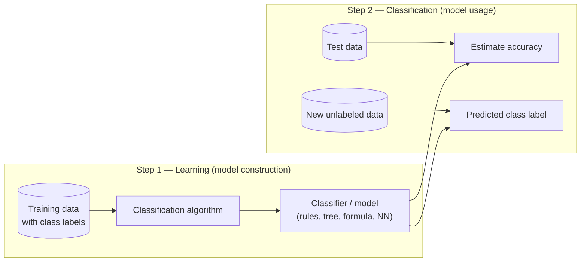
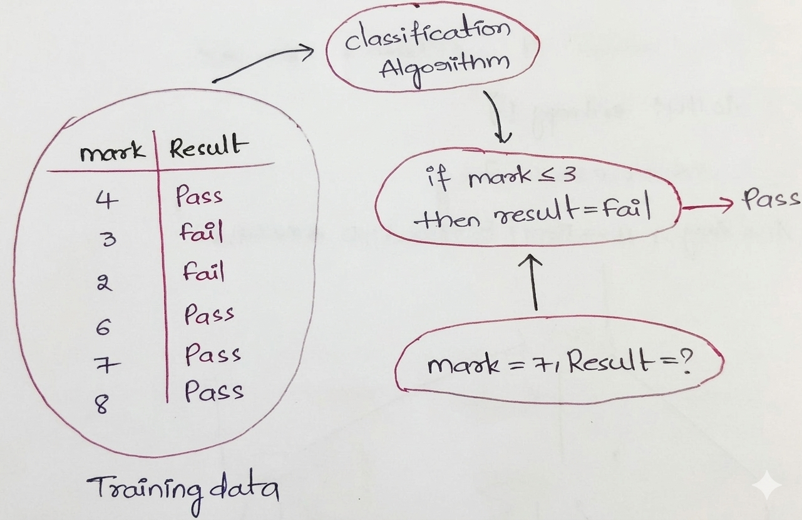
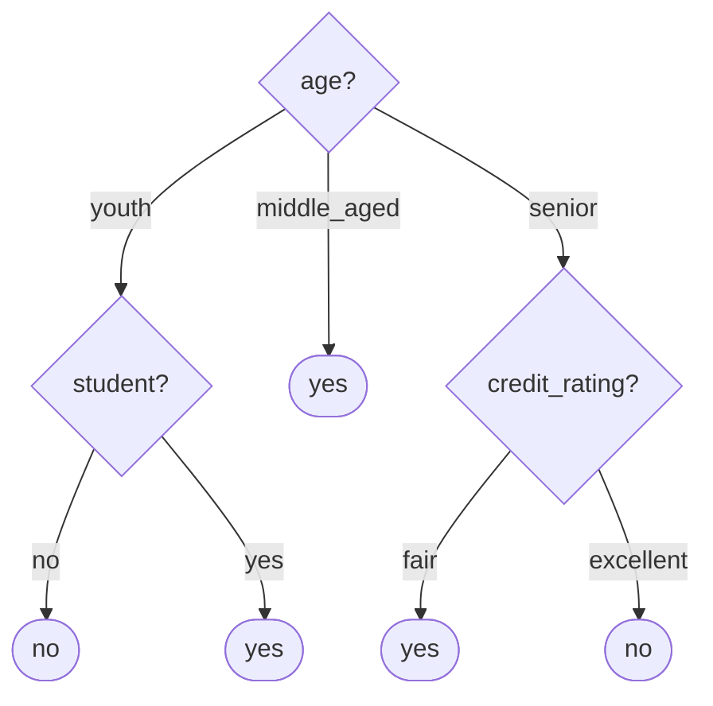
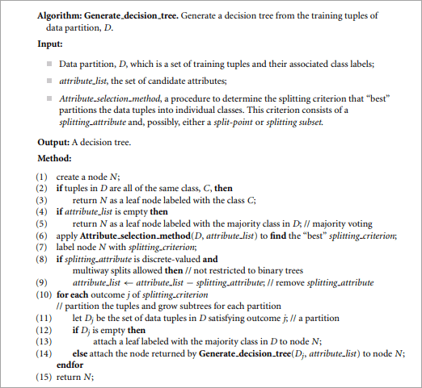
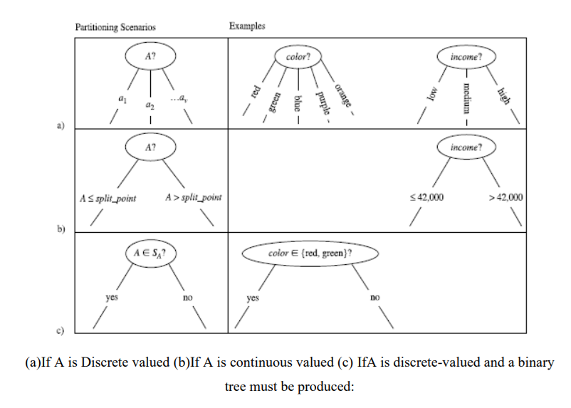
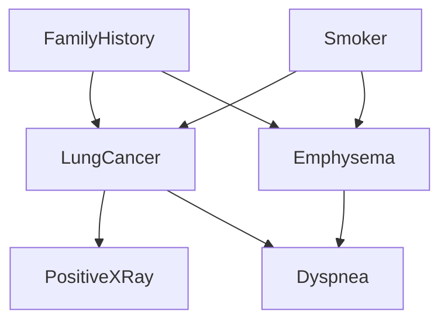
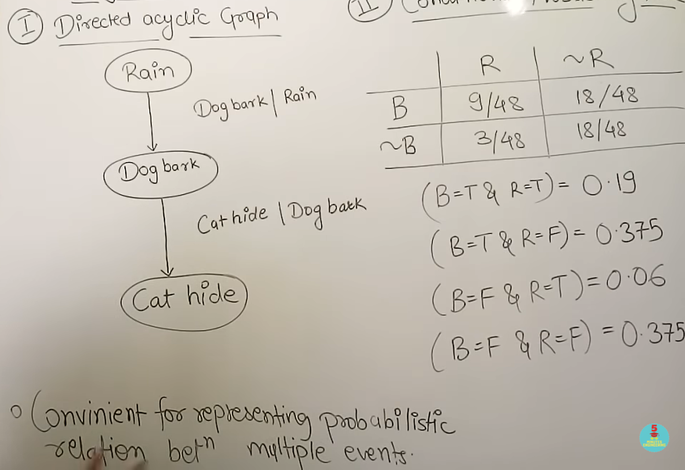
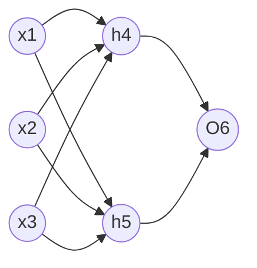
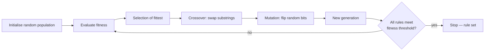

# Unit V — Classification & Prediction

> **Syllabus:** What is classification and prediction; issues regarding classification and prediction; classification by decision-tree induction (information gain, gain ratio, Gini index, tree pruning); Bayesian classification (Bayes' theorem, naïve Bayes, belief networks); classification by back-propagation; support vector machines; k-nearest-neighbour classifiers; other methods (genetic algorithms, fuzzy sets); prediction (linear, multiple, non-linear regression); classifier accuracy.
>
> **Source:** *DWDM UNIT V 2026.pptx* (SNIST) — Han & Kamber, Ch. 6. Many derivations on the slides are images; they are worked out here using the same textbook data.

**Importance legend:** ★★★ = very frequently asked (long answer / numericals) · ★★ = medium · ★ = short answer

---

## Table of Contents
1. [What is Classification? What is Prediction?](#1-what-is-classification-what-is-prediction-)
2. [Classification — A Two-Step Process](#2-classification--a-two-step-process-)
3. [Issues Regarding Classification and Prediction](#3-issues-regarding-classification-and-prediction-)
4. [Classification vs Prediction](#4-classification-vs-prediction-)
5. [Decision-Tree Induction](#5-decision-tree-induction-)
6. [Attribute Selection Measures — Info Gain, Gain Ratio, Gini](#6-attribute-selection-measures-)
7. [Worked Example — ID3 on buys_computer](#7-worked-example--id3-on-buys_computer-)
8. [Overfitting & Tree Pruning](#8-overfitting--tree-pruning-)
9. [Bayesian Classification & Naïve Bayes](#9-bayesian-classification-)
10. [Bayesian Belief Networks](#10-bayesian-belief-networks-)
11. [Classification by Back-propagation](#11-classification-by-back-propagation-)
12. [Support Vector Machines](#12-support-vector-machines-svm-)
13. [k-Nearest-Neighbour Classifiers](#13-k-nearest-neighbour-classifiers-)
14. [Other Methods — Genetic Algorithms & Fuzzy Sets](#14-other-classification-methods-)
15. [Prediction — Regression](#15-prediction--regression-analysis-)
16. [Classifier Accuracy](#16-classifier-accuracy--evaluation-)
17. [Unit V — One-Page Summary](#unit-v--one-page-summary)

---

## 1. What is Classification? What is Prediction? ★★★

- **Classification** — finding a **model (classifier)** that describes and distinguishes data **classes**, used to predict the **categorical class label** of objects whose label is unknown (e.g., grouping patients by medical records; loan → safe/risky).
- **Prediction (numeric prediction)** — models **continuous-valued** functions; predicts **missing or unknown numeric values** (e.g., treatment cost, salary, sales).

Key ideas:
- **Training data** — tuples with **known class labels** (weather → Rain/No Rain).
- **Learning** — the algorithm learns the relationship between inputs and labels.
- **Model** — decision tree, rules, formulae, neural network.
- **Test/new data** — unlabeled tuples given to the model for prediction.

Classification is **supervised learning** (labels known); clustering is **unsupervised**.

---

## 2. Classification — A Two-Step Process ★★★

1. **Model construction (learning):** each tuple belongs to a predefined class given by the **class-label attribute**; the set used is the **training set**; the model is represented as **classification rules, decision trees, mathematical formulae or neural networks**.
   *E.g.,* rule: `IF attendance = high AND internal_marks ≥ 60 THEN result = Pass`.
2. **Model usage (classification):**
   - Estimate **accuracy** on an **independent test set** (accuracy = % of test tuples correctly classified; test set must be independent of training to avoid **over-fitting**).
   - If acceptable, classify **new** tuples — e.g., new student (attendance = high, internal = 70) → **Pass**.

---

## 3. Issues Regarding Classification and Prediction ★★

### 3.1 Preparing the data
| Issue | What is done |
|---|---|
| **Data cleaning** | Handle missing values (mean, median, mode, regression), smooth noise, fix inconsistencies |
| **Relevance analysis (feature selection)** | Remove irrelevant/redundant attributes (correlation, χ², information gain, PCA) — avoids the **curse of dimensionality** |
| **Data transformation** | Normalisation (min-max, z-score), discretisation, generalisation via concept hierarchies, attribute construction |
| **Data reduction** | Sampling, aggregation, dimensionality reduction, compression |
| **Data integration** | Resolve schema conflicts, duplicates, redundant attributes |
| **Data splitting** | Proper train/test split; **cross-validation** to avoid bias |

### 3.2 Comparing classification & prediction methods
| Criterion | Meaning |
|---|---|
| **Accuracy** | Ability to correctly predict class labels (confusion matrix, precision, recall, F-measure) or values (MAE, MSE, RMSE) |
| **Speed** | Training time and classification time (naïve Bayes & decision trees fast; NN & SVM slow) |
| **Robustness** | Correct predictions with **noisy/missing data** and outliers |
| **Scalability** | Efficiency with large amounts of data (records & attributes) |
| **Interpretability** | Understanding/insight provided (trees & rules high; NN, SVM, ensembles = black boxes) |
| **Data types handled** | Numeric only (regression, SVM) vs categorical + numeric (trees, naïve Bayes) |

---

## 4. Classification vs Prediction ★★★

| Basis | Classification | Prediction |
|---|---|---|
| Definition | Assigns data to **predefined classes** | Estimates a **continuous numeric** value |
| Output | **Categorical/discrete** (Yes/No, Fraud/Not fraud) | **Numerical/continuous** (sales, temperature) |
| Target variable | Qualitative | Quantitative |
| Examples | Spam detection, disease diagnosis, loan approval | House price, demand forecasting, stock price |
| Techniques | Decision trees, naïve Bayes, k-NN, SVM, neural networks | Linear, multiple, non-linear regression, time series |
| Evaluation | Accuracy, precision, recall, F-measure, confusion matrix | MAE, MSE, RMSE |
| Typical output | "Approved" | "₹2,30,000" |

---

## 5. Decision-Tree Induction ★★★

A **decision tree** is a **flowchart-like tree**:
- each **internal node** (rectangle) = a **test on an attribute**,
- each **branch** = an **outcome** of the test,
- each **leaf node** (oval) = a **class label**; the topmost node is the **root**.

*Decision tree for buys_computer (Han & Kamber Fig. 6.2).*

**History:** **ID3** (Iterative Dichotomiser 3) by **J. Ross Quinlan** (1980s) → successor **C4.5**; **CART** (Breiman et al.) — binary trees. All use a **greedy, top-down, recursive divide-and-conquer** approach with **no backtracking**.

**Why decision trees?** No domain knowledge or parameter setting needed; handle high-dimensional data; easy to understand (convertible to IF-THEN rules); fast learning and classification; good accuracy.

### 5.1 Basic Algorithm — Generate_decision_tree(D, attribute_list, Attribute_selection_method)
1. Create a node **N**.
2. If all tuples in D are of the **same class C** → N is a **leaf** labelled C.
3. If **attribute_list is empty** → N is a leaf labelled with the **majority class** (majority voting).
4. Apply **Attribute_selection_method** to find the **best splitting criterion**; label N with it.
5. If the splitting attribute is discrete-valued and multiway splits allowed → remove it from attribute_list.
6. For each outcome j: let Dⱼ = tuples satisfying outcome j; if **Dⱼ is empty** → attach a leaf with the majority class of D; else attach the subtree **Generate_decision_tree(Dⱼ, attribute_list)**.
7. Return N.

**Stopping conditions:** all samples at a node belong to one class; no remaining attributes (majority voting); no samples left.

### 5.2 Three splitting scenarios
Let A have v distinct values {a₁, …, aᵥ}:
1. **A discrete-valued** — one branch per known value aⱼ; A not considered again.
2. **A continuous-valued** — two branches: **A ≤ split_point** and **A > split_point**.
3. **A discrete-valued with binary tree required** — test "**A ∈ S_A?**" where S_A is a splitting subset.

---

## 6. Attribute Selection Measures ★★★

### 6.1 Information Gain (ID3)
**Expected information (entropy)** needed to classify a tuple in D:
$$\text{Info}(D) = -\sum_{i=1}^{m} p_i \log_2 p_i$$
(pᵢ = |Cᵢ,D|/|D|, m = number of classes.)

Information still needed after partitioning on A into v partitions:
$$\text{Info}_A(D) = \sum_{j=1}^{v} \frac{|D_j|}{|D|}\,\text{Info}(D_j)$$

$$\text{Gain}(A) = \text{Info}(D) - \text{Info}_A(D)$$
→ choose the attribute with the **highest information gain**.

**Continuous attributes:** sort values; consider **midpoints** (aᵢ + aᵢ₊₁)/2 as split points; choose the point with **minimum Info_A(D)**; D₁ = {A ≤ split}, D₂ = {A > split}.

### 6.2 Gain Ratio (C4.5)
Information gain is **biased towards multi-valued attributes** (e.g., product_ID gives pure partitions but is useless). C4.5 normalises:
$$\text{SplitInfo}_A(D) = -\sum_{j=1}^{v} \frac{|D_j|}{|D|}\log_2 \frac{|D_j|}{|D|}$$
$$\text{GainRatio}(A) = \frac{\text{Gain}(A)}{\text{SplitInfo}_A(D)}$$
→ choose the attribute with the **maximum gain ratio**.

### 6.3 Gini Index (CART)
Measures **impurity** of D:
$$\text{Gini}(D) = 1 - \sum_{i=1}^{m} p_i^2$$
For a **binary split** of D into D₁, D₂ on A:
$$\text{Gini}_A(D) = \frac{|D_1|}{|D|}\text{Gini}(D_1) + \frac{|D_2|}{|D|}\text{Gini}(D_2), \qquad \Delta\text{Gini}(A) = \text{Gini}(D) - \text{Gini}_A(D)$$
→ choose the split with the **minimum Gini_A(D)** (maximum reduction in impurity).

### 6.4 Comparison
| Measure | Used in | Bias / behaviour |
|---|---|---|
| **Information gain** | ID3 | Biased towards **multi-valued** attributes |
| **Gain ratio** | C4.5 | Tends to prefer **unbalanced splits** (one small partition) |
| **Gini index** | CART | Biased to multi-valued attributes; difficulty with many classes; favours **equal-sized, pure** partitions |

**Other measures:** **CHAID** (χ² test of independence), **C-SEP**, **G-statistic**, **MDL** (minimum description length — best tree needs fewest bits to encode tree + exceptions), **multivariate splits** (CART — linear combinations of attributes). No measure is significantly superior overall.

---

## 7. Worked Example — ID3 on buys_computer ★★★

**Training data (Table 6.1, 14 tuples):**
| RID | age | income | student | credit_rating | buys_computer |
|---|---|---|---|---|---|
| 1 | youth | high | no | fair | no |
| 2 | youth | high | no | excellent | no |
| 3 | middle_aged | high | no | fair | yes |
| 4 | senior | medium | no | fair | yes |
| 5 | senior | low | yes | fair | yes |
| 6 | senior | low | yes | excellent | no |
| 7 | middle_aged | low | yes | excellent | yes |
| 8 | youth | medium | no | fair | no |
| 9 | youth | low | yes | fair | yes |
| 10 | senior | medium | yes | fair | yes |
| 11 | youth | medium | yes | excellent | yes |
| 12 | middle_aged | medium | no | excellent | yes |
| 13 | middle_aged | high | yes | fair | yes |
| 14 | senior | medium | no | excellent | no |

**Step 1 — Info(D):** 9 yes, 5 no
$$\text{Info}(D) = -\tfrac{9}{14}\log_2\tfrac{9}{14} - \tfrac{5}{14}\log_2\tfrac{5}{14} = 0.940 \text{ bits}$$

**Step 2 — Info_age(D):**
| age | yes | no | Info(Dⱼ) |
|---|---|---|---|
| youth (5) | 2 | 3 | 0.971 |
| middle_aged (4) | 4 | 0 | 0 |
| senior (5) | 3 | 2 | 0.971 |
$$\text{Info}_{age}(D) = \tfrac{5}{14}(0.971) + \tfrac{4}{14}(0) + \tfrac{5}{14}(0.971) = 0.694$$
**Gain(age) = 0.940 − 0.694 = 0.246**

**Step 3 — other attributes:** Gain(income) = **0.029**, Gain(student) = **0.151**, Gain(credit_rating) = **0.048**.

→ **age has the highest gain → root**. The *middle_aged* branch is pure (all yes) → leaf "yes". Recurse on youth (→ split on **student**) and senior (→ split on **credit_rating**) → the tree in §5.

**Gain ratio for income:** partitions low 4, medium 6, high 4
SplitInfo = −(4/14)log₂(4/14) − (6/14)log₂(6/14) − (4/14)log₂(4/14) = **1.557** → GainRatio(income) = 0.029/1.557 = **0.019**.

**Gini:** Gini(D) = 1 − (9/14)² − (5/14)² = **0.459**.
Split income ∈ {low, medium} (10 tuples: 7 yes, 3 no) vs {high} (4: 2 yes, 2 no):
Gini = (10/14)(1 − 0.49 − 0.09) + (4/14)(1 − 0.25 − 0.25) = (10/14)(0.42) + (4/14)(0.5) = **0.443**.
(Best binary split on income: {low, high}/{medium} also ≈ 0.443–0.458; overall CART picks **age ∈ {youth, senior}** vs middle_aged with Gini **0.357**.)

---

## 8. Overfitting & Tree Pruning ★★★

**Overfitting:** an induced tree may **over-fit** the training data — too many branches reflecting **noise or outliers** → **poor accuracy on unseen samples**.

| Approach | Description | Issue |
|---|---|---|
| **Pre-pruning** | **Halt construction early** — don't split a node if the goodness measure (gain, Gini, χ²) falls below a **threshold**; node becomes a leaf with the majority class | Hard to choose the threshold (too high → over-simplified, too low → little pruning) |
| **Post-pruning** | Remove subtrees from a **fully grown** tree, replacing them with leaves; produces a sequence of progressively pruned trees; use a **separate validation set** to choose the best pruned tree | More computation but more reliable (C4.5 **pessimistic pruning**, CART **cost-complexity pruning**) |

Other problems: **repetition** (same attribute tested repeatedly along a branch) and **replication** (duplicate subtrees).

---

## 9. Bayesian Classification ★★★

**Why Bayesian?** **Statistical classifiers** that predict **class-membership probabilities**; based on **Bayes' theorem**; naïve Bayes is **comparable** to decision trees and some neural networks; **high accuracy and speed** on large databases; incremental; a standard for evaluating other methods.

### 9.1 Bayes' Theorem
Let **X** be a data tuple ("evidence") and **H** the hypothesis that X belongs to class C:
$$P(H \mid X) = \frac{P(X \mid H)\,P(H)}{P(X)}$$
| Term | Name | Meaning |
|---|---|---|
| P(H\|X) | **Posterior** probability of H given X | Probability that X belongs to C given its attributes |
| P(H) | **Prior** probability of H | Probability of the class regardless of attributes |
| P(X\|H) | **Likelihood** (posterior of X given H) | Probability of seeing X given class C |
| P(X) | **Prior** probability of X (evidence) | Constant for all classes |

### 9.2 Naïve Bayesian Classifier ★★★
1. Training set D with tuples X = (x₁, …, xₙ); m classes C₁ … Cₘ.
2. Predict the class with the **highest posterior**: X ∈ Cᵢ iff P(Cᵢ|X) > P(Cⱼ|X) for all j ≠ i (**maximum a posteriori hypothesis**).
3. P(X) is constant → maximise **P(X|Cᵢ)·P(Cᵢ)**; P(Cᵢ) = |Cᵢ,D|/|D|.
4. **Class-conditional independence** ("naïve") assumption:
$$P(X \mid C_i) = \prod_{k=1}^{n} P(x_k \mid C_i)$$
   - Categorical Aₖ: P(xₖ|Cᵢ) = (# tuples of Cᵢ with value xₖ)/|Cᵢ,D|.
   - Continuous Aₖ: Gaussian g(xₖ, μ_Cᵢ, σ_Cᵢ).
5. Choose the class maximising P(X|Cᵢ)P(Cᵢ).

**Example — classify X = (age = youth, income = medium, student = yes, credit_rating = fair)** using Table 6.1:

| | buys = yes | buys = no |
|---|---|---|
| P(Cᵢ) | 9/14 = 0.643 | 5/14 = 0.357 |
| P(age = youth \| Cᵢ) | 2/9 = 0.222 | 3/5 = 0.600 |
| P(income = medium \| Cᵢ) | 4/9 = 0.444 | 2/5 = 0.400 |
| P(student = yes \| Cᵢ) | 6/9 = 0.667 | 1/5 = 0.200 |
| P(credit = fair \| Cᵢ) | 6/9 = 0.667 | 2/5 = 0.400 |
| **P(X\|Cᵢ)** | 0.222 × 0.444 × 0.667 × 0.667 = **0.044** | 0.600 × 0.400 × 0.200 × 0.400 = **0.019** |
| **P(X\|Cᵢ)·P(Cᵢ)** | 0.044 × 0.643 = **0.028** | 0.019 × 0.357 = **0.007** |

→ **Predicted class: buys_computer = yes.**

**Zero-probability problem:** if any P(xₖ|Cᵢ) = 0 the whole product becomes 0 → use the **Laplacian correction** (add 1 to each count).

| Advantages | Disadvantages |
|---|---|
| Easy to implement; fast | **Class-conditional independence** assumption → loss of accuracy |
| Good results in most cases | Real data has dependencies (age, family history → symptoms → disease) that naïve Bayes can't model → **Bayesian belief networks** |

---

## 10. Bayesian Belief Networks ★★

- Specify **joint conditional probability distributions**; allow **class-conditional independencies between subsets** of variables; provide a **graphical model of causal relationships**. Also called belief / Bayesian / probabilistic networks.
- Two components:
  1. A **directed acyclic graph (DAG)** — each node is a **random variable** (discrete or continuous); each arc is a **probabilistic dependence** (Y → Z: Y is a **parent** of Z).
  2. A **conditional probability table (CPT)** for each variable: P(Z | Parents(Z)).
- Each variable is **conditionally independent of its non-descendants given its parents**:
$$P(x_1, \dots, x_n) = \prod_{i=1}^{n} P(x_i \mid \text{Parents}(Y_i))$$

CPT for LungCancer:
| | FH, S | FH, ¬S | ¬FH, S | ¬FH, ¬S |
|---|---|---|---|---|
| LC | 0.8 | 0.5 | 0.7 | 0.1 |
| ¬LC | 0.2 | 0.5 | 0.3 | 0.9 |

**Training scenarios:**
1. Structure known, all variables observable → learn only the **CPTs** (like naïve Bayes counting).
2. Structure known, some **hidden** variables → **gradient descent** (greedy hill-climbing), analogous to NN learning.
3. Structure unknown, all observable → search the model space to reconstruct the topology.
4. Structure unknown, all hidden → no good algorithms known.

---

## 11. Classification by Back-propagation ★★★

**Back-propagation** — a **supervised neural-network learning algorithm** that **adjusts connection weights** by **propagating the output error backward** through the network, minimising the **mean squared error** using **gradient descent**.

### 11.1 Neural networks as classifiers
| Strengths | Weaknesses |
|---|---|
| High tolerance of **noisy** data | **Long training time** |
| Can classify **untrained patterns** | Many parameters set **empirically** (topology) |
| Good for continuous inputs/outputs | **Poor interpretability** (black box — meaning of weights/hidden units unclear) |
| Successful on many real-world problems; inherently **parallel** | |
| Rules can be extracted from trained networks | |

### 11.2 Multilayer feed-forward network

- **Input layer** — one unit per input attribute; passes values on.
- **Hidden layer(s)** — weighted sum + **activation function** (sigmoid); extract patterns.
- **Output layer** — one unit per class (or one unit for two classes); prediction compared with the actual label.
- **Feed-forward:** no cycles; **fully connected** layers.

### 11.3 Algorithm
1. **Initialise** all weights and biases to small random numbers (e.g., −0.5 … 0.5).
2. **Repeat** for each training tuple until termination (all Δw tiny, % misclassified below threshold, or max epochs):
   - **Propagate inputs forward:**
     $I_j = \sum_i w_{ij} O_i + \theta_j$, $\quad O_j = \dfrac{1}{1 + e^{-I_j}}$ (sigmoid)
   - **Back-propagate the error:**
     - Output unit: $Err_j = O_j(1 - O_j)(T_j - O_j)$
     - Hidden unit: $Err_j = O_j(1 - O_j)\sum_k Err_k\, w_{jk}$
   - **Update weights and biases** (learning rate l, 0 < l < 1):
     $w_{ij} \leftarrow w_{ij} + l\,Err_j\,O_i$, $\quad \theta_j \leftarrow \theta_j + l\,Err_j$
   - Updating after each tuple = **case updating**; after all tuples = **epoch updating**.

### 11.4 Worked example (Han & Kamber Fig. 6.18)
X = (1, 0, 1), target T = 1, l = 0.9.
Initial: w₁₄ = 0.2, w₁₅ = −0.3, w₂₄ = 0.4, w₂₅ = 0.1, w₃₄ = −0.5, w₃₅ = 0.2, w₄₆ = −0.3, w₅₆ = −0.2; θ₄ = −0.4, θ₅ = 0.2, θ₆ = 0.1.

**Forward pass:**
| Unit | Net input Iⱼ | Output Oⱼ |
|---|---|---|
| 4 | 0.2 + 0 − 0.5 − 0.4 = **−0.7** | 1/(1 + e⁰·⁷) = **0.332** |
| 5 | −0.3 + 0 + 0.2 + 0.2 = **0.1** | 1/(1 + e⁻⁰·¹) = **0.525** |
| 6 | (−0.3)(0.332) + (−0.2)(0.525) + 0.1 = **−0.105** | **0.474** |

**Errors:**
- Err₆ = 0.474 (1 − 0.474)(1 − 0.474) = **0.1311**
- Err₅ = 0.525 (1 − 0.525)(0.1311)(−0.2) = **−0.0065**
- Err₄ = 0.332 (1 − 0.332)(0.1311)(−0.3) = **−0.0087**

**Updated weights/biases:**
| Parameter | New value |
|---|---|
| w₄₆ | −0.3 + 0.9(0.1311)(0.332) = **−0.261** |
| w₅₆ | −0.2 + 0.9(0.1311)(0.525) = **−0.138** |
| w₁₄ | 0.2 + 0.9(−0.0087)(1) = **0.192** |
| w₁₅ | −0.3 + 0.9(−0.0065)(1) = **−0.306** |
| w₂₄, w₂₅ | unchanged (x₂ = 0): **0.4, 0.1** |
| w₃₄ | −0.5 + 0.9(−0.0087)(1) = **−0.508** |
| w₃₅ | 0.2 + 0.9(−0.0065)(1) = **0.194** |
| θ₆ | 0.1 + 0.9(0.1311) = **0.218** |
| θ₅ | 0.2 + 0.9(−0.0065) = **0.194** |
| θ₄ | −0.4 + 0.9(−0.0087) = **−0.408** |

---

## 12. Support Vector Machines (SVM) ★★★

- A classification method for **both linear and non-linear** data.
- Uses a **non-linear mapping** to transform training data into a **higher dimension**; there it searches for the **linear optimal separating hyperplane** (decision boundary).
- With a suitable mapping to a high enough dimension, two classes can **always** be separated by a hyperplane.
- The hyperplane is found using **support vectors** ("essential" training tuples closest to the boundary) and **margins** defined by them.

**Linearly separable case:** hyperplane **W·X + b = 0**; sides H₁: W·X + b ≥ +1 (class +1), H₂: W·X + b ≤ −1 (class −1). SVM finds the **maximum marginal hyperplane (MMH)**; margin = **2/‖W‖**. Training = a **constrained convex quadratic optimisation** problem (Lagrange multipliers). Complexity depends on the number of support vectors, not data dimensionality.

**Non-linear case:** map with φ(X) into higher dimension; use a **kernel function** K(Xᵢ, Xⱼ) = φ(Xᵢ)·φ(Xⱼ) (**kernel trick**) — polynomial (Xᵢ·Xⱼ + 1)ʰ, **Gaussian RBF** e^{−‖Xᵢ − Xⱼ‖²/2σ²}, sigmoid tanh(κXᵢ·Xⱼ − δ).

| Feature | Linear SVM | Non-linear SVM |
|---|---|---|
| Decision boundary | Straight line / hyperplane | Curved, complex |
| Data | Linearly separable | Not linearly separable |
| Kernel | None / linear | RBF, polynomial, sigmoid |
| Cost | Faster, simpler | More computation |
| Use case | Spam detection with simple features | Image classification, handwriting recognition |

**Pros:** high accuracy, robust to over-fitting (maximum margin), works in high dimensions. **Cons:** slow training on large data, kernel/parameter selection, poor interpretability.

---

## 13. k-Nearest-Neighbour Classifiers ★★★

- **Lazy learner** (instance-based): stores all training tuples and **waits until a test tuple** arrives (vs **eager** learners like decision trees that build a model first).
- Each tuple is a point in **n-dimensional space**. For an unknown tuple, find the **k training tuples closest** to it (its k nearest neighbours) and assign the **majority class** among them (for prediction: the **average** of their values).
- **Distance:** Euclidean
$$\text{dist}(X_1, X_2) = \sqrt{\sum_{i=1}^{n}(x_{1i} - x_{2i})^2}$$
- **Normalise** attributes first (min-max) so large-range attributes don't dominate; categorical: difference 0 if equal, else 1; missing values: assume maximum difference.
- **Choosing k:** experimentally (start at k = 1, use a test set; often odd k to avoid ties).

**Example:** classify a new student (attendance = 70, marks = 65) with k = 3:
| Student | Attendance | Marks | Class | Distance |
|---|---|---|---|---|
| A | 90 | 80 | Pass | √(400 + 225) = 25.0 |
| B | 60 | 50 | Fail | √(100 + 225) = 18.0 |
| C | 75 | 70 | Pass | √(25 + 25) = 7.1 |
| D | 50 | 40 | Fail | √(400 + 625) = 32.0 |
| E | 72 | 60 | Pass | √(4 + 25) = 5.4 |
3 nearest = E (Pass), C (Pass), B (Fail) → majority **Pass**.

| Advantages | Disadvantages |
|---|---|
| Simple; no training phase | **Slow classification** (compare with all tuples); needs efficient indexing |
| Naturally handles multi-class; adapts as new data arrives | Sensitive to **irrelevant attributes** and scaling |
| Effective with large representative training data | Choosing k; storage of all data |

*Other lazy learner:* **case-based reasoning (CBR)** — stores symbolic "cases" (help desks, legal reasoning).

---

## 14. Other Classification Methods ★★

### 14.1 Genetic Algorithms (GA)
Evolutionary search inspired by **natural selection ("survival of the fittest")**.

| Term | Meaning |
|---|---|
| **Chromosome** | Encoded solution (rule set) |
| **Gene** | Component of a chromosome (bit) |
| **Population** | Set of chromosomes |
| **Fitness function** | Evaluates a rule — e.g., **classification accuracy** on training samples |
| **Generation** | One iteration of evolution |

**Encoding rules as bit strings:** with Boolean attributes A1, A2 and classes C1, C2:
- "IF A1 AND NOT A2 THEN C2" → **100**; "IF NOT A1 AND NOT A2 THEN C1" → **001**. (Attributes with k > 2 values use k bits.)

- **Crossover** — substrings from pairs of rules are swapped; **mutation** — random bits inverted.
- **Pros:** global search, large/complex spaces, handles noise, **easily parallelisable**, also used for feature selection and evaluating other algorithms. **Cons:** computationally expensive, parameter tuning, slow convergence, no guarantee of optimality.

### 14.2 Fuzzy Set Approaches
- **Fuzzy logic** (Lotfi **Zadeh, 1965**) uses truth values **between 0.0 and 1.0** to represent the **degree of membership** of a value in a category (fuzzy set) — also called **possibility theory**.
- Unlike **crisp** sets, an element can belong to **more than one** fuzzy set (income $49K is "medium" to degree 0.7 and "high" to degree 0.15).
- Works at a high level of abstraction, handles **vague/imprecise** facts; useful for **rule-based classification**: each applicable rule contributes a vote; fuzzy outputs are combined and **defuzzified** into a crisp value.
- Applications: market research, finance, health care, environmental engineering.

*(Also: rough-set approach, rule-based classification via sequential covering, associative classification.)*

---

## 15. Prediction — Regression Analysis ★★★

**Numeric prediction** = predicting **continuous/ordered** values (e.g., salary of graduates with 10 years' experience, sales of a new product). **Regression analysis** models the relationship between one or more **predictor (independent)** variables and a continuous **response (dependent)** variable.

### 15.1 Linear (straight-line) Regression
$$y = w_0 + w_1 x$$
Coefficients by the **method of least squares**:
$$w_1 = \frac{\sum_{i}(x_i - \bar x)(y_i - \bar y)}{\sum_i (x_i - \bar x)^2}, \qquad w_0 = \bar y - w_1 \bar x$$

**Example (salary vs years of experience):**
| x (years) | 3 | 8 | 9 | 13 | 3 | 6 | 11 | 21 | 1 | 16 |
|---|---|---|---|---|---|---|---|---|---|---|
| y (salary $1000s) | 30 | 57 | 64 | 72 | 36 | 43 | 59 | 90 | 20 | 83 |

x̄ = 9.1, ȳ = 55.4 → w₁ = **3.5**, w₀ = 55.4 − 3.5 × 9.1 = **23.6**
→ **y = 23.6 + 3.5x**; for 10 years: 23.6 + 35 = **$58,600**.

### 15.2 Multiple Linear Regression
Extension with **two or more predictors**:
$$y = w_0 + w_1 x_1 + w_2 x_2 + \dots + w_n x_n$$
Solved by least squares (matrix methods / software).

### 15.3 Non-linear Regression
- **Polynomial regression** — e.g., y = w₀ + w₁x + w₂x² + w₃x³ can be converted to linear by substituting x₁ = x, x₂ = x², x₃ = x³.
- Other models: **log-linear**, logistic regression (probability of an event), Poisson regression, **regression trees** and **model trees** (CART).

---

## 16. Classifier Accuracy & Evaluation ★★★

### 16.1 Confusion Matrix (two classes)
| Actual \ Predicted | Yes (positive) | No (negative) |
|---|---|---|
| **Yes** | **TP** (true positive) | **FN** (false negative) |
| **No** | **FP** (false positive) | **TN** (true negative) |

| Measure | Formula |
|---|---|
| **Accuracy (recognition rate)** | (TP + TN) / All |
| **Error rate** | (FP + FN) / All = 1 − accuracy |
| **Sensitivity / recall (TPR)** | TP / (TP + FN) |
| **Specificity (TNR)** | TN / (TN + FP) |
| **Precision** | TP / (TP + FP) |
| **F-measure** | 2 × precision × recall / (precision + recall) |

*Example:* buys_computer test set: TP = 6954, FN = 46, FP = 412, TN = 2588 (total 10,000) → accuracy = 9542/10000 = **95.42 %**, sensitivity = 6954/7000 = **99.34 %**, specificity = 2588/3000 = **86.27 %**, precision = 6954/7366 = **94.41 %**.

**Prediction (numeric) error:** MAE = Σ|yᵢ − y′ᵢ|/d, MSE = Σ(yᵢ − y′ᵢ)²/d, RMSE = √MSE; relative absolute/squared errors.

### 16.2 Estimating accuracy
| Method | Description |
|---|---|
| **Holdout** | Randomly split data: **2/3 training**, **1/3 test** |
| **Random subsampling** | Repeat holdout k times; average accuracy |
| **k-fold cross-validation** | Split into k equal folds; each fold used **once as test**, k−1 as training; average (k = **10** common). **Leave-one-out**: k = number of tuples. **Stratified**: class distribution preserved in each fold |
| **Bootstrap (.632)** | Sample d tuples **with replacement** for training (~63.2 % unique), rest for test; Acc = Σ(0.632·Acc_test + 0.368·Acc_train)/k |

### 16.3 Improving accuracy — ensemble methods
- **Bagging** (bootstrap aggregation): train k classifiers on bootstrap samples; **majority vote**.
- **Boosting** (AdaBoost): weights assigned to tuples; later classifiers focus on **misclassified** tuples; weighted vote.
- **Random forests**: bagging of decision trees with random attribute selection.

---

## Unit V — One-Page Summary

| Topic | Key points |
|---|---|
| **Classification vs prediction** | Categorical labels vs continuous values; both supervised. Two steps: learning (training set → model) and usage (test accuracy, classify new data). |
| **Issues** | Prepare data (cleaning, relevance analysis, transformation, reduction, integration, splitting). Compare: accuracy, speed, robustness, scalability, interpretability. |
| **Decision tree** | Internal node = test, branch = outcome, leaf = class. ID3/C4.5 (Quinlan), CART. Greedy top-down divide-and-conquer; stop when pure / no attributes (majority vote) / no samples. |
| **Measures** | Info(D) = −Σpᵢlog₂pᵢ; Gain(A) = Info(D) − Info_A(D) (ID3); GainRatio = Gain/SplitInfo (C4.5); Gini = 1 − Σpᵢ² (CART). buys_computer: Info = 0.940, Gain(age) = 0.246 → root; income 0.029, student 0.151, credit 0.048. |
| **Pruning** | Overfitting → pre-pruning (threshold) vs post-pruning (validation set, cost-complexity, pessimistic). |
| **Naïve Bayes** | P(H\|X) = P(X\|H)P(H)/P(X); class-conditional independence; maximise P(X\|Cᵢ)P(Cᵢ). Example: 0.028 (yes) vs 0.007 (no) → yes. Laplacian correction. |
| **Belief networks** | DAG + CPTs; conditional independence given parents; P(x₁…xₙ) = Π P(xᵢ\|Parents). Training: CPTs, gradient descent, structure search. |
| **Back-propagation** | Multilayer feed-forward NN; forward Iⱼ = Σwᵢⱼ Oᵢ + θⱼ, Oⱼ = sigmoid; Err_out = O(1−O)(T−O), Err_hidden = O(1−O)ΣErr·w; w += l·Err·O. Example O₆ = 0.474, Err₆ = 0.1311. |
| **SVM** | Maximum-margin hyperplane via support vectors; margin 2/‖W‖; kernels (polynomial, RBF, sigmoid) for non-linear data. |
| **k-NN** | Lazy learner; Euclidean distance on normalised data; majority of k nearest. |
| **GA / fuzzy** | GA: bit-string rules, fitness = accuracy, crossover, mutation. Fuzzy: degree of membership 0–1 (Zadeh), defuzzification. |
| **Regression** | y = w₀ + w₁x via least squares (salary: y = 23.6 + 3.5x → $58,600); multiple; polynomial/non-linear. |
| **Accuracy** | Confusion matrix; accuracy, error rate, sensitivity, specificity, precision, F-measure; holdout, random subsampling, k-fold CV, bootstrap; bagging, boosting. |
