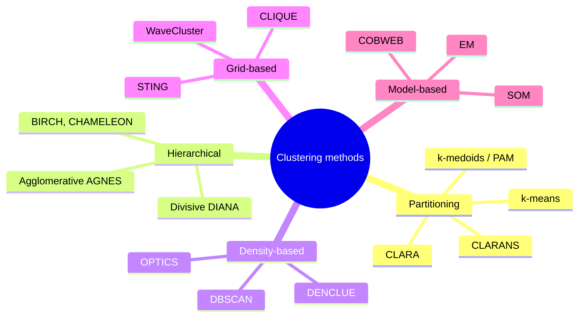
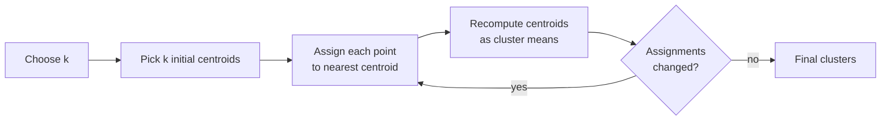
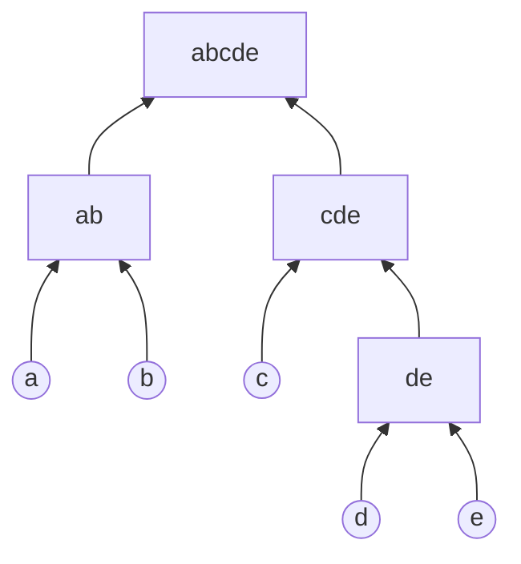
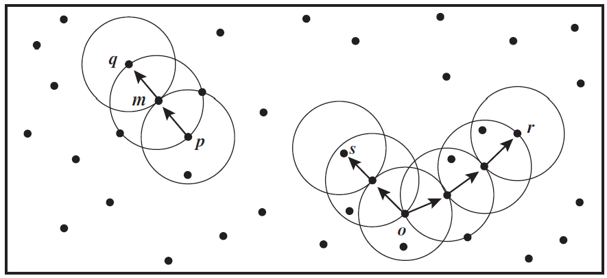
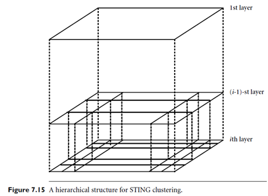
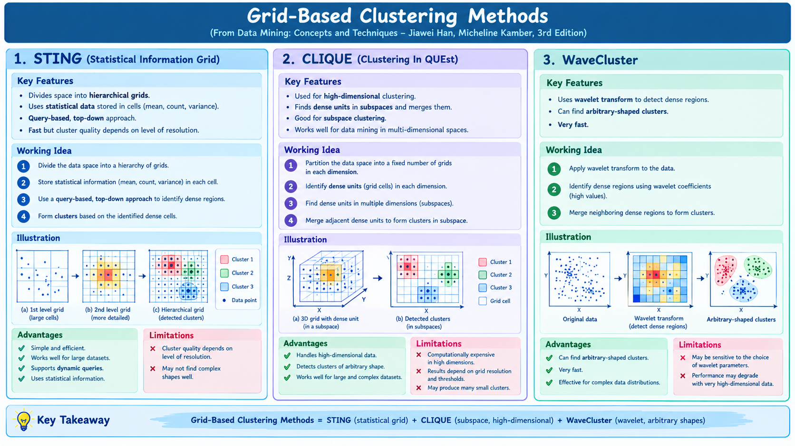
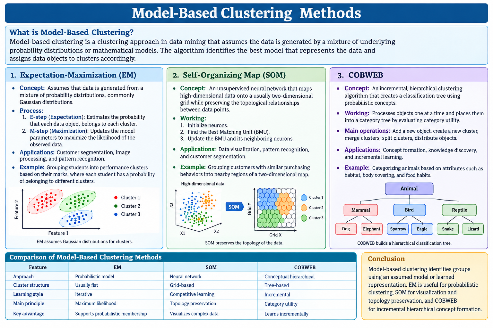
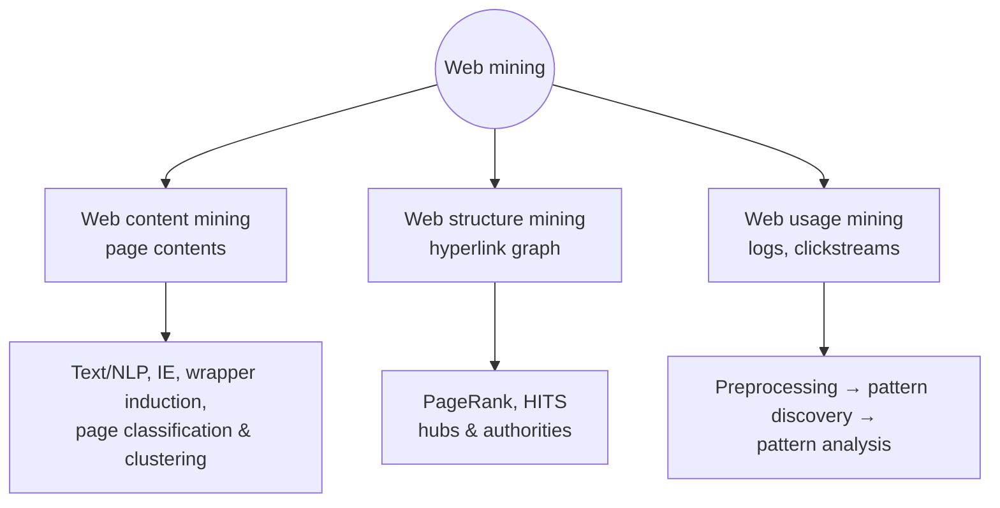

# Unit VI — Cluster Analysis, Outlier Analysis, Text & Web Mining

> **Syllabus:** Cluster analysis introduction, types of data in cluster analysis, major clustering methods — partitioning (k-means, k-medoids/PAM, CLARA, CLARANS), hierarchical, density-based (DBSCAN, OPTICS, DENCLUE), grid-based (STING, WaveCluster, CLIQUE), model-based (EM, SOM, COBWEB); outlier analysis. Advanced topics: text mining, web mining.
>
> **Source:** *DWDM Unit VI 2026.ppt* (SNIST) — Han & Kamber, Ch. 7/10

**Importance legend:** ★★★ = very frequently asked (long answer / numericals) · ★★ = medium · ★ = short answer

---

## Table of Contents
1. [What is Cluster Analysis?](#1-what-is-cluster-analysis-)
2. [Applications & Requirements of Clustering](#2-applications--requirements-of-clustering-)
3. [Types of Data in Cluster Analysis](#3-types-of-data-in-cluster-analysis-)
4. [Categorisation of Major Clustering Methods](#4-categorisation-of-major-clustering-methods-)
5. [Partitioning — k-Means](#5-partitioning-methods--k-means-)
6. [Partitioning — k-Medoids (PAM), CLARA, CLARANS](#6-k-medoids-pam-clara--clarans-)
7. [📘 Hierarchical Methods](#7--hierarchical-methods-)
8. [Density-Based — DBSCAN, OPTICS, DENCLUE](#8-density-based-methods-)
9. [Grid-Based — STING, WaveCluster, CLIQUE](#9-grid-based-methods-)
10. [Model-Based — EM, SOM, COBWEB](#10-model-based-clustering-methods-)
11. [Outlier Analysis](#11-outlier-analysis-)
12. [Text Mining](#12-text-mining-)
13. [Web Mining](#13-web-mining-)
14. [Unit VI — One-Page Summary](#unit-vi--one-page-summary)

---

## 1. What is Cluster Analysis? ★★★

- **Cluster analysis (clustering)** = grouping a set of data objects (physical or abstract) into **classes of similar objects** — an **unsupervised** learning technique (no predefined class labels).
- A **cluster** = a collection of objects **similar to one another** within the same cluster and **dissimilar** to objects in other clusters.
- **Key idea:** **maximise intra-cluster similarity**, **minimise inter-cluster similarity**.
- Clusters can be treated as a single group → **data compression**. Data is first partitioned by similarity, then labels are assigned to groups ("learning by observation" vs classification's "learning by examples").
- Advantage over classification: **adaptable to changes**; helps single out **features that distinguish** groups.

**Why cluster?** Understand data distribution · identify hidden patterns · summarisation/compression · pre-processing for other algorithms · outlier detection.

---

## 2. Applications & Requirements of Clustering ★★

**Applications:** customer segmentation (marketing), market analysis, web mining (user groups), image segmentation, document/topic grouping, medical analysis (patients, genes), social-network communities, spatial analysis, fraud detection, scientific research.
Classic examples: **land use** (earth observation), **insurance** (high-claim groups), **city planning** (houses by type/value/location), **earthquake studies** (epicentres along fault lines).

**Requirements of clustering in data mining:**
| Requirement | Meaning |
|---|---|
| **Scalability** | Handle millions of objects |
| **Different attribute types** | Numeric, binary, categorical, ordinal, mixed |
| **Arbitrary-shaped clusters** | Not just spherical clusters (distance-based methods find spheres) |
| **Minimal domain knowledge for input parameters** | Results shouldn't depend heavily on parameters like k |
| **Handling noisy data** | Robust to outliers, missing or erroneous data |
| **Incremental clustering & insensitivity to input order** | |
| **High dimensionality** | Sparse, skewed high-dimensional data |
| **Constraint-based clustering** | Respect user constraints |
| **Interpretability and usability** | Understandable, useful results |

---

## 3. Types of Data in Cluster Analysis ★★★

### 3.1 Data structures
| Structure | Form | Description |
|---|---|---|
| **Data matrix** (object-by-variable, **two-mode**) | n × p | n objects × p variables (age, height, weight…) |
| **Dissimilarity matrix** (object-by-object, **one-mode**) | n × n (lower triangular) | d(i, j) = dissimilarity between objects i and j; d(i, i) = 0, d(i, j) = d(j, i) |

$$\begin{bmatrix} x_{11} & \cdots & x_{1p}\\ \vdots & & \vdots \\ x_{n1} & \cdots & x_{np}\end{bmatrix} \qquad \begin{bmatrix} 0 & & & \\ d(2,1) & 0 & & \\ d(3,1) & d(3,2) & 0 & \\ \vdots & \vdots & & \ddots \end{bmatrix}$$

### 3.2 Interval-scaled variables
**Standardise** first (units affect results):
- Mean absolute deviation: $s_f = \frac{1}{n}(|x_{1f} - m_f| + \dots + |x_{nf} - m_f|)$, where $m_f$ = mean (more robust than standard deviation).
- **z-score:** $z_{if} = \dfrac{x_{if} - m_f}{s_f}$

**Distance measures:**
| Distance | Formula |
|---|---|
| **Minkowski** | $d(i,j) = \left(\sum_{k=1}^{p} \lvert x_{ik} - x_{jk}\rvert^q\right)^{1/q}$ |
| **Manhattan** (q = 1) | $\sum \lvert x_{ik} - x_{jk}\rvert$ |
| **Euclidean** (q = 2) | $\sqrt{\sum (x_{ik} - x_{jk})^2}$ |
| **Supremum** (q → ∞) | $\max_k \lvert x_{ik} - x_{jk}\rvert$ |

**Metric properties:** d(i, j) ≥ 0 · d(i, i) = 0 · d(i, j) = d(j, i) · **triangle inequality** d(i, j) ≤ d(i, k) + d(k, j).
*Example:* x₁ = (1, 2), x₂ = (3, 5) → Euclidean = √(4 + 9) = **3.61**, Manhattan = 2 + 3 = **5**.

### 3.3 Binary variables
Contingency table for objects i, j: q = (1,1), r = (1,0), s = (0,1), t = (0,0).
| Measure | Formula |
|---|---|
| **Symmetric** binary dissimilarity (both states equally important, e.g., gender) | d(i, j) = (r + s)/(q + r + s + t) |
| **Asymmetric** binary dissimilarity (1 is rarer/more important, e.g., test positive) | d(i, j) = (r + s)/(q + r + s) |
| **Jaccard coefficient** (similarity, asymmetric) | sim(i, j) = q/(q + r + s) |

**Example (patients; gender symmetric, rest asymmetric; Y/P = 1, N = 0):**
| Name | Fever | Cough | Test-1 | Test-2 | Test-3 | Test-4 |
|---|---|---|---|---|---|---|
| Jack | 1 | 0 | 1 | 0 | 0 | 0 |
| Mary | 1 | 0 | 1 | 0 | 1 | 0 |
| Jim | 1 | 1 | 0 | 0 | 0 | 0 |
- d(Jack, Mary) = (0 + 1)/(2 + 0 + 1) = **0.33**
- d(Jack, Jim) = (1 + 1)/(1 + 1 + 1) = **0.67**
- d(Jim, Mary) = (1 + 2)/(1 + 1 + 2) = **0.75**
→ Jack and Mary are most likely to have a similar disease.

### 3.4 Nominal, ordinal, ratio-scaled & mixed
| Type | Method |
|---|---|
| **Nominal** (red, yellow, blue…) | **Simple matching:** d(i, j) = (p − m)/p (m = # matches, p = # variables); or one binary variable per state |
| **Ordinal** (ranks) | Replace by rank r ∈ {1 … M}; map to [0, 1]: **z = (r − 1)/(M − 1)**; then treat as interval-scaled |
| **Ratio-scaled** (non-linear, e.g., Ae^{Bt}) | Don't treat as interval (scale distorted); apply **log transform** y = log(x), or treat as continuous ordinal |
| **Mixed types** | Weighted combination: $d(i,j) = \dfrac{\sum_f \delta_{ij}^{(f)} d_{ij}^{(f)}}{\sum_f \delta_{ij}^{(f)}}$ — binary/nominal: d = 0 if equal else 1; interval: normalised distance; ordinal/ratio: ranks → z |
| **Vector objects** (documents, gene features) | **Cosine similarity** s(x, y) = x·y / (‖x‖‖y‖); Tanimoto coefficient |

---

## 4. Categorisation of Major Clustering Methods ★★★

| Approach | Idea | Typical methods |
|---|---|---|
| **Partitioning** | Divide n objects into **k** clusters (each object in exactly one), iteratively relocating to optimise a criterion (e.g., sum of squared errors) | k-means, k-medoids, PAM, CLARA, CLARANS |
| **Hierarchical** | Hierarchical decomposition (**dendrogram**): **agglomerative** (bottom-up merging) or **divisive** (top-down splitting) | AGNES, DIANA, BIRCH, ROCK, CHAMELEON |
| **Density-based** | Grow clusters while the **density** of the neighbourhood exceeds a threshold → **arbitrary shapes**, filters noise | DBSCAN, OPTICS, DENCLUE |
| **Grid-based** | **Quantise** the space into a finite number of **cells**; cluster on the grid → fast (depends on # cells) | STING, WaveCluster, CLIQUE |
| **Model-based** | **Hypothesise a model** for each cluster and find the best fit | EM, SOM, COBWEB |

---

## 5. Partitioning Methods — k-Means ★★★

**Partitioning:** given k, find a partition of D into k clusters that **minimises the sum of squared distances**:
$$E = \sum_{i=1}^{k} \sum_{p \in C_i} \lvert p - m_i \rvert^2$$
Global optimum needs exhaustive enumeration → heuristics: **k-means** (cluster represented by its **centre/mean**) and **k-medoids** (represented by one **actual object**).

### 5.1 Algorithm
1. Choose **k** (number of clusters).
2. **Initialise** k centroids (randomly pick k objects, or k-means++).
3. **Assign** each object to the **nearest centroid** (usually Euclidean).
4. **Recompute** each centroid as the **mean** of its cluster.
5. **Repeat** 3–4 until **convergence** — no change in assignments, centroids stop moving, or max iterations.

### 5.2 Worked Example (1-D)
Data **{2, 4, 10, 12, 3, 20, 30, 11, 25}**, k = 2, initial means m₁ = 2, m₂ = 4.

| Iteration | Cluster 1 | Cluster 2 | New means |
|---|---|---|---|
| 1 | {2, 3} | {4, 10, 11, 12, 20, 25, 30} | 2.5, 16 |
| 2 | {2, 3, 4} | {10, 11, 12, 20, 25, 30} | 3, 18 |
| 3 | {2, 3, 4, 10} | {11, 12, 20, 25, 30} | 4.75, 19.6 |
| 4 | {2, 3, 4, 10, 11, 12} | {20, 25, 30} | 7, 25 |
| 5 | {2, 3, 4, 10, 11, 12} | {20, 25, 30} | 7, 25 — **no change, stop** |

**Final:** C₁ = {2, 3, 4, 10, 11, 12} (mean 7), C₂ = {20, 25, 30} (mean 25).

### 5.3 Comments
| Strengths | Weaknesses |
|---|---|
| Simple, **efficient: O(tkn)** (t iterations, k, t ≪ n) — vs PAM O(k(n−k)²), CLARA O(ks² + k(n−k)) | Applicable only when a **mean is defined** (not categorical data) |
| Scalable; works well for large data | Must specify **k in advance** |
| | Often terminates at a **local optimum** (sensitive to initial centroids) |
| | **Sensitive to noise and outliers** |
| | Not suitable for **non-convex** shapes or very different sizes |

**Variants:** different initial means, dissimilarity measures, mean computation; **k-modes** (Huang '98 — categorical data: modes instead of means, frequency-based update); **k-prototypes** (mixed numeric + categorical).

---

## 6. k-Medoids (PAM), CLARA & CLARANS ★★★

**Problem with k-means:** an object with an extremely large value can **distort the mean** (outlier sensitivity).
**Solution — k-medoids:** represent each cluster by its **medoid** — the **most centrally located actual object**.

### 6.1 PAM (Partitioning Around Medoids)
1. Select **k** objects arbitrarily as initial medoids.
2. **Assign** every non-medoid to the cluster of the nearest medoid (Manhattan/Euclidean).
3. Compute the **total cost** = Σ distance of each object to its medoid.
4. **Swap step:** for each medoid m and non-medoid o, compute the cost of swapping m with o (**S = new cost − old cost**); if **S < 0**, perform the swap.
5. Repeat until **no swap reduces the cost**; output the k medoids and clusters.

More **robust** to noise/outliers than k-means, but **more costly** — O(k(n − k)²) per iteration → works well for small data only.

### 6.2 k-Means vs k-Medoids ★★★
| Feature | k-Means | k-Medoids |
|---|---|---|
| Cluster centre | **Mean** (artificial point) | **Medoid** (real object) |
| Data type | Numeric only | Numeric + categorical (any distance) |
| Outlier sensitivity | **High** | **Low (robust)** |
| Distance | Mostly Euclidean | Any dissimilarity |
| Cost | Fast, O(tkn) | Slow, O(k(n−k)²) |
| Scalability | Good for large data | Poor for very large data |

### 6.3 CLARA (Clustering LARge Applications)
- Draws **multiple samples** of the data, applies **PAM** on each sample, and returns the best clustering (lowest cost on the whole data).
- Handles larger data than PAM; quality depends on **sample size** — a good clustering on samples may not be good overall (biased sample).

### 6.4 CLARANS (Clustering Large Applications based on RANdomized Search) ★★
- Views clustering as searching a **graph**: each node = a set of **k medoids**; two nodes are **neighbours** if they differ by **one medoid**.
- PAM examines **all** neighbours (slow); CLARA searches subgraphs of samples; **CLARANS randomly samples neighbours** without restricting to a sample.

**Algorithm:**
1. Input **numlocal** and **maxneighbor**; set i = 1, mincost = large.
2. Set **current** = an arbitrary node.
3. Set j = 1.
4. Consider a **random neighbour S** of current; compute the cost differential.
5. If S has **lower cost**, set current = S and go to step 3.
6. Otherwise j = j + 1; if j ≤ **maxneighbor**, go to step 4.
7. Otherwise (local minimum reached): if cost(current) < mincost, record it as **bestnode**.
8. i = i + 1; if i > **numlocal**, output bestnode and halt; else go to step 2.

| Advantages | Disadvantages |
|---|---|
| Faster than PAM; more accurate than CLARA | Still slower than k-means |
| Scales to large datasets | Randomisation may miss global optimum |
| | Needs tuning of maxneighbor, numlocal |

---

## 7. 📘 Hierarchical Methods ★★
*(listed under clustering categories on the slides)*

- Build a **tree of clusters (dendrogram)**; no need to specify k (cut the dendrogram at the desired level).
- **Agglomerative (AGNES — bottom-up):** start with each object as its own cluster; repeatedly **merge the two closest** clusters until one cluster (or a termination condition).
- **Divisive (DIANA — top-down):** start with all objects in one cluster; repeatedly **split** until each object is alone.
- **Inter-cluster distance:** single link (min), complete link (max), average link, centroid distance.
- **Weakness:** merges/splits can't be undone; O(n²) — improved by **BIRCH** (CF-tree), **ROCK**, **CHAMELEON**.

*AGNES merges upward ↑; DIANA splits downward ↓.*

---

## 8. Density-Based Methods ★★★

Clusters = **dense regions** of objects separated by regions of **low density** (noise) → discover **arbitrary-shaped** clusters, handle noise, need density parameters, one scan.

### 8.1 DBSCAN (Density-Based Spatial Clustering of Applications with Noise)
**Definitions** (parameters **ε** and **MinPts**):
| Term | Definition |
|---|---|
| **ε-neighbourhood** | Objects within radius ε of an object |
| **Core object** | Its ε-neighbourhood contains **≥ MinPts** objects |
| **Border object** | Not core, but in the ε-neighbourhood of a core object |
| **Noise** | Neither core nor border |
| **Directly density-reachable** | p is directly density-reachable from q if p is in q's ε-neighbourhood **and q is a core object** |
| **Density-reachable** | A **chain** p₁ = q, …, pₙ = p with each pᵢ₊₁ directly density-reachable from pᵢ (not symmetric) |
| **Density-connected** | p and q are both density-reachable from some object o (symmetric) |
| **Density-based cluster** | A **maximal** set of **density-connected** objects; objects in no cluster = **noise** |

**Example (MinPts = 3):** m, p, o, r are core objects. q is directly density-reachable from m; m from p and vice versa. q is (indirectly) density-reachable from p, but **p is not density-reachable from q** (q is not core). r and s are density-reachable from o; o, r, s are all density-connected.

**Algorithm:** check the ε-neighbourhood of each point; if a point p has ≥ MinPts neighbours, **create a new cluster** with p as a core; iteratively collect **directly density-reachable** objects (possibly merging density-reachable clusters); stop when no new point can be added. Complexity **O(n²)** (O(n log n) with a spatial index).

**Pros:** arbitrary shapes, handles noise, no need for k. **Cons:** **sensitive to ε and MinPts** (different values give different clusters); struggles with **varying densities**.

### 8.2 DBSCAN Solved Example (slide) ★★★
Points: P1(3,7), P2(4,6), P3(5,5), P4(6,4), P5(7,3), P6(6,2), P7(7,2), P8(8,4), P9(3,3), P10(2,6), P11(3,5), P12(2,4). **MinPts = 4** (point itself counted), **ε = 1.9**.

| Point | Neighbours within ε (incl. itself) | Count | Type |
|---|---|---|---|
| P1 | P1, P2, P10 | 3 | border (of P2) |
| **P2** | P2, P1, P3, P11 | **4** | **core** |
| P3 | P3, P2, P4 | 3 | border (of P2) |
| P4 | P4, P3, P5 | 3 | border (of P5) |
| **P5** | P5, P4, P6, P7, P8 | **5** | **core** |
| P6 | P6, P5, P7 | 3 | border |
| P7 | P7, P5, P6 | 3 | border |
| P8 | P8, P5 | 2 | border |
| P9 | P9, P12 | 2 | **noise** (P12 is not core) |
| P10 | P10, P1, P11 | 3 | border |
| **P11** | P11, P2, P10, P12 | **4** | **core** |
| P12 | P12, P11, P9 | 3 | border |

(Diagonal neighbours are √2 ≈ 1.41 apart; points 2 apart are outside ε = 1.9.)

**Clusters:**
- **Cluster 1:** core P2, P11 (directly reachable from each other) + border P1, P3, P10, P12.
- **Cluster 2:** core P5 + border P4, P6, P7, P8.
- **Noise:** P9.

### 8.3 OPTICS (Ordering Points To Identify the Clustering Structure)
- Overcomes DBSCAN's sensitivity to a single global ε: produces an **augmented cluster ordering** representing the density-based structure for a **wide range of parameter settings**.
- Stores for each object:
  - **Core-distance** of p = the **smallest ε′** that makes p a core object (undefined if p isn't core within ε).
  - **Reachability-distance** of q w.r.t. p = **max(core-distance(p), dist(p, q))** (undefined if p isn't core).
- The ordering + reachability plot lets you extract clusters for **any ε′ ≤ ε**.

### 8.4 DENCLUE (DENsity-based CLUstEring)
Based on **density distribution functions**:
1. The **influence** of each point is modelled by an **influence function** — square wave f(x, y) = 0 if d(x, y) > σ else 1, or **Gaussian** $f(x,y) = e^{-d(x,y)^2/2\sigma^2}$.
2. The **density function** at x = **sum of influence functions** of all points: $f^D(x) = \sum_{i=1}^{n} f(x, x_i)$.
3. Clusters are determined by **density attractors** — **local maxima** of the overall density function; points are assigned by **hill-climbing** to attractors.
- Solid mathematical foundation; handles noise and arbitrary shapes; fast with grid indexing; needs careful σ and threshold.

| Feature | DBSCAN | OPTICS | DENCLUE |
|---|---|---|---|
| Principle | Dense neighbourhoods | Density-based ordering | Density functions |
| Cluster shapes | Arbitrary | Arbitrary | Complex/arbitrary |
| Noise handling | Yes | Yes (via structure) | Depends on thresholds |
| Different densities | Limited (one ε) | Better suited | Depends on model |
| Output | Clusters + noise | Ordering + reachability plot | Attractors + clusters |

---

## 9. Grid-Based Methods ★★★

- **Quantise** the data space into a finite number of **cells** (grid); cluster on the grid.
- **Complexity depends on the number of cells**, not data objects → very fast; good for large and spatial data.

**General steps:** partition each dimension into intervals → assign objects to cells → compute **cell density** → mark cells with density ≥ τ as **dense** → **connect adjacent dense cells** into clusters (sparse cells = noise) → summarise.

| Advantages | Disadvantages |
|---|---|
| Fast; scalable; easy to implement | Quality depends heavily on **grid size** (too coarse misses structure, too fine → many tiny cells) |
| Natural for spatial data (GIS, images) | Arbitrary shapes need fine resolution; cluster boundaries are horizontal/vertical |

### 9.1 STING (STatistical INformation Grid)
- Spatial area divided into **rectangular cells** at **several levels of resolution** → **hierarchical structure** (each high-level cell is partitioned into child cells at the next lower level).
- Each cell stores precomputed **statistics**: **count** (attribute-independent), **mean, stdev, min, max** (attribute-dependent) and **type of distribution** (normal, uniform, exponential, none — assigned by user or χ² test). Higher-level parameters are computed from lower-level ones.
- **Query processing (top-down):** start at a high level, select relevant cells, move down only into children of relevant cells, finally merge adjacent relevant cells.
- **Pros:** fast O(g) for g cells; query-independent; easy incremental update. **Cons:** quality depends on the bottom-level granularity; cluster boundaries are only horizontal or vertical.

### 9.2 WaveCluster
- **Multi-resolution** grid- and density-based method; imposes a grid, then applies a **wavelet transform** to the feature space; dense regions in the transformed space are clusters.
- Treats the data distribution like a **signal**; **hat-shaped filters** amplify dense regions (clusters) and suppress sparse/noisy areas.
- **Advantages:** unsupervised; detects **arbitrary-shaped** clusters at **multiple resolutions**; removes outliers; **O(n)**; parallelisable; insensitive to input order; doesn't need number of clusters or neighbourhood radius.

### 9.3 CLIQUE (CLustering In QUEst)
- For **high-dimensional** data: finds **dense units in subspaces** (Apriori-like — a k-dimensional unit can be dense only if its (k−1)-dimensional projections are dense), merges connected dense units into clusters and produces minimal descriptions (DNF expressions).
- Good for **subspace clustering**; insensitive to order; scales linearly with data size.

---

## 10. Model-Based Clustering Methods ★★

- Assume data are generated by a **mixture of underlying probability distributions** (e.g., Gaussians); each distribution = a cluster. Goal: find the model that **maximises the likelihood** of the data.

| Method | Idea |
|---|---|
| **Expectation-Maximisation (EM)** | Extension of k-means: each object belongs to each cluster with a **probability (weight)**. **E-step:** compute membership probabilities with current parameters; **M-step:** re-estimate parameters (means, variances, mixing weights) to maximise likelihood; iterate until convergence |
| **Self-Organising Maps (SOM)** (Kohonen) | **Neural-network** approach: neurons on a 2-D grid **compete** for each input; the winner and its neighbours move closer → topology-preserving map for visualising high-dimensional data |
| **COBWEB** | **Conceptual clustering** — incremental; builds a **classification tree** of probabilistic concepts using **category utility**; operations: add to existing class, create new class, merge, split |

**Why model-based?** Probabilistic cluster description; clusters of different shapes/sizes (covariances); strong statistical foundation; handles noise; can choose the number of clusters (BIC/AIC).
**Limitations:** computationally expensive (EM), distribution assumptions, sensitive to initialisation, local optima.

---

## 11. Outlier Analysis ★★★

An **outlier** is a data object that **deviates significantly** from the rest of the data / does not conform to expected behaviour — also called an **anomaly** or **exception**. (E.g., marks mostly 60–90, one student scores 5.)
"One person's noise could be another person's signal" — outliers matter for **fraud detection, network intrusion, medical abnormalities**, and data quality.

### 11.1 Types of outliers
| Type | Description | Example |
|---|---|---|
| **Global (point) outlier** | Deviates from the **entire** dataset | Extremely high salary in a normal salary dataset |
| **Contextual (conditional) outlier** | Abnormal in a **specific context** (time, location) | 30 °C is normal in summer but abnormal in winter |
| **Collective outlier** | A **group** of points abnormal together, though individually normal | Sudden unusual burst in network traffic |

### 11.2 Detection methods
| Approach | Idea | Notes |
|---|---|---|
| **Statistical (distribution-based)** | Assume a distribution (e.g., normal); objects far from the mean are outliers: **z = (x − μ)/σ**, \|z\| > threshold (e.g., 3) | Needs known distribution; mostly univariate |
| **Distance-based** | DB(p, d)-outlier: fewer than **p %** of objects lie within distance **d** | No distribution needed; O(n²) |
| **Density-based (LOF)** | Compare an object's local density with its neighbours' — **Local Outlier Factor**; lower relative density → outlier | Handles varying densities |
| **Deviation-based** | Examine main characteristics of a group; objects deviating from the description are outliers (sequential exception, OLAP data cube) | |
| **Clustering-based** | Objects **not in any cluster** or in **small/sparse clusters** (DBSCAN noise points) | |
| **Classification-based** | Supervised/semi-supervised — **one-class SVM**, rule-based | Needs labels |
| **Isolation-based** | **Isolation Forest** — outliers are isolated with **fewer random splits** | Fast, scalable |

*Example (statistical):* marks 60, 62, 65, 70, 72, 75, 78, 80, 85, 5 → the value 5 has a z-score far below −2 → outlier.

**Applications:** fraud detection (banking, insurance), intrusion detection, fault detection, health monitoring.
**Pros:** finds rare but important events; improves model performance. **Cons:** computationally costly, parameter-sensitive, hard to evaluate without labels.

---

## 12. Text Mining ★★★

**Text mining** = extracting useful information, patterns and knowledge from **unstructured text** (documents are unstructured, high-dimensional, noisy, ambiguous). Goal: convert text into **structured** data for mining.

### 12.1 Pre-processing
| Step | Description | Example |
|---|---|---|
| **Tokenisation** | Split text into words/sentences/terms | "Data Mining is powerful" → [Data, Mining, is, powerful] |
| **Stop-word removal** | Remove common words carrying little meaning | is, of, the, a, an, are |
| **Stemming** | Reduce words to root form (crude suffix stripping) | studying, studied → study |
| **Lemmatisation** | Dictionary (base) form — more accurate | better → good |
| **Synonym handling** | Map similar words to one concept | car, automobile → vehicle |
| **Noise removal** | Remove punctuation, special characters, numbers, extra spaces | |

### 12.2 Text representation
- **Bag-of-Words (BoW)** — document = word frequencies; ignores grammar & order.
- **Vector Space Model (VSM)** — documents as vectors in term space; similarity by **cosine**: cos(d₁, d₂) = (d₁·d₂)/(‖d₁‖‖d₂‖).
- **TF** (term frequency) — occurrences of a term in a document; **IDF** = log(N / dfₜ) — importance across documents; **TF-IDF = TF × IDF** — frequent-in-document but rare-in-collection terms get high weight.
- **Dimensionality reduction** — PCA, **SVD/LSI** (latent semantic indexing).

*Example:* N = 1000 documents; "mining" appears 5 times in d and in 10 documents → TF-IDF = 5 × log₁₀(1000/10) = 5 × 2 = **10**.

### 12.3 Text-mining techniques
| Technique | Description |
|---|---|
| **Text classification** | Assign predefined categories — naïve Bayes, SVM, decision trees, NN (spam detection, topic classification) |
| **Text clustering** | Group similar documents without labels — k-means, hierarchical (document organisation, topic discovery) |
| **Concept extraction** | Key concepts, phrases, keywords |
| **Information extraction (IE)** | Structured info from text; **Named Entity Recognition** — people, locations, organisations |
| **Information retrieval (IR)** | Retrieve documents relevant to a query (search engines); measured by **precision, recall, F1** |
| **Text summarisation** | Concise summaries — **extractive** (select sentences) vs **abstractive** (generate new sentences) |
| **Sentiment analysis** | Positive/negative/neutral opinions (product reviews, social-media monitoring) |

**IR measures:** Precision = |relevant ∩ retrieved| / |retrieved|; Recall = |relevant ∩ retrieved| / |relevant|.

**Challenges:** high dimensionality; **synonymy** (different words, same meaning); **polysemy** (same word, many meanings); noise; context understanding.
**Applications:** search engines, customer-feedback analysis, e-mail filtering, recommendation systems, digital libraries, clinical text mining, business intelligence.

---

## 13. Web Mining ★★★

**Web mining** = applying data-mining techniques to discover patterns from the **Web** — which is **huge, dynamic, heterogeneous** (text, images, audio/video, links, user logs/clickstreams). Discovers user behaviour, navigation paths, page rankings, content extraction, website optimisation.

### 13.1 Web Content Mining
- Extract useful information from **page contents** — text (HTML, blogs, articles), multimedia, structured/semi-structured data (tables, metadata).
- Techniques: information extraction, text mining, **NLP**, **wrapper induction**, web-page classification & clustering.
- Tasks: categorising pages, extracting keywords, summarising content, opinion/sentiment detection.

### 13.2 Web Structure Mining
- Analyses the **link structure**: pages = **nodes**, hyperlinks = **edges** → web graph.
- Purpose: connectivity patterns, **authoritative** and **hub** pages, improve search ranking, communities.
- **HITS (Hyperlink-Induced Topic Search, Kleinberg):** **authorities** — pages highly referenced by others; **hubs** — pages linking to many authorities; mutually reinforcing: authority score = Σ hub scores of pages pointing to it; hub score = Σ authority scores of pages it points to.
- **PageRank (Google):** a page is important if important pages link to it:
$$PR(A) = (1 - d) + d\sum_{T_i \to A} \frac{PR(T_i)}{C(T_i)}$$
  (d ≈ 0.85 damping factor, C(Tᵢ) = number of out-links of Tᵢ).
- Outputs: link-based clusters, influential sites, communities/topic clusters.

### 13.3 Web Usage Mining
Mines **web log data** to understand **user behaviour**. Sources: server logs, browser logs, proxy logs, clickstreams, cookies, sessions.
1. **Data collection** — from server, proxy or client.
2. **Pre-processing** — **cleaning** (remove image requests, robots), **user identification**, **session identification**, **path completion**.
3. **Pattern discovery** — association rules, **sequential patterns**, clustering of sessions/users, classification, **collaborative filtering**.
4. **Pattern analysis** — visualisation, rule filtering, recommendation generation.

**Applications:** recommendation systems (Amazon, YouTube), user profiling, website redesign/personalisation, clickstream analytics, fraud detection.

### 13.4 Web-mining architecture & challenges
**Architecture:** data sources (content, logs, metadata, links) → pre-processing (noise removal, parsing, sessionising) → **mining engine** (clustering, classification, association, link analysis) → **pattern-analysis module** (visualisation, rule filtering) → applications (search engines, BI, personalisation).

**Challenges:** Web is **too huge** and **constantly changing**; data is unstructured/semi-structured; complexity of pages; **user privacy**; noise and duplicate pages; dynamic user behaviour; need for scalable algorithms; only a small portion of information is relevant to any user.

| Category | Data | Applications |
|---|---|---|
| Content | Page text, multimedia | Search engines, categorisation, sentiment analysis, spam detection |
| Structure | Hyperlinks | Page ranking, community detection, link prediction, topology analysis |
| Usage | Logs, clickstreams | Recommendations, clickstream analytics, fraud detection, user behaviour |

---

## Unit VI — One-Page Summary

| Topic | Key points |
|---|---|
| **Clustering** | Unsupervised grouping; maximise intra-cluster, minimise inter-cluster similarity. Requirements: scalability, attribute types, arbitrary shapes, few parameters, noise, high dimensionality, interpretability. |
| **Data types** | Data matrix (n × p) vs dissimilarity matrix (n × n). Interval: standardise (mean absolute deviation, z-score); Minkowski/Manhattan/Euclidean. Binary: symmetric (r+s)/(q+r+s+t), asymmetric (r+s)/(q+r+s), Jaccard. Nominal (p−m)/p; ordinal (r−1)/(M−1); ratio → log; mixed weighted; cosine for vectors. |
| **Methods** | Partitioning · Hierarchical · Density · Grid · Model-based. |
| **k-means** | Choose k → assign to nearest mean → recompute means → repeat. O(tkn). Example {2,3,4,10,11,12} & {20,25,30}. Weak: k in advance, outliers, non-convex, numeric only; k-modes, k-prototypes. |
| **k-medoids** | Medoid = central real object; PAM swap if cost decreases; robust but O(k(n−k)²). CLARA = PAM on samples. CLARANS = randomised neighbour search (numlocal, maxneighbor). |
| **Hierarchical** | AGNES (merge) / DIANA (split); dendrogram; single/complete/average link. |
| **DBSCAN** | ε, MinPts; core, border, noise; directly density-reachable, density-reachable, density-connected; cluster = maximal density-connected set. Example: {P1,P2,P3,P10,P11,P12}, {P4,P5,P6,P7,P8}, noise P9. |
| **OPTICS / DENCLUE** | OPTICS: cluster ordering with core-distance & reachability-distance. DENCLUE: influence functions (square/Gaussian), density = sum, density attractors. |
| **Grid-based** | Cells; complexity by # cells. STING (hierarchical cells with count, mean, stdev, min, max, distribution), WaveCluster (wavelet, arbitrary shapes, O(n)), CLIQUE (dense subspace units). |
| **Model-based** | EM (soft membership, E & M steps), SOM (competitive NN), COBWEB (concept tree, category utility). |
| **Outliers** | Global, contextual, collective. Statistical (z-score), distance-based, density (LOF), deviation, clustering, classification (one-class SVM), isolation forest. |
| **Text mining** | Collect → pre-process (tokenise, stop words, stemming, lemmatisation) → represent (BoW, VSM, TF-IDF, SVD) → classification, clustering, IE/NER, IR (precision, recall), summarisation, sentiment. Challenges: synonymy, polysemy. |
| **Web mining** | Content (page text, wrappers), Structure (PageRank, HITS hubs/authorities), Usage (logs → cleaning, sessions → patterns → analysis; recommendations). |
