# IAI — Examination Answers

**Source question papers:** `A22-IAI-(AIML)-21-01-2025-(Regular).doc` (21-Jan-2025) and `A22-IAI-AIML (Regular & Supplementary).doc` (18-Dec-2025).
**Reference notes:** `Unit-1` … `Unit-6` in `IAI/` (Russell & Norvig based).
**Marks weightage:** Part A = 6 × 2M = 12M; Part B = 6 × 8M = 48M; Total = 60M.
Images referenced from `IAI/media/U1…U6/` (named per the notes, e.g. `media/U1/s63_1.png`).

---

## Paper 1 — Regular (21-Jan-2025)

### Part A (6 × 2 = 12M)

#### Q1. Define Agent. [L1, CO1, 2M]

An **agent** is anything that perceives its environment through **sensors** and acts upon it through **actuators (effectors)**.

- **Percept:** the agent's perceptual input at a given instant.
- **Agent function:** an abstract mapping from percept sequences to actions, f : P* → A.
- **Agent program:** a concrete implementation of the agent function running on an agent architecture.
- **Agent = architecture + program.**
- **Rational agent:** for each possible percept sequence, selects an action expected to maximise its performance measure, given the evidence from the percept sequence and its built-in knowledge.

Example diagram — agent–environment loop:

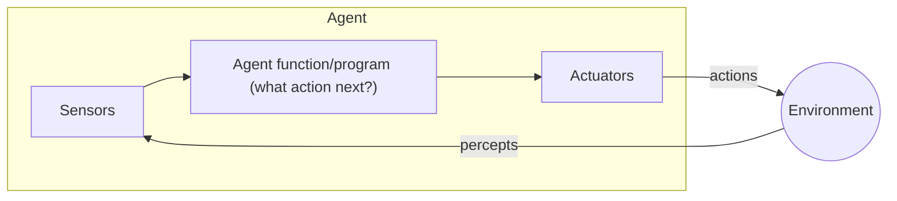


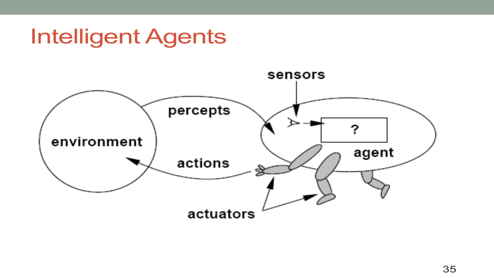


---

#### Q2. Write about knowledge-based agents. [L2, CO2, 2M]

A **knowledge-based (KB) agent** maintains a **knowledge base (KB)** — a set of sentences in a knowledge-representation language — and uses two generic operations:

- **TELL** — add new sentences (facts) to the KB.
- **ASK** — query the KB; answers must follow from what was told.

Architecture = **inference engine** (domain-independent) + **knowledge base** (domain-specific).

The agent must represent states and actions, incorporate new percepts, update its internal world model, deduce hidden properties, and deduce appropriate actions. Useful in **partially observable** environments because it can combine general knowledge flexibly.

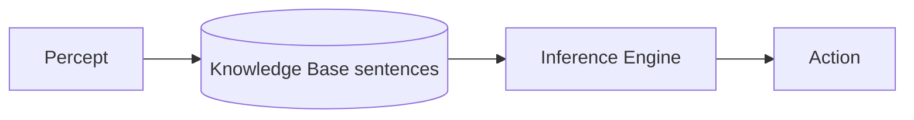


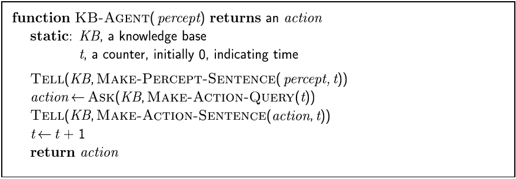


**Declarative vs procedural:** TELL what it needs to know (flexible, explicit) vs encode behaviour directly as code (efficient, minimal explicit reasoning).

---

#### Q3. List the inference rules in First Order Logic. [L1, CO3, 2M]

Key FOL inference rules:

1. **Universal Instantiation (UI):** from ∀v α, infer SUBST({v/g}, α) for any ground term g.
   - E.g., ∀x King(x) ⇒ Evil(x) → King(John) ⇒ Evil(John).
2. **Existential Instantiation (EI):** from ∃v α, infer SUBST({v/k}, α) using a **new** constant (Skolem constant) k, applied once.
3. **Generalised Modus Ponens (GMP):** premises p₁′,…,pₙ′ and rule (p₁ ∧ … ∧ pₙ ⇒ q) with SUBST(θ, pᵢ′) = SUBST(θ, pᵢ) → infer SUBST(θ, q).
4. **Unification:** find θ such that SUBST(θ, p) = SUBST(θ, q) (used by GMP/resolution).


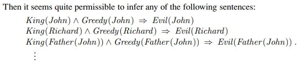


---

#### Q4. Define state space with an example. [L2, CO4, 2M]

The **state space** is the set of all states reachable from the initial state via the transition model — i.e., the implicit graph of states defined by **initial state + actions + transition model (RESULT)**.

**Example — 8-puzzle:** each state is the arrangement of tiles 1–8 and the blank on the 3×3 board; a move slides one tile into the blank; all arrangements reachable from the initial configuration form the state space.

**Example — planning (air cargo):** each state is a conjunction of ground fluents such as At(C₁, SFO) ∧ In(C₁, P₁) ∧ At(P₁, JFK); the state space is all fluent combinations reachable by Load/Unload/Fly actions.


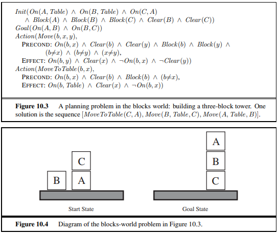


---

#### Q5. Write short notes on Bayes rule. [L1, CO5, 2M]

**Bayes' rule** (from the product rule):

$$P(b \mid a) = \frac{P(a \mid b)\,P(b)}{P(a)}$$

It converts **causal** knowledge P(effect | cause) into **diagnostic** knowledge P(cause | effect):

$$P(\text{cause} \mid \text{effect}) = \frac{P(\text{effect} \mid \text{cause})\,P(\text{cause})}{P(\text{effect})}$$

**Example — meningitis:** P(M) = 0.0001, P(S | M) = 0.8, P(S) = 0.1:

$$P(M \mid S) = \frac{0.8 \times 0.0001}{0.1} = 0.0008$$

Even with a stiff neck, meningitis is still unlikely because the prior is tiny.


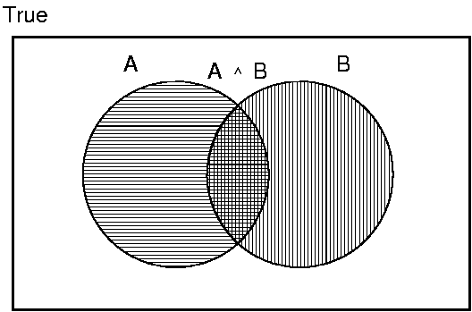 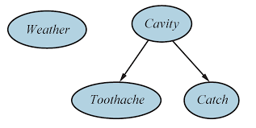


---

#### Q6. Define Conditional Distribution. [L2, CO6, 2M]

A **conditional probability distribution** P(X | Y) gives the probability of each value of variable X **given** that Y takes a particular value:

$$P(X \mid Y) = \frac{P(X, Y)}{P(Y)} \quad (P(Y) > 0)$$

In a Bayesian network, each node Xᵢ has a **Conditional Probability Table (CPT)** specifying P(Xᵢ | Parents(Xᵢ)) — the distribution over Xᵢ for every combination of parent values.

**Example:** P(Toothache | Cavity) — e.g., P(toothache | cavity) = 0.8, P(toothache | ¬cavity) = 0.1.


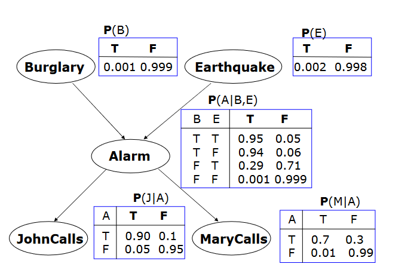 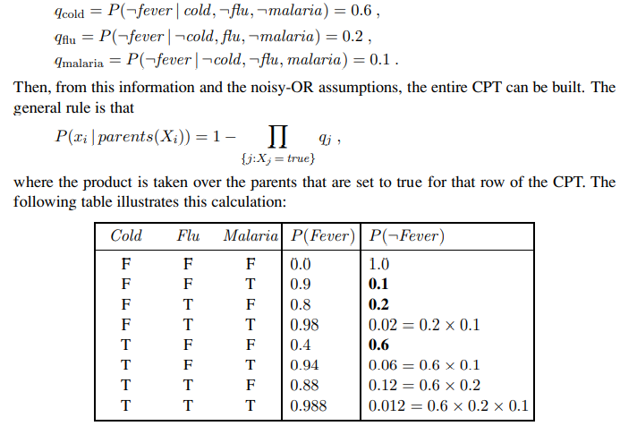


---

## Paper 1 — Part B (6 × 8 = 48M)

#### Q7. Differentiate between BFS and DFS. [L3, CO1, 8M]

| Aspect | BFS (Breadth-First Search) | DFS (Depth-First Search) |
|---|---|---|
| **Data structure** | FIFO queue | LIFO stack (or recursion) |
| **Expansion order** | Level by level (shallowest first) | Deepest first, then backtrack |
| **Complete** | Yes (finite branching factor) | No (may loop forever in infinite spaces) |
| **Optimal** | Yes (unit/non-decreasing step cost) | No |
| **Time** | O(bᵈ) | O(bᵐ) |
| **Space** | O(bᵈ) — high | O(bm) — low (linear) |
| **Best when** | Solution is shallow | Solution is deep / memory limited |

BFS traversal example: **S → A → B → C → D → G → H → E → F → I → K**.
DFS traversal example: S → A → B → D → E → (backtrack) → C → G (goal).


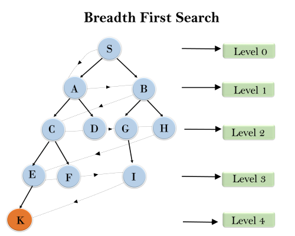 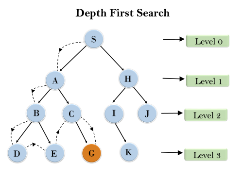


**Algorithms:** BFS uses a FIFO frontier and an explored set; DFS uses a LIFO frontier. DFS variants: depth-limited search, iterative deepening (combines DFS space with BFS completeness — O(bᵈ) time, O(bd) space).

---

#### Q8. Write about Simulated Annealing Search. [L2, CO1, 8M]

**Simulated annealing** is a local-search algorithm that escapes local maxima. Inspired by metallurgical annealing: heat metal to high temperature, then cool gradually to reach a low-energy state.

**Algorithm:** pick a random successor; if it improves the state (ΔE > 0), accept it; otherwise accept it with probability **e^(ΔE/T)** (< 1). Temperature T decreases over time per a schedule, so bad moves become less likely.

```
function SIMULATED-ANNEALING(problem, schedule):
    current ← problem.INITIAL-STATE
    for t = 1 to ∞:
        T ← schedule(t)
        if T = 0: return current
        next ← random successor of current
        ΔE ← next.VALUE − current.VALUE
        if ΔE > 0: current ← next
        else: accept next with probability e^(ΔE/T)
```

| Temperature | Behaviour |
|---|---|
| High T | Accepts many bad moves → explores (like random walk) |
| Low T | Rarely accepts bad moves → exploits (like hill climbing) |
| T decreased slowly enough | Finds global optimum with probability → 1 |

**Example:** ΔE = −2. At T = 10: P = e⁻⁰·² ≈ 0.82. At T = 1: P = e⁻² ≈ 0.14. At T = 0.1: P = e⁻²⁰ ≈ 0.

**Vs hill climbing:** hill climbing always moves uphill and gets stuck at local maxima/plateaux/ridges; simulated annealing sometimes accepts downhill moves and escapes local optima.


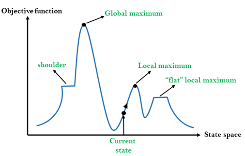 


Applications: VLSI layout, airline scheduling, TSP, large optimisation problems.

---

#### Q9. Solve the CSP: SEND + MORE = MONEY. [L4, CO2, 8M]

**Cryptarithmetic:** each letter is a unique digit 0–9; leading digits (S, M) ≠ 0.

```
    S E N D
  + M O R E
  ---------
  M O N E Y
```

Constraints (with carries C₁, C₂, C₃):
- D + E = Y + 10·C₁
- C₁ + N + R = E + 10·C₂
- C₂ + E + O = N + 10·C₃
- C₃ = M
- S ≠ 0, M ≠ 0
- Alldiff(S, E, N, D, M, O, R, Y)

**Solution (by backtracking with MRV/LCV and forward checking):**

**S = 9, E = 5, N = 6, D = 7, M = 1, O = 0, R = 8, Y = 2**

Check:
```
  9 5 6 7
+ 1 0 8 5
---------
 1 0 6 5 2
```
9567 + 1085 = 10652 ✓

**Reasoning:** M = 1 (carry from thousands column must be 1 since max sum of two digits + carry < 20). S must be 8 or 9 (to produce a carry); with O = 0 and M = 1, S = 9. Column 2: E + O + carry = N + 10·carry → E = 5, N = 6. Column 1: N + R + carry = E + 10 → R = 8. Column 0: D + E = Y + 10 → D = 7, Y = 2.


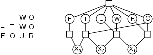 


---

#### Q10. Write short notes on Horn clauses and definite clauses. [L2, CO2, 8M]

- **Clause:** a finite disjunction of literals.
- **Horn clause:** at most one positive literal: ¬X₁ ∨ … ∨ ¬Xₙ ∨ Y ≡ (X₁ ∧ … ∧ Xₙ) ⇒ Y, written **Head ← Body**.
- **Definite clause:** exactly one positive literal (a rule).
- **Unit clause:** definite clause with no negative literals (a fact, no variables).
- **Fact:** unit clause without variables, e.g., Human(Ram).
- **Goal clause (query):** no positive literal, e.g., ← Human(Ram) ("Is Ram human?").

| Clause | Positive literals | Horn? |
|---|---|---|
| Mammal(x) ← Dog(x) | 1 | ✓ rule |
| Animal(Tiger) | 1 | ✓ fact |
| ← Animal(Tiger) | 0 | ✓ goal |
| P(x) ∨ Q(x) | 2 | ✗ not Horn |
| ¬P(x) ∨ ¬Q(x) ∨ R(x) | 1 | ✓ ≡ R(x) ← P(x) ∧ Q(x) |

**Why definite clauses matter:** (1) read as IF–THEN rules, (2) inference by forward/backward chaining — entailment is **linear in KB size**, (3) basis of Prolog / logic programming.


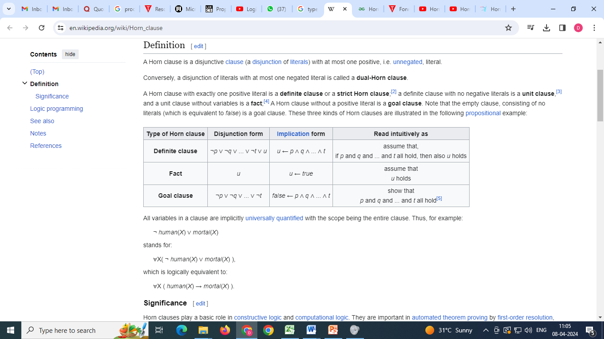


Example conversion: Student(x) ∧ WorksHard(x) ⇒ Pass(x) → ¬Student(x) ∨ ¬WorksHard(x) ∨ Pass(x) — Horn.

---

#### Q11. Marcus / Caesar — prove Marcus hated Caesar by Resolution. [L4, CO3, 8M]

**FOL KB:**
1. Man(Marcus)
2. Pompeian(Marcus)
3. ∀x Pompeian(x) ⇒ Roman(x)
4. Ruler(Caesar)
5. ∀x Roman(x) ⇒ LoyalTo(x, Caesar) ∨ Hates(x, Caesar)
6. ∀x ∃y LoyalTo(x, y)
7. ∀x ∀y (Person(x) ∧ Ruler(y) ∧ TryAssassinate(x, y) ⇒ ¬LoyalTo(x, y))
8. TryAssassinate(Marcus, Caesar)

**Goal:** Hates(Marcus, Caesar). Negate goal: ¬Hates(Marcus, Caesar).

**Convert to CNF:**
- (3) ¬Pompeian(x) ∨ Roman(x)
- (5) ¬Roman(x) ∨ LoyalTo(x, Caesar) ∨ Hates(x, Caesar)
- (7) ¬Person(x) ∨ ¬Ruler(y) ∨ ¬TryAssassinate(x, y) ∨ ¬LoyalTo(x, y)
- Facts: Man(Marcus), Pompeian(Marcus), Ruler(Caesar), TryAssassinate(Marcus, Caesar)
- Negated goal: ¬Hates(Marcus, Caesar)

**Resolution chain:**
1. ¬Pompeian(Marcus) ∨ Roman(Marcus)  [UI (3) x/Marcus]
2. With Pompeian(Marcus) → **Roman(Marcus)**
3. ¬Roman(Marcus) ∨ LoyalTo(Marcus, Caesar) ∨ Hates(Marcus, Caesar) [UI (5)]
4. With Roman(Marcus) → **LoyalTo(Marcus, Caesar) ∨ Hates(Marcus, Caesar)**
5. ¬Person(Marcus) ∨ ¬Ruler(Caesar) ∨ ¬TryAssassinate(Marcus, Caesar) ∨ ¬LoyalTo(Marcus, Caesar) [UI (7)]
6. Man(Marcus) → Person(Marcus); Ruler(Caesar); TryAssassinate(Marcus, Caesar) → **¬LoyalTo(Marcus, Caesar)**
7. Resolve (4) with ¬LoyalTo(Marcus, Caesar) → **Hates(Marcus, Caesar)**
8. Resolve Hates(Marcus, Caesar) with negated goal ¬Hates(Marcus, Caesar) → **□ (empty clause)**

Contradiction ⇒ **Marcus hated Caesar** is proved.


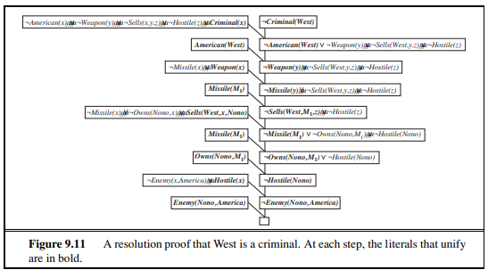 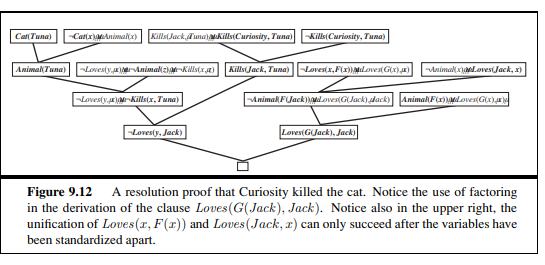


---

#### Q12. Discuss forward and backward chaining in FOL with example. [L3, CO3, 8M]

**Example KB (definite clauses):**
- P ⇒ Q
- L ∧ M ⇒ P
- B ∧ L ⇒ M
- A ∧ P ⇒ L
- A ∧ B ⇒ L
- Facts: A, B
- Query: Q?

**Forward chaining (data-driven, bottom-up):**
Start from facts A, B. Fire rules whose premises are satisfied:
1. A ∧ B ⇒ L → add **L**
2. B ∧ L ⇒ M → add **M**
3. L ∧ M ⇒ P → add **P**
4. P ⇒ Q → add **Q** ✓

**Backward chaining (goal-driven, top-down):**
Start from query Q:
1. Q ← P (rule P ⇒ Q)
2. P ← L ∧ M (rule L ∧ M ⇒ P)
3. L ← A ∧ B — both facts ✓
4. M ← B ∧ L — B fact, L proved ✓
⇒ P ✓ ⇒ **Q ✓**

| Forward chaining | Backward chaining |
|---|---|
| Data-driven (bottom-up) | Goal-driven (top-down) |
| Starts from facts | Starts from query |
| May infer many irrelevant facts | Explores only relevant rules |
| Good for monitoring/control | Good for Q&A, diagnosis (Prolog) |
| Sound & complete for definite clauses; linear time | Depth-first; may loop without memoisation |


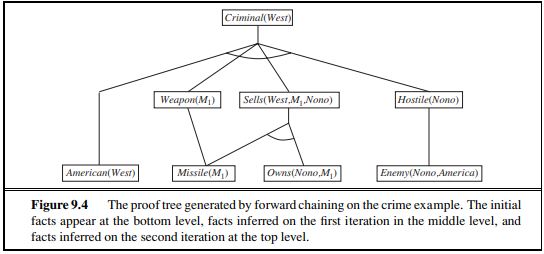 


---

#### Q13. Describe the classical planning approaches used in AI. [L2, CO4, 8M]

Classical planning finds an action sequence in a **deterministic, fully observable, static, discrete** environment using a factored representation (PDDL).

Approaches:
1. **Forward state-space search (progression):** from initial state, apply applicable actions to reach goal. Considers all applicable actions (many irrelevant); needs good heuristics.
2. **Backward state-space search (regression):** from goal, regress actions until reaching a description satisfied by the initial state. Considers only relevant actions; lower branching. Regression: g′ = (g − ADD(a)) ∪ PRECOND(a).
3. **Planning graphs / GRAPHPLAN:** polynomial-size approximation of the search space; levels S₀, A₀, S₁… with mutexes; extracts plan by backward search with nogoods. Admissible heuristic.
4. **SATPLAN:** translate PDDL to propositional CNF (successor-state, precondition, action-exclusion axioms) and solve with a SAT solver; increase plan length T until satisfiable.
5. **Situation calculus:** FOL-based, situations S₀, RESULT(s, a), fluents with situation argument, possibility and successor-state axioms; expressive (∀ goals) but costly inference.
6. **Partial-order planning (POP):** plan-space search with ordering constraints and causal links; least commitment; resolve threats by promotion/demotion.


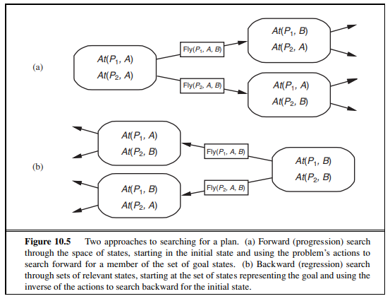 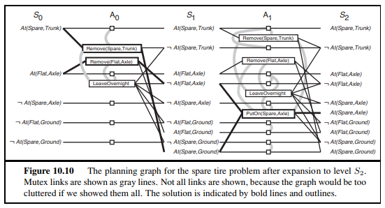 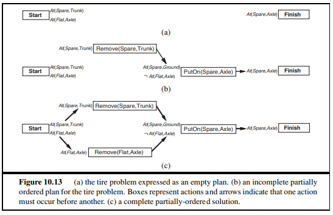


---

#### Q14. What is hierarchical planning in AI, and how does it address complexity? [L2, CO4, 8M]

**Hierarchical planning** plans at higher levels of abstraction rather than primitive actions. Humans perform ~10¹³ actions over a lifetime; a two-week vacation at motor level ≈ 10¹⁰ actions — too many for classical planners (which handle ~10³ actions).

**HTN formalism:**
- **Primitive actions:** standard precondition/effect schemas, no refinements.
- **High-level action (HLA):** e.g., Go(Home, SFO), with one or more **refinements** into sequences of actions (HLAs or primitives).

```
Refinement(Go(Home, SFO),
  STEPS: [Drive(Home, SFOLongTermParking), Shuttle(SFOLongTermParking, SFO)])
Refinement(Go(Home, SFO),
  STEPS: [Taxi(Home, SFO)])
```

- An HLA refinement containing only primitives = an **implementation**.
- A high-level plan achieves the goal if **at least one** implementation does.

**Complexity benefit:** non-hierarchical forward search is O(bᵈ) for d primitive actions; with hierarchy (r refinements of k actions each), cost ≈ O(r^((d−1)/(k−1)}) — far smaller with a good plan library.

**Angelic semantics:** reachable set REACH(s, h) = states reachable by any implementation of h. Optimistic (over-approx) and pessimistic (under-approx) descriptions decide whether a plan works/fails or needs refinement.


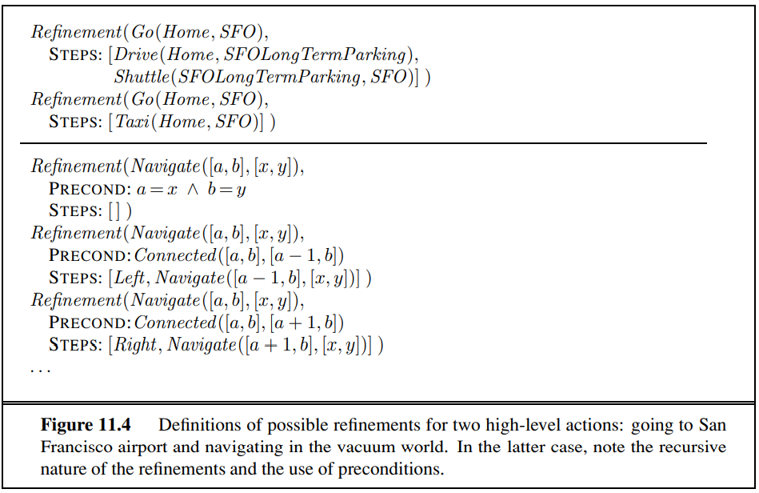 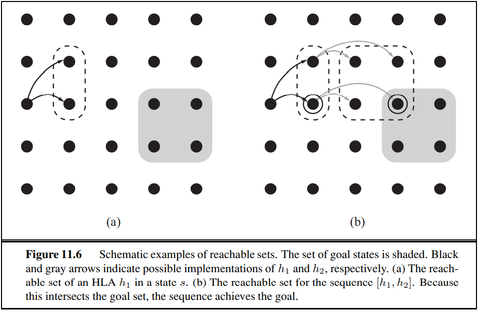


---

#### Q15. Explain basic probability notation used in AI (events, distributions, conditional probability) with examples. [L3, CO5, 8M]

**Sample space Ω:** set of all possible worlds, mutually exclusive and exhaustive. Two dice: 36 worlds (1,1)...(6,6).

**Probability model:** P(ω) with 0 ≤ P(ω) ≤ 1 and Σ P(ω) = 1.

**Event/proposition:** set of worlds; P(φ) = Σ_{ω∈φ} P(ω). Example: P(Total = 11) = P((5,6)) + P((6,5)) = 1/18.

**Random variables:** uppercase names; values lowercase. Boolean (Cavity), discrete multivalued (Weather ∈ {sunny, rain, cloudy, snow}), continuous (Temperature).

**Prior (unconditional) probability:** P(Cavity) = 0.1; P(Weather) = ⟨0.72, 0.1, 0.08, 0.1⟩.

**Joint distribution:** P(Weather, Cavity) — table over all combinations. Full joint = complete model.

**Conditional (posterior) probability:**

$$P(A \mid B) = \frac{P(A \wedge B)}{P(B)} \quad (P(B) > 0)$$

Example: P(cavity | toothache) = 0.04 / 0.05 = 0.8.

**Product rule:** P(A ∧ B) = P(A | B) P(B) = P(B | A) P(A).

**Chain rule:** P(X₁,…,Xₙ) = Πᵢ P(Xᵢ | Xᵢ₋₁,…,X₁).


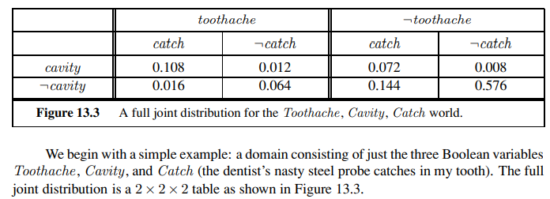


---

#### Q16. Discuss how Bayesian networks are used for probabilistic reasoning; write applications. [L2, CO5, 8M]

**Bayesian network** = DAG of random variables; each node Xᵢ has CPT P(Xᵢ | Parents(Xᵢ)). Represents full joint distribution:

$$P(x_1,\dots,x_n) = \prod_i P(x_i \mid \text{Parents}(X_i))$$

**Probabilistic reasoning = inference:** compute posterior P(X | E = e), e.g., P(Burglary | JohnCalls, MaryCalls).

**Example — burglary network:** B, E → A → J, M.
- P(B) = 0.001, P(E) = 0.002
- P(A | B, E) = .95/.94/.29/.001
- P(J | A) = .90/.05, P(M | A) = .70/.01

**Inference by enumeration:** P(B | j, m) = α P(B) Σₑ P(e) Σₐ P(a | B,e) P(j | a) P(m | a) ≈ ⟨0.284, 0.716⟩. Even if both neighbours call, burglary is only ~28% likely.

**Applications:** medical diagnosis (diseases → symptoms), troubleshooting, forecasting, decision support, sensor fusion, risk analysis.


 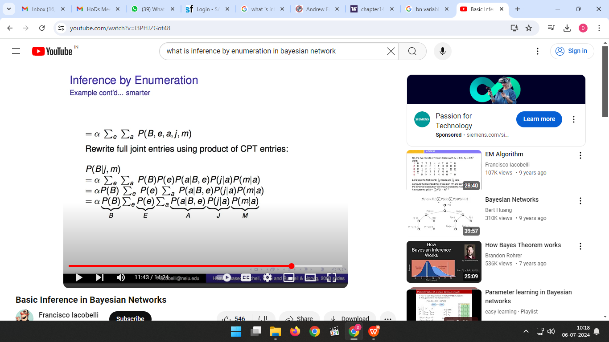


---

#### Q17. Describe the components of Bayesian Networks. [L2, CO6, 8M]

Components of a Bayesian network:

1. **Nodes:** one per random variable (discrete or continuous).
2. **Directed links (arrows):** X → Y means X is a parent of Y (direct influence). No directed cycles → **DAG**.
3. **Conditional distributions / CPTs:** for each node Xᵢ, P(Xᵢ | Parents(Xᵢ)); a CPT for discrete variables — distribution over Xᵢ for each parent combination.

**Semantics:** global — represents full joint distribution as product of local CPTs.

**Local semantics / conditional independence:** each node is conditionally independent of its non-descendants given its parents.

**Markov blanket:** each node is conditionally independent of all others given its Markov blanket = parents + children + children's parents.

**Compactness:** a Boolean node with k Boolean parents needs 2ᵏ numbers; n nodes with ≤ k parents need O(n·2ᵏ) vs O(2ⁿ) for the full joint (burglary: 10 vs 31 numbers).


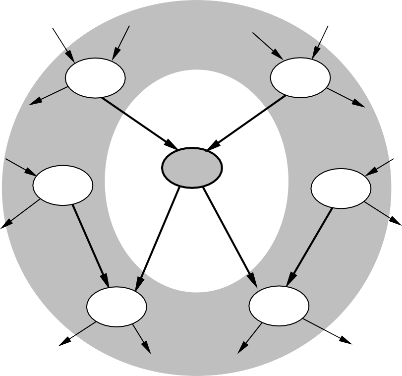 


---

#### Q18. Explain relational probability models with an example. [L3, CO6, 8M]

**Limitation of Bayes nets:** propositional — fixed, finite set of variables; cannot easily model "every customer's honesty affects their ratings of every book they review."

**Relational probability models (RPMs):** first-order probability models using **database semantics** (unique names, closed world, domain closure) → finite worlds. Define random variables for each object's attributes (Honest(C₁), Kindness(C₁), Quality(B₁), Recommendation(C₁, B₁)) with **dependency statements shared across objects**. The model "unrolls" into an ordinary Bayes net. **Context-specific independence** handles parents that depend on other values (e.g., Fan(c, Author(b))).

**Open-universe probability models (OUPMs):** relax unique names/domain closure to handle identity uncertainty (citation matching, multi-target tracking), e.g., BLOG.

**Example:** Honest(Reviewer) influences Recommendation(Reviewer, Book); Quality(Book) influences Recommendation(Reviewer, Book); shared across all reviewer–book pairs.

**P(φ) = Σ over FOL worlds where φ holds** — probability of a first-order sentence.


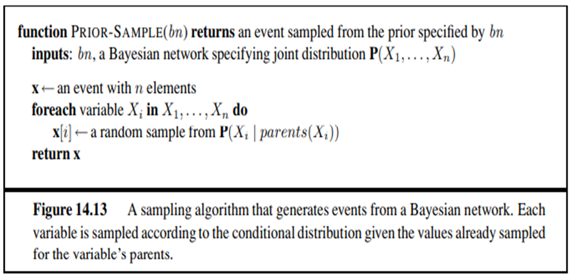 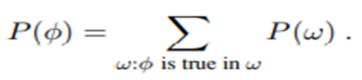


---

---

## Paper 2 — Regular & Supplementary (18-Dec-2025)

### Part A (6 × 2 = 12M)

#### Q1. Define intelligent agent and list its types. [L1, CO1, 2M]

An **intelligent agent** perceives its environment through sensors and acts through actuators, choosing actions expected to maximise its performance measure (rational agent).

**Five agent types** (in increasing sophistication):
1. **Simple reflex agent** — condition–action rules based on current percept only (e.g., thermostat). Works only in fully observable environments.
2. **Model-based reflex agent** — keeps internal state (model of how the world works); works in partially observable environments (e.g., robot vacuum with map).
3. **Goal-based agent** — model-based + goal information; uses search/planning to achieve goals (proactive, flexible).
4. **Utility-based agent** — adds a utility function; chooses the best way among alternatives / under uncertainty (maximise expected utility).
5. **Learning agent** — learns from experience; four components: learning element, critic, performance element, problem generator (e.g., spam filter).


---

#### Q2. What is alpha-beta pruning? Give an example scenario. [L2, CO2, 2M]

**Alpha-beta pruning** is a branch-and-bound technique that skips subtrees that cannot affect the minimax decision, returning the same move as minimax but examining fewer nodes.

- **α (alpha):** best (highest) value for MAX so far along the path (lower bound, initially −∞).
- **β (beta):** best (lowest) value for MIN so far along the path (upper bound, initially +∞).
- **Prune when α ≥ β:** at a MIN node stop when a child's value ≤ α; at a MAX node stop when a child's value ≥ β.

**Example scenario** (same tree as minimax worked example):
- B = min(3,12,8) = 3 → at root A: α = 3.
- C: first leaf = 2 ≤ α = 3 → prune leaves 4 and 6 (MAX will never choose C).
- D = min(14,5,2) = 2 → root A = max(3, ≤2, 2) = 3 — same answer, 2 leaves skipped.

Best case (perfect move ordering): O(b^(m/2)) — effectively √b branching, twice as deep as minimax.


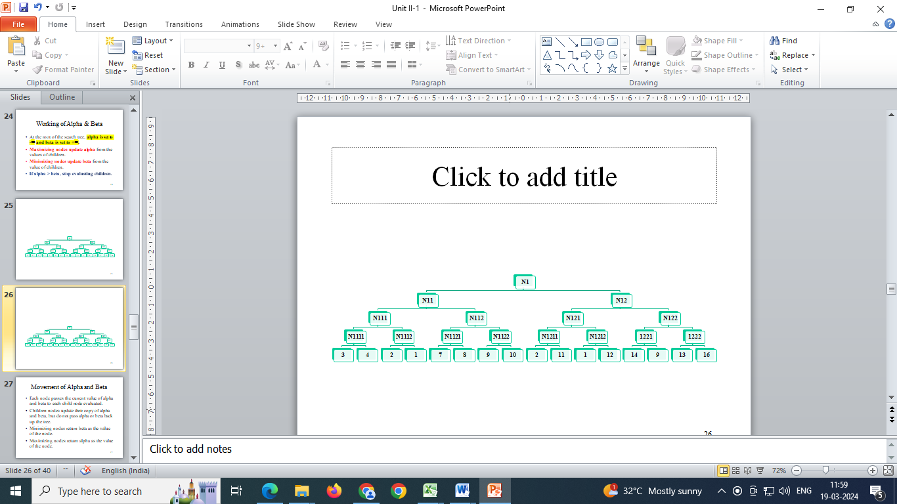 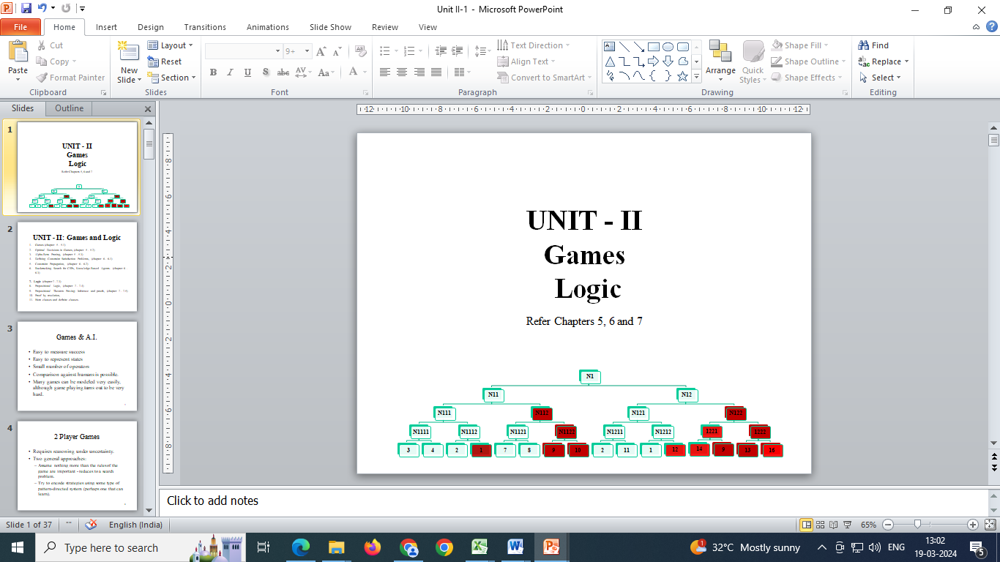


---

#### Q3. Define First-order logic with example. [L1, CO3, 2M]

**First-order logic (FOL)** extends propositional logic with **objects, relations, functions, and quantifiers (∀, ∃)**. It is declarative, compositional, and unambiguous — unlike programming languages (procedural) and natural language (ambiguous).

**Example:** "All kings are persons" → ∀x King(x) ⇒ Person(x). "King John has a crown on his head" → ∃x Crown(x) ∧ OnHead(x, John).

Terms: constants (Richard, John), variables (x), complex terms (LeftLeg(John)). Atomic sentences: Brother(Richard, John).


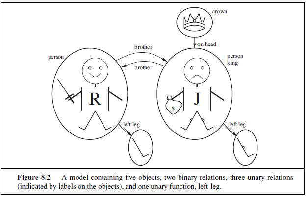 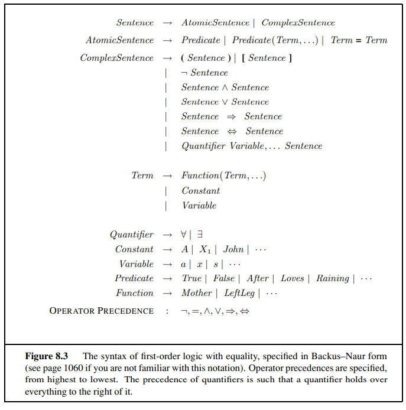


---

#### Q4. What is classical planning? [L1, CO4, 2M]

**Classical planning** = finding a sequence of actions to accomplish a goal in a **discrete, deterministic, static, fully observable** environment. It uses a **factored representation** (PDDL): a state is a collection of fluents, and one action schema expresses many ground actions — unlike atomic state representations (problem-solving) or ground propositional inference (which is swamped by many states).

**Example PDDL action:**
```
Action(Fly(p, from, to),
  PRECOND: At(p, from) ∧ Plane(p) ∧ Airport(from) ∧ Airport(to)
  EFFECT:  ¬At(p, from) ∧ At(p, to))
```

---

#### Q5. Define Bayes' Rule. [L1, CO5, 2M]

From the product rule P(a ∧ b) = P(a | b)P(b) = P(b | a)P(a):

$$P(b \mid a) = \frac{P(a \mid b)\,P(b)}{P(a)}$$

Converts **causal** knowledge P(effect | cause) into **diagnostic** knowledge P(cause | effect).

**Example — meningitis:** P(M|S) = P(S|M)·P(M)/P(S) = 0.8 × 0.0001 / 0.1 = 0.0008.

---

#### Q6. What is a CPT in Bayesian Networks? [L2, CO6, 2M]

A **Conditional Probability Table (CPT)** for node Xᵢ specifies P(Xᵢ | Parents(Xᵢ)) — the distribution over Xᵢ for every combination of parent values. Each row sums to 1 (only P(true) listed for Boolean variables). A Boolean node with k Boolean parents needs 2ᵏ numbers.

**Example (burglary net):** P(A | B, E) table: T,T→0.95; T,F→0.94; F,T→0.29; F,F→0.001.


 


---

### Part B (6 × 8 = 48M)

#### Q7. Explain problem-solving agents with examples. [L2, CO1, 8M]

A **problem-solving agent** is a goal-based agent that decides what to do by finding sequences of actions leading to desirable states.

**Steps:** Goal formulation → Problem formulation → Search → Solution → Execution.

**Five components of a well-defined problem:**
1. **Initial state** — where the agent starts.
2. **Actions** — ACTIONS(s), possible actions in a state.
3. **Transition model** — RESULT(s, a) → successor state.
4. **Goal test** — whether a state is a goal.
5. **Path cost** — numeric cost of a path (sum of step costs).

**Example — 8-puzzle:** 3×3 board, tiles 1–8 + blank; action = slide a tile into blank; goal = match goal configuration; path cost = number of moves.

**Example — route finding / TSP / VLSI layout / robot navigation.**


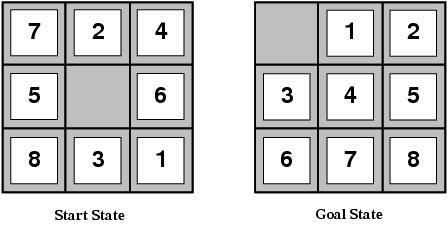 


---

#### Q8. Compare and Contrast BFS, DFS & Hill-climbing. [L3, CO1, 8M]

| Aspect | BFS | DFS | Hill-climbing |
|---|---|---|---|
| **Structure** | FIFO queue | LIFO stack | Single current state |
| **Expansion** | Level by level | Deepest first, backtrack | Best neighbour (uphill) |
| **Complete** | Yes (finite b) | No (infinite spaces) | No (local maxima) |
| **Optimal** | Yes (unit cost) | No | No |
| **Time** | O(bᵈ) | O(bᵐ) | Depends on landscape |
| **Space** | O(bᵈ) — high | O(bm) — low | O(1) — one state |
| **Memory** | Stores whole frontier | Stores current path | Stores only current state |

Hill-climbing problems: local maxima, plateaux, ridges. Remedies: backtracking, big jumps, multi-direction, random restart. Simulated annealing improves on hill-climbing by accepting worse moves probabilistically.


   


---

#### Q9. Apply CSPs and backtracking search to show how constraints guide variable assignments. [L3, CO2, 8M]

**CSP = ⟨X, D, C⟩:** variables Xᵢ with domains Dᵢ and constraints C; solution = complete and consistent assignment.

**Example — Australia map colouring:** WA, NT, Q, NSW, V, SA, T; domains {red, green, blue}; adjacent regions differ.

**Backtracking search** assigns one variable at a time (DFS), backtracking when a variable has no legal values. Constraints prune the search: after WA = red, NT and SA lose red; forward checking deletes inconsistent neighbour values; backtrack when any domain becomes empty.

**Heuristics guide assignments:**
- **MRV** (minimum remaining values) — most constrained variable first.
- **Degree heuristic** — most constraining variable (tie-breaker).
- **LCV** (least constraining value) — value ruling out fewest neighbour values.

**Constraint propagation (arc consistency / AC-3):** arc X→Y consistent iff every value of X has a compatible value of Y; recheck neighbours when a domain changes; AC-3 is O(c·d³). Detects failures earlier than forward checking (e.g., NT and SA both forced blue but adjacent — forward checking misses this, AC-3 catches it).


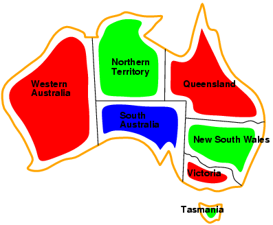  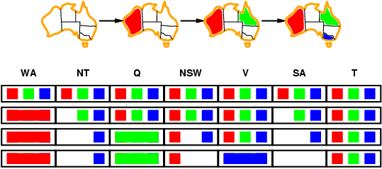 


---

#### Q10. Distinguish between Minimax and Alpha-Beta pruning with examples. [L3, CO2, 8M]

**Minimax:** optimal play for deterministic, perfect-information games. MAX takes max of children, MIN takes min. Evaluates ALL nodes to depth m: O(bᵐ) time, O(bm) space.

**Alpha-beta pruning:** branch-and-bound that prunes subtrees that cannot affect the decision; returns the **same move as minimax** but examines fewer nodes. Uses α (MAX lower bound) and β (MIN upper bound); prune when α ≥ β.

**Example** (same worked tree): Minimax → B = 3, C = 2, D = 2, root A = max(3,2,2) = 3 → play a1. Alpha-beta → after B = 3 (α = 3), C's first leaf = 2 ≤ 3 → prune C's other leaves; root still 3 — fewer nodes examined.

| Minimax | Alpha-beta |
|---|---|
| Explores all nodes to depth m | Prunes branches that can't change decision |
| O(bᵐ) | Best case O(b^(m/2)) (√b branching) |
| Same result | Same result, faster |
| Move ordering irrelevant | Best case needs best moves first |


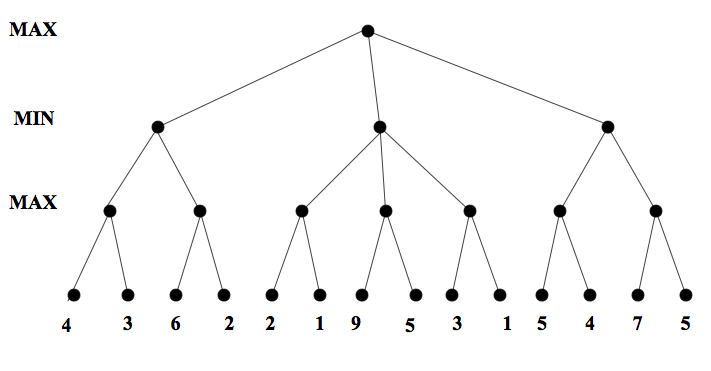  


---

#### Q11. Demonstrate how the syntax and semantics of FOL represent relationships and interpret meaning in a KB. [L3, CO3, 8M]

**Syntax:** terms (constants, variables, functions f(t…)), atomic sentences (predicate(terms,…)), complex sentences via ¬∧∨⇒⇔ and quantifiers ∀, ∃. Grammar: Sentence → Atomic | Complex; Atomic → Predicate | Predicate(Term,…) | Term = Term.

**Semantics:** a **model** = domain of objects + interpretation mapping constants → objects, predicates → relations, functions → functions. A sentence is **true** in a model if the relation holds among referenced objects. **Entailment** KB ⊨ α: in every model where KB is true, α is true (M(α) ⊆ M(β)).

**Example model (5 objects):** Richard, John, their left legs, a crown. Relations: Brother = {⟨Richard,John⟩, ⟨John,Richard⟩}; OnHead = {⟨crown, John⟩}. Functions: LeftLeg(John) = John's left leg.

**Sentences true in the model:** ¬Brother(LeftLeg(Richard), John); Brother(Richard, John) ∧ Brother(John, Richard); King(Richard) ∨ King(John); ¬King(Richard) ⇒ King(John).

**Quantifiers:** ∀x King(x) ⇒ Person(x) (all kings are persons — natural connective ⇒ with ∀); ∃x Crown(x) ∧ OnHead(x, John) (natural connective ∧ with ∃). Order matters: ∀x∃y Loves(x,y) vs ∃y∀x Loves(x,y).

**Example KB (kinship):** ∀m,c Mother(c) = m ⇔ Female(m) ∧ Parent(m, c); Grandparent(g,c) ⇔ ∃p Parent(g,p) ∧ Parent(p,c).


 


---

#### Q12. Evaluate how unification enables forward and backward chaining; assess differences in reasoning flow. [L4, CO3, 8M]

**Unification** finds substitution θ making expressions identical: UNIFY(p, q) = θ where SUBST(θ, p) = SUBST(θ, q). It underlies **Generalised Modus Ponens (GMP)** — the lifted Modus Ponens used by both forward and backward chaining.

| | Knows(John, x) | Knows(y, Bill) | θ |
|---|---|---|---|
| Unify | Knows(John, x) | Knows(y, Mother(y)) | {y/John, x/Mother(John)} |
| Fail | Knows(John, x) | Knows(x, Elizabeth) | fail (occur check) |

MGU (most general unifier), occur check, standardising apart are key.

**Forward chaining (data-driven):** start from facts, apply GMP forward, add conclusions until query found or no new inferences. E.g., crime KB: iteration 1 → Sells(West, M1, Nono), Weapon(M1), Hostile(Nono); iteration 2 → Criminal(West). Sound & complete for definite clauses; linear time; may infer irrelevant facts. Used in production systems.

**Backward chaining (goal-driven):** start from query, prove by finding rules concluding it and proving premises recursively (AND/OR depth-first search). E.g., Criminal(West) ← American(West) ∧ Weapon(y) ∧ Sells(West,y,z) ∧ Hostile(z). Basis of Prolog. May loop without memoisation; explores only relevant facts.

| Forward chaining | Backward chaining |
|---|---|
| Data-driven (bottom-up) | Goal-driven (top-down) |
| Starts from facts | Starts from query |
| May derive irrelevant facts | Only goal-relevant inferences |
| Complete for definite clauses; linear | Incomplete (loops) without memoisation |
| Production systems, deductive DBs | Prolog, question answering |


  


---

#### Q13. Explain how planning with state-space search explores states and actions to construct a goal-achieving sequence. [L2, CO4, 8M]

**State-space search** treats planning as search: states are fluent sets; edges are action applications.

**Forward (progression) search:** start at initial state, apply applicable actions (s ⊨ PRECOND(a)), search until a goal state. RESULT(s, a) = (s − DEL(a)) ∪ ADD(a). Problem: many irrelevant actions (e.g., Buy(ISBN) → 10¹⁰ ground actions); air cargo ~2000⁴¹ nodes. Feasible only with strong domain-independent heuristics.

**Backward (regression) search:** start at goal, apply actions backward until a description satisfied by the initial state. Considers only relevant actions (adds a goal literal, doesn't delete any). Regression: g′ = (g − ADD(a)) ∪ PRECOND(a). Works on sets of states (descriptions); 3ⁿ descriptions for n fluents.

**Example — spare tyre:** Init: Tire(Flat) ∧ Tire(Spare) ∧ At(Flat, Axle) ∧ At(Spare, Trunk). Goal: At(Spare, Axle). Solution: [Remove(Flat, Axle), Remove(Spare, Trunk), PutOn(Spare, Axle)].

**Example — air cargo:** solution [Load(C₁,P₁,SFO), Fly(P₁,SFO,JFK), Unload(C₁,P₁,JFK), Load(C₂,P₂,JFK), Fly(P₂,JFK,SFO), Unload(C₂,P₂,SFO)].

Heuristics from relaxed problems (ignore preconditions, ignore delete lists) make forward search effective (A* with admissible heuristic).


 


---

#### Q14. Explain classical planning approaches with suitable example. [L4, CO4, 8M]

Classical planning approaches:
1. **Forward state-space search** (progression) — from initial state, applicable actions to goal; needs heuristics.
2. **Backward state-space search** (regression) — from goal, only relevant actions.
3. **Planning graphs / GRAPHPLAN** — polynomial graph with mutexes; extract plan backward with nogoods; admissible heuristic.
4. **SATPLAN** — propositionalise to CNF (successor-state, precondition, action-exclusion axioms); SAT solver; increase plan length T.
5. **Situation calculus** — FOL: situations S₀, RESULT(s,a), fluents with situation argument, possibility/successor-state axioms; expressive but costly.
6. **Partial-order planning (POP)** — plan space, ordering constraints + causal links; least commitment; threats resolved by promotion/demotion.

**Example — spare tyre (illustrates several):**
- Forward: [Remove(Flat, Axle), Remove(Spare, Trunk), PutOn(Spare, Axle)].
- GRAPHPLAN: S₀ has At(Spare, Trunk), At(Flat, Axle); expand to S₂ where PutOn(Spare, Axle) possible → plan: Remove(Spare, Trunk) and Remove(Flat, Axle) in parallel at level 0, PutOn(Spare, Axle) at level 1.
- POP: Start → {Remove(Spare, Trunk), Remove(Flat, Axle)} unordered → PutOn(Spare, Axle) → Finish.


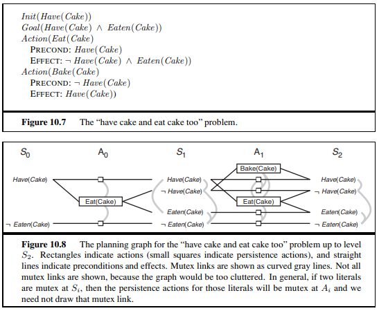  


---

#### Q15. Discuss Basic Probability Notation and its uses under uncertainty domain with example. [L3, CO5, 8M]

**Sample space Ω:** mutually exclusive, exhaustive worlds; ω a world. P(ω) ∈ [0,1], Σ P(ω) = 1. Two dice: 36 worlds; P(Total=11) = 1/18.

**Event/proposition:** set of worlds; P(φ) = Σ_{ω∈φ} P(ω).

**Random variables:** uppercase names, lowercase values. Boolean (Cavity), discrete (Weather ∈ {sunny, rain, cloudy, snow}), continuous (Temperature).

**Prior:** P(Cavity) = 0.1; P(Weather) = ⟨0.72, 0.1, 0.08, 0.1⟩.

**Joint distribution:** P(Weather, Cavity) over all combinations; full joint = complete model (2ⁿ entries for n Boolean variables — impractical).

**Conditional probability:** P(A|B) = P(A∧B)/P(B). Example: P(cavity|toothache) = 0.04/0.05 = 0.8.

**Product rule / chain rule / Bayes' rule:** under uncertainty, compute posteriors from priors and likelihoods.

**Uses:** medical diagnosis (P(disease|symptoms)), decision under uncertainty (airport departure time), sensor fusion, robot localisation.

**Axioms:** 0 ≤ P(A) ≤ 1; P(True)=1, P(False)=0; P(A∨B) = P(A) + P(B) − P(A∧B). De Finetti Dutch book — rational beliefs obey axioms.


---

#### Q16. Discuss an efficient representation of conditional distribution with an example. [L2, CO5, 8M]

Filling a CPT needs O(2ᵏ) numbers — impractical for many parents. **Canonical distributions** specify relationships with few parameters:

**1. Deterministic nodes:** value exactly determined by parents (NorthAmerican ⇔ Canadian ∨ US ∨ Mexican; BestPrice = min(prices)).

**2. Noisy-OR:** generalises logical OR with uncertain inhibition of each parent. Fever is false iff all true parents are inhibited:

$$P(\neg x_i \mid \text{parents}) = \prod q_j$$

**Example:** q_cold = 0.6, q_flu = 0.2, q_malaria = 0.1.
- Cold=T, Flu=T, Malaria=T → P(¬fever) = 0.6 × 0.2 × 0.1 = 0.012 → P(fever) = 0.988.
- k parents need O(k) parameters instead of O(2ᵏ).

**3. Continuous variables:** discretisation (loses accuracy), linear Gaussian P(Cost|Harvest=h) = N(aₜh + bₜ, σₜ²), hybrid networks, probit/logit for discrete child of continuous parents.


---

#### Q17. Explain Bayesian network semantics. [L2, CO6, 8M]

Two equivalent views:

**1. Global semantics (joint distribution):** full joint is product of local CPTs:

$$P(x_1,\dots,x_n) = \prod_i P(x_i \mid \text{Parents}(X_i))$$

**Example:** P(j ∧ m ∧ a ∧ ¬b ∧ ¬e) = P(j|a) P(m|a) P(a|¬b,¬e) P(¬b) P(¬e) = 0.9 × 0.7 × 0.001 × 0.999 × 0.998 ≈ 0.00063.

**2. Local semantics (conditional independence):** each node is conditionally independent of its non-descendants given its parents.

**Markov blanket:** each node independent of all others given its Markov blanket = parents + children + children's parents.

**Inference:** P(B | j, m) = α P(B) Σₑ P(e) Σₐ P(a|B,e) P(j|a) P(m|a) ≈ ⟨0.284, 0.716⟩.

**Compactness:** O(n·2ᵏ) vs O(2ⁿ) (burglary: 10 vs 31 numbers).


  


---

#### Q18. Differentiate between Approximate inference & relational models with examples. [L3, CO6, 8M]

| | Approximate inference | Relational models |
|---|---|---|
| **Purpose** | Estimate posteriors in large/multiply connected Bayes nets where exact inference is #P-hard | Model domains with objects & relations (first-order), beyond fixed finite variables |
| **Method** | Randomised sampling (Monte Carlo) | Random variables per object's attributes, shared dependency statements |
| **Examples** | Prior sampling, rejection sampling, likelihood weighting, Gibbs sampling / MCMC | RPMs (database semantics), OUPMs / BLOG (open universe) |
| **Accuracy** | Improves with number of samples; consistent estimate | "Unrolls" to an ordinary Bayes net |
| **Weakness** | Rejection wastes samples (exponential in evidence); likelihood weighting degrades with many/unlikely evidence; MCMC slow mixing | Infinite FOL worlds; needs database semantics or open-universe assumptions |

**Approximate inference example:** P(Rain | Sprinkler=true) via rejection sampling: 100 samples, 73 rejected, of 27 with Sprinkler=true → 8 Rain=true → P̂ ≈ ⟨0.296, 0.704⟩ (true ⟨0.3, 0.7⟩). Likelihood weighting: fix evidence, weight = Π P(eᵢ | parents) — e.g., w = 0.45.

**Relational model example:** Honest(Reviewer) → Recommendation(Reviewer, Book); Quality(Book) → Recommendation(Reviewer, Book), shared across all reviewer–book pairs; unrolls to a Bayes net. Open-universe (BLOG) handles identity uncertainty (citation matching).


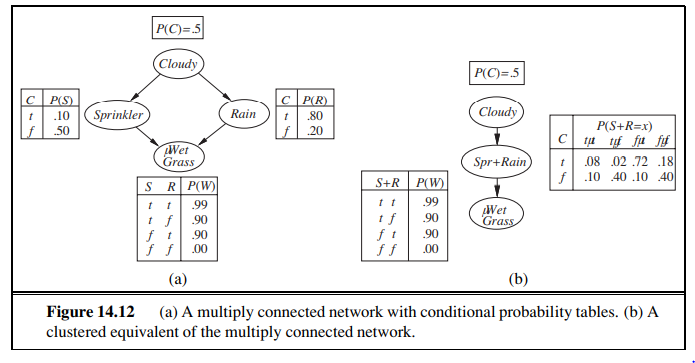  


---

## Marking summary (per paper)

| Part | Questions | Marks each | Total |
|---|---|---|---|
| A | Q1–Q6 | 2M | 12M |
| B | Q7–Q18 (one of each OR pair) | 8M | 48M |
| **Grand total** | | | **60M** |

**Images used:** from `IAI/media/U1…U6/` (named per unit notes; e.g., `media/U1/s63_1.png` BFS, `media/U2/s26_1.png` alpha-beta, `media/U3/s29_2.png` resolution, `media/U4/s16_2.png` GRAPHPLAN, `media/U5/s32_1.png` burglary CPTs, `media/U6/w_s08_1.png` noisy-OR).
