# Unit I — Introduction to AI: Intelligent Agents, Problem Solving & Search

> **Syllabus:** Intelligent agents, problem-solving agents, searching for solutions — breadth-first search, depth-first search, hill-climbing search, simulated annealing search, local search in continuous spaces.
>
> **Source:** *Unit I.ppt* (N. Vinaykumar, SNIST) · *IAI-all.pptx* (problem-solving agent, example problems) — Russell & Norvig, *AI: A Modern Approach*

**Importance legend:** ★★★ = very frequently asked (long answer) · ★★ = medium · ★ = short answer

---

## Table of Contents
1. [What is Artificial Intelligence?](#1-what-is-artificial-intelligence-)
2. [Four Approaches to AI](#2-four-approaches-to-ai-)
3. [Strong AI vs Weak AI](#3-strong-ai-vs-weak-ai-)
4. [Intelligent Agents — Agents & Environments](#4-intelligent-agents-)
5. [Rationality & PEAS](#5-rationality--peas-task-environment-)
6. [Properties of Task Environments](#6-properties-of-task-environments-)
7. [Types of Agents](#7-types-of-agents-)
8. [Problem-Solving Agents & Problem Formulation](#8-problem-solving-agents-)
9. [Example Problems](#9-example-problems-)
10. [Searching for Solutions — Concepts](#10-searching-for-solutions-)
11. [Breadth-First Search](#11-breadth-first-search-bfs-)
12. [Depth-First Search](#12-depth-first-search-dfs-)
13. [Hill-Climbing Search](#13-hill-climbing-search-)
14. [Simulated Annealing](#14-simulated-annealing-)
15. [Local Search in Continuous Spaces — Gradient Descent](#15-local-search-in-continuous-spaces-)
16. [Unit I — One-Page Summary](#unit-i--one-page-summary)

---

## 1. What is Artificial Intelligence? ★★

- **Artificial** — produced by human art or effort rather than originating naturally. **Intelligence** — "the ability to **acquire knowledge and use it**" (Pigford & Baur).
- **AI** — the study of ideas that **enable computers to be intelligent**; the part of computer science concerned with designing systems that **exhibit human intelligence** (Concise Oxford).
- "AI is the study of how to make computers do things which, **at the moment, people do better**." (Rich & Knight)
- A field that seeks to **explain and emulate intelligent behaviour** in terms of computational processes; the **automation of intelligent behaviour**.

---

## 2. Four Approaches to AI ★★★

Definitions are organised along two dimensions — **thought vs behaviour** and **human-like vs rational**:

| | **Human-like** | **Rational** |
|---|---|---|
| **Thought** | **Thinking humanly** — cognitive modelling | **Thinking rationally** — laws of thought |
| **Behaviour** | **Acting humanly** — Turing test | **Acting rationally** — rational agent |

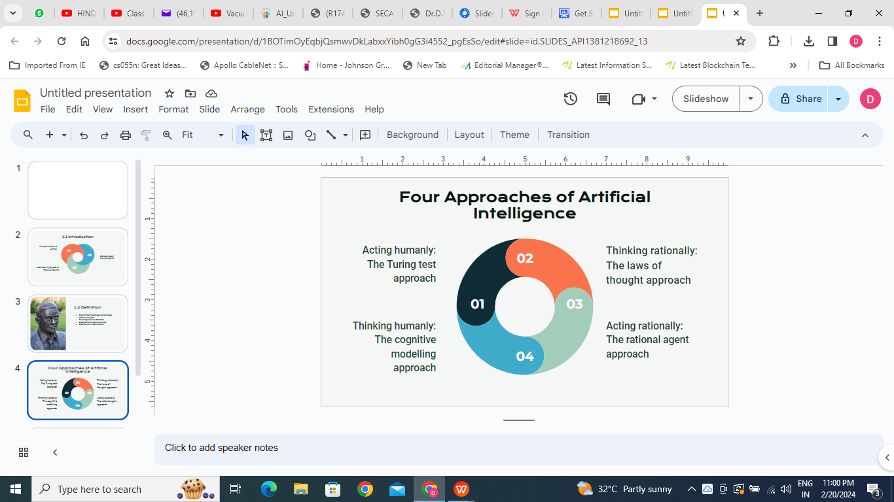

### 2.1 Acting Humanly — The Turing Test (Alan Turing, 1950)
- Kurzweil: "the art of creating machines that perform functions that require intelligence when performed by people."
- **Test setup:** an **interrogator** in a separate room types questions to two parties A and B — a **human** and the **computer** — and receives typed replies. If the interrogator **cannot distinguish** the machine from the human, the machine passes.

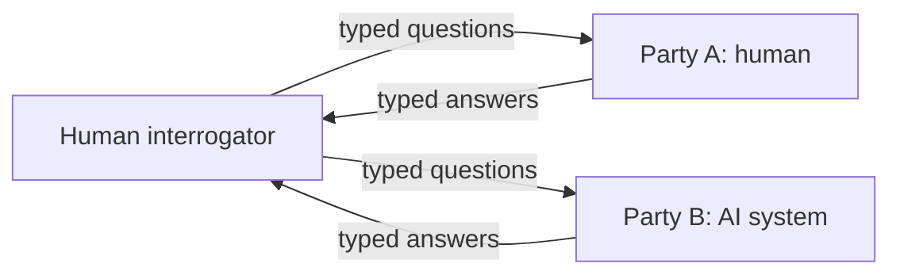

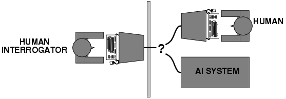

**Capabilities needed to pass:**
| Capability | Purpose |
|---|---|
| **Natural language processing** | Communicate successfully in English |
| **Knowledge representation** | Store what it knows or hears |
| **Automated reasoning** | Use stored information to answer questions and draw conclusions |
| **Machine learning** | Adapt to new circumstances, detect patterns |
| *Total Turing test adds:* **Computer vision** | Perceive objects |
| **Robotics** | Manipulate and move objects |

### 2.2 Thinking Humanly — Cognitive Modelling
- Need a **theory of how the human mind works** (via introspection, psychological experiments, brain imaging), then express it as a **computer program**.
- Approaches: **cognitive science & psychology** (how the mind processes information) and **cognitive neuroscience** (neurological data; every mental process has a biological origin).
- If the program's input/output **and timing** match human behaviour, its mechanism may be working like the human mind (e.g., GPS — General Problem Solver).

### 2.3 Thinking Rationally — "Laws of Thought"
- **Aristotle's syllogisms** — irrefutable reasoning: "All dogs are animals; all animals have four legs; therefore all dogs have four legs."
- **Logic** notation can, in principle, solve any solvable problem.
- **Obstacles:** humans aren't always rational; informal knowledge is hard to state in logic; logic can't express **uncertainty**; reasoning can be **computationally infeasible**.

### 2.4 Acting Rationally — The Rational Agent ★★★
- **Rational behaviour = doing the right thing** — the action expected to **maximise goal achievement**, given the available information.
- Doesn't require replicating human thought or using purely logical reasoning; **logic is only part** of rationality (domain knowledge compensates when logic can't conclude).
- **Advantages:** more **general** than the laws-of-thought approach (logic + domain knowledge); more amenable to **scientific development**.

---

## 3. Strong AI vs Weak AI ★★

| Strong AI | Weak (Narrow) AI |
|---|---|
| A machine that is **autonomous**, thinks for itself, makes its own decisions, deliberates on its own thoughts, learns and adapts, communicates in language — **genuine general intelligence** | A program that **simulates a particular intelligent activity** (e.g., playing chess, speech recognition) |
| Still hypothetical | Widely deployed today |

---

## 4. Intelligent Agents ★★★

An **agent** is anything that **perceives** its **environment** through **sensors** and **acts** upon it through **actuators (effectors)**.

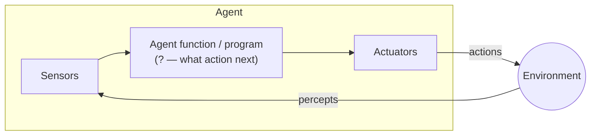

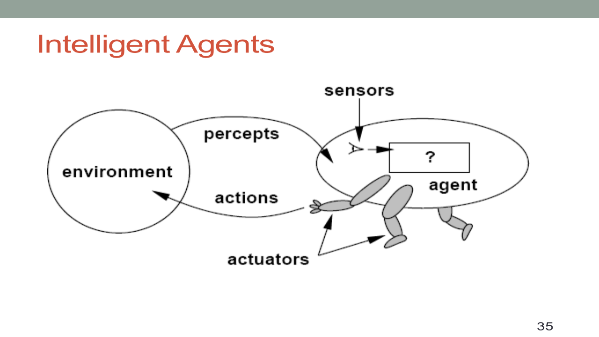

| Term | Meaning |
|---|---|
| **Percept** | The agent's perceptual inputs at a given instant |
| **Percept sequence** | Complete history of everything the agent has perceived |
| **Action** | An operation performed through an actuator; actions can form **action sequences** |
| **Agent function** | Abstract mapping from **percept sequences to actions**: f : P* → A |
| **Agent program** | Concrete **implementation** of the agent function, running on an **agent architecture** (platform) |
| **Agent = architecture + program** | |

**Examples:**
| Agent | Sensors | Actuators |
|---|---|---|
| **Human** | Eyes, ears, skin, taste buds | Hands, fingers, legs, mouth (muscles) |
| **Robot** | Camera, infrared, bumper | Grippers, wheels, lights, speakers (motors) |
| **Software agent** | Keystrokes, file contents, network packets (encoded bit strings/symbols) | Screen display, writing files, sending packets |

**Why study agents?** A consistent viewpoint on many AI topics; requires the essential skills of intelligent behaviour; uses AI methods and techniques.

---

## 5. Rationality & PEAS (Task Environment) ★★★

### 5.1 Rational Agent
> **For each possible percept sequence, a rational agent should select an action that is expected to maximise its performance measure, given the evidence provided by the percept sequence and whatever built-in knowledge the agent has.**

Rationality depends on: the **performance measure** (criterion of success), the agent's **prior knowledge** of the environment, the **actions** it can perform, and its **percept sequence** to date.
- Rational ≠ omniscient (it maximises **expected** performance, not actual outcome).
- A rational agent should **gather information** (exploration), **learn**, and be **autonomous**.

### 5.2 PEAS Description ★★★
To design an agent, specify its **task environment**:
- **P**erformance measure — how well the agent does
- **E**nvironment — surroundings beyond the agent's control
- **A**ctuators — actions the agent can perform
- **S**ensors — information about the current state

| Agent | Performance measure | Environment | Actuators | Sensors |
|---|---|---|---|---|
| **Automated taxi / car driver** | Safe, fast, legal, comfortable trip, maximise distance/profit | Roads, traffic, pedestrians, vehicles | Steering, accelerator, brake, signal, horn, mirror | Cameras, GPS, odometer, speedometer, sonar |
| **Hospital management / medical diagnosis** | Patient's health, admission process, payment, minimise costs | Hospital, doctors, patients, staff | Prescription, diagnosis, scan report, display questions/tests | Symptoms, patient's responses, findings |
| **Subject tutoring** | Maximise students' scores, improvement | Classroom, desk, chair, board, staff, students | Smart displays, corrections, exercises | Eyes, ears, notebooks, keyboard entry |
| **Part-picking robot** | % of parts in correct bins | Conveyor belt with parts, bins | Jointed arm and hand | Camera, joint-angle sensors |
| **Satellite image analysis** | Correct image categorisation | Downlink from orbiting satellite | Display categorisation of scene | Colour pixel arrays |

---

## 6. Properties of Task Environments ★★★

| Dimension | Meaning | Example |
|---|---|---|
| **Fully observable vs partially observable** | Sensors capture **all relevant** aspects of the state? | Chess (fully) vs poker/taxi (partially) |
| **Deterministic vs stochastic** | Next state **completely determined** by current state + action? | 8-puzzle vs taxi driving |
| **Episodic vs sequential** | Experience divided into **independent episodes**, or current decisions affect future ones? | Part-picking (episodic) vs chess (sequential) |
| **Static vs dynamic** | Environment **unchanged while the agent deliberates**? (semi-dynamic: score changes) | Crossword (static) vs taxi (dynamic) |
| **Discrete vs continuous** | Limited number of distinct percepts/actions? | Chess (discrete) vs taxi (continuous) |
| **Single-agent vs multi-agent** | Other agents? **Competitive** or **cooperative** | Crossword (single) vs chess (competitive), soccer (cooperative + competitive) |
| **Known vs unknown** | Agent knows the "laws of physics" of the environment? | — |

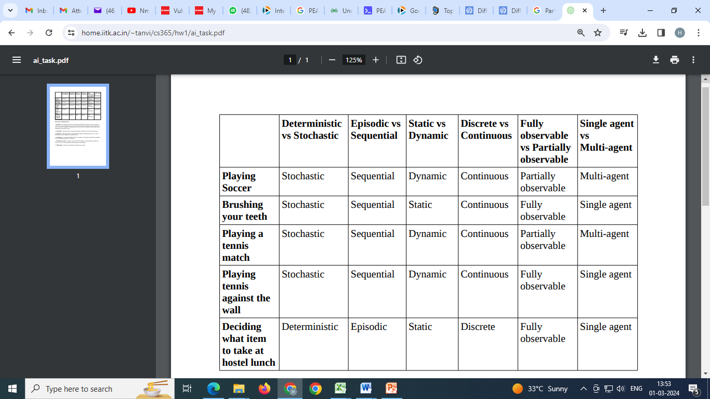

| Task | Observable | Deterministic | Episodic | Static | Discrete | Agents |
|---|---|---|---|---|---|---|
| Crossword puzzle | Fully | Deterministic | Sequential | Static | Discrete | Single |
| Chess with clock | Fully | Strategic | Sequential | Semi | Discrete | Multi |
| Poker | Partially | Stochastic | Sequential | Static | Discrete | Multi |
| Taxi driving | Partially | Stochastic | Sequential | Dynamic | Continuous | Multi |
| Medical diagnosis | Partially | Stochastic | Sequential | Dynamic | Continuous | Single |
| Image analysis | Fully | Deterministic | Episodic | Semi | Continuous | Single |
| Soccer | Partially | Stochastic | Sequential | Dynamic | Continuous | Multi |

---

## 7. Types of Agents ★★★

### 7.1 Simple Reflex Agent
- Selects actions on the basis of the **current percept only**, ignoring percept history; uses **condition–action (if–then) rules**.
- Succeeds only in **fully observable** environments.
- *Example:* basic house **thermostat** — if temperature < set point, turn on heater.
- **Problems:** very limited intelligence; no knowledge of non-perceptual parts of the state; rule tables too big; not adaptive; infinite loops in partially observable worlds.

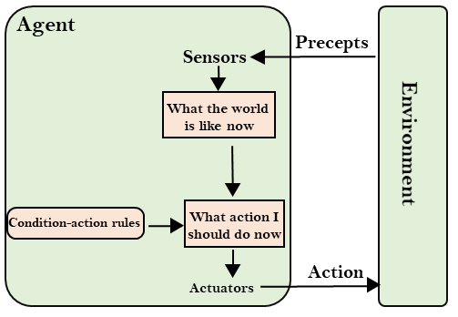

### 7.2 Model-Based Reflex Agent
- Works in **partially observable** environments by keeping an **internal state** (based on percept history).
- **Model** = knowledge of "how the world works": (1) how the world evolves independently of the agent, (2) how the agent's actions affect the world.
- *Example:* **robot vacuum** that builds and remembers a map of the room.

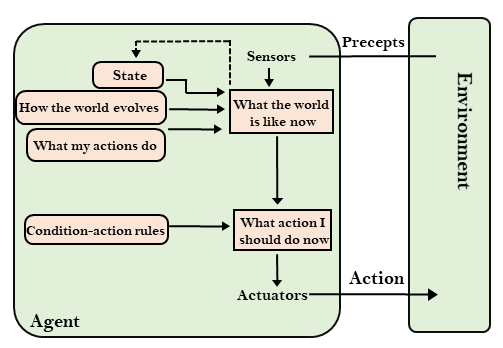

### 7.3 Goal-Based Agent
- Knowing the current state isn't always enough — the agent needs **goal information** describing desirable situations.
- **Goal-based = model-based + goal**; chooses actions that **achieve the goal**; requires **search and planning** (considers long action sequences) → **proactive**, flexible (change the goal, behaviour changes).
- *Examples:* navigation, robotics, NLP systems.

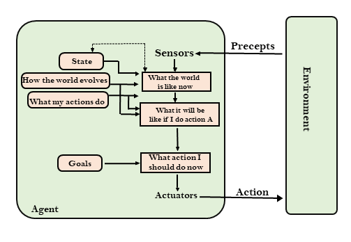

### 7.4 Utility-Based Agent
- Like goal-based, but adds a **utility function** mapping each state to a **real number** (degree of "happiness") — chooses not just *a* way to reach the goal but the **best** way.
- Useful when there are **multiple alternatives** or **conflicting goals** (speed vs safety) and under uncertainty (maximise **expected utility**).

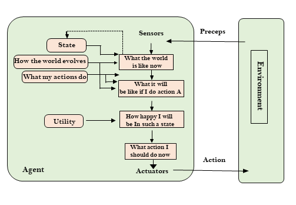

### 7.5 Learning Agent
Learns from past experience — starts with basic knowledge and **adapts automatically**. Four components:
| Component | Role |
|---|---|
| **Learning element** | Makes **improvements** by learning from the environment |
| **Critic** | Gives **feedback** on how well the agent is doing w.r.t. a fixed **performance standard** |
| **Performance element** | Selects **external actions** (the "agent" proper) |
| **Problem generator** | Suggests **exploratory actions** leading to new, informative experiences |

*Example:* a **spam filter** that learns from user feedback.

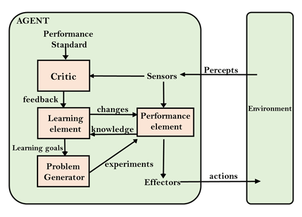

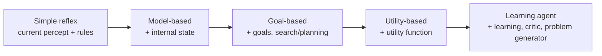

---

## 8. Problem-Solving Agents ★★★

A **problem-solving agent** is a **goal-based agent** that decides what to do by finding **sequences of actions** leading to desirable states. (Psychology: reaching a definite goal from a present condition; CS: techniques such as algorithms and heuristics to solve a problem.)

### 8.1 Steps

1. **Goal formulation** — first, simplest step; based on current situation and performance measure; organises the goal and actions.
2. **Problem formulation** — the most important step; decides what actions and states to consider.
3. **Search** — find the sequence of actions reaching the goal (input: problem; output: solution).
4. **Solution** — the action sequence (the best/optimal one).
5. **Execution** — carry out the actions.

### 8.2 Five Components of a Well-Defined Problem ★★★
| Component | Description |
|---|---|
| **Initial state** | Where the agent starts |
| **Actions** | Possible actions available in a state: ACTIONS(s) |
| **Transition model** | What each action does: RESULT(s, a) → successor state |
| **Goal test** | Determines whether a state is a goal |
| **Path cost** | Numeric cost of a path (sum of step costs); reflects the performance measure |

- **Initial state + actions + transition model** implicitly define the **state space** — all states reachable from the initial state (a graph).
- A **solution** = action sequence from initial state to a goal; an **optimal solution** has the **lowest path cost**.

---

## 9. Example Problems ★★

**Toy problems** — concise, exact descriptions used to compare algorithms. **Real-world problems** — people actually care about solutions.

### 9.1 8-Puzzle (sliding-tile / N-puzzle)
3×3 board, tiles 1–8 and a blank; a tile adjacent to the blank can slide into it. (N = 8 → √(N+1) = 3 rows/columns; N = 15 → 4×4; N = 24 → 5×5.)

| Component | Formulation |
|---|---|
| **States** | Location of each tile and the blank |
| **Initial state** | Any state |
| **Actions** | Move the **blank** Left, Right, Up, Down (no diagonal; one step at a time) |
| **Transition model** | Returns the resulting state |
| **Goal test** | State matches the goal configuration |
| **Path cost** | Each step costs 1 (number of moves) |

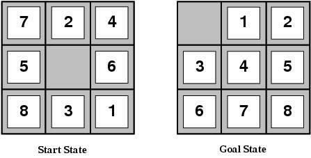

### 9.2 8-Queens
Place 8 queens so no queen attacks another.
- **Incremental formulation:** start empty; states = 0–8 queens on board; action = add a queen to an empty square; goal = 8 non-attacking queens; ~**1.8 × 10¹⁴** sequences (improved: one queen per column in the leftmost empty column not attacked → 2057 states).
- **Complete-state formulation:** start with all 8 queens and move them to eliminate attacks (used by local search).

### 9.3 Real-world problems
- **Route finding** (navigation, airline travel), **Travelling Salesperson Problem (TSP)** — visit each city exactly once with the shortest tour.
- **VLSI layout** — **cell layout** (place cells without overlap) and **channel routing** (route wires) to minimise area, delays, stray capacitance, maximise yield.
- **Robot navigation** (continuous space), **automatic assembly sequencing** (FREDDY, 1972), **protein design**.

---

## 10. Searching for Solutions ★★★

**Search** = a step-by-step procedure for solving a search problem in a search space.

| Term | Meaning |
|---|---|
| **Search space** | Set of possible states/solutions |
| **Start state** | Where search begins |
| **Goal test** | Checks whether the current state is a goal |
| **Search tree** | Tree whose root is the initial state; branches are actions; nodes are states |
| **Actions / transition model** | Available actions and their effects |
| **Path cost** | Numeric cost of each path |
| **Frontier (open list)** | Leaf nodes available for expansion |
| **Explored set (closed list)** | Already-expanded states (graph search avoids repeats) |

### 10.1 Measuring Search Performance ★★★
| Property | Meaning |
|---|---|
| **Completeness** | Guaranteed to find a solution **if one exists** |
| **Optimality** | Finds the **lowest-cost** solution |
| **Time complexity** | Time taken (nodes generated) |
| **Space complexity** | Maximum memory needed |
Measured with **b** = branching factor, **d** = depth of the shallowest goal, **m** = maximum depth of the state space.

### 10.2 Uninformed vs Informed Search
| Uninformed (blind) search | Informed (heuristic) search |
|---|---|
| **No domain knowledge** (closeness, location of goal) — only the problem definition | Uses **domain knowledge (heuristics)** to guide the search |
| Brute-force traversal | More efficient |
| BFS, DFS, uniform-cost, depth-limited, iterative deepening, bidirectional | Greedy best-first, A*, hill climbing |
| Can be slow | Good solution in reasonable time (not always optimal) — e.g., TSP |

---

## 11. Breadth-First Search (BFS) ★★★

- Expands the **shallowest** unexpanded node first — all nodes at depth d before depth d+1 (**level by level**).
- Implemented with a **FIFO queue**.

**Example:** root S to goal K — traversal order:
**S → A → B → C → D → G → H → E → F → I → K**

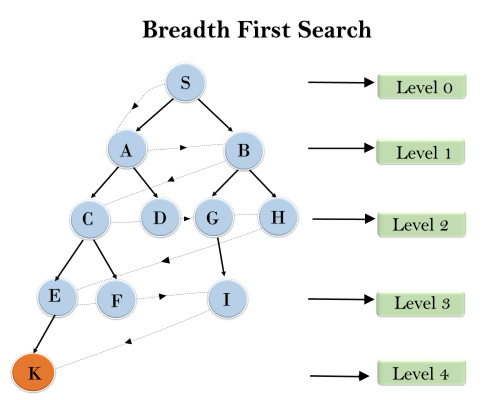

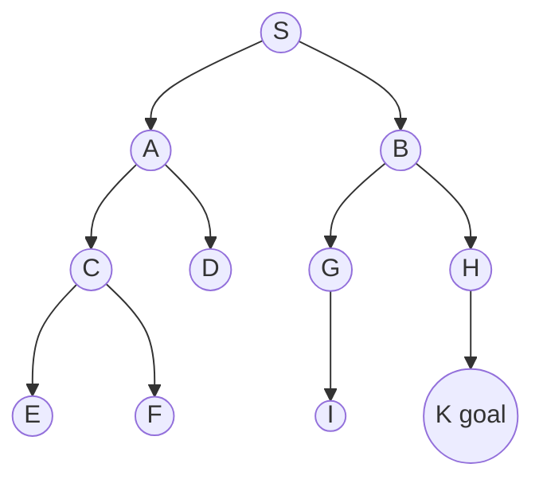

| Property | BFS |
|---|---|
| **Complete** | **Yes** (if b is finite) |
| **Optimal** | **Yes** if path cost is a non-decreasing function of depth (e.g., all step costs equal) |
| **Time** | 1 + b + b² + … + b^d = **O(b^d)** |
| **Space** | **O(b^d)** (keeps every node in memory — the frontier) |

| Advantages | Disadvantages |
|---|---|
| Finds a solution if one exists | **Huge memory** — each level must be stored |
| Finds the **minimal-step** solution | **Slow** if the solution is far from the root |

**Algorithm:**
```
function BFS(problem):
    node ← initial state; if GOAL-TEST(node) return solution
    frontier ← FIFO queue with node; explored ← ∅
    loop:
        if frontier empty: return failure
        node ← POP(frontier); add node.state to explored
        for each action in ACTIONS(node.state):
            child ← CHILD-NODE(node, action)
            if child.state not in explored or frontier:
                if GOAL-TEST(child) return solution
                INSERT(child, frontier)
```

---

## 12. Depth-First Search (DFS) ★★★

- Expands the **deepest** unexpanded node — follows each path to its greatest depth before **backtracking**.
- Implemented with a **LIFO stack** (or recursion).

**Example:** order Root → left → right: S → A → B → D → E (no successors, **backtrack**) → C → G (goal found).

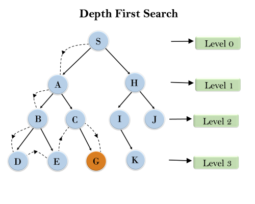

| Property | DFS |
|---|---|
| **Complete** | Only in **finite** state spaces (graph search); may loop forever in infinite spaces |
| **Optimal** | **No** — may find a deep, costly solution |
| **Time** | 1 + b + b² + … + b^m = **O(b^m)** (m can be ≫ d) |
| **Space** | **O(bm)** — only the current path (and siblings) — **linear** |

| Advantages | Disadvantages |
|---|---|
| **Very little memory** | States may recur; no guarantee of finding a solution |
| May reach the goal faster than BFS if on the right path | May go into an **infinite loop** down a deep branch |

**Variants:** depth-limited search (limit l), iterative deepening DFS (combines DFS space with BFS completeness/optimality — O(b^d) time, O(bd) space).

### BFS vs DFS ★★★
| Aspect | BFS | DFS |
|---|---|---|
| Data structure | Queue (FIFO) | Stack (LIFO) |
| Expansion | Level by level | Deepest first, backtrack |
| Complete | Yes | Not in infinite spaces |
| Optimal | Yes (unit cost) | No |
| Time | O(b^d) | O(b^m) |
| Space | O(b^d) — high | O(bm) — low |
| Best when | Solution is shallow | Solution is deep / memory is limited |

---

## 13. Hill-Climbing Search ★★★

- A **local search** algorithm: keeps only a **single current state** and repeatedly moves to the **neighbour with the highest value** (uphill); terminates at a **peak** where no neighbour is higher.
- Also called **greedy local search** (looks only at immediate neighbours). "Like **climbing Everest in thick fog with amnesia**."
- Each node has a **state** and a **value** (objective/heuristic function); no search tree is kept.
- Used for **optimisation** — e.g., **TSP** (minimise distance), 8-queens.

```
function HILL-CLIMBING(problem):
    current ← MAKE-NODE(problem.INITIAL-STATE)
    loop:
        neighbour ← highest-valued successor of current
        if neighbour.VALUE ≤ current.VALUE: return current.STATE
        current ← neighbour
```

**Features:** variant of **generate-and-test** (feedback guides the direction); **greedy**; **no backtracking** (doesn't remember previous states).

### 13.1 State-space landscape
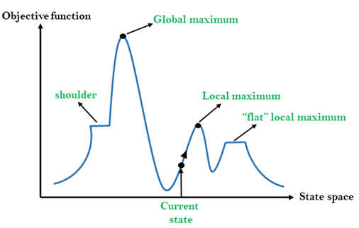

| Region | Meaning |
|---|---|
| **Global maximum** | Best possible state (highest objective value) |
| **Local maximum** | Better than all neighbours, but a higher state exists elsewhere |
| **Flat local maximum** | Flat region where all neighbours have the same value |
| **Shoulder** | Plateau with an uphill edge |
| **Current state** | Where the agent currently is |

### 13.2 Problems & Solutions ★★★
| Problem | Description | Remedy |
|---|---|---|
| **Local maximum** | Peak higher than neighbours but lower than global max — algorithm stops | **Backtracking**: keep a list of promising paths to explore others |
| **Plateau** | Flat area — all neighbours equal; no direction to move | Take **big jumps** (or very small steps); randomly select a far-away state |
| **Ridge** | Area higher than surroundings but sloping; can't be climbed in a single move (sequence of local maxima) | **Bidirectional search** or moving in **several directions** at once |

| Local maximum | Plateau | Ridge |
|---|---|---|
| 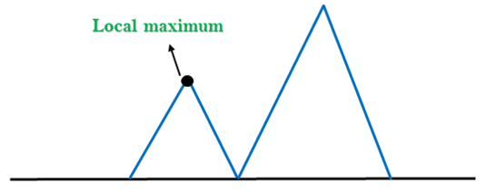 | 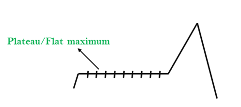 | 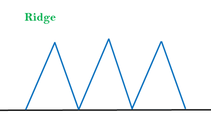 |

**Variants:** **stochastic** hill climbing (random uphill move), **first-choice** (first better successor), **random-restart** hill climbing (restart from random states — complete with probability → 1), **steepest-ascent** (best of all neighbours).

---

## 14. Simulated Annealing ★★★

- A hill climber that **never moves downhill** is **incomplete** (stuck at local maxima); a pure **random walk** is complete but **inefficient**. **Simulated annealing** combines both.
- **Annealing (metallurgy):** heat metal/glass to a high temperature, then **cool gradually** so it reaches a low-energy crystalline state.
- Algorithm picks a **random move** instead of the best: if it **improves** the state, accept it; otherwise accept it with probability **e^{ΔE/T}** (< 1). The **temperature T decreases** over time per a **schedule** → bad moves become less likely.

```
function SIMULATED-ANNEALING(problem, schedule):
    current ← problem.INITIAL-STATE
    for t = 1 to ∞:
        T ← schedule(t)
        if T = 0: return current
        next ← a randomly selected successor of current
        ΔE ← next.VALUE − current.VALUE
        if ΔE > 0: current ← next
        else: current ← next only with probability e^(ΔE/T)
```

| Temperature | Behaviour |
|---|---|
| **High T** | Accepts many bad moves → **explores** (like random walk) |
| **Low T** | Rarely accepts bad moves → **exploits** (like hill climbing) |
| **T decreased slowly enough** | Finds the **global optimum** with probability approaching 1 |

*Example:* ΔE = −2: at T = 10 → P = e^{−0.2} ≈ **0.82**; at T = 1 → e^{−2} ≈ **0.14**; at T = 0.1 → e^{−20} ≈ 0.

**Applications:** VLSI layout, airline scheduling, TSP, large optimisation problems.

| Hill climbing | Simulated annealing |
|---|---|
| Always moves to a better neighbour | Sometimes accepts worse moves (probabilistically) |
| Gets stuck at local maxima, plateaux, ridges | Escapes local optima |
| Fast, incomplete | Slower; complete/optimal with a slow schedule |

---

## 15. Local Search in Continuous Spaces ★★

- Many real problems have **continuous** state spaces (infinite branching factor) — e.g., placing airports to minimise distances.
- Denote the state as **θ** (vector x₁…xₙ) and cost **J(θ)**. How to change θ to reduce J?
  - Use the **derivative**: positive → J increasing, negative → J decreasing.
  - **Gradient** ∇J = (∂J/∂x₁, …, ∂J/∂xₙ) points in the direction of **steepest ascent**; its **negative** gives **steepest descent**.

**Gradient descent (hill climbing in continuous spaces):**
1. Compute the gradient ∇J(θ).
2. Take a small step **downhill**: θ ← θ − α ∇J(θ) (α = step size / learning rate).
3. Check whether J decreased.
4. If yes, **accept** the move; if not, **reject** (and decrease the step size — line search, Armijo rule).
5. Repeat until convergence.

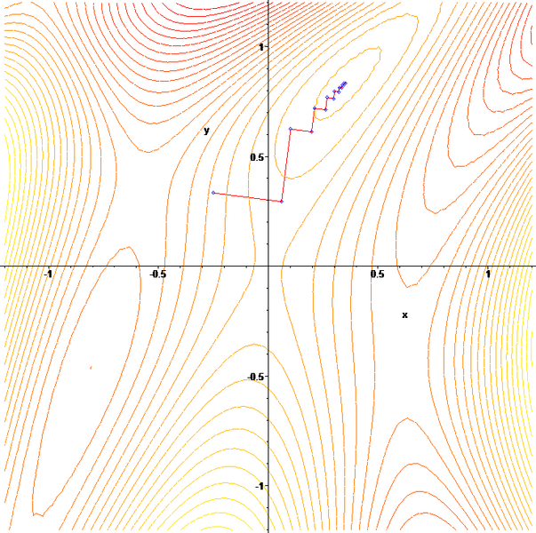

*Example:* J(x) = (x − 3)², ∇J = 2(x − 3); from x = 0 with α = 0.25: x₁ = 0 − 0.25(−6) = **1.5**, x₂ = 1.5 − 0.25(−3) = **2.25**, x₃ = 2.625 … → converges to the minimum **x = 3**.

- **How to get the gradient:** derive analytically (multivariate calculus), ask an expert, literature; **empirical gradient** by finite differences.
- **Newton–Raphson:** θ ← θ − H⁻¹∇J (uses the Hessian).
- Works well in **smooth** spaces; poorly in **rough** ones (many local minima) → combine with **simulated annealing**, random restarts; **linear programming / convex optimisation** for special cases.

---

## Unit I — One-Page Summary

| Topic | Key points |
|---|---|
| **AI** | Making computers do things that require intelligence / that people do better. |
| **Four approaches** | Acting humanly (**Turing test** — NLP, KR, reasoning, ML; total test + vision, robotics) · Thinking humanly (cognitive modelling) · Thinking rationally (laws of thought, syllogisms) · Acting rationally (**rational agent** — preferred). |
| **Strong vs weak AI** | Autonomous general intelligence vs a program simulating one intelligent activity. |
| **Agent** | Perceives via sensors, acts via actuators; agent function f: P* → A; agent = architecture + program. |
| **Rational agent** | Maximises expected performance given percepts + built-in knowledge. **PEAS**: Performance, Environment, Actuators, Sensors (taxi, medical, tutor, part-picker, satellite). |
| **Environments** | Fully/partially observable · deterministic/stochastic · episodic/sequential · static/dynamic · discrete/continuous · single/multi-agent. |
| **Agent types** | Simple reflex (condition–action, thermostat) · Model-based (internal state, robot vacuum) · Goal-based (search/planning) · Utility-based (utility function) · Learning (learning element, critic, performance element, problem generator; spam filter). |
| **Problem solving** | Goal formulation → problem formulation → search → solution → execution. Components: initial state, actions, transition model, goal test, path cost. 8-puzzle, 8-queens, TSP, VLSI. |
| **Search** | Completeness, optimality, time, space (b, d, m). Uninformed vs informed. |
| **BFS** | FIFO, level-wise; complete, optimal (unit cost); O(b^d) time & space. |
| **DFS** | LIFO, deepest first; not optimal, incomplete in infinite spaces; O(b^m) time, O(bm) space. |
| **Hill climbing** | Greedy local search uphill; problems: local maxima (backtrack), plateaux (big jumps), ridges (multi-direction); random restart. |
| **Simulated annealing** | Random moves; accept worse with probability e^{ΔE/T}; T decreases; escapes local optima. |
| **Continuous spaces** | Gradient descent θ ← θ − α∇J; accept/reject, step-size control; Newton–Raphson; good in smooth spaces. |
