# Unit II — Games, Constraint Satisfaction & Propositional Logic

> **Syllabus:** Games — optimal decisions in games (minimax), alpha-beta pruning; defining constraint satisfaction problems, constraint propagation, backtracking search for CSPs; knowledge-based agents; logic — propositional logic; propositional theorem proving — inference and proofs, proof by resolution, Horn clauses and definite clauses (forward & backward chaining).
>
> **Source:** *Unit II part 1.pptx*, *Unit II- part 2.pptx*, *horn clause.docx* (SNIST) — Russell & Norvig Ch. 5, 6, 7

**Importance legend:** ★★★ = very frequently asked (long answer / problems) · ★★ = medium · ★ = short answer

---

## Table of Contents
**Part A — Games**
1. [Games and AI](#1-games-and-ai-)
2. [Game Formulation & Game Trees](#2-game-formulation--game-trees-)
3. [Optimal Decisions — Minimax](#3-optimal-decisions--the-minimax-algorithm-)
4. [Alpha-Beta Pruning](#4-alpha-beta-pruning-)

**Part B — Constraint Satisfaction**

5. [Defining CSPs](#5-defining-constraint-satisfaction-problems-)
6. [Backtracking Search for CSPs & Heuristics](#6-backtracking-search-for-csps-)
7. [Forward Checking & Constraint Propagation (Arc Consistency, AC-3)](#7-forward-checking--constraint-propagation-)

**Part C — Logic**

8. [Knowledge-Based Agents](#8-knowledge-based-agents-)
9. [The Wumpus World](#9-the-wumpus-world-)
10. [Logic — Syntax, Semantics, Models, Entailment, Inference](#10-logic-in-general-)
11. [Propositional Logic](#11-propositional-logic-)
12. [Equivalence, Validity, Satisfiability](#12-equivalence-validity-satisfiability-)
13. [Inference Rules & Proof by Deduction](#13-inference-rules--theorem-proving-)
14. [Proof by Resolution & CNF](#14-proof-by-resolution-)
15. [Horn Clauses & Definite Clauses](#15-horn-clauses--definite-clauses-)
16. [Forward & Backward Chaining](#16-forward--backward-chaining-)
17. [Unit II — One-Page Summary](#unit-ii--one-page-summary)

---

# PART A — GAMES

## 1. Games and AI ★

**Why games?** Success is **easy to measure**; states are **easy to represent**; a **small number of operators**; comparison against humans possible. Many games are easy to model but **very hard to play** well.

- **Two-player games** (tic-tac-toe, checkers, chess) — **adversarial search**: the opponent's moves are uncertain.
- Two approaches: (1) only the rules matter → reduces to **search**; (2) encode **strategies** with a pattern-directed (possibly learning) system.
- **Search & games:** each node = a game state; a move = transition to a child; branching factor = number of legal moves; deciding which child is best is the hard part.
- **Search tree size:** chess has b ≈ **35**, ~**100** moves per game → ~**35¹⁰⁰** nodes → impossible to search fully → **heuristic search** with limited depth.

### 1.1 Static evaluation function
Applied at **leaf nodes** (cut-off depth) to **estimate** how good a position is for us.
| Game | Example evaluation function |
|---|---|
| Tic-tac-toe | Number of rows/columns/diagonals with 2 of our pieces (or open lines for X − open lines for O) |
| Checkers | Our pieces − opponent's pieces |
| Chess | Weighted sum of material: king = 1000, queen = 10 (or 9), rook = 5, bishop = knight = 3–5, pawn = 1 |

Trade-off: number of choices analysed vs accuracy of each analysis. **Assume the adversary is good** — they pick the move best for them.

---

## 2. Game Formulation & Game Trees ★★

An **optimal decision** leads to an outcome at least as good as any other option; outcomes are compared by **utility values**.

| Component | Meaning |
|---|---|
| **Initial state** | Initial board position + whose move it is |
| **Operators (actions)** | Legal moves a player can make |
| **Terminal test** | Is the game over? |
| **Utility (payoff) function** | Numeric outcome of terminal states (win +1, loss −1, draw 0; chess +1/0/½) |
| **Search objective** | Find the sequence of moves maximising our utility, considering the opponent's moves |

**Game tree** (2-player, deterministic, alternating turns): levels alternate between **MAX** (us) and **MIN** (opponent); leaves hold utilities from MAX's point of view.

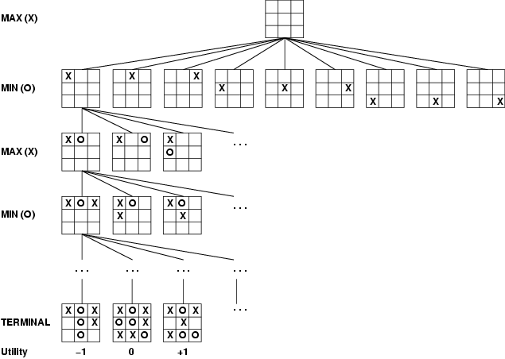

---

## 3. Optimal Decisions — The Minimax Algorithm ★★★

- **Perfect play for deterministic, perfect-information games.**
- Idea: choose the move leading to the position with the **highest minimax value** = best achievable payoff **against best play** by the opponent.
- **Depth-first search** with limited depth; apply the **static evaluation** at leaves; **MAX** nodes take the **maximum** of children, **MIN** nodes the **minimum**.

$$\text{MINIMAX}(s) = \begin{cases} \text{UTILITY}(s) & \text{if TERMINAL}(s)\\ \max_a \text{MINIMAX}(\text{RESULT}(s,a)) & \text{if PLAYER}(s) = \text{MAX}\\ \min_a \text{MINIMAX}(\text{RESULT}(s,a)) & \text{if PLAYER}(s) = \text{MIN}\end{cases}$$

```
Minimax(curstate, depth, player):
    if depth == max: return static(curstate, player)
    generate successor states s[1..n]
    if player == ME:
        return max of Minimax(s[i], depth+1, OPPONENT)
    else:
        return min of Minimax(s[i], depth+1, ME)
```

### 3.1 Worked example (Russell & Norvig Fig. 5.2)
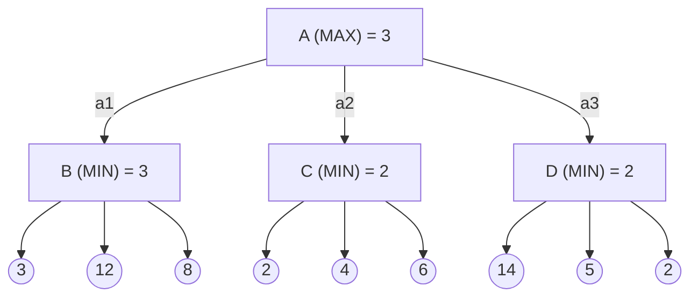
- MIN nodes: B = min(3, 12, 8) = **3**, C = min(2, 4, 6) = **2**, D = min(14, 5, 2) = **2**.
- MAX root: A = max(3, 2, 2) = **3** → MAX plays **a1**.

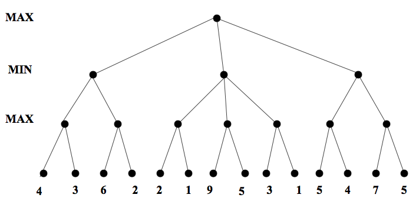

### 3.2 Properties
| Property | Minimax |
|---|---|
| Complete | Yes (finite tree) |
| Optimal | Yes, against an optimal opponent |
| Time | **O(b^m)** |
| Space | O(bm) (depth-first) |

For chess (b ≈ 35, m ≈ 100) exact solution is infeasible → **depth-limited** search + evaluation function, and **pruning**.

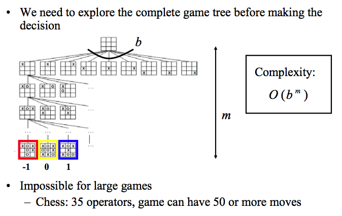

---

## 4. Alpha-Beta Pruning ★★★

**Pruning** = a **branch-and-bound** technique: skip subtrees that **cannot affect** the final decision. Returns the **same move as minimax** but examines fewer nodes.

- **α (alpha)** — the best (highest) value found so far for **MAX** along the path = **lower bound** on MAX nodes. Initially **−∞**.
- **β (beta)** — the best (lowest) value found so far for **MIN** along the path = **upper bound** on MIN nodes. Initially **+∞**.

**Rules:**
- MAX nodes update **α**; MIN nodes update **β**.
- At a **MIN** node, stop evaluating children when a child's value **≤ α** (MAX above won't choose this path).
- At a **MAX** node, stop when a child's value **≥ β** (MIN above won't allow it).
- In general, **prune when α ≥ β**.
- α and β are passed **down** to children; children don't pass α/β back up — MIN nodes return their value (β), MAX nodes return theirs (α).

```
function ALPHA-BETA(node, depth, α, β, maximizingPlayer):
    if depth = 0 or node is terminal: return eval(node)
    if maximizingPlayer:
        v ← −∞
        for each child:
            v ← max(v, ALPHA-BETA(child, depth−1, α, β, FALSE))
            α ← max(α, v)
            if α ≥ β: break          // β cut-off
        return v
    else:
        v ← +∞
        for each child:
            v ← min(v, ALPHA-BETA(child, depth−1, α, β, TRUE))
            β ← min(β, v)
            if α ≥ β: break          // α cut-off
        return v
```

### 4.1 Worked example (same tree)
1. **B:** leaves 3, 12, 8 → B = 3 → at A: **α = 3**.
2. **C:** first leaf **2** → C ≤ 2 ≤ α = 3 → **prune** leaves 4 and 6 (MAX will never choose C).
3. **D:** leaves 14 (D ≤ 14), 5 (D ≤ 5), 2 (D = 2) → no cut until the last leaf.
4. A = max(3, ≤2, 2) = **3** — same answer as minimax with 2 leaves skipped.

| Alpha-beta example | Pruned nodes (shaded red) |
|---|---|
| 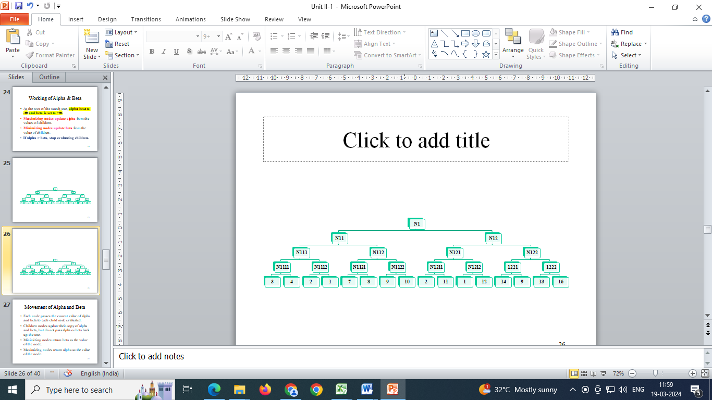 | 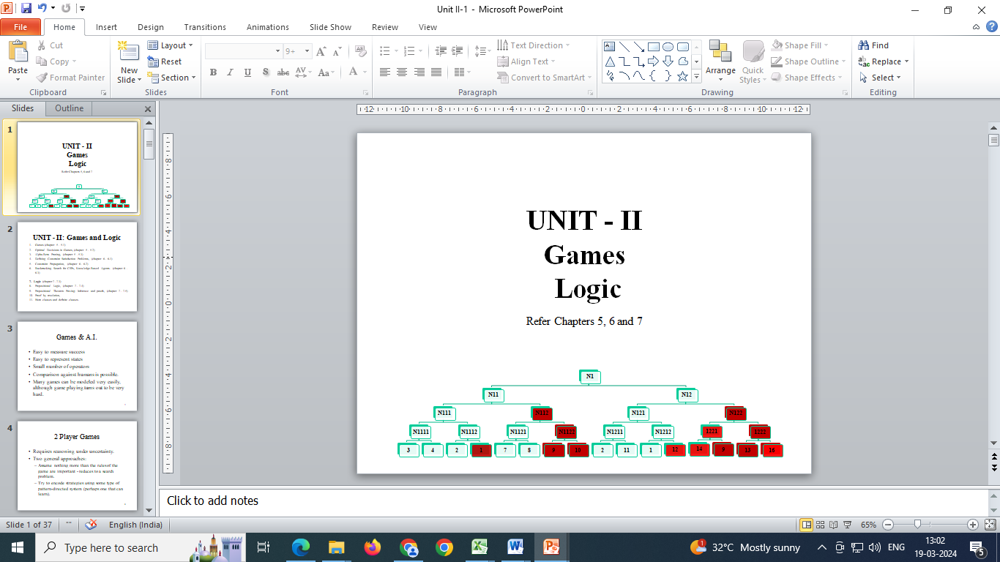 |

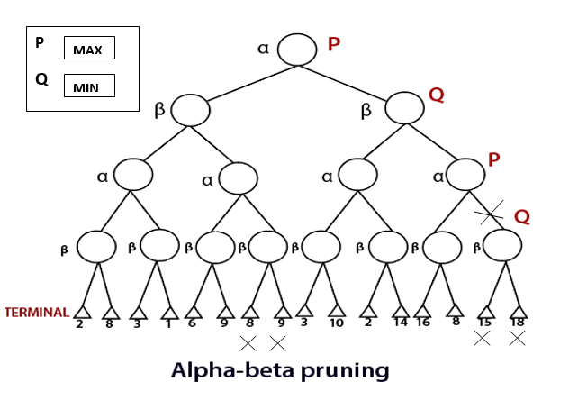

### 4.2 Effectiveness
- Depends on **move ordering** — examine the best moves first.
- **Best case (perfect ordering):** examines **O(b^{m/2})** nodes — effective branching factor **√b** → can search **twice as deep** as minimax in the same time.
- **Random ordering (average):** ~O(b^{3m/4}); effective branching factor ≈ b/log b.
- **Worst case:** no pruning — O(b^m).

| Minimax | Alpha-beta |
|---|---|
| Explores **all** nodes to depth m | Prunes branches that can't change the decision |
| O(b^m) | Best case O(b^{m/2}) |
| Same result | Same result, faster |

---

# PART B — CONSTRAINT SATISFACTION PROBLEMS

## 5. Defining Constraint Satisfaction Problems ★★★

- **Standard search:** a state is a **black box** (any data structure with successor function and goal test).
- **CSP:** a state is defined by **variables Xᵢ** with values from **domains Dᵢ**; the goal test is a set of **constraints** specifying allowable combinations of values. A simple formal representation → **general-purpose algorithms** more powerful than standard search.

A CSP = ⟨**X**, **D**, **C**⟩:
- **X** = {X₁, …, Xₙ} — variables
- **D** = {D₁, …, Dₙ} — domains
- **C** — constraints, each ⟨scope, relation⟩

**Assignment** — values to some/all variables; **consistent** — violates no constraint; **complete** — every variable assigned; **solution** = complete **and** consistent assignment.

### 5.1 Example — Map colouring (Australia) ★★★
- **Variables:** WA, NT, Q, NSW, V, SA, T
- **Domains:** Dᵢ = {red, green, blue}
- **Constraints:** adjacent regions differ — WA ≠ NT, WA ≠ SA, NT ≠ SA, NT ≠ Q, SA ≠ Q, SA ≠ NSW, SA ≠ V, Q ≠ NSW, NSW ≠ V (i.e., (WA, NT) ∈ {(r,g), (r,b), (g,r), (g,b), (b,r), (b,g)}).
- **A solution:** WA = red, NT = green, Q = red, NSW = green, V = red, SA = blue, T = green.

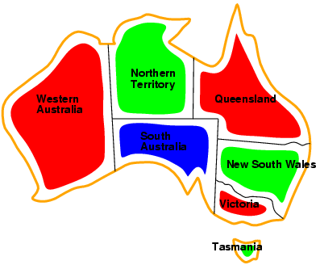

**Constraint graph:** nodes = variables, arcs = constraints (binary CSP — each constraint relates two variables).

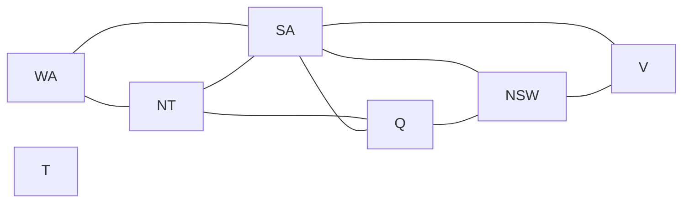

### 5.2 Varieties of CSPs
| Kind | Description | Example |
|---|---|---|
| **Discrete, finite domains** | n variables, domain size d → **O(dⁿ)** complete assignments | Map colouring, 8-queens, **Boolean SAT** (NP-complete) |
| **Discrete, infinite domains** | Integers, strings — need a **constraint language** | Job scheduling: StartJob1 + 5 ≤ StartJob3 |
| **Continuous domains** | Real-valued variables; linear constraints solvable in polynomial time by **linear programming** | Hubble Space Telescope observation times |

### 5.3 Varieties of constraints
| Type | Involves | Example |
|---|---|---|
| **Unary** | One variable | SA ≠ green |
| **Binary** | Two variables | SA ≠ WA |
| **Higher-order (global)** | 3+ variables | Cryptarithmetic column constraints, **Alldiff** |
| *Preference (soft)* | Costs, not absolute | Prof. X prefers mornings |

### 5.4 Example — Cryptarithmetic: TWO + TWO = FOUR ★★
```
    T W O
  + T W O
  -------
  F O U R
```
- **Variables:** F, T, U, W, R, O and carries X₁, X₂, X₃
- **Domains:** {0, …, 9}
- **Constraints:** Alldiff(F, T, U, W, R, O);
  O + O = R + 10·X₁; X₁ + W + W = U + 10·X₂; X₂ + T + T = O + 10·X₃; X₃ = F; T ≠ 0; F ≠ 0.
- **One solution:** 734 + 734 = **1468** (T = 7, W = 3, O = 4, F = 1, U = 6, R = 8).

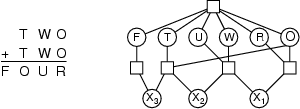

### 5.5 Real-world CSPs
Assignment (who teaches what class), **timetabling** (which class when and where), transportation scheduling, factory scheduling, hardware configuration, floor planning — often with real-valued variables.

### 5.6 Standard search formulation (incremental)
- **States** = values assigned so far; **initial state** = empty assignment {}.
- **Successor** = assign a value to an unassigned variable that doesn't conflict; fail if none.
- **Goal** = complete assignment. Every solution is at depth **n** → use DFS.
- Naïve branching: b = (n − l)d at depth l → **n!·dⁿ** leaves, although only dⁿ assignments exist → fix by **commutativity**.

---

## 6. Backtracking Search for CSPs ★★★

- Variable assignments are **commutative** ([WA = red then NT = green] = [NT = green then WA = red]) → consider **one variable per node** → dⁿ leaves.
- **Backtracking search** = **depth-first search** that assigns **one variable at a time** and **backtracks** when a variable has **no legal values** left. The basic uninformed CSP algorithm (n-queens up to n ≈ 25).

```
function BACKTRACKING-SEARCH(csp): return BACKTRACK({}, csp)

function BACKTRACK(assignment, csp):
    if assignment is complete: return assignment
    var ← SELECT-UNASSIGNED-VARIABLE(csp)
    for each value in ORDER-DOMAIN-VALUES(var, assignment, csp):
        if value is consistent with assignment:
            add {var = value} to assignment
            inferences ← INFERENCE(csp, var, value)      // e.g. forward checking
            if inferences ≠ failure:
                result ← BACKTRACK(assignment, csp)
                if result ≠ failure: return result
        remove {var = value} and inferences from assignment
    return failure
```

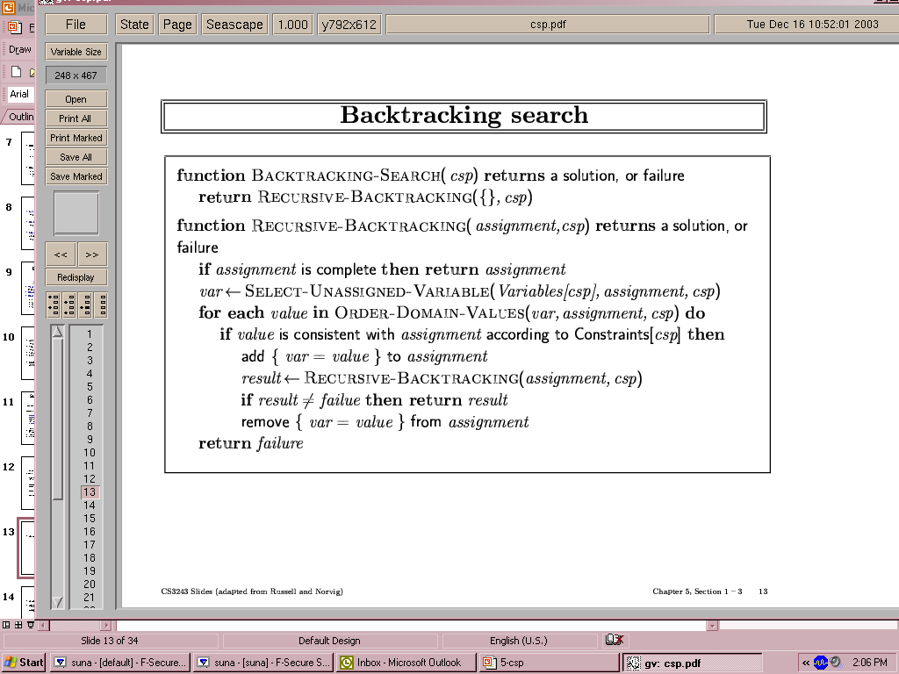

**Example progression (map colouring):** WA = red → NT = green → Q = red → …

| Step 1 | Step 2 | Step 3 |
|---|---|---|
| 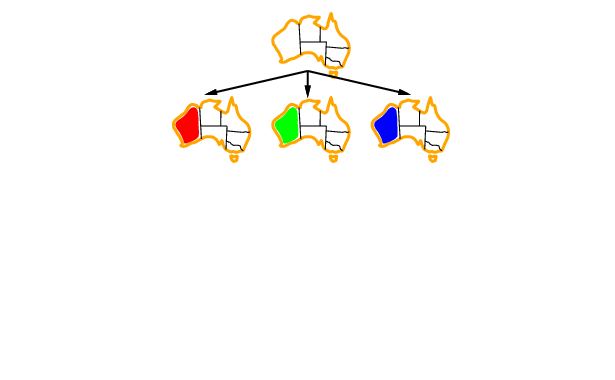 | 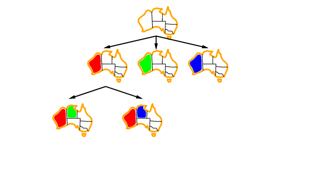 | 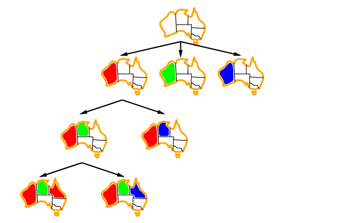 |

### 6.1 Improving backtracking efficiency ★★★
General-purpose heuristics answer three questions:

| Question | Heuristic | Idea |
|---|---|---|
| **Which variable next?** | **Minimum Remaining Values (MRV)** — "most constrained variable", **fail-first** | Choose the variable with the **fewest legal values** |
| *Tie-breaker* | **Degree heuristic** — "most constraining variable" | Choose the variable involved in the **most constraints on remaining unassigned variables** (SA has degree 5 → choose it first) |
| **Which value order?** | **Least Constraining Value (LCV)** — **fail-last** | Choose the value that **rules out the fewest** values in neighbouring variables |
| **Detect failure early?** | **Forward checking**, **arc consistency** (inference) | Prune domains after each assignment |

Combining these makes **1000-queens** feasible.

| MRV | Degree | LCV |
|---|---|---|
|  |  | 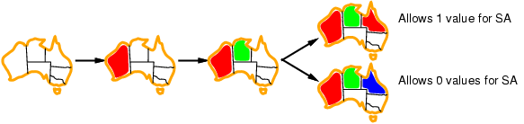 |

---

## 7. Forward Checking & Constraint Propagation ★★★

### 7.1 Forward Checking
- Keep track of **remaining legal values** for unassigned variables; after assigning X, **delete inconsistent values** from the domains of X's neighbours.
- **Terminate (backtrack)** as soon as any variable has **no legal values**.

**Map example:**
| Step | WA | NT | Q | NSW | V | SA | T |
|---|---|---|---|---|---|---|---|
| Initial | RGB | RGB | RGB | RGB | RGB | RGB | RGB |
| WA = R | **R** | GB | RGB | RGB | RGB | GB | RGB |
| Q = G | R | B | **G** | RB | RGB | B | RGB |
| V = B | R | B | G | R | **B** | **∅** ✗ | RGB |
→ SA has no legal value → **backtrack**.

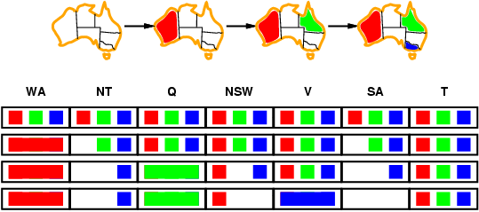

**Limitation:** forward checking propagates information from **assigned to unassigned** variables but doesn't detect all failures early — after WA = R, Q = G, **NT and SA are both forced to blue** but are adjacent; forward checking doesn't notice.

### 7.2 Constraint Propagation — Arc Consistency ★★★
**Constraint propagation** = using constraints to **reduce domains** of variables, repeatedly enforcing constraints **locally** (inference in CSPs).

- **Node consistency (1-consistency):** every value in a variable's domain satisfies its **unary** constraints.
- **Arc consistency (2-consistency):** arc **X → Y is consistent** iff **for every value x of X there is some allowed value y of Y**. (Slide phrasing: for every y of Y there is some allowed x when checking the arc in the other direction.)
- If X loses a value, **neighbours of X must be rechecked**.
- Detects failure **earlier than forward checking**; can be run as a **pre-processor** or **after each assignment** (MAC — maintaining arc consistency).

| Arc check 1 | Arc check 2 | Neighbour recheck | Failure detected |
|---|---|---|---|
| 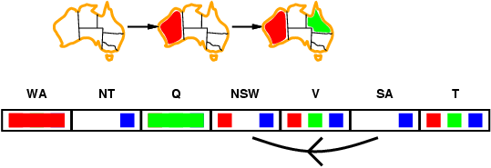 | 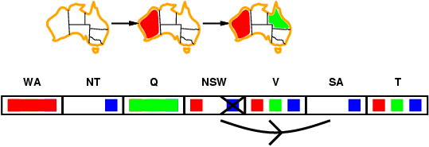 | 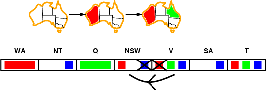 | 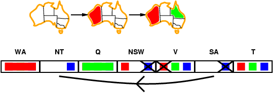 |

### 7.3 AC-3 Algorithm ★★★
```
function AC-3(csp): returns false if inconsistency found, else true
    queue ← all arcs in csp
    while queue not empty:
        (Xi, Xj) ← REMOVE-FIRST(queue)
        if REVISE(csp, Xi, Xj):
            if size of Di = 0: return false
            for each Xk in NEIGHBORS(Xi) − {Xj}:
                add (Xk, Xi) to queue
    return true

function REVISE(csp, Xi, Xj): returns true iff Di was revised
    revised ← false
    for each x in Di:
        if no value y in Dj allows (x, y) to satisfy the constraint:
            delete x from Di; revised ← true
    return revised
```
**Complexity:** **O(c·d³)** (c = number of binary constraints, d = domain size) — each arc can be inserted d times and checking an arc is O(d²).

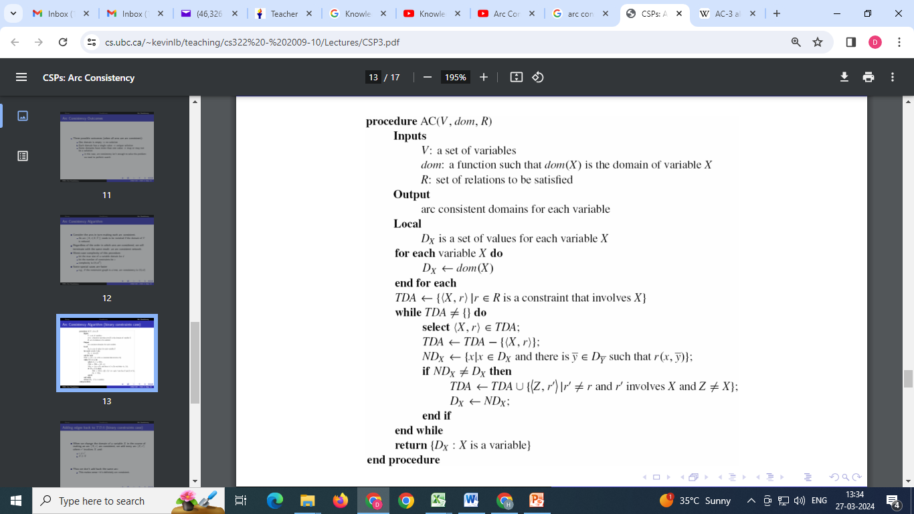

### 7.4 k-Consistency
- A CSP is **k-consistent** if for any set of k−1 variables and any consistent assignment to them, a consistent value can always be assigned to any **k-th** variable.
- 1-consistency = **node**, 2-consistency = **arc**, 3-consistency = **path** consistency (for binary networks).
- **Strong k-consistency** = k′-consistent for all k′ ≤ k; strong n-consistency → solution found **without backtracking**.
- Cost is **exponential in k** → trade-off between propagation and branching; practitioners use 2- (sometimes 3-) consistency.

### 7.5 Game of MinMax (slide exercise)
Start in the centre square of a number grid; **MAX** picks any number in the current row, **MIN** picks any number in the resulting column; the game ends when a player can't move; **MAX wins if the sum > 0**. Solve by building the minimax tree with alternating MAX/MIN levels and pruning with α-β.

---

# PART C — LOGIC

## 8. Knowledge-Based Agents ★★★

- Humans **know things** and **reason**. **Representation:** how things are stored; **reasoning:** how knowledge is used (to solve problems, generate new knowledge). Logical agents are useful in **partially observable** environments and can combine general knowledge flexibly.
- Central component: a **knowledge base (KB)** — a set of **sentences** in a **knowledge-representation language**.
- Two generic operations:
  - **TELL** — add new sentences (facts) to the KB ("tell it what it needs to know");
  - **ASK** — query the KB ("ask what to do next"); answers must **follow** from what was told.
- Architecture: **inference engine** (domain-independent algorithms) + **knowledge base** (domain-specific content).

```
function KB-AGENT(percept): returns an action
    persistent: KB, t (time counter, initially 0)
    TELL(KB, MAKE-PERCEPT-SENTENCE(percept, t))
    action ← ASK(KB, MAKE-ACTION-QUERY(t))
    TELL(KB, MAKE-ACTION-SENTENCE(action, t))
    t ← t + 1
    return action
```

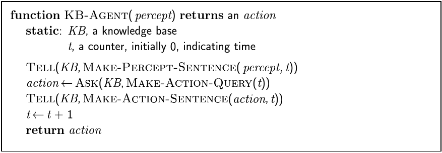

The agent must: represent states & actions; incorporate new percepts; update its internal world representation; **deduce hidden properties**; deduce appropriate actions.

| Declarative approach | Procedural approach |
|---|---|
| Build the agent by **TELLing** it what it needs to know | Encode desired behaviour directly as **program code** |
| Flexible, explicit knowledge | Minimal explicit reasoning → more efficient |

---

## 9. The Wumpus World ★★★

A 4×4 cave of rooms; agent starts at [1,1]; a **Wumpus** (monster) in one room, **pits** in some rooms, **gold** in one room.

**PEAS:**
| | Description |
|---|---|
| **Performance** | Gold **+1000**, death **−1000**, each step **−1**, using the arrow **−10** |
| **Environment** | Squares adjacent to the Wumpus are **smelly (stench)**; adjacent to a pit are **breezy**; **glitter** iff gold in the same square; shooting kills the Wumpus if facing it; only **one arrow**; Grab picks up gold; Release drops it |
| **Actuators** | Turn left, turn right, forward, grab, release, shoot |
| **Sensors** | **Stench, Breeze, Glitter** (+ bump, scream) |

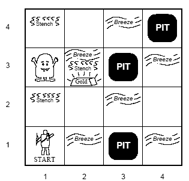

**Characterisation:** partially observable (local perception) · deterministic · sequential · static (Wumpus and pits don't move) · discrete · single agent.

**Reasoning walkthrough:** [1,1] no breeze, no stench → [1,2] and [2,1] are **safe (OK)**. Move to [2,1]: **breeze** → pit in [2,2] or [3,1]. Return, go to [1,2]: **stench**, no breeze → Wumpus in [1,3] (not [2,2], since [2,1] had no stench); no pit in [2,2] → pit is in [3,1]; [2,2] safe → proceed.

**Sticky situations:** breeze in both (1,2) and (2,1) → **no safe action**; smell in (1,1) → can't move safely (may shoot to test).

---

## 10. Logic in General ★★★

| Concept | Meaning |
|---|---|
| **Syntax** | Which sentences are **well-formed** (x + 2 ≥ y ✓; x2 + y > ✗) |
| **Semantics** | The **meaning** — truth of each sentence in each **possible world (model)** (x + 2 ≥ y is true when x = 7, y = 1; false when x = 0, y = 6) |
| **Model** | A formally structured world in which truth can be evaluated; m is a model of α if α is true in m; M(α) = set of all models of α |
| **Entailment** α ⊨ β | β **follows logically** from α: **in every model where α is true, β is also true** ⇔ **M(α) ⊆ M(β)** |
| **Inference** KB ⊢ᵢ α | α can be **derived** from KB by procedure i ("KB is the haystack, entailment the needle, inference finding it") |
| **Soundness** | i is sound if whenever KB ⊢ᵢ α, then KB ⊨ α (derives only entailed sentences) |
| **Completeness** | i is complete if whenever KB ⊨ α, then KB ⊢ᵢ α (derives every entailed sentence) |

*Examples:* KB = {"Cleveland won", "Dallas won"} ⊨ "Cleveland won or Dallas won"; x + y = 4 ⊨ 4 = x + y.

**Model checking in the Wumpus world:** after nothing in [1,1] and breeze in [2,1], consider pits in [1,2], [2,2], [3,1] → 2³ = **8 models**.
- α₁ = "[1,2] is safe" — true in **every** model of KB → **KB ⊨ α₁**.
- α₂ = "[2,2] is safe" — false in some models of KB → **KB ⊭ α₂**.

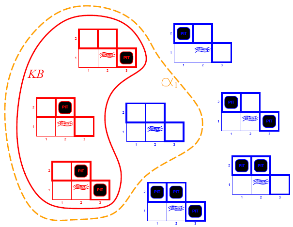

If KB is true in the real world, any sentence derived by a **sound** procedure is also true in the real world.

---

## 11. Propositional Logic ★★★

**Propositional (Boolean) logic** — atomic sentences are **proposition symbols** (P, Q, P₁,₂…) plus **True/False**; complex sentences built with connectives:

| Connective | Symbol | Name |
|---|---|---|
| NOT | ¬S | Negation |
| AND | S₁ ∧ S₂ | Conjunction |
| OR | S₁ ∨ S₂ | Disjunction |
| IMPLIES | S₁ ⇒ S₂ | Implication (premise ⇒ conclusion) |
| IFF | S₁ ⇔ S₂ | Biconditional |

**Truth table:**
| P | Q | ¬P | P ∧ Q | P ∨ Q | P ⇒ Q | P ⇔ Q |
|---|---|---|---|---|---|---|
| F | F | T | F | F | **T** | T |
| F | T | T | F | T | **T** | F |
| T | F | F | F | T | **F** | F |
| T | T | F | T | T | T | T |

**Wumpus-world KB** (Pᵢ,ⱼ = pit in [i,j], Bᵢ,ⱼ = breeze in [i,j]):
- R1: ¬P₁,₁
- R2: B₁,₁ ⇔ (P₁,₂ ∨ P₂,₁) — "a square is breezy iff an adjacent square has a pit"
- R3: B₂,₁ ⇔ (P₁,₁ ∨ P₂,₂ ∨ P₃,₁)
- R4: ¬B₁,₁
- R5: B₂,₁
- KB = R1 ∧ R2 ∧ R3 ∧ R4 ∧ R5

**Truth-table enumeration (TT-ENTAILS?)** checks all models — sound and complete, but **O(2ⁿ)**; every known inference algorithm for propositional logic is worst-case exponential (entailment is **co-NP-complete**).

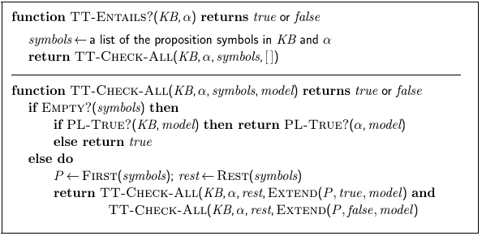

---

## 12. Equivalence, Validity, Satisfiability ★★★

- **Logical equivalence** α ≡ β — true in the same models (α ⊨ β and β ⊨ α).

| Equivalence | |
|---|---|
| Commutativity | α ∧ β ≡ β ∧ α; α ∨ β ≡ β ∨ α |
| Associativity | (α ∧ β) ∧ γ ≡ α ∧ (β ∧ γ) |
| Double negation | ¬(¬α) ≡ α |
| **Contraposition** | α ⇒ β ≡ ¬β ⇒ ¬α |
| **Implication elimination** | α ⇒ β ≡ ¬α ∨ β |
| **Biconditional elimination** | α ⇔ β ≡ (α ⇒ β) ∧ (β ⇒ α) |
| **De Morgan** | ¬(α ∧ β) ≡ ¬α ∨ ¬β; ¬(α ∨ β) ≡ ¬α ∧ ¬β |
| **Distributivity** | α ∧ (β ∨ γ) ≡ (α ∧ β) ∨ (α ∧ γ); α ∨ (β ∧ γ) ≡ (α ∨ β) ∧ (α ∨ γ) |

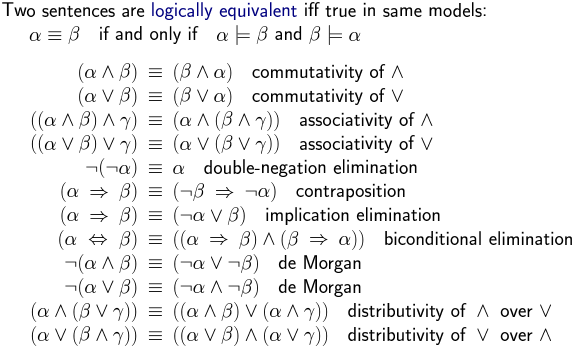

| Concept | Definition | Examples |
|---|---|---|
| **Valid (tautology)** | True in **all** models | True, A ∨ ¬A, A ⇒ A, (A ∧ (A ⇒ B)) ⇒ B |
| **Satisfiable** | True in **some** model | A ∨ B, C |
| **Unsatisfiable** | True in **no** model | A ∧ ¬A |

- **Deduction theorem:** KB ⊨ α **iff** (KB ⇒ α) is **valid**.
- **Refutation (proof by contradiction):** KB ⊨ α **iff** (KB ∧ ¬α) is **unsatisfiable** — the basis of resolution.

---

## 13. Inference Rules & Theorem Proving ★★★

**Inference rules** = patterns of inference applied to derive chains of conclusions (a **proof**).

| Rule | Premises | Conclusion |
|---|---|---|
| **Modus Ponens** | α ⇒ β, α | β |
| **And-Elimination** | α ∧ β | α (or β) |
| **De Morgan** | ¬(A ∨ B) | ¬A ∧ ¬B |
| **Biconditional elimination** | α ⇔ β | (α ⇒ β) ∧ (β ⇒ α) |
| **Contraposition** | α ⇒ β | ¬β ⇒ ¬α |
| **Unit resolution** | ℓ₁ ∨ … ∨ ℓₖ, ¬ℓᵢ | ℓ₁ ∨ … ∨ ℓᵢ₋₁ ∨ ℓᵢ₊₁ ∨ … ∨ ℓₖ |

*Examples:* "It's raining and pouring ⇒ it's raining" (and-elimination); (WumpusAhead ∧ WumpusAlive) ⇒ Shoot with (WumpusAhead ∧ WumpusAlive) ⊢ **Shoot** (modus ponens).

### 13.1 Example proof by deduction (no pit around [2,2])
Knowledge: S1: B₂₂ ⇔ (P₂₁ ∨ P₂₃ ∨ P₁₂ ∨ P₃₂) (rule); S2: ¬B₂₂ (observation).
| Step | Sentence | Justification |
|---|---|---|
| S3 | (B₂₂ ⇒ (P₂₁ ∨ P₂₃ ∨ P₁₂ ∨ P₃₂)) ∧ ((P₂₁ ∨ P₂₃ ∨ P₁₂ ∨ P₃₂) ⇒ B₂₂) | S1, biconditional elimination |
| S4 | (P₂₁ ∨ P₂₃ ∨ P₁₂ ∨ P₃₂) ⇒ B₂₂ | S3, and-elimination |
| S5 | ¬B₂₂ ⇒ ¬(P₂₁ ∨ P₂₃ ∨ P₁₂ ∨ P₃₂) | S4, contraposition |
| S6 | ¬(P₂₁ ∨ P₂₃ ∨ P₁₂ ∨ P₃₂) | S2, S5, modus ponens |
| S7 | ¬P₂₁ ∧ ¬P₂₃ ∧ ¬P₁₂ ∧ ¬P₃₂ | S6, De Morgan |

**Evaluation of deductive inference:**
- **Sound** — the rules are sound (truth-table argument).
- **Complete?** Allowing all rules → infinite search space; restricting rules risks omitting a needed one.
- **Monotonic** — adding information never invalidates a proof (if KB ⊨ α then KB ∧ β ⊨ α).

---

## 14. Proof by Resolution ★★★

- **Resolution** — a **single inference rule** that yields a **complete** inference procedure (with a complete search).
$$\frac{\ell_1 \vee \dots \vee \ell_k, \quad m_1 \vee \dots \vee m_n}{\ell_1 \vee \dots \vee \ell_{i-1} \vee \ell_{i+1} \vee \dots \vee \ell_k \vee m_1 \vee \dots \vee m_{j-1} \vee m_{j+1} \vee \dots \vee m_n}$$
where ℓᵢ and mⱼ are **complementary literals** (one is the negation of the other) — they "cancel out".
- **Why it works:** if ℓᵢ is true then mⱼ is false so the rest of the second clause must hold; if ℓᵢ is false the rest of the first clause must hold.

*Wumpus:* P₂₁ ∨ P₂₃ ∨ P₁₂ ∨ P₃₂ and ¬P₂₁ ⊢ **P₂₃ ∨ P₁₂ ∨ P₃₂**.

### 14.1 Resolution Refutation Procedure
To prove KB ⊨ α:
1. Convert **KB ∧ ¬α** to **CNF**.
2. Repeatedly resolve pairs of clauses, adding resolvents, until:
   - the **empty clause** □ is derived → **KB ⊨ α** (contradiction), or
   - **no new clauses** can be added → KB ⊭ α.

### 14.2 Conversion to CNF (Conjunctive Normal Form) ★★★
CNF = a **conjunction of clauses**, each clause a **disjunction of literals**.

Example: **B₂₂ ⇔ (P₂₁ ∨ P₂₃ ∨ P₁₂ ∨ P₃₂)**
1. **Eliminate ⇔:** (B₂₂ ⇒ (P₂₁ ∨ P₂₃ ∨ P₁₂ ∨ P₃₂)) ∧ ((P₂₁ ∨ P₂₃ ∨ P₁₂ ∨ P₃₂) ⇒ B₂₂)
2. **Eliminate ⇒** (A ⇒ B ≡ ¬A ∨ B): (¬B₂₂ ∨ P₂₁ ∨ P₂₃ ∨ P₁₂ ∨ P₃₂) ∧ (¬(P₂₁ ∨ P₂₃ ∨ P₁₂ ∨ P₃₂) ∨ B₂₂)
3. **Move ¬ inwards** (De Morgan): (¬B₂₂ ∨ P₂₁ ∨ P₂₃ ∨ P₁₂ ∨ P₃₂) ∧ ((¬P₂₁ ∧ ¬P₂₃ ∧ ¬P₁₂ ∧ ¬P₃₂) ∨ B₂₂)
4. **Distribute ∨ over ∧:** (¬B₂₂ ∨ P₂₁ ∨ P₂₃ ∨ P₁₂ ∨ P₃₂) ∧ (¬P₂₁ ∨ B₂₂) ∧ (¬P₂₃ ∨ B₂₂) ∧ (¬P₁₂ ∨ B₂₂) ∧ (¬P₃₂ ∨ B₂₂) — **5 clauses**.

### 14.3 Resolution Example
Given B₂₂, ¬P₂₁, ¬P₂₃, ¬P₃₂ — prove **P₁₂** (add ¬P₁₂):
| Resolve | With | Resolvent |
|---|---|---|
| ¬B₂₂ ∨ P₂₁ ∨ P₂₃ ∨ P₁₂ ∨ P₃₂ | ¬P₁₂ | ¬B₂₂ ∨ P₂₁ ∨ P₂₃ ∨ P₃₂ |
| ¬B₂₂ ∨ P₂₁ ∨ P₂₃ ∨ P₃₂ | ¬P₂₁ | ¬B₂₂ ∨ P₂₃ ∨ P₃₂ |
| ¬B₂₂ ∨ P₂₃ ∨ P₃₂ | ¬P₂₃ | ¬B₂₂ ∨ P₃₂ |
| ¬B₂₂ ∨ P₃₂ | ¬P₃₂ | ¬B₂₂ |
| ¬B₂₂ | B₂₂ | **□ (empty clause)** |
→ Contradiction, so **P₁₂ is true** (pit in [1,2]).

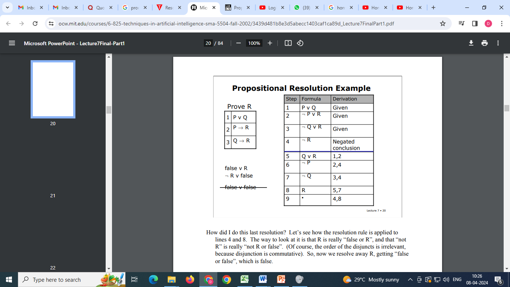

**Evaluation:** resolution is **sound** (the rule is valid in all cases) and **refutation-complete** (with a complete search); but **exponential** — the number of clauses can grow exponentially; you must know what you're trying to prove.

---

## 15. Horn Clauses & Definite Clauses ★★★

- A **clause** = a finite **disjunction of literals**.
- A **Horn clause** = a disjunction of literals with **at most one positive literal**:
  ¬X₁ ∨ ¬X₂ ∨ … ∨ ¬Xₙ ∨ Y ≡ **(X₁ ∧ X₂ ∧ … ∧ Xₙ) ⇒ Y**
- Written as **Head ← Body** (Prolog: `head :- body1, body2.`) — "to prove the head, prove the body".

*Example:* {¬lawyer(x), rich(x)} ≡ lawyer(x) ⇒ rich(x).

| Type | Form | Example |
|---|---|---|
| **Definite clause (strict Horn / rule)** | Exactly **one positive** literal | ¬Student(x) ∨ Human(x) ≡ Student(x) ⇒ Human(x) |
| **Unit clause** | Definite clause with **no negative** literals | Human(x) |
| **Fact** | Unit clause **without variables** | Human(Ram), Animal(Tiger) |
| **Goal clause (query)** | **No positive** literal | ← Human(Ram) ("Is Ram human?") |

**Which are Horn?**
| Clause | Positive literals | Horn? |
|---|---|---|
| Mammal(x) ← Dog(x) | 1 | ✓ (rule) |
| Animal(Tiger) | 1 | ✓ (fact) |
| ← Animal(Tiger) | 0 | ✓ (goal) |
| P(x) ∨ Q(x) | **2** | ✗ |
| ¬P(x) ∨ ¬Q(x) ∨ R(x) | 1 | ✓ ≡ R(x) ← P(x) ∧ Q(x) |
| ¬Parent(X,Y) ∨ ¬Ancestor(Y,Z) ∨ Ancestor(X,Z) | 1 | ✓ — if X is parent of Y and Y is ancestor of Z, then X is ancestor of Z |

**Converting an implication:** Student(x) ∧ WorksHard(x) ⇒ Pass(x) → ¬Student(x) ∨ ¬WorksHard(x) ∨ Pass(x) — Horn (one positive literal).

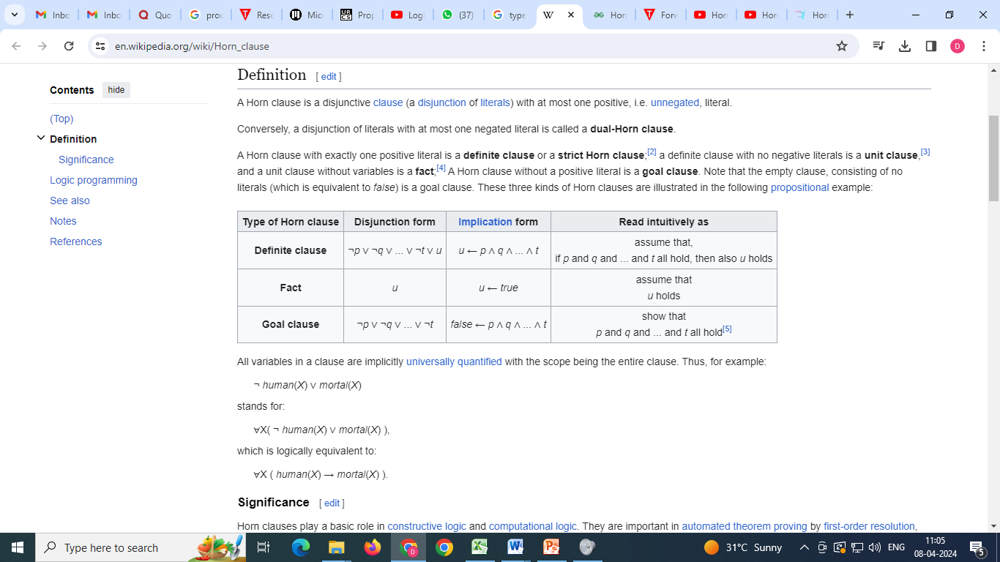

### 15.1 Why KBs of definite clauses are interesting
1. **Easy to understand** — they read as **IF–THEN rules** (Mortal(x) ← Human(x) is clearer than ¬Human(x) ∨ Mortal(x)).
2. **Efficient inference** — inference by **forward and backward chaining**; deciding entailment is **linear in the size of the KB**.
3. **Basis of logic programming** — **Prolog**, expert systems, rule-based AI.

---

## 16. Forward & Backward Chaining ★★★

**Example KB (definite clauses):**
```
P ⇒ Q
L ∧ M ⇒ P
B ∧ L ⇒ M
A ∧ P ⇒ L
A ∧ B ⇒ L
A
B
```
Query: **Q**?

### 16.1 Forward Chaining (data-driven)
Start from **known facts**; fire any rule whose premises are all satisfied, add its conclusion; repeat until the query is added or nothing new can be inferred.
1. Facts A, B.
2. A ∧ B ⇒ L → **L**.
3. B ∧ L ⇒ M → **M**.
4. L ∧ M ⇒ P → **P**.
5. P ⇒ Q → **Q** ✓ (also A ∧ P ⇒ L fires, L already known).

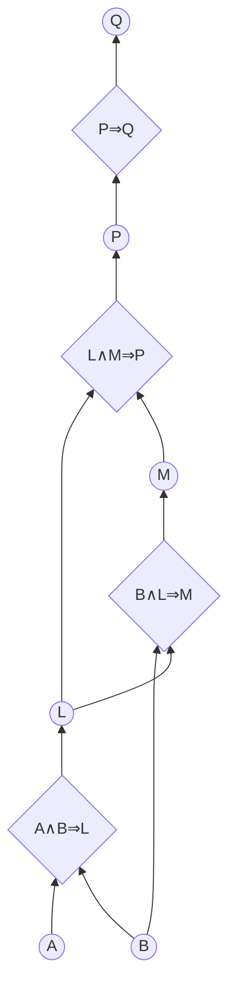
Sound and complete for definite clauses; runs in **linear time**; may derive many irrelevant facts. Used in **production systems**, real-time monitoring.

### 16.2 Backward Chaining (goal-driven)
Start from the **query** and work **backwards**: to prove Q, find rules concluding Q and prove their premises recursively; succeed when reaching known facts.
1. Goal **Q** ← needs **P**.
2. **P** ← needs **L** and **M**.
3. **L** ← A ∧ B — both facts ✓ (A ∧ P ⇒ L would loop on P — avoided by checking goals already on the stack).
4. **M** ← B ∧ L — B fact, L proved ✓.
5. ⇒ P ✓ ⇒ **Q ✓**.

| Forward chaining | Backward chaining |
|---|---|
| **Data-driven** (bottom-up) | **Goal-driven** (top-down) |
| Starts from facts | Starts from the query |
| May infer many irrelevant facts | Explores only relevant rules — often much less than linear |
| Good for monitoring, control, planning | Good for **question answering**, diagnosis (**Prolog**) |

---

## Unit II — One-Page Summary

| Topic | Key points |
|---|---|
| **Games** | Adversarial search; chess 35¹⁰⁰ → depth-limited search + static evaluation (material, open lines). Formulation: initial state, operators, terminal test, utility. |
| **Minimax** | MAX takes max, MIN takes min; optimal vs optimal opponent; O(b^m) time, O(bm) space. Example: B = 3, C = 2, D = 2 → root 3. |
| **Alpha-beta** | α = best for MAX (lower bound, −∞), β = best for MIN (upper bound, +∞); prune when α ≥ β; same result as minimax; best case O(b^{m/2}) (branching √b), random ≈ b/log b. |
| **CSP** | ⟨X, D, C⟩; solution = complete + consistent. Map colouring (WA…T, RGB), cryptarithmetic TWO + TWO = FOUR (734 + 734 = 1468). Discrete finite/infinite, continuous; unary, binary, higher-order constraints; constraint graph. |
| **Backtracking** | DFS assigning one variable per level; commutativity → dⁿ leaves. Heuristics: **MRV** (fewest values), **degree** (most constraints), **LCV** (least constraining value). |
| **Forward checking** | Delete inconsistent neighbour values; backtrack on empty domain; misses NT–SA both blue. |
| **Arc consistency / AC-3** | X → Y consistent if every x has a compatible y; recheck neighbours on change; AC-3 O(cd³). k-consistency: node (1), arc (2), path (3). |
| **KB agents** | KB of sentences; TELL/ASK; inference engine + KB; declarative vs procedural. |
| **Wumpus world** | PEAS: +1000 gold, −1000 death, −1 step, −10 arrow; stench/breeze/glitter; partially observable, deterministic, sequential, static, discrete, single-agent. |
| **Logic** | Syntax, semantics, models; entailment α ⊨ β iff M(α) ⊆ M(β); inference ⊢; soundness & completeness; model checking (8 models). |
| **Propositional logic** | ¬, ∧, ∨, ⇒, ⇔; truth table (P ⇒ Q false only when P = T, Q = F); wumpus KB R1–R5. |
| **Validity / satisfiability** | Valid = all models; satisfiable = some; unsatisfiable = none. KB ⊨ α iff KB ⇒ α valid iff KB ∧ ¬α unsatisfiable. |
| **Inference rules** | Modus ponens, and-elimination, De Morgan, contraposition, biconditional elimination; sound & monotonic. |
| **Resolution** | Complementary literals cancel; CNF (eliminate ⇔, ⇒; move ¬ in; distribute); refutation to empty clause □ (prove P₁₂); sound, complete, exponential. |
| **Horn clauses** | ≤ 1 positive literal; definite clause (exactly 1), unit, fact, goal; Head ← Body; Prolog; linear-time entailment. |
| **Chaining** | Forward (data-driven: A, B → L → M → P → Q) vs backward (goal-driven: Q ← P ← L ∧ M). |
