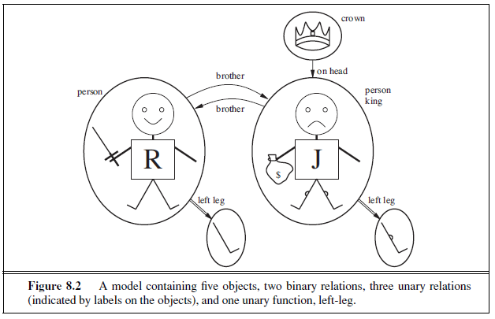
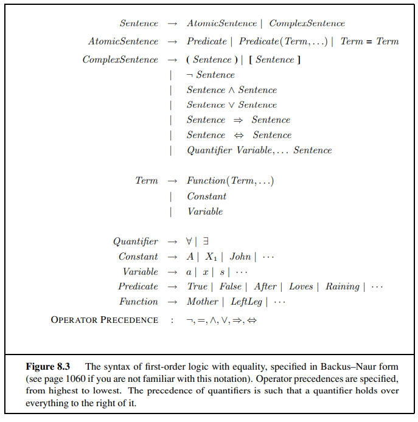
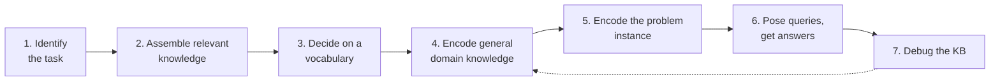
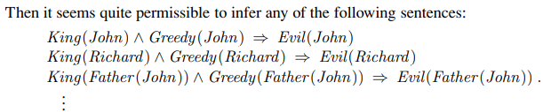
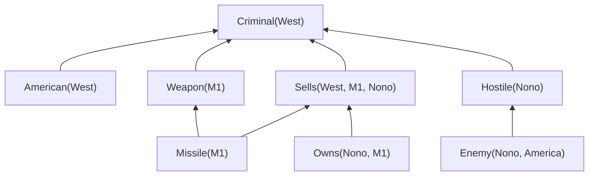
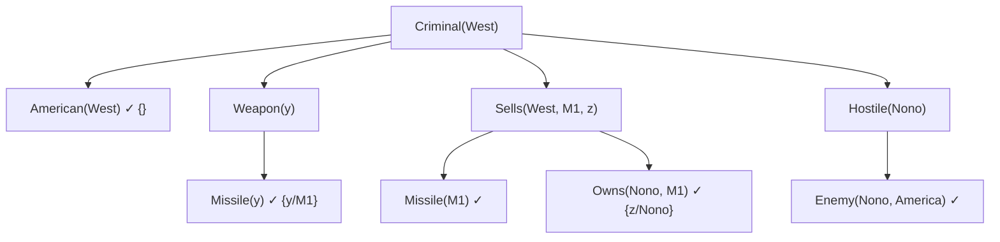
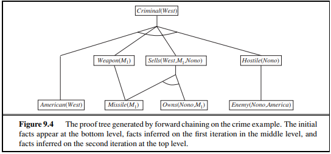
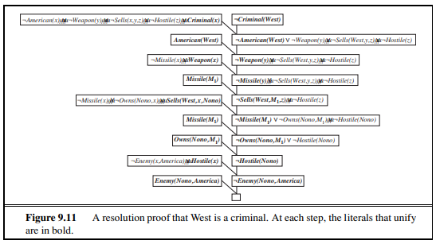
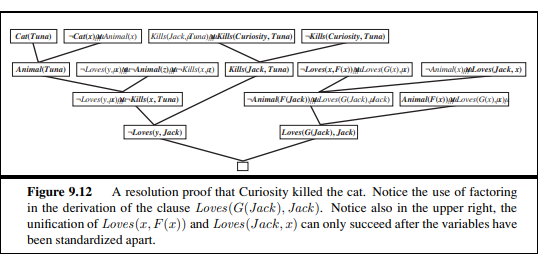
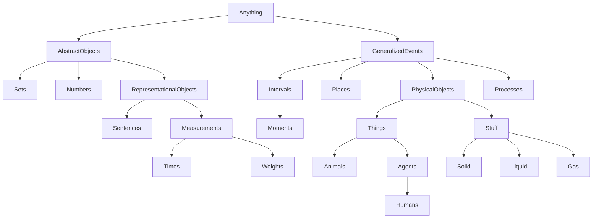

# Unit III — First-Order Logic, Inference & Knowledge Representation

> **Syllabus:** Representation revisited; syntax and semantics of first-order logic; using first-order logic; knowledge engineering in FOL. Inference in FOL — propositional vs first-order inference, unification and lifting, forward chaining, backward chaining, resolution. Knowledge representation — ontological engineering, categories and objects, events.
>
> **Source:** *Unit-III -IAI.pptx* (SNIST) — Russell & Norvig Ch. 8, 9, 12. Sections marked 📘 (ontological engineering, categories & objects, events) are in the syllabus but not in the slides; added from R&N Ch. 12.

**Importance legend:** ★★★ = very frequently asked (long answer / problems) · ★★ = medium · ★ = short answer

---

## Table of Contents
1. [Representation Revisited — Why FOL?](#1-representation-revisited--why-first-order-logic-)
2. [Syntax & Semantics of FOL — Models, Symbols, Interpretations](#2-syntax--semantics-of-first-order-logic-)
3. [Terms, Atomic & Complex Sentences](#3-terms-atomic-sentences-complex-sentences-)
4. [Quantifiers & Equality](#4-quantifiers-)
5. [Using First-Order Logic — Assertions, Kinship, Numbers, Sets, Wumpus](#5-using-first-order-logic-)
6. [Knowledge Engineering in FOL](#6-knowledge-engineering-in-fol-)
7. [Propositional vs First-Order Inference](#7-propositional-vs-first-order-inference-)
8. [Unification & Lifting — Generalized Modus Ponens](#8-unification--lifting-)
9. [Forward Chaining — The Crime Example](#9-forward-chaining-)
10. [Backward Chaining](#10-backward-chaining-)
11. [Resolution — CNF Conversion & Proofs](#11-resolution-in-fol-)
12. [📘 Ontological Engineering](#12--ontological-engineering-)
13. [📘 Categories and Objects](#13--categories-and-objects-)
14. [📘 Events](#14--events-)
15. [Unit III — One-Page Summary](#unit-iii--one-page-summary)

---

## 1. Representation Revisited — Why First-Order Logic? ★★★

| Language | Strengths | Weaknesses |
|---|---|---|
| **Programming languages** (C++, Java, Lisp) | Data structures represent facts (World[2,2] ← Pit) | **Procedural** — no general mechanism to **derive facts from facts**; each update is domain-specific code; can't express partial info ("pit in [2,2] or [3,1]") |
| **Propositional logic** | **Declarative** (knowledge and inference separate, inference domain-independent); handles **partial information** (∨, ¬); **compositional** (meaning of a sentence = function of its parts); context-independent, unambiguous | **"Too puny"** — can't concisely represent complex environments; needs a separate symbol for each fact (e.g., a rule per square per time step) |
| **Natural language** | Very expressive | Medium for **communication** rather than representation; meaning depends on **context**; **ambiguous** |

**First-order logic (FOL)** adopts propositional logic's declarative, compositional, unambiguous semantics and borrows from natural language the idea of **objects, relations and functions**:
| Element | Examples |
|---|---|
| **Objects** | People, houses, numbers, theories, colours, baseball games, wars, centuries |
| **Relations** | Unary **properties** (red, round, prime); n-ary relations (brother of, bigger than, inside, part of, owns) |
| **Functions** | Father of, best friend, one more than, beginning of |

*"One plus two equals three"* → objects: one, two, three, one plus two; relation: equals; function: plus.
*"Squares neighbouring the wumpus are smelly"* → objects: wumpus, squares; property: smelly; relation: neighbouring.

### 1.1 Ontological & Epistemological Commitments ★★
| Language | Ontological commitment (what exists in the world) | Epistemological commitment (what an agent believes about facts) |
|---|---|---|
| **Propositional logic** | **Facts** | True / false / unknown |
| **First-order logic** | **Facts, objects, relations** | True / false / unknown |
| Temporal logic | Facts, objects, relations, **times** | True / false / unknown |
| Probability theory | Facts | **Degree of belief** ∈ [0, 1] |
| Fuzzy logic | Facts with **degree of truth** ∈ [0, 1] | Known interval value |
| *Higher-order logic* | Relations & functions are themselves objects | — |

---

## 2. Syntax & Semantics of First-Order Logic ★★★

### 2.1 Models
- A **model** links the logical vocabulary to elements of a possible world. In FOL, models contain **objects**: the **domain** = the (non-empty) set of objects.
- **Example model (R&N Fig. 8.2):** five objects — **Richard the Lionheart** (King of England 1189–1199), his younger brother **evil King John** (1199–1215), the **left legs** of Richard and John, and a **crown**.
  - **Relations** = sets of **tuples**: Brother = {⟨Richard, John⟩, ⟨John, Richard⟩}; OnHead = {⟨crown, John⟩}.
  - **Unary relations (properties):** Person (Richard, John), King (John only), Crown (the crown).
  - **Functions** (total — must have a value for every input): LeftLeg: Richard → Richard's left leg, John → John's left leg.



### 2.2 Symbols and Interpretations
| Symbol kind | Stands for | Example |
|---|---|---|
| **Constant symbols** | Objects | Richard, John |
| **Predicate symbols** | Relations (with **arity**) | Brother/2, OnHead/2, Person/1, King/1, Crown/1 |
| **Function symbols** | Functions (with arity) | LeftLeg/1 |

- An **interpretation** specifies which objects, relations and functions the symbols refer to. The **intended interpretation**: Richard → Richard the Lionheart, John → King John, Brother → brotherhood relation, etc.
- With 5 objects there are 5² = **25** possible interpretations for Richard and John alone.
- **A model in FOL = a set of objects + an interpretation** mapping constants → objects, predicates → relations, functions → functions.



**FOL grammar (BNF summary):**
```
Sentence        → AtomicSentence | ComplexSentence
AtomicSentence  → Predicate | Predicate(Term, …) | Term = Term
ComplexSentence → (Sentence) | ¬Sentence | Sentence ∧ Sentence | Sentence ∨ Sentence
                | Sentence ⇒ Sentence | Sentence ⇔ Sentence | Quantifier Variable, … Sentence
Term            → Function(Term, …) | Constant | Variable
Quantifier      → ∀ | ∃
```

---

## 3. Terms, Atomic Sentences, Complex Sentences ★★

- **Term** — a logical expression that **refers to an object**: constants, variables, or **complex terms** f(t₁,…,tₙ) — e.g., **LeftLeg(John)** ("King John's left leg"). A complex term is just a **complicated name**, not a subroutine call.
- **Atomic sentence (atom)** — predicate symbol + parenthesised list of terms: **Brother(Richard, John)**; may contain complex terms: **Married(Father(Richard), Mother(John))**. True in a model if the relation holds among the referenced objects.
- **Complex sentences** — built with connectives ¬, ∧, ∨, ⇒, ⇔ (same semantics as propositional logic). True in the Fig. 8.2 model:
  - ¬Brother(LeftLeg(Richard), John)
  - Brother(Richard, John) ∧ Brother(John, Richard)
  - King(Richard) ∨ King(John)
  - ¬King(Richard) ⇒ King(John)

---

## 4. Quantifiers ★★★

### 4.1 Universal quantification (∀ — "for all")
- "All kings are persons": **∀x King(x) ⇒ Person(x)**.
- A **variable** is a term (also usable as function argument, LeftLeg(x)); a term **without variables** is a **ground term**.
- ∀x P is true iff P is true under **every extended interpretation** (x → Richard, x → John, x → Richard's leg, x → John's leg, x → crown).
- **Natural connective with ∀ is ⇒.** Using ∧ (∀x King(x) ∧ Person(x)) would wrongly claim *everything* is a king and a person.

### 4.2 Existential quantification (∃ — "there exists")
- "King John has a crown on his head": **∃x Crown(x) ∧ OnHead(x, John)** — true if **at least one** extended interpretation makes it true (x → the crown).
- **Natural connective with ∃ is ∧.** ∃x Crown(x) ⇒ OnHead(x, John) is too weak — true whenever any object is not a crown.

### 4.3 Nested quantifiers
- "Brothers are siblings": ∀x ∀y Brother(x, y) ⇒ Sibling(x, y).
- "Sibling is symmetric": ∀x, y Sibling(x, y) ⇔ Sibling(y, x).
- **Order matters:**
  - "Everybody loves somebody": **∀x ∃y Loves(x, y)**
  - "There is someone loved by everyone": **∃y ∀x Loves(x, y)**

### 4.4 Connections between ∀ and ∃ (De Morgan for quantifiers) ★★★
| Quantified | Unquantified analogue |
|---|---|
| ∀x ¬P ≡ ¬∃x P | ¬(P ∨ Q) ≡ ¬P ∧ ¬Q |
| ¬∀x P ≡ ∃x ¬P | ¬(P ∧ Q) ≡ ¬P ∨ ¬Q |
| ∀x P ≡ ¬∃x ¬P | P ∧ Q ≡ ¬(¬P ∨ ¬Q) |
| ∃x P ≡ ¬∀x ¬P | P ∨ Q ≡ ¬(¬P ∧ ¬Q) |

*Examples:* "Everyone dislikes parsnips" ∀x ¬Likes(x, Parsnips) ≡ ¬∃x Likes(x, Parsnips); "Everyone likes ice cream" ∀x Likes(x, IceCream) ≡ ¬∃x ¬Likes(x, IceCream).

### 4.5 Equality
- **Father(John) = Henry** — both terms refer to the same object.
- "Richard has **at least two** brothers": ∃x, y Brother(x, Richard) ∧ Brother(y, Richard) ∧ **¬(x = y)** (without ¬(x = y), x and y could be the same).
- "Richard's brothers are John and Geoffrey":
  Brother(John, Richard) ∧ Brother(Geoffrey, Richard) ∧ **John ≠ Geoffrey** ∧ ∀x Brother(x, Richard) ⇒ (x = John ∨ x = Geoffrey).

### 4.6 Translating English to FOL (practice)
| English | FOL |
|---|---|
| All students are smart | ∀x Student(x) ⇒ Smart(x) |
| There is a student who is smart | ∃x Student(x) ∧ Smart(x) |
| Every student loves some student | ∀x Student(x) ⇒ ∃y Student(y) ∧ Loves(x, y) |
| No one likes everyone | ¬∃x ∀y Likes(x, y) |
| Only one student failed | ∃x Student(x) ∧ Failed(x) ∧ ∀y (Student(y) ∧ Failed(y) ⇒ x = y) |

---

## 5. Using First-Order Logic ★★★

A **domain** = some part of the world about which we wish to express knowledge.

### 5.1 Assertions and queries
- **TELL** adds **assertions**: TELL(KB, King(John)); TELL(KB, Person(Richard)); TELL(KB, ∀x King(x) ⇒ Person(x)).
- **ASK** poses **queries (goals)**: ASK(KB, King(John)) → true; ASK(KB, Person(John)) → true.
- **ASKVARS(KB, Person(x))** returns a **substitution (binding list)** — {x/John} and {x/Richard}.

### 5.2 The kinship domain
Objects = people; unary predicates **Male, Female**; binary predicates Parent, Sibling, Brother, Sister, Child, Daughter, Son, Spouse, Wife, Husband, Grandparent, Grandchild, Cousin, Aunt, Uncle; functions **Mother, Father**.
| Fact | FOL axiom |
|---|---|
| One's mother is one's female parent | ∀m, c Mother(c) = m ⇔ Female(m) ∧ Parent(m, c) |
| One's husband is one's male spouse | ∀w, h Husband(h, w) ⇔ Male(h) ∧ Spouse(h, w) |
| Male and female are disjoint | ∀x Male(x) ⇔ ¬Female(x) |
| Parent and child are inverses | ∀p, c Parent(p, c) ⇔ Child(c, p) |
| Grandparent = parent of a parent | ∀g, c Grandparent(g, c) ⇔ ∃p Parent(g, p) ∧ Parent(p, c) |
| Sibling = another child of one's parents | ∀x, y Sibling(x, y) ⇔ x ≠ y ∧ ∃p Parent(p, x) ∧ Parent(p, y) |

These are **definitions/axioms**; other sentences derived from them are **theorems**.

### 5.3 Numbers (Peano axioms)
Predicate **NatNum**, constant **0**, function **S** (successor):
- NatNum(0)
- ∀n NatNum(n) ⇒ NatNum(S(n)) → 0, S(0), S(S(0)), …
- ∀n 0 ≠ S(n);  ∀m, n m ≠ n ⇒ S(m) ≠ S(n)
- **Addition:** ∀m NatNum(m) ⇒ +(0, m) = m; ∀m, n NatNum(m) ∧ NatNum(n) ⇒ +(S(m), n) = S(+(m, n)). In infix: (m + 1) + n = (m + n) + 1.

### 5.4 Sets and lists
- **Sets:** empty set {}; predicate **Set**; x ∈ s (membership); s₁ ⊆ s₂ (subset); functions ∪, ∩, {x | s} (adjoin).
- **Lists:** ordered, repetitions allowed; **Nil** (empty list []), **Cons, Append, First, Rest**; predicate **Find**; Cons(x, y) written **[x | y]**.

### 5.5 The wumpus world in FOL
- Percepts with time: **Percept([Stench, Breeze, Glitter, None, None], 5)**.
- Actions as terms: Turn(Right), Turn(Left), Forward, Shoot, Grab, Climb; query **ASKVARS(∃a BestAction(a, 5))** → {a/Grab}.
- Perception rules: ∀t, s, g, m, c Percept([s, Breeze, g, m, c], t) ⇒ Breeze(t); Glitter similar.
- Reflex: **∀t Glitter(t) ⇒ BestAction(Grab, t)**.
- Squares as lists [x, y]; adjacency:
  ∀x, y, a, b Adjacent([x, y], [a, b]) ⇔ (x = a ∧ (y = b − 1 ∨ y = b + 1)) ∨ (y = b ∧ (x = a − 1 ∨ x = a + 1)).
- Location: At(Agent, s, t); one place at a time: ∀x, s₁, s₂, t At(x, s₁, t) ∧ At(x, s₂, t) ⇒ s₁ = s₂.
- ∀s, t At(Agent, s, t) ∧ Breeze(t) ⇒ Breezy(s).
- **One axiom** replaces many propositional ones: **∀s Breezy(s) ⇔ ∃r Adjacent(r, s) ∧ Pit(r)**.
- Arrow: ∀t HaveArrow(t + 1) ⇔ (HaveArrow(t) ∧ ¬Action(Shoot, t)).

---

## 6. Knowledge Engineering in FOL ★★★

**Knowledge engineering** = the general process of **knowledge-base construction**. A **knowledge engineer** investigates a domain, learns its important concepts and creates a **formal representation** of its objects and relations.

### 6.1 The Knowledge-Engineering Process (7 steps) ★★★

| Step | Description |
|---|---|
| **1. Identify the task** | Delineate the questions the KB will support and the facts available per problem instance (choose actions? or only answer questions?) |
| **2. Assemble the relevant knowledge** | Work with experts — **knowledge acquisition**; understand scope informally |
| **3. Decide on a vocabulary** | Translate domain concepts into **predicates, functions, constants** → the domain's **ontology** |
| **4. Encode general knowledge** | Write **axioms** for all vocabulary terms |
| **5. Encode the problem instance** | Atomic sentences describing the specific instance (easy with a good ontology) |
| **6. Pose queries** | Let the inference procedure derive answers |
| **7. Debug the KB** | Answers are rarely right first time — find **missing or incorrect axioms** (e.g., using Smelly(s) ⇒ Adjacent(Home(Wumpus), s) instead of the biconditional means the agent can never prove the absence of the wumpus) |

### 6.2 Example — electronic circuits domain (one-bit full adder)
Vocabulary: gates (AND, OR, XOR, NOT), terminals, Connected, Signal (1 or 0).
General axioms (a good ontology needs only a few):
1. Connected terminals have the same signal: ∀t₁, t₂ Terminal(t₁) ∧ Terminal(t₂) ∧ Connected(t₁, t₂) ⇒ Signal(t₁) = Signal(t₂).
2. Signal is 1 or 0: ∀t Terminal(t) ⇒ Signal(t) = 1 ∨ Signal(t) = 0.
3. Connected is commutative: ∀t₁, t₂ Connected(t₁, t₂) ⇔ Connected(t₂, t₁).
4. Gate behaviour: e.g., ∀g Gate(g) ∧ Type(g) = AND ⇒ (Signal(Out(1, g)) = 0 ⇔ ∃n Signal(In(n, g)) = 0).


---

## 7. Propositional vs First-Order Inference ★★★

### 7.1 Inference rules for quantifiers
**Universal Instantiation (UI):** infer any sentence obtained by substituting a **ground term** g for a universally quantified variable v:
$$\frac{\forall v\ \alpha}{\text{SUBST}(\{v/g\}, \alpha)}$$
From ∀x King(x) ∧ Greedy(x) ⇒ Evil(x): King(John) ∧ Greedy(John) ⇒ Evil(John) {x/John}; same with {x/Richard}, {x/Father(John)}.

**Existential Instantiation (EI):** replace the variable by a **new constant symbol k** that appears nowhere else in the KB (a **Skolem constant**):
$$\frac{\exists v\ \alpha}{\text{SUBST}(\{v/k\}, \alpha)}$$
From ∃x Crown(x) ∧ OnHead(x, John): Crown(C₁) ∧ OnHead(C₁, John). UI can be applied many times; EI **once** (then the existential sentence is discarded).



### 7.2 Reduction to propositional inference (propositionalisation)
KB: ∀x King(x) ∧ Greedy(x) ⇒ Evil(x); King(John); Greedy(John); Brother(Richard, John).
Apply UI with all ground terms {x/John}, {x/Richard} → King(John) ∧ Greedy(John) ⇒ Evil(John); King(Richard) ∧ Greedy(Richard) ⇒ Evil(Richard); discard the ∀ sentence → essentially **propositional** (ground atoms as symbols) → any complete propositional algorithm infers **Evil(John)**.

**Problems:** generates many **irrelevant** sentences; with **function symbols** there are **infinitely many** ground terms (Father(Father(John))…). **Herbrand's theorem:** if a sentence is entailed, a proof exists using a finite subset → semi-decidable (entailment in FOL is **semidecidable** — can say yes to entailed sentences but may loop forever otherwise).

---

## 8. Unification & Lifting ★★★

### 8.1 Generalized Modus Ponens (GMP)
Instead of propositionalising, find a substitution θ making the premises match known facts. For atomic sentences pᵢ, pᵢ′ and q, where **SUBST(θ, pᵢ′) = SUBST(θ, pᵢ)** for all i:
$$\frac{p_1', p_2', \dots, p_n', \quad (p_1 \wedge p_2 \wedge \dots \wedge p_n \Rightarrow q)}{\text{SUBST}(\theta, q)}$$
*Example:* p₁′ = King(John), p₁ = King(x); p₂′ = Greedy(y), p₂ = Greedy(x); θ = {x/John, y/John}; q = Evil(x) → **Evil(John)**.
- **Sound** (follows from UI: p ⊨ SUBST(θ, p)).
- GMP is a **lifted** version of Modus Ponens — raises it from ground propositional logic to FOL; makes only the substitutions needed.

### 8.2 Unification ★★★
**Unification** finds substitutions that make different logical expressions **identical** — key to all FOL inference.
**UNIFY(p, q) = θ** where SUBST(θ, p) = SUBST(θ, q).

Query: AskVars(Knows(John, x)) — "whom does John know?"
| p | q | θ |
|---|---|---|
| Knows(John, x) | Knows(John, Jane) | **{x/Jane}** |
| Knows(John, x) | Knows(y, Bill) | **{x/Bill, y/John}** |
| Knows(John, x) | Knows(y, Mother(y)) | **{y/John, x/Mother(John)}** |
| Knows(John, x) | Knows(x, Elizabeth) | **fail** — x can't be John and Elizabeth at once |

- **Standardising apart:** rename variables to avoid clashes — Knows(x, Elizabeth) → Knows(z₁₇, Elizabeth) → unifies with {x/Elizabeth, z₁₇/John} ("everyone knows Elizabeth" ⇒ John knows Elizabeth).
- **Most general unifier (MGU):** the least restrictive substitution — UNIFY(Knows(John, x), Knows(y, z)) → {y/John, x/z} (not {y/John, x/John, z/John}).
- **Occur check:** a variable can't be unified with a term containing it (S(x) vs x fails).

**Unification algorithm (sketch):**
```
UNIFY(x, y, θ):
    if θ = failure: return failure
    if x = y: return θ
    if VARIABLE(x): return UNIFY-VAR(x, y, θ)
    if VARIABLE(y): return UNIFY-VAR(y, x, θ)
    if COMPOUND(x) and COMPOUND(y):
        return UNIFY(x.ARGS, y.ARGS, UNIFY(x.OP, y.OP, θ))
    if LIST(x) and LIST(y):
        return UNIFY(x.REST, y.REST, UNIFY(x.FIRST, y.FIRST, θ))
    return failure
UNIFY-VAR(var, x, θ):
    if {var/val} ∈ θ: return UNIFY(val, x, θ)
    if {x/val} ∈ θ: return UNIFY(var, val, θ)
    if OCCUR-CHECK(var, x): return failure
    return θ ∪ {var/x}
```

---

## 9. Forward Chaining ★★★

Start with the **atomic sentences (facts)** in the KB and apply **GMP in the forward direction**, adding new atomic sentences until the query is answered or **no new inferences** can be made. Suits systems reacting to newly arrived information (Situation ⇒ Response).

### 9.1 First-order definite clauses
Disjunctions of literals with **exactly one positive** literal: either **atomic** or an **implication** (conjunction of positive literals ⇒ single positive literal). Variables are **universally quantified**.
King(x) ∧ Greedy(x) ⇒ Evil(x); King(John); Greedy(y).

### 9.2 The Crime Example ★★★
> "The law says that it is a crime for an American to sell weapons to hostile nations. The country Nono, an enemy of America, has some missiles, and all of its missiles were sold to it by Colonel West, who is American." Prove that **West is a criminal**.

| # | Definite clause | Source |
|---|---|---|
| 9.3 | American(x) ∧ Weapon(y) ∧ Sells(x, y, z) ∧ Hostile(z) ⇒ **Criminal(x)** | "crime for an American to sell weapons to hostile nations" |
| 9.4 | Owns(Nono, **M1**) | "Nono has some missiles" — ∃x Owns(Nono, x) ∧ Missile(x), by EI with new constant M1 |
| 9.5 | Missile(M1) | (same) |
| 9.6 | Missile(x) ∧ Owns(Nono, x) ⇒ Sells(West, x, Nono) | "all its missiles were sold by West" |
| 9.7 | Missile(x) ⇒ Weapon(x) | missiles are weapons |
| 9.8 | Enemy(x, America) ⇒ Hostile(x) | an enemy of America is hostile |
| 9.9 | American(West) | "West, who is American" |
| 9.10 | Enemy(Nono, America) | "Nono, an enemy of America" |

No function symbols → a **Datalog** KB.

**Forward-chaining run (2 iterations):**
- **Iteration 1:** 9.3 unsatisfied; **9.6** with {x/M1} → **Sells(West, M1, Nono)**; **9.7** with {x/M1} → **Weapon(M1)**; **9.8** with {x/Nono} → **Hostile(Nono)**.
- **Iteration 2:** **9.3** with {x/West, y/M1, z/Nono} → **Criminal(West)** ✓.



- A fact is not "new" if it's merely a **renaming** of a known fact (Likes(x, IceCream) vs Likes(y, IceCream)).
- **Properties:** sound and **complete** for definite clauses; terminates for Datalog (polynomial); may not terminate with function symbols if the query is not entailed.
- **Efficient FC:** pattern matching (conjunct ordering — a CSP), **incremental forward chaining** (only rules with a premise matching a fact added in the previous iteration), **Rete algorithm**; avoid irrelevant facts (magic sets). Used in **production systems** and deductive databases.

```
function FOL-FC-ASK(KB, α):
    repeat until new is empty:
        new ← {}
        for each rule (p1 ∧ … ∧ pn ⇒ q) in KB (standardised apart):
            for each θ such that SUBST(θ, p1 ∧ … ∧ pn) = SUBST(θ, p1′ ∧ … ∧ pn′) for some p′ in KB:
                q′ ← SUBST(θ, q)
                if q′ does not unify with some sentence already in KB or new:
                    add q′ to new
                    φ ← UNIFY(q′, α); if φ ≠ fail: return φ
        add new to KB
    return false
```

---

## 10. Backward Chaining ★★★

- Works **backward from the goal**: FOL-BC-ASK(KB, goal) succeeds if the KB has a clause **lhs ⇒ goal** whose lhs conjuncts can all be proved (facts like American(West) have an empty lhs).
- Implemented as a **generator** returning multiple substitutions (Person(x) → {x/John}, {x/Richard}).
- A form of **AND/OR search**: **OR** — the goal can be proved by **any** rule; **AND** — **all** conjuncts of the lhs must be proved.
- **Depth-first**, so space is linear; but suffers from **repeated states** and **incompleteness** (infinite loops) — fixed by memoisation.
- Basis of **logic programming — Prolog** (`criminal(X) :- american(X), weapon(Y), sells(X,Y,Z), hostile(Z).`).

**Proof tree for Criminal(West):**




| Forward chaining | Backward chaining |
|---|---|
| Data-driven, bottom-up | Goal-driven, top-down |
| Derives all consequences (possibly irrelevant) | Only goal-relevant inferences |
| Production systems, deductive DBs | Prolog, question answering |
| Complete for Datalog | Incomplete (loops) without memoisation |

---

## 11. Resolution in FOL ★★★

Resolution by **refutation** is a **complete** inference procedure for FOL: to show KB ⊨ α, show **KB ∧ ¬α is unsatisfiable** by deriving the **empty clause**.

### 11.1 Conversion to CNF ★★★
Literals may contain variables (universally quantified). E.g.,
∀x American(x) ∧ Weapon(y) ∧ Sells(x, y, z) ∧ Hostile(z) ⇒ Criminal(x)
becomes ¬American(x) ∨ ¬Weapon(y) ∨ ¬Sells(x, y, z) ∨ ¬Hostile(z) ∨ Criminal(x).

**Example:** "Everyone who loves all animals is loved by someone":
**∀x [∀y Animal(y) ⇒ Loves(x, y)] ⇒ [∃y Loves(y, x)]**

| Step | Result |
|---|---|
| **1. Eliminate implications** | ∀x [¬∀y ¬Animal(y) ∨ Loves(x, y)] ∨ [∃y Loves(y, x)] |
| **2. Move ¬ inwards** (¬∀x p ≡ ∃x ¬p; ¬∃x p ≡ ∀x ¬p) | ∀x [∃y ¬(¬Animal(y) ∨ Loves(x, y))] ∨ [∃y Loves(y, x)] → ∀x [∃y Animal(y) ∧ ¬Loves(x, y)] ∨ [∃y Loves(y, x)] |
| **3. Standardise variables** | ∀x [∃y Animal(y) ∧ ¬Loves(x, y)] ∨ [∃z Loves(z, x)] |
| **4. Skolemise** — replace ∃ variables by **Skolem functions** of the enclosing ∀ variables (not constants!) | ∀x [Animal(F(x)) ∧ ¬Loves(x, F(x))] ∨ Loves(G(x), x) |
| **5. Drop universal quantifiers** | [Animal(F(x)) ∧ ¬Loves(x, F(x))] ∨ Loves(G(x), x) |
| **6. Distribute ∨ over ∧** | **[Animal(F(x)) ∨ Loves(G(x), x)] ∧ [¬Loves(x, F(x)) ∨ Loves(G(x), x)]** |

> Blind EI would give ∀x [Animal(A) ∧ ¬Loves(x, A)] ∨ Loves(B, x) — wrong meaning (a single animal A and a single lover B for everyone). F(x) and G(x) depend on x. *(The slide writes G(z); since z was bound inside the scope of ∀x, the Skolem function is G(x).)*

### 11.2 The resolution rule (binary resolution)
Two clauses, **standardised apart** (no shared variables), resolve if they contain **complementary literals** — one **unifies with the negation** of the other:
$$\frac{\ell_1 \vee \dots \vee \ell_k, \quad m_1 \vee \dots \vee m_n}{\text{SUBST}(\theta, \ell_1 \vee \dots \vee \ell_{i-1} \vee \ell_{i+1} \vee \dots \vee \ell_k \vee m_1 \vee \dots \vee m_{j-1} \vee m_{j+1} \vee \dots \vee m_n)}$$
where UNIFY(ℓᵢ, ¬mⱼ) = θ.
*E.g.,* [Animal(F(x)) ∨ Loves(G(x), x)] and [¬Loves(u, v) ∨ ¬Kills(u, v)] with θ = {u/G(x), v/x} → **Animal(F(x)) ∨ ¬Kills(G(x), x)**.

**Factoring** removes redundant literals (two unifiable literals → one). Binary resolution + factoring is **refutation-complete**.

### 11.3 Example 1 — Crime problem by resolution
CNF clauses:
1. ¬American(x) ∨ ¬Weapon(y) ∨ ¬Sells(x, y, z) ∨ ¬Hostile(z) ∨ Criminal(x)
2. ¬Missile(x) ∨ ¬Owns(Nono, x) ∨ Sells(West, x, Nono)
3. ¬Enemy(x, America) ∨ Hostile(x)
4. ¬Missile(x) ∨ Weapon(x)
5. Owns(Nono, M1)  6. Missile(M1)  7. American(West)  8. Enemy(Nono, America)
9. **¬Criminal(West)** (negated goal)

Resolution chain (each step resolves away one literal): 9 + 1 → ¬American(West) ∨ ¬Weapon(y) ∨ ¬Sells(West, y, z) ∨ ¬Hostile(z); + 7 → ¬Weapon(y) ∨ ¬Sells(West, y, z) ∨ ¬Hostile(z); + 4 → ¬Missile(y) ∨ …; + 6 {y/M1} → ¬Sells(West, M1, z) ∨ ¬Hostile(z); + 2 → ¬Missile(M1) ∨ ¬Owns(Nono, M1) ∨ ¬Hostile(Nono); + 6 → …; + 5 → ¬Hostile(Nono); + 3 → ¬Enemy(Nono, America); + 8 → **□** ⇒ **Criminal(West)** proved.



### 11.4 Example 2 — Did Curiosity kill the cat? ★★★
> Everyone who loves all animals is loved by someone. Anyone who kills an animal is loved by no one. Jack loves all animals. Either Jack or Curiosity killed the cat, who is named Tuna. Did Curiosity kill the cat?

| | FOL | CNF |
|---|---|---|
| A | ∀x [∀y Animal(y) ⇒ Loves(x, y)] ⇒ [∃y Loves(y, x)] | A1: Animal(F(x)) ∨ Loves(G(x), x); A2: ¬Loves(x, F(x)) ∨ Loves(G(x), x) |
| B | ∀x [∃z Animal(z) ∧ Kills(x, z)] ⇒ [∀y ¬Loves(y, x)] | ¬Loves(y, x) ∨ ¬Animal(z) ∨ ¬Kills(x, z) |
| C | ∀x Animal(x) ⇒ Loves(Jack, x) | ¬Animal(x) ∨ Loves(Jack, x) |
| D | Kills(Jack, Tuna) ∨ Kills(Curiosity, Tuna) | (same) |
| E | Cat(Tuna) | Cat(Tuna) |
| F | ∀x Cat(x) ⇒ Animal(x) | ¬Cat(x) ∨ Animal(x) |
| ¬G | ¬Kills(Curiosity, Tuna) | (negated goal) |

**Proof in English:** Suppose Curiosity did not kill Tuna. Then (D) Jack did. Tuna is a cat (E) and cats are animals (F), so Tuna is an animal. Anyone who kills an animal is loved by no one (B), so **no one loves Jack**. But Jack loves all animals (C), so (A) **someone loves him** — contradiction. Hence **Curiosity killed the cat**.



**Properties:** resolution is **sound** and **refutation-complete** for FOL; FOL entailment remains **semidecidable**. Strategies: unit preference, set of support, input resolution, subsumption; **paramodulation/demodulation** for equality.

---

## 12. 📘 Ontological Engineering ★★

- **Ontological engineering** = representing **abstract, general concepts** — Events, Time, Physical Objects, Beliefs — that occur in many domains.
- An **ontology** = a vocabulary of concepts and their relations; the **upper ontology** gives the general framework, with specific concepts below.


*(Upper ontology of the world — R&N Fig. 12.1)*

- **General-purpose ontologies** should be applicable to any special-purpose domain and able to combine areas of knowledge (with domain-specific axioms added).
- Approaches: built by trained ontologists (**CYC**), imported from databases/encyclopaedias (**DBpedia**, YAGO), parsed from text (TextRunner), crowd-sourced (OpenMind); also **WordNet**.

---

## 13. 📘 Categories and Objects ★★

- Organising objects into **categories** is vital — reasoning happens at the category level (recognise an object as a watermelon → infer it's useful for fruit salad).
- Two representations: **predicates** (Basketball(b)) or **reify** categories as objects (Basketballs, Member(b, Basketballs) / b ∈ Basketballs).
- **Subclass / inheritance:** Basketballs ⊂ Balls; Dogs ⊂ DomesticatedAnimals — members inherit properties (all food is edible, fruit is food, apples are fruit ⇒ apples are edible). Subclass relations form a **taxonomy** (e.g., Linnaean, Dewey Decimal).

| Relation | Meaning | Example |
|---|---|---|
| **Member** (∈) | Object belongs to category | BB₉ ∈ Basketballs |
| **Subset** (⊂) | Category is a subclass | Basketballs ⊂ Balls |
| **Disjoint** | No members in common | Disjoint({Animals, Vegetables}) |
| **Exhaustive decomposition** | Every member of the parent is in one of the subclasses | ExhaustiveDecomposition({Americans, Canadians, Mexicans}, NorthAmericans) |
| **Partition** | Disjoint + exhaustive | Partition({Males, Females}, Animals) |

- **Physical composition:** **PartOf** — PartOf(Bucharest, Romania), PartOf(Romania, EasternEurope) (transitive, reflexive). **BunchOf** — composite objects (BunchOf({Apple1, Apple2, Apple3})).
- **Measurements:** quantitative measures as **units functions** — Length(L₁) = Inches(1.5) = Centimeters(3.81); ordering for qualitative measures.
- **Objects vs stuff:** **count nouns** (things — aardvarks, theorems) vs **mass nouns** (stuff — butter, water, energy). Stuff has **intrinsic** properties (density, flavour) retained when divided; things have **extrinsic** ones (weight, shape).

---

## 14. 📘 Events ★★

- **Situation calculus** handles discrete, instantaneous actions; **event calculus** handles **continuous**, overlapping, simultaneous events.
- **Fluents** = properties that change over time (At(Shankar, Berkeley)); **events** are reified objects: E₁ ∈ Flyings ∧ Flyer(E₁, Shankar) ∧ Origin(E₁, SF) ∧ Destination(E₁, DC).

| Predicate | Meaning |
|---|---|
| T(f, t) | Fluent f is true at time t |
| Happens(e, i) | Event e happens over time interval i |
| Initiates(e, f, t) | Event e causes fluent f to start holding at t |
| Terminates(e, f, t) | Event e causes f to cease to hold at t |
| Clipped(f, i) | f ceases to be true at some point in i |
| Restored(f, i) | f becomes true sometime in i |

Axiom: a fluent holds at t if it was initiated by an event at an earlier time and not clipped since:
Happens(e, (t₁, t₂)) ∧ Initiates(e, f, t₁) ∧ ¬Clipped(f, (t₁, t)) ∧ t₁ < t ⇒ T(f, t).

- **Processes (liquid events):** any subinterval of a flying is also a flying (vs discrete events like "a trip from SF to DC").
- **Time intervals:** Start, End, Time; **Allen's interval relations** — Meet, Before, After, During, Overlap, Starts, Finishes, Equals.
- **Fluents and objects:** objects can be viewed as **generalised events** (chunks of space-time), e.g., President(USA) as an object whose properties change over time.

---

## Unit III — One-Page Summary

| Topic | Key points |
|---|---|
| **Why FOL** | Propositional logic declarative & compositional but "puny"; programming languages procedural; natural language ambiguous. FOL: objects, relations, functions. Ontological commitment: PL = facts, FOL = facts + objects + relations. |
| **Models & symbols** | Domain of objects (Richard, John, legs, crown); constants → objects, predicates → relations (arity), functions → total functions; model = objects + interpretation (25 interpretations for 2 constants, 5 objects). |
| **Sentences** | Terms (constants, variables, f(t…)); atomic Brother(Richard, John); complex via ¬ ∧ ∨ ⇒ ⇔. |
| **Quantifiers** | ∀ with ⇒ (∀x King(x) ⇒ Person(x)); ∃ with ∧ (∃x Crown(x) ∧ OnHead(x, John)); order matters (∀x∃y Loves vs ∃y∀x Loves); De Morgan ∀x¬P ≡ ¬∃xP; equality (two brothers need x ≠ y). |
| **Using FOL** | TELL/ASK/ASKVARS; kinship axioms (Mother, Husband, Grandparent, Sibling); Peano axioms (NatNum, 0, S, +); sets & lists; wumpus: Breezy(s) ⇔ ∃r Adjacent(r, s) ∧ Pit(r). |
| **Knowledge engineering** | Identify task → assemble knowledge → vocabulary (ontology) → general axioms → problem instance → queries → debug. Circuits example. |
| **Prop. vs FO inference** | UI (any ground term), EI (new Skolem constant, once); propositionalisation — inefficient, infinite with functions; semidecidable. |
| **Unification & GMP** | GMP lifts Modus Ponens using θ. UNIFY(Knows(John, x), Knows(y, Mother(y))) = {y/John, x/Mother(John)}; fail on Knows(x, Elizabeth) unless standardised apart; MGU; occur check. |
| **Forward chaining** | Datalog crime KB (American, Weapon, Sells, Hostile ⇒ Criminal); iteration 1: Sells(West, M1, Nono), Weapon(M1), Hostile(Nono); iteration 2: Criminal(West). Sound, complete for definite clauses; Rete, incremental FC. |
| **Backward chaining** | Goal-driven AND/OR depth-first search; generator of substitutions; Prolog; may loop. |
| **Resolution** | CNF: eliminate ⇒, move ¬ in, standardise, **Skolemise** (F(x), G(x)), drop ∀, distribute. Binary resolution with unification + factoring; refutation complete. Proofs: Criminal(West); Curiosity killed the cat. |
| **📘 Ontology** | Upper ontology (abstract objects, generalized events, physical objects, things/stuff); CYC, DBpedia, WordNet. |
| **📘 Categories** | Member, subset, inheritance, taxonomy, disjoint, exhaustive decomposition, partition; PartOf, BunchOf; measures; things vs stuff. |
| **📘 Events** | Event calculus: T, Happens, Initiates, Terminates, Clipped, Restored; fluents; processes; Allen's interval relations. |
