# Unit IV — Planning

> **Syllabus:** Definition of classical planning, algorithms for planning with state-space search, planning graphs, other classical planning approaches, analysis of planning approaches, hierarchical planning.
>
> **Source:** *Unit-IV-AI-2024 - Common to all.ppt* (N. VinayKumar, SNIST) — Russell & Norvig Ch. 10 & 11

**Importance legend:** ★★★ = very frequently asked (long answer) · ★★ = medium · ★ = short answer

---

## Table of Contents
1. [What is Planning? Definition of Classical Planning](#1-definition-of-classical-planning-)
2. [PDDL — States, Action Schemas, Goals](#2-pddl--planning-domain-definition-language-)
3. [Example Domains — Air Cargo, Spare Tyre, Blocks World](#3-example-planning-domains-)
4. [Planning as State-Space Search — Forward & Backward](#4-algorithms-for-planning-as-state-space-search-)
5. [Heuristics for Planning](#5-heuristics-for-planning-)
6. [Planning Graphs](#6-planning-graphs-)
7. [The GRAPHPLAN Algorithm](#7-the-graphplan-algorithm-)
8. [Other Classical Planning Approaches — SATPLAN, Situation Calculus, Partial-Order Planning](#8-other-classical-planning-approaches-)
9. [Analysis of Planning Approaches](#9-analysis-of-planning-approaches-)
10. [Hierarchical Planning — HLAs & HTN](#10-hierarchical-planning-)
11. [Unit IV — One-Page Summary](#unit-iv--one-page-summary)

---

## 1. Definition of Classical Planning ★★★

- AI is the study of **rational action** → **planning** — devising a **plan of action** to achieve one's goals — is a critical part of AI.
- **Classical planning** = finding a **sequence of actions** to accomplish a goal in a **discrete, deterministic, static, fully observable** environment.

**Why not plain problem-solving or propositional logic?**
| Approach | Limitation |
|---|---|
| **Problem-solving agent** (Unit I) | Uses **atomic** state representations — needs good **domain-specific heuristics** |
| **Hybrid propositional logical agent** | Finds plans with domain-independent heuristics, but relies on **ground propositional inference** → swamped by many actions/states (wumpus: a "move forward" axiom for each of 4 orientations × T time steps × n² locations) |
| **Planning (PDDL)** | **Factored representation** — a state is a collection of variables; **one action schema** expresses all 4Tn² actions |

---

## 2. PDDL — Planning Domain Definition Language ★★★

PDDL describes the four things needed to define a search problem: **initial state, available actions, result of applying an action, goal test**.

### 2.1 States
- A **state** = a **conjunction of fluents** that are **ground, functionless atoms**.
  - Poor ∧ Unknown (a hapless agent); At(Truck₁, Melbourne) ∧ At(Truck₂, Sydney) (package delivery).
- **Database semantics:**
  - **Closed-world assumption** — any fluent **not mentioned is false**.
  - **Unique names assumption** — Truck₁ and Truck₂ are **distinct**.
- **Not allowed** in a state: At(x, y) (**non-ground**), ¬Poor (**negation**), At(Father(Fred), Sydney) (**function symbol**).
- A state can be treated as a conjunction of fluents or as a **set** of fluents.

### 2.2 Action Schemas ★★★
- Actions are described by **action schemas** that implicitly define **ACTIONS(s)** and **RESULT(s, a)**.
- Only the changes need be mentioned (the **frame problem** handled implicitly — nudging an object changes only its location by Δ, not every other object).
- A schema = **action name + parameter list + PRECOND + EFFECT**; lifts reasoning to a restricted subset of FOL.

```
Action(Fly(p, from, to),
  PRECOND: At(p, from) ∧ Plane(p) ∧ Airport(from) ∧ Airport(to)
  EFFECT:  ¬At(p, from) ∧ At(p, to))
```
Ground instance: Fly(P₁, SFO, JFK) with PRECOND At(P₁, SFO) ∧ Plane(P₁) ∧ Airport(SFO) ∧ Airport(JFK), EFFECT ¬At(P₁, SFO) ∧ At(P₁, JFK).

- **Precondition** and **effect** are conjunctions of **literals** (positive or negated atoms).
- **Applicability:** a ∈ ACTIONS(s) **⇔ s ⊨ PRECOND(a)** — every positive literal of the precondition is in s and every negated literal is not.
  ∀p, from, to (Fly(p, from, to) ∈ ACTIONS(s)) ⇔ s ⊨ (At(p, from) ∧ Plane(p) ∧ Airport(from) ∧ Airport(to)).
- **Result:**
$$\text{RESULT}(s, a) = (s - \text{DEL}(a)) \cup \text{ADD}(a)$$
  **DEL(a)** (delete list) = negative literals of the effect; **ADD(a)** (add list) = positive literals.

### 2.3 Goals
A **goal** is a conjunction of literals (may contain variables, existentially quantified), e.g., At(C₁, JFK) ∧ At(C₂, SFO). A state satisfies the goal if it entails it.

---

## 3. Example Planning Domains ★★

### 3.1 Air cargo transport
```
Init(At(C1, SFO) ∧ At(C2, JFK) ∧ At(P1, SFO) ∧ At(P2, JFK)
     ∧ Cargo(C1) ∧ Cargo(C2) ∧ Plane(P1) ∧ Plane(P2) ∧ Airport(JFK) ∧ Airport(SFO))
Goal(At(C1, JFK) ∧ At(C2, SFO))
Action(Load(c, p, a),
  PRECOND: At(c, a) ∧ At(p, a) ∧ Cargo(c) ∧ Plane(p) ∧ Airport(a)
  EFFECT:  ¬At(c, a) ∧ In(c, p))
Action(Unload(c, p, a),
  PRECOND: In(c, p) ∧ At(p, a) ∧ Cargo(c) ∧ Plane(p) ∧ Airport(a)
  EFFECT:  At(c, a) ∧ ¬In(c, p))
Action(Fly(p, from, to),
  PRECOND: At(p, from) ∧ Plane(p) ∧ Airport(from) ∧ Airport(to)
  EFFECT:  ¬At(p, from) ∧ At(p, to))
```
**Solution:** [Load(C₁, P₁, SFO), Fly(P₁, SFO, JFK), Unload(C₁, P₁, JFK), Load(C₂, P₂, JFK), Fly(P₂, JFK, SFO), Unload(C₂, P₂, SFO)].

### 3.2 Spare tyre problem
```
Init(Tire(Flat) ∧ Tire(Spare) ∧ At(Flat, Axle) ∧ At(Spare, Trunk))
Goal(At(Spare, Axle))
Action(Remove(obj, loc), PRECOND: At(obj, loc)
                         EFFECT: ¬At(obj, loc) ∧ At(obj, Ground))
Action(PutOn(t, Axle),   PRECOND: Tire(t) ∧ At(t, Ground) ∧ ¬At(Flat, Axle)
                         EFFECT: ¬At(t, Ground) ∧ At(t, Axle))
Action(LeaveOvernight,   PRECOND: (none)
                         EFFECT: ¬At(Spare, Ground) ∧ ¬At(Spare, Axle) ∧ ¬At(Spare, Trunk)
                                 ∧ ¬At(Flat, Ground) ∧ ¬At(Flat, Axle) ∧ ¬At(Flat, Trunk))
```
**Solution:** [Remove(Flat, Axle), Remove(Spare, Trunk), PutOn(Spare, Axle)].

### 3.3 Blocks world ★★★
- Cube-shaped blocks on a table; blocks can be stacked, **one block directly on another**; a robot arm picks up **one block at a time** and can't pick up a block with another on it.
- Goal: build stacks — e.g., **On(A, B) ∧ On(B, C)**.
- **On(b, x)** — b is on x; **Move(b, x, y)** — move b from x to y.
- Precondition "nothing on b" is ¬∃x On(x, b) in FOL — basic PDDL has **no quantifiers**, so introduce **Clear(x)**.

```
Init(On(A, Table) ∧ On(B, Table) ∧ On(C, A) ∧ Block(A) ∧ Block(B) ∧ Block(C)
     ∧ Clear(B) ∧ Clear(C))
Goal(On(A, B) ∧ On(B, C))
Action(Move(b, x, y),
  PRECOND: On(b, x) ∧ Clear(b) ∧ Clear(y) ∧ Block(b) ∧ Block(y) ∧ (b ≠ x) ∧ (b ≠ y) ∧ (x ≠ y)
  EFFECT:  On(b, y) ∧ Clear(x) ∧ ¬On(b, x) ∧ ¬Clear(y))
Action(MoveToTable(b, x),
  PRECOND: On(b, x) ∧ Clear(b) ∧ Block(b) ∧ (b ≠ x)
  EFFECT:  On(b, Table) ∧ Clear(x) ∧ ¬On(b, x))
```
- Problem with the first Move schema: when y = Table, Clear(Table) would become false → fix by **MoveToTable** and interpreting Clear(x) as "there is a clear space on x to hold a block".
- **Solution** for this start state: [MoveToTable(C, A), Move(B, Table, C), Move(A, Table, B)].

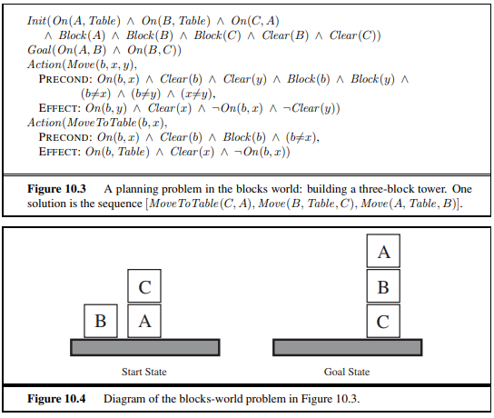

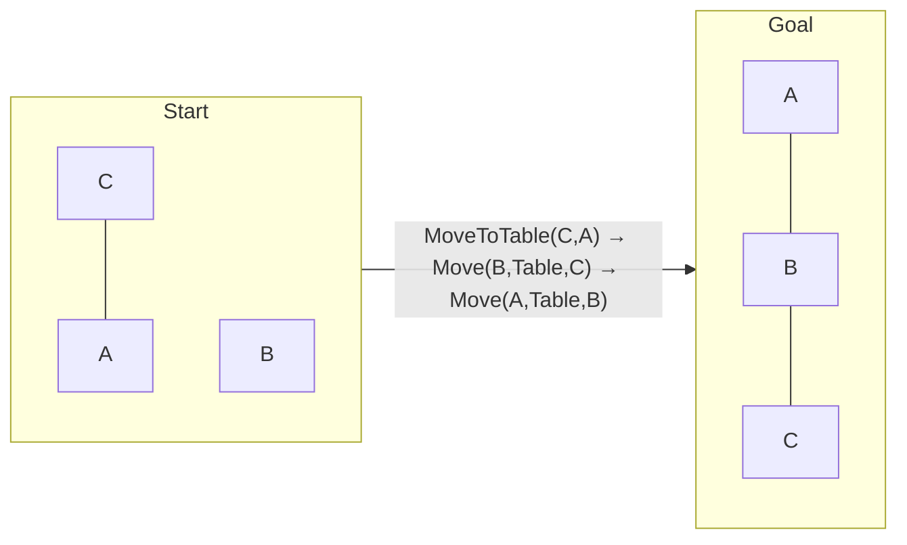

---

## 4. Algorithms for Planning as State-Space Search ★★★

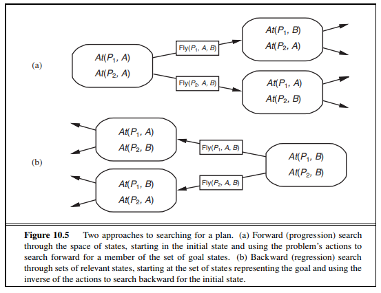

### 4.1 Forward (progression) state-space search
- Start at the **initial state**, apply applicable actions, search for a goal — any heuristic or local search algorithm can be used.
- Long believed too inefficient:
  1. **Irrelevant actions** — buying *AI: A Modern Approach* with Buy(ISBN) (effect Own(ISBN)): 10-digit ISBNs → **10 billion ground actions** to enumerate.
  2. **Huge state spaces** — air cargo with 10 airports, 5 planes each, 20 cargo items each: goal = move all cargo at A to B (simple solution: load 20 items into one plane, fly, unload). Yet each of 50 planes can fly to 9 airports and each of 200 packages can be loaded/unloaded → **450 to 10,450 actions per state**; ~2000 on average → search graph ~ **2000⁴¹** nodes.
- With strong **domain-independent heuristics** (derived automatically), forward search becomes **feasible** — most successful approach today.

### 4.2 Backward (regression) relevant-states search
- Start at the **goal** and apply actions **backward** until reaching a description satisfied by the initial state; considers only **relevant** actions (those that achieve a goal literal and don't undo any) → much lower branching.
- A goal describes a **set of states**: ¬Poor ∧ Famous — any other fluent can be anything. With n ground fluents: **2ⁿ** ground states but **3ⁿ** descriptions (each fluent positive, negative or unmentioned).
- Requires knowing how to regress (hard for n-queens) — PDDL is designed to make regression easy.
- **Regression of goal g over action a:**
$$g' = (g - \text{ADD}(a)) \cup \text{PRECOND}(a)$$
  *(effects removed — they were achieved by a; preconditions added — must hold before a).* For lifted actions, also handle variables via unification (e.g., regressing At(C₂, SFO) over Unload(C₂, p′, SFO) gives In(C₂, p′) ∧ At(p′, SFO) ∧ Cargo(C₂) ∧ Plane(p′) ∧ Airport(SFO)).
- **Relevant & consistent** actions only: an action must add a goal literal and not delete any.

| Forward (progression) | Backward (regression) |
|---|---|
| From initial state to goal | From goal to initial state |
| Considers all **applicable** actions (many irrelevant) | Considers only **relevant** actions |
| Works on concrete states | Works on **sets of states** (descriptions) |
| Easier to design good heuristics → most popular | Lower branching, but heuristics harder |

---

## 5. Heuristics for Planning ★★

- Neither direction is efficient without a good **heuristic h(s)** estimating distance to the goal. An **admissible** heuristic (never overestimates) lets **A\*** find optimal plans.
- Admissible heuristics come from **relaxed problems** (easier versions) — the exact solution cost of the relaxed problem is the heuristic.
- **Factored** representations allow **domain-independent** heuristics computed automatically (atomic states need human ingenuity).
- Two ways to relax (viewing the search space as a graph with states as nodes, actions as edges):
  1. **Add more edges** (easier to find a path):
     - **Ignore-preconditions heuristic** — every action applicable in every state; number of steps ≈ number of unsatisfied goals (a set-cover problem).
     - **Ignore-delete-lists heuristic** — remove all negative effects → monotonic progress (FF planner's h⁺).
  2. **Group nodes together** — **state abstraction** (fewer states): ignore some fluents, e.g., treat all packages identically.
- **Subgoal independence** assumption: cost of a conjunction ≈ sum (or max) of subgoal costs.

---

## 6. Planning Graphs ★★★

- All heuristics so far can be inaccurate. A **planning graph** gives **better heuristic estimates** and can be searched directly by **GRAPHPLAN**.
- A complete tree of all possible actions is **exponential**; a planning graph is a **polynomial-size approximation** that can be built quickly.
- It **can't definitively say** whether goal G is reachable, but it **estimates** how many steps it takes: if it says unreachable, that's **always correct**; it **never overestimates** the number of steps → **admissible heuristic**.
- Works only for **propositional** planning (no variables) — propositionalise action schemas first.

### 6.1 Structure
A directed graph in **levels**: **S₀** (fluents true in the initial state) → **A₀** (actions applicable in S₀) → **S₁** → **A₁** → … until two consecutive levels are identical (**levelled off**).
- **Sᵢ** contains **all literals that could hold** at time i (both P and ¬P if either could).
- **Aᵢ** contains all actions whose preconditions **could be satisfied** at time i.
- Each action in Aᵢ is linked to its **preconditions in Sᵢ** and its **effects in Sᵢ₊₁**.
- **Persistence actions (no-ops):** for every literal C, an action with precondition C and effect C — a literal persists if no action negates it.
- A literal may appear **too early** (only a restricted set of negative interactions is recorded) but **never too late** — so its first level is a good estimate of difficulty.

### 6.2 Example — Have cake and eat it too ★★★
```
Init(Have(Cake))
Goal(Have(Cake) ∧ Eaten(Cake))
Action(Eat(Cake),  PRECOND: Have(Cake)   EFFECT: ¬Have(Cake) ∧ Eaten(Cake))
Action(Bake(Cake), PRECOND: ¬Have(Cake)  EFFECT: Have(Cake))
```
| Level | Contents |
|---|---|
| **S₀** | Have(Cake), ¬Eaten(Cake) |
| **A₀** | Eat(Cake), no-op(Have), no-op(¬Eaten) |
| **S₁** | Have(Cake), ¬Have(Cake), Eaten(Cake), ¬Eaten(Cake) |
| **A₁** | Eat(Cake), Bake(Cake), no-ops |
| **S₂** | Have(Cake), ¬Have(Cake), Eaten(Cake), ¬Eaten(Cake) — goal literals appear **non-mutex** |
**Plan:** [Eat(Cake), Bake(Cake)].

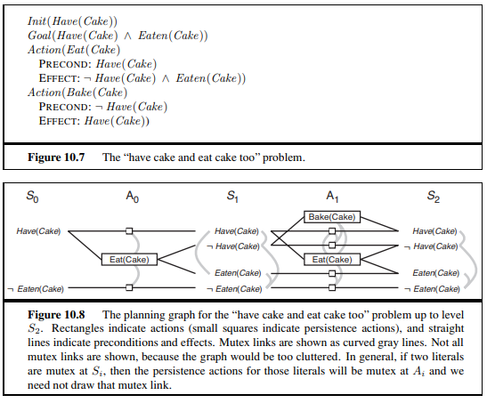

### 6.3 Mutex (mutual exclusion) relations ★★★
**Between two actions at the same level:**
| Condition | Meaning | Cake example |
|---|---|---|
| **Inconsistent effects** | One action **negates an effect** of the other | Eat(Cake) vs persistence of Have(Cake) (disagree on Have(Cake)) |
| **Interference** | An effect of one **negates a precondition** of the other | Eat(Cake) negates Have(Cake), the precondition of its persistence |
| **Competing needs** | A precondition of one is **mutex with** a precondition of the other | Bake(Cake) (needs ¬Have) vs Eat(Cake) (needs Have) |

**Between two literals at the same level:**
- One is the **negation** of the other, or
- **Inconsistent support** — every pair of actions that could achieve them is mutex (e.g., Have(Cake) and Eaten(Cake) are mutex in S₁).

### 6.4 Planning graphs for heuristic estimation
- If any goal literal **fails to appear** in the final (levelled-off) level → **problem unsolvable**.
- **Level cost** of goal gᵢ = the level at which it **first appears** (admissible for individual goals). Cake: Have(Cake) = 0, Eaten(Cake) = 1.
- For conjunctions:
  - **Max-level** = max level cost of the goals (admissible);
  - **Level sum** = sum of level costs (subgoal independence; not admissible but works well);
  - **Set-level** = level at which **all** goals appear **with no pair mutex** (admissible, dominates max-level).
- Inaccuracy: several actions may occur in one level, but the heuristic counts levels, not actions (serial planning graphs fix this).

---

## 7. The GRAPHPLAN Algorithm ★★★

Extracts a plan **directly** from the planning graph:
```
function GRAPHPLAN(problem): returns solution or failure
    graph ← INITIAL-PLANNING-GRAPH(problem)
    goals ← CONJUNCTS(problem.GOAL)
    nogoods ← empty hash table
    for tl = 0 to ∞ do
        if goals all non-mutex in S_tl of graph then
            solution ← EXTRACT-SOLUTION(graph, goals, NUMLEVELS(graph), nogoods)
            if solution ≠ failure then return solution
        if graph and nogoods have both levelled off then return failure
        graph ← EXPAND-GRAPH(graph, problem)
```
- **EXPAND-GRAPH** adds the next action level and state level.
- When all goals appear **non-mutex**, **EXTRACT-SOLUTION** searches **backward** for a plan — formulated as a **Boolean CSP** (variables = actions at each level, values = in/out of plan, constraints = mutexes + goal support) or as backward search; failing (level, goals) pairs are recorded as **nogoods**.
- If extraction fails, expand another level; terminate with failure when the graph **and** nogoods **level off**.

### 7.1 Spare-tyre trace
- **S₀:** At(Spare, Trunk), At(Flat, Axle) (+ negatives). Goal At(Spare, Axle) not present → expand.
- **A₀/S₁:** Remove(Spare, Trunk), Remove(Flat, Axle), LeaveOvernight, no-ops. Goal still absent → expand.
- **A₁/S₂:** PutOn(Spare, Axle) now possible → At(Spare, Axle) appears in S₂ non-mutex → extract.

Mutex examples at A₁/S₂:
| Mutex | Reason |
|---|---|
| Remove(Spare, Trunk) vs LeaveOvernight | **Inconsistent effects** — At(Spare, Ground) vs ¬At(Spare, Ground) |
| Remove(Flat, Axle) vs LeaveOvernight | **Interference** — precondition At(Flat, Axle) vs effect ¬At(Flat, Axle) |
| PutOn(Spare, Axle) vs Remove(Flat, Axle) | **Competing needs** — ¬At(Flat, Axle) vs At(Flat, Axle) preconditions |
| At(Spare, Axle) vs At(Flat, Axle) in S₂ | **Inconsistent support** — only achievers PutOn(Spare, Axle) and persistence of At(Flat, Axle) are mutex |

**Plan extracted:** Remove(Spare, Trunk) and Remove(Flat, Axle) at level 0 (parallel), PutOn(Spare, Axle) at level 1.

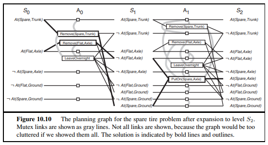

**Termination:** literals increase monotonically, actions increase monotonically, mutexes decrease monotonically, nogoods decrease monotonically → the graph must level off.

---

## 8. Other Classical Planning Approaches ★★

The most popular, effective approaches to fully automated planning: **(1)** translating to **Boolean satisfiability (SAT)**, **(2)** **forward state-space search** with crafted heuristics, **(3)** search using a **planning graph** (GRAPHPLAN). (International Planning Competition held every even year since 1998.)

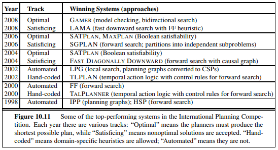

### 8.1 Classical planning as Boolean satisfiability (SATPLAN) ★★
Translate PDDL into propositional CNF for a SAT solver (for plan length T, increasing T until satisfiable):
1. **Propositionalise the actions** — replace each schema with ground actions.
2. **Define the initial state** — assert F⁰ for every fluent in the initial state and ¬F⁰ for every fluent not mentioned.
3. **Propositionalise the goal** — replace variables with disjunctions over constants: On(A, x) ∧ Block(x) with objects A, B, C → (On(A, A) ∧ Block(A)) ∨ (On(A, B) ∧ Block(B)) ∨ (On(A, C) ∧ Block(C)).
4. **Successor-state axioms** — for each fluent F:
   $$F^{t+1} \Leftrightarrow \text{ActionCausesF}^t \vee (F^t \wedge \neg\text{ActionCausesNotF}^t)$$
5. **Precondition axioms** — for each ground action A: **Aᵗ ⇒ PRE(A)ᵗ**.
6. **Action exclusion axioms** — every action is distinct from every other (at most one action per step, or only non-interfering ones).
→ Hand to **SATPLAN**; a satisfying assignment gives the plan (actions that are true).

### 8.2 Planning as first-order deduction — Situation Calculus ★★
- PDDL can't express "move **all** the cargo from A to B regardless of how many" — FOL can with ∀. Propositional planning also ties time directly to fluents (South₂ = facing south at time 2).
- **Situation calculus** replaces linear time with **branching situations**:
  - The initial state is a **situation** S₀; if s is a situation and a an action, **RESULT(s, a)** is a situation — a situation = a **history of actions**. Two situations are equal only if their start and actions are equal: (RESULT(s, a) = RESULT(s′, a′)) ⇔ (s = s′ ∧ a = a′).
  - **Fluents** vary between situations; the situation is the **last argument**: At(x, l, s) (relational fluent), Location(x, s) (functional fluent).
  - **Possibility axioms** — when an action can be taken: Φ(s) ⇒ Poss(a, s); e.g., **Alive(Agent, s) ∧ Have(Agent, Arrow, s) ⇒ Poss(Shoot, s)**.
  - **Successor-state axioms** — Poss(a, s) ⇒ (fluent true in RESULT(s, a) ⇔ a made it true ∨ (it was true before ∧ a didn't undo it)).
  - **Unique action axioms** — distinct action names denote distinct actions.

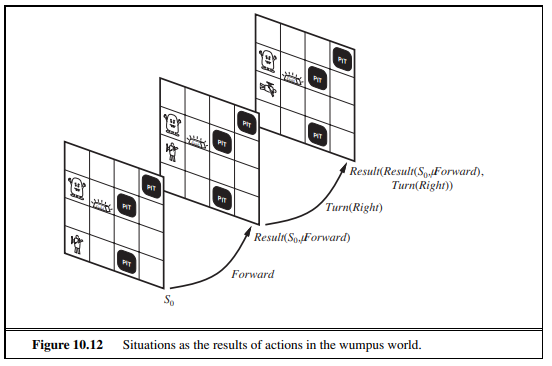

### 8.3 Planning as refinement of partially ordered plans (POP) ★★
- Previous methods build **totally ordered** (strictly linear) plans, ignoring that many subproblems are **independent** (loading 30 packages at one airport and 50 at another needn't be interleaved strictly).
- **Partial-order plan:** a set of **actions** + **ordering constraints Before(aᵢ, aⱼ)** (aᵢ ≺ aⱼ) + **causal links** (aᵢ →ᵖ aⱼ: aᵢ achieves precondition p for aⱼ) + open preconditions.
- **Least commitment:** order only when necessary. Search in **plan space**: start with an empty plan (Start, Finish) and **refine** by adding actions/links to satisfy open preconditions; resolve **threats** (an action that might delete p between aᵢ and aⱼ) by **promotion** or **demotion**.
- Any **linearisation** (topological sort) of the partial plan is a valid total-order plan.

*Spare tyre POP:* Start → {Remove(Spare, Trunk), Remove(Flat, Axle)} (unordered) → PutOn(Spare, Axle) → Finish.

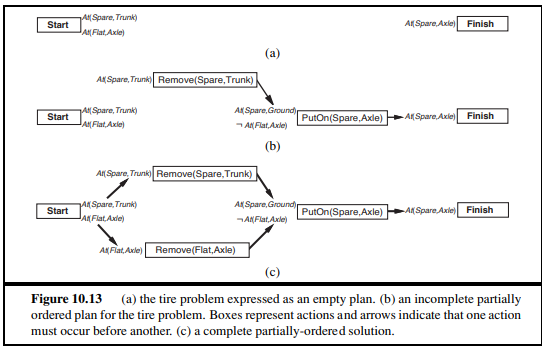

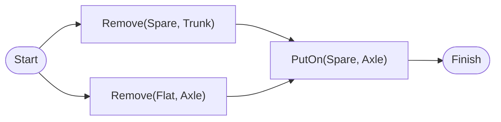

---

## 9. Analysis of Planning Approaches ★★

- Planning combines **search and logic** — a planner is a program that **searches** for a solution or one that **constructively proves** its existence. Cross-fertilisation → orders-of-magnitude speed-ups and industrial use; no clear understanding yet of which technique is best for which problem.
- Planning is foremost an exercise in **controlling combinatorial explosion**: n propositions → **2ⁿ states**; planning is **PSPACE-hard**.
- **Independent subproblems** are a powerful weapon — full **decomposability** gives an **exponential speed-up**; destroyed by **negative interactions** between actions.
  - **GRAPHPLAN** records **mutexes** to point out difficult interactions.
  - **SATPLAN** represents similar mutex relations in general **CNF** form.
  - **Forward search** heuristically finds **patterns** (subsets of propositions) covering independent subproblems — works even when not fully independent.
- **Serializable subgoals:** an order exists in which subgoals can be achieved without undoing earlier ones (e.g., blocks world: build towers bottom-up) — planning becomes efficient.

| Approach | Representation | Strength |
|---|---|---|
| Forward search + heuristics | States as fluent sets | Most effective with automatically derived heuristics (FF, LAMA) |
| Backward (regression) | State descriptions | Only relevant actions |
| GRAPHPLAN | Planning graph + mutexes | Parallel plans; good heuristics |
| SATPLAN | CNF + SAT solver | Leverages fast SAT solvers |
| Situation calculus | FOL | Expressive (∀ goals), but inference costly |
| Partial-order planning | Plan space | Least commitment; human-readable; flexible execution |

---

## 10. Hierarchical Planning ★★★

### 10.1 Motivation
- Classical planners use a **fixed set of atomic actions**; state-of-the-art planners handle **thousands** of actions.
- Human life: ~10³ muscles × ~10 activations/s × ~10⁹ s awake ≈ **10¹³ actions**; even a **two-week Hawaii vacation** at motor level ≈ **10¹⁰ actions** ≫ 1000.
- So AI must do what humans do: **plan at higher levels of abstraction**.
  - Vacation plan: "Go to SFO airport; take Hawaiian Airlines flight 11 to Honolulu; do vacation stuff for two weeks; take flight 12 back; go home."
  - "Go to SFO" is itself a planning task: "Drive to the long-term parking lot; park; take the shuttle to the terminal" — each decomposed further until **primitive** motor actions.
- Planning can happen **before and during execution** (e.g., defer the route from a parking spot to the shuttle stop until the spot is found).
- **Hierarchical decomposition** pervades complexity management: software (subroutines/classes), armies (units), governments and corporations (departments, branches). Key benefit: at each level a task reduces to a **small number of activities** at the next level → cheap to arrange; non-hierarchical methods face a huge number of individual actions.

### 10.2 High-Level Actions (HLAs) & HTN Planning ★★★
- Formalism: **Hierarchical Task Networks (HTN)**; assume full observability and determinism.
- **Primitive actions** — standard precondition/effect schemas; **no refinements**.
- **High-level action (HLA)** — e.g., "Go to San Francisco airport" = **Go(Home, SFO)**; each HLA has one or more **refinements** into a **sequence of actions** (HLAs or primitives).

```
Refinement(Go(Home, SFO),
  STEPS: [Drive(Home, SFOLongTermParking), Shuttle(SFOLongTermParking, SFO)])
Refinement(Go(Home, SFO),
  STEPS: [Taxi(Home, SFO)])

Refinement(Navigate([a, b], [x, y]),            -- recursive (vacuum world)
  PRECOND: a = x ∧ b = y   STEPS: [])
Refinement(Navigate([a, b], [x, y]),
  PRECOND: Connected([a, b], [a−1, b])   STEPS: [Left, Navigate([a−1, b], [x, y])])
```

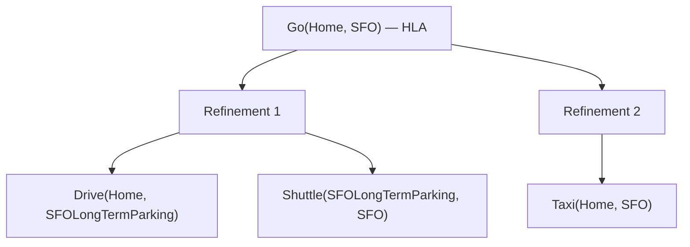

- An HLA refinement containing **only primitive actions** = an **implementation** — e.g., [Right, Right, Down] and [Down, Right, Right] both implement Navigate([1, 3], [3, 2]).
- An implementation of a **high-level plan** = concatenation of implementations of each HLA.
- A high-level plan **achieves the goal** if **at least one** of its implementations does.

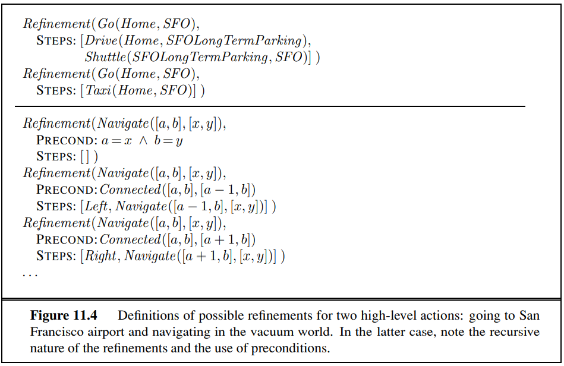

### 10.3 Searching for primitive solutions
- HTN planning often uses a single top-level action **Act**; aim: find an implementation of Act achieving the goal.
- Fully general — classical planning is a special case: for each primitive action aᵢ, a refinement of Act with steps [aᵢ, Act] (recursive), plus a refinement with **empty steps** and precondition = **goal** (to stop recursion).
- **Algorithm (breadth-first hierarchical search):** repeatedly pick an HLA in the current plan and replace it with one of its refinements, until the plan is entirely primitive and achieves the goal.
- **Computational benefit:** a non-hierarchical forward planner costs **O(bᵈ)** for d primitive actions; with a hierarchy where each HLA has r refinements of k actions, the cost is about **O(r^{(d−1)/(k−1)})** — far smaller with a small number of refinements of long length (a good **plan library**).

### 10.4 Searching for abstract solutions — angelic semantics
- Refining all the way to primitives contradicts common sense: one should know [Drive(Home, SFOLongTermParking), Shuttle(SFOLongTermParking, SFO)] gets you to the airport **without** choosing a precise route or parking spot.
- **Reachable set** REACH(s, h) = set of states reachable by **any** implementation of HLA h from s (the agent — an "angel" — chooses the implementation).
- For a sequence: REACH(s, [h₁, h₂]) = ⋃_{s′ ∈ REACH(s, h₁)} REACH(s′, h₂).
- A high-level plan achieves the goal if its reachable set **intersects** the goal set.
- **Optimistic** (over-approximate) and **pessimistic** (under-approximate) descriptions: if the pessimistic reachable set intersects the goal → plan **works**; if the optimistic set doesn't → plan **fails**; otherwise refine further.

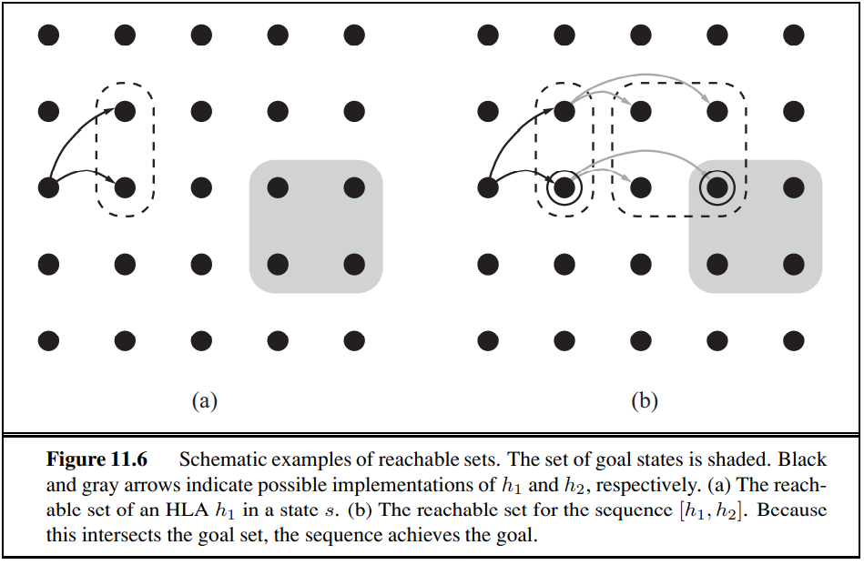

---

## Unit IV — One-Page Summary

| Topic | Key points |
|---|---|
| **Classical planning** | Find an action sequence in a deterministic, fully observable, static, discrete world; factored representation vs atomic search / ground propositional logic. |
| **PDDL** | State = conjunction of ground, functionless fluents; closed-world & unique-names assumptions. Action schema = name + params + PRECOND + EFFECT; a ∈ ACTIONS(s) ⇔ s ⊨ PRECOND(a); RESULT(s, a) = (s − DEL(a)) ∪ ADD(a). |
| **Domains** | Air cargo (Load, Unload, Fly); spare tyre (Remove, PutOn, LeaveOvernight); blocks world (On, Clear, Move, MoveToTable). |
| **Forward search** | Progression from initial state; irrelevant actions (10 billion Buy(ISBN)); air cargo ~2000⁴¹ nodes; feasible with good domain-independent heuristics. |
| **Backward search** | Regression: g′ = (g − ADD(a)) ∪ PRECOND(a); only relevant actions; 3ⁿ state descriptions. |
| **Heuristics** | Relaxed problems: ignore preconditions, ignore delete lists; state abstraction; admissible → A*. |
| **Planning graph** | Levels S₀, A₀, S₁ …; persistence (no-op) actions; mutexes — inconsistent effects, interference, competing needs; literal mutex — negation, inconsistent support. Level cost, max-level, level sum, set-level. Cake: [Eat, Bake]. |
| **GRAPHPLAN** | Expand graph until goals non-mutex → EXTRACT-SOLUTION (backward/CSP, nogoods) → else expand; fail when graph & nogoods level off. Spare tyre: Remove × 2 then PutOn. |
| **SATPLAN** | Propositionalise actions, initial state, goal; successor-state, precondition and action-exclusion axioms → SAT solver. |
| **Situation calculus** | Situations S₀, RESULT(s, a); fluents with situation argument; possibility axioms (Poss), successor-state axioms. |
| **Partial-order planning** | Actions + ordering constraints + causal links; least commitment; resolve threats by promotion/demotion. |
| **Analysis** | Combinatorial explosion (2ⁿ states, PSPACE-hard); decomposability → exponential speed-up; mutexes (GRAPHPLAN/SATPLAN); serializable subgoals. |
| **Hierarchical planning** | 10¹³ human actions → abstraction. HTN: primitive actions, HLAs with refinements, implementations; Act top-level action; O(bᵈ) vs O(r^{(d−1)/(k−1)}); angelic semantics with reachable sets (optimistic/pessimistic). |
