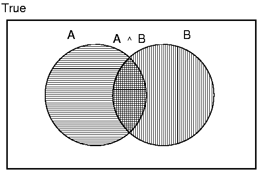
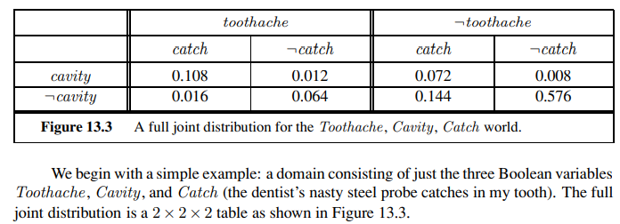
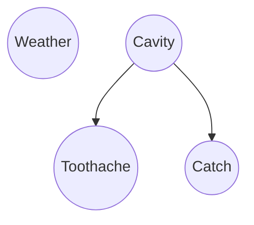
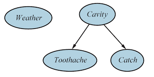
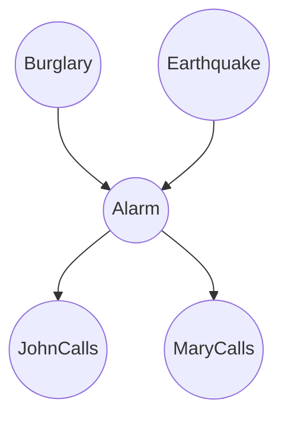
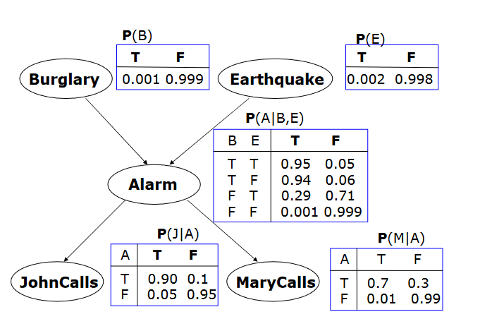

# Unit V — Probabilistic Reasoning

> **Syllabus:** Acting under uncertainty, basic probability notation, Bayes' rule and its use, probabilistic reasoning, representing knowledge in an uncertain domain.
>
> **Source:** *UNIT - V Probablistic Reasoning.pptx*, *Unit-V-AI-2024-common to all.pptx* (N. VinayKumar, SNIST) — Russell & Norvig Ch. 13 & 14.1

**Importance legend:** ★★★ = very frequently asked (long answer / numericals) · ★★ = medium · ★ = short answer

---

## Table of Contents
1. [Uncertainty in AI](#1-uncertainty-in-ai-)
2. [Acting under Uncertainty — The Airport & Dentist Examples](#2-acting-under-uncertainty-)
3. [Methods for Handling Uncertainty](#3-methods-for-handling-uncertainty-)
4. [Uncertainty & Rational Decisions — Decision Theory](#4-uncertainty-and-rational-decisions-)
5. [Basic Probability Notation](#5-basic-probability-notation-)
6. [Axioms of Probability](#6-axioms-of-probability-)
7. [Prior, Distributions & Joint Distributions](#7-prior-probability-distributions--joint-distributions-)
8. [Conditional Probability, Product & Chain Rules](#8-conditional-probability-product-rule--chain-rule-)
9. [Independence & Conditional Independence](#9-independence--conditional-independence-)
10. [Inference Using Full Joint Distributions](#10-inference-using-full-joint-distributions-)
11. [Bayes' Rule and Its Use](#11-bayes-rule-and-its-use-)
12. [Representing Knowledge in an Uncertain Domain — Bayesian Networks](#12-representing-knowledge-in-an-uncertain-domain--bayesian-networks-)
13. [The Burglary-Alarm Network](#13-the-burglary-alarm-network-)
14. [Unit V — One-Page Summary](#unit-v--one-page-summary)

---

## 1. Uncertainty in AI ★★

- **Uncertainty** = **lack of complete information** needed to reach correct conclusions and build accurate models.
- Understanding and modelling uncertainty is crucial for **informed decisions** and **robust** AI systems.
- **Sources:** partial observability, **noisy sensors**, uncertainty in **action outcomes**, immense **complexity** of modelling the world, incomplete/ambiguous knowledge.

---

## 2. Acting under Uncertainty ★★★

- Agents must handle uncertainty from **partial observability, non-determinism**, or both — they may never know for certain what state they're in or where they'll end up.
- Logical/problem-solving agents keep a **belief state** (set of all possible world states) and build **contingency plans** for every eventuality. **Drawbacks:**
  1. Belief-state representations become **impossibly large and complex**.
  2. A correct contingent plan handling every eventuality can grow **arbitrarily large** and must consider **arbitrarily unlikely** contingencies.
  3. Sometimes **no plan is guaranteed** to achieve the goal — yet the agent must act; it must **compare plans** that aren't guaranteed.

### 2.1 Airport example (plan Aₜ = leave t minutes before the flight)
- Will **A₉₀** get me there on time? Problems: partial observability (road state, other drivers' plans), noisy sensors (traffic reports), uncertain outcomes (flat tyre, car won't start), immense complexity of traffic.
- A purely logical approach either:
  - **risks falsehood** — "A₉₀ will get me there on time", or
  - leads to conclusions **too weak** for decisions — "A₉₀ will get me there on time **if** there's no accident on the bridge **and** it doesn't rain **and** my tyres remain intact **and** …" (the **qualification problem**).
- A₁₄₄₀ (leave 24 hours early) almost guarantees arrival but means an intolerable wait at the airport.
- The **rational decision** depends on both the **relative importance** of goals and the **likelihood** of achieving them.

### 2.2 Dentist (diagnosis) example ★★★
- Rule **Toothache ⇒ Cavity** is **wrong** — toothaches may come from gum disease, abscess, …
- Toothache ⇒ Cavity ∨ GumProblem ∨ Abscess ∨ … needs an almost **unlimited list**.
- Causal rule **Cavity ⇒ Toothache** is also wrong — not all cavities cause pain.

**Logic fails for medical diagnosis for three reasons:**
| Reason | Meaning |
|---|---|
| **Laziness** | Too much work to list the complete set of antecedents/consequents for an exceptionless rule |
| **Theoretical ignorance** | Medical science has **no complete theory** of the domain |
| **Practical ignorance** | Even with all rules, we may be uncertain about a **particular patient** (not all tests run) |

**Probability** summarises the uncertainty from **laziness and ignorance**, solving the qualification problem: "there is an **80 % chance** (probability 0.8) that a patient with a toothache has a cavity" — i.e., in 80 % of situations indistinguishable from the current one given our knowledge, the patient has a cavity. Derived from **statistics**, general knowledge or both; e.g., P(cavity | toothache, gum-disease history) = 0.4.

---

## 3. Methods for Handling Uncertainty ★★★

| # | Method | Idea | Issues |
|---|---|---|---|
| 1 | **Default / non-monotonic logic** (Reiter 1980) | Assume normal conditions unless contradicted: "assume my car doesn't have a flat tyre", "assume A₁₂₅ works" | Which assumptions are reasonable? How to handle contradiction? (Conclusions can be **retracted** — defeasible inference) |
| 2 | **Rules with fudge factors** (certainty factors) | Sprinkler ↦₀.₉₉ WetGrass; WetGrass ↦₀.₇ Rain | Problems combining rules — does Sprinkler then "cause" Rain? |
| 3 | **Probability** ✓ | Given the evidence, A₉₀ gets me there on time with probability 0.95 | Needs probability values; computation can be costly (handled by Bayes nets) |
| 4 | **Fuzzy logic** | Handles **degree of truth**, not uncertainty: WetGrass is true to degree 0.2 | Not a model of uncertainty |

> **Probability** = chance of involvement; **fuzziness** = grade/level of involvement.

### 3.1 Subjective (Bayesian) probability
- Probabilistic assertions summarise effects of **ignorance** (lack of facts, initial conditions) and **laziness** (failure to enumerate exceptions).
- **Subjective/Bayesian** probabilities relate propositions to the agent's **own state of knowledge** — P(A₉₀ succeeds | no reported accidents) = 0.97. They are **degrees of belief**, not assertions about the world.
- Probabilities **change with new evidence**: P(A₉₀ | no reported accidents, 5 a.m.) = 0.99 — analogous to the entailment status KB ⊨ α (not truth).

---

## 4. Uncertainty and Rational Decisions ★★★

Suppose:
| Plan | P(on time \| …) |
|---|---|
| A₃₀ | 0.05 |
| A₆₀ | 0.70 |
| A₉₀ | 0.97 |
| A₁₀₀ | 0.95 (slide values may vary) |
| A₁₈₀ | higher |
| A₁₄₄₀ | 0.9999 |

Which to choose? Depends on **preferences** — missing the flight vs airport cuisine/waiting.

- An **outcome** = a completely specified state (on time? length of wait?).
- **Utility theory** — every state has a degree of **usefulness (utility)** to an agent; the agent prefers states with **higher utility**. Utility is **relative to the agent** (checkmate is high utility for White, low for Black).
- **Decision theory = probability theory + utility theory**.
- **Principle of Maximum Expected Utility (MEU):** a rational agent chooses the action that yields the **highest expected utility**, averaged over all possible outcomes.

```
function DT-AGENT(percept): returns an action
    persistent: belief_state, action
    update belief_state based on action and percept
    calculate outcome probabilities for actions, given action descriptions and current belief_state
    select action with highest expected utility given probabilities of outcomes and utility information
    return action
```

---

## 5. Basic Probability Notation ★★★

- Probabilistic assertions are about **possible worlds** — logic says which worlds are **ruled out**; probability says **how probable** each world is.
- **Sample space Ω** = set of all possible worlds — **mutually exclusive and exhaustive**; ω = a particular world.
  *Two distinguishable dice:* 36 worlds (1,1), (1,2), …, (6,6).
- A **probability model** assigns P(ω) to each world:
$$0 \le P(\omega) \le 1 \quad\text{for every } \omega, \qquad \sum_{\omega \in \Omega} P(\omega) = 1$$
- **Event / proposition** φ = a set of worlds: $P(\phi) = \sum_{\omega \in \phi} P(\omega)$.
  *Fair dice:* each world 1/36; **P(Total = 11) = P((5,6)) + P((6,5)) = 1/36 + 1/36 = 1/18**.
- **Unconditional (prior) probability** P(A) — degree of belief **without other information**: P(Male) = 0.5 (50 % chance); with more information (person is a CS151 student) the **posterior** may differ.

### 5.1 Random variables
- Names begin with **uppercase**; values are **lowercase**.
- **Boolean random variables:** Cavity (do I have a cavity?) — cavity / ¬cavity.
- **Multivalued (discrete):** Weather ∈ ⟨sunny, rain, cloudy, snow⟩ — values **exhaustive and mutually exclusive**.
- **Continuous:** Temperature, with probability density functions.
- **Propositions:** Weather = sunny; Cavity = true (written cavity); combined with logical connectives: Burglary ∨ Earthquake, cavity ∧ ¬toothache.

---

## 6. Axioms of Probability ★★★

For any propositions A, B (Kolmogorov's axioms):
1. **0 ≤ P(A) ≤ 1**
2. **P(True) = 1** and **P(False) = 0**
3. **P(A ∨ B) = P(A) + P(B) − P(A ∧ B)** — the **inclusion–exclusion principle**



Derived: **P(¬A) = 1 − P(A)**.

**de Finetti (1931):** an agent who bets according to probabilities that **violate these axioms** can be forced to **lose money regardless of the outcome** (Dutch book argument) → rational beliefs must obey the axioms.

---

## 7. Prior Probability, Distributions & Joint Distributions ★★★

- **Prior (unconditional) probabilities** — belief before any new evidence: P(Cavity = true) = P(cavity) = **0.1**; P(Weather = sunny) = **0.72**.
- **Probability distribution** — probabilities of **all values** of a variable:
  **P(Weather) = ⟨0.72, 0.1, 0.08, 0.1⟩** (normalised — sums to 1). Bold **P** denotes a vector of numbers.
- **Joint probability distribution** — values for every combination of values of a set of variables: **P(Weather, Cavity)** is a 4 × 2 table.
- **Full joint distribution** — joint distribution over **all** variables — a complete probability model.

**P(Toothache, Cavity):**
| | toothache | ¬toothache |
|---|---|---|
| **cavity** | 0.04 | 0.06 |
| **¬cavity** | 0.01 | 0.89 |
Elements sum to 1 → **3 independent numbers**.

---

## 8. Conditional Probability, Product Rule & Chain Rule ★★★

### 8.1 Conditional (posterior) probability
$$P(A \mid B) = \frac{P(A \wedge B)}{P(B)} \quad \text{if } P(B) > 0$$
"Our universe has **shrunk** to the one in which B is true."

*Example:* P(Cavity | Toothache) = 0.04 / (0.04 + 0.01) = **0.8**.

### 8.2 Product rule
$$P(A \wedge B) = P(A \mid B)\,P(B) = P(B \mid A)\,P(A)$$
*Example:* P(Male) = 0.5, P(CS151Student) = 0.0037, P(Male | CS151Student) = 0.9 → P(Male ∧ CS151Student) = 0.9 × 0.0037 = **0.0033**.

For distributions: **P(Weather, Cavity) = P(Weather | Cavity) P(Cavity)** — a set of 4 × 2 equations (pointwise product), not matrix multiplication.

### 8.3 More evidence
- P(cavity | toothache) = 0.8; with the dental probe catching: P(cavity | toothache, catch) = 0.9 (say); with cavity given: P(cavity | toothache, cavity) = 1.
- The less specific belief remains **valid** but may not be **useful**.
- **Irrelevant evidence** simplifies: P(cavity | toothache, RealMadridWins) = P(cavity | toothache) = 0.8 (cavities and football are independent).

### 8.4 Chain rule
By repeated application of the product rule:
$$P(X_1, \dots, X_n) = P(X_n \mid X_{n-1}, \dots, X_1)\,P(X_{n-1}, \dots, X_1) = \prod_{i=1}^{n} P(X_i \mid X_{i-1}, \dots, X_1)$$
In a Bayesian network this simplifies to $\prod_{i=1}^{n} P(X_i \mid \text{Parents}(X_i))$.
*(The slide writes the product to n − 1; the product runs over all n variables — the last factor is the prior of the first variable.)*

---

## 9. Independence & Conditional Independence ★★★

### 9.1 Independence
X and Y are **independent** iff
$$P(X \mid Y) = P(X) \quad\Leftrightarrow\quad P(Y \mid X) = P(Y) \quad\Leftrightarrow\quad P(X, Y) = P(X)\,P(Y)$$

**Weather and Cavity** are independent: P(Weather) = ⟨0.72, 0.1, 0.08, 0.1⟩, P(Cavity) = 0.1:

| | sunny | rain | cloudy | snow | marginal |
|---|---|---|---|---|---|
| **cavity** | .072 | .01 | .008 | .01 | **.1** |
| **¬cavity** | .648 | .09 | .072 | .09 | **.9** |
| **marginal** | **.72** | **.1** | **.08** | **.1** | 1 |

Each entry = product of the marginals → instead of **7** independent numbers (8 − 1), store only **4** (3 for Weather + 1 for Cavity). Independence **factors** large joint distributions into smaller ones — a huge saving.

### 9.2 Conditional independence
X and Y are **conditionally independent given Z** iff P(X, Y | Z) = P(X | Z) P(Y | Z).
*Example:* **Toothache and Catch are conditionally independent given Cavity** — both are caused by the cavity, but neither directly affects the other:
P(Toothache, Catch | Cavity) = P(Toothache | Cavity) P(Catch | Cavity).
→ P(Toothache, Catch, Cavity) = P(Toothache | Cavity) P(Catch | Cavity) P(Cavity) — **2 + 2 + 1 = 5** numbers instead of 7.
Conditional independence is the **basic and most robust** form of knowledge about uncertain environments (naïve Bayes models).

---

## 10. Inference Using Full Joint Distributions ★★★

**Probabilistic inference** = computing **posterior probabilities** of query propositions given observed evidence, using the **full joint distribution** as the "knowledge base".

**Full joint distribution for Toothache, Catch, Cavity:**
| | toothache, catch | toothache, ¬catch | ¬toothache, catch | ¬toothache, ¬catch |
|---|---|---|---|---|
| **cavity** | 0.108 | 0.012 | 0.072 | 0.008 |
| **¬cavity** | 0.016 | 0.064 | 0.144 | 0.576 |



| Query | Computation | Result |
|---|---|---|
| **P(cavity ∨ toothache)** | Sum of the 6 worlds where it holds: 0.108 + 0.012 + 0.072 + 0.008 + 0.016 + 0.064 | **0.28** |
| **Marginal P(cavity)** (marginalisation / summing out) | 0.108 + 0.012 + 0.072 + 0.008 | **0.2** |
| **P(toothache)** | 0.108 + 0.012 + 0.016 + 0.064 | **0.2** |
| **P(cavity \| toothache)** | P(cavity ∧ toothache)/P(toothache) = (0.108 + 0.012)/0.2 | **0.6** |
| **P(¬cavity \| toothache)** | (0.016 + 0.064)/0.2 | **0.4** |

- **Marginalisation:** $P(Y) = \sum_{z} P(Y, z)$; **conditioning:** $P(Y) = \sum_z P(Y \mid z) P(z)$.
- **Normalisation:** P(Cavity | toothache) = **α P(Cavity, toothache)** = α[⟨0.108, 0.016⟩ + ⟨0.012, 0.064⟩] = α⟨0.12, 0.08⟩ = **⟨0.6, 0.4⟩** (α = 1/P(toothache) makes the result sum to 1).
- **General inference:** P(X | e) = α P(X, e) = α Σ_y P(X, e, y) (y = hidden variables).
- **Problem:** with n Boolean variables the table has **2ⁿ** entries → **O(2ⁿ)** time and space → impractical → use **independence** and **Bayesian networks**.

---

## 11. Bayes' Rule and Its Use ★★★

From the product rule P(a ∧ b) = P(a | b)P(b) = P(b | a)P(a), dividing by P(a):
$$P(b \mid a) = \frac{P(a \mid b)\,P(b)}{P(a)}$$
This **Bayes' rule (law, theorem)** underlies most modern AI systems for probabilistic inference.

**Why useful?** We often know **causal** probabilities and want **diagnostic** ones:
$$P(\text{cause} \mid \text{effect}) = \frac{P(\text{effect} \mid \text{cause})\,P(\text{cause})}{P(\text{effect})}$$
Causal knowledge P(effect | cause) is more **robust** (doesn't change in an epidemic), while diagnostic knowledge P(cause | effect) does. *Examples of cause → effect:* cavities → toothaches; sleeping late → missing class; meningitis → stiff neck.

### 11.1 Example — Meningitis ★★★
M = meningitis, S = stiff neck: P(M) = 1/50000 = 0.00002 (slide uses 0.0001), P(S) = 0.1 (slide) / 0.01 (textbook), P(S | M) = 0.8 (slide) / 0.7 (textbook).

**Slide values:**
$$P(M \mid S) = \frac{P(S \mid M)P(M)}{P(S)} = \frac{0.8 \times 0.0001}{0.1} = \mathbf{0.0008}$$
**Textbook values:** P(m | s) = 0.7 × (1/50000) / 0.01 = **0.0014**.
→ Even with a stiff neck, the **posterior probability of meningitis is still very small** (1 in ~700–1250), because the prior is tiny.

### 11.2 Normalised form & combining evidence
- **P(Y | X) = α P(X | Y) P(Y)** — avoids computing P(X) directly.
- Multiple evidence with conditional independence (**naïve Bayes**):
$$P(\text{Cause} \mid e_1, \dots, e_n) = \alpha\, P(\text{Cause}) \prod_i P(e_i \mid \text{Cause})$$
  *Example:* P(Cavity | toothache ∧ catch) = α P(toothache | Cavity) P(catch | Cavity) P(Cavity).

---

## 12. Representing Knowledge in an Uncertain Domain — Bayesian Networks ★★★

A **Bayesian network** (Bayes net; formerly **belief network**, probabilistic network, causal network) is a **data structure** representing **dependencies** among variables — a concise representation of **any full joint distribution**.

**Specification:**
1. Each **node** = a **random variable** (discrete or continuous).
2. **Directed links (arrows)** connect pairs of nodes; an arrow **X → Y** means X is a **parent** of Y (X has a **direct influence** on Y). The graph has **no directed cycles** → **DAG**.
3. Each node Xᵢ has a **conditional probability distribution P(Xᵢ | Parents(Xᵢ))** quantifying the effect of the parents (a **CPT** for discrete variables).

- The **topology** (nodes and links) specifies the **conditional independence** relationships; arrows usually go from **causes to effects**. Usually easy for a domain expert to decide which direct influences exist — much easier than specifying probabilities.

### 12.1 Simple example — the dentist world

- **Weather** is independent of the other variables (no links).
- **Toothache** and **Catch** are **conditionally independent given Cavity** (no link between them).
- **Cavity** is the direct cause of both; no direct causal link between Toothache and Catch.



### 12.2 Semantics — joint distribution
A Bayes net with variables X₁ … Xₙ represents the full joint distribution:
$$P(x_1, \dots, x_n) = \prod_{i=1}^{n} P(x_i \mid \text{parents}(X_i))$$
→ Compact: a node with k Boolean parents needs **2ᵏ** numbers; n nodes with ≤ k parents need **n·2ᵏ** numbers instead of **2ⁿ** (e.g., n = 30, k = 5: 960 vs ~10⁹).

---

## 13. The Burglary-Alarm Network ★★★

**Problem (Judea Pearl):** your house has a burglar **alarm**, which can also be set off occasionally by **earthquakes** (you live in a seismically active area). Two neighbours, **John** and **Mary**, who don't know each other, promised to call you when they hear the alarm. John **nearly always** calls when he hears it but sometimes confuses the **telephone** with the alarm; Mary likes **loud music** and often **misses** the alarm. Given who has or hasn't called, estimate the probability of a **burglary**.



**CPTs:**
| P(B) | P(E) |
|---|---|
| 0.001 | 0.002 |

| B | E | P(A \| B, E) |
|---|---|---|
| T | T | 0.95 |
| T | F | 0.94 |
| F | T | 0.29 |
| F | F | 0.001 |

| A | P(J \| A) | | A | P(M \| A) |
|---|---|---|---|---|
| T | 0.90 | | T | 0.70 |
| F | 0.05 | | F | 0.01 |



- **CPT rows** give the conditional probability of each node value for each **conditioning case** (combination of parent values); each row sums to 1 (only P(true) is listed for Boolean variables).
- The network doesn't model *why* John/Mary miss the alarm (loud music, phone) — those factors are **summarised** in the uncertainty of the links (laziness & ignorance).
- Total: 1 + 1 + 4 + 2 + 2 = **10 numbers** vs 2⁵ − 1 = **31** for the full joint.

### 13.1 Computing a joint entry ★★★
**Probability that the alarm sounded, but neither a burglary nor an earthquake occurred, and both John and Mary call:**
$$P(j, m, a, \neg b, \neg e) = P(j \mid a)\,P(m \mid a)\,P(a \mid \neg b, \neg e)\,P(\neg b)\,P(\neg e)$$
$$= 0.90 \times 0.70 \times 0.001 \times 0.999 \times 0.998 = \mathbf{0.000628}$$

*(Inference such as P(Burglary | JohnCalls = true, MaryCalls = true) ≈ **0.284** is covered in Unit VI.)*

---

## Unit V — One-Page Summary

| Topic | Key points |
|---|---|
| **Uncertainty** | Lack of complete information: partial observability, noisy sensors, uncertain outcomes, complexity. |
| **Acting under uncertainty** | Belief states & contingency plans grow too large; no guaranteed plan. Airport A₉₀ — qualification problem; dentist — Toothache ⇒ Cavity is wrong. Logic fails due to **laziness, theoretical ignorance, practical ignorance**. |
| **Methods** | Default/non-monotonic logic · fudge-factor rules · **probability** · fuzzy logic (degree of truth, not uncertainty). Subjective/Bayesian probability = degree of belief, changes with evidence. |
| **Rational decisions** | Utility theory + probability = **decision theory**; MEU principle; DT-AGENT. |
| **Notation** | Sample space Ω (36 dice worlds); P(ω) ∈ [0,1], Σ = 1; P(Total = 11) = 1/18. Random variables (Boolean, discrete, continuous); propositions. |
| **Axioms** | 0 ≤ P(A) ≤ 1; P(True) = 1, P(False) = 0; P(A∨B) = P(A) + P(B) − P(A∧B); de Finetti Dutch book. |
| **Distributions** | Prior P(cavity) = 0.1; P(Weather) = ⟨0.72, 0.1, 0.08, 0.1⟩; joint P(Toothache, Cavity) table; full joint = complete model. |
| **Conditional** | P(A\|B) = P(A∧B)/P(B); P(cavity\|toothache) = 0.04/0.05 = 0.8; product rule; chain rule P(x₁…xₙ) = ΠP(xᵢ\|xᵢ₋₁…x₁). |
| **Independence** | P(X,Y) = P(X)P(Y) — Weather ⊥ Cavity (7 → 4 numbers). Conditional independence: Toothache ⊥ Catch \| Cavity (7 → 5). |
| **Full-joint inference** | P(cavity ∨ toothache) = 0.28; P(cavity) = 0.2; P(cavity\|toothache) = 0.6; normalisation α; O(2ⁿ) problem. |
| **Bayes' rule** | P(b\|a) = P(a\|b)P(b)/P(a); diagnostic from causal; meningitis P(M\|S) = 0.8 × 0.0001/0.1 = 0.0008 (textbook 0.0014); naïve Bayes α P(C)ΠP(eᵢ\|C). |
| **Bayesian network** | DAG of random variables; arrows = direct influence (parent → child); CPT P(Xᵢ\|Parents(Xᵢ)); P(x₁…xₙ) = ΠP(xᵢ\|parents); compact (n·2ᵏ vs 2ⁿ). |
| **Burglary network** | B, E → A → J, M; P(B) = .001, P(E) = .002, P(A\|B,E) = .95/.94/.29/.001, P(J\|A) = .90/.05, P(M\|A) = .70/.01; P(j,m,a,¬b,¬e) = 0.000628. |
