# Unit VI — Bayesian Networks

> **Syllabus:** The semantics of Bayesian networks, efficient representation of conditional distributions, (exact and) approximate inference in Bayesian networks, relational and first-order probability (+ other approaches to uncertain reasoning).
>
> **Source:** *Unit VI (1).pptx*, *UNIT-VI-AI-2018- Common to all.ppt* (N. Vinay Kumar, SNIST) — Russell & Norvig Ch. 14

**Importance legend:** ★★★ = very frequently asked (long answer / numericals) · ★★ = medium · ★ = short answer

---

## Table of Contents
1. [Bayesian Networks — Recap of Syntax](#1-bayesian-networks--syntax-recap-)
2. [The Semantics of Bayesian Networks](#2-the-semantics-of-bayesian-networks-)
3. [Compactness](#3-compactness-)
4. [Conditional Independence — Markov Blanket](#4-conditional-independence-relations-)
5. [Constructing Bayesian Networks — Node Ordering](#5-constructing-bayesian-networks-)
6. [Efficient Representation of Conditional Distributions](#6-efficient-representation-of-conditional-distributions-)
7. [Exact Inference — Enumeration & Variable Elimination](#7-exact-inference-in-bayesian-networks-)
8. [Approximate Inference — Sampling](#8-approximate-inference-in-bayesian-networks-)
9. [Relational & First-Order Probability Models](#9-relational-and-first-order-probability-models-)
10. [Other Approaches to Uncertain Reasoning](#10-other-approaches-to-uncertain-reasoning-)
11. [Unit VI — One-Page Summary](#unit-vi--one-page-summary)

---

## 1. Bayesian Networks — Syntax Recap ★★

A **Bayesian network** is a simple graphical notation for **conditional independence assertions**, and hence for a **compact specification of full joint distributions**.
- **Syntax:**
  - a set of **nodes**, one per random variable;
  - a **directed acyclic graph** (link ≈ "**directly influences**");
  - a **conditional distribution** for each node given its parents, **P(Xᵢ | Parents(Xᵢ))** — in the simplest case a **conditional probability table (CPT)** giving the distribution over Xᵢ for each combination of parent values.

**Burglary network** — "I'm at work, neighbour John calls to say my alarm is ringing, but neighbour Mary doesn't call. Sometimes it's set off by minor earthquakes. Is there a burglar?" Variables: Burglary, Earthquake, Alarm, JohnCalls, MaryCalls. Topology reflects **causal** knowledge: a burglar or an earthquake can set off the alarm; the alarm can cause John or Mary to call.

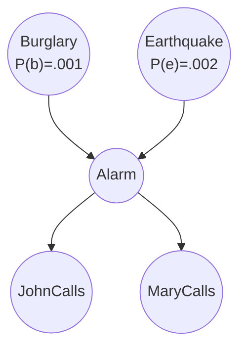

| B | E | P(A \| B, E) |
|---|---|---|
| T | T | .95 |
| T | F | .94 |
| F | T | .29 |
| F | F | .001 |

| A | P(J \| A) | P(M \| A) |
|---|---|---|
| T | .90 | .70 |
| F | .05 | .01 |

---

## 2. The Semantics of Bayesian Networks ★★★

Two equivalent ways to understand what a network **means**:
1. As a **representation of the joint probability distribution** — helpful for **constructing** networks.
2. As an **encoding of conditional independence statements** — helpful for **designing inference** procedures.

### 2.1 Global semantics — representing the full joint distribution
The full joint distribution is the **product of the local conditional distributions**:
$$P(x_1, \dots, x_n) = \prod_{i=1}^{n} P(x_i \mid \text{parents}(X_i))$$

**Example:** P(j ∧ m ∧ a ∧ ¬b ∧ ¬e) = P(j | a) P(m | a) P(a | ¬b, ¬e) P(¬b) P(¬e)
= 0.9 × 0.7 × 0.001 × 0.999 × 0.998 ≈ **0.00063**.

Each CPT entry is therefore exactly the conditional probability P(xᵢ | parents(Xᵢ)) implied by the joint distribution.

---

## 3. Compactness ★★★

- A CPT for a Boolean Xᵢ with **k Boolean parents** has **2ᵏ rows**; each row needs one number p (for Xᵢ = true; false is 1 − p).
- If each variable has **≤ k parents**, the network needs **O(n · 2ᵏ)** numbers — **linear in n**, versus **O(2ⁿ)** for the full joint distribution.
- **Burglary net:** 1 + 1 + 4 + 2 + 2 = **10** numbers vs 2⁵ − 1 = **31**.
- Compactness comes from **locally structured (sparse)** systems — each component interacts directly with a bounded number of others.

---

## 4. Conditional Independence Relations ★★★

**Local semantics:** each node is **conditionally independent of its non-descendants given its parents**.
*E.g.,* JohnCalls is independent of Burglary, Earthquake and MaryCalls given Alarm.

**Markov blanket theorem:** each node is **conditionally independent of all other nodes given its Markov blanket** = **parents + children + children's parents**.

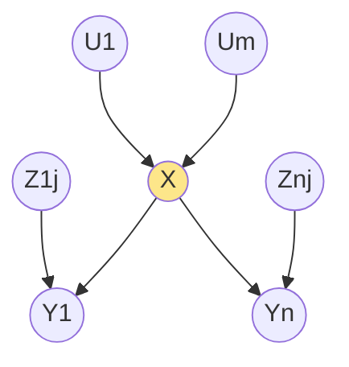
*Markov blanket of X = {U₁…Uₘ (parents), Y₁…Yₙ (children), Z₁ⱼ…Zₙⱼ (children's other parents)}.*

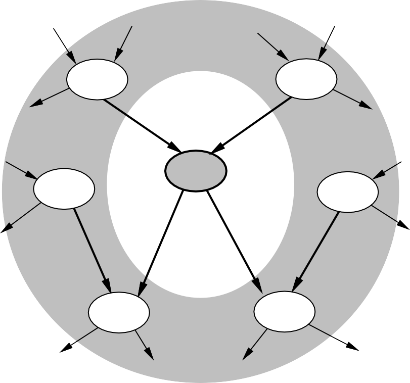

---

## 5. Constructing Bayesian Networks ★★★

Need a method where a series of **locally testable** conditional-independence assertions guarantees the global semantics:
1. Choose an **ordering** of variables X₁, …, Xₙ.
2. For i = 1 to n:
   - add Xᵢ to the network;
   - select parents from X₁ … Xᵢ₋₁ such that **P(Xᵢ | Parents(Xᵢ)) = P(Xᵢ | X₁, …, Xᵢ₋₁)**.

This guarantees the global semantics:
$$P(X_1, \dots, X_n) = \prod_{i=1}^{n} P(X_i \mid X_1, \dots, X_{i-1}) \;(\text{chain rule}) = \prod_{i=1}^{n} P(X_i \mid \text{Parents}(X_i)) \;(\text{by construction})$$

Best results when variables are ordered **causes first** ("root causes" first, then the variables they influence) — the network is then **compact**.

### 5.1 Example — bad ordering M, J, A, B, E ★★★
| Step | Question | Answer | Parents chosen |
|---|---|---|---|
| Add **J** | P(J \| M) = P(J)? | **No** (Mary calling makes the alarm and hence John calling more likely) | M |
| Add **A** | P(A \| J, M) = P(A \| J)? P(A \| J, M) = P(A)? | **No, No** | J, M |
| Add **B** | P(B \| A, J, M) = P(B \| A)? | **Yes** | A |
| | P(B \| A, J, M) = P(B)? | No | |
| Add **E** | P(E \| B, A, J, M) = P(E \| A)? | **No** | |
| | P(E \| B, A, J, M) = P(E \| A, B)? | **Yes** | A, B |

Resulting network needs **1 + 2 + 4 + 2 + 4 = 13** numbers vs **10** for the causal ordering. Deciding conditional independence is **hard in non-causal directions** (assessing P(E | A, B) is unnatural).
With ordering **M, J, E, B, A** the network is fully connected and needs **2⁵ − 1 = 31** numbers — **no better than the full joint**.

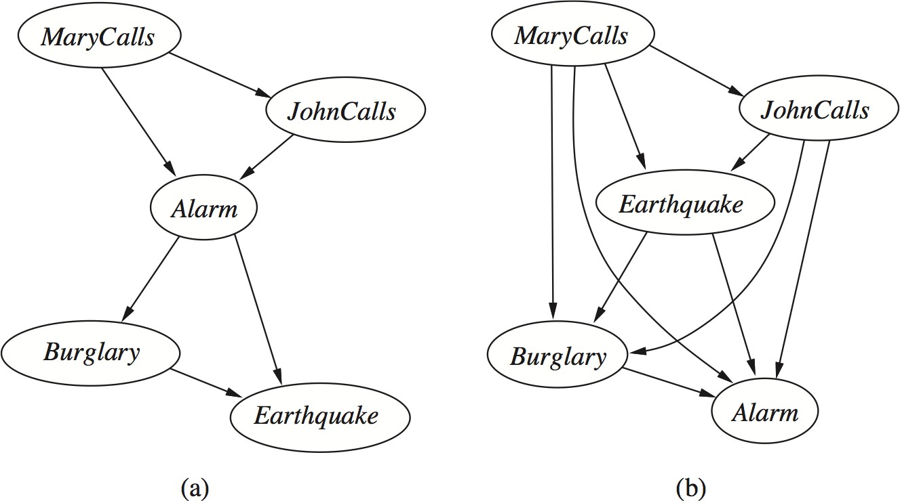

> **The chosen ordering of variables can have a big impact on the size of the network.**

---

## 6. Efficient Representation of Conditional Distributions ★★★

Filling a CPT needs up to **O(2ᵏ)** numbers and experience with all conditioning cases — worst case when the relationship is arbitrary. Usually relationships fit a **canonical distribution** (a standard pattern) specified by a few parameters.

### 6.1 Deterministic nodes
Value specified **exactly** by its parents' values (no uncertainty):
- Logical: NorthAmerican ⇔ Canadian ∨ US ∨ Mexican.
- Numerical: BestPrice = min(prices of dealers); water level = inflows − outflows.

### 6.2 Noisy-OR ★★★
Generalises logical OR (Fever ⇔ Cold ∨ Flu ∨ Malaria) to allow **uncertainty** about each parent's ability to cause the child — the causal link may be **inhibited** (a patient with a cold might not have a fever).

**Assumptions:**
1. **All possible causes are listed** (if not, add a **leak node** for "miscellaneous causes").
2. **Inhibition of each parent is independent** of the inhibition of others.

Then Fever is **false iff all its true parents are inhibited**:
$$P(x_i \mid \text{parents}(X_i)) = 1 - \prod_{\{j: X_j = \text{true}\}} q_j$$

**Inhibition probabilities:** q_cold = P(¬fever | cold, ¬flu, ¬malaria) = **0.6**; q_flu = **0.2**; q_malaria = **0.1**.

| Cold | Flu | Malaria | P(fever) | P(¬fever) |
|---|---|---|---|---|
| F | F | F | 0.0 | 1.0 |
| F | F | T | 0.9 | **0.1** |
| F | T | F | 0.8 | **0.2** |
| F | T | T | 0.98 | 0.02 = 0.2 × 0.1 |
| T | F | F | 0.4 | **0.6** |
| T | F | T | 0.94 | 0.06 = 0.6 × 0.1 |
| T | T | F | 0.88 | 0.12 = 0.6 × 0.2 |
| T | T | T | 0.988 | 0.012 = 0.6 × 0.2 × 0.1 |

→ A variable with k parents needs only **O(k)** parameters instead of O(2ᵏ).

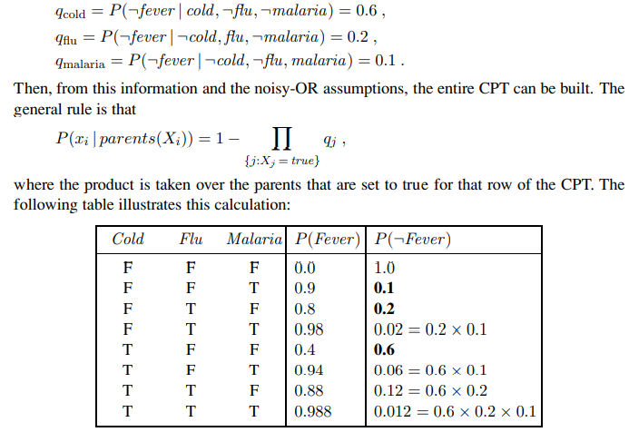

### 6.3 Bayesian nets with continuous variables
- Continuous quantities (height, mass, temperature, money) have infinitely many values → can't list CPT entries.
- Options: **discretisation** into intervals (loses accuracy, large CPTs); or **parametric** families — e.g., **linear Gaussian** P(Cost | Harvest = h) = N(aₜh + bₜ, σₜ²); **hybrid networks** with discrete + continuous variables; **probit / logit (sigmoid)** distributions for a discrete child of continuous parents (e.g., Buys given Cost).

---

## 7. Exact Inference in Bayesian Networks ★★★

### 7.1 Inference tasks
- **Simple queries:** posterior marginal **P(Xᵢ | E = e)** — e.g., P(Burglary | JohnCalls = true, MaryCalls = true) = **P(B | j, m)**.
- **Conjunctive queries:** P(Xᵢ, Xⱼ | E = e) = P(Xᵢ | E = e) P(Xⱼ | Xᵢ, E = e).
- **Optimal decisions:** decision networks with utilities need P(outcome | action, evidence).
- **Value of information:** which evidence to seek next?
- **Sensitivity analysis:** which probability values are most critical?
- **Explanation:** why do I need a new starter motor?

### 7.2 Inference by enumeration ★★★
Sum out hidden variables from the joint **without constructing it explicitly**:
$$P(B \mid j, m) = \frac{P(B, j, m)}{P(j, m)} = \alpha\, P(B, j, m) = \alpha \sum_e \sum_a P(B, e, a, j, m)$$
(e and a are **hidden variables**). Rewriting with CPT entries:
$$P(B \mid j, m) = \alpha \sum_e \sum_a P(B)\,P(e)\,P(a \mid B, e)\,P(j \mid a)\,P(m \mid a) = \alpha\, P(B) \sum_e P(e) \sum_a P(a \mid B, e)\,P(j \mid a)\,P(m \mid a)$$

**Worked computation:** P(j | a)P(m | a) = 0.9 × 0.7 = **0.63**; P(j | ¬a)P(m | ¬a) = 0.05 × 0.01 = **0.0005**.

For **b**:
- e: 0.95 × 0.63 + 0.05 × 0.0005 = 0.598525
- ¬e: 0.94 × 0.63 + 0.06 × 0.0005 = 0.59223
- Σₑ = 0.002 × 0.598525 + 0.998 × 0.59223 = 0.592243 → × P(b) = 0.001 → **0.00059224**

For **¬b**:
- e: 0.29 × 0.63 + 0.71 × 0.0005 = 0.183055
- ¬e: 0.001 × 0.63 + 0.999 × 0.0005 = 0.0011295
- Σₑ = 0.002 × 0.183055 + 0.998 × 0.0011295 = 0.0014934 → × 0.999 → **0.0014919**

Normalising: **P(B | j, m) = α⟨0.00059224, 0.0014919⟩ ≈ ⟨0.284, 0.716⟩** — even if both neighbours call, the chance of a burglary is only **~28 %**.

**Evaluation tree:**

- Recursive **depth-first** enumeration: **O(n)** space, **O(dⁿ)** time.
- **Inefficient — repeated computation:** e.g., P(j | a)P(m | a) is computed for each value of e.

### 7.3 Inference by variable elimination ★★★
Carry out summations **right-to-left**, storing intermediate results (**factors**) to avoid recomputation:
$$P(B \mid j, m) = \alpha\, \underbrace{P(B)}_{f_1(B)} \sum_e \underbrace{P(e)}_{f_2(E)} \sum_a \underbrace{P(a \mid B, e)}_{f_3(A,B,E)} \underbrace{P(j \mid a)}_{f_4(A)} \underbrace{P(m \mid a)}_{f_5(A)}$$
- f₁, f₂, f₄, f₅ are 2-element vectors; f₃ is a 2 × 2 × 2 matrix.
- **Sum out A** → 2 × 2 matrix f₆(B, E) = Σₐ f₃(A, B, E) × f₄(A) × f₅(A) = f₃(a, B, E) f₄(a) f₅(a) + f₃(¬a, B, E) f₄(¬a) f₅(¬a).
- **Sum out E** → 2-vector f₇(B) = Σₑ f₂(E) × f₆(B, E) = f₂(e) f₆(B, e) + f₂(¬e) f₆(B, ¬e).
- Finally **P(B | j, m) = α f₁(B) × f₇(B)** (pointwise product).

**Irrelevant variables:** for P(JohnCalls | Burglary = true):
P(J | b) = α P(b) Σₑ P(e) Σₐ P(a | b, e) P(J | a) **Σₘ P(m | a)** — the sum over m is **identically 1**, so **MaryCalls is irrelevant**.
**Theorem:** Y is irrelevant unless **Y ∈ Ancestors({X} ∪ E)**. Here X = JohnCalls, E = {Burglary}, Ancestors = {Alarm, Earthquake} → MaryCalls is irrelevant and can be removed.

**Complexity:** polynomial (linear in network size) for **singly connected networks (polytrees)**; **#P-hard** (exponential) for **multiply connected** networks in general → motivates approximate inference. (Clustering/join-tree algorithms are also used.)

---

## 8. Approximate Inference in Bayesian Networks ★★★

Exact inference in large, **multiply connected** networks is intractable (exponential). **Approximate inference** gives probabilistic estimates at much lower cost using **randomised sampling (Monte Carlo) algorithms** — accuracy depends on the **number of samples**.

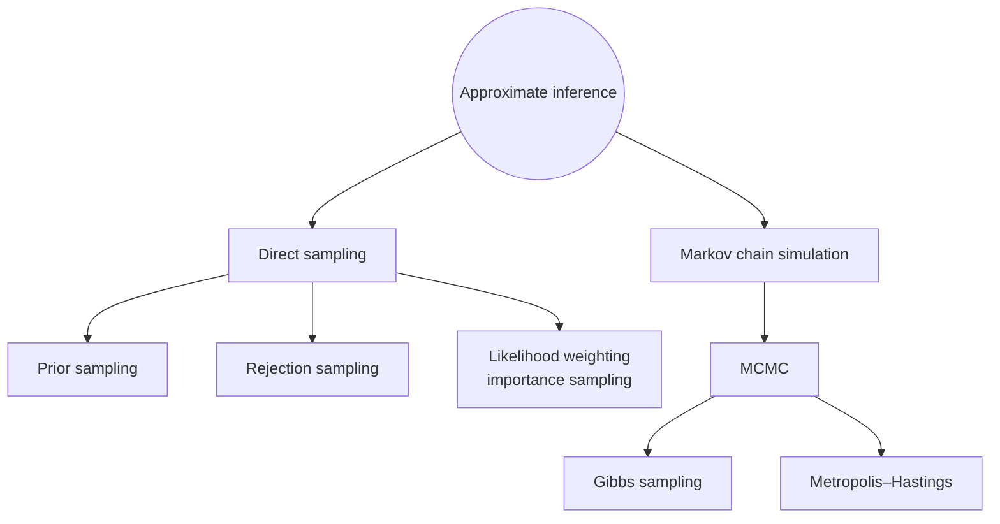

### 8.1 Direct (prior) sampling ★★★
- Primitive: generate samples from a **known distribution** — a fair coin P(Coin) = ⟨0.5, 0.5⟩ ≈ flipping the coin; with uniform random numbers in [0, 1] any single-variable distribution can be sampled.
- **PRIOR-SAMPLE:** sample each variable **in topological order**, conditioned on the values already assigned to its parents (no evidence).

**Sprinkler network:**
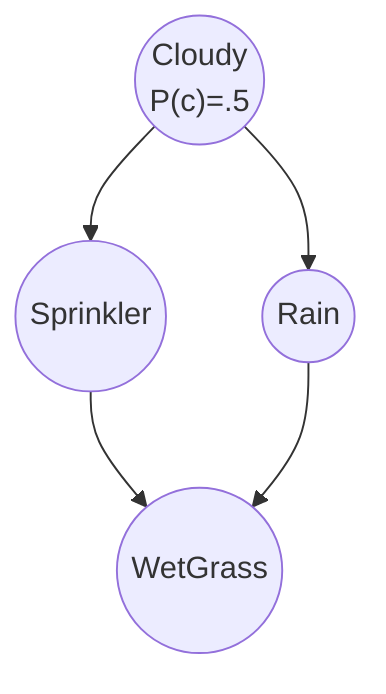
| C | P(S \| C) | P(R \| C) |
|---|---|---|
| T | .10 | .80 |
| F | .50 | .20 |

| S | R | P(W \| S, R) |
|---|---|---|
| T | T | .99 |
| T | F | .90 |
| F | T | .90 |
| F | F | .00 |

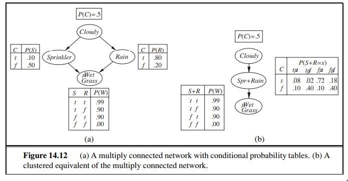

**Sample with ordering [Cloudy, Sprinkler, Rain, WetGrass]:**
1. Sample from P(Cloudy) = ⟨0.5, 0.5⟩ → **true**.
2. Sample from P(Sprinkler | Cloudy = true) = ⟨0.1, 0.9⟩ → **false**.
3. Sample from P(Rain | Cloudy = true) = ⟨0.8, 0.2⟩ → **true**.
4. Sample from P(WetGrass | Sprinkler = false, Rain = true) = ⟨0.9, 0.1⟩ → **true**.
→ PRIOR-SAMPLE returns **[true, false, true, true]**; P(this event) = 0.5 × 0.9 × 0.8 × 0.9 = 0.324.

As N → ∞, the fraction of samples matching an event → its true probability (**consistent** estimate). Useful for complex, high-dimensional or partially specified distributions and real-time decisions.

### 8.2 Rejection sampling ★★★
- Generate samples from the prior (proposal) distribution and **reject** all those that **don't match the evidence**; estimate P(X | e) by counting X values among the remaining samples.
- *General form:* propose from an easy distribution, compute an **acceptance ratio** target/proposal, draw u ~ U(0,1), **accept if u < ratio**, repeat.
- *Example:* estimate **P(Rain | Sprinkler = true)** with 100 samples — 73 have Sprinkler = false (rejected); of the 27 with Sprinkler = true, 8 have Rain = true and 19 Rain = false → **P̂(Rain | s) = ⟨8/27, 19/27⟩ ≈ ⟨0.296, 0.704⟩** (true value ⟨0.3, 0.7⟩).
- **Drawback:** rejects **too many** samples — the fraction consistent with evidence **drops exponentially** with the number of evidence variables → inefficient when the proposal differs greatly from the target / evidence is unlikely.

### 8.3 Likelihood weighting (importance sampling) ★★★
- Avoids rejection: **fix the evidence variables** to their observed values and sample only the **non-evidence** variables; each sample gets a **weight** = the **likelihood of the evidence** given the sample = product of P(eᵢ | parents(Eᵢ)).
- More generally, weight = target probability / proposal probability (importance).

*Example:* query **P(Rain | Cloudy = true, WetGrass = true)**, ordering Cloudy, Sprinkler, Rain, WetGrass; w = 1.0:
1. Cloudy is evidence (true) → **w ← w × P(c) = 0.5**.
2. Sprinkler not evidence → sample from P(S | c) = ⟨0.1, 0.9⟩ → false.
3. Rain not evidence → sample from P(R | c) = ⟨0.8, 0.2⟩ → true.
4. WetGrass is evidence (true) → **w ← w × P(w | ¬s, r) = 0.5 × 0.9 = 0.45**.
→ Weighted sample [true, false, true, true] with weight **0.45**, tallied under Rain = true.

| Benefits | Drawbacks |
|---|---|
| **Reduced variance** — samples weighted by importance | Computing weights can be **expensive** |
| **More efficient** than rejection sampling — no samples discarded | Choice of proposal distribution matters a lot |
| Consistent estimates | Performance degrades with many evidence variables (most samples get tiny weights), especially evidence downstream |

### 8.4 Markov Chain Monte Carlo (MCMC) & Gibbs sampling ★★
- **Monte Carlo methods:** random sampling to estimate numerical results (high-dimensional integrals/sums).
- **MCMC:** generate samples by constructing a **Markov chain** whose **equilibrium (stationary) distribution** is the desired posterior; each sample is a random change to the **previous** sample (not generated from scratch). Algorithms: **Metropolis–Hastings**, **Gibbs sampling**.
- **Gibbs sampling:** start in an arbitrary state with evidence fixed; repeatedly pick a **non-evidence variable** and **resample it from its conditional distribution given its Markov blanket** (all other variables' current values). The fraction of time spent in each state converges to the posterior.
  *E.g.,* P(Rain | Sprinkler = true, WetGrass = true): initial state [Cloudy = T, Sprinkler = T, Rain = F, WetGrass = T]; resample Cloudy from P(Cloudy | s, ¬r); then Rain from P(Rain | c, s, w); … count Rain = true over many steps.
- Effective in high-dimensional spaces; converges under appropriate conditions; can be slow to mix and computationally intensive.

| Method | Idea | Weakness |
|---|---|---|
| Prior sampling | Sample all variables top-down | Ignores evidence |
| Rejection sampling | Discard samples inconsistent with evidence | Wastes samples (exponential in # evidence) |
| Likelihood weighting | Fix evidence, weight samples by evidence likelihood | Poor with many/unlikely evidence |
| Gibbs / MCMC | Random walk resampling each variable given its Markov blanket | Slow convergence/mixing |

---

## 9. Relational and First-Order Probability Models ★★

- FOL commits to **objects and relations** and expresses facts about some or all objects → far more concise than propositional descriptions.
- **Bayesian networks are essentially propositional:** the set of random variables is **fixed and finite**, each with a fixed domain → limits applicability (e.g., can't easily model "every customer's honesty affects their ratings of every book they review").

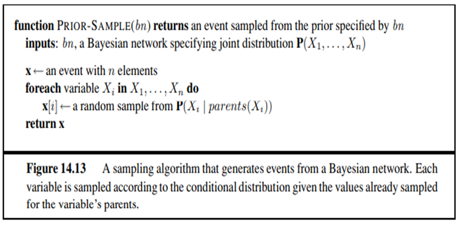

### 9.1 Possible worlds
- A probability model defines a set **Ω of possible worlds** with P(ω) for each world.
- For Bayes nets, worlds = **assignments of values to variables** (same as propositional logic for Boolean variables).
- For a **first-order probability model**, worlds are those of **FOL** — sets of objects with relations and an interpretation mapping constants → objects, predicates → relations, functions → functions.
- The probability of any first-order sentence φ:
$$P(\phi) = \sum_{\omega:\ \phi \text{ is true in } \omega} P(\omega)$$
- **Problem:** the set of FOL models is **infinite** and the sum may be infeasible. Solutions:
  - **Database semantics** (unique names + closed world + domain closure) → finite worlds → **relational probability models (RPMs)**: define random variables for each object's attributes (e.g., Honest(C₁), Kindness(C₁), Quality(B₁), Recommendation(C₁, B₁)) with **dependency statements** shared across objects → the model "unrolls" into an ordinary Bayes net. **Context-specific independence** handles variables whose parents depend on other values (e.g., Fan(c, Author(b))).
  - **Open-universe probability models (OUPMs)** — relax unique names/domain closure to handle **identity uncertainty** (citation matching, tracking multiple targets) — e.g., BLOG.

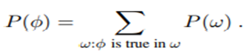

---

## 10. Other Approaches to Uncertain Reasoning ★★

- Physics, genetics, economics have long favoured probability. **Laplace (1819):** "Probability theory is nothing but common sense reduced to calculation." **Maxwell (1850):** "The true logic for this world is the calculus of probabilities…"
- Early probabilistic expert systems (medical) didn't scale (exponential joint distribution) → **1975–1988** alternatives were tried:
  - human reasoning seems **qualitative**, not numerical;
  - **rule-based** approaches with "fudge factors" (certainty factors — MYCIN);
  - **Dempster–Shafer theory** for **ignorance** vs uncertainty;
  - **fuzzy logic** for **vagueness** ("sort of" true) — vagueness and uncertainty are **orthogonal** issues.

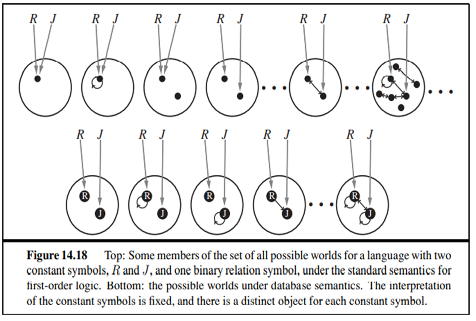

### 10.1 Rule-based methods for uncertain reasoning
Logical rule-based systems have three desirable properties that **fail** for uncertain reasoning:
| Property | In logic | Why it fails with probability |
|---|---|---|
| **Locality** | Given A ⇒ B and evidence A, conclude B without worrying about other rules | Must consider **all** the evidence |
| **Detachment** | Once B is proved, use it regardless of how it was derived | The **source** of evidence matters for later reasoning (avoid double counting) |
| **Truth-functionality** | Truth of complex sentences computed from components | Probability of A ∨ B isn't a function of P(A) and P(B) alone |

*Truth-functionality counter-example:* H₁ = heads on flip 1, T₁ = tails on flip 1, H₂ = heads on flip 2 — all have probability 0.5, yet P(H₁ ∨ H₁) = 0.5, P(H₁ ∨ T₁) = 1, P(H₁ ∨ H₂) = 0.75 → disjunction's probability depends on more than the components. Chaining evidence (A → B rules) makes it worse (double counting via forward/backward chaining).

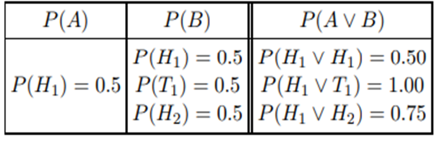

### 10.2 Representing ignorance — Dempster–Shafer theory ★★
- Distinguishes **uncertainty** from **ignorance**; computes the probability that the **evidence supports** a proposition — a **belief function Bel(X)**.
- *Magician's coin:* no evidence whether the coin is fair → **Bel(Heads) = 0** and **Bel(¬Heads) = 0**.
- An expert testifies with **90 % certainty** that the coin is fair (P(Heads) = 0.5) → **Bel(Heads) = 0.9 × 0.5 = 0.45**, Bel(¬Heads) = **0.45** — a **10-point gap** not accounted for by evidence (the interval [Bel, Plausibility] expresses ignorance).
- **Pearl's critique:** Bel(A) is the probability of worlds in which A is **provable**, not the probability that A is **true**. A Bayesian treatment models the **Bias** of the coin (0–1) as a variable with a prior and the next **Flip** — no new formalism needed.

### 10.3 Fuzzy sets and fuzzy logic
- Fuzzy set theory specifies **how well an object satisfies a vague description** (TallPerson(Nate) true to degree 0.6); fuzzy logic combines degrees with T(A ∧ B) = min, T(A ∨ B) = max, T(¬A) = 1 − T(A) — **truth-functional**, so it can't model uncertainty correctly; **fuzzy control** is successful in practice (appliances, cameras).

---

## Unit VI — One-Page Summary

| Topic | Key points |
|---|---|
| **Bayes net syntax** | Nodes = variables; DAG (links = direct influence); CPT P(Xᵢ \| Parents(Xᵢ)). Burglary: B, E → A → J, M. |
| **Global semantics** | P(x₁…xₙ) = Π P(xᵢ \| parents(Xᵢ)); P(j, m, a, ¬b, ¬e) = 0.9 × 0.7 × 0.001 × 0.999 × 0.998 ≈ 0.00063. |
| **Compactness** | k parents → 2ᵏ rows; O(n·2ᵏ) vs O(2ⁿ); burglary 10 vs 31 numbers. |
| **Local semantics** | Node ⊥ non-descendants \| parents; **Markov blanket** = parents + children + children's parents. |
| **Construction** | Order variables; choose minimal parents with P(Xᵢ \| Parents) = P(Xᵢ \| X₁…Xᵢ₋₁); causal order is compact (10), M, J, A, B, E gives 13, M, J, E, B, A gives 31. |
| **Efficient CPTs** | Deterministic nodes; **noisy-OR** (all causes listed + leak node, independent inhibition; P(¬fever) = Π qⱼ; q = 0.6, 0.2, 0.1 → 0.988 for all three); continuous: discretise, linear Gaussian, probit/logit. |
| **Inference tasks** | Posterior marginals, conjunctive queries, decisions, value of information, sensitivity, explanation. |
| **Enumeration** | P(B \| j, m) = α P(B) Σₑ P(e) Σₐ P(a \| B, e) P(j \| a) P(m \| a) = ⟨0.284, 0.716⟩; O(n) space, O(dⁿ) time; repeated computation. |
| **Variable elimination** | Right-to-left sums with factors f₁…f₇; drop irrelevant variables (not ancestors of query ∪ evidence — MaryCalls for P(J \| b)); polytrees linear, general #P-hard. |
| **Approximate inference** | Prior sampling (topological order: [true, false, true, true]); rejection sampling (P(Rain \| s) ≈ ⟨0.296, 0.704⟩, wasteful); likelihood weighting (fix evidence, weight = Π P(eᵢ \| parents), w = 0.45 example); MCMC/Gibbs (resample each variable given its Markov blanket); Metropolis–Hastings. |
| **First-order probability** | Bayes nets are propositional; FOL possible worlds; P(φ) = Σ over worlds where φ holds; relational probability models (database semantics) and open-universe models (identity uncertainty). |
| **Other approaches** | Rule-based certainty factors fail locality, detachment, truth-functionality (H₁/T₁/H₂ coins); Dempster–Shafer belief functions (Bel(Heads) = 0.45, ignorance gap); fuzzy logic = vagueness, not uncertainty. |
