# Unit I — Introduction to Operating Systems

> **Syllabus:** Introduction to OS concepts — definition, functions; types of operating systems (batch, multiprogramming, multiprocessing, multitasking, network, real-time, time-sharing, distributed); computer-system architecture; OS services; system calls and system programs; OS structure; threads.
>
> **Source:** *OS-Unit-1.pptx* (= *Unit 1.pptx*, identical) · *Important Questions Mid-1_OS (docx)*

**Importance legend:** ★★★ = very frequently asked (long answer) · ★★ = medium · ★ = short answer

---

## Table of Contents
1. [What is an Operating System?](#1-what-is-an-operating-system-)
2. [Kernel & Bootstrap](#2-kernel--bootstrap-)
3. [Functions, Goals & Objectives of an OS](#3-functions-goals--objectives-of-an-os-)
4. [Computer System Components; User & System View](#4-computer-system-components-user--system-view-)
5. [Types of Operating Systems](#5-types-of-operating-systems-)
6. [Multiprogramming vs Multitasking vs Multiprocessing vs Multithreading](#6-multiprogramming-vs-multitasking-vs-multiprocessing-vs-multithreading-)
7. [Computer-System Organisation & Architecture](#7-computer-system-organisation--architecture-)
8. [Operating-System Services](#8-operating-system-services-)
9. [System Calls](#9-system-calls-)
10. [System Programs](#10-system-programs-)
11. [Operating-System Structure](#11-operating-system-structure-)
12. [Threads](#12-threads-)
13. [Unit I — One-Page Summary](#unit-i--one-page-summary)

---

## 1. What is an Operating System? ★★★

- **Defn 1:** An OS is software that **manages computer hardware and software resources** and provides **common services** for computer programs.
- **Defn 2:** It **controls and coordinates** the use of hardware among various applications and users.
- **Defn 3:** A collection of **system software** that makes the computer **user-friendly** and **efficient**.
- **Textbook:** A program that acts as an **intermediary between the user and the computer hardware**.

**OS goals:** execute user programs and make solving problems easier; make the computer **convenient** to use; use hardware **efficiently**.

**Popular OSes:** UNIX (AT&T/BSD), Solaris (Sun), Linux, MS-DOS, Windows 95/98/NT/2000/XP/Vista/7/8/10/11, VMS & TOPS-20 (DEC), OS/2 (IBM), macOS, iOS, Android.

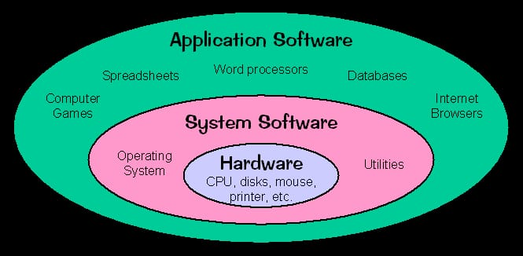

---

## 2. Kernel & Bootstrap ★★

**Kernel** — the **central module** of the OS; the one program **running at all times**.
- Loaded **first** and stays in **main memory**, in a **protected area** (so programs can't overwrite it) → must be **as small as possible** while providing essential services.
- Responsible for **memory management, process/task management and disk management**; connects hardware to application software.
- Every OS has a kernel (e.g., the Linux kernel is used by Linux distributions and Android).

**Bootstrap program** — loaded at **power-up or reboot**; stored in **ROM/EPROM (firmware)**; initialises all aspects of the system, **loads the OS kernel** and starts its execution.

---

## 3. Functions, Goals & Objectives of an OS ★★★

**Purpose:** provide an environment in which a user can **execute programs conveniently and efficiently**.

**Functions:**
1. Acts as an **intermediary** between user and hardware.
2. **Ensures correct operation** of the computer system.
3. Provides **services** to programs and users to make their tasks easier.
4. **Controls and coordinates** hardware among application programs and users.
5. **Process management** — create, schedule, terminate processes; synchronisation & communication.
6. **Memory management** — allocate/deallocate memory, track usage.
7. **File management** — create, delete, organise files & directories.
8. **Device (I/O) management** — drivers, buffering, spooling.
9. **Security & protection**, **error detection**, **accounting**, **user interface**.

**Primary goals:** user-friendliness (convenience) and efficient operation.

| OS objective | Meaning |
|---|---|
| **Efficiency** | Good resource utilisation |
| **Convenience** | User-friendly |
| **Ability to evolve** | Scalability — new functions added without disrupting service |
| **Reliability, robustness** | Dependable, trustworthy |
| **Portability** | Runs on different platforms |

---

## 4. Computer System Components; User & System View ★★★

A computer system has four components:

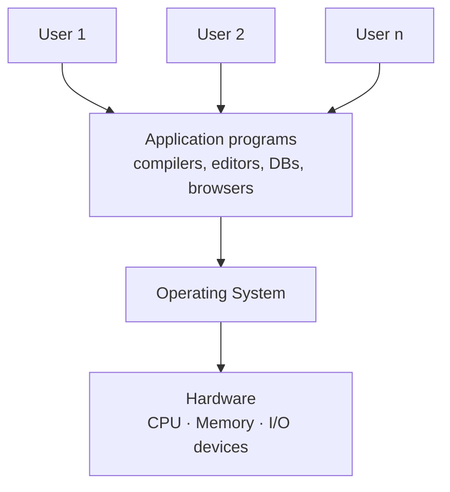

| Component | Role |
|---|---|
| **Hardware** | CPU, memory, I/O devices — basic computing resources |
| **Operating system** | Controls & coordinates hardware use among applications and users |
| **Application programs** | Define how resources are used to solve users' problems (compilers, DBs, games) |
| **Users** | People, machines, other computers |

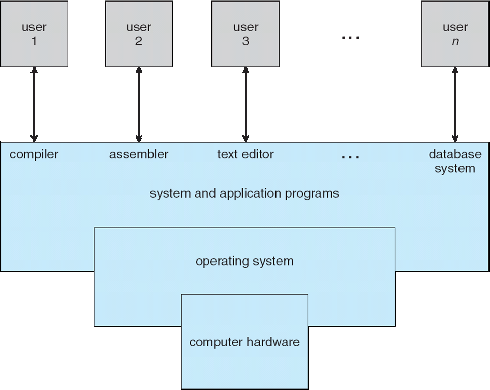

### 4.1 User View
- **Single-user PC:** maximise the work the user does → designed for **ease of use**, some performance, little concern for resource utilisation.
- **Mainframe/minicomputer (many users):** users **share resources and exchange information** → OS maximises **resource utilisation** (CPU, memory, I/O used efficiently and fairly).
- **Workstations:** dedicated resources but share network & servers (file, compute, print) → compromise between usability and utilisation.
- **Handhelds:** designed for individual usability and battery life.
- **Embedded computers** (home devices, cars): little or **no user view** — numeric keypads, indicator lights; run without user intervention.

### 4.2 System View
- **Resource allocator** — manager of resources (CPU time, memory, files, I/O); decides allocation among conflicting requests **efficiently and fairly**.
- **Control program** — manages execution of user programs to **prevent errors and improper use**; controls I/O devices.

---

## 5. Types of Operating Systems ★★★

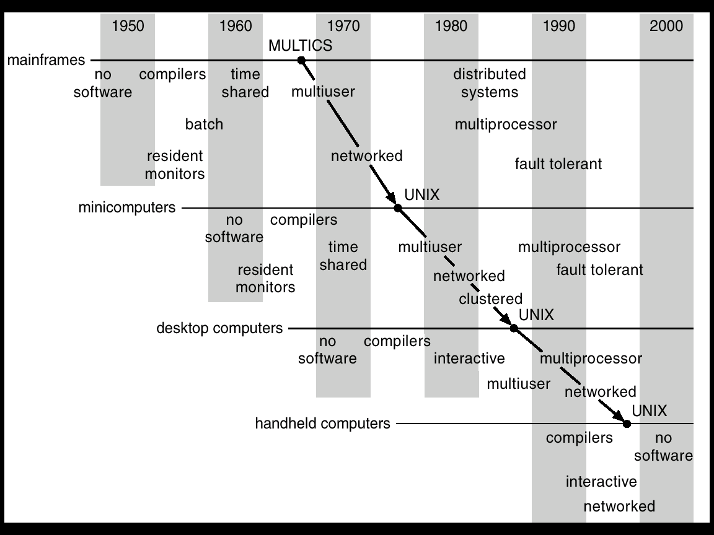

### 5.1 Batch Operating System
- Runs **one application at a time**; jobs with **similar needs are batched** and executed together.
- OS was simple — its major task was to **transfer control from one job to the next**; always resident in memory.
- Jobs submitted to an **operator on punch cards**; output appeared later. Input: card readers, tape drives; output: line printers, tape drives, card punches.

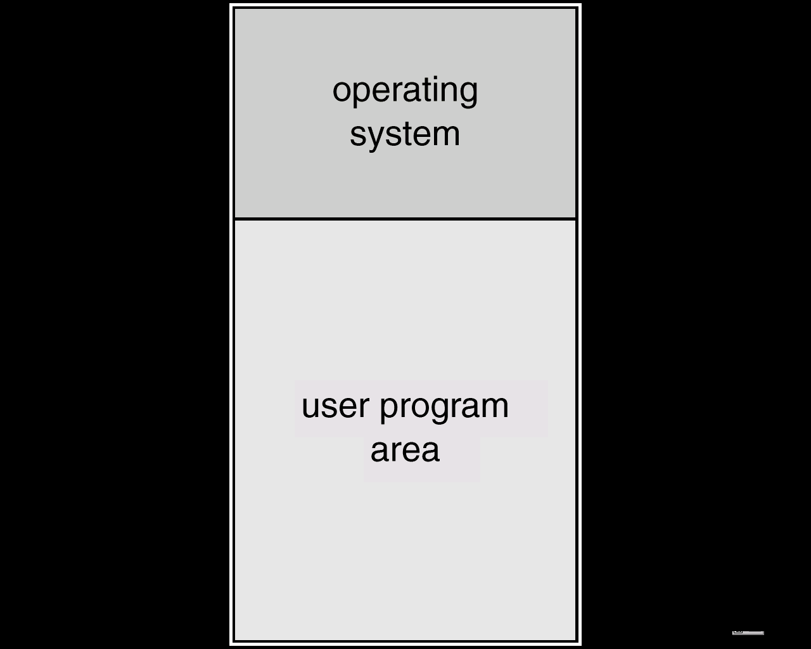

**Problems:** no interaction between user and job; **CPU often idle** (mechanical I/O far slower than CPU); difficult to set priorities.

### 5.2 Multiprogramming Operating System ★★★
- **More than one program resides in main memory** at once on a **single processor** (e.g., Excel and Firefox).
- Jobs kept in a **job pool**; when the running job waits for **I/O**, the OS **switches the CPU to another job** → CPU always busy → **improved CPU utilisation**.

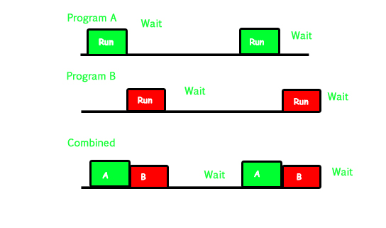

```mermaid
gantt
    dateFormat X
    axisFormat %s
    section Program A
    CPU :a1, 0, 3
    I/O wait :crit, a2, 3, 6
    CPU :a3, 6, 8
    section Program B
    CPU :b1, 3, 6
    I/O wait :crit, b2, 6, 9
```

### 5.3 Multiprocessing / Multiprocessor Systems ★★★
- Executing **more than one process simultaneously** on a machine with **two or more CPUs**.
- Also called **parallel** or **tightly coupled** systems — processors share the **bus, clock, memory and peripherals**.

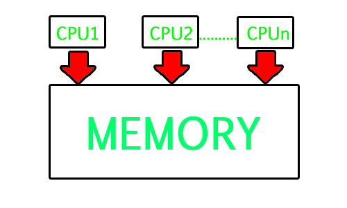

**Advantages:**
1. **Increased throughput** — more work in less time (speed-up with N processors is **less than N** due to overhead & contention).
2. **Economy of scale** — cheaper than multiple single-processor systems (shared peripherals, storage, power supplies).
3. **Increased reliability** — failure of one processor slows but doesn't halt the system: **graceful degradation**, **fault tolerance** (detection, diagnosis, correction; hardware duplication, e.g., HP NonStop).

Types: **Symmetric (SMP)** — every processor runs all tasks, peers; **Asymmetric** — master processor assigns work to slaves.

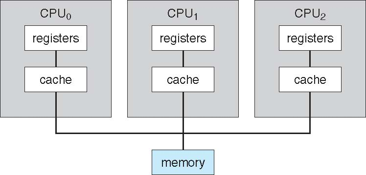

### 5.4 Multitasking Operating System ★★★
- Ability to execute **more than one task "simultaneously" on a single processor** — an **extension of multiprogramming** using **time sharing and context switching**.
- Each task gets a small **time slice (quantum)**; the CPU switches so fast it creates the **illusion of parallelism**.
- **Context switch** = act of reassigning the CPU from one task to another.
- Requires (1) **multiprogramming** (multiple ready programs) and (2) **time sharing**.
- **Multiuser** — multiple users use the same computer in a timely manner.

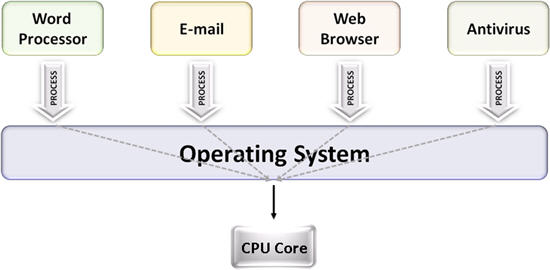

### 5.5 Network Operating System ★★
- Runs on a **server**; provides capability to manage **data, users, groups, security, applications** and networking functions; allows **shared file and printer access** across a LAN/private network.
- Examples: Windows Server 2003/2008, UNIX, Linux, Mac OS X, Novell NetWare, BSD.

| Advantages | Disadvantages |
|---|---|
| Centralised servers, highly stable | High cost of buying & running servers |
| Security is server-managed | Dependency on a central location |
| Easy integration of new technology/hardware | Regular maintenance & updates required |
| Remote access from different locations | |

### 5.6 Real-Time Operating System ★★★
- **Special-purpose** OS used when **rigid time requirements** exist on processor operation or data flow; acts as a **control device in a dedicated application**.
- Sensors bring data → computer analyses → adjusts controls. **Well-defined, fixed time constraints** — processing must finish within them, or the system fails.
- Examples: scientific experiments, **medical imaging** (X-ray, CT scan), industrial control, automobile fuel-injection, home-appliance controllers, weapon systems.

| Hard real-time | Soft real-time |
|---|---|
| **Guarantees** critical tasks complete **on time** | Critical task gets **priority** over others and retains it until completion |
| Missing a deadline = system failure | Occasional deadline miss tolerated |
| No virtual memory / secondary storage delays | Used with general-purpose OS features |
| Industrial control, airbag, pacemaker | **Multimedia**, advanced scientific projects, undersea exploration, planetary rovers |

### 5.7 Time-Sharing Operating System ★★★
- **Logical extension of multiprogramming**: CPU switches among jobs so **frequently that users can interact** with each program while it runs.
- **Response time < 1 second**; each user has at least one program in memory (a **process**).
- **Job scheduling** — which jobs to bring into memory; **CPU scheduling** — which ready job runs; **swapping** moves processes in/out of memory; **virtual memory** allows execution of processes not completely in memory.
- *Time sharing:* equal CPU time slices among processes (**time slicing**) vs non-time-sharing: variable CPU time — once allocated, a process runs until it completes or waits for I/O.

### 5.8 Distributed Operating System ★★★
- Uses **multiple central processors** to serve multiple real-time applications and users; jobs distributed among processors.
- Processors communicate through **communication lines** (high-speed buses, telephone lines) — **loosely coupled** systems; processors (sites/nodes) vary in size and function.

**Advantages:** resource sharing across sites · computation **speed-up** · **reliability** (if one site fails, others continue) · faster data exchange (e-mail) · better service · reduced load on the host · reduced processing delays.

### 5.9 Interactive Systems
User interacts directly with the OS — supplies commands/data while the program executes and receives results immediately (request → response) through a **CLI or GUI**.

| Tightly coupled (multiprocessor) | Loosely coupled (distributed) |
|---|---|
| Shared memory & clock | Each node has own memory & clock |
| Communicate through shared memory | Communicate by message passing over network |
| Close physical proximity | Geographically dispersed |

---

## 6. Multiprogramming vs Multitasking vs Multiprocessing vs Multithreading ★★★

| Concept | Definition | CPUs | Key idea |
|---|---|---|---|
| **Multiprogramming** | Keep **multiple programs in main memory** ready to run | 1 | Switch on I/O wait → maximise CPU utilisation |
| **Multitasking** | Multiprogramming + **time sharing (round robin)** | 1 | Time slices → interactive response |
| **Multiprocessing** | **More than one CPU** in one system | ≥ 2 | True parallel execution |
| **Multithreading** | Multiple **threads of one process** execute concurrently | ≥ 1 | Extension of multitasking within a process |

---

## 7. Computer-System Organisation & Architecture ★★

### 7.1 Organisation
One or more CPUs and **device controllers** connect through a **common bus** to **shared memory**; CPUs and devices execute concurrently, **competing for memory cycles**. Device controllers have local buffers and raise **interrupts** when done.

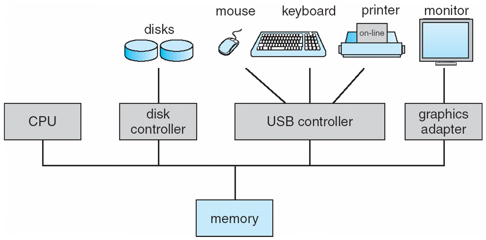

### 7.2 Storage-Device Hierarchy

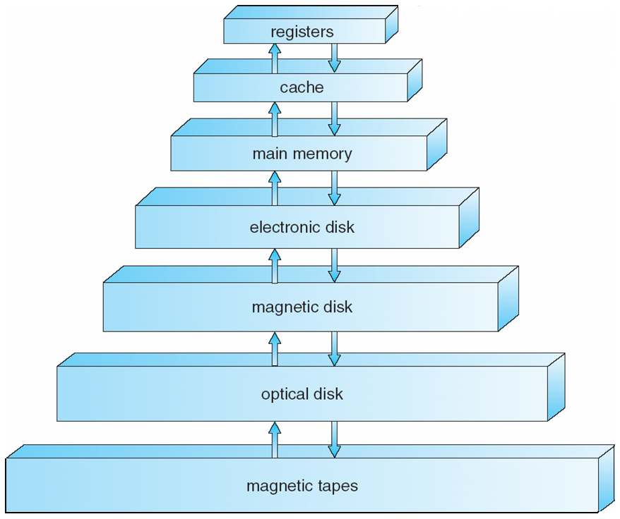

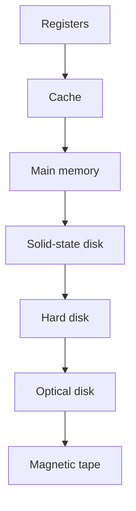
Higher levels: **fast and expensive**; moving down: **cost per bit decreases, access time increases**; top levels are volatile.

### 7.3 Architecture types
| Type | Description |
|---|---|
| **Single-processor** | One general-purpose CPU; may have special-purpose processors (disk, keyboard, graphics controllers) with limited instruction sets that don't run user processes (e.g., disk controller runs its own scheduling) |
| **Multiprocessor** | 2+ CPUs sharing bus/clock/memory — SMP or asymmetric (§5.3) |
| **Clustered** | Two or more **individual systems coupled** together (usually LAN); provide **high availability** — nodes monitor each other; if one fails, another takes over its storage and restarts its applications |

**Clustering structures:** **Asymmetric** — one machine in **hot-standby** monitoring the active server; **Symmetric** — two or more hosts run applications and monitor each other. **Parallel clusters** let multiple hosts access shared storage, needing a **distributed lock manager (DLM)**.

**Uniprogramming** — single user, single program in execution (early systems).

---

## 8. Operating-System Services ★★★

Services are provided at two levels: **system calls** (lowest — programs request OS directly) and **command interpreter / shell** (higher — users issue requests without writing programs).

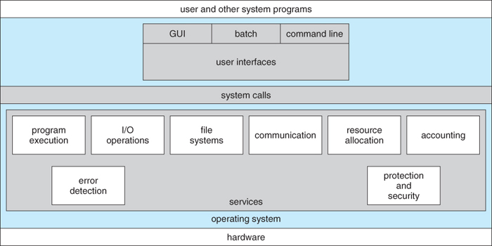

**Services helpful to the user:**
| Service | Description |
|---|---|
| **User interface** | **CLI** (command line), **GUI** (graphical), batch |
| **Program execution** | Load a program into memory, run it, end normally or abnormally |
| **I/O operations** | Running programs need file or device I/O; users can't control devices directly |
| **File-system manipulation** | Read/write, create/delete, search files & directories, list info, **permission management** |
| **Communications** | Between processes on the same or different computers via **shared memory** or **message passing** |
| **Error detection** | Errors in CPU/memory hardware, I/O devices, user programs → take appropriate action; debugging facilities |

**Services for efficient system operation:**
| Service | Description |
|---|---|
| **Resource allocation** | Allocate CPU, memory, files, I/O among multiple users/jobs |
| **Accounting** | Track which users use how much of which resources (usage statistics, billing) |
| **Protection & security** | Control all access to resources; **authentication** of users; defend I/O devices from invalid access |

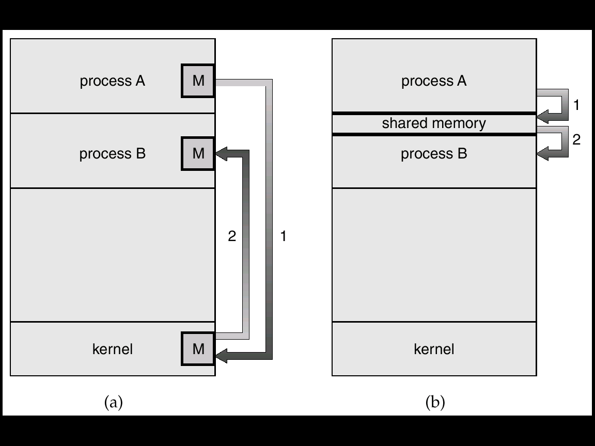

---

## 9. System Calls ★★★

A **system call** provides the **interface between a running program and the OS** — the way programs request OS services. Generally available as routines in **C/C++** (some low-level tasks in assembly). Programmers usually use an **API** (Win32, POSIX, Java API) which invokes system calls.

**Example — copy contents of one file to another:**

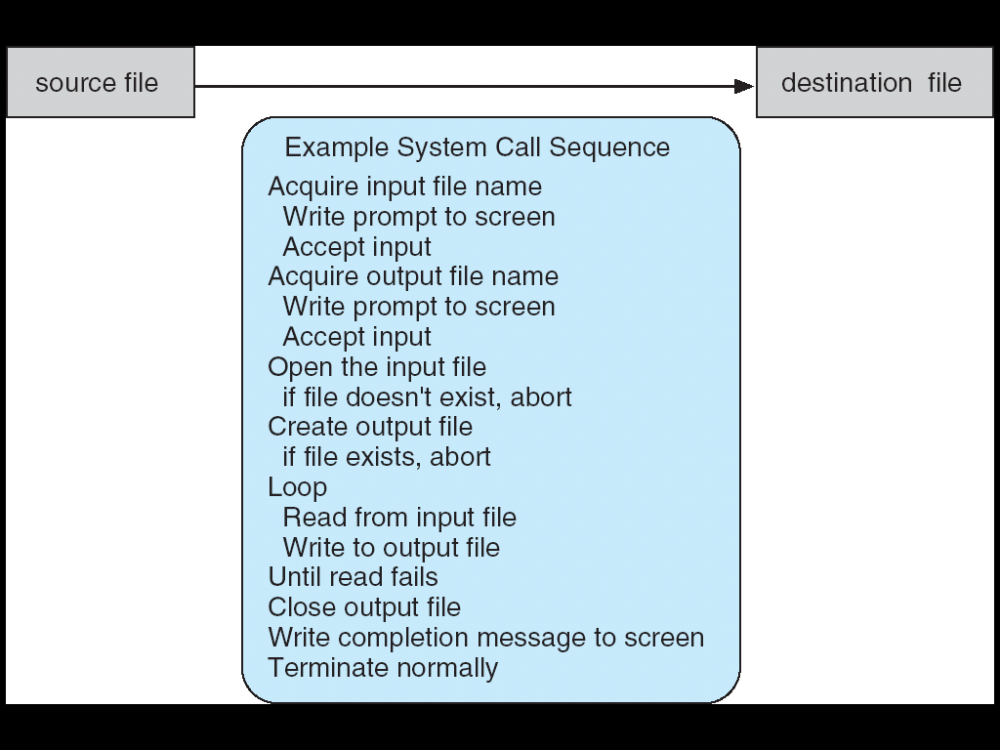

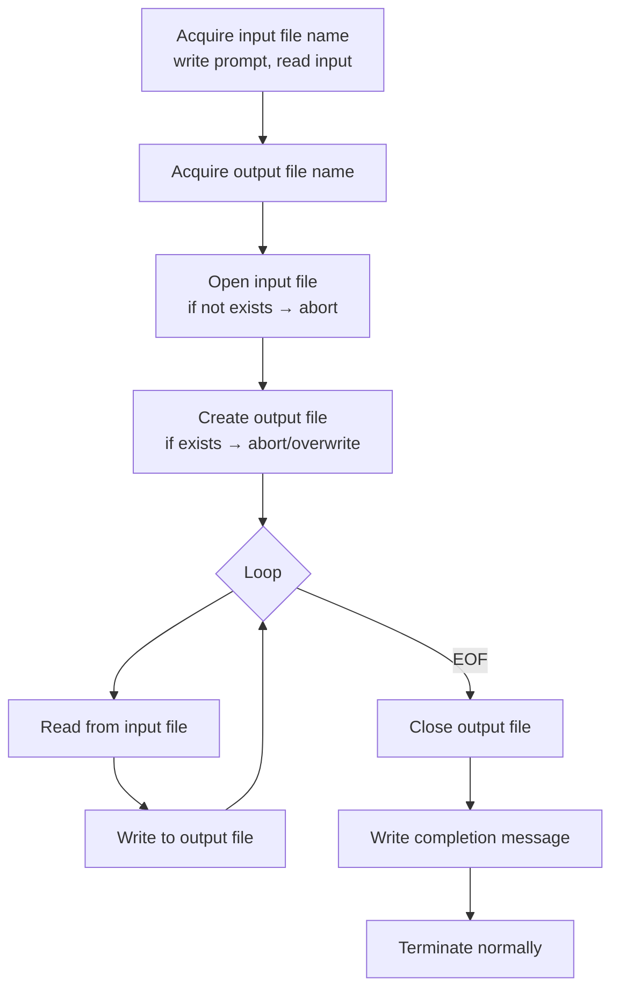

**Handling of the `open()` system call:** user application calls `open()` → **system-call interface** (user mode → kernel mode trap) → indexes the **system-call table** by number → kernel implementation of `open()` executes → returns status/value to user.

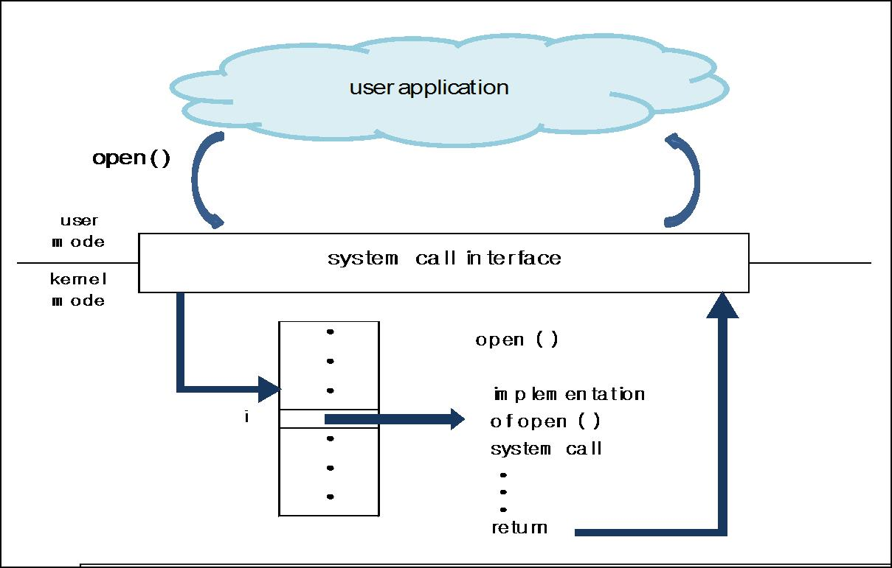

### 9.1 Parameter passing (3 methods)
1. Pass parameters in **registers**.
2. Store parameters in a **block/table in memory** and pass the **table address** in a register (Linux, Solaris).
3. **Push** parameters onto the **stack** by the program; **pop** off by the OS.

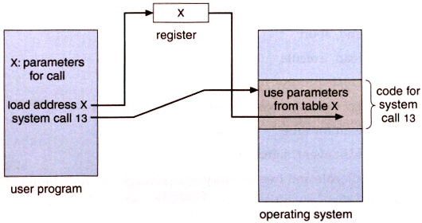

### 9.2 Types of System Calls ★★★
| Category | Typical calls | Windows / UNIX examples |
|---|---|---|
| **Process control** | end, abort; load, execute; create/terminate process; get/set process attributes; wait for time; wait event, signal event; allocate & free memory | CreateProcess(), ExitProcess() / **fork(), exit(), wait()** |
| **File management** | create/delete file; open, close; read, write, reposition; get/set file attributes | CreateFile(), ReadFile() / **open(), read(), write(), close()** |
| **Device management** | request/release device; read, write, reposition; get/set device attributes; logically attach/detach devices | SetConsoleMode() / **ioctl(), read(), write()** |
| **Information maintenance** | get/set time or date; get/set system data; get/set process, file or device attributes | GetCurrentProcessID() / **getpid(), alarm(), sleep()** |
| **Communications** | create/delete connection; send/receive messages; transfer status info; attach/detach remote devices (message passing vs shared memory) | CreatePipe() / **pipe(), shmget(), mmap()** |
| **Protection** | get/set permissions; allow/deny user access | SetFileSecurity() / **chmod(), umask(), chown()** |

---

## 10. System Programs ★★★

**System programs (utilities)** provide a **convenient environment for program development and execution**. Most users see the OS through system programs, not system calls.

| Category | Examples |
|---|---|
| **Programming-language support** | Compilers, assemblers, interpreters, debuggers |
| **Program loading & execution** | Absolute loaders, relocatable loaders, linkage editors, overlay loaders, debugging systems |
| **File management** | Create, delete, copy, rename, print, dump, list, manipulate files & directories |
| **File modification** | **Text editors** to create/modify file contents — screen editor (vi), line editors (ed, edlin) |
| **Status information** | Date, time, available memory/disk space, number of users; performance, logging & debugging info; **registry** for configuration |
| **Communications** | Create virtual connections among processes, users, systems — send messages to screens, browse web, e-mail, remote login, file transfer |
| **Background services** | Daemons/services launched at boot |
| **Application programs** | Browsers, word processors, games (shipped with OS) |

---

## 11. Operating-System Structure ★★★

A general-purpose OS is a very large program — structured in different ways:

### 11.1 Simple Structure — MS-DOS
- Written to provide **most functionality in least space**; not carefully divided into modules; interfaces and levels **not well separated**.
- Application programs can access basic I/O routines and **write directly to display and disk drivers** → vulnerable to malicious programs; whole system crashes when a user program fails. Limited by hardware (8088 had no dual mode/protection).

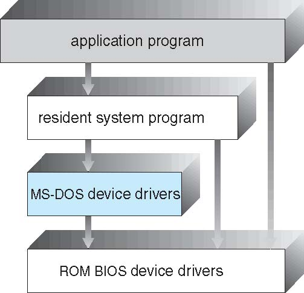

### 11.2 Monolithic / Non-simple Structure — UNIX
- Two separable parts: **system programs** and the **kernel**.
- Kernel = everything **below the system-call interface and above the hardware** — file system, CPU scheduling, memory management, etc. — **a large number of functions in one level**. Beyond simple but not fully layered.

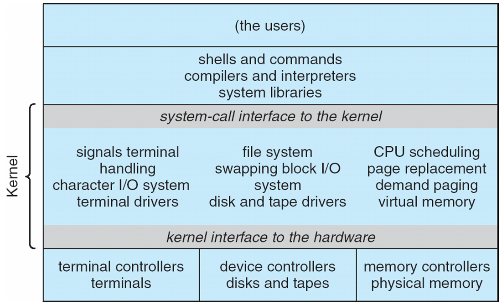

### 11.3 Layered Approach
- OS divided into **layers**, each built on top of lower layers: **layer 0 = hardware**, **layer N = user interface**.
- Each layer uses functions/services of **only lower layers** → simple construction and **debugging** (debug layer by layer).
- **Drawbacks:** hard to define layers appropriately; **less efficient** (each layer adds overhead).

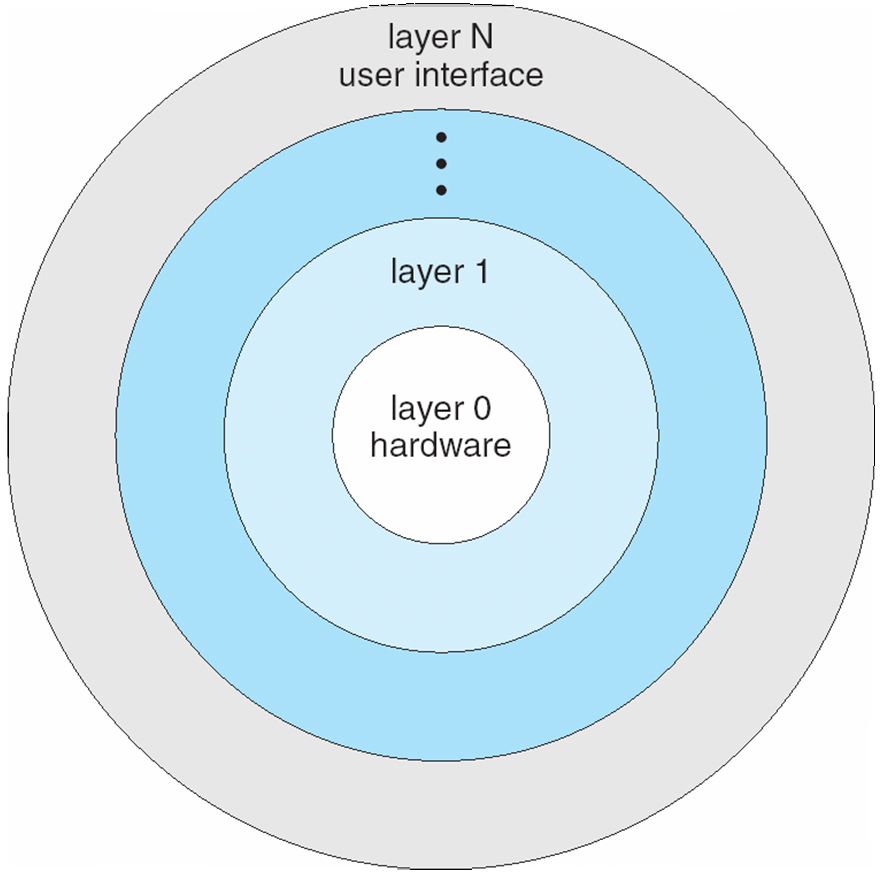

### 11.4 Microkernel (Mach)
- Moves as much as possible **from the kernel into user space**; kernel provides only **minimal process & memory management and communication (IPC)**.
- User modules communicate via **message passing**. Mach; macOS kernel (Darwin) partly based on Mach; QNX.

| Benefits | Detriments |
|---|---|
| Easier to **extend** | **Performance overhead** of user-space ↔ kernel-space communication |
| Easier to **port** to new architectures | |
| More **reliable** (less code in kernel mode) | |
| More **secure** | |

### 11.5 Modules (Loadable Kernel Modules)
- Best current methodology — **object-oriented** modular kernel: a set of **core components**, with additional services **linked in at boot or run time**.
- Each core component separate, talks over known interfaces, **loadable as needed** → like layers but more flexible. Linux, Solaris.

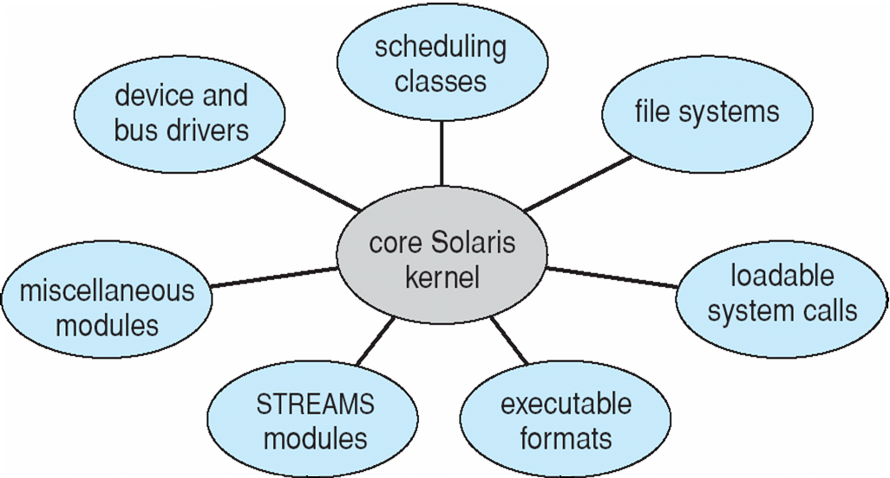

### 11.6 Hybrid Systems
- Most modern OSes combine models for performance, security and usability.
- Linux & Solaris — monolithic (kernel address space) + modular; Windows — mostly monolithic + microkernel ideas.
- **macOS** — layered; **Mach microkernel** (memory management, RPC, IPC, thread scheduling, message passing) + **BSD** (CLI, networking, file systems) + Aqua UI and Cocoa.
- **iOS** — based on macOS; Cocoa Touch (Objective-C API), media services, core services (cloud, databases), core OS; runs on ARM.
- **Android** — Open Handset Alliance (Google); **modified Linux kernel** (process, memory, driver management, + power management); runtime with core libraries and **Dalvik VM/ART**; apps in Java + Android API; libraries: WebKit, SQLite, multimedia, libc.

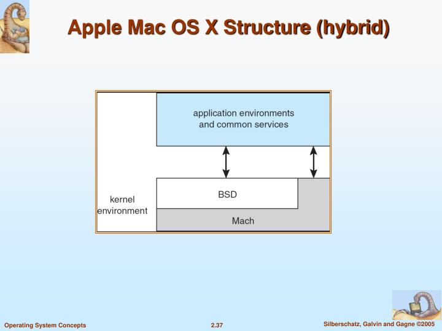

| Structure | Example | Pros | Cons |
|---|---|---|---|
| Simple | MS-DOS | Small, fast | No protection, poor modularity |
| Monolithic | UNIX | Fast (little overhead) | Hard to implement/maintain |
| Layered | THE OS | Easy debugging | Overhead, layer definition hard |
| Microkernel | Mach, QNX | Extensible, portable, secure | Message-passing overhead |
| Modular | Linux, Solaris | Flexible, efficient | Module interface complexity |
| Hybrid | macOS, Windows | Balanced | Complex |

---

## 12. Threads ★★★

A **thread** is the **smallest unit of CPU execution** within a process (lightweight process). A process can contain one or more threads that **share** its resources.

*Example — web browser:* one thread handles the UI, another loads pages, another plays video — all share the browser's memory.

| Shared by all threads of a process | Private to each thread |
|---|---|
| Code section | **Program counter** |
| Data section | **Registers** |
| Heap memory | **Stack** |
| Open files | Thread ID, state |

### 12.1 Types of threads
| User-level threads (ULT) | Kernel-level threads (KLT) |
|---|---|
| Managed by **user-space libraries** (Pthreads, Java) | Managed **directly by the OS kernel** |
| **Faster** creation and switching | Higher overhead |
| Kernel **unaware** of them — one blocking call blocks the whole process | Kernel schedules each — true parallelism on **multicore** |

### 12.2 Multithreading models
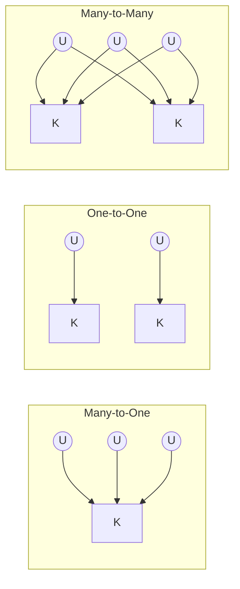
| Model | Mapping | Notes |
|---|---|---|
| **Many-to-One** | Many user threads → **one** kernel thread | Efficient, but one blocking call blocks all; no parallelism (Green threads) |
| **One-to-One** | Each user thread → its own kernel thread | More concurrency & parallelism; overhead limits thread count (Windows, Linux) |
| **Many-to-Many** | Many user threads → many (≤) kernel threads | Flexible; best of both (older Solaris) |

### 12.3 Benefits of Multithreading
1. **Responsiveness** — app remains interactive (word processor accepts input while saving).
2. **Resource sharing** — threads share memory and resources → easy communication.
3. **Economy** — creating/switching threads is cheaper than processes.
4. **Scalability / parallelism** — threads run in parallel on multicore CPUs.
5. **Better CPU utilisation** — while one thread waits for I/O, another uses the CPU.

### 12.4 Process vs Thread ★★★
| Feature | Process | Thread |
|---|---|---|
| Memory | **Separate** address space | **Shared** within the process |
| Creation cost | High | Low |
| Context switching | Slower | Faster |
| Communication | Needs **IPC** | Directly via shared memory |
| Failure impact | **Isolated** | May affect the **entire process** |
| Weight | Heavyweight | Lightweight |

---

## Unit I — One-Page Summary

| Topic | Key points |
|---|---|
| **OS definition** | Intermediary between user and hardware; manages resources; resource allocator + control program. |
| **Kernel / bootstrap** | Kernel: core, always in memory, protected; manages memory, processes, disk. Bootstrap in ROM loads kernel. |
| **Objectives** | Efficiency, convenience, ability to evolve, reliability, portability. |
| **Components** | Hardware · OS · application programs · users. User view (ease of use vs utilisation) vs system view (allocator, control program). |
| **Batch** | Similar jobs batched; punch cards; CPU idle; no interaction. |
| **Multiprogramming** | Many jobs in memory; switch on I/O → CPU utilisation. |
| **Multiprocessing** | 2+ CPUs, tightly coupled; throughput, economy of scale, reliability (graceful degradation). SMP vs asymmetric. |
| **Multitasking / time-sharing** | Time slices + context switch; response < 1 s; job & CPU scheduling, swapping, virtual memory. |
| **Network OS** | Server-based, shared files/printers, centralised security; costly server. |
| **Real-time** | Fixed time constraints; **hard** (guaranteed) vs **soft** (priority). Medical imaging, fuel injection, multimedia. |
| **Distributed** | Loosely coupled, message passing; resource sharing, speed-up, reliability. |
| **Architecture** | Single-processor, multiprocessor, clustered (asymmetric hot-standby / symmetric; parallel clusters + DLM). Storage hierarchy: registers → cache → RAM → SSD → HDD → optical → tape. |
| **Services** | UI, program execution, I/O, file system, communication, error detection; resource allocation, accounting, protection & security. |
| **System calls** | Interface program ↔ OS; params via registers, table, stack. Types: process control, file mgmt, device mgmt, info maintenance, communication, protection. |
| **System programs** | Language support, loading & execution, file mgmt, file modification, status info, communications. |
| **Structures** | Simple (MS-DOS) · Monolithic (UNIX) · Layered · Microkernel (Mach; message passing) · Modules (Linux, Solaris) · Hybrid (macOS, iOS, Android). |
| **Threads** | Smallest unit of execution; share code/data/heap/files, own PC/registers/stack. ULT vs KLT; many-to-one, one-to-one, many-to-many; responsiveness, sharing, economy, scalability. |
