# Unit II — Process Management & CPU Scheduling

> **Syllabus:** Process concept — definition, process in memory, process state diagram, PCB, CPU switch from process to process, context switch, process vs thread. Process scheduling — queues, schedulers (long, short, medium term). Operations on processes. CPU scheduling — preemptive vs non-preemptive, dispatcher, scheduling criteria, algorithms (FCFS, SJF, SRTF, Priority, RR, Multilevel Queue, Multilevel Feedback Queue). Case studies: Windows, Linux scheduling.
>
> **Source:** *OS-unit-2-uodated.pptx*, *Unit-2.pptx*, *CPU-Scheduling-and-Algorithm-.pdf* (V. N. Kukre handout) · *Important Questions Mid-1_OS*

**Importance legend:** ★★★ = very frequently asked (long answer / numericals) · ★★ = medium · ★ = short answer

---

## Table of Contents
1. [Process Concept](#1-process-concept-)
2. [Process States & State Diagram](#2-process-states--state-diagram-)
3. [Process Control Block (PCB)](#3-process-control-block-pcb-)
4. [Context Switch](#4-context-switch-)
5. [Threads & Process vs Thread](#5-threads--process-vs-thread-)
6. [Process Scheduling Queues](#6-process-scheduling-queues-)
7. [Schedulers — Long, Short & Medium Term](#7-schedulers--long-short--medium-term-)
8. [Operations on Processes](#8-operations-on-processes-)
9. [CPU Scheduling — Basic Concepts](#9-cpu-scheduling--basic-concepts-)
10. [Scheduling Criteria](#10-scheduling-criteria-)
11. [FCFS](#11-first-come-first-served-fcfs-)
12. [SJF & SRTF](#12-shortest-job-first-sjf--srtf-)
13. [Priority Scheduling](#13-priority-scheduling-)
14. [Round Robin](#14-round-robin-rr-)
15. [Multilevel Queue & Multilevel Feedback Queue](#15-multilevel-queue--multilevel-feedback-queue-)
16. [Solved Exercises](#16-solved-exercises-)
17. [Case Studies — Windows & Linux Scheduling](#17-case-studies--windows--linux-scheduling-)
18. [Unit II — One-Page Summary](#unit-ii--one-page-summary)

---

## 1. Process Concept ★★★

A **process** is a **program in execution**; its execution must progress **sequentially**. It needs resources — **CPU time, memory, files, I/O devices** — allocated at creation or while executing. (Batch systems run *jobs*; time-shared systems run *user programs/tasks* — the terms job and process are used interchangeably.)

A process is more than program code (**text section**). It includes:

| Part | Contents |
|---|---|
| **Text section** | Program code |
| **Program counter & registers** | Current activity |
| **Stack** | Temporary data — function parameters, return addresses, local variables |
| **Data section** | Global variables |
| **Heap** | Memory **dynamically allocated** during run time |

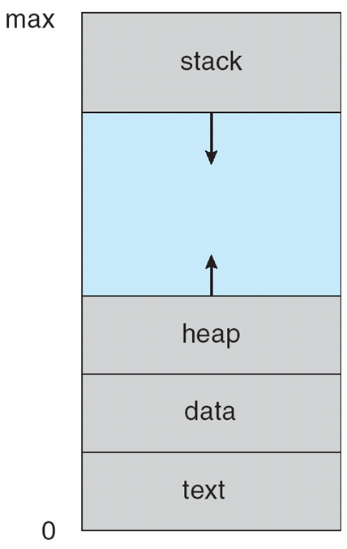

### Program vs Process ★★★
| Program | Process |
|---|---|
| **Passive** entity — a file of instructions on disk (executable) | **Active** entity — has a program counter and associated resources |
| Exists permanently on disk | Exists while executing (has a lifetime) |
| No resources | Holds CPU, memory, files, I/O |
| One program can produce many processes | Each process is one execution instance |

A program becomes a process when its **executable file is loaded into memory** (double-click icon, or typing `prog.exe` / `a.out`).

---

## 2. Process States & State Diagram ★★★

| State | Meaning |
|---|---|
| **New** | Process is being **created** |
| **Ready** | Waiting to be **assigned to a processor** |
| **Running** | **Instructions are being executed** |
| **Waiting (Blocked)** | Waiting for some **event** (I/O completion, signal) |
| **Terminated** | Finished execution |
| **Suspended Ready** | Ready, but swapped out to disk (no memory space in ready state) |
| **Suspended Wait** | Waiting, and swapped out (too many processes waiting for I/O) |

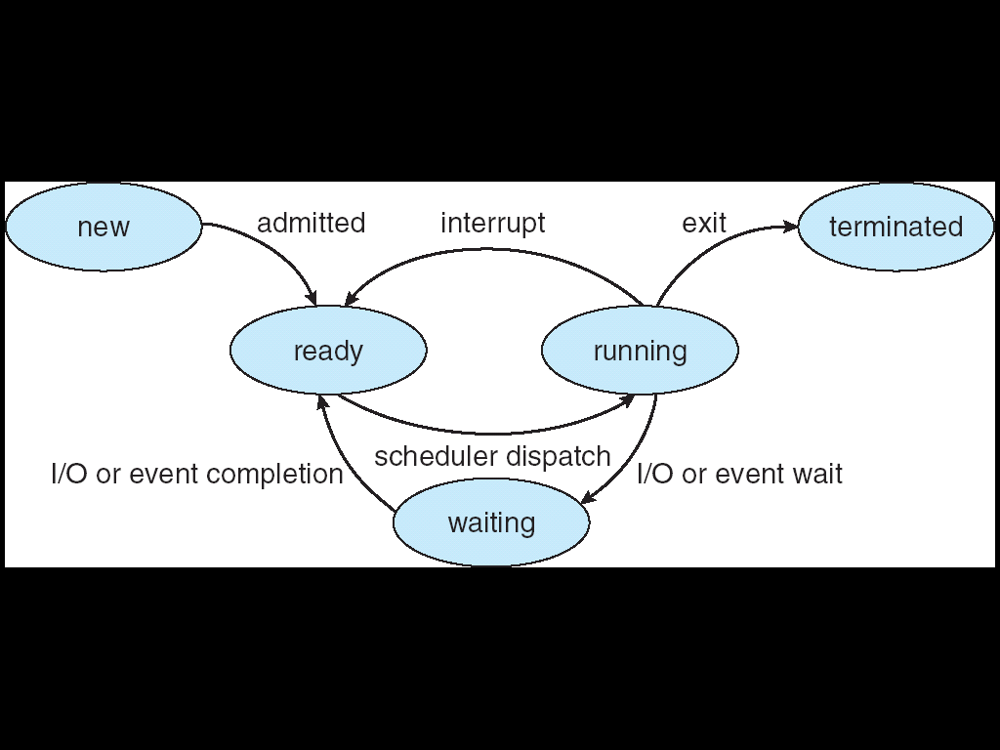

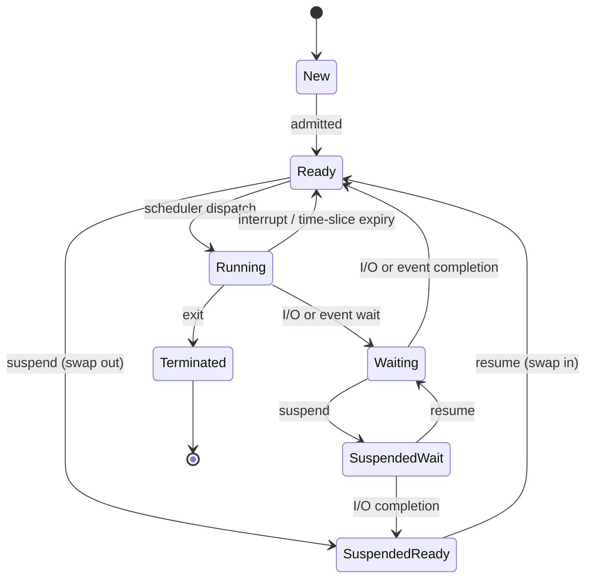

**Transitions explained:**
1. **New → Ready (admit):** long-term scheduler admits process into memory.
2. **Ready → Running (dispatch):** short-term scheduler selects it; dispatcher gives CPU.
3. **Running → Ready (interrupt):** time quantum expires or a higher-priority process arrives (preemption).
4. **Running → Waiting:** process requests I/O or waits for an event.
5. **Waiting → Ready:** the event/I/O completes.
6. **Running → Terminated:** process finishes or is killed.
7. **Suspend/Resume:** medium-term scheduler swaps processes out to disk and back.

**Reasons for process suspension:** swapping to free memory, low priority, process inactive for long, frequent page faults, large memory use, user/parent request, timing (periodic process), OS debugging.

---

## 3. Process Control Block (PCB) ★★★

Each process is represented in the OS by a **PCB** (also **task control block**) — the data structure holding all information associated with the process.

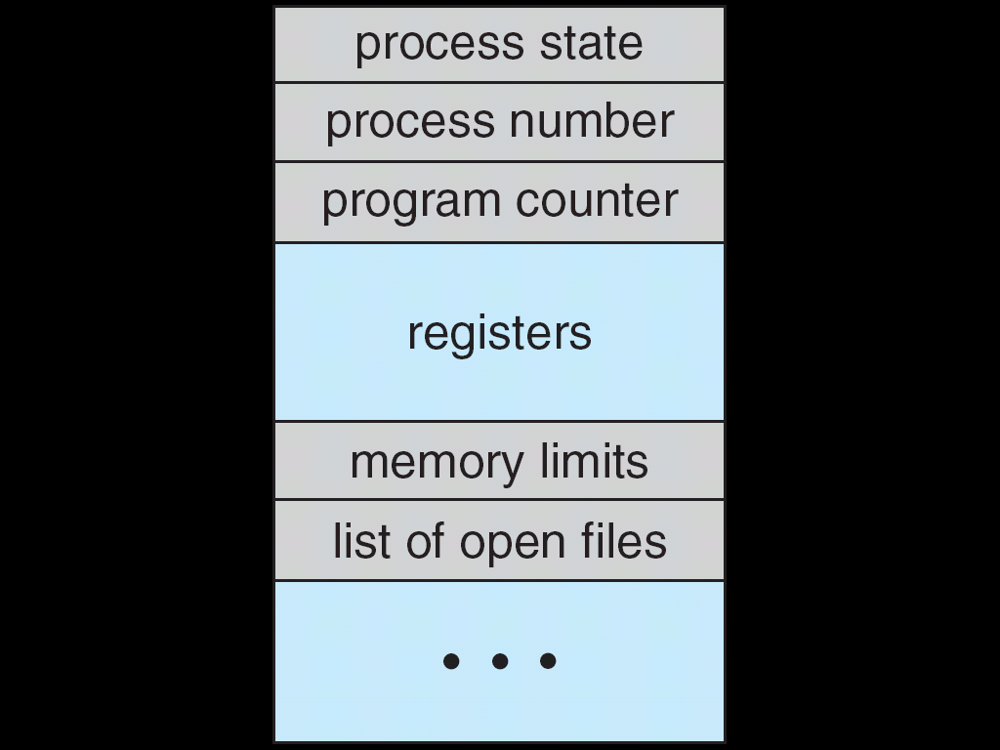

| Field | Contents |
|---|---|
| **Process state** | New, ready, running, waiting, halted… |
| **Process number (PID)** | Unique identifier |
| **Program counter** | Address of the **next instruction** |
| **CPU registers** | Accumulators, index registers, stack pointers, general-purpose registers, condition codes (saved on interrupt) |
| **CPU-scheduling information** | **Priority**, pointers to scheduling queues, other parameters |
| **Memory-management information** | **Base & limit registers**, page tables or segment tables |
| **Accounting information** | CPU and real time used, time limits, account numbers, job/process numbers |
| **I/O status information** | List of **I/O devices allocated**, list of **open files** |

---

## 4. Context Switch ★★★

When the CPU switches to another process, the system must **save the state (context) of the old process** in its PCB and **load the saved state of the new process** — a **context switch**.

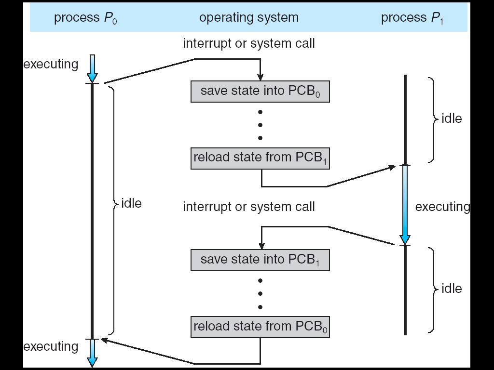

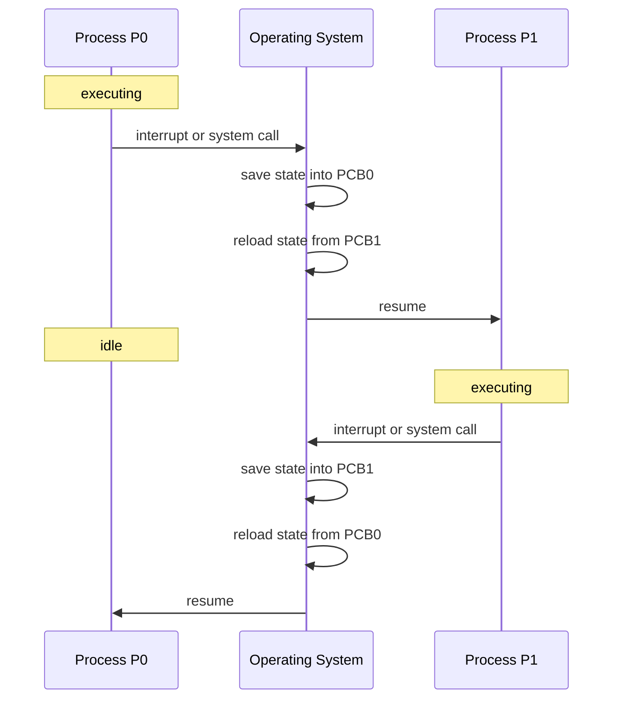

- Context-switch time is **pure overhead** — the system does no useful work while switching.
- The more complex the OS and PCB, the **longer** the switch; typically microseconds.
- Depends on **hardware support** — some CPUs provide **multiple register sets**, so a switch only changes a pointer.

---

## 5. Threads & Process vs Thread ★★★

A **thread** (lightweight process) is a **basic unit of CPU utilisation** — a single sequential flow of control within a process. It has its own **program counter, register set and stack**, and **shares** with peer threads the **code section, data section and OS resources** (collectively a *task*). A traditional (heavyweight) process = a task with one thread.

- While one thread is **blocked**, another thread of the same task can run → higher throughput.
- Useful for applications sharing a common buffer (**producer–consumer**).
- Allow sequential processes to make **blocking system calls** while achieving parallelism.
- Implementations: **kernel-supported** (Mach, OS/2), **user-level** via libraries (CMU Project Andrew), **hybrid** (Solaris 2).

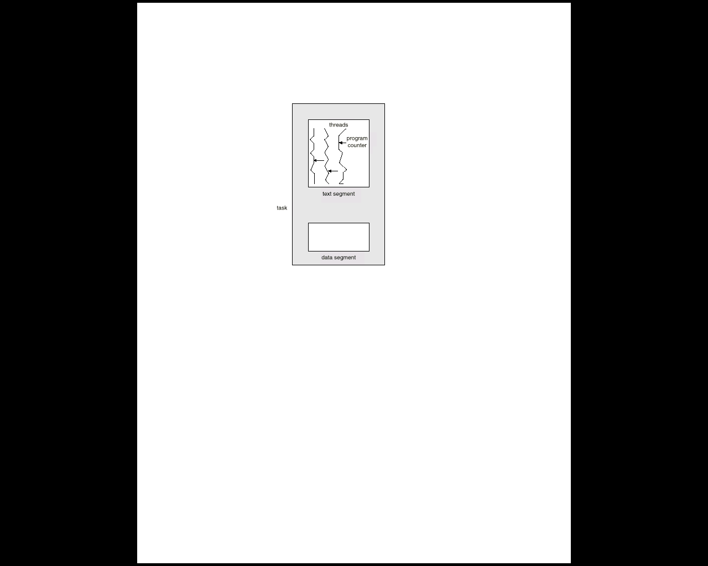

| # | Process | Thread |
|---|---|---|
| 1 | Program in execution | **Segment** of a process (lightweight) |
| 2 | More time to create & terminate | Less time to create & terminate |
| 3 | Context switch slower | Context switch faster |
| 4 | Less efficient communication (needs IPC) | Efficient communication (shared memory) |
| 5 | Consumes more resources | Consumes fewer resources |
| 6 | **Isolated** — does not share memory/data | **Shares** memory and data |
| 7 | Error in one process doesn't affect others | Error in one thread can affect others |

**Thread-related system calls (POSIX):** `pthread_create()`, `pthread_join()`, `pthread_exit()`, `pthread_cancel()`, `pthread_self()`; Windows `CreateThread()`.

---

## 6. Process Scheduling Queues ★★★

Objective of multiprogramming: keep the CPU busy; of time sharing: switch often enough for interaction. The **process scheduler** selects which process runs.

| Queue | Contents |
|---|---|
| **Job queue** | **All processes** in the system |
| **Ready queue** | Processes **in main memory, ready and waiting** to execute (linked list of PCBs) |
| **Device (I/O) queues** | Processes **waiting for a particular I/O device** — one queue per device |
| **Waiting/Blocked queue** | Processes waiting for an event |
| **Suspended queues** | Swapped-out processes (suspended ready / suspended wait) |

Processes **migrate** among these queues during their lifetime.

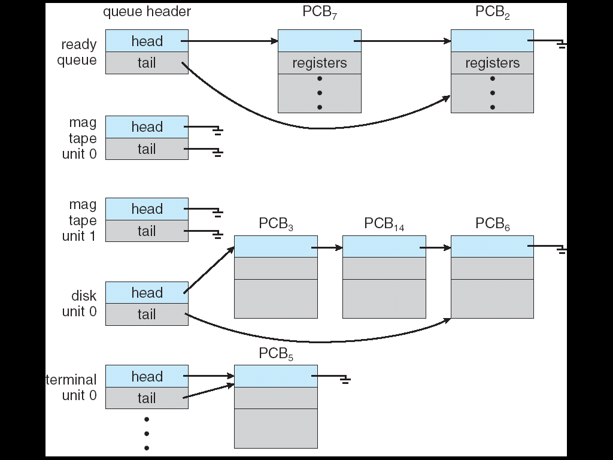

### Queueing-diagram representation
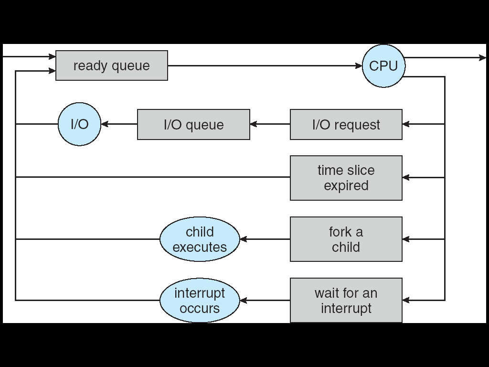

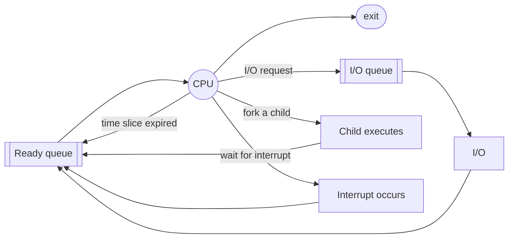

---

## 7. Schedulers — Long, Short & Medium Term ★★★

| | **Long-term (job) scheduler** | **Short-term (CPU) scheduler** | **Medium-term scheduler** |
|---|---|---|---|
| Function | Selects processes from the **job pool** (disk) and loads them into the **ready queue** | Selects from **ready processes** and **allocates the CPU** | **Swaps** processes out of memory to disk and back in |
| Frequency | **Infrequent** (seconds/minutes) — may be slow | **Very frequent** (milliseconds) — must be fast | Intermediate |
| Controls | **Degree of multiprogramming** | Which process runs next | Reduces degree of multiprogramming |
| Transition | New → Ready | Ready → Running | Ready/Wait ↔ Suspended |
| Present in | Batch systems; minimal/absent in time-sharing | All systems | Time-sharing systems |
| Invoked by | Process completion/arrival | Clock interrupts, I/O interrupts, system calls, signals | Memory pressure |

- The long-term scheduler should choose a good **mix** of **I/O-bound** (more time on I/O, many short CPU bursts) and **CPU-bound** (more computation, few long bursts) processes.
- The **medium-term scheduler** may swap out a process that is **inactive** for some time, has **low priority**, is **page-faulting frequently**, or uses **large memory** — swapped back when memory is available or it is unblocked.

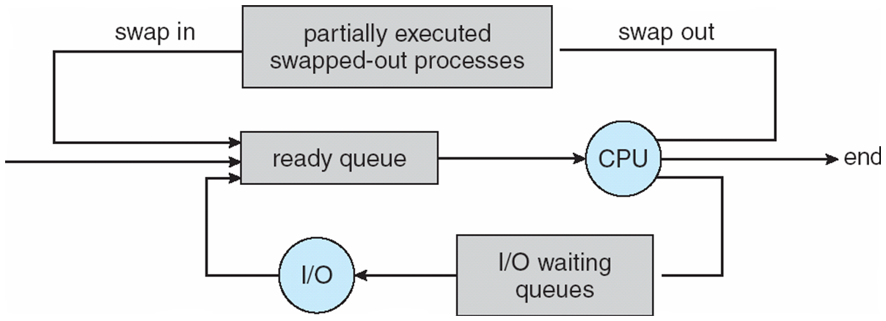

---

## 8. Operations on Processes ★★

### 8.1 Process Creation
- A **parent** process creates **children**, which create others → a **tree of processes** (identified by **PID**).
- **Resource sharing options:** parent and children share **all** resources; children share a **subset**; **no** sharing.
- **Execution options:** parent and children run **concurrently**; or parent **waits** until children terminate.
- **Address space options:** child is a **duplicate** of the parent (same program & data); or child has a **new program** loaded.
- **UNIX:** `fork()` creates a new process (copy of parent); `exec()` after fork **replaces** the process's memory with a new program; parent calls `wait()`.

```c
pid_t pid = fork();
if (pid < 0)        { /* error */ }
else if (pid == 0)  { execlp("/bin/ls", "ls", NULL); }   /* child */
else                { wait(NULL); printf("Child complete"); } /* parent */
```

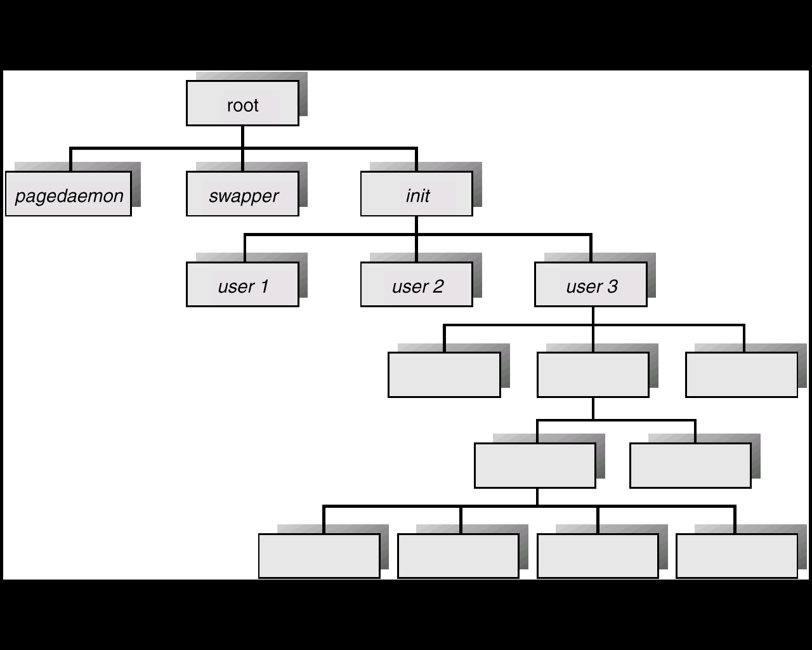

### 8.2 Process Termination
- Process executes its last statement and asks the OS to delete it (**exit**); output data returned to parent (via **wait**); resources **deallocated**.
- Parent may **abort** a child when: child **exceeded allocated resources**; child's task **no longer required**; parent is **exiting** and the OS doesn't allow orphans → **cascading termination**.
- **Zombie** = terminated child whose parent hasn't called wait(); **orphan** = child whose parent terminated.

---

## 9. CPU Scheduling — Basic Concepts ★★★

- **Maximum CPU utilisation** is obtained with multiprogramming.
- **CPU–I/O burst cycle:** process execution is a cycle of **CPU execution (CPU burst)** and **I/O wait (I/O burst)**; it begins and ends with a CPU burst. I/O-bound programs have many **short** CPU bursts; CPU-bound have few **long** bursts.

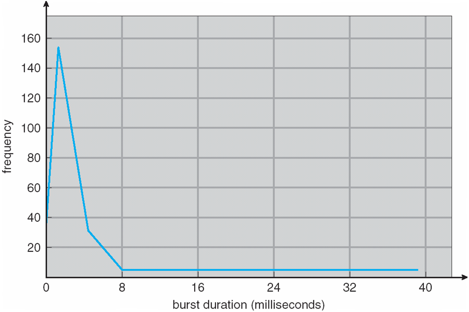

### 9.1 CPU Scheduler & When Scheduling Occurs
The **short-term scheduler** selects a process from the ready queue. Decisions occur when a process:
1. Switches **running → waiting** (I/O request) — *non-preemptive*
2. Switches **running → ready** (interrupt) — *preemptive*
3. Switches **waiting → ready** (I/O completion) — *preemptive*
4. **Terminates** — *non-preemptive*

Scheduling only under 1 and 4 is **non-preemptive (cooperative)**; otherwise **preemptive** (which raises issues: shared data access, preemption in kernel mode, interrupts during crucial OS activity).

### 9.2 Preemptive vs Non-preemptive ★★★
| Basis | Preemptive | Non-preemptive |
|---|---|---|
| Basic | CPU allocated for a **limited time**, then may be taken away | Process holds CPU until it **terminates or waits** |
| Interrupt | Process can be interrupted midway | Cannot be interrupted |
| Starvation | Low-priority process may starve if high-priority ones keep arriving | Short process may starve behind a long one |
| Overhead | Scheduling/context-switch overhead | No such overhead |
| Flexibility | Flexible, responsive | Rigid |
| Cost | Cost associated (shared-data consistency) | Not cost-associative |
| Examples | RR, SRTF, preemptive priority | FCFS, SJF, non-preemptive priority |

### 9.3 Dispatcher ★★
The **dispatcher** module gives control of the CPU to the process selected by the short-term scheduler:
- **switching context**,
- **switching to user mode**,
- **jumping to the proper location** in the user program to restart it.

**Dispatch latency** = time for the dispatcher to **stop one process and start another** — should be minimal.

---

## 10. Scheduling Criteria ★★★

| Criterion | Definition | Goal |
|---|---|---|
| **CPU utilisation** | Keep CPU as busy as possible (40 % light – 90 % heavy load) | **Max** |
| **Throughput** | Number of processes **completed per time unit** | **Max** |
| **Turnaround time (TAT)** | Submission to completion | **Min** |
| **Waiting time (WT)** | Sum of periods spent **in the ready queue** | **Min** |
| **Response time (RT)** | Submission until the **first response** (start of response, not output) | **Min** |

**Formulas:**
- **TAT = Completion Time (CT) − Arrival Time (AT)**
- **WT = TAT − Burst Time (BT)**
- **RT = Time of first CPU allocation − AT**

Other goals: fairness, **avoid starvation**, predictability, enforce priorities, balance resource use.

---

## 11. First-Come, First-Served (FCFS) ★★★

- Process that **arrives first** is served first (FIFO queue); ties broken by smaller process ID.
- **Non-preemptive**; criterion: arrival time.

**Example (all arrive at 0):** P1 = 24, P2 = 3, P3 = 3

Order P1, P2, P3:
```
| P1                      | P2 | P3 |
0                         24   27   30
```
WT: P1 = 0, P2 = 24, P3 = 27 → **avg = 17**

Order P2, P3, P1:
```
| P2 | P3 | P1                      |
0    3    6                         30
```
WT: P1 = 6, P2 = 0, P3 = 3 → **avg = 3** — much better.

- **Convoy effect:** short processes wait behind a long process (one CPU-bound + many I/O-bound processes → low utilisation).

| Advantages | Disadvantages |
|---|---|
| Simple, easy to implement (queue) | High average waiting time |
| **No starvation** | **Convoy effect** |
| Fair in arrival order | Ignores priority and burst time; poor for time-sharing |

---

## 12. Shortest-Job-First (SJF) & SRTF ★★★

- Associate each process with the length of its **next CPU burst**; schedule the **shortest** one. Ties → FCFS.
- **SJF is optimal** — gives the **minimum average waiting time** for a given set of processes.
- Difficulty: **knowing the next CPU burst** (ask the user in batch; predict otherwise).
- Two versions: **non-preemptive SJF** and **preemptive SJF = Shortest-Remaining-Time-First (SRTF)** — a newly arrived process with a burst shorter than the remaining time of the current process preempts it.

**Example — non-preemptive SJF (all at 0):** P1 = 6, P2 = 8, P3 = 7, P4 = 3
```
| P4 | P1     | P3      | P2       |
0    3        9         16         24
```
WT: P1 = 3, P2 = 16, P3 = 9, P4 = 0 → **avg = 7**

**Example — SRTF:**
| Process | Arrival | Burst |
|---|---|---|
| P1 | 0 | 8 |
| P2 | 1 | 4 |
| P3 | 2 | 9 |
| P4 | 3 | 5 |
```
| P1 | P2    | P4     | P1       | P3        |
0    1       5        10         17          26
```
WT = [(10−1) + (1−1) + (17−2) + (5−3)]/4 = 26/4 = **6.5 ms**

### 12.1 Predicting the next CPU burst — Exponential averaging ★★
$$\tau_{n+1} = \alpha\,t_n + (1-\alpha)\,\tau_n$$
where t<sub>n</sub> = actual length of the n-th burst, τ<sub>n+1</sub> = predicted next burst, 0 ≤ α ≤ 1 (commonly **α = ½**).

- **α = 0** → τ<sub>n+1</sub> = τ<sub>n</sub> — recent history does not count.
- **α = 1** → τ<sub>n+1</sub> = t<sub>n</sub> — only the last burst counts.
- Expanded: τ<sub>n+1</sub> = αt<sub>n</sub> + (1−α)αt<sub>n−1</sub> + … + (1−α)<sup>j</sup>αt<sub>n−j</sub> + … + (1−α)<sup>n+1</sup>τ<sub>0</sub> — older bursts get geometrically less weight.

*Example:* τ<sub>0</sub> = 10, α = ½, t<sub>0</sub> = 6 → τ<sub>1</sub> = 0.5·6 + 0.5·10 = **8**; t<sub>1</sub> = 4 → τ<sub>2</sub> = 0.5·4 + 0.5·8 = **6**.


| Advantages | Disadvantages |
|---|---|
| Minimum average waiting time (optimal) | Burst length must be known/predicted |
| Good throughput | **Starvation** of long processes |
| | SRTF has more context switches |

---

## 13. Priority Scheduling ★★★

- A **priority number** (integer) is associated with each process; CPU goes to the **highest priority** (here, **smallest integer = highest priority**).
- Can be **preemptive** or **non-preemptive**. SJF is a priority scheme where priority = predicted next burst.
- **Problem: Starvation (indefinite blocking)** — low-priority processes may never run.
- **Solution: Aging** — gradually **increase the priority** of processes that wait a long time.

**Example (all arrive at 0):**
| Process | Burst | Priority |
|---|---|---|
| P1 | 10 | 3 |
| P2 | 1 | 1 |
| P3 | 2 | 4 |
| P4 | 1 | 5 |
| P5 | 5 | 2 |
```
| P2 | P5    | P1         | P3 | P4 |
0    1       6            16   18   19
```
WT: P1 = 6, P2 = 0, P3 = 16, P4 = 18, P5 = 1 → 41/5 = **8.2 ms**

---

## 14. Round Robin (RR) ★★★

- Designed for **time-sharing**: each process gets a small **time quantum q** (10–100 ms); when it expires the process is **preempted** and added to the **tail** of the ready queue (FIFO circular queue).
- With n processes and quantum q, each gets **1/n of the CPU** in chunks of ≤ q; **no process waits more than (n−1)q**.
- **Large q → FCFS**; **small q → too many context switches** (q must be large relative to context-switch time; context switch < 10 µs). Rule of thumb: **80 % of CPU bursts should be shorter than q**.
- Typically **higher average turnaround than SJF but better response time**.

**Example q = 4:** P1 = 24, P2 = 3, P3 = 3
```
| P1 | P2 | P3 | P1 | P1 | P1 | P1 | P1 |
0    4    7    10   14   18   22   26   30
```
WT: P1 = 6, P2 = 4, P3 = 7 → **avg = 5.67**

**Example q = 20:** P1 = 53, P2 = 17, P3 = 68, P4 = 24
```
| P1 | P2 | P3 | P4 | P1 | P3 | P4 | P1 | P3 | P3 |
0    20   37   57   77   97   117  121  134  154  162
```
WT = [(77−20)+(121−97)] + 20 + [37+(97−57)+(134−117)] + [57+(117−77)] → (57+24) + 20 + (37+40+17) + (57+40) = 81+20+94+97 = 292 → **avg = 73**
*(The slide writes (77+24) for P1, giving 312/4 = 78; P1's first wait is 0 and its later waits are 57 and 24, so 73 is the correct figure.)*

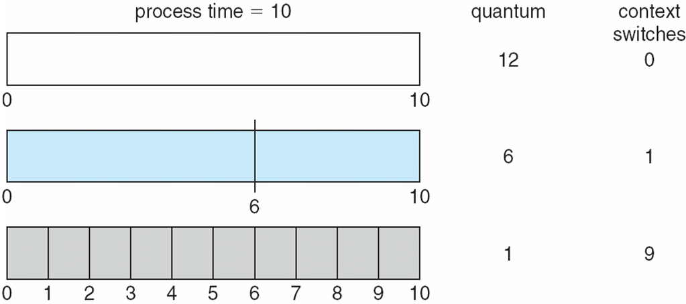
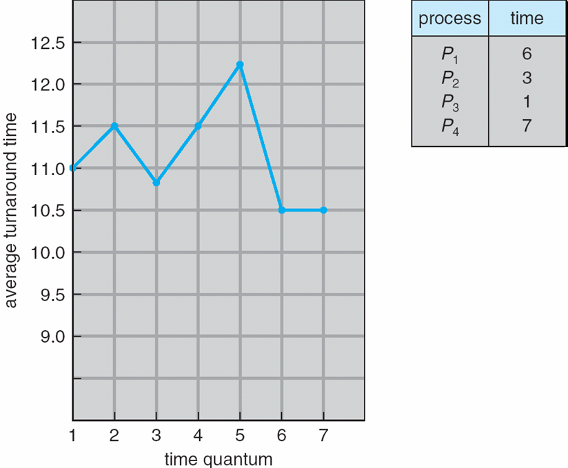

---

## 15. Multilevel Queue & Multilevel Feedback Queue ★★★

### 15.1 Multilevel Queue (MLQ)
- Ready queue **partitioned into separate queues**, e.g., **foreground (interactive)** and **background (batch)**.
- Processes are **permanently assigned** to one queue (by memory size, priority, type).
- Each queue has its **own algorithm** — foreground: **RR**; background: **FCFS**.
- Scheduling **between** queues:
  - **Fixed priority** — serve all foreground then background → possible **starvation**;
  - **Time slice** — e.g., **80 %** CPU to foreground (RR), **20 %** to background (FCFS).

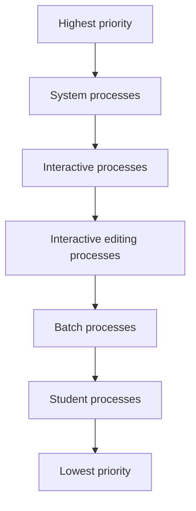

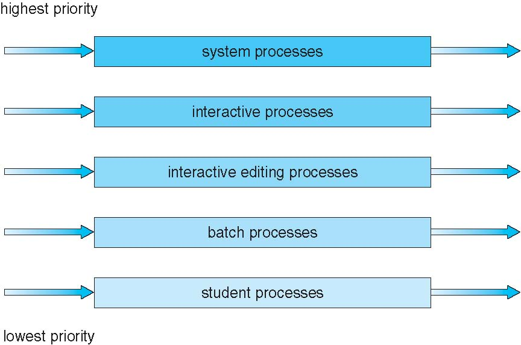

### 15.2 Multilevel Feedback Queue (MLFQ)
- Processes can **move between queues** — separates processes by CPU-burst behaviour; **aging** can be implemented this way.
  - Uses too much CPU → moved to a **lower-priority** queue.
  - Waits too long in a low queue → moved **up**.
- Defined by: **number of queues; algorithm for each queue; method to upgrade; method to demote; which queue a process enters** when it needs service.

**Example — three queues:**
- **Q0** — RR, q = 8 ms; **Q1** — RR, q = 16 ms; **Q2** — FCFS.
- A new job enters **Q0**; if it doesn't finish in 8 ms → moved to tail of **Q1**; there it gets 16 more ms; if still not done → preempted to **Q2** (FCFS).
- Q1 runs only when Q0 is empty; Q2 only when Q0 and Q1 are empty; an arrival for a higher queue **preempts** a lower-queue process.

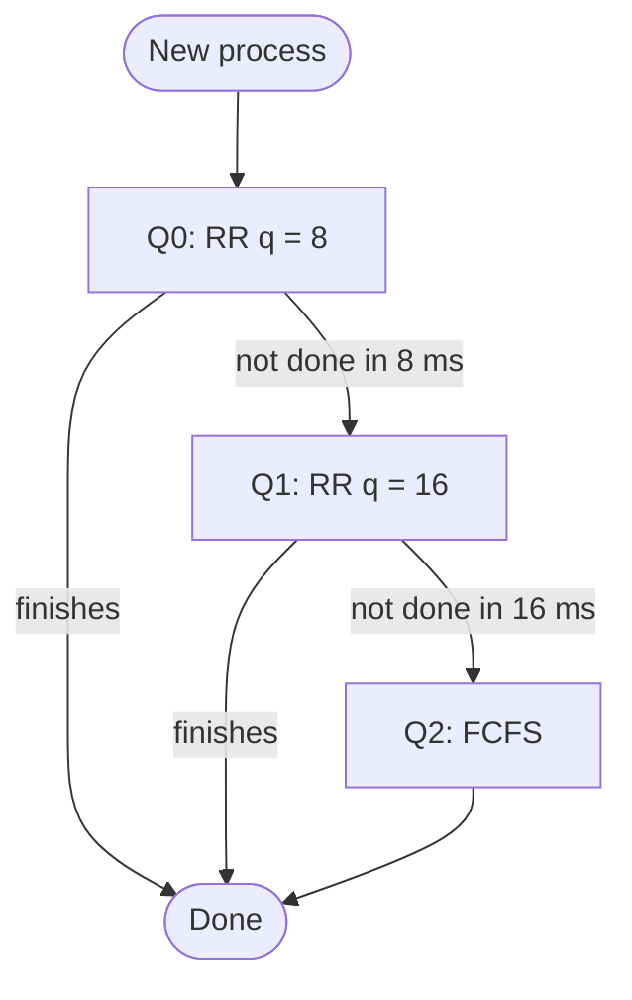

| MLQ | MLFQ |
|---|---|
| Processes **fixed** to a queue | Processes **move** between queues |
| Low overhead | More overhead, more flexible |
| Starvation possible | Aging prevents starvation |

---

## 16. Solved Exercises ★★★

### 16.1 Five jobs with arrival times
| Process | Arrival | Burst |
|---|---|---|
| P1 | 2 | 10 |
| P2 | 1 | 2 |
| P3 | 0 | 5 |
| P4 | 4 | 6 |
| P5 | 3 | 4 |

**(a) FCFS**
```
| P3    | P2 | P1          | P5    | P4      |
0       5    7             17      21        27
```
| Process | CT | TAT = CT−AT | WT = TAT−BT |
|---|---|---|---|
| P1 | 17 | 15 | 5 |
| P2 | 7 | 6 | 4 |
| P3 | 5 | 5 | 0 |
| P4 | 27 | 23 | 17 |
| P5 | 21 | 18 | 14 |
| **Avg** | | **13.4** | **8.0** |

**(b) Preemptive SJF (SRTF)** — at t = 1 P2 (2) preempts P3 (remaining 4); at t = 3 tie P3 (4) vs P5 (4) → earlier arrival P3.
```
| P3 | P2 | P3     | P5     | P4       | P1          |
0    1    3        7        11         17            27
```
| Process | CT | TAT | WT |
|---|---|---|---|
| P1 | 27 | 25 | 15 |
| P2 | 3 | 2 | 0 |
| P3 | 7 | 7 | 2 |
| P4 | 17 | 13 | 7 |
| P5 | 11 | 8 | 4 |
| **Avg** | | **11.0** | **5.6** |

**(c) Round Robin, q = 3** (new arrivals join the queue before the preempted process)
```
| P3 | P2 | P1 | P5 | P3 | P4 | P1 | P5 | P4 | P1 | P1 |
0    3    5    8    11   13   16   19   20   23   26   27
```
| Process | CT | TAT | WT |
|---|---|---|---|
| P1 | 27 | 25 | 15 |
| P2 | 5 | 4 | 2 |
| P3 | 13 | 13 | 8 |
| P4 | 23 | 19 | 13 |
| P5 | 20 | 17 | 13 |
| **Avg** | | **15.6** | **10.2** |

### 16.2 Exam question 18 — jobs arrive at 0 in order 1…5
| Job | Burst | Priority |
|---|---|---|
| 1 | 10 | 3 |
| 2 | 1 | 1 |
| 3 | 2 | 3 |
| 4 | 1 | 4 |
| 5 | 5 | 2 |

| Algorithm | Gantt chart | TAT (J1…J5) | WT (J1…J5) | Avg TAT | Avg WT |
|---|---|---|---|---|---|
| **FCFS** | J1 0–10, J2 10–11, J3 11–13, J4 13–14, J5 14–19 | 10, 11, 13, 14, 19 | 0, 10, 11, 13, 14 | 13.4 | 9.6 |
| **RR (q = 1)** | J1,J2,J3,J4,J5,J1,J3,J5,J1,J5,J1,J5,J1,J5, J1 14–19 | 19, 2, 7, 4, 14 | 9, 1, 5, 3, 9 | 9.2 | 5.4 |
| **SPN (SJF)** = **SRT** (all arrive at 0) | J2 0–1, J4 1–2, J3 2–4, J5 4–9, J1 9–19 | 19, 1, 4, 2, 9 | 9, 0, 2, 1, 4 | 7.0 | 3.2 |
| **Priority** (non-preemptive) | J2 0–1, J5 1–6, J1 6–16, J3 16–18, J4 18–19 | 16, 1, 18, 19, 6 | 6, 0, 16, 18, 1 | 12.0 | 8.2 |

> Observation: SJF/SRT gives the **minimum average waiting time** (3.2), confirming its optimality.

---

## 17. Case Studies — Windows & Linux Scheduling ★★

### 17.1 Windows (XP) Scheduling
- **Priority-based, preemptive**; the **dispatcher** is the scheduler; highest-priority thread runs next.
- A thread runs until it (1) **blocks**, (2) uses its **time slice**, (3) is **preempted** by a higher-priority thread. Real-time threads can preempt non-real-time ones.
- **32-level** priority scheme: **variable class 1–15**, **real-time class 16–31**; priority 0 = memory-management thread. A queue per priority; **idle thread** if nothing is runnable.
- Win32 **priority classes:** REALTIME, HIGH, ABOVE_NORMAL, NORMAL, BELOW_NORMAL, IDLE (all variable except REALTIME). **Relative priorities** within a class: TIME_CRITICAL, HIGHEST, ABOVE_NORMAL, NORMAL, BELOW_NORMAL, LOWEST, IDLE. Class + relative priority → numeric priority; base = NORMAL.
- Quantum expires → priority **lowered** (never below base); after a wait → priority **boosted** (depending on what was waited for); **foreground window gets 3× boost**.

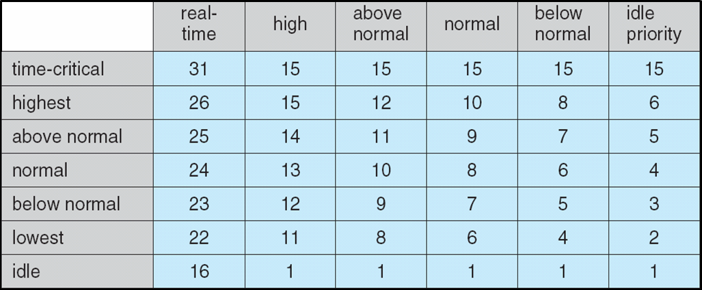

### 17.2 Linux Scheduling (O(1) scheduler, kernel 2.5/2.6)
- **Constant-time O(1)** scheduling; **preemptive, priority-based**.
- Two ranges: **real-time 0–99** and **nice/time-sharing 100–140**; numerically **lower = higher priority**; **higher priority gets a larger quantum**.
- Task runnable while time is left in its slice (**active**); when used up → **expired** until all others use theirs.
- Each processor has its own **runqueue** (SMP support) with **two priority arrays — active and expired** — indexed by priority; when active becomes empty the arrays are **swapped**.
- Real-time tasks: **static** priorities (POSIX.1b). Others: **dynamic** priority = nice ± 5 based on **interactivity** (how long the task sleeps waiting for I/O — more interactive → bonus). Priority recalculated when a task expires.
- *(Modern Linux uses the **Completely Fair Scheduler (CFS)** with a red-black tree of virtual runtimes.)*

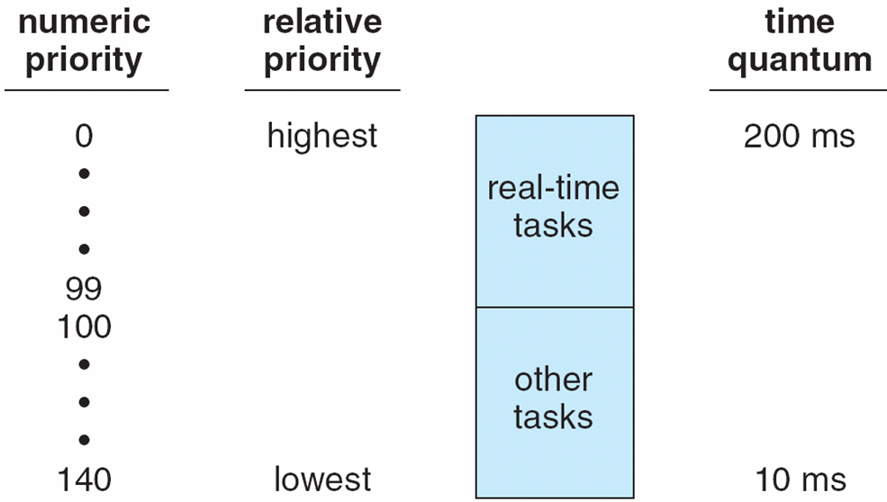
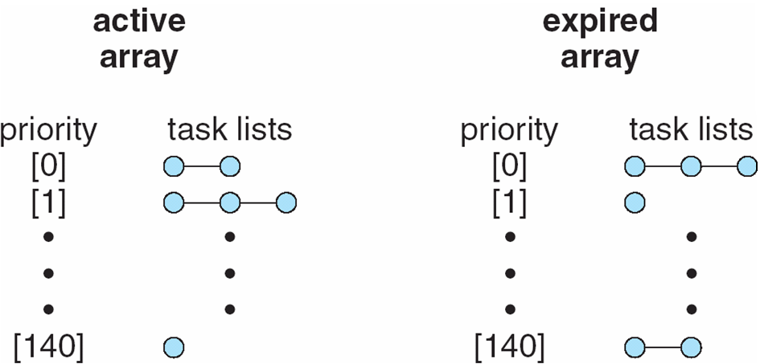

---

## Unit II — One-Page Summary

| Topic | Key points |
|---|---|
| **Process** | Program in execution: text, PC/registers, stack, data, heap. Program = passive; process = active. |
| **States** | New → Ready → Running → (Waiting ↔ Ready) → Terminated; + Suspended Ready / Suspended Wait via swapping. |
| **PCB** | State, PID, PC, registers, scheduling info, memory info, accounting, I/O status. |
| **Context switch** | Save old PCB, load new PCB; pure overhead; hardware register sets help. |
| **Thread** | Own PC, registers, stack; shares code, data, files. Faster creation/switching than processes. |
| **Queues** | Job, ready, device, waiting, suspended. Queueing diagram: CPU → I/O, time-slice, fork, interrupt → ready queue. |
| **Schedulers** | Long-term (job, degree of multiprogramming, infrequent) · Short-term (CPU, ms, fast) · Medium-term (swapping). Mix I/O- and CPU-bound. |
| **Operations** | fork(), exec(), wait(), exit(); tree of processes; abort; cascading termination. |
| **CPU scheduling** | CPU–I/O burst cycle; decisions at run→wait, run→ready, wait→ready, terminate. Preemptive vs non-preemptive. Dispatcher: context switch, user mode, jump; dispatch latency. |
| **Criteria** | Max CPU utilisation & throughput; min TAT, WT, RT. **TAT = CT − AT; WT = TAT − BT; RT = first run − AT.** |
| **FCFS** | Non-preemptive, FIFO; convoy effect (24,3,3 → avg WT 17 vs 3). |
| **SJF / SRTF** | Optimal min avg WT; needs burst prediction τ<sub>n+1</sub> = αt<sub>n</sub> + (1−α)τ<sub>n</sub>; starvation of long jobs. SRTF example avg 6.5. |
| **Priority** | Smallest number = highest; starvation → **aging**. Example avg WT 8.2. |
| **RR** | Quantum q; ≤ (n−1)q wait; large q → FCFS, small q → overhead; 80 % bursts < q. |
| **MLQ / MLFQ** | MLQ: fixed queues (fg RR, bg FCFS; fixed priority or 80/20 time slice). MLFQ: move between Q0 (q=8), Q1 (q=16), Q2 (FCFS); aging. |
| **Windows** | 32 priorities (1–15 variable, 16–31 real-time), classes + relative priorities, boosts. |
| **Linux** | O(1): RT 0–99, nice 100–140, active/expired arrays per CPU; dynamic priority ±5 by interactivity. |
