# Unit III — Process Synchronization & Inter-Process Communication

> **Syllabus:** The critical-section problem; solutions to the critical-section problem (software — Peterson's, and hardware); synchronization hardware; semaphores; classical problems of synchronization; monitors. Inter-process communication mechanisms: IPC between processes on a single computer and on different systems, using pipes, FIFOs, message queues and shared memory.
>
> **Source:** *OS-UNIT III-2024.ppt* · *Important Questions Mid-1_OS*

**Importance legend:** ★★★ = very frequently asked (long answer) · ★★ = medium · ★ = short answer

---

## Table of Contents
1. [Cooperating Processes & the Producer–Consumer Problem](#1-cooperating-processes--the-producerconsumer-problem-)
2. [Race Condition](#2-race-condition-)
3. [The Critical-Section Problem](#3-the-critical-section-problem-)
4. [Peterson's Solution (Software)](#4-petersons-solution-software-)
5. [Synchronization Hardware — Test-and-Set & Swap](#5-synchronization-hardware-)
6. [Semaphores](#6-semaphores-)
7. [Deadlock, Starvation & Priority Inversion with Semaphores](#7-deadlock-starvation--priority-inversion-)
8. [Classical Problems of Synchronization](#8-classical-problems-of-synchronization-)
9. [Lock vs Mutex vs Semaphore](#9-lock-vs-mutex-vs-semaphore-)
10. [Monitors](#10-monitors-)
11. [Inter-Process Communication — Models](#11-inter-process-communication-ipc-)
12. [Message-Passing Systems — Naming, Synchronisation, Buffering](#12-message-passing-systems-)
13. [Pipes, FIFOs, Message Queues, Shared Memory](#13-ipc-mechanisms-pipes-fifos-message-queues-shared-memory-)
14. [Unit III — One-Page Summary](#unit-iii--one-page-summary)

---

## 1. Cooperating Processes & the Producer–Consumer Problem ★★

- A **cooperating process** can **affect or be affected** by other processes. Cooperating processes either **directly share a logical address space** (code and data — threads) or share data **only through files or messages**.
- **Concurrent access to shared data may result in data inconsistency** → we need mechanisms to ensure **orderly execution** of cooperating processes so that data consistency is maintained.

### 1.1 Producer–Consumer (Bounded-Buffer) Problem
A **producer** produces information consumed by a **consumer** — e.g., compiler → assembly code → assembler → object modules → loader; web server → HTML/images → browser. Solution: a **shared buffer** filled by the producer and emptied by the consumer.

| Buffer type | Behaviour |
|---|---|
| **Unbounded** | No practical limit; consumer may wait for new items, producer **never** waits |
| **Bounded** | Fixed size; **consumer waits if empty**, **producer waits if full** |

**Requirements:** (1) producer must not overwrite a **full** buffer; (2) consumer must not consume an **empty** buffer; (3) buffer access must be **mutually exclusive**; (4) items consumed in the **same order** they were produced.

**Code using a shared `count`** (buffer[0..BUFFER_SIZE−1], `in = out = count = 0`):

```c
/* Producer */                          /* Consumer */
while (true) {                          while (true) {
  /* produce nextProduced */              while (count == 0)
  while (count == BUFFER_SIZE)              ;   /* do nothing */
      ;   /* do nothing */                nextConsumed = buffer[out];
  buffer[in] = nextProduced;              out = (out + 1) % BUFFER_SIZE;
  in = (in + 1) % BUFFER_SIZE;            count--;
  count++;                                /* consume nextConsumed */
}                                       }
```
Each routine is correct separately but **not when executed concurrently**.

---

## 2. Race Condition ★★★

`count++` and `count--` are **not atomic** — in machine language:

```
count++ :  register1 = count          count-- :  register2 = count
           register1 = register1 + 1             register2 = register2 - 1
           count = register1                     count = register2
```

Interleaving with **count = 5** initially:

| Time | Process | Statement | Result |
|---|---|---|---|
| T0 | producer | register1 = count | register1 = 5 |
| T1 | producer | register1 = register1 + 1 | register1 = 6 |
| T2 | consumer | register2 = count | register2 = 5 |
| T3 | consumer | register2 = register2 − 1 | register2 = 4 |
| T4 | producer | count = register1 | **count = 6** |
| T5 | consumer | count = register2 | **count = 4** ✗ |

The result is **4** (or **6** if T4 and T5 are swapped), but the correct value is **5**.

> **Race condition:** several processes access and manipulate the same data **concurrently**, and the **outcome depends on the particular order** in which the accesses take place. → We need **process synchronization**.

---

## 3. The Critical-Section Problem ★★★

- System of n processes {P0 … Pn−1}; each has a segment of code called the **critical section (CS)** in which it changes **common variables**, updates a table, writes a file, etc.
- **When one process is executing in its CS, no other process may execute in its CS.**
- The **critical-section problem** = design a **protocol** the processes can use to cooperate.

### 3.1 General structure of a process
```c
do {
    [ entry section ]      // request permission to enter
        critical section   // only one process at a time
    [ exit section ]       // release, let others in
        remainder section  // rest of the code
} while (true);
```

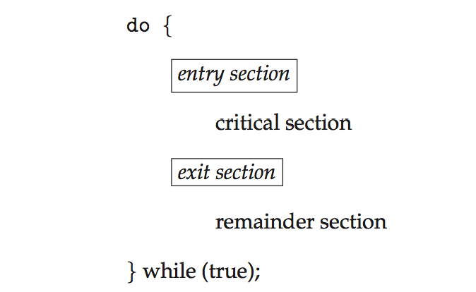

### 3.2 Three Requirements of a Solution ★★★
| Requirement | Meaning |
|---|---|
| **1. Mutual exclusion** | If Pi is executing in its CS, **no other process** can be executing in its CS |
| **2. Progress** | If no process is in its CS and some wish to enter, only processes **not in their remainder sections** decide who enters next, and this decision **cannot be postponed indefinitely** |
| **3. Bounded waiting** | There is a **bound** on the number of times other processes may enter their CS after a process has requested entry and before it is granted (no starvation) |

Assumption: each process runs at non-zero speed; no assumption about relative speeds.

### 3.3 Solution using locks
```c
do {
    acquire lock
        critical section
    release lock
        remainder section
} while (TRUE);
```

---

## 4. Peterson's Solution (Software) ★★★

- A classic **software** solution, restricted to **two processes** P0 and P1 (Pi and Pj, j = 1 − i) that alternate between CS and remainder sections.
- Not guaranteed on modern architectures (load/store reordering) but gives a good **algorithmic description**.
- Shared variables:
  - `int turn;` — **whose turn** it is to enter the CS
  - `boolean flag[2];` — `flag[i] = true` means **Pi is ready** to enter

```c
/* Process Pi */
do {
    flag[i] = true;          // I want to enter
    turn = j;                // but let the other go first
    while (flag[j] && turn == j)
        ;                    // busy wait
    /* critical section */
    flag[i] = false;         // I am out
    /* remainder section */
} while (true);
```

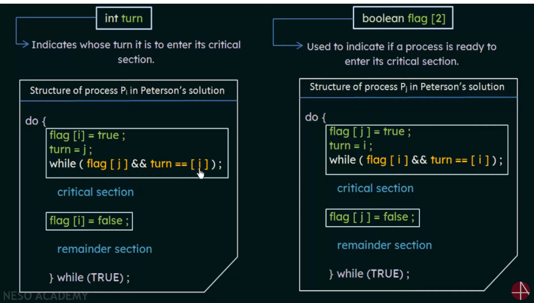

**Why it works:**
- If both try at once, `turn` is set to both i and j almost together — **only the last assignment lasts**, so exactly one enters.
1. **Mutual exclusion:** Pi enters only if `flag[j] == false` **or** `turn == i`. If both were in the CS, flag[0] = flag[1] = true, and both would have passed their while loops — impossible since `turn` is either 0 or 1, not both.
2. **Progress:** Pi is blocked only if flag[j] is true and turn == j; if Pj isn't interested (flag[j] = false), Pi enters immediately.
3. **Bounded waiting:** when Pj exits it sets flag[j] = false; if it re-enters it sets turn = i, so Pi enters after **at most one** entry by Pj.

---

## 5. Synchronization Hardware ★★★

Critical sections can be solved by **software (Peterson)** or **hardware** support. Uniprocessors could simply **disable interrupts** during the CS (not feasible on multiprocessors — too slow, affects clock). Modern machines provide **atomic (non-interruptible) hardware instructions**.

### 5.1 Lock variable idea
Shared `lock`: **0 = CS free**, **1 = CS locked**. Before entering, a process checks the lock — if locked it **waits**; if free it **takes the lock** and enters. This only works if *test* and *set* happen **atomically**.

### 5.2 Test-and-Set Lock (TSL)
```c
boolean test_and_set(boolean *target) {   // executed atomically
    boolean rv = *target;
    *target = TRUE;
    return rv;
}

/* shared: boolean lock = FALSE; */
do {
    while (test_and_set(&lock))
        ;            // busy wait
    /* critical section */
    lock = FALSE;
    /* remainder section */
} while (TRUE);
```

### 5.3 Swap / Compare-and-Swap
```c
void swap(boolean *a, boolean *b) {   // atomic
    boolean temp = *a; *a = *b; *b = temp;
}
/* shared lock = FALSE; each process has local key */
do {
    key = TRUE;
    while (key == TRUE) swap(&lock, &key);
    /* critical section */
    lock = FALSE;
    /* remainder section */
} while (TRUE);
```

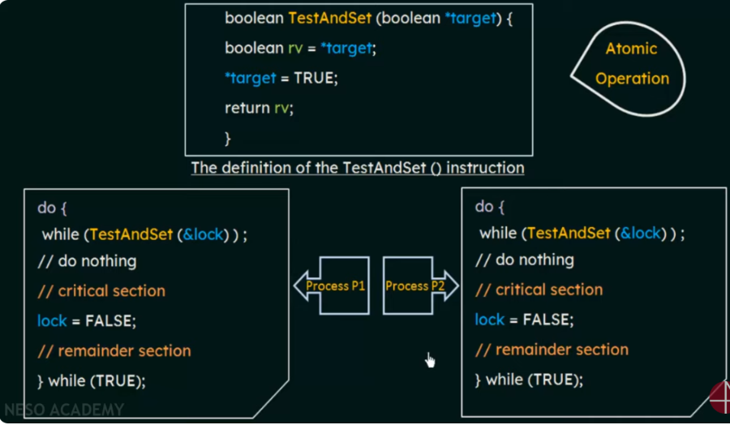

- TSL and Swap satisfy **mutual exclusion and progress** but **not bounded waiting** (a process may keep losing). A bounded-waiting version uses a `waiting[n]` array and passes the lock to the next waiting process in cyclic order.
- Drawback: **busy waiting (spinlock)** wastes CPU cycles.

---

## 6. Semaphores ★★★

Proposed by **Edsger Dijkstra**. A **semaphore S** is a non-negative **integer variable** that, apart from initialisation, is accessed only through two **atomic** operations:
- **wait() / P()** — from Dutch *proberen*, "to test"
- **signal() / V()** — from Dutch *verhogen*, "to increment"

```c
wait(S) {                 signal(S) {
    while (S <= 0)            S++;
        ;   // no-op      }
    S--;
}
```
All modifications to S must be executed **indivisibly** — no two processes may modify S simultaneously.

### 6.1 Types of Semaphores
| Binary semaphore | Counting semaphore |
|---|---|
| Value only **0 or 1** | Value over an **unrestricted domain** |
| Also called **mutex lock** | Controls access to a resource with **multiple instances** (initialised to number of instances) |
| Simpler to implement | A counting semaphore can be implemented using binary semaphores |

### 6.2 Uses / Advantages
**(1) Mutual exclusion:**
```c
semaphore S = 1;
do {
    wait(S);
        /* critical section */
    signal(S);
        /* remainder section */
} while (true);
```
**(2) Ordering/synchronisation:** P1 must execute S1 **before** P2 executes S2 — use `synch = 0`:
```c
P1:  S1;  signal(synch);          P2:  wait(synch);  S2;
```

### 6.3 Implementation without Busy Waiting ★★★
The busy-waiting version is a **spinlock** — wasteful when CSs are long. Instead, each semaphore has a **waiting queue**:

```c
typedef struct {
    int value;               // initially 1
    struct process *list;    // waiting queue
} semaphore;

wait(semaphore *S) {
    S->value--;
    if (S->value < 0) {
        add this process to S->list;
        block();             // move to waiting state
    }
}

signal(semaphore *S) {
    S->value++;
    if (S->value <= 0) {
        remove a process P from S->list;
        wakeup(P);           // move P to ready queue
    }
}
```
- **block()** — place the invoking process on the semaphore's waiting queue.
- **wakeup(P)** — move P from the waiting queue to the ready queue.
- A **negative value** = number of processes waiting on the semaphore.
- wait/signal themselves must be atomic (implemented with interrupts disabled or spinlocks — brief busy waiting only in these short code sections).

### 6.4 Properties of semaphores (asked in Mid-1)
1. Simple; works for **any number of processes**.
2. Can have **many different critical sections** with different semaphores.
3. Each CS can be accessed only by **one** process at a time (binary) or **k** processes (counting).
4. Operations are **atomic**; with waiting queues there is **no busy waiting**.
5. **Machine-independent** — implemented in the OS.
6. Disadvantages: **programming errors** (wrong order, omissions) lead to deadlock or violation of mutual exclusion; possible starvation; priority inversion.

---

## 7. Deadlock, Starvation & Priority Inversion ★★

- **Deadlock:** two or more processes wait **indefinitely** for an event that can be caused only by one of the waiting processes.

```c
/* S = Q = 1 */
P0:  wait(S);          P1:  wait(Q);
     wait(Q);               wait(S);     // each holds one, waits for other
     ...                    ...
     signal(S);             signal(Q);
     signal(Q);             signal(S);
```
- **Starvation (indefinite blocking):** a process may **never be removed** from the semaphore queue (e.g., LIFO queue).
- **Priority inversion:** a **lower-priority** process holds a lock needed by a **higher-priority** process (and a medium-priority one preempts the low one). Solved by the **priority-inheritance protocol** — the lock holder temporarily inherits the higher priority.

### 7.1 Problems with semaphores (incorrect use)
- `signal(mutex) … wait(mutex)` → several processes in CS (**violates mutual exclusion**).
- `wait(mutex) … wait(mutex)` → **deadlock**.
- Omitting wait() or signal() (or both) → mutual exclusion violated or deadlock.

These motivate higher-level constructs such as **monitors**.

---

## 8. Classical Problems of Synchronization ★★★

Used to test newly proposed synchronisation schemes: **Bounded-Buffer**, **Readers–Writers**, **Dining-Philosophers**.

### 8.1 Bounded-Buffer Problem
N buffers each holding one item. Semaphores: **mutex = 1** (buffer access), **full = 0** (count of full slots), **empty = N** (count of empty slots).

```c
/* Producer */                       /* Consumer */
do {                                 do {
    /* produce item in nextp */          wait(full);
    wait(empty);                         wait(mutex);
    wait(mutex);                         /* remove item to nextc */
    /* add nextp to buffer */            signal(mutex);
    signal(mutex);                       signal(empty);
    signal(full);                        /* consume nextc */
} while (TRUE);                      } while (TRUE);
```
> Order matters: `wait(empty)` **before** `wait(mutex)`; reversing them can deadlock when the buffer is full.

### 8.2 Readers–Writers Problem ★★★
- A database is shared among processes: **readers** only read; **writers** read and write.
- **Multiple readers** may read simultaneously (no harm), but a **writer needs exclusive access** (writer + any other access → chaos).
- Shared data: **semaphore mutex = 1** (protects readcount), **semaphore wrt = 1** (writer exclusion), **int readcount = 0**.

```c
/* Writer */
do {
    wait(wrt);
        /* writing is performed */
    signal(wrt);
} while (TRUE);

/* Reader */
do {
    wait(mutex);              // entry section
    readcount++;
    if (readcount == 1)       // first reader locks out writers
        wait(wrt);
    signal(mutex);
        /* reading is performed (CS) */
    wait(mutex);              // exit section
    readcount--;
    if (readcount == 0)       // last reader lets writers in
        signal(wrt);
    signal(mutex);
} while (TRUE);
```
**Explanation:**
1. The **first reader** locks the resource from writers; later readers use it without re-locking.
2. Only one reader at a time can be in the entry/exit section (mutex protects `readcount` from races).
3. The **last reader** unlocks the resource for writers.
4. A continuous stream of readers can **starve writers** → not fair.

**Variations:** *First* readers–writers — no reader waits unless a writer already has permission (writers may starve). *Second* — once a writer is ready it writes ASAP (readers may starve). Some kernels provide **reader–writer locks**.

### 8.3 Dining-Philosophers Problem ★★★
- **5 philosophers** alternately **think and eat** around a table with a bowl of rice and **5 chopsticks** (one between each pair). To eat, a philosopher needs **both** adjacent chopsticks (picked up one at a time); releases both after eating.
- Shared data: `semaphore chopstick[5]` all initialised to **1**.

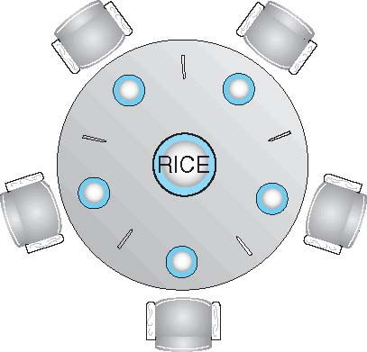

```c
/* Philosopher i */
do {
    wait(chopstick[i]);               // left
    wait(chopstick[(i + 1) % 5]);     // right
        /* eat */
    signal(chopstick[i]);
    signal(chopstick[(i + 1) % 5]);
        /* think */
} while (TRUE);
```
**Problem:** if all five get hungry at once and each picks up the **left** chopstick → all wait forever for the right one → **deadlock** (and possible **starvation**).

**Possible solutions:**
1. Allow at most **4 philosophers** at the table simultaneously (semaphore room = 4).
2. A philosopher picks up chopsticks **only if both are available** (pick both inside a critical section / monitor).
3. **Asymmetric solution:** odd philosophers pick **left then right**, even philosophers **right then left**.
4. **Monitor solution** with states THINKING/HUNGRY/EATING and condition variables (deadlock-free; starvation still possible).

```c
monitor DiningPhilosophers {
    enum {THINKING, HUNGRY, EATING} state[5];
    condition self[5];
    void pickup(int i) { state[i] = HUNGRY; test(i);
                         if (state[i] != EATING) self[i].wait(); }
    void putdown(int i){ state[i] = THINKING;
                         test((i+4)%5); test((i+1)%5); }
    void test(int i) {
        if (state[(i+4)%5] != EATING && state[i] == HUNGRY &&
            state[(i+1)%5] != EATING) { state[i] = EATING; self[i].signal(); }
    }
    initialization_code() { for (int i = 0; i < 5; i++) state[i] = THINKING; }
}
```

---

## 9. Lock vs Mutex vs Semaphore ★★

| Construct | Description |
|---|---|
| **Lock** | Allows only **one thread** into the locked part; not shared with other processes |
| **Mutex** | **Locking mechanism** — only one task can acquire it; has **ownership** — only the owner can release it |
| **Semaphore** | Like a mutex but allows **x threads** to enter; a **signalling mechanism** ("I'm done, you carry on") — e.g., an ISR signals the call-processing task when a call arrives while music plays |

---

## 10. Monitors ★★★

A **monitor** is a **high-level abstraction (abstract data type)** that provides a convenient and effective mechanism for process synchronisation.
- Internal variables are accessible **only by code within the monitor's procedures**.
- **Only one process may be active within the monitor at a time** → mutual exclusion is automatic.

```c
monitor monitor_name {
    // shared variable declarations
    procedure P1 (...) { ... }
    ...
    procedure Pn (...) { ... }
    initialization_code (...) { ... }
}
```

**Condition variables** (`condition x, y;`) let a process wait inside a monitor:
- `x.wait()` — the invoking process is **suspended** until another invokes `x.signal()`.
- `x.signal()` — **resumes exactly one** suspended process (no effect if none waiting — unlike semaphore signal).

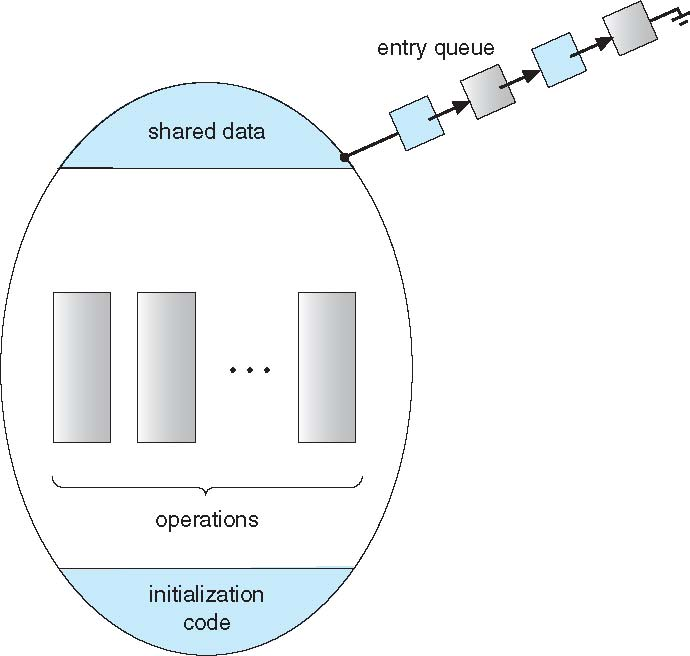

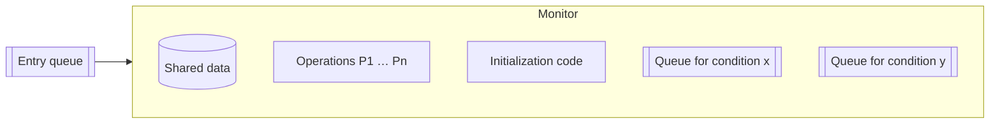

### Semaphore vs Monitor ★★★
| Basis | Semaphore | Monitor |
|---|---|---|
| Basic | An **integer variable** S | An **abstract data type** |
| Action | Value of S = number of available resources | Contains shared variables + procedures operating on them |
| Access | Process performs **wait()** to acquire and **signal()** to release | Shared variables accessed **only through monitor procedures** |
| Condition variables | **None** | **Has condition variables** |
| Mutual exclusion | Programmer's responsibility (error-prone) | **Automatic** (compiler-enforced) |
| Level | Low-level | High-level language construct |

---

## 11. Inter-Process Communication (IPC) ★★★

**IPC** = mechanism provided by the OS that allows processes to **communicate** — notify each other of events or **transfer data**.

Processes are **independent** (cannot affect/be affected) or **cooperating** (can affect/be affected; share data).

### 11.1 Reasons for process cooperation (advantages of IPC)
| Reason | Explanation |
|---|---|
| **Information sharing** | Several users may want the same information (shared file) → concurrent access |
| **Computation speed-up** | Break a task into **subtasks running in parallel** (needs multiple cores) |
| **Modularity** | Divide system functions into separate processes/threads |
| **Convenience** | A user may edit, listen to music and compile in parallel |

### 11.2 Two fundamental models
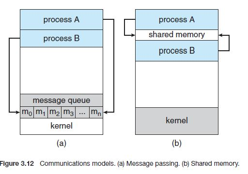

| | **Shared memory** | **Message passing** |
|---|---|---|
| Mechanism | A **region of memory shared** by cooperating processes; they read/write it | Processes exchange **messages** via send()/receive() |
| Kernel involvement | Only to **set up** the region; afterwards normal memory access → **fast** | System call for **every message** → slower |
| Synchronisation | Processes must synchronise themselves (e.g., semaphores) | Built-in |
| Best for | Large amounts of data, same machine | Small data, **distributed systems** (different computers), no conflicts to avoid |

### 11.3 Shared-Memory Systems
- The shared region normally resides in the address space of the **creating** process; others **attach** it to their address space.
- Normally the OS prevents one process from accessing another's memory → processes must **agree to remove this restriction**.
- Data format and location are determined by the processes, not the OS; they must ensure they don't write simultaneously.
- Classic use: **producer–consumer with a shared bounded/unbounded buffer** (§1).

---

## 12. Message-Passing Systems ★★★

Allows processes to communicate and synchronise **without sharing the same address space** — especially useful in **distributed environments**.

Operations: **send(message)** and **receive(message)**. Messages can be **fixed-size** (simple system implementation, harder programming) or **variable-size** (complex implementation, simpler programming).

If P and Q want to communicate, a **communication link** must exist. Logical implementation issues: **naming (direct/indirect)**, **synchronisation (blocking/non-blocking)**, **buffering (automatic/explicit)**.

### 12.1 Naming
**Direct communication** — each process explicitly names the other:
- `send(P, message)` — send to process P; `receive(Q, message)` — receive from Q.
- Link established **automatically**; associated with **exactly two** processes; **exactly one link** per pair.
- **Symmetric** addressing (both name each other) or **asymmetric** — only sender names receiver: `receive(id, message)` receives from any process, `id` set to sender's name.
- Disadvantage: changing a process's identifier requires changing all references (limited modularity).

**Indirect communication** — via **mailboxes (ports)**, each with a unique ID:
- `send(A, message)` / `receive(A, message)` — to/from mailbox A.
- Link established only if processes **share a mailbox**; a link may involve **more than two** processes; a pair may have **several links** (one per mailbox).
- If P1, P2, P3 share mailbox A and P1 sends while P2 and P3 receive — who gets it? Options: allow a link with **at most two** processes; allow **one receive() at a time**; or let the **system choose arbitrarily** (e.g., round robin) and notify the sender.

### 12.2 Synchronisation (blocking vs non-blocking)
| Primitive | Blocking (synchronous) | Non-blocking (asynchronous) |
|---|---|---|
| **send** | Sender **blocked until** the message is received (by process or mailbox) | Sender sends and **resumes** |
| **receive** | Receiver **blocks until** a message is available | Receiver gets a valid message **or null** |

Blocking send + blocking receive = **rendezvous**.

### 12.3 Buffering
Messages reside in a temporary **queue**:
1. **Zero capacity** — no messages can wait; **sender must block** until the receiver takes the message (no buffering).
2. **Bounded capacity** — finite length n; sender continues if not full, **blocks when full**.
3. **Unbounded capacity** — potentially infinite; **sender never blocks**.

---

## 13. IPC Mechanisms: Pipes, FIFOs, Message Queues, Shared Memory ★★★

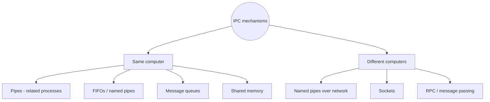

### 13.1 Pipes (ordinary / anonymous)
- A **unidirectional data channel**; two pipes give two-way communication. A form of **message passing** — no shared variables.
- Created with `int pipe(int fd[2]);` → returns **0 on success, −1 on failure**.
  - **fd[0] = read end**, **fd[1] = write end**.
- Accessed with ordinary `read()` and `write()` system calls; data flows **FIFO** through a **kernel buffer**.
- Used between **related processes** (parent–child after `fork()`); exists only while processes run.

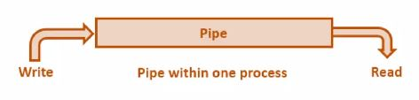

```c
int fd[2]; char buf[20];
pipe(fd);
if (fork() == 0) {               /* child: reader */
    close(fd[1]);
    read(fd[0], buf, sizeof buf);
    printf("child got: %s\n", buf);
} else {                         /* parent: writer */
    close(fd[0]);
    write(fd[1], "hello", 6);
}
```

### 13.2 FIFOs (Named Pipes)
- A variation on pipes — a **filename is attached** to the pipe → called **named pipes**.
- Exist in the **file system**, persist after processes exit, can be used by **unrelated processes**, and (on some systems) between processes on **different computers** across a network.
- Created by `mkfifo(pathname, mode)`; then opened with `open()` and used with `read()/write()`.

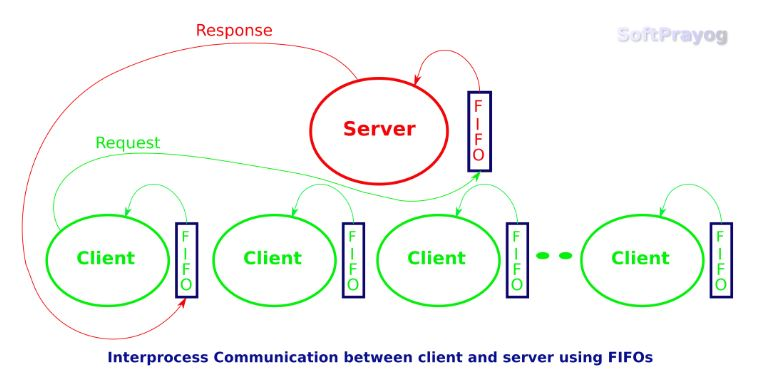

| Pipe | FIFO |
|---|---|
| No name; exists in memory | Has a **name** in the file system |
| Only **related** processes | **Unrelated** processes too |
| Destroyed when processes end | Persists until deleted |
| `pipe()` | `mkfifo()` |

### 13.3 Message Queues
- A **linked list of messages stored within the kernel**, identified by a key/ID.
- Processes exchange data as **messages**, **asynchronously**; messages wait in the queue and are **deleted after being read**; can be retrieved by **type**, not just FIFO.
- Steps: define a **message structure** → **create** the queue → **send** → **receive**.

| System call | Purpose |
|---|---|
| `ftok()` | Generate a unique **key** |
| `msgget()` | Create a new queue or get the ID of an existing one with the same key |
| `msgsnd()` | Place data onto the queue |
| `msgrcv()` | Retrieve messages from the queue |
| `msgctl()` | Control operations — generally to **destroy** the queue |

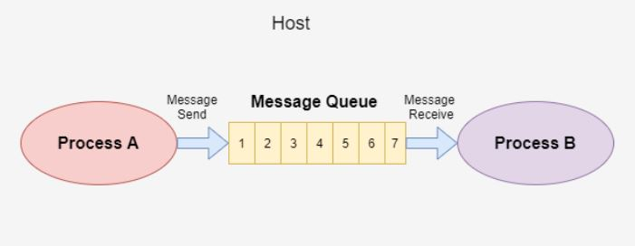

### 13.4 Shared Memory (System V)
- Fastest IPC: a memory segment is **mapped into the address spaces** of several processes; once attached, no kernel involvement.
- System calls: `shmget()` (create/get segment), `shmat()` (attach), `shmdt()` (detach), `shmctl()` (control/remove).
- Requires explicit **synchronisation** (semaphores) to avoid race conditions.

| Mechanism | Direction | Related processes only? | Speed | Sync built-in? |
|---|---|---|---|---|
| Pipe | One-way | Yes | Medium | Yes (blocking read/write) |
| FIFO | One-way | No | Medium | Yes |
| Message queue | Two-way (typed msgs) | No | Medium | Yes |
| Shared memory | Two-way | No | **Fastest** | **No** — use semaphores |

---

## Unit III — One-Page Summary

| Topic | Key points |
|---|---|
| **Cooperating processes** | Share address space or communicate via files/messages; concurrent access → inconsistency. Producer–consumer with bounded/unbounded buffer. |
| **Race condition** | Outcome depends on order of access (count++/count-- → 4 or 6 instead of 5). |
| **CS problem** | Entry · CS · exit · remainder. Requirements: **mutual exclusion, progress, bounded waiting**. |
| **Peterson** | 2 processes; `flag[i] = true; turn = j; while (flag[j] && turn == j);` — satisfies all 3. |
| **Hardware** | Atomic **test_and_set** / **swap**; lock 0/1; spinlock (busy waiting); disabling interrupts on uniprocessors. |
| **Semaphore** | Dijkstra; integer; atomic **wait(P)** / **signal(V)**. Binary (mutex) vs counting. Uses: mutual exclusion, ordering (synch = 0). No-busy-wait implementation with waiting list, block(), wakeup(). |
| **Problems** | Deadlock (wait(S); wait(Q) vs wait(Q); wait(S)), starvation, priority inversion (priority inheritance), misuse of wait/signal. |
| **Bounded buffer** | mutex = 1, full = 0, empty = N; producer: wait(empty), wait(mutex)…signal(mutex), signal(full). |
| **Readers–writers** | mutex = 1, wrt = 1, readcount = 0; first reader waits wrt, last signals wrt; writers may starve. |
| **Dining philosophers** | 5 chopsticks = 1; all pick left → deadlock. Fixes: max 4 at table, pick both atomically, asymmetric order, monitor. |
| **Lock / mutex / semaphore** | Lock: one thread; mutex: ownership; semaphore: signalling, k threads. |
| **Monitor** | ADT; one process active at a time; condition variables x.wait()/x.signal(). Higher-level and safer than semaphores. |
| **IPC** | Reasons: info sharing, speed-up, modularity, convenience. Models: **shared memory** (fast, self-synchronised) vs **message passing** (send/receive, distributed). |
| **Message passing** | Naming: direct (symmetric/asymmetric) vs indirect (mailboxes). Sync: blocking/non-blocking send & receive. Buffering: zero, bounded, unbounded. |
| **Mechanisms** | **Pipe** `pipe(fd)`: fd[0] read, fd[1] write, related processes. **FIFO** `mkfifo()`: named, unrelated processes. **Message queue**: ftok, msgget, msgsnd, msgrcv, msgctl. **Shared memory**: shmget, shmat, shmdt, shmctl. |
