# Unit IV — Deadlocks & Memory Management

> **Syllabus:** **Part 1 – Deadlocks:** system model, necessary conditions, resource-allocation graph, methods for handling deadlocks — prevention, avoidance (safe state, Banker's algorithm), detection, recovery. **Part 2 – Memory management:** address binding, logical vs physical address space, dynamic loading & linking, swapping, contiguous allocation, fragmentation, paging, TLB, segmentation; virtual memory — demand paging, page-fault handling, page replacement (FIFO, Optimal, LRU, Second-chance), thrashing, working set; case studies (Windows, Linux).
>
> **Source:** *OS-04_Part-1.pptx* (Deadlocks), *OS-04_Part-2.pptx* (Memory Management), *OSC – Practice Questions – Units 4, 5 and 6.pdf*

**Importance legend:** ★★★ = very frequently asked (long answer / numericals) · ★★ = medium · ★ = short answer

---

## Table of Contents
**Part 1 — Deadlocks**
1. [Deadlock — Definition & System Model](#1-deadlock--definition--system-model-)
2. [Necessary Conditions (Coffman)](#2-necessary-conditions-for-deadlock-)
3. [Resource-Allocation Graph](#3-resource-allocation-graph-rag-)
4. [Methods for Handling Deadlocks](#4-methods-for-handling-deadlocks-)
5. [Deadlock Prevention](#5-deadlock-prevention-)
6. [Deadlock Avoidance — Safe State & Banker's Algorithm](#6-deadlock-avoidance-)
7. [Banker's Algorithm — Solved Examples](#7-bankers-algorithm--solved-examples-)
8. [Deadlock Detection](#8-deadlock-detection-)
9. [Recovery from Deadlock](#9-recovery-from-deadlock-)

**Part 2 — Memory Management**

10. [Background, Base & Limit Registers](#10-background-base--limit-registers-)
11. [Address Binding; Logical vs Physical Address; MMU](#11-address-binding-logical-vs-physical-address-mmu-)
12. [Dynamic Loading, Dynamic Linking, Overlays](#12-dynamic-loading-dynamic-linking-overlays-)
13. [Swapping](#13-swapping-)
14. [Contiguous Memory Allocation & Fragmentation](#14-contiguous-memory-allocation--fragmentation-)
15. [Paging](#15-paging-)
16. [TLB & Page-Table Structures](#16-translation-lookaside-buffer-tlb--page-table-structures-)
17. [Segmentation](#17-segmentation-)
18. [Virtual Memory & Demand Paging](#18-virtual-memory--demand-paging-)
19. [Page Replacement Algorithms](#19-page-replacement-algorithms-)
20. [Thrashing & the Working-Set Model](#20-thrashing--the-working-set-model-)
21. [Case Studies — Windows & Linux](#21-case-studies--windows--linux-)
22. [Unit IV — One-Page Summary](#unit-iv--one-page-summary)

---

# PART 1 — DEADLOCKS

## 1. Deadlock — Definition & System Model ★★★

A **deadlock** is a situation where a **set of blocked processes each hold a resource and wait to acquire a resource held by another process** in the set — none can proceed.

**Examples:**
- System has **2 disk drives**; P1 and P2 each hold one and each needs the other.
- Semaphores A and B initialised to 1: `P0: wait(A); wait(B);` and `P1: wait(B); wait(A);`
- **Bridge crossing:** one-lane bridge, traffic in one direction; each section of the bridge is a resource. Deadlock is resolved if one car **backs up** (preempt & rollback); several cars may need to back up; **starvation** possible.

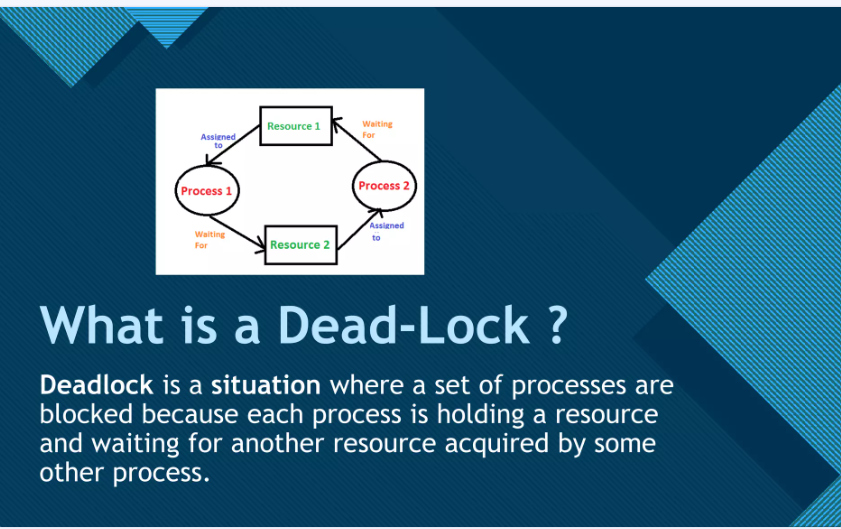

**System model:**
- Resource types R1, R2, …, Rm (CPU cycles, memory space, I/O devices); each type Ri has **Wi instances**.
- Each process uses a resource as: **request → use → release**.

---

## 2. Necessary Conditions for Deadlock ★★★

Deadlock can arise **only if all four conditions hold simultaneously** (Coffman conditions):

| Condition | Meaning |
|---|---|
| **1. Mutual exclusion** | At least one resource is **non-sharable** — only one process at a time can use it |
| **2. Hold and wait** | A process **holding at least one resource** is waiting to acquire additional resources held by others |
| **3. No preemption** | A resource can be released **only voluntarily** by the process holding it, after it finishes its task |
| **4. Circular wait** | A set {P0, P1, …, Pn} exists such that P0 waits for P1, P1 waits for P2, …, Pn waits for P0 |

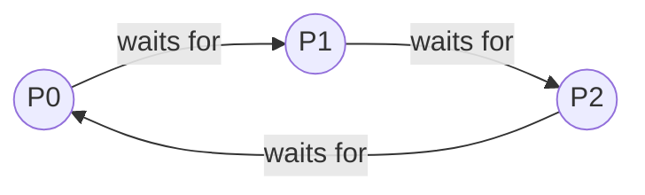

---

## 3. Resource-Allocation Graph (RAG) ★★★

A directed graph G = (V, E). V is partitioned into:
- **P** = {P1 … Pn} — processes (circles)
- **R** = {R1 … Rm} — resource types (rectangles, with **dots** for instances)

Edges:
- **Request edge** Pi → Rj — Pi has requested an instance of Rj.
- **Assignment edge** Rj → Pi — an instance of Rj is allocated to Pi.

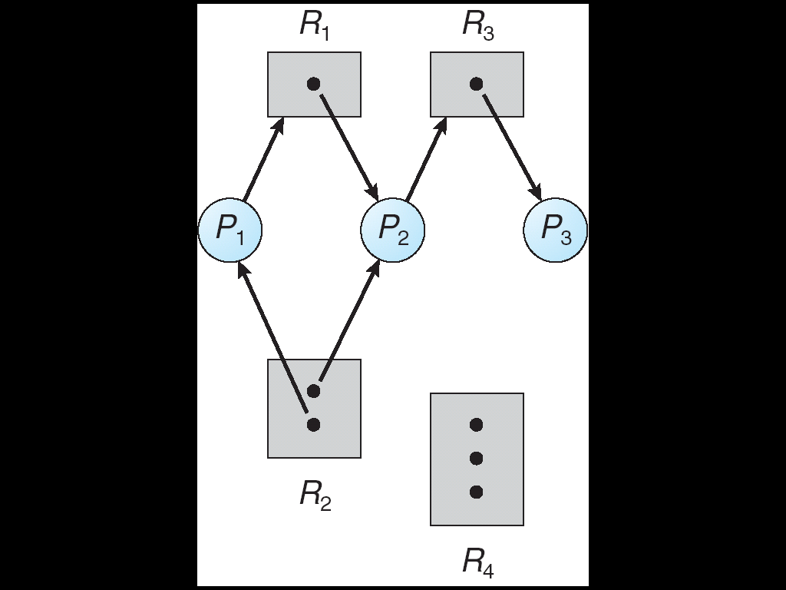

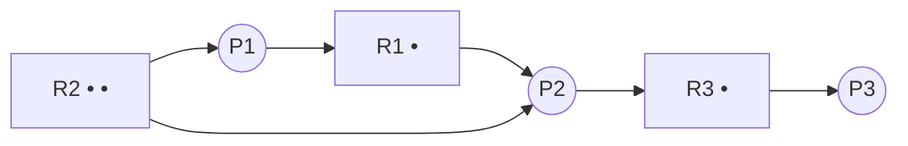

**Basic facts ★★★:**
- **No cycle ⇒ no deadlock.**
- **Cycle present:**
  - if **only one instance per resource type ⇒ deadlock**;
  - if **several instances per type ⇒ possibility** of deadlock (not certain).

| RAG with a deadlock | Cycle but no deadlock |
|---|---|
| 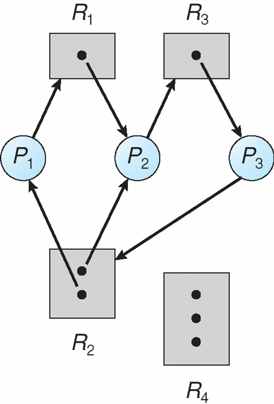 | 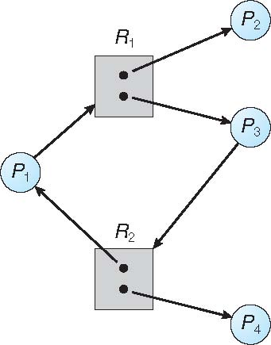 |

In the second graph, P2 or P4 (not in the cycle) can finish and release an instance, breaking the cycle.

---

## 4. Methods for Handling Deadlocks ★★★

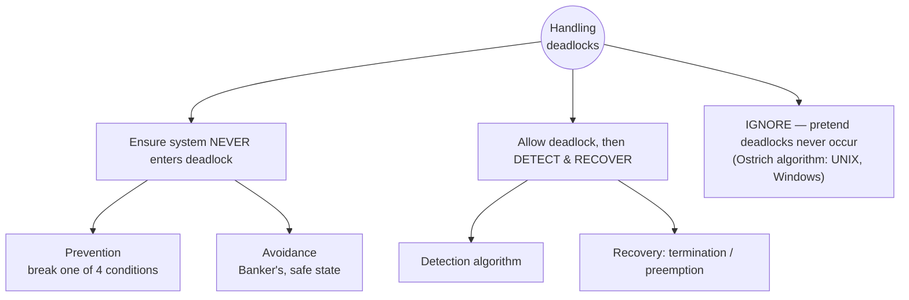

---

## 5. Deadlock Prevention ★★★

**Ensure at least one of the four necessary conditions cannot hold.**

| Condition | How to prevent it | Drawback |
|---|---|---|
| **Mutual exclusion** | Not required for **sharable** resources (read-only files); must hold for non-sharable ones (printers) — generally cannot be denied | Some resources are intrinsically non-sharable |
| **Hold and wait** | Whenever a process requests a resource, it must **hold no other resources**: (a) request and be allocated **all resources before execution**, or (b) request resources **only when it holds none** | **Low resource utilisation**; **starvation** possible |
| **No preemption** | If a process holding resources requests one that cannot be immediately allocated, **all resources it holds are released (preempted)**; added to its wait list; restarted only when it can regain old + new resources | Only for resources whose state can be saved (CPU registers, memory), not printers |
| **Circular wait** | Impose a **total ordering** of all resource types; each process requests resources in **increasing order** of enumeration (e.g., F(tape) = 1, F(disk) = 5, F(printer) = 12) | Ordering may not suit all programs |

---

## 6. Deadlock Avoidance ★★★

- Requires **a priori information**: simplest model — each process declares the **maximum number** of resources of each type it may need.
- The avoidance algorithm **dynamically examines the resource-allocation state** (available, allocated, maximum demands) to ensure a **circular wait can never arise**.

### 6.1 Safe State ★★★
- When a process requests an available resource, the system decides whether **immediate allocation leaves the system in a safe state**.
- The system is in a **safe state** if there exists a **safe sequence** ⟨P1, P2, …, Pn⟩ of ALL processes such that for each Pi, the resources Pi can still request can be satisfied by **currently available resources + resources held by all Pj with j < i**.
  - If Pi's needs aren't immediately available, Pi waits until all Pj finish; then Pi obtains its resources, executes, returns them and terminates; then Pi+1 proceeds, and so on.

**Basic facts:**
- **Safe state ⇒ no deadlock.**
- **Unsafe state ⇒ possibility** of deadlock.
- **Avoidance ⇒ never let the system enter an unsafe state.**

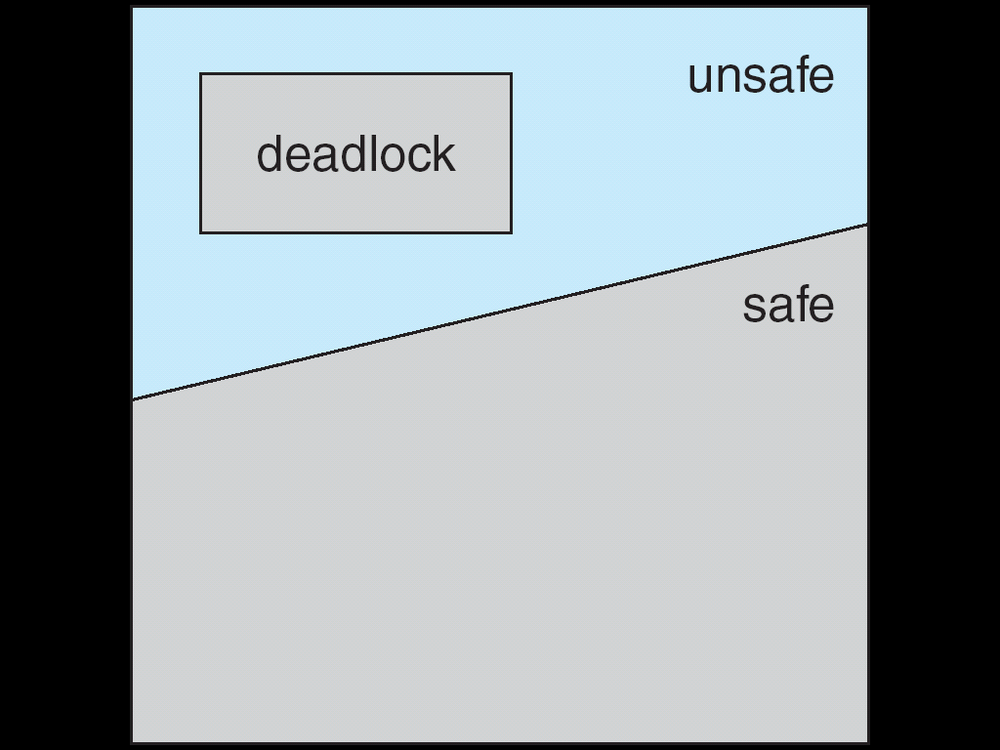

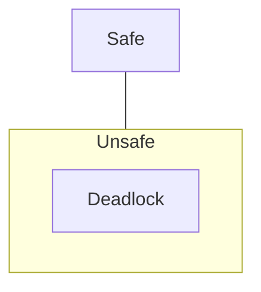
*(Deadlock ⊂ Unsafe; Safe ∩ Deadlock = ∅)*

**Single-instance resources:** use a **resource-allocation-graph algorithm** with **claim edges** (dashed Pi → Rj meaning Pi may request Rj). A request is granted only if converting the request edge to an assignment edge **does not form a cycle**.

### 6.2 Banker's Algorithm (multiple instances) ★★★
Named after a bank that never allocates cash such that it can't satisfy all customers.
- Each process must make an **a priori claim of maximum use** (≤ total resources).
- When a process requests resources, it **may have to wait**; when it gets all its resources it must **return them in finite time**.
- On each request, the system checks whether allocation leaves a **safe state** — if yes, allocate; else the process waits.

**Data structures** (n = number of processes, m = number of resource types):
| Structure | Size | Meaning |
|---|---|---|
| **Available** | vector m | Available[j] = k → k instances of Rj available |
| **Max** | n × m | Max[i, j] = k → Pi may request at most k instances of Rj |
| **Allocation** | n × m | Allocation[i, j] = k → Pi currently holds k instances of Rj |
| **Need** | n × m | Need[i, j] = k → Pi may need k more instances; **Need = Max − Allocation** |

**Safety Algorithm:**
```
1. Work = Available;  Finish[i] = false for i = 0 … n-1
2. Find i such that  Finish[i] == false  AND  Need_i ≤ Work
   If no such i exists, go to step 4
3. Work = Work + Allocation_i;  Finish[i] = true;  go to step 2
4. If Finish[i] == true for all i → system is in a SAFE state
```
Complexity: O(m × n²).

**Resource-Request Algorithm for Pi:**
```
1. If Request_i ≤ Need_i  go to 2, else ERROR (exceeded maximum claim)
2. If Request_i ≤ Available go to 3, else Pi must WAIT (resources not available)
3. Pretend to allocate:
       Available    = Available    − Request_i
       Allocation_i = Allocation_i + Request_i
       Need_i       = Need_i       − Request_i
   Run the safety algorithm:
       SAFE   → allocate resources to Pi
       UNSAFE → Pi waits; restore the old state
```

---

## 7. Banker's Algorithm — Solved Examples ★★★

### Example 1 (textbook) — 5 processes, A = 10, B = 5, C = 7 instances
| | Allocation A B C | Max A B C | **Need** A B C |
|---|---|---|---|
| P0 | 0 1 0 | 7 5 3 | **7 4 3** |
| P1 | 2 0 0 | 3 2 2 | **1 2 2** |
| P2 | 3 0 2 | 9 0 2 | **6 0 0** |
| P3 | 2 1 1 | 2 2 2 | **0 1 1** |
| P4 | 0 0 2 | 4 3 3 | **4 3 1** |

Available = **3 3 2** (total allocated = 7 2 5).

**(b) Safety check:**
| Step | Process (Need ≤ Work?) | Work after release |
|---|---|---|
| start | — | 3 3 2 |
| 1 | P1 (1 2 2 ≤ 3 3 2 ✓) | 5 3 2 |
| 2 | P3 (0 1 1 ≤ 5 3 2 ✓) | 7 4 3 |
| 3 | P4 (4 3 1 ≤ 7 4 3 ✓) | 7 4 5 |
| 4 | P0 (7 4 3 ≤ 7 4 5 ✓) | 7 5 5 |
| 5 | P2 (6 0 0 ≤ 7 5 5 ✓) | **10 5 7** |

Safe sequence **⟨P1, P3, P4, P0, P2⟩** → **SAFE**. *(The slide prints the final Work as 10 5 5; it should be 10 5 7, the total instances.)*

**(c) P1 requests (1, 0, 2):**
- Request ≤ Need₁ (1 0 2 ≤ 1 2 2) ✓; Request ≤ Available (1 0 2 ≤ 3 3 2) ✓.
- Pretend: Available = **2 3 0**, Allocation₁ = **3 0 2**, Need₁ = **0 2 0**.
- Safety: P1 (0 2 0 ≤ 2 3 0) → 5 3 2; P3 → 7 4 3; P4 → 7 4 5; P0 → 7 5 5; P2 → 10 5 7.
- Safe sequence ⟨P1, P3, P4, P0, P2⟩ → **request granted immediately**.

### Example 2 (also Practice Q3) — 4 resource types
| | Allocation A B C D | Max A B C D | **Need** A B C D |
|---|---|---|---|
| P0 | 0 0 1 2 | 0 0 1 2 | **0 0 0 0** |
| P1 | 1 0 0 0 | 1 7 5 0 | **0 7 5 0** |
| P2 | 1 3 5 4 | 2 3 5 6 | **1 0 0 2** |
| P3 | 0 6 3 2 | 0 6 5 2 | **0 0 2 0** |
| P4 | 0 0 1 4 | 0 6 5 6 | **0 6 4 2** |

Available = **1 5 2 0**.

| Step | Process | Work |
|---|---|---|
| start | — | 1 5 2 0 |
| 1 | P0 (0 0 0 0) | 1 5 3 2 |
| 2 | P2 (1 0 0 2) | 2 8 8 6 |
| 3 | P1 (0 7 5 0) | 3 8 8 6 |
| 4 | P3 (0 0 2 0) | 3 14 11 8 |
| 5 | P4 (0 6 4 2) | 3 14 12 12 |

Safe sequence **⟨P0, P2, P1, P3, P4⟩** → **SAFE**.

**P1 requests (0, 4, 2, 0):** ≤ Need₁ (0 7 5 0) ✓, ≤ Available (1 5 2 0) ✓ → Available = 1 1 0 0, Allocation₁ = 1 4 2 0, Need₁ = 0 3 3 0. Safety: P0 → 1 1 1 2; P2 (1 0 0 2) → 2 4 6 6; P1 (0 3 3 0) → 3 8 8 6; P3 → 3 14 11 8; P4 → 3 14 12 12 → **safe, grant the request**.

### Example 3 — smallest x for a safe state
| Process | Allocated a b c d e | Maximum a b c d e | Need a b c d e |
|---|---|---|---|
| A | 1 0 2 1 1 | 1 1 2 1 3 | 0 1 0 0 2 |
| B | 2 0 1 1 0 | 2 2 2 1 0 | 0 2 1 0 0 |
| C | 1 1 0 1 0 | 2 1 3 1 0 | 1 0 3 0 0 |
| D | 1 1 1 1 0 | 1 1 2 2 1 | 0 0 1 1 1 |

Available = 0 0 x 1 1.
- **x = 0:** no process can run → deadlock.
- **x = 1:** D runs (needs 0 0 1 1 1) → Available = 1 1 2 2 1. Now C needs c = 3 > 2, B needs b = 2 > 1, A needs e = 2 > 1 → **stuck**.
- **x = 2:** D → 1 1 3 2 1; C (1 0 3 0 0) → 2 2 3 3 1; B (0 2 1 0 0) → 4 2 4 4 1; then A.

**Answer (textbook — Tanenbaum): smallest x = 2.**
> ⚠️ The slide's sequence D, C, B, A with x = 1 is incorrect — after D only 2 instances of c are free, but C needs 3. Also note that, as printed, A's maximum claim for **e** is 3 while only 2 instances of e exist in total, so A can only finish if its claim for e is ≤ 2. This looks like a typo in the source; the expected exam answer is still **x = 2**.

---

## 8. Deadlock Detection ★★★

Allow the system to enter a deadlock state, then use a **detection algorithm** and a **recovery scheme**.

### 8.1 Single instance of each resource type — Wait-for graph
- Obtained from the RAG by **removing resource nodes** and collapsing edges: **Pi → Pj** if Pi is waiting for a resource held by Pj.
- Periodically search for a **cycle**; a cycle ⇒ deadlock. Cycle detection needs **O(n²)** operations (n = vertices).

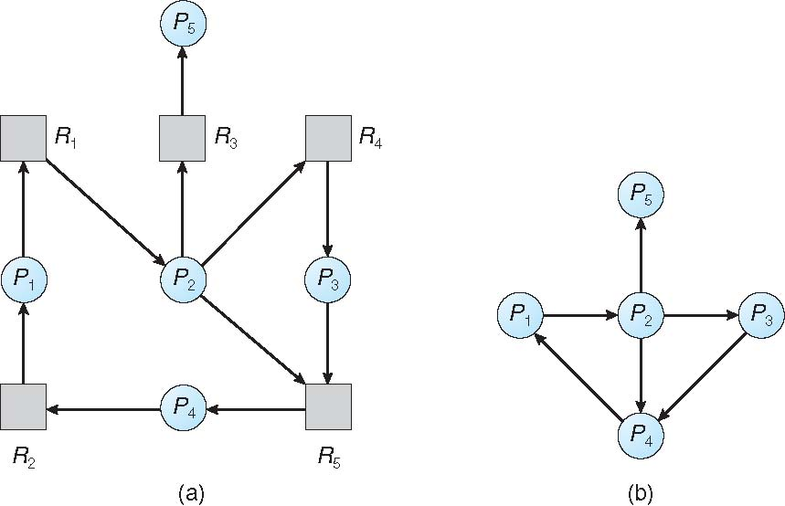

### 8.2 Several instances of a resource type
Data structures: **Available** (m), **Allocation** (n × m), **Request** (n × m — current request of each process).

```
1. Work = Available
   For each i: Finish[i] = false if Allocation_i ≠ 0, else true
2. Find i with Finish[i] == false AND Request_i ≤ Work; if none, go to 4
3. Work = Work + Allocation_i; Finish[i] = true; go to 2
4. If Finish[i] == false for some i → system is DEADLOCKED, and each such Pi is deadlocked
```
Complexity O(m × n²). (Differs from safety: uses **Request** instead of Need — optimistic.)

**Example:** A = 7, B = 2, C = 6; Available = 0 0 0
| | Allocation | Request |
|---|---|---|
| P0 | 0 1 0 | 0 0 0 |
| P1 | 2 0 0 | 2 0 2 |
| P2 | 3 0 3 | 0 0 0 |
| P3 | 2 1 1 | 1 0 0 |
| P4 | 0 0 2 | 0 0 2 |

P0 → Work 0 1 0; P2 → 3 1 3; P3 → 5 2 4; P1 → 7 2 4; P4 → 7 2 6 → sequence **⟨P0, P2, P3, P1, P4⟩**, **no deadlock**.

**If P2 requests one more C (Request₂ = 0 0 1):** P0 finishes → Work 0 1 0; no other request can be met → **deadlock among P1, P2, P3, P4**.

### 8.3 When to invoke detection?
Depends on **how often deadlock is likely** and **how many processes** will need to be rolled back (one per disjoint cycle). Invoking arbitrarily (e.g., when CPU utilisation drops below 40 %) may find many cycles, making it impossible to tell which process "caused" the deadlock; invoking on every request is expensive.

---

## 9. Recovery from Deadlock ★★

### 9.1 Process Termination
- **Abort all** deadlocked processes — expensive (lost computation).
- **Abort one process at a time** until the cycle is eliminated — overhead of re-running detection.
- **Choosing the victim:** priority; how long it has computed and how much longer to completion; resources used; resources needed to complete; how many processes must be terminated; interactive or batch.

### 9.2 Resource Preemption
- **Selecting a victim** — minimise cost.
- **Rollback** — return the process to some **safe state** and restart it from there (checkpoints).
- **Starvation** — the same process may always be picked; include the **number of rollbacks** in the cost factor.

---

# PART 2 — MEMORY MANAGEMENT

## 10. Background, Base & Limit Registers ★★

- A program must be brought from disk **into memory** and placed within a process to run.
- **Main memory and registers** are the only storage the CPU accesses directly. Registers: 1 clock cycle; main memory: many cycles (stall) → **cache** between them.
- **Memory protection** is required for correct operation.
- A pair of **base** and **limit** registers defines a process's **logical address space**; every user-mode address is checked: `base ≤ address < base + limit`, else **trap** to the OS (addressing error).

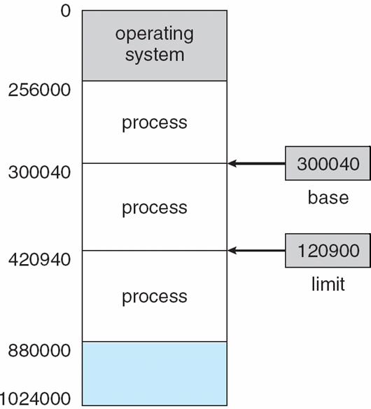

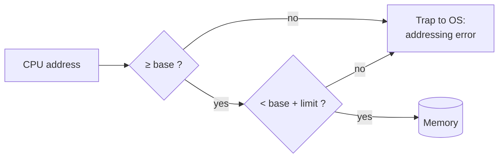

---

## 11. Address Binding; Logical vs Physical Address; MMU ★★★

### 11.1 Address binding
Addresses are represented differently at each stage: **symbolic** in source (`count`) → **relocatable** after compiling ("14 bytes from start of this module") → **absolute** after linking/loading (74014).

| Binding time | Description |
|---|---|
| **Compile time** | Memory location known a priori → **absolute code**; must recompile if start location changes (MS-DOS .COM) |
| **Load time** | Compiler generates **relocatable code**; final binding when the program is loaded |
| **Execution time** | Binding delayed until **run time** if the process can be **moved** during execution; needs hardware (MMU, base/limit registers) — used by most modern OSes |

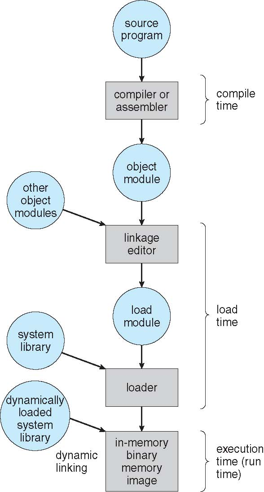

### 11.2 Logical vs Physical Address ★★★
| Logical (virtual) address | Physical address |
|---|---|
| Generated by the **CPU** | Address seen by the **memory unit** |
| Logical address space = set of all logical addresses of a program | Physical address space = set of corresponding physical addresses |
| User program deals only with logical addresses | Never seen by the user program |

Logical and physical addresses are **the same** in compile-time and load-time binding; they **differ** in **execution-time** binding.

### 11.3 Memory-Management Unit (MMU)
- **Hardware** that maps virtual to physical addresses at run time.
- Simplest scheme: the base register becomes a **relocation register**; its value is **added** to every address generated by a user process. E.g., relocation = 14000, logical 346 → physical **14346**.

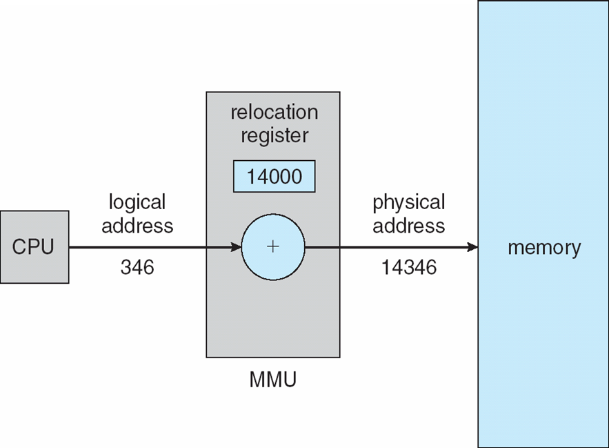

---

## 12. Dynamic Loading, Dynamic Linking, Overlays ★★

| Technique | Idea | Benefit |
|---|---|---|
| **Dynamic loading** | A routine is **not loaded until it is called**; routines kept on disk in relocatable format | Better memory utilisation; unused routines (e.g., error handlers) never loaded; implemented by program design (OS may provide libraries) |
| **Static linking** | System libraries combined with program code by the loader into the binary image | Simple; but each program has its own copy |
| **Dynamic linking** | Linking **postponed until execution time**; a small **stub** locates the memory-resident library routine, replaces itself with the routine's address, and executes it | **Shared libraries (DLLs/.so)**; saves memory and disk; library updates/patches apply to all programs; needs OS support |
| **Overlays** | Keep in memory only the instructions/data needed at a given time; **replace a block** of code with another | Programs larger than memory without VM support (programmer-designed) |

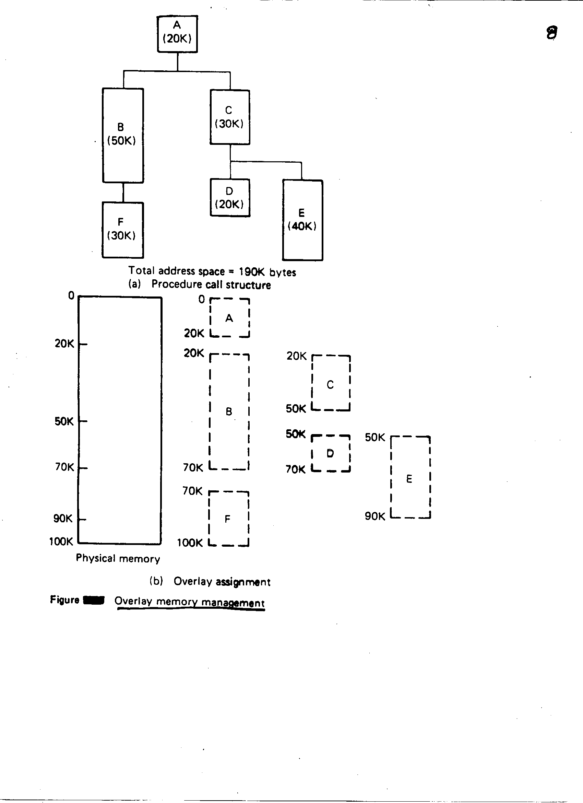

---

## 13. Swapping ★★★

- A process can be **swapped temporarily out** of memory to a **backing store** (fast disk large enough for all memory images, with direct access) and **brought back** for continued execution → total memory of processes can exceed physical memory.
- **Roll out, roll in:** variant for **priority scheduling** — a lower-priority process is swapped out so a higher-priority one can run.
- Major part of swap time is **transfer time**, proportional to the amount of memory swapped.
- Whether a process returns to the same addresses depends on **address binding**; beware **pending I/O** into the process's memory (latch it or do I/O into OS buffers).
- Modern UNIX/Linux/Windows use modified swapping — normally **disabled**, started when memory use exceeds a threshold.

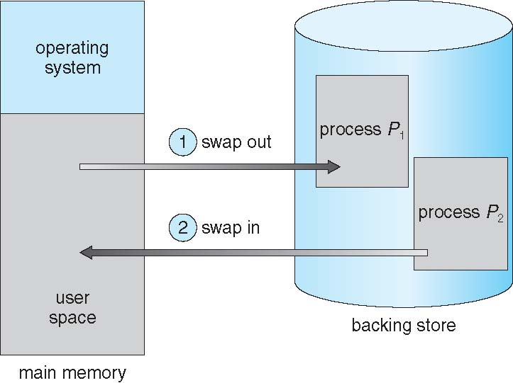

**Context-switch time with swapping:** 100 MB process, transfer rate 50 MB/s, latency 8 ms → swap out = 100/50 s + 8 ms = **2008 ms**; plus swap in of an equal process → **4016 ms (> 4 s)**. Reduce by swapping only memory actually in use.

---

## 14. Contiguous Memory Allocation & Fragmentation ★★★

Memory techniques overview: single contiguous, partitioned (fixed/variable), relocatable partitions, paged, segmented, demand-paged, overlays.

### 14.1 Single contiguous allocation
Memory split into two parts: **resident OS** (low memory, with interrupt vector) and **user process** (high memory). Simple, but memory not fully used and job size limited.

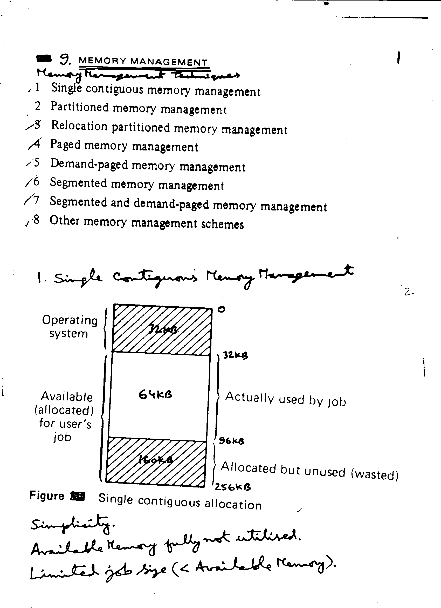

### 14.2 Multiple-partition allocation
- **Fixed partitions:** degree of multiprogramming limited by the number of partitions → **internal fragmentation**.
- **Variable partitions:** a **hole** = block of available memory; holes of various sizes are scattered. An arriving process gets memory from a hole large enough; a departing process frees its partition and **adjacent holes are merged**. OS tracks **allocated partitions** and **free holes**.

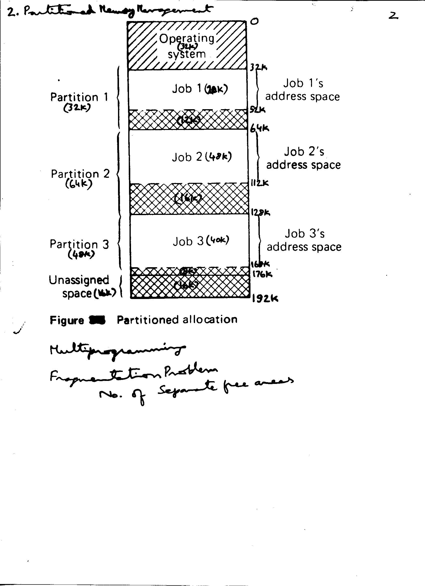

### 14.3 Dynamic Storage-Allocation Problem ★★★
How to satisfy a request of size n from a list of free holes:
| Strategy | Rule | Notes |
|---|---|---|
| **First-fit** | Allocate the **first** hole big enough | Fastest |
| **Best-fit** | Allocate the **smallest** hole big enough (search whole list unless sorted) | Smallest leftover hole |
| **Worst-fit** | Allocate the **largest** hole (search whole list) | Largest leftover hole (may be reusable) |

First-fit and best-fit are **better than worst-fit** in speed and storage utilisation.

**Problem 1:** Holes (in order): **10, 4, 20, 18, 7, 9, 12, 15 KB**. Requests: **12, 10, 9 KB**.
| Request | First-fit | Best-fit | Worst-fit |
|---|---|---|---|
| 12 KB | 20 KB (8 left) | 12 KB (0 left) | 20 KB (8 left) |
| 10 KB | 10 KB (0 left) | 10 KB (0 left) | 18 KB (8 left) |
| 9 KB | 18 KB (9 left) | 9 KB (0 left) | 15 KB (6 left) |

**Problem 2:** Partitions **12, 7, 15, 20, 9, 4, 10, 18 KB**; processes **10, 12, 6, 9 KB**.
| Process | First-fit | Best-fit | Worst-fit |
|---|---|---|---|
| 10 KB | 12 KB (2 left) | 10 KB (0) | 20 KB (10 left) |
| 12 KB | 15 KB (3 left) | 12 KB (0) | 18 KB (6 left) |
| 6 KB | 7 KB (1 left) | 7 KB (1) | 15 KB (9 left) |
| 9 KB | 20 KB (11 left) | 9 KB (0) | 12 KB (3 left) |

Best-fit leaves the least wasted space here.

### 14.4 Fragmentation ★★★
| Type | Meaning | Where |
|---|---|---|
| **External fragmentation** | Total free memory is enough for a request but it is **not contiguous** (scattered holes) | Variable partitions, segmentation |
| **Internal fragmentation** | Allocated memory is **slightly larger** than requested; the difference inside a partition is unused | Fixed partitions, paging (last page) |

- **50-percent rule:** with first-fit, given N allocated blocks, another **0.5 N blocks are lost** to fragmentation (one-third of memory unusable).
- **Solutions to external fragmentation:**
  1. **Compaction** — shuffle memory contents to place all free memory in one large block. Possible only with **dynamic (execution-time) relocation**; I/O problem — latch job in memory during I/O or do I/O only into OS buffers.
  2. **Non-contiguous allocation** — **paging** and **segmentation**.

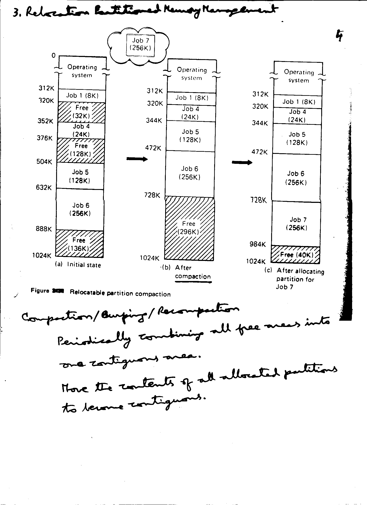

---

## 15. Paging ★★★

- The physical address space of a process can be **non-contiguous**; avoids external fragmentation and the need for compaction.
- **Physical memory** divided into fixed-size blocks called **frames** (power of 2, 512 B – 16 MB; commonly 4 KB).
- **Logical memory** divided into blocks of the same size called **pages**.
- To run a program of n pages, find **n free frames**; a **page table** translates logical to physical addresses. The OS keeps a **free-frame list**.
- Still has **internal fragmentation** (last page).

### 15.1 Address Translation
For a logical address space of **2ᵐ** and page size **2ⁿ**:

| page number **p** | page offset **d** |
|---|---|
| m − n bits | n bits |

- **p** = index into the **page table** (gives frame number f).
- **d** = offset combined with the frame base → physical address = **f × page size + d**.

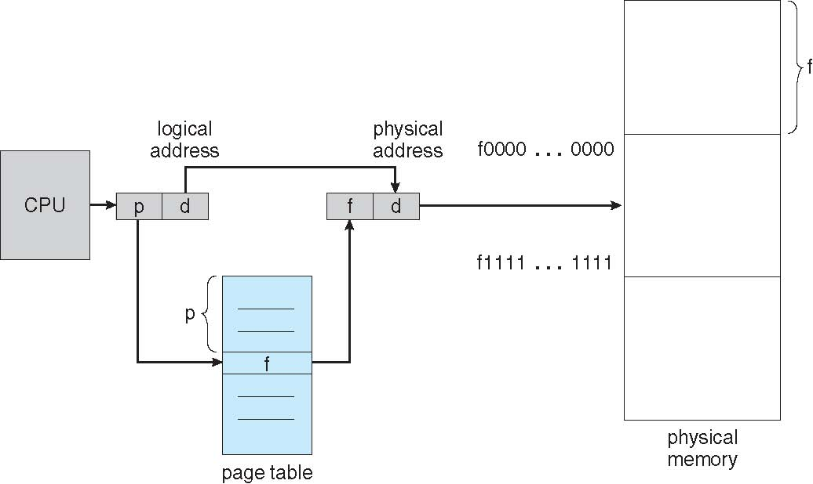

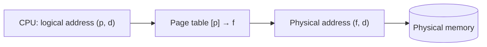

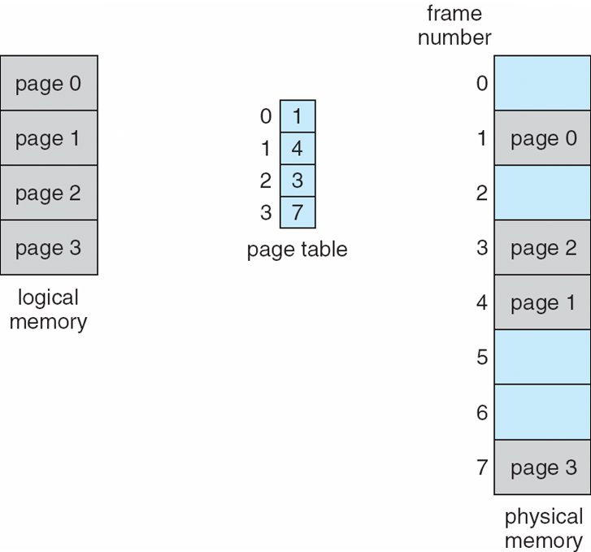

**Example — 32-byte memory, 4-byte pages (n = 2, m = 4):** page table: 0→5, 1→6, 2→1, 3→2.
- Logical 0 (page 0, offset 0) → frame 5 → physical **20** (5×4 + 0).
- Logical 3 (page 0, offset 3) → 5×4 + 3 = **23**.
- Logical 4 (page 1, offset 0) → frame 6 → **24**.
- Logical 13 (page 3, offset 1) → frame 2 → 2×4 + 1 = **9**.

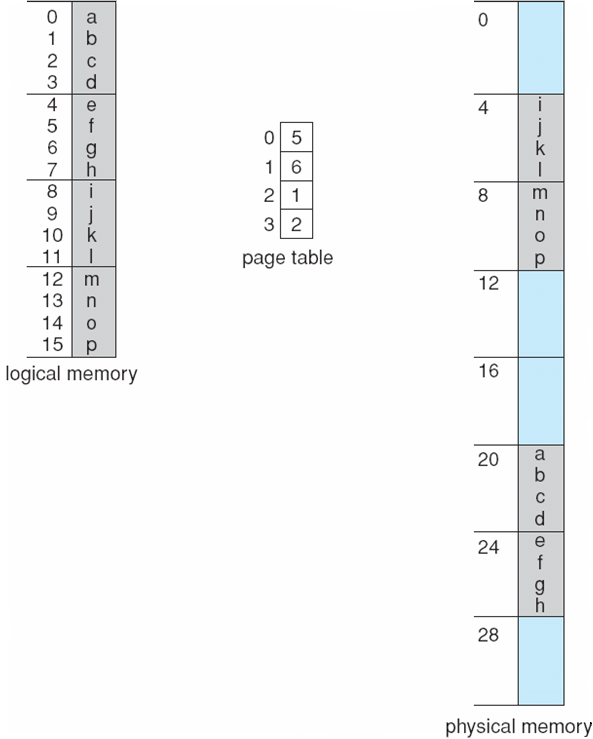

### 15.2 Internal fragmentation in paging
Page size 2048 B, process 72,766 B → 35 pages + 1,086 B → 36 frames; internal fragmentation = 2048 − 1086 = **962 B**. Worst case = 1 frame − 1 byte; average = ½ frame. Smaller pages → less fragmentation but **bigger page tables**; page sizes have grown (Solaris supports 8 KB and 4 MB).

### 15.3 Advantages / disadvantages
| Advantages | Disadvantages |
|---|---|
| No external fragmentation; no compaction | Internal fragmentation |
| Easy allocation (any free frame) | Page table memory overhead |
| Supports sharing (shared pages of re-entrant code) and protection (valid/invalid, r/w bits) | Two memory accesses per reference without TLB |
| Basis for virtual memory | |

---

## 16. Translation Lookaside Buffer (TLB) & Page-Table Structures ★★★

### 16.1 TLB
- With the page table in memory, **each reference needs two memory accesses** (page table + data).
- **TLB** = a small, fast **associative cache** of recently used **page-table entries**.
- Given a virtual address: check the TLB — **TLB hit** → frame number retrieved, real address formed. **TLB miss** → index the page table; if the page is in memory, update the TLB; if not → **page fault**.

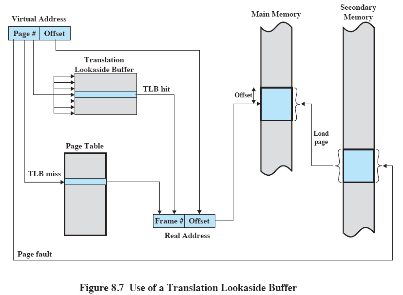

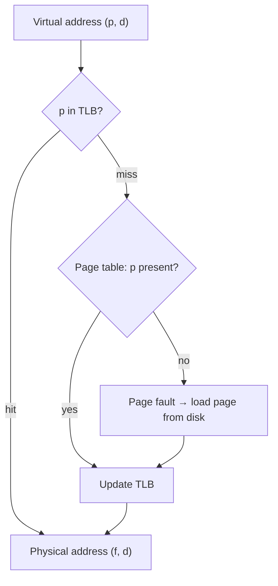

**Effective access time with TLB:** EAT = h(t + m) + (1 − h)(t + 2m), where h = hit ratio, t = TLB time, m = memory time.
*Example:* t = 20 ns, m = 100 ns, h = 0.80 → EAT = 0.8 × 120 + 0.2 × 220 = **140 ns**; with h = 0.98 → 0.98 × 120 + 0.02 × 220 = **122 ns**.

### 16.2 📘 Page-Table Structures (Practice Q6)
| Structure | Idea |
|---|---|
| **Hierarchical (multi-level) paging** | Page the page table itself — e.g., **two-level**: logical address = (p1, p2, d); p1 indexes the outer page table, p2 the inner page table. Linux uses multi-level tables |
| **Hashed page table** | For address spaces > 32 bits: virtual page number is **hashed** into a table; each entry is a linked list of (VPN, frame, next) elements matched on lookup |
| **Inverted page table** | **One entry per physical frame** (not per page) holding (process-id, page-number); reduces memory for tables but lookup needs a search (use hashing); shared memory is harder |

---

## 17. Segmentation ★★★

- Memory-management scheme supporting the **user's view of memory**: a program is a **collection of segments** — logical units such as main program, procedures, functions, methods, objects, local/global variables, common block, stack, symbol table, arrays.

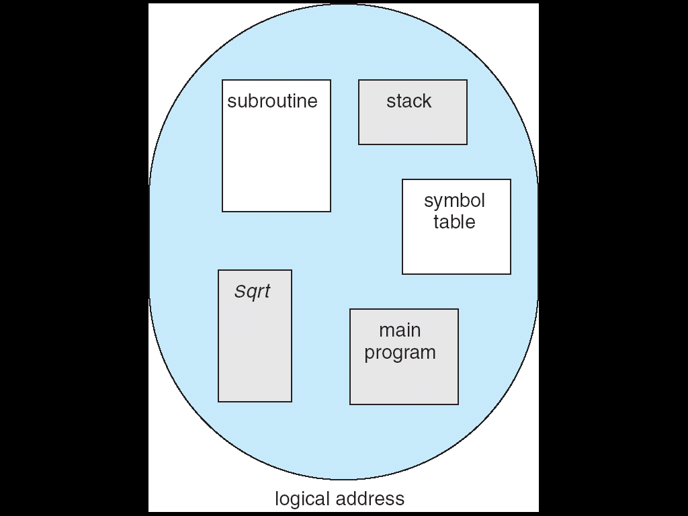

### 17.1 Segmentation Architecture
- Logical address = **⟨segment-number s, offset d⟩**.
- **Segment table** — each entry has a **base** (starting physical address) and **limit** (length).
- **STBR** (segment-table base register) points to the table; **STLR** (segment-table length register) = number of segments; s is legal if **s < STLR**.
- Check **d < limit**, else trap; physical address = **base + d**.
- **Protection:** each entry has a **validation bit** (0 = illegal) and **read/write/execute** privileges; **sharing** at segment level.
- Segments vary in length → allocation is a **dynamic storage-allocation problem** → **external fragmentation**.

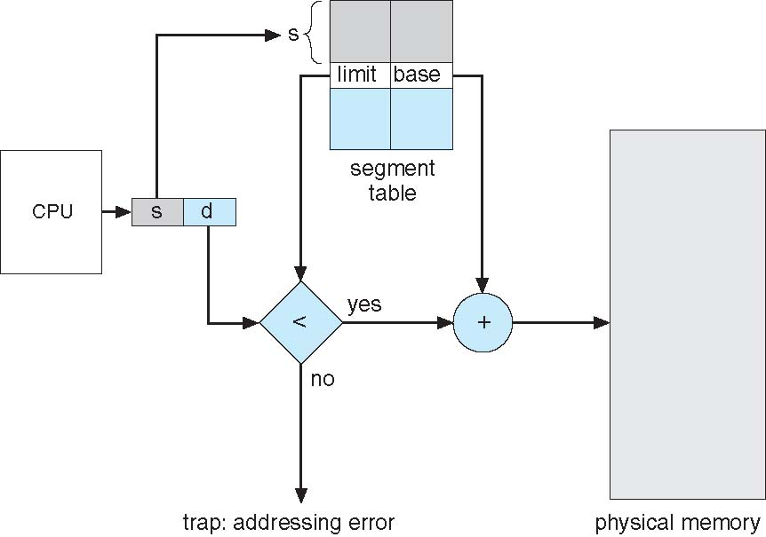

**Example:**
| Segment | Limit | Base |
|---|---|---|
| 0 | 1000 | 1400 |
| 1 | 400 | 6300 |
| 2 | 400 | 4300 |
| 3 | 1100 | 3200 |
| 4 | 1000 | 4700 |

- ⟨2, 53⟩ → 4300 + 53 = **4353**
- ⟨3, 852⟩ → 3200 + 852 = **4052**
- ⟨0, 1222⟩ → 1222 ≥ 1000 → **trap** (addressing error)

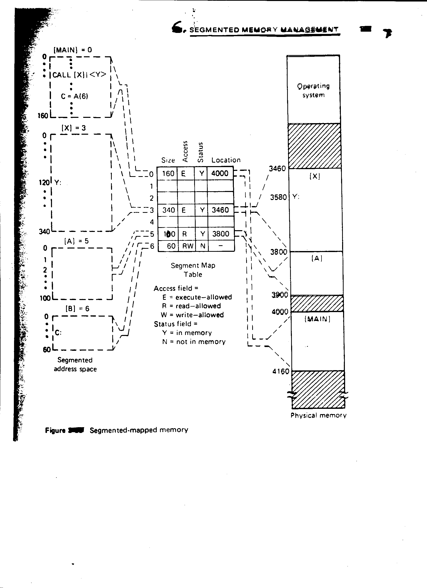

### 17.2 Paging vs Segmentation ★★★
| Paging | Segmentation |
|---|---|
| Fixed-size **pages** | Variable-size **segments** |
| Invisible to the programmer | Visible — matches the **user's view** |
| **Internal** fragmentation | **External** fragmentation |
| Address = (page, offset) | Address = (segment, offset) |
| Page table: frame numbers | Segment table: base + limit |
| Sharing/protection per page | Sharing/protection per logical segment |

**Segmentation with paging** (Intel x86, MULTICS) — each segment is paged: combines the user view with no external fragmentation.

---

## 18. Virtual Memory & Demand Paging ★★★

### 18.1 Virtual Memory
**Virtual memory** = a technique that allows execution of processes that are **not completely in memory**; separates user **logical memory** from **physical memory**.
- Programs can be **larger than physical memory**; only part of a program needs to be in memory.
- Logical address space can be much larger than physical; address spaces can be **shared**; more efficient process creation (copy-on-write); more programs run concurrently; less I/O to load/swap.
- Implemented via **demand paging** or **demand segmentation**.

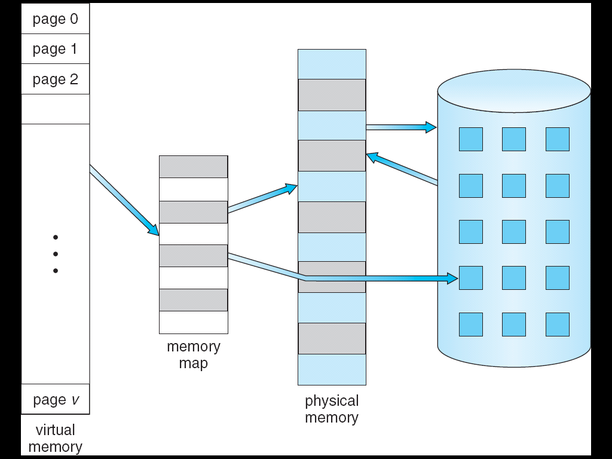

### 18.2 Demand Paging
- Bring a page into memory **only when it is needed** → less I/O, less memory, faster response, more users.
- **Lazy swapper** — never swaps a page in unless it will be needed; a swapper dealing with pages is a **pager**.
- **Valid–invalid bit** in each page-table entry: v = in memory; i = not in memory (or not legal). Referencing an invalid page → **page fault** trap.

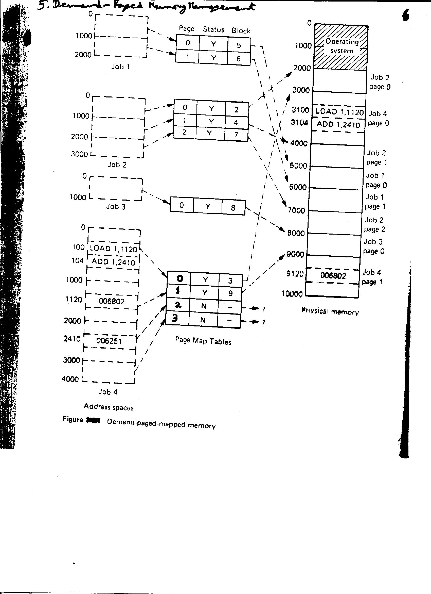

### 18.3 Steps in Handling a Page Fault ★★★
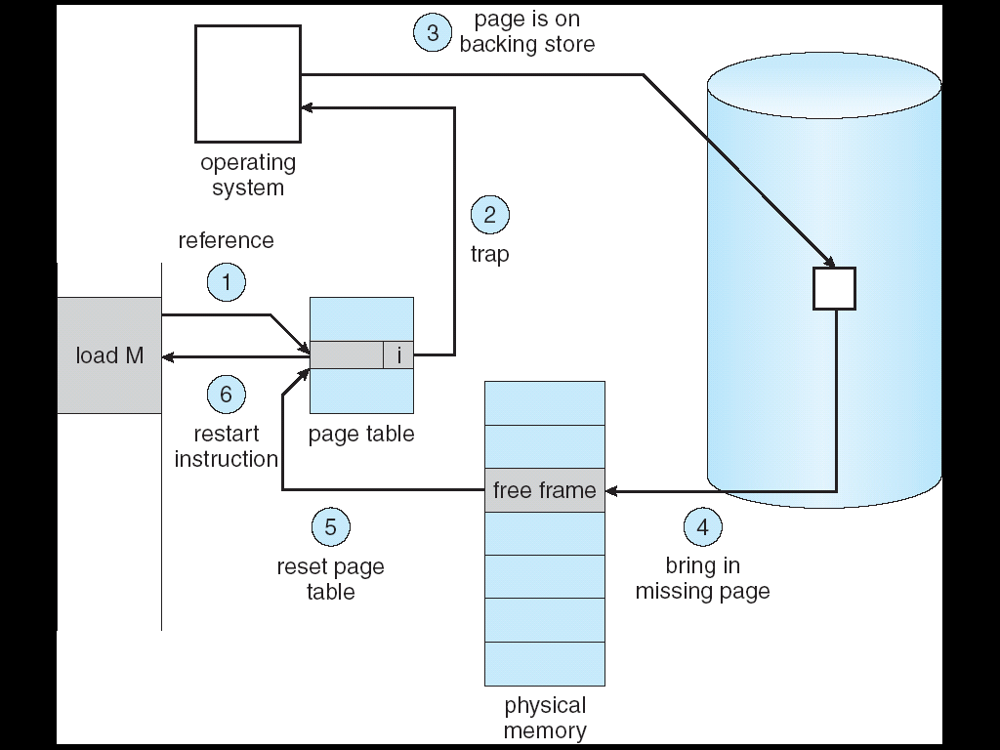

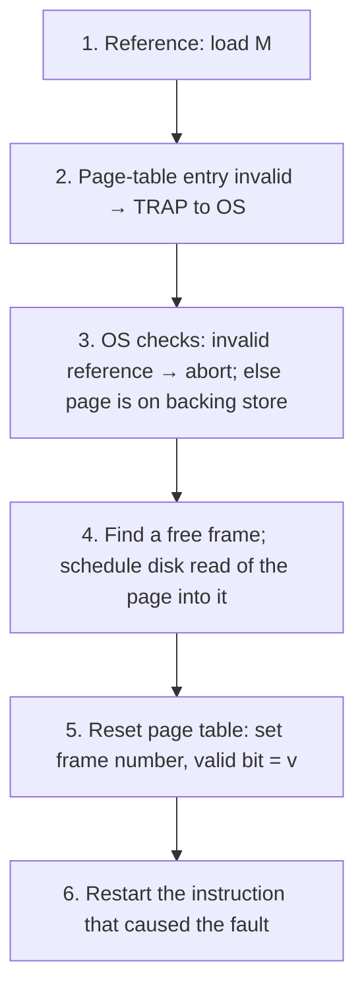
If no free frame exists → **page replacement**.

### 18.4 Performance of Demand Paging ★★★
Page-fault rate **0 ≤ p ≤ 1** (p = 0: no faults; p = 1: every reference faults).

$$EAT = (1-p)\times \text{memory access} + p\times(\text{page-fault overhead} + \text{swap out} + \text{swap in} + \text{restart overhead})$$

**Example 1:** memory access 100 ns, fault service 25 ms, p = 1/1000 → EAT = 0.999 × 100 ns + 0.001 × 25 ms ≈ **25 µs** — **250× slower** than memory access.

**Example 2:** memory access 200 ns, fault service 8 ms → EAT = (1 − p) × 200 + p × 8,000,000 = 200 + 7,999,800p ns. For p = 1/1000 → EAT ≈ **8.2 µs** — a **slowdown by a factor of 40**. To keep slowdown < 10 %: 220 > 200 + 7,999,800p → **p < 1/399,990**.

---

## 19. Page Replacement Algorithms ★★★

When no frame is free: find a **victim** frame, write it to disk if modified (**dirty/modify bit** avoids unnecessary writes), read the desired page in, update tables, restart.

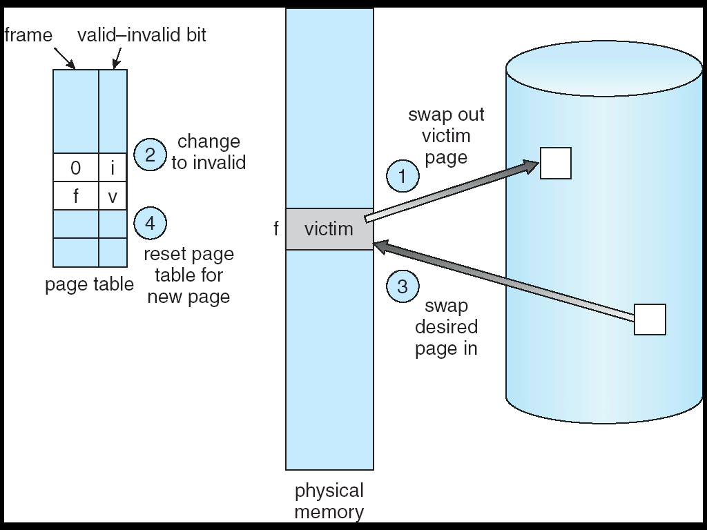

Goal: **lowest page-fault rate**; evaluate on a **reference string**. Generally, more frames → fewer faults.

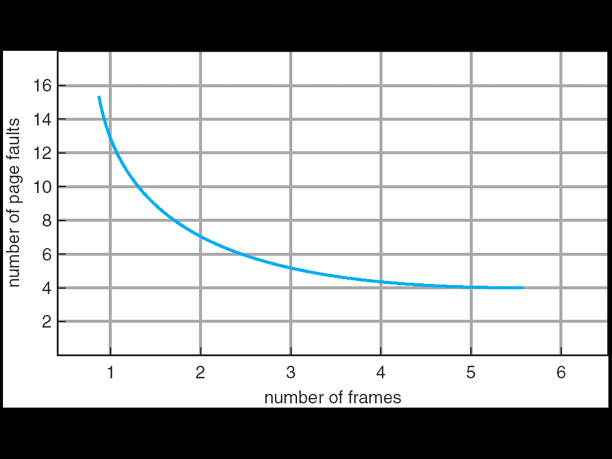

### 19.1 Reference string 7 0 1 2 0 3 0 4 2 3 0 3 2 1 2 0 1 7 0 1 — 3 frames

**FIFO** — replace the **oldest** page:
| Ref | 7 | 0 | 1 | 2 | 0 | 3 | 0 | 4 | 2 | 3 | 0 | 3 | 2 | 1 | 2 | 0 | 1 | 7 | 0 | 1 |
|---|---|---|---|---|---|---|---|---|---|---|---|---|---|---|---|---|---|---|---|---|
| F1 | 7 | 7 | 7 | 2 | 2 | 2 | 2 | 4 | 4 | 4 | 0 | 0 | 0 | 0 | 0 | 0 | 0 | 7 | 7 | 7 |
| F2 | | 0 | 0 | 0 | 0 | 3 | 3 | 3 | 2 | 2 | 2 | 2 | 2 | 1 | 1 | 1 | 1 | 1 | 0 | 0 |
| F3 | | | 1 | 1 | 1 | 1 | 0 | 0 | 0 | 3 | 3 | 3 | 3 | 3 | 2 | 2 | 2 | 2 | 2 | 1 |
| Fault | F | F | F | F | H | F | F | F | F | F | F | H | H | F | F | H | H | F | F | F |

**15 faults, 5 hits** → hit ratio 25 %, miss ratio 75 %.

**Optimal (OPT/MIN)** — replace the page that **will not be used for the longest time** (needs future knowledge; used as a benchmark):
| Ref | 7 | 0 | 1 | 2 | 0 | 3 | 0 | 4 | 2 | 3 | 0 | 3 | 2 | 1 | 2 | 0 | 1 | 7 | 0 | 1 |
|---|---|---|---|---|---|---|---|---|---|---|---|---|---|---|---|---|---|---|---|---|
| F1 | 7 | 7 | 7 | 2 | 2 | 2 | 2 | 2 | 2 | 2 | 2 | 2 | 2 | 2 | 2 | 2 | 2 | 7 | 7 | 7 |
| F2 | | 0 | 0 | 0 | 0 | 0 | 0 | 4 | 4 | 4 | 0 | 0 | 0 | 0 | 0 | 0 | 0 | 0 | 0 | 0 |
| F3 | | | 1 | 1 | 1 | 3 | 3 | 3 | 3 | 3 | 3 | 3 | 3 | 1 | 1 | 1 | 1 | 1 | 1 | 1 |
| Fault | F | F | F | F | H | F | H | F | H | H | F | H | H | F | H | H | H | F | H | H |

**9 faults, 11 hits** → hit ratio 55 %.

**LRU** — replace the page **least recently used** (past approximates future):
| Ref | 7 | 0 | 1 | 2 | 0 | 3 | 0 | 4 | 2 | 3 | 0 | 3 | 2 | 1 | 2 | 0 | 1 | 7 | 0 | 1 |
|---|---|---|---|---|---|---|---|---|---|---|---|---|---|---|---|---|---|---|---|---|
| F1 | 7 | 7 | 7 | 2 | 2 | 2 | 2 | 4 | 4 | 4 | 0 | 0 | 0 | 1 | 1 | 1 | 1 | 1 | 1 | 1 |
| F2 | | 0 | 0 | 0 | 0 | 0 | 0 | 0 | 0 | 3 | 3 | 3 | 3 | 3 | 3 | 0 | 0 | 0 | 0 | 0 |
| F3 | | | 1 | 1 | 1 | 3 | 3 | 3 | 2 | 2 | 2 | 2 | 2 | 2 | 2 | 2 | 2 | 7 | 7 | 7 |
| Fault | F | F | F | F | H | F | H | F | F | F | F | H | H | F | H | F | H | F | H | H |

**12 faults, 8 hits** → hit ratio 40 %.
> ⚠️ The slide shows 9 faults for LRU; the standard (Silberschatz) answer for this string with 3 frames is **12 faults** (FIFO 15 > LRU 12 > OPT 9).

**LRU implementation:** **counter** (copy the clock into the page entry on every reference; replace the smallest) or **stack** (doubly linked list; move a referenced page to the top — 6 pointer changes; the LRU page is at the bottom, no search).

### 19.2 Practice Q7 — reference string 1 2 3 4 1 2 5 1 2 3 4 5
| Algorithm | 3 frames | 4 frames |
|---|---|---|
| **FIFO** | **9** faults | **10** faults ← **Belady's anomaly** |
| **Optimal** | **7** faults | **6** faults |
| **LRU** | **10** faults | **8** faults |

**3-frame traces:**
- FIFO: 1F 2F 3F 4F(−1) 1F(−2) 2F(−3) 5F(−4) 1H 2H 3F(−1) 4F(−2) 5H → **9**
- OPT: 1F 2F 3F 4F(−3) 1H 2H 5F(−4) 1H 2H 3F(−1) 4F(−2) 5H → **7**
- LRU: 1F 2F 3F 4F(−1) 1F(−2) 2F(−3) 5F(−4) 1H 2H 3F(−5) 4F(−1) 5F(−2) → **10**

→ **Optimal yields the fewest faults (best hit ratio 5/12 ≈ 42 %).**

**Belady's anomaly:** for some algorithms (FIFO), **more frames can cause more page faults**. **Stack algorithms** (OPT, LRU) never suffer from it.

### 19.3 Second-Chance (Clock) Algorithm
- Each page has a **reference bit** (set to 1 by hardware when referenced).
- FIFO order in a **circular queue** with a clock hand: if the candidate's reference bit = **0 → replace** it; if **1 → set it to 0** (give a **second chance**) and move to the next page.
- If all bits are 1, it degenerates to FIFO.

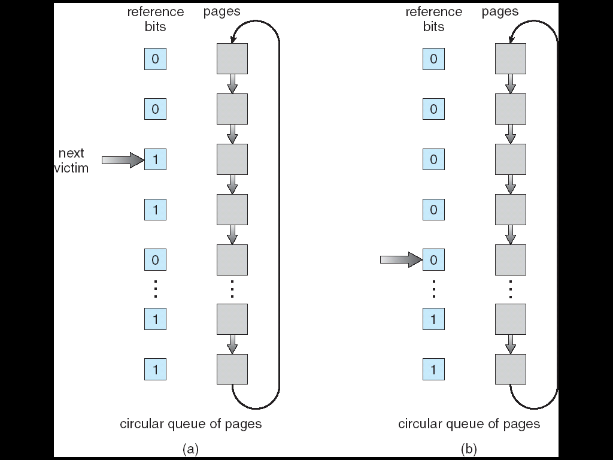

### 19.4 Other algorithms
- **LFU** (least frequently used) — replace the page with the **smallest count**.
- **MFU** (most frequently used) — page with smallest count was probably just brought in.
- **Enhanced second chance** — uses (reference, modify) bit pairs: (0,0) best victim … (1,1) worst.

| Algorithm | Pros | Cons |
|---|---|---|
| FIFO | Simple | Belady's anomaly; may evict heavily used pages |
| Optimal | Lowest possible fault rate | Needs future knowledge — benchmark only |
| LRU | Good approximation of OPT; no Belady anomaly | Needs hardware support (counters/stack) |
| Second chance | Cheap approximation of LRU | Degenerates to FIFO when all bits set |

---

## 20. Thrashing & the Working-Set Model ★★★

### 20.1 Thrashing
If a process does not have "enough" frames, its page-fault rate is very high → **low CPU utilisation** → the OS thinks it should **increase the degree of multiprogramming** → adds another process → even more faults →
**Thrashing = a process is busy swapping pages in and out** (more time paging than executing).

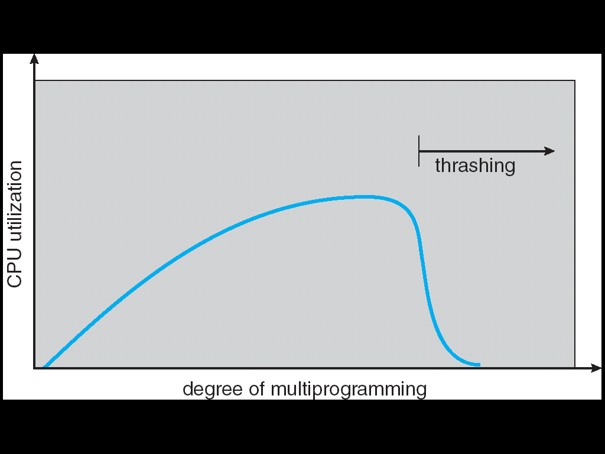


**Causes:** high degree of multiprogramming, insufficient frames, global replacement.
**Remedies:** **local replacement**, provide each process as many frames as its **working set**, **page-fault-frequency (PFF)** control (add frames if fault rate too high, remove if too low), reduce multiprogramming (suspend processes).

### 20.2 Locality & Working-Set Model
- **Locality model:** a process migrates from one **locality** (set of pages actively used together) to another; thrashing occurs when Σ size of localities > total memory.

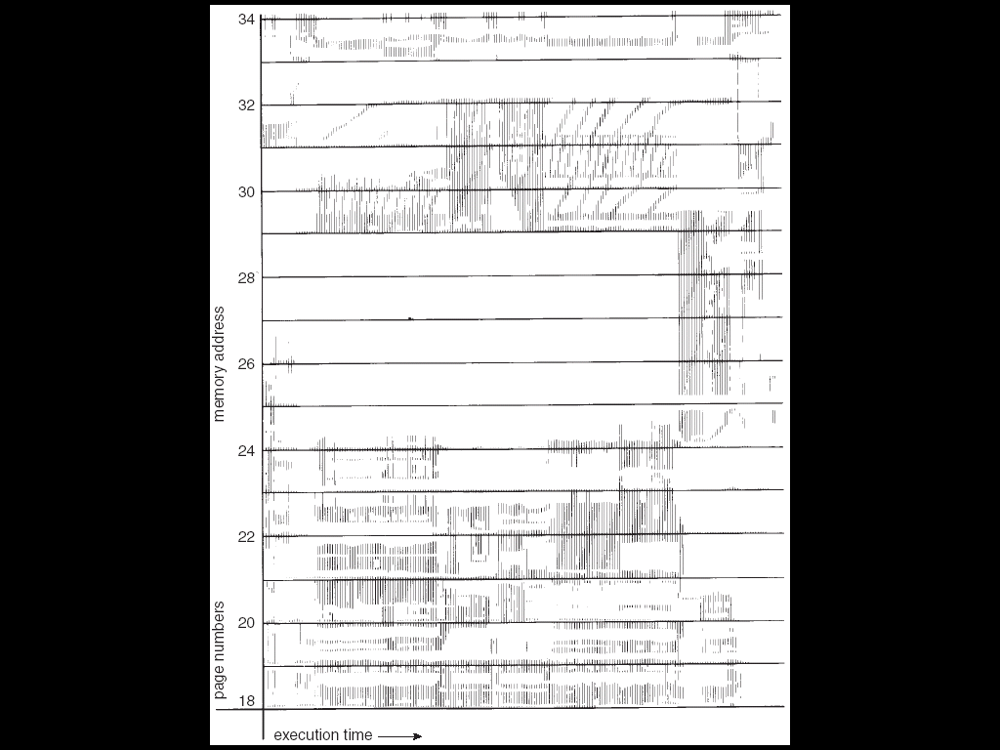

- **Δ ≡ working-set window** — a fixed number of page references (e.g., 10,000 instructions).
- **WSSᵢ** (working set of Pi) = total number of distinct pages referenced in the most recent Δ (varies over time).
  - Δ too small → doesn't cover the whole locality; Δ too large → covers several localities; Δ = ∞ → entire program.
- **D = Σ WSSᵢ** = total demand frames. If **D > m** (available frames) → thrashing → **suspend** a process.

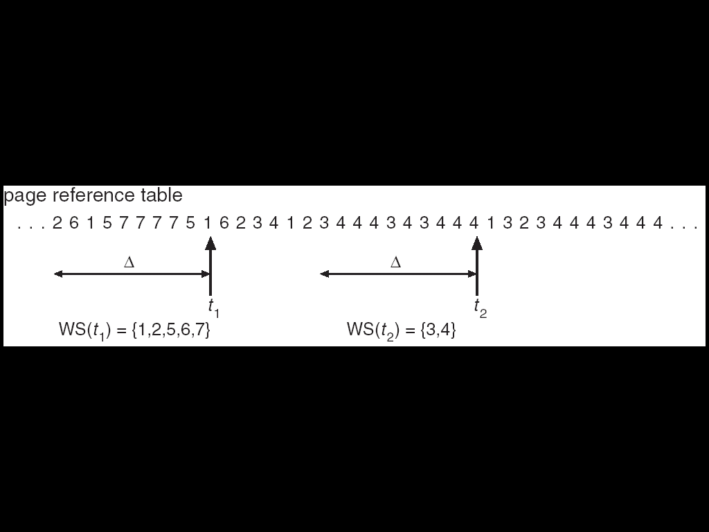

---

## 21. Case Studies — Windows & Linux ★

**Windows:**
- **Demand paging with clustering** — brings in pages surrounding the faulting page.
- Each process has a **working-set minimum** (guaranteed pages) and **working-set maximum**.
- When free memory falls below a threshold → **automatic working-set trimming** removes pages from processes above their minimum.

**Linux:**
- Uses **paging** only (avoids segmentation — more portable; RISC CPUs lack segmentation; simpler when all processes share segment register values).
- **4 KB pages**; a **three-level (now four/five-level) page table** for 64-bit addresses; on 32-bit x86 only two levels are used; hardware paging with a **TLB**.

---

## Unit IV — One-Page Summary

| Topic | Key points |
|---|---|
| **Deadlock** | Set of blocked processes each holding a resource and waiting for another's. Request → use → release. |
| **4 conditions** | Mutual exclusion · Hold & wait · No preemption · Circular wait (all must hold). |
| **RAG** | Request edge P→R, assignment edge R→P. No cycle → no deadlock; cycle + single instance → deadlock; cycle + multiple instances → possible. |
| **Handling** | Prevention · Avoidance · Detection & recovery · Ignore (ostrich, UNIX). |
| **Prevention** | Deny one condition: sharable resources; request all at start / only when holding none; preempt held resources; total ordering of resource types. |
| **Avoidance** | Safe state = safe sequence exists. Safe ⇒ no deadlock. Banker's: Available, Max, Allocation, **Need = Max − Allocation**; safety + resource-request algorithms. Ex1 safe ⟨P1,P3,P4,P0,P2⟩, P1(1,0,2) granted. |
| **Detection** | Wait-for graph cycle (single instance, O(n²)); Request-matrix algorithm (multiple, O(mn²)). |
| **Recovery** | Abort all / one at a time (victim by priority, time, resources); resource preemption: victim, rollback, avoid starvation. |
| **Binding & MMU** | Compile / load / execution time. Logical (CPU) vs physical (memory); relocation register adds base. Base & limit protection. |
| **Loading/linking** | Dynamic loading (load on call), dynamic linking (stub, shared libraries), overlays. |
| **Swapping** | Backing store; roll-out/roll-in; transfer time dominates (100 MB @ 50 MB/s ≈ 2 s each way). |
| **Contiguous** | Fixed vs variable partitions; first/best/worst fit; internal vs external fragmentation; 50 % rule; compaction. |
| **Paging** | Frames/pages; address = (p, d); page table; no external fragmentation; internal frag (962 B example). TLB: EAT = h(t+m) + (1−h)(t+2m). Hierarchical, hashed, inverted tables. |
| **Segmentation** | ⟨s, d⟩; segment table (base, limit), STBR/STLR; user view; external fragmentation. ⟨2,53⟩ → 4353. |
| **Virtual memory** | Execute partially loaded programs; demand paging (lazy swapper, valid–invalid bit); page-fault steps (trap → find on disk → free frame → read → update table → restart). EAT = (1−p)ma + p·fault time (8.2 µs, 40× slowdown). |
| **Replacement** | FIFO (Belady's anomaly), Optimal (min faults), LRU (counter/stack), Second chance (reference bit), LFU/MFU. String 7 0 1 2…: FIFO 15, LRU 12, OPT 9. String 1 2 3 4 1 2 5…: FIFO 9/10, OPT 7/6, LRU 10/8 (3/4 frames). |
| **Thrashing** | More time paging than executing; low CPU use → more processes → worse. Working set Δ, WSS, D = ΣWSS > m → suspend; PFF; local replacement. |
| **Case studies** | Windows: clustering, working-set min/max, trimming. Linux: paging only, 4 KB pages, multi-level tables, TLB. |
