# Unit V — File System & Disk Scheduling

> **Syllabus:** File concept, attributes, operations, types; access methods (sequential, direct, indexed); directory and disk structure; directory structures (single-level, two-level, tree, acyclic-graph); allocation methods (contiguous, linked, indexed, FAT, inode); disk scheduling and management — FCFS, SSTF, SCAN, C-SCAN, LOOK, C-LOOK, selecting an algorithm; introduction to Distributed File Systems.
>
> **Source:** *UNIT- V.ppt* · *OSC – Practice Questions – Units 4, 5 and 6.pdf*

**Importance legend:** ★★★ = very frequently asked (long answer / numericals) · ★★ = medium · ★ = short answer

---

## Table of Contents
1. [File Concept](#1-file-concept-)
2. [File Attributes](#2-file-attributes-)
3. [File Operations](#3-file-operations-)
4. [File Types](#4-file-types-)
5. [Access Methods](#5-access-methods-)
6. [Directory & Disk Structure](#6-directory--disk-structure-)
7. [Directory Structures](#7-directory-structures-)
8. [Allocation Methods](#8-file-allocation-methods-)
9. [📘 Free-Space Management](#9--free-space-management-)
10. [Disk Structure & Access Time](#10-disk-structure--access-time-)
11. [Disk Scheduling Algorithms](#11-disk-scheduling-algorithms-)
12. [Solved Disk-Scheduling Problems](#12-solved-disk-scheduling-problems-)
13. [Selecting a Disk-Scheduling Algorithm](#13-selecting-a-disk-scheduling-algorithm-)
14. [Distributed File System (DFS / NFS)](#14-distributed--network-file-system-dfs--nfs-)
15. [Unit V — One-Page Summary](#unit-v--one-page-summary)

---

## 1. File Concept ★★

- A **file** is a **named collection of related information** recorded on **secondary storage**.
- From the user's view, a file is the **smallest allotment of logical secondary storage** — data can't be written to secondary storage unless it is within a file.
- Files represent **programs** (source and object) and **data** (numeric, alphabetic, alphanumeric, binary); in general a sequence of **bits, bytes, lines or records**.
- Structure depends on type:
  - **Text file** — sequence of characters organised into lines (and pages);
  - **Source file** — sequence of functions (declarations + executable statements);
  - **Executable file** — series of code sections the loader can bring into memory and execute.

---

## 2. File Attributes ★★★

| Attribute | Description |
|---|---|
| **Name** | The only information kept in **human-readable** form |
| **Identifier** | Unique tag (number) identifying the file within the file system |
| **Type** | Needed for systems supporting different file types |
| **Location** | Pointer to the device and location of the file on it |
| **Size** | Current size (bytes/words/blocks), possibly maximum size |
| **Protection** | Access-control info — who can read, write, execute |
| **Time, date, user ID** | Creation, last modification, last use — for protection, security, usage monitoring |

Information about files is kept in the **directory structure**, which is maintained **on the disk**.

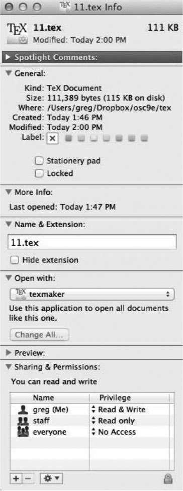

---

## 3. File Operations ★★

A file is an **abstract data type**; the OS provides system calls to:

| Operation | How it works |
|---|---|
| **Create** | (1) Find **space** in the file system; (2) make an **entry in the directory** |
| **Write** | System call with file name + data; directory searched for location; a **write pointer** tracks the next write position and is updated after each write |
| **Read** | System call with file name + memory destination; a **read pointer** tracks position (read & write share one **current-file-position pointer**) |
| **Reposition (seek)** | Set the current-file-position pointer to a given value (no I/O) |
| **Delete** | Search the directory, **release all file space**, erase the directory entry |
| **Truncate** | Erase contents but **keep attributes**; length reset to zero and space released |

Others: append, rename, copy; **open()** (caches the directory entry in the **open-file table**) and **close()**.

---

## 4. File Types ★

The OS uses the **extension** to recognise the type:

| Type | Extensions | Function |
|---|---|---|
| Executable | exe, com, bin | Ready-to-run machine-language program |
| Object | obj, o | Compiled, not linked |
| Source code | c, cc, java, py, asm | Source in various languages |
| Batch | bat, sh | Commands to the command interpreter |
| Text | txt, doc | Textual data, documents |
| Word processor | docx, rtf, tex | Various word-processor formats |
| Library | lib, a, so, dll | Libraries of routines |
| Print/view | pdf, ps, jpg | Printing or viewing |
| Archive | zip, tar, arc | Related files grouped, often compressed |
| Multimedia | mpeg, mov, mp3, mp4 | Audio/video |

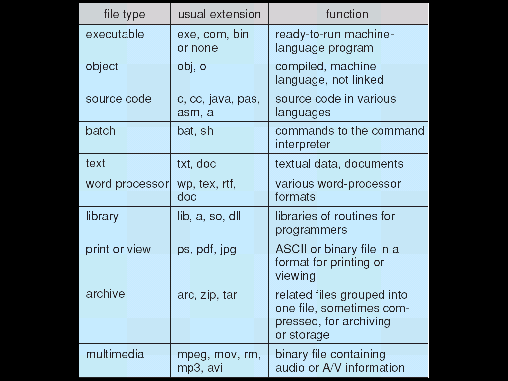

---

## 5. Access Methods ★★★

### 5.1 Sequential Access
- Simplest: information processed **in order**, one record after another (editors, compilers).
- **read_next()** reads the next portion and advances the file pointer; **write_next()** appends at the end and advances.
- File can be **reset** to the beginning; some systems allow skipping forward/backward n records.
- Based on the **tape model** of a file.

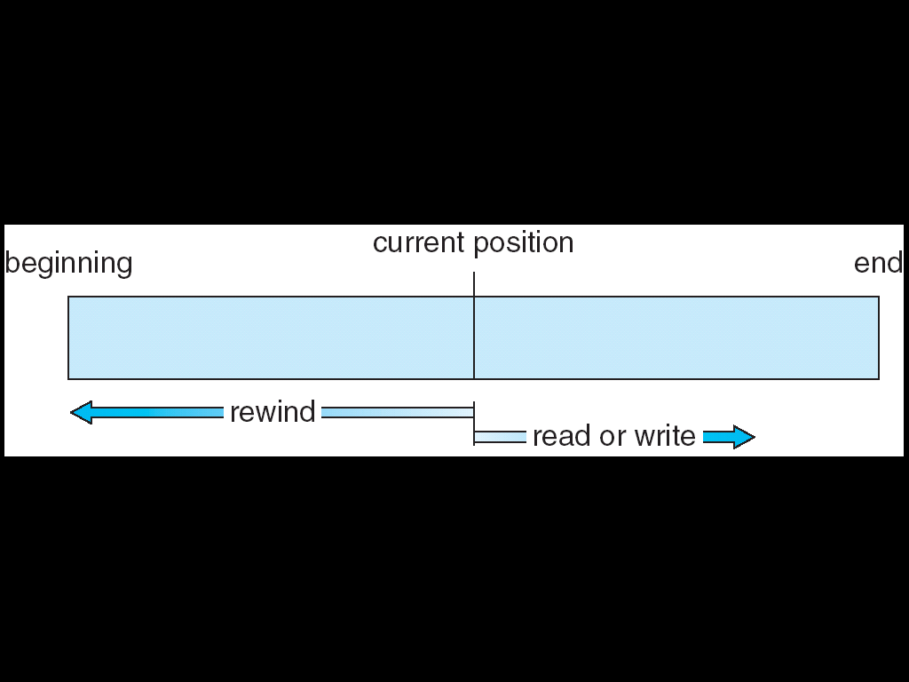

### 5.2 Direct (Relative) Access
- File = **fixed-length logical records**; programs read/write records **rapidly in no particular order**.
- Based on the **disk model** (random access to any block). File viewed as a numbered sequence of blocks: read block 14, then 53, then write 7.
- Operations take a block number: **read(n)**, **write(n)** (or position_file(n) then read_next()).
- Ideal for **databases** and large data lookup.

**Simulating sequential access on a direct-access file:** keep `cp` (current position): reset → `cp = 0`; read_next → `read cp; cp = cp + 1`; write_next → `write cp; cp = cp + 1`.

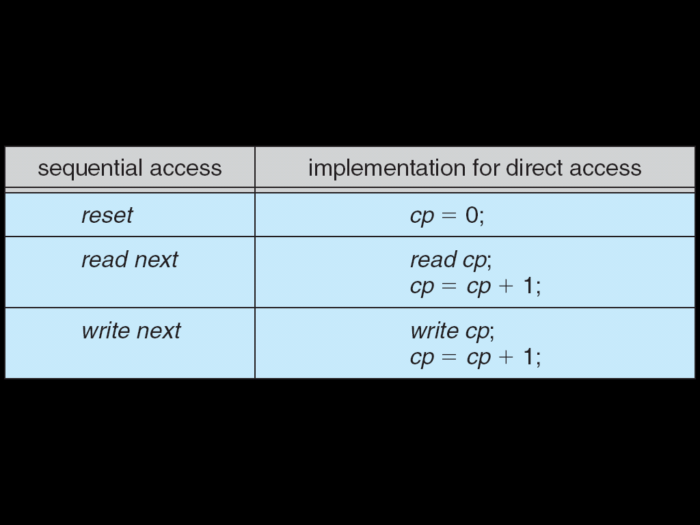

### 5.3 Indexed Access
- An **index** contains **pointers to blocks**; to find a record, **search the index**, then use the pointer to access the record directly.
- For large files the index itself becomes large → **multi-level index**: a **primary index** points to **secondary index** files which point to data items (e.g., IBM ISAM).

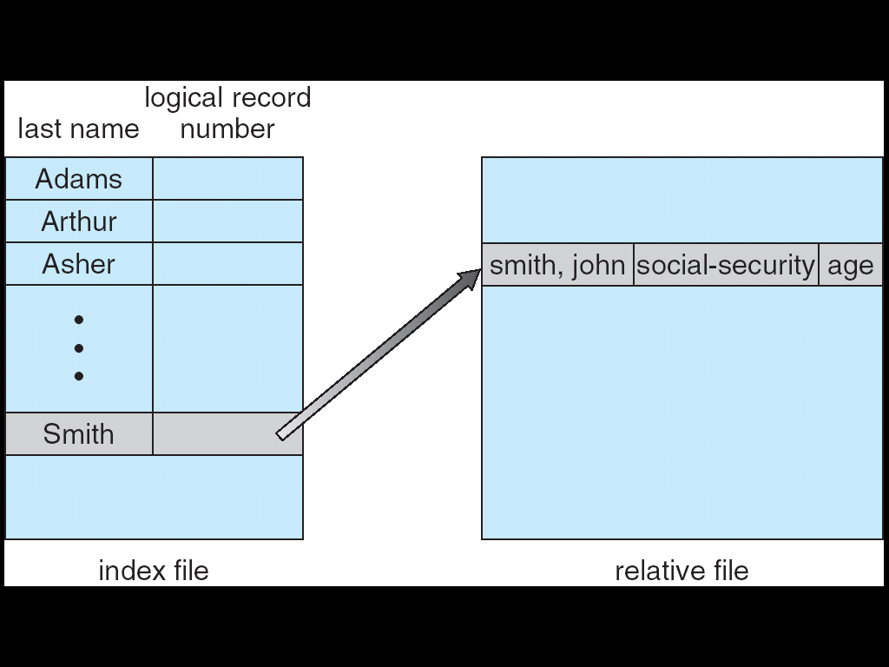

| Sequential | Direct | Indexed |
|---|---|---|
| In order | Any order by block number | Via index lookup |
| Tape model | Disk model | Built on direct access |
| Simple; slow for random lookups | Fast random access | Fast search on keys; index overhead |

---

## 6. Directory & Disk Structure ★★

- A storage device can hold one file system or be **partitioned** (e.g., into quarters, each with its own file system).
- Any entity containing a file system = a **volume** (a virtual disk); volumes can also hold multiple OSes for multi-booting.
- Each volume keeps information about its files in a **device directory / volume table of contents** — name, location, size, type of every file.

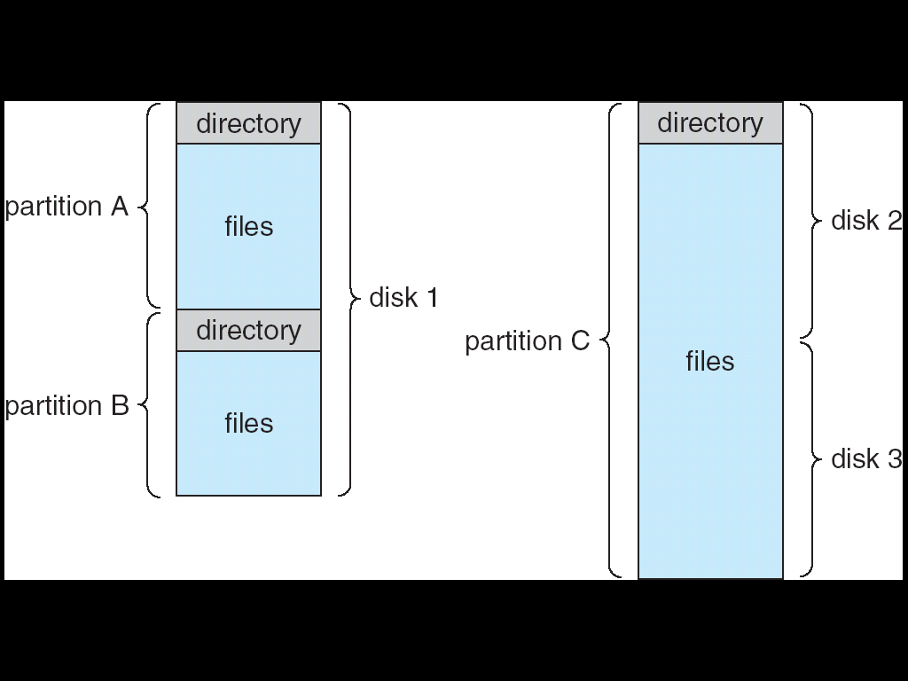

**Storage structure:** a system may have many file systems of different types — e.g., Solaris: **tmpfs** (temporary, in volatile memory), **objfs** (virtual — kernel symbols for debuggers), **ctfs** (contract info for boot-time processes), **lofs** (loop-back), **procfs** (process information as files), **ufs, zfs** (general-purpose).

### 6.1 Operations on a Directory
The directory is a **symbol table** translating file names into directory entries. Operations: **search** for a file · **create** a file · **delete** a file · **list** a directory · **rename** a file · **traverse** the file system (e.g., for backup).

**Goals of directory organisation:** efficiency (locate files quickly), naming (two users can use the same name; one file can have several names), grouping (by properties).

---

## 7. Directory Structures ★★★

### 7.1 Single-Level Directory
**One directory for all users**; all files contained in the same directory.

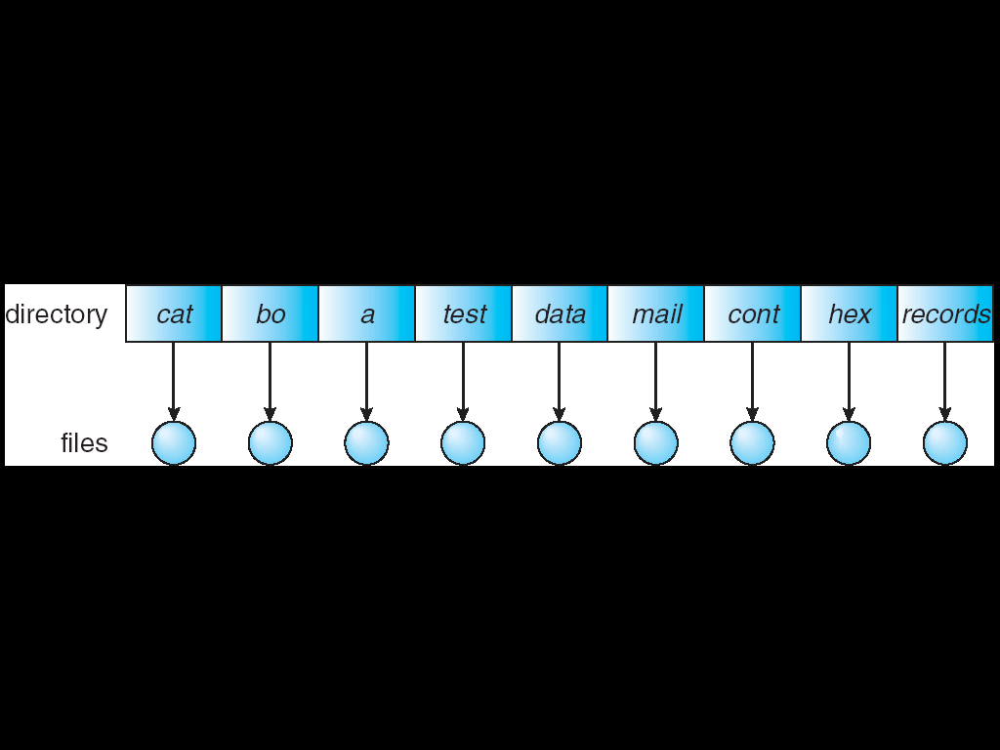

| Advantages | Disadvantages |
|---|---|
| Very simple to implement & understand | **No two files can have the same name** (naming problem) |
| Fast search when few, small files | Large directory → slow search |
| Create/search/delete simple | **No protection** for multiple users; **no grouping** |

### 7.2 Two-Level Directory
- Each user has a separate **User File Directory (UFD)**; the **Master File Directory (MFD)**, indexed by user name/account, points to each UFD.
- When a user logs in, the MFD is searched; file references resolve within that user's UFD. Path name = user name + file name.

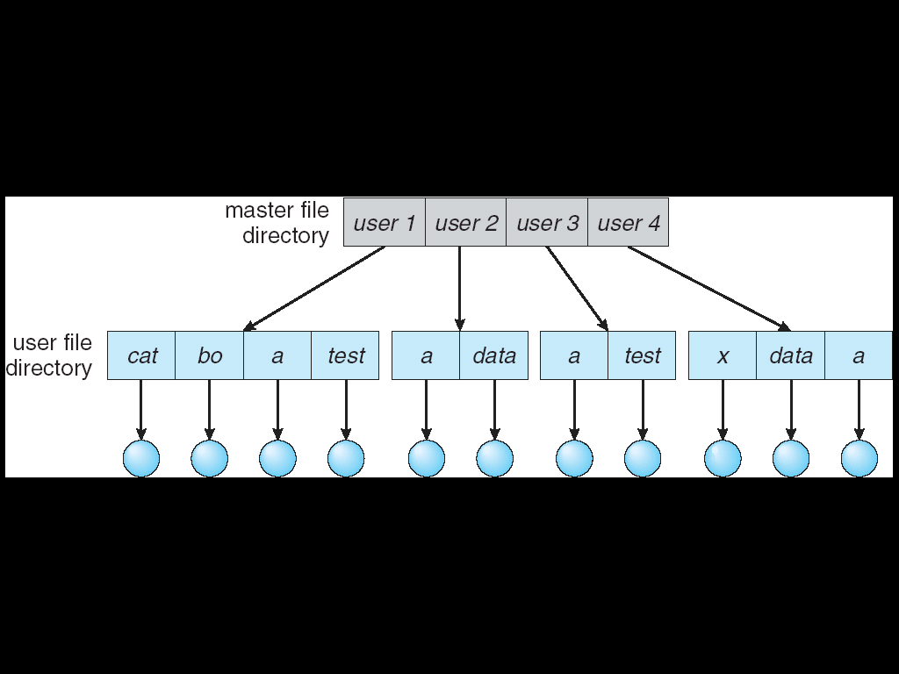

| Advantages | Disadvantages |
|---|---|
| Different users can have **same file names** | No **grouping** of similar files |
| Efficient searching (user grouping) | Users **cannot share** files easily (isolation) |
| Isolation / protection between users | |

### 7.3 Tree-Structured Directory
- Directory entries can be **files or subdirectories** — a tree of arbitrary height; overcomes two-level limitations; similar files can be **grouped**.
- Each user has a home directory; users can read the root's data but cannot modify it; only the administrator has full access to root.
- **Current (working) directory**; path names:
  - **Absolute** — from the **root** down (`/home/ravi/os/notes.txt`);
  - **Relative** — from the **current directory** (`os/notes.txt`).

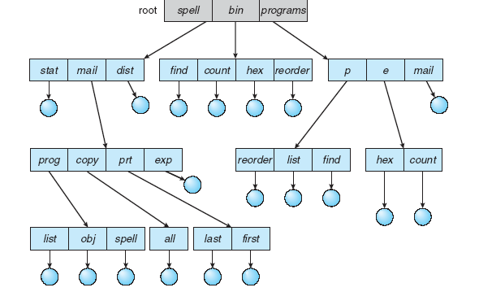

| Advantages | Disadvantages |
|---|---|
| Efficient searching; **grouping** | **Files cannot be shared** across directories |
| Scalable, logical organisation | Accessing a file may require long paths through many directories |

### 7.4 Acyclic-Graph Directory
- Allows **sharing**: two or more directory entries can point to the **same file or subdirectory** (no cycles).
- Implemented with **links**: **soft (symbolic) link** — a pointer containing the path; **hard link** — duplicate directory entry with a reference count.

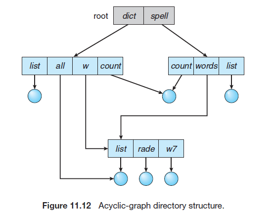

| Advantages | Disadvantages |
|---|---|
| **Files can be shared** | Soft link: deleting the file leaves a **dangling pointer** |
| Searching is easier (multiple paths) | Hard link: deleting a file requires removing all references (reference count) |
| | Traversal may visit a shared file more than once |

**General graph directory** (cycles allowed) needs garbage collection and cycle detection — usually avoided.

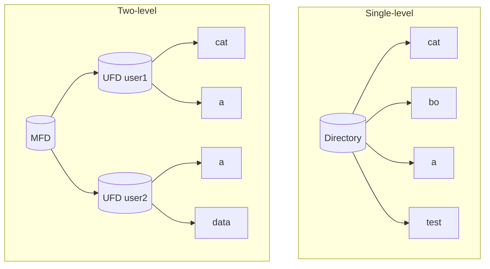

| Structure | Same names for different users | Grouping | Sharing |
|---|---|---|---|
| Single-level | ✗ | ✗ | (trivial) |
| Two-level | ✓ | ✗ | ✗ |
| Tree | ✓ | ✓ | ✗ |
| Acyclic graph | ✓ | ✓ | ✓ |

---

## 8. File Allocation Methods ★★★

Allocation methods define **how files are stored in disk blocks**. Goals: **efficient disk-space utilisation** and **fast access**. Three methods: **contiguous, linked, indexed**.

### 8.1 Contiguous Allocation
- Each file occupies a **contiguous set of blocks**: a file of n blocks starting at b uses **b, b+1, …, b+n−1**.
- Directory entry: **start block** and **length**.

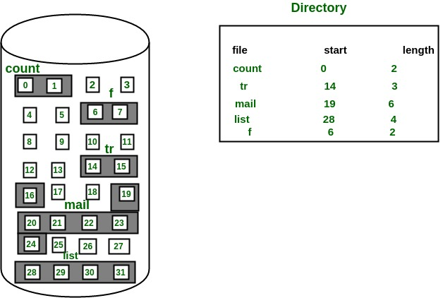

| Advantages | Disadvantages |
|---|---|
| Supports **sequential and direct** access — block k is at **b + k** | **External fragmentation** (and internal in last block) |
| **Very fast** — minimal seeks | Hard to **grow** a file (needs contiguous free space); must know size in advance |
| | Dynamic storage-allocation problem (first/best fit) |

### 8.2 Linked Allocation
- Each file is a **linked list of disk blocks** scattered anywhere; each block contains a **pointer to the next** block.
- Directory entry: pointer to the **first and last** blocks.

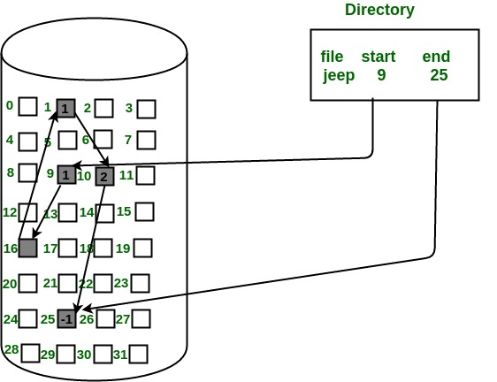

| Advantages | Disadvantages |
|---|---|
| **No external fragmentation** | **No direct access** — block k needs k reads from the start |
| File size can **grow easily** | Many seeks → slower |
| No need to declare size | **Pointer overhead** in every block; reliability — a lost/damaged pointer breaks the chain |

**File-Allocation Table (FAT)** — a variation used by MS-DOS/Windows: the chain of pointers is kept in a **table at the start of the volume**, one entry per block; directory gives the first block; the FAT entry gives the next (end-of-file marker ends it). FAT can be cached → **random access improves**.

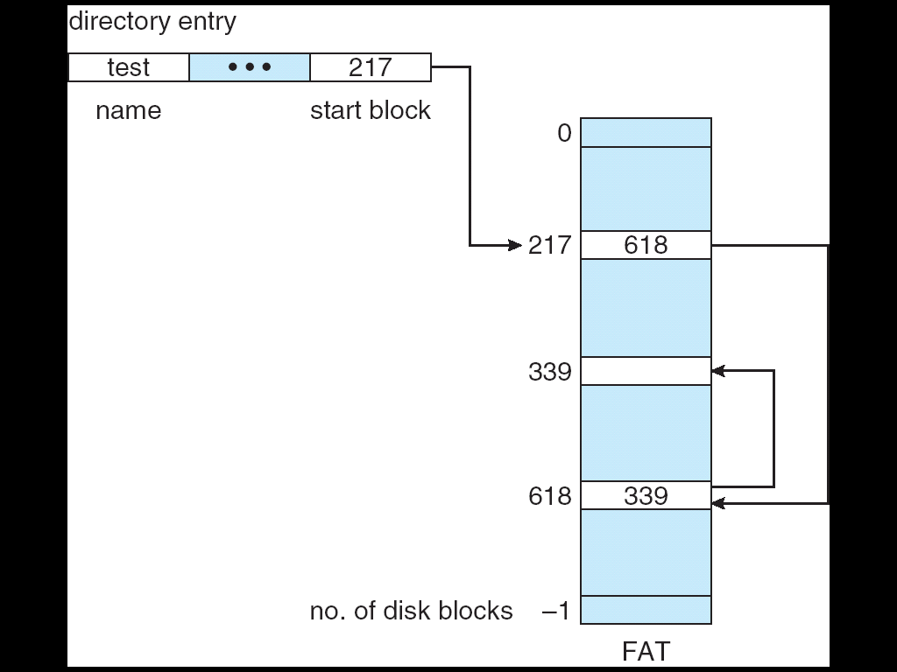

### 8.3 Indexed Allocation
- A special **index block** holds **pointers to all blocks** of the file; the i-th entry = address of the i-th block. Directory entry contains the **index-block address**.

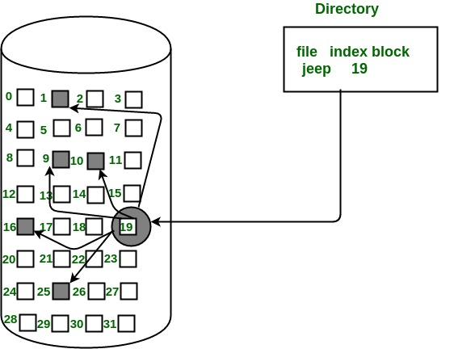

| Advantages | Disadvantages |
|---|---|
| Supports **direct access** — fast | Pointer overhead **greater** than linked allocation |
| **No external fragmentation** | Small files (2–3 blocks) waste a whole **index block** |

**Large files — when one index block isn't enough:**
1. **Linked scheme** — link several index blocks together (last entry points to next index block).
2. **Multilevel index** — a first-level index block points to second-level index blocks, which point to data blocks (extendable to 3+ levels).
3. **Combined scheme (UNIX inode)** — the **inode** holds file attributes (name/owner, size, permissions…) plus block pointers:
   - first **12 direct** pointers → data blocks;
   - **single indirect** pointer → a block of pointers to data;
   - **double indirect** → block of pointers to blocks of pointers;
   - **triple indirect** → three levels.

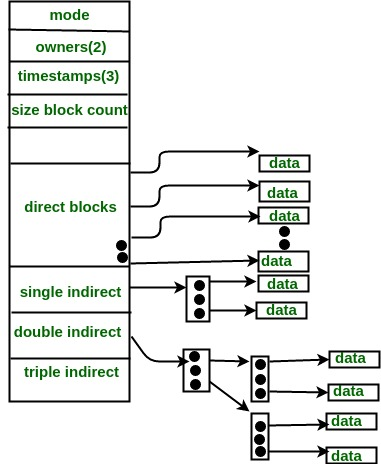

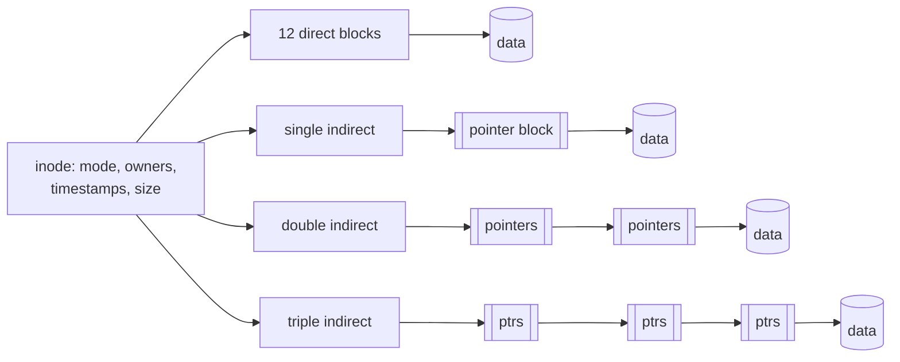

*Example:* 4 KB blocks, 4-byte pointers → 1024 pointers per block. Max size ≈ 12×4 KB + 1024×4 KB + 1024²×4 KB + 1024³×4 KB ≈ **4 TB**.

| Method | Access | Fragmentation | Growth | Overhead |
|---|---|---|---|---|
| Contiguous | Sequential + direct (fastest) | External | Hard | Minimal |
| Linked | Sequential only | None | Easy | Pointer per block |
| Indexed | Sequential + direct | None | Easy | Index block per file |

---

## 9. 📘 Free-Space Management ★★
(asked as "free space management" in exam questions)

| Method | Idea |
|---|---|
| **Bit vector (bitmap)** | One bit per block: 1 = free, 0 = allocated (or vice versa); easy to find contiguous free blocks; bitmap must be kept in memory |
| **Linked list** | Free blocks linked together; head pointer in a special location; traversal is slow |
| **Grouping** | First free block stores addresses of n free blocks; the last of those stores the next n |
| **Counting** | Store (first free block, count of contiguous free blocks) pairs |

---

## 10. Disk Structure & Access Time ★★

The OS should use hardware efficiently — for disks, **fast access time** and high **disk bandwidth**.

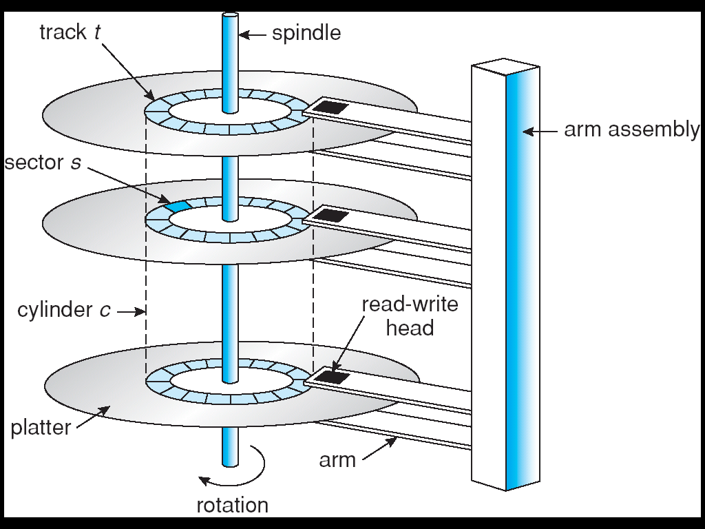

- Disk = platters → **tracks** → **sectors**; the set of tracks at one arm position = **cylinder**.
- **Access time** = **seek time** (move heads to the cylinder) + **rotational latency** (wait for the sector to rotate under the head) + transfer time.
- **Seek time ∝ seek distance** → disk scheduling aims to **minimise seek distance (head movement)**.
- **Disk bandwidth** = total bytes transferred ÷ total time from the first request to completion of the last.

---

## 11. Disk Scheduling Algorithms ★★★

| Algorithm | Rule | Advantages | Disadvantages |
|---|---|---|---|
| **FCFS** | Serve requests in **arrival order** | Fair; no starvation | No seek optimisation; wild swings |
| **SSTF** (Shortest Seek Time First) | Serve the request **closest** to the current head (like SJF) | Lower average response time; higher throughput | Overhead to compute seeks; **starvation** of far requests; high variance |
| **SCAN (Elevator)** | Arm moves in one direction **to the end of the disk**, serving requests, then **reverses** | High throughput; low variance | Long wait for requests just passed |
| **C-SCAN** (Circular SCAN) | Like SCAN, but at the end **jumps back to the beginning** without serving on the return; treats cylinders as a circular list | **More uniform waiting time** than SCAN | More head movement |
| **LOOK** | Like SCAN but goes only as far as the **last request** in each direction, then reverses | Avoids needless travel to the end | Slight overhead to find last request |
| **C-LOOK** | Like C-SCAN but goes only to the **last request**, then jumps to the **farthest request at the other end** | Uniform wait + less movement | — |

---

## 12. Solved Disk-Scheduling Problems ★★★

> Convention used: the return jump in C-SCAN / C-LOOK **is counted** in total head movement (as on the slides).

### Example 1 — cylinders 0–199, head at **50**, moving towards higher cylinders
Queue: **82, 170, 43, 140, 24, 16, 190**

| Algorithm | Service order | Total head movement |
|---|---|---|
| **FCFS** | 50 → 82 → 170 → 43 → 140 → 24 → 16 → 190 | 32+88+127+97+116+8+174 = **642** |
| **SSTF** | 50 → 43 → 24 → 16 → 82 → 140 → 170 → 190 | 7+19+8+66+58+30+20 = **208** |
| **SCAN** | 50 → 82 → 140 → 170 → 190 → **199** → 43 → 24 → 16 | (199−50)+(199−16) = **332** |
| **C-SCAN** | 50 → … → 190 → 199 → **0** → 16 → 24 → 43 | (199−50)+(199−0)+(43−0) = **391** |
| **LOOK** | 50 → 82 → 140 → 170 → 190 → 43 → 24 → 16 | (190−50)+(190−16) = **314** |
| **C-LOOK** | 50 → … → 190 → **16** → 24 → 43 | (190−50)+(190−16)+(43−16) = **341** |

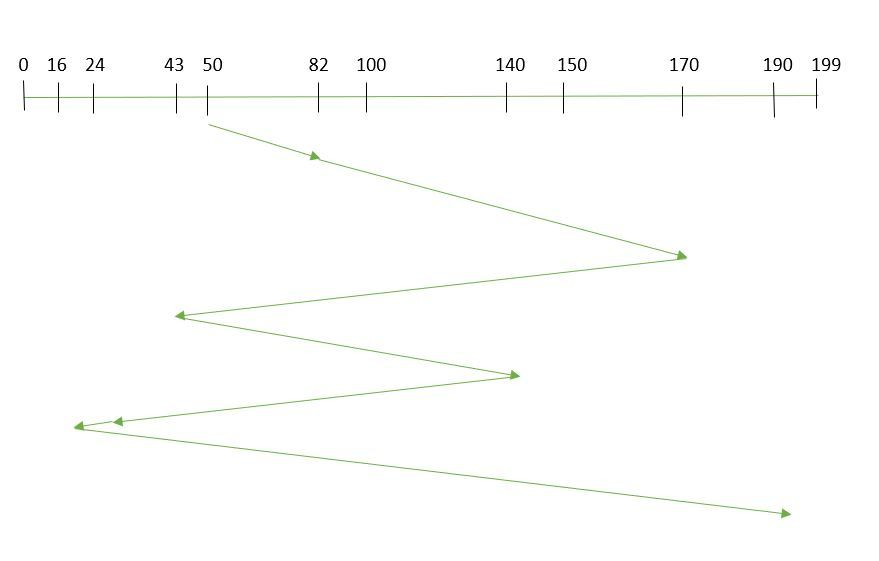 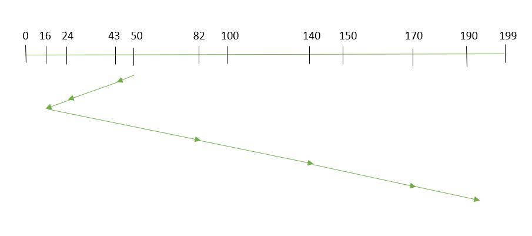 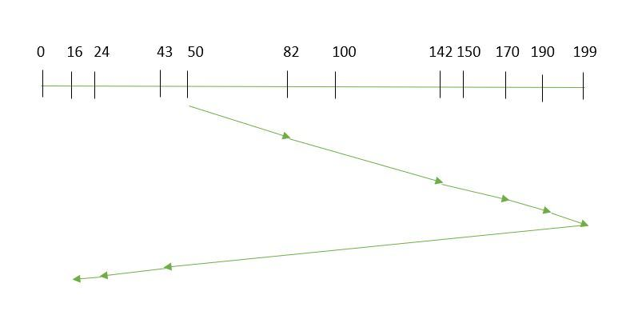
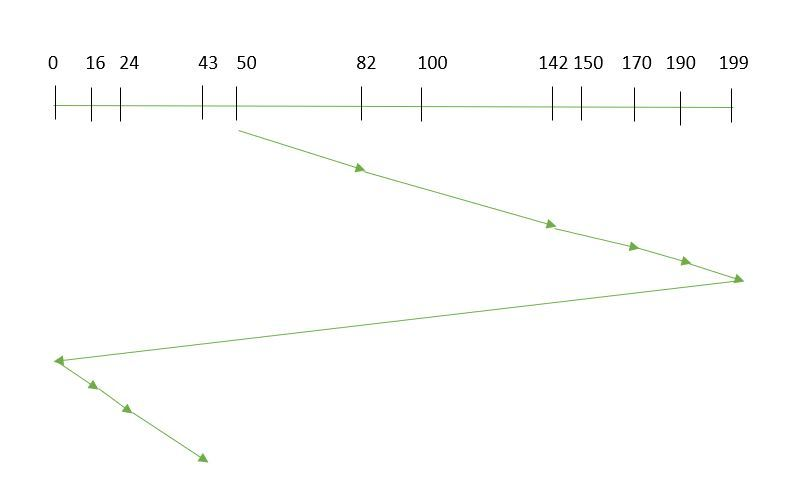 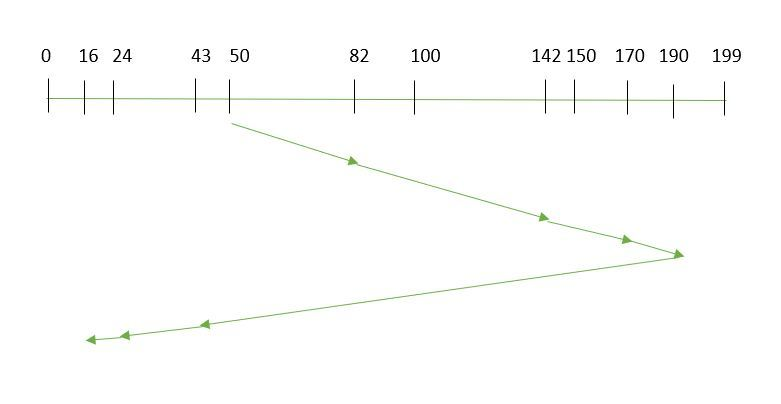 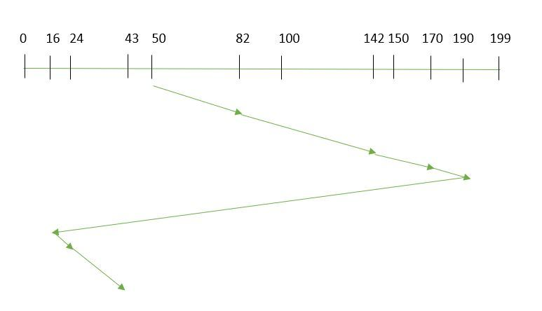

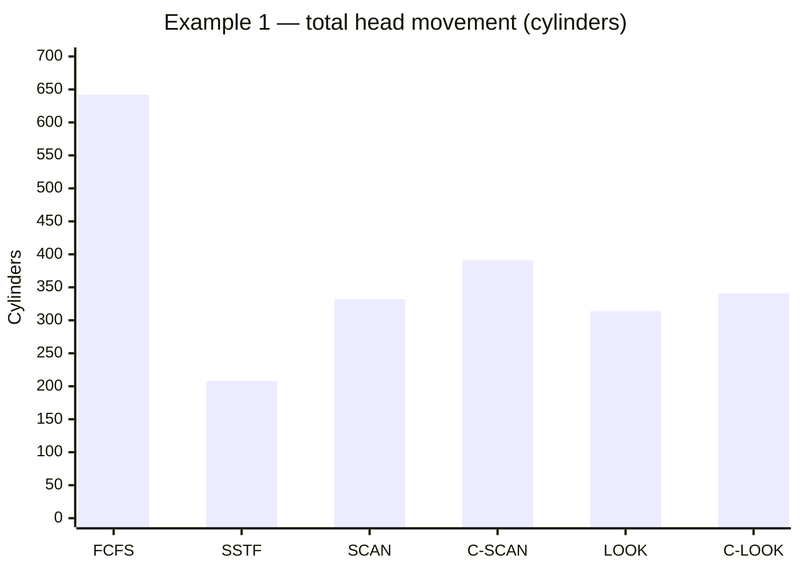

### Example 2 — cylinders 0–199, head at **53**, previous request 45 (moving **up**)
Queue: **98, 183, 37, 122, 14, 124, 65, 67**

| Algorithm | Service order | Total |
|---|---|---|
| **FCFS** | 53 → 98 → 183 → 37 → 122 → 14 → 124 → 65 → 67 | 45+85+146+85+108+110+59+2 = **640** |
| **SSTF** | 53 → 65 → 67 → 37 → 14 → 98 → 122 → 124 → 183 | 12+2+30+23+84+24+2+59 = **236** |
| **SCAN** (up) | 53 → 65 → 67 → 98 → 122 → 124 → 183 → 199 → 37 → 14 | 146 + 185 = **331** |
| **C-SCAN** (up) | … → 183 → 199 → 0 → 14 → 37 | 146 + 199 + 37 = **382** |
| **LOOK** (up) | … → 183 → 37 → 14 | 130 + 169 = **299** |
| **C-LOOK** (up) | … → 183 → 14 → 37 | 130 + 169 + 23 = **322** |

*(If the head were moving towards 0, as in the textbook figure, SCAN = 53 + 183 = **236**.)*

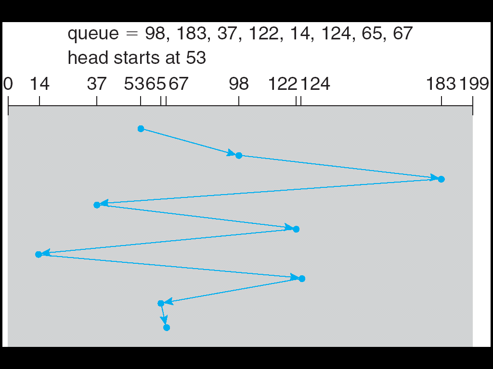 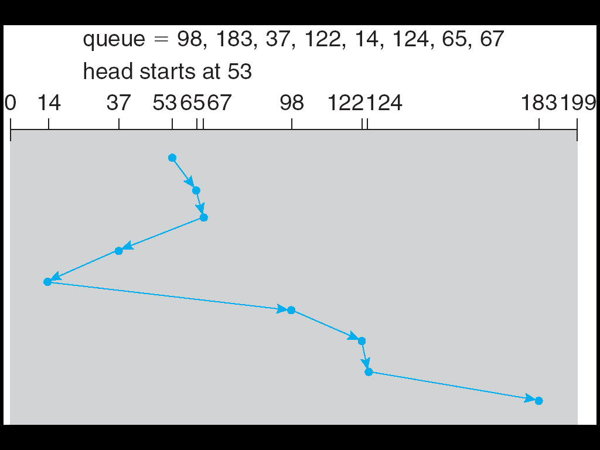

### Example 3 — cylinders 0–4999, head at **143**, previous 125 (moving **up**)
Queue: **86, 1470, 913, 1774, 948, 1509, 1022, 1750, 130**

| Algorithm | Service order | Total |
|---|---|---|
| **FCFS** | 143 → 86 → 1470 → 913 → 1774 → 948 → 1509 → 1022 → 1750 → 130 | **7081** |
| **SSTF** | 143 → 130 → 86 → 913 → 948 → 1022 → 1470 → 1509 → 1750 → 1774 | **1745** |
| **SCAN** | 143 → 913 → 948 → 1022 → 1470 → 1509 → 1750 → 1774 → 4999 → 130 → 86 | 4856 + 4913 = **9769** |
| **C-SCAN** | … → 1774 → 4999 → 0 → 86 → 130 | 4856 + 4999 + 130 = **9985** |
| **LOOK** | … → 1774 → 130 → 86 | 1631 + 1688 = **3319** |
| **C-LOOK** | … → 1774 → 86 → 130 | 1631 + 1688 + 44 = **3363** |

### Practice Q4 — cylinders 0–299, head at **14**, moving in **decreasing** order
Queue: **8, 147, 91, 177, 94, 150, 102, 9, 130**

| Algorithm | Service order | Total |
|---|---|---|
| **FCFS** | 14 → 8 → 147 → 91 → 177 → 94 → 150 → 102 → 9 → 130 | 6+139+56+86+83+56+48+93+121 = **688** |
| **SSTF** | 14 → 9 → 8 → 91 → 94 → 102 → 130 → 147 → 150 → 177 | 5+1+83+3+8+28+17+3+27 = **175** |
| **SCAN** (down) | 14 → 9 → 8 → **0** → 91 → 94 → 102 → 130 → 147 → 150 → 177 | 14 + 177 = **191** |
| **C-SCAN** (down) | 14 → 9 → 8 → 0 → **299** → 177 → 150 → 147 → 130 → 102 → 94 → 91 | 14 + 299 + 208 = **521** |
| **LOOK** (down) | 14 → 9 → 8 → 91 → … → 177 | 6 + 169 = **175** |
| **C-LOOK** (down) | 14 → 9 → 8 → **177** → 150 → 147 → 130 → 102 → 94 → 91 | 6 + 169 + 86 = **261** |

→ **SSTF and LOOK** give the least head movement (175) here.

---

## 13. Selecting a Disk-Scheduling Algorithm ★★

- **SSTF** is common and has natural appeal (but can starve).
- **SCAN and C-SCAN** perform better for systems with a **heavy disk load** (no starvation).
- Performance depends on the **number and types of requests**; requests are influenced by the **file-allocation method** (contiguous → clustered requests; linked/indexed → scattered).
- The disk-scheduling algorithm should be a **separate OS module**, replaceable if needed.
- **SSTF or LOOK** is a reasonable **default**.
- (Rotational latency is hard for the OS to optimise — modern disk controllers schedule internally.)

---

## 14. Distributed / Network File System (DFS / NFS) ★★

- A file system that allows **access to files from multiple hosts** sharing via a **computer network**.
- Multiple users on multiple machines **share files and storage**; clients don't access block storage directly but interact over the network using a **protocol** (NFS, SMB/CIFS, AFS).
- Access can be restricted by **access lists or capabilities** on servers and clients.
- Includes **transparent replication and fault tolerance** — if a limited number of nodes go offline, the system continues without data loss.

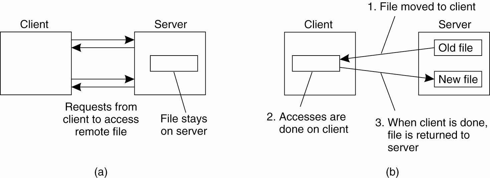

| Model | Description |
|---|---|
| **Remote-access model** | File stays on the server; client sends requests (read/write) to access it remotely |
| **Upload/download model** | File is **moved** to the client, accessed locally, then **returned** to the server |

**DFS requirements:** heterogeneity · replication · **transparency** (access, location, naming) · consistency · concurrency · fault tolerance · security · efficiency.

---

## Unit V — One-Page Summary

| Topic | Key points |
|---|---|
| **File** | Named collection of related info on secondary storage; smallest logical storage allotment. |
| **Attributes** | Name, identifier, type, location, size, protection, time/date/user ID (kept in directory on disk). |
| **Operations** | Create (space + directory entry), write/read (shared current-position pointer), reposition, delete, truncate; open/close (open-file table). |
| **Access methods** | Sequential (tape model, read_next/write_next) · Direct (disk model, read(n)) · Indexed (index → pointer; multilevel index). |
| **Directory ops** | Search, create, delete, list, rename, traverse. Volume = entity containing a file system. |
| **Directory structures** | Single-level (no duplicate names) · Two-level (MFD → UFD; no sharing/grouping) · Tree (absolute/relative paths; no sharing) · Acyclic graph (sharing via soft/hard links; dangling pointers). |
| **Allocation** | **Contiguous** (b + k, fast, external fragmentation, hard to grow) · **Linked** (no fragmentation, sequential only, pointer overhead; FAT) · **Indexed** (direct access, index-block overhead; linked/multilevel/combined inode with direct, single/double/triple indirect). |
| **Free space** | Bitmap, linked list, grouping, counting. |
| **Disk time** | Access = seek + rotational latency + transfer; minimise seek distance; bandwidth. |
| **Scheduling** | FCFS (fair) · SSTF (closest, starvation) · SCAN (elevator, to the end) · C-SCAN (circular, uniform wait) · LOOK (to last request) · C-LOOK. |
| **Example (head 50)** | FCFS 642 · SSTF 208 · SCAN 332 · C-SCAN 391 · LOOK 314 · C-LOOK 341. |
| **Practice (head 14, down)** | FCFS 688 · SSTF 175 · SCAN 191 · C-SCAN 521 · LOOK 175 · C-LOOK 261. |
| **Selection** | SSTF/LOOK default; SCAN/C-SCAN for heavy load; depends on allocation method; separate module. |
| **DFS** | Network file sharing via protocol; remote-access vs upload/download model; transparency, replication, fault tolerance. |
