# Unit VI — I/O Systems, Protection & Security

> **Syllabus:** I/O hardware — ports, buses, controllers; polling; interrupts; DMA. Protection — goals and principles of protection, domain of protection, access matrix and its implementation (global table, access lists, capability lists, lock–key), revocation of access rights, role-based and mandatory access control, capability-based systems. Program threats, system & network threats, cryptography basics.
>
> **Source:** *UNIT VI.ppt* (Silberschatz, Galvin & Gagne) · *OSC – Practice Questions – Units 4, 5 and 6.pdf*

**Importance legend:** ★★★ = very frequently asked (long answer) · ★★ = medium · ★ = short answer

---

## Table of Contents
1. [I/O Management — Overview](#1-io-management--overview-)
2. [I/O Hardware — Ports, Buses, Controllers](#2-io-hardware--ports-buses-controllers-)
3. [Polling](#3-polling-)
4. [Interrupts & the Interrupt-Driven I/O Cycle](#4-interrupts--the-interrupt-driven-io-cycle-)
5. [Polling vs Interrupts; Blocking vs Non-blocking I/O](#5-polling-vs-interrupts-blocking-vs-non-blocking-io-)
6. [Direct Memory Access (DMA)](#6-direct-memory-access-dma-)
7. [📘 Life Cycle of an I/O Request](#7--life-cycle-of-an-io-request-)
8. [Protection — Goals & Principles](#8-protection--goals--principles-)
9. [Domain of Protection](#9-domain-of-protection-)
10. [Access Matrix](#10-access-matrix-)
11. [Implementation of the Access Matrix](#11-implementation-of-the-access-matrix-)
12. [Revocation of Access Rights](#12-revocation-of-access-rights-)
13. [RBAC, MAC & Capability-Based Systems](#13-rbac-mac--capability-based-systems-)
14. [Security Violations & Attacks](#14-security-violations--attacks-)
15. [Program Threats](#15-program-threats-)
16. [System & Network Threats; Cryptography](#16-system--network-threats-cryptography-)
17. [Unit VI — One-Page Summary](#unit-vi--one-page-summary)

---

## 1. I/O Management — Overview ★

- I/O management is a **major component** of OS design; the OS's role is to **manage and control I/O operations and devices**.
- I/O devices **vary greatly** (speed, data unit, access) → various methods of control; performance management; new device types appear often.
- Device categories: **storage** (disks, tapes), **transmission** (network cards, Bluetooth), **human-interface** (screen, keyboard, mouse, audio).

---

## 2. I/O Hardware — Ports, Buses, Controllers ★★

| Term | Meaning |
|---|---|
| **Port** | A **connection point** through which a device communicates with the machine (e.g., serial port) |
| **Bus** | A **set of wires** and a rigidly defined **protocol** specifying messages that can be sent on them; shared by devices |
| **Daisy chain** | Device A → B → C → computer port; usually operates as a bus |
| **Controller** | Electronics that operate a port, bus or device (e.g., serial-port controller — a single chip; SCSI controller — a separate board) |

**Typical PC bus structure:** a **PCI/PCIe bus** connects the processor–memory subsystem to fast devices (graphics, disk controllers); an **expansion bus** connects slow devices (keyboard, serial, USB ports); a **SCSI bus** links several disks to a SCSI controller. PCIe ≈ 16 GB/s, HyperTransport ≈ 25 GB/s.

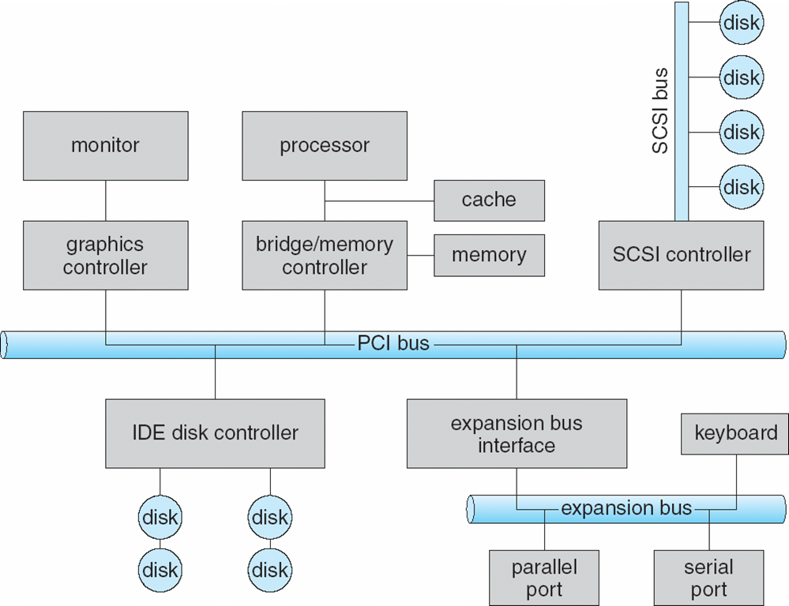

### 2.1 I/O Port Registers
| Register | Purpose |
|---|---|
| **data-in** | Read by the host to get **input** |
| **data-out** | Written by the host to send **output** |
| **status** | Bits read by the host — command completed? byte available? device error? (**busy** bit) |
| **control** | Written by the host to **start a command** or change device mode |

Data registers are 1–4 bytes; some controllers have **FIFO chips** to hold several bytes.

### 2.2 Addressing devices
- **Direct I/O instructions** — special instructions (IN/OUT) transfer a byte/word to an **I/O port address**.
- **Memory-mapped I/O** — device-control registers are **mapped into the processor's address space**; ordinary load/store instructions access them (fast for large transfers, e.g., graphics memory).

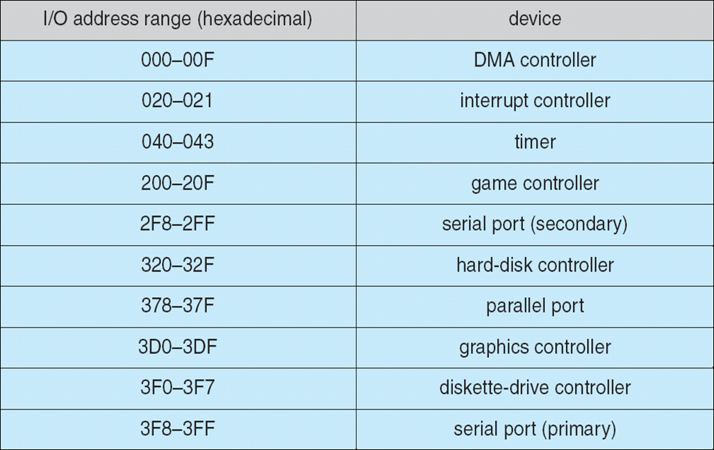

---

## 3. Polling ★★★

**Polling** is **not a hardware mechanism** but a **protocol** in which the **CPU repeatedly checks** (busy-waits on) a device's status to see whether it needs attention.

**Handshaking for each byte (host writing output):**
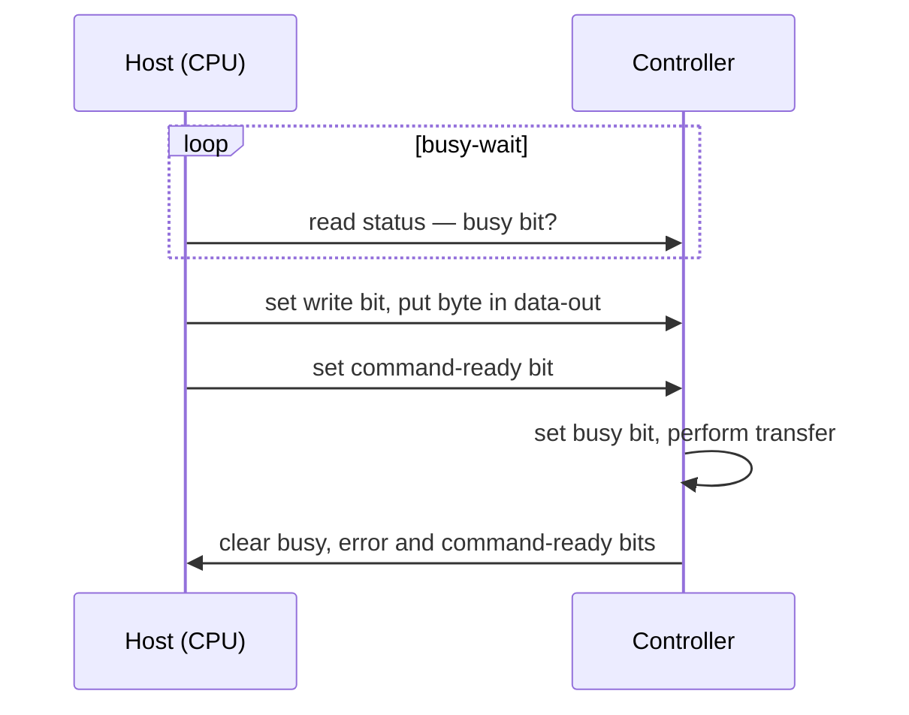
1. Host reads the **busy bit** until it is 0 (busy-wait).
2. Host sets the **read/write bit**; if writing, copies data into **data-out**.
3. Host sets **command-ready**.
4. Controller sets **busy**, executes the transfer.
5. Controller clears **busy**, **error** and **command-ready** when done.

- Reasonable if the device is **fast**; **inefficient if slow** (CPU wastes cycles). If the CPU switches to other tasks it may miss a cycle → data overwritten/lost.

| Advantages | Disadvantages |
|---|---|
| No context switching | **Inefficient** — wastes CPU cycles |
| Reduced interrupt overhead | **Increased power consumption** |
| Simple, predictable | Poor for slow/infrequent devices |

---

## 4. Interrupts & the Interrupt-Driven I/O Cycle ★★★

An **interrupt** is a **hardware mechanism** by which a **device notifies the CPU** that it requires attention — can occur at any time.

- The CPU has an **interrupt-request line** that it senses **after every instruction**.
- When a controller asserts it, the CPU performs a **state save**, jumps to the **interrupt-handler routine** at a fixed address; the handler determines the cause, services the device, performs a **state restore** and executes **return-from-interrupt**.
- The device controller **raises**, the CPU **catches** and **dispatches** to the handler, which **clears** the interrupt.

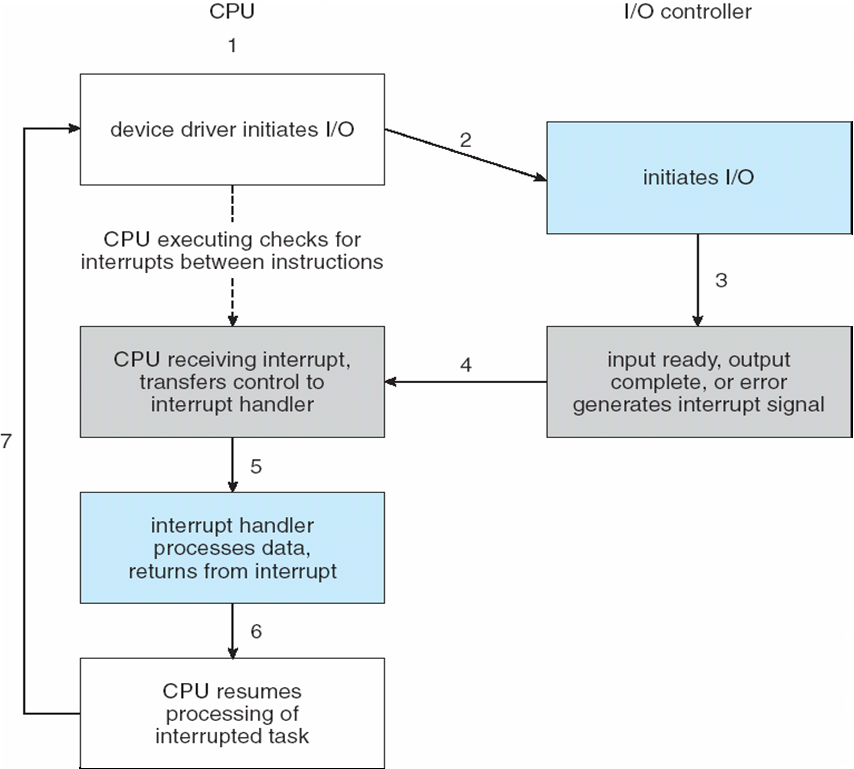

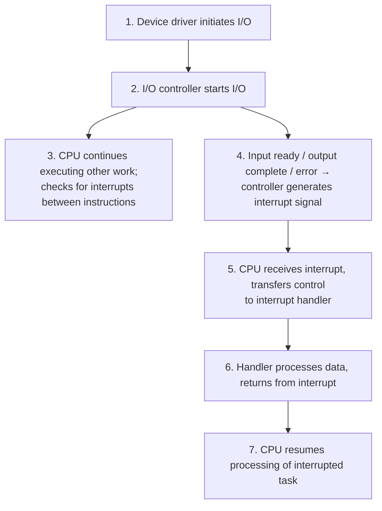

### 4.1 Advanced interrupt features
Modern OSes need:
1. Ability to **defer** interrupt handling during critical processing;
2. Efficient **dispatch** to the proper handler without polling all devices (**interrupt vector**);
3. **Multilevel interrupts** — distinguish high- and low-priority interrupts.

### 4.2 Maskable vs Non-maskable Interrupts ★★★
| Non-maskable interrupt (NMI) | Maskable interrupt |
|---|---|
| **Cannot be disabled** by the CPU | Can be **turned off** by the CPU before critical instruction sequences |
| Reserved for events such as **unrecoverable memory errors**, power failure | Used by **device controllers** to request service |
| Intel Pentium vectors **0–31** (errors/exceptions) | Intel Pentium vectors **32–255** (device interrupts) |

- **Interrupt vector table** — the interrupt carries an **address (number)** that indexes a table of handler addresses. **Interrupt chaining**: each vector entry points to a list of handlers when there are more devices than vectors.

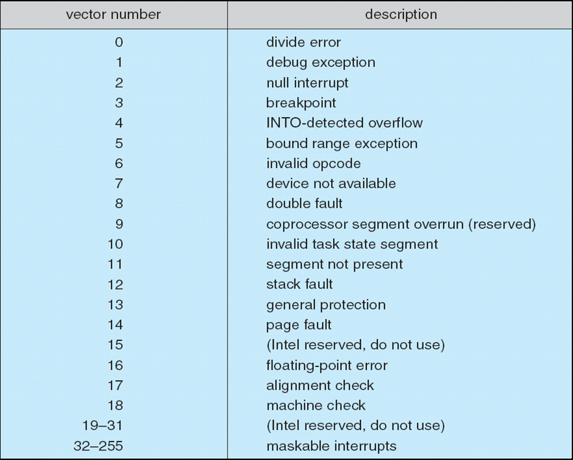

### 4.3 Other uses of the interrupt mechanism
- **Exceptions** — terminate process or crash system on hardware error (divide by zero).
- **Page faults** — memory-access error handled by the OS.
- **System calls** — executed via a **trap (software interrupt)** to make the kernel execute a request.
- Multi-CPU systems can process interrupts concurrently; used for time-sensitive, frequent processing — must be fast.

| Advantages of interrupts | Disadvantages |
|---|---|
| CPU free for other work (**parallel processing**) | **Context-switching** overhead |
| Devices can sleep (**sleep modes**, power saving) | **Interrupt latency** |
| Efficient for slow devices | Complex handling; high interrupt rates hurt performance |

---

## 5. Polling vs Interrupts; Blocking vs Non-blocking I/O ★★★

| Interrupt | Polling |
|---|---|
| Device **notifies** the CPU that it needs attention | CPU **steadily checks** whether the device needs attention |
| A **hardware mechanism** | A **protocol** |
| Device serviced by an **interrupt handler** | Device serviced by the **CPU** |
| Can occur **at any time** | CPU polls at **regular intervals** |
| **Interrupt-request line** signals service needed | **Command-ready bit** indicates service needed |
| Processor disturbed only when a device interrupts | Processor wastes cycles **repeatedly checking** |

| Blocking I/O | Non-blocking I/O | Asynchronous I/O |
|---|---|---|
| Process **suspended** until I/O completes (moved to wait queue) | Call **returns immediately** with whatever data is available (maybe none) | Call returns immediately; process is **notified later** (signal/callback) when I/O completes |
| Easy to use and understand | E.g., UI receiving keyboard/mouse input while processing | E.g., `aio_read()` |
| `read()` on a file | `select()`, non-blocking sockets | |

---

## 6. Direct Memory Access (DMA) ★★★

- Avoids **programmed I/O (PIO)** — moving data one byte at a time through the CPU — for **large transfers** (disk).
- Requires a **DMA controller** that **bypasses the CPU** to transfer data **directly between the device and memory**.
- OS writes a **DMA command block** into memory: **source and destination addresses**, **read/write mode**, **byte count**; then writes the block's location to the DMA controller.
- **Bus mastering** — the DMA controller grabs the bus from the CPU; **cycle stealing** slows the CPU slightly but is far more efficient overall.
- When done, the controller **interrupts** the CPU to signal completion. **DVMA** — DMA aware of virtual addresses — is even more efficient.

### 6.1 Six-Step Process to Perform a DMA Transfer ★★★
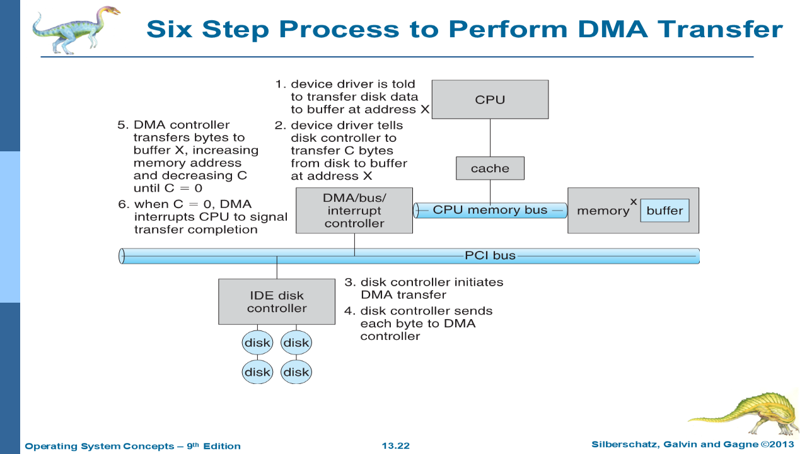

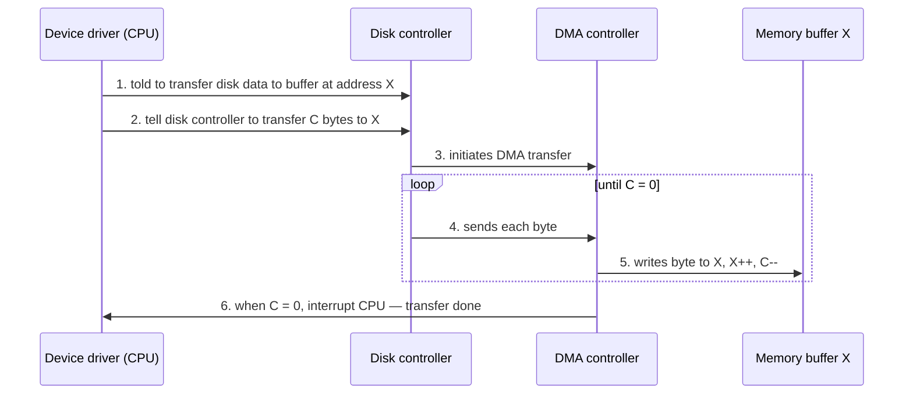
1. Device driver is told to transfer disk data to a buffer at address **X**.
2. Device driver tells the disk controller to transfer **C** bytes from disk to buffer X.
3. Disk controller **initiates the DMA transfer**.
4. Disk controller sends **each byte** to the DMA controller.
5. DMA controller transfers bytes to buffer X, **increasing the memory address and decreasing C** until C = 0.
6. When C = 0, DMA **interrupts the CPU** to signal completion.

| Programmed I/O | Interrupt-driven I/O | DMA |
|---|---|---|
| CPU busy-waits and moves every byte | CPU moves every byte, but only when interrupted | DMA controller moves the block; CPU interrupted **once** at the end |
| Simplest; wasteful | Better for slow devices | Best for **bulk** transfers |

---

## 7. 📘 Life Cycle of an I/O Request ★★
(Practice Q4)

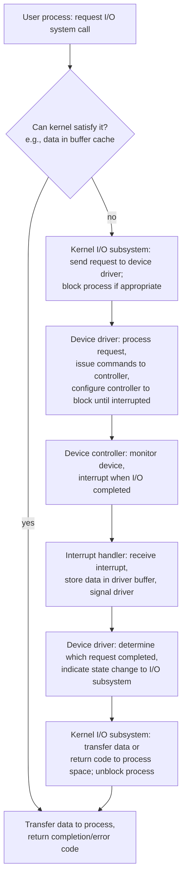

---

## 8. Protection — Goals & Principles ★★★

### 8.1 Goals of Protection
- A computer is a collection of **objects** — **hardware** (CPU, memory, printers, disks) or **software** (files, programs, semaphores).
- Each object has a **unique name** and is accessed through a **well-defined set of operations**.
- **Protection problem:** ensure that **each object is accessed correctly and only by those processes allowed** to do so.
- Also: prevent mischievous/intentional violations, detect latent errors at interfaces, enforce **policies** on resource use; protection provides the **mechanism**, users/admins set the **policy**.

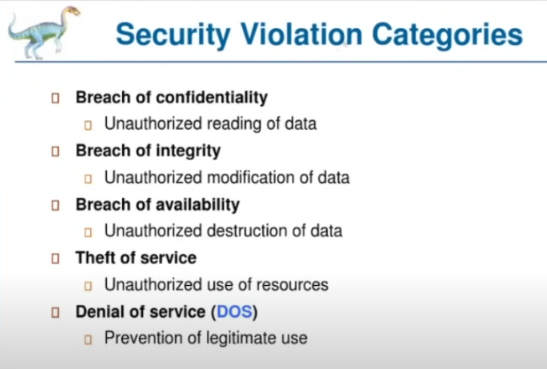

### 8.2 Principles of Protection
- **Principle of least privilege** (guiding principle): programs, users and systems get **just enough privileges** to perform their tasks.
- Properly set permissions **limit damage** if an entity has a bug or is abused.
- Privileges can be **static** (for the life of system/process) or **dynamic** (changed as needed — **domain switching**, privilege escalation).
- **Need-to-know** principle: a process accesses only the objects it currently requires.
- **Compartmentalisation** — protecting each component with specific permissions and access restrictions.

---

## 9. Domain of Protection ★★

- **Access right** = ⟨object-name, rights-set⟩, where rights-set ⊆ valid operations on that object (e.g., ⟨file F, {read, write}⟩).
- **Domain** = a **set of access rights**. Domains may **overlap** (share access rights).
- A domain can be a **user** (UNIX — user ID), a **process**, or a **procedure**. In UNIX, the **setuid** bit lets a program temporarily switch domain to its owner's.

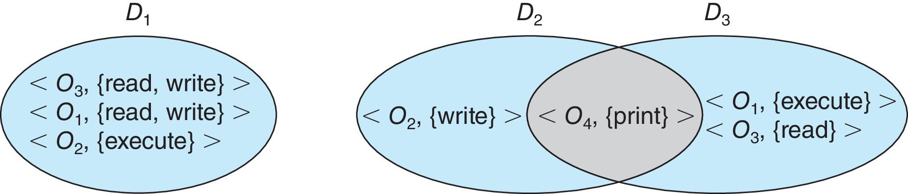

---

## 10. Access Matrix ★★★

Protection is modelled as an **access matrix**:
- **Rows → domains**, **columns → objects**.
- **Access(i, j)** = set of operations a process in domain **Di** can invoke on object **Oj**.

| Domain \ Object | F1 | F2 | F3 | Printer |
|---|---|---|---|---|
| **D1** | read | | read | |
| **D2** | | | | print |
| **D3** | | read | execute | |
| **D4** | read, write | | read, write | |

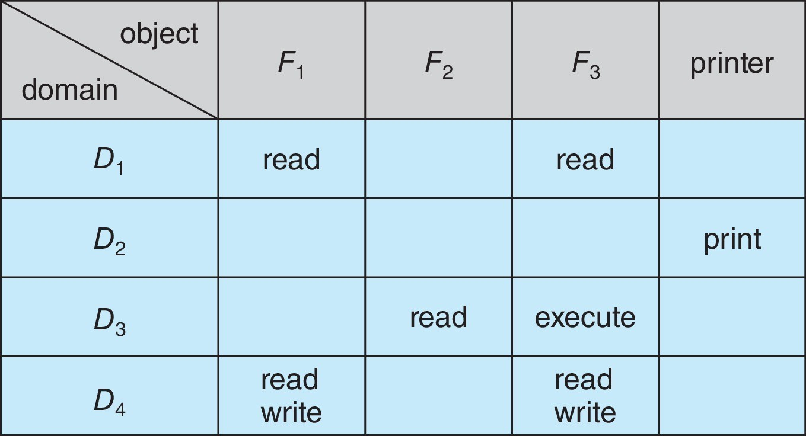

- If a process in Di tries operation "op" on Oj, **op must be in Access(i, j)**.
- The **user who creates** an object defines its column; the OS decides policy for the matrix entries.
- **Separates mechanism from policy:** *mechanism* — OS provides the matrix and rules, ensures it is manipulated only by authorised agents; *policy* — users decide who can access what and in what mode. (Does not solve the general **confinement problem**.)

### 10.1 Dynamic protection — special rights
| Right | Applies to | Meaning |
|---|---|---|
| **Switch** | Domain as object | A process in Di can switch to Dj if "switch" ∈ Access(i, j) |
| **Copy (\*)** | Object | Right marked **R\*** can be copied to another domain in the same column (**transfer** — removes it from the original; **limited copy** — copies R without \*) |
| **Owner** | Object | Owner of Oj can **add/remove any right** in column j |
| **Control** | Domain object | If "control" ∈ Access(i, j), a process in Di can **remove any right from row j** |

**Access matrix with domains as objects (switching):**
| | F1 | F2 | F3 | Printer | D1 | D2 | D3 | D4 |
|---|---|---|---|---|---|---|---|---|
| D1 | read | | read | | | switch | | |
| D2 | | | | print | | | switch | switch, control |
| D3 | | read | execute | | | | | |
| D4 | read, write | | read, write | | switch | | | |

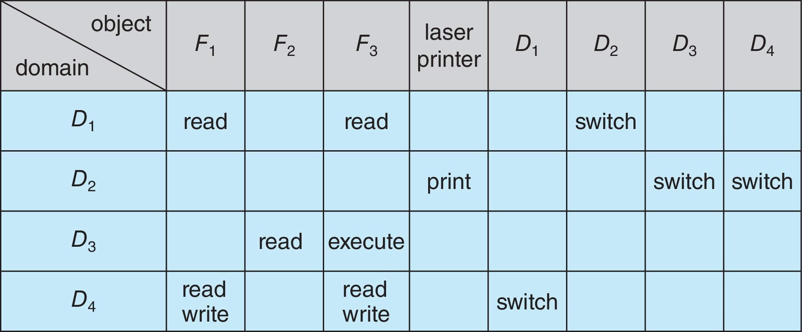
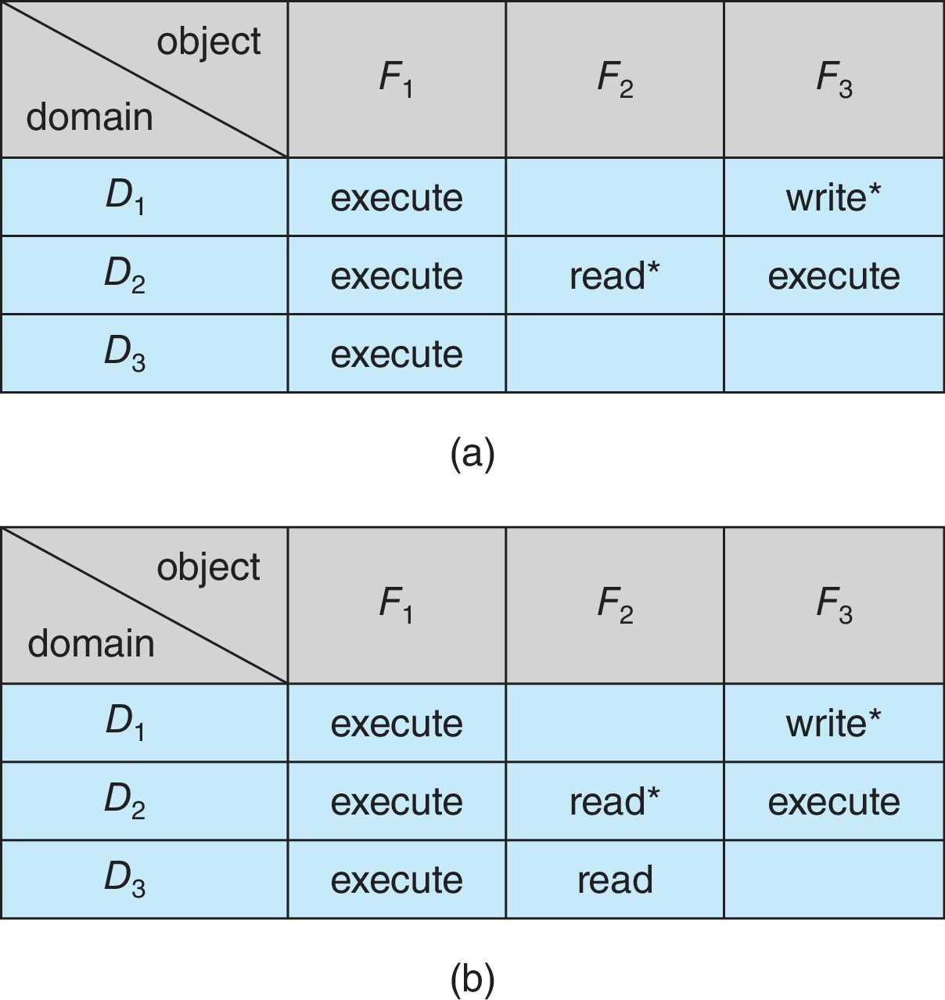
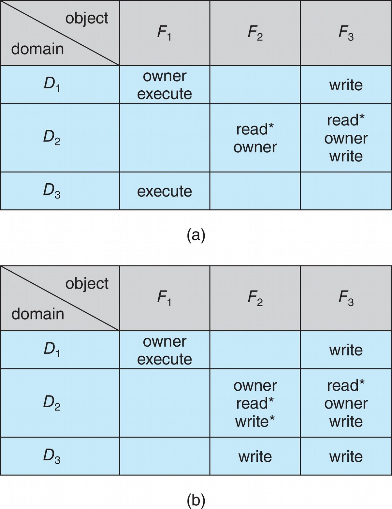

---

## 11. Implementation of the Access Matrix ★★★

The access matrix is generally **sparse** — stored in one of these ways:

| # | Method | How it works | Pros | Cons |
|---|---|---|---|---|
| 1 | **Global table** | Set of ordered **triples ⟨domain, object, rights-set⟩**. For operation M on Oj in Di, search for ⟨Di, Oj, Rk⟩ with **M ∈ Rk**; found → allowed, else exception | Simplest | Table **large** — can't fit in memory (extra I/O); hard to exploit groupings — an object everyone can read needs an entry in **every** domain |
| 2 | **Access lists for objects** | Each **column** = an access list for one object: ordered pairs **⟨domain, rights-set⟩** for domains with non-empty rights (empty entries discarded). Can add a **default** set — check default first | Corresponds to user needs (owner sets rights per file); easy revocation | Finding all rights of a domain requires searching every list |
| 3 | **Capability lists for domains** | Each **row** = list of objects with allowed operations. An object is represented by its physical name/address — a **capability**. To execute M on Oj, the process presents the capability; **possession means access is allowed** | Efficient per-process checks | Capabilities must be **protected** (kept by OS, tagged/segregated memory); revocation is hard |
| 4 | **Lock–key mechanism** | Compromise: each **object** has a list of unique bit patterns — **locks**; each **domain** has a list of **keys**. A process can access an object only if its domain has a **key matching one of the object's locks**. Keys managed by the OS; users can't examine/modify keys or locks | Effective and flexible; revocation by changing locks | Key management overhead |

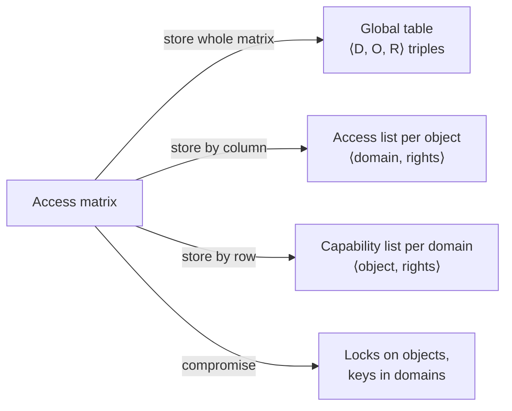

**Most systems combine** ACLs and capabilities: the ACL is checked on first access (e.g., `open()`), then a capability (file descriptor/handle) is used for later accesses.

---

## 12. Revocation of Access Rights ★★

**Design options:** immediate vs delayed · selective vs general · partial vs total · temporary vs permanent.

- **Access lists:** simple — search the list and delete the entry; can be immediate, general or selective, total or partial, permanent or temporary.
- **Capability lists:** harder — capabilities must be **located** first:
  | Scheme | Idea |
  |---|---|
  | **Reacquisition** | Capabilities periodically deleted; process must reacquire — denied if revoked |
  | **Back-pointers** | Each object keeps pointers to all its capabilities (MULTICS) — follow and change them |
  | **Indirection** | Capability points to a **global table entry**, which points to the object; revoke by deleting the entry (not selective) (CAL) |
  | **Keys** | Unique bit pattern in each capability, matched against an object's **master key**; revoke by creating a **new master key** |

---

## 13. RBAC, MAC & Capability-Based Systems ★

- **Role-Based Access Control (RBAC)** — e.g., **Solaris 10**: a **privilege** = right to execute a system call or use an option; privileges are assigned to **roles**; users assume roles (via password) to gain privileges → implements **least privilege**.
- **Discretionary Access Control (DAC)** — owners set permissions (UNIX permissions, Windows ACLs) — weakness: users must act to increase protection.
- **Mandatory Access Control (MAC)** — stronger; **even root can't circumvent**; **labels** assigned to subjects and objects, and a policy decides whether a label-holding subject may act on an object (SELinux, TrustedBSD/macOS, Trusted Solaris, Windows Vista+ integrity levels).
- **Capability-based systems** — Hydra and CAP were first; Linux/Android implement **POSIX.1e capabilities** that **slice root's powers** into distinct bits; three bitmaps — **permitted, effective, inheritable**; per process/thread; once revoked cannot be reacquired → direct implementation of least privilege.

---

## 14. Security Violations & Attacks ★★

**Categories of security violation:** breach of **confidentiality** (unauthorised reading), breach of **integrity** (unauthorised modification), breach of **availability** (destruction), **theft of service** (unauthorised use of resources), **denial of service (DoS)** (preventing legitimate use — sometimes accidental; the Internet worm became a DoS when a bug failed to delay its spread).

**Methods:**
| Attack | Description |
|---|---|
| **Masquerading** | Pretending to be someone else (another host/person) to gain access or escalate privileges |
| **Replay attack** | Replaying a captured valid exchange (e.g., repeated money transfer); with **message modification** — change data in the replay |
| **Man-in-the-middle** | Attacker sits in the data flow, masquerading as sender to receiver and vice versa |
| **Session hijacking** | An active communication session is intercepted |

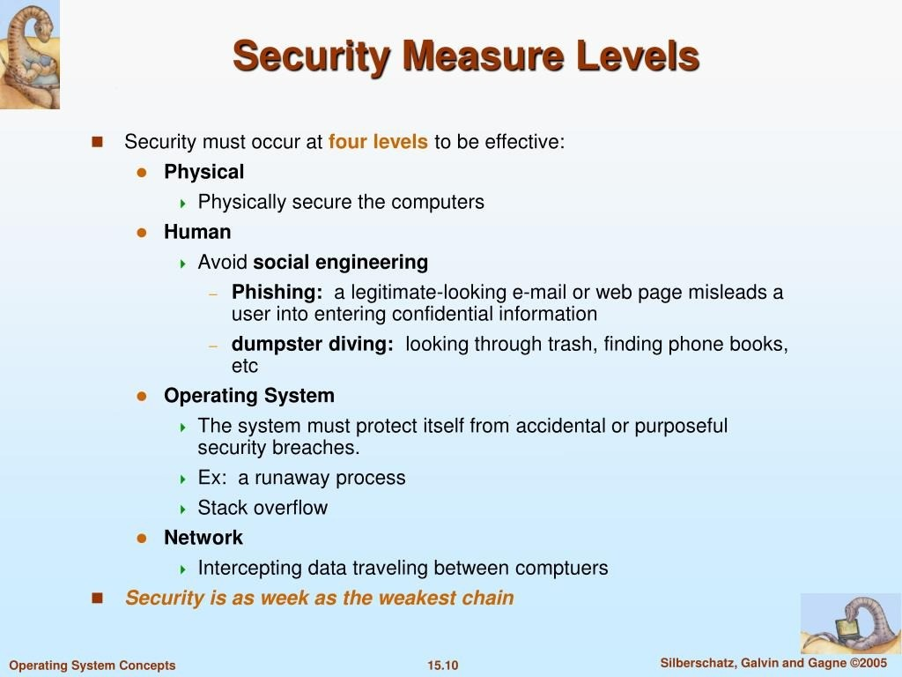

**Security measure levels** — security must occur at **four levels** ("security is as weak as the weakest link"):
1. **Physical** — secure the machines.
2. **Human** — avoid **social engineering**, **phishing** (legitimate-looking e-mail/web page misleads a user), **dumpster diving**.
3. **Operating system** — protect against accidental/purposeful breaches (runaway processes, stack overflow).
4. **Network** — protect data in transit from interception.

---

## 15. Program Threats ★★★

Goal of crackers: write a program that creates a **breach of security**, or cause a normal process to change behaviour; often leave a **back-door daemon** for future access.

| Threat | Description | Example / defence |
|---|---|---|
| **Trojan horse** | A code segment that **misuses its environment** — exploits mechanisms that let programs written by one user be executed by others | Text editor secretly copying files with keywords; long **search paths** (`.` in PATH) running a fake command with your permissions; **login emulator** steals password, prints "login incorrect" → defence: non-trappable key sequence (**Ctrl-Alt-Del**), print usage stats at session end. **Spyware**: pop-ups, capture info, **covert channels** (spam relays — 80 % of spam in 2004) |
| **Trap door (back door)** | Designer leaves a **hole** only they can use — e.g., a special user ID/password bypassing security; bank programmer's **rounding-error "half-cent"** deposits | Can be hidden in a **compiler** — source code review won't reveal it |
| **Logic bomb** | Program that initiates a security incident **only under certain circumstances** | Programmer's code checks if they're still employed; if not, spawns a daemon to allow remote access or damage the site |
| **Stack & buffer overflow** | Most common way for an outside attacker to gain access — exploits a **missing bounds check** | Attacker (1) overflows an input field/argument/buffer until it writes into the stack, (2) overwrites the **return address** with the address of exploit code, (3) writes code that spawns a **shell**, (4) gets a **root shell** |
| **Viruses** | Code fragment **embedded in a legitimate program**; **self-replicating**, designed to **infect** other programs; modify/destroy files | Spread via e-mail, macros, downloads; Windows more susceptible than UNIX (executables protected from writes) |

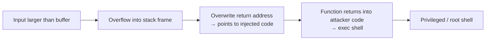

### 15.1 Virus categories
| Category | Behaviour |
|---|---|
| **File** | Appends itself to executable files |
| **Boot** | Infects the boot sector; runs at every boot |
| **Macro** | Written in macro languages — most common are **MS Office** macro viruses |
| **Source code** | Looks for source code and modifies it to include the virus |
| **Polymorphic** | **Changes each time** it is installed to avoid signature detection (functionality unchanged) |
| **Encrypted** | Encrypted, with decryption code; first decrypts itself, then executes |
| **Stealth** | Modifies parts of the system used to detect it (e.g., read system call returns original code) |
| **Tunnelling** | Bypasses antivirus by installing itself in the **interrupt-handler chain** or device drivers |
| **Multipartite** | Infects multiple parts — boot sector, memory, files — hard to detect |
| **Armoured** | Coded to be hard for researchers to unravel; compressed; droppers hidden via file attributes |

---

## 16. System & Network Threats; Cryptography ★★

**Worms** — standalone programs using **spawn** mechanisms to replicate across networks.
**Internet worm (Nov 2, 1988, Robert Tappan Morris Jr.)** — exploited UNIX networking features (**rsh** remote access) and bugs in **finger** and **sendmail**; targeted Sun-3 and VAX machines running BSD UNIX; a **grappling hook** (bootstrap) pulled the main worm; consumed resources until machines were brought down.

Other: **port scanning** (detect vulnerable services), **denial of service** / **DDoS** (overload a target).

### 16.1 Cryptography basics
| Symmetric encryption | Asymmetric (public-key) encryption |
|---|---|
| **Same key** to encrypt and decrypt (E(k) derivable from D(k)) | Each user has **two keys** — **public** (published, to encrypt) and **private** (secret, to decrypt) |
| **DES** (block cipher, US govt), **Triple-DES**, **AES**, Twofish; **RC4** stream cipher (keystream, wireless) | **RSA** — security relies on difficulty of **factoring** large numbers (efficient primality test, no efficient factoring) |
| Fast; key distribution is the problem | Slower; solves key distribution; enables digital signatures |

---

## Unit VI — One-Page Summary

| Topic | Key points |
|---|---|
| **I/O hardware** | Devices: storage, transmission, human-interface. Port, bus (PCI/PCIe, expansion, SCSI), daisy chain, controller. Registers: data-in, data-out, status, control. Direct I/O vs memory-mapped I/O. |
| **Polling** | CPU busy-waits on busy bit; steps: busy→write/data-out→command-ready→controller busy→clear bits. No context switch, but wasteful & power-hungry. |
| **Interrupts** | Interrupt-request line checked after each instruction; save state → handler → restore → return. Deferral, vector dispatch, priority levels. **NMI** (0–31, unrecoverable errors) vs **maskable** (32–255, devices). Also exceptions, page faults, traps (system calls). |
| **I/O modes** | Polling vs interrupts table; blocking, non-blocking, asynchronous I/O. |
| **DMA** | DMA controller moves blocks memory↔device; command block (src, dst, mode, count); bus mastering, cycle stealing; 6 steps ending with interrupt when C = 0. |
| **I/O request life cycle** | System call → kernel (buffer?) → driver → controller → interrupt → handler → driver → kernel → process unblocked. |
| **Protection goals** | Objects accessed correctly and only by authorised processes; mechanism vs policy. |
| **Principles** | Least privilege, need-to-know, compartmentalisation; static vs dynamic (domain switching). |
| **Domain** | Set of access rights ⟨object, rights-set⟩; user/process/procedure; setuid. |
| **Access matrix** | Rows = domains, columns = objects; special rights: switch, copy (\*), owner, control. |
| **Implementation** | Global table (triples; large) · Access lists per object (columns + default) · Capability lists per domain (rows; possession = access) · Lock–key (locks on objects, keys in domains). |
| **Revocation** | ACL: delete entry. Capabilities: reacquisition, back-pointers, indirection, keys. |
| **RBAC / MAC / capabilities** | Roles grant privileges (Solaris); MAC labels (SELinux), root can't bypass; POSIX capabilities split root powers. |
| **Attacks** | Masquerading, replay, MITM, session hijacking; DoS. Four levels: physical, human, OS, network. |
| **Program threats** | Trojan horse (login emulator, PATH, spyware), trap door, logic bomb, stack/buffer overflow, viruses (macro, polymorphic, stealth, encrypted, tunnelling, multipartite, armoured). |
| **Network / crypto** | Morris worm (finger, sendmail, rsh); symmetric (DES, AES, RC4) vs asymmetric (RSA public/private keys). |
