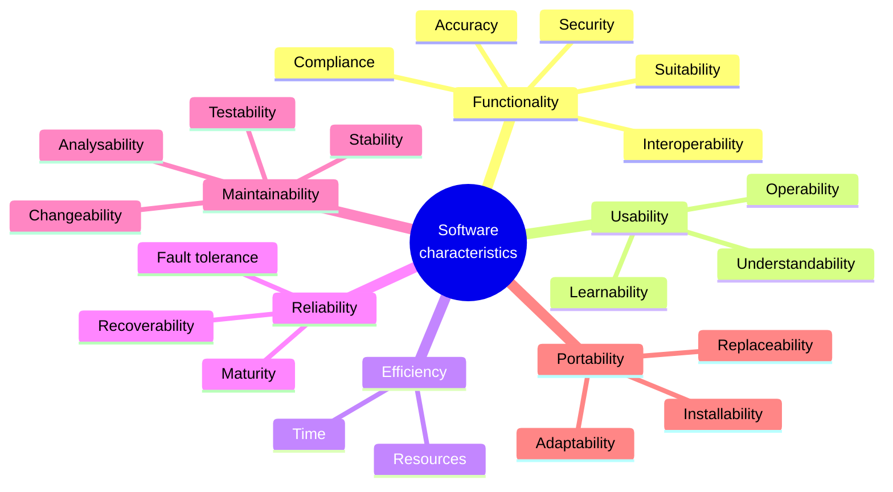
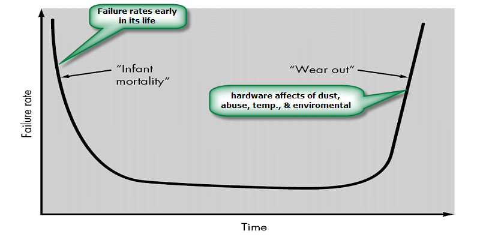
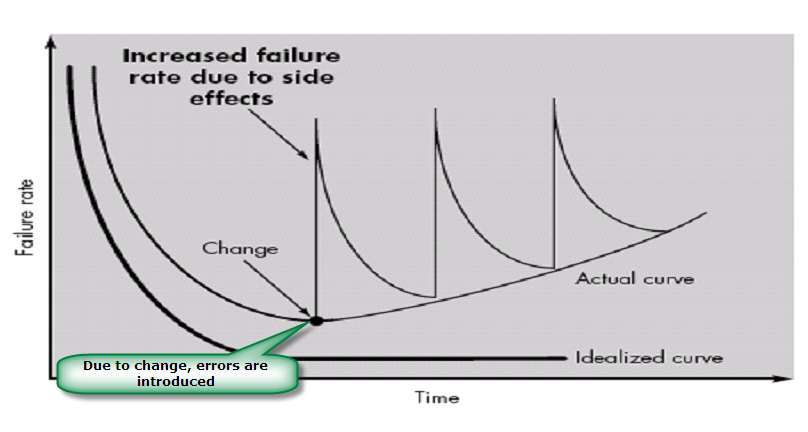
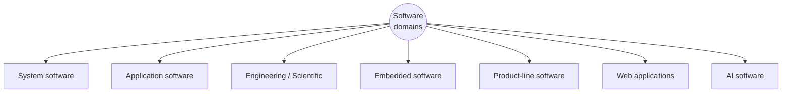
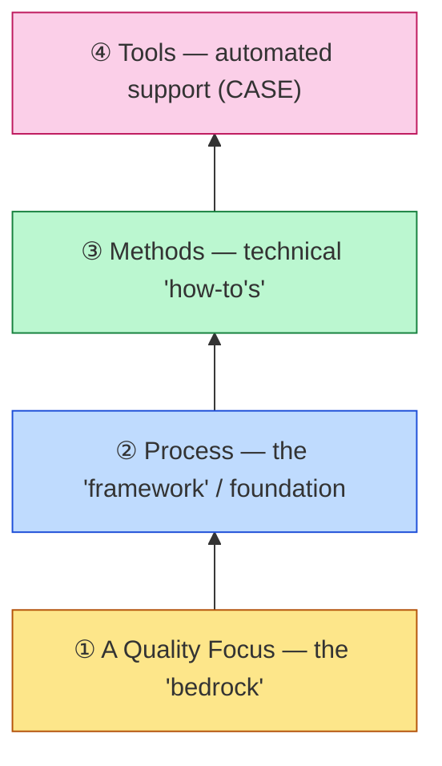
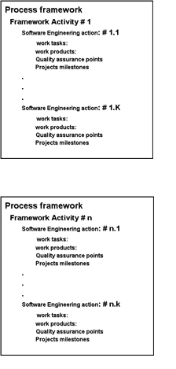
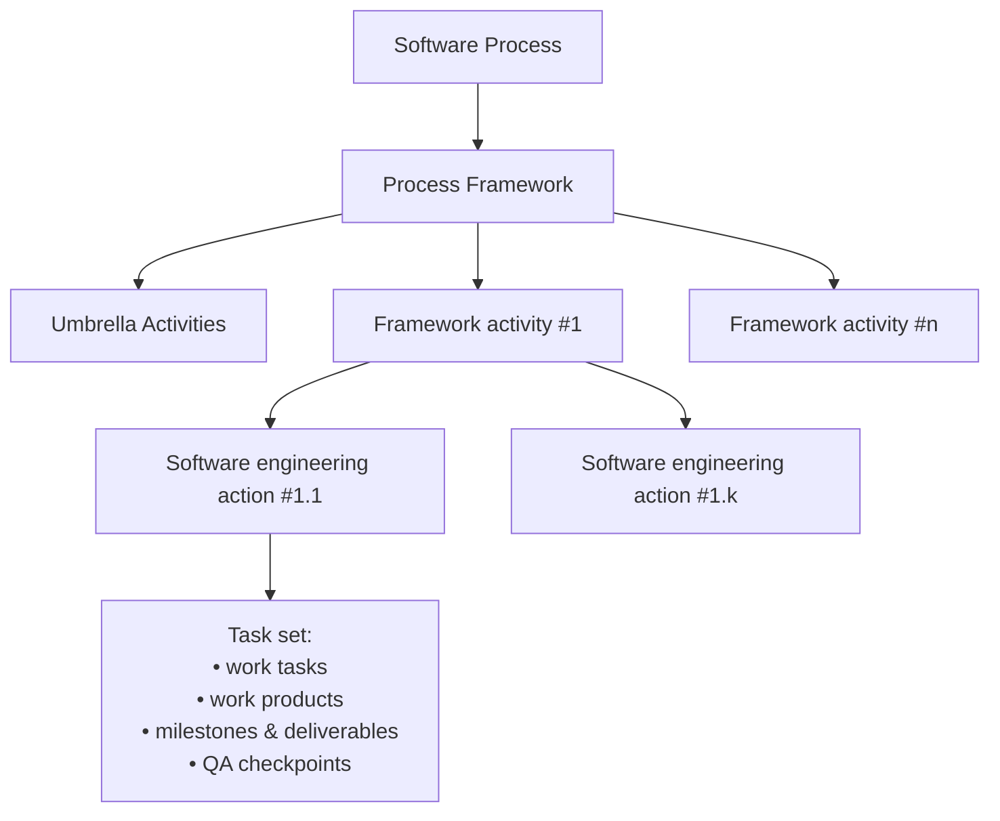
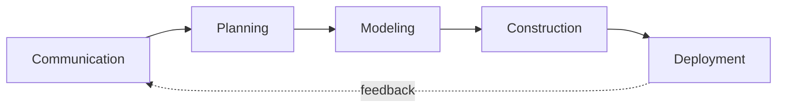
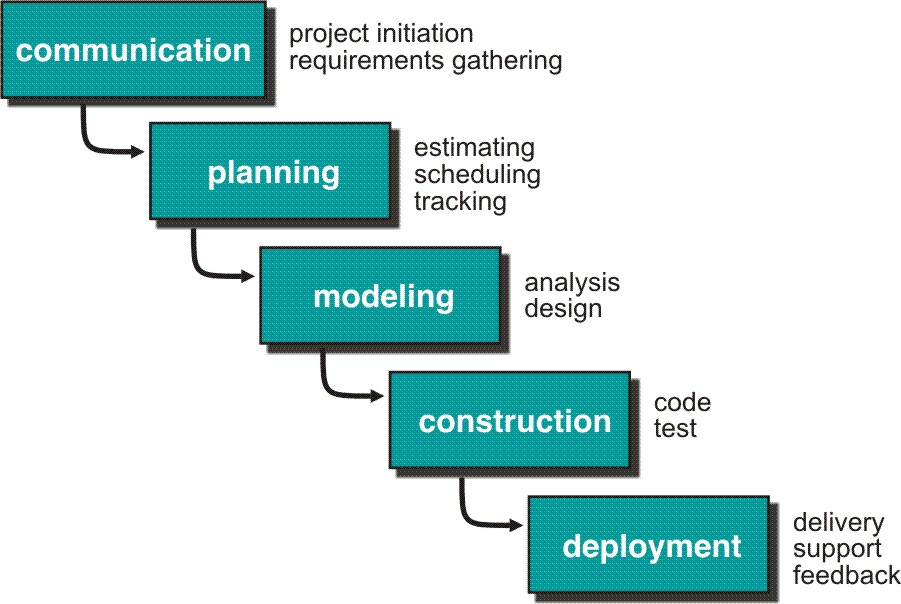
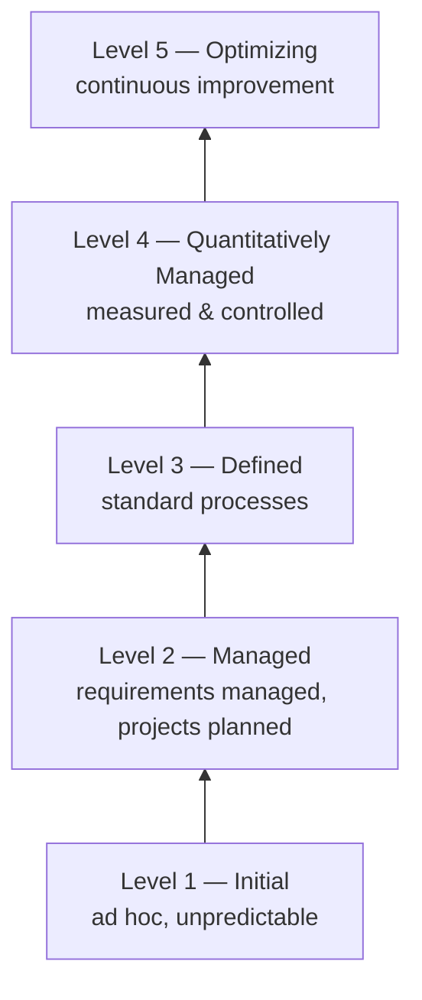

# Unit I — Introduction to Software Engineering & A Generic View of Process

> **Topics:** Definition of software engineering, characteristics of software, evolving role of software, changing nature of software, software myths, generic view of process — layered technology, process framework (framework + umbrella activities), CMMI.
>
> **Source:** *SE UNIT 1.ppt* (SNIST) · important questions from *SE_important.docx*

**Importance legend:** ★★★ = very frequently asked (long answer) · ★★ = medium · ★ = short answer

---

## Table of Contents
1. [Software Engineering — Definition](#1-software-engineering--definition-)
2. [What is Software?](#2-what-is-software-)
3. [Characteristics of Software (Quality Attributes)](#3-characteristics-of-software-)
4. [Evolving Role of Software](#4-evolving-role-of-software-)
5. [Hardware vs Software & Failure Curves](#5-hardware-vs-software--failure-curves-)
6. [Changing Nature of Software](#6-changing-nature-of-software-)
7. [Software Myths](#7-software-myths-)
8. [Generic View of Process — Overview](#8-generic-view-of-process--overview-)
9. [Software Engineering — A Layered Technology](#9-software-engineering--a-layered-technology-)
10. [Process Framework & Generic Framework Activities](#10-process-framework--generic-framework-activities-)
11. [Umbrella Activities](#11-umbrella-activities-)
12. [CMMI — Capability Maturity Model Integration](#12-cmmi--capability-maturity-model-integration-)
13. [Unit I — One-Page Summary](#unit-i--one-page-summary)

---

## 1. Software Engineering — Definition ★★

**Software Engineering** is the process of **designing, developing, testing and maintaining** software applications. It is a branch of computer science that applies **engineering principles** and programming languages to build software for end users.

*Alternate definition:* Software engineering is **analysing user requirements** and then **designing, building and testing** software applications that satisfy those requirements.

*IEEE definition (for exams):* "The application of a **systematic, disciplined, quantifiable approach** to the development, operation and maintenance of software."

Why we need it: large/complex software, cost control, quality, scalability, and managing changing requirements.

---

## 2. What is Software? ★

Software is:
1. **Instructions** (computer programs) that, when executed, provide the desired features, function and performance;
2. **Data structures** that enable programs to adequately manipulate information;
3. **Documents** that describe the operation and use of the programs.

Software products may be **generic** (developed for a general market, e.g., MS Office) or **customised/bespoke** (developed for a particular customer).

---

## 3. Characteristics of Software ★★

Six quality characteristics (ISO 9126 style):

| Characteristic | Meaning | Sub-characteristics |
|---|---|---|
| **Functionality** | Does the software do what it is supposed to do? | Suitability, accuracy, interoperability, compliance, security |
| **Usability** | Ease of use (user-friendly) | Understandability, learnability, operability |
| **Efficiency** | Good use of system resources | In time (response), in resources (memory, CPU) |
| **Reliability** | Works correctly over a period of time | Maturity, fault tolerance, recoverability |
| **Maintainability** | Ease of making changes/fixes | Testability, stability, changeability |
| **Portability** | Ease of moving to another environment | Adaptability, installability, replaceability |

Other classic characteristics (Pressman): software is **developed/engineered, not manufactured**; software **doesn't wear out, but it deteriorates**; most software is still **custom-built**.

---

## 4. Evolving Role of Software ★★

Software has a **dual role**:

1. **Software is a product** — it transforms information: produces, manages, acquires, modifies, displays or transmits information. It delivers the computing potential of hardware and networks.
2. **Software is a vehicle for delivering a product** — it acts as the basis for:
   - **controlling** other programs (operating systems),
   - **communication** of information (networking software),
   - **creating/building** other programs (software tools & environments).

Topics under the evolving role: definition of software, hardware vs software, manufacturing vs development, failure curves, component-based vs custom-built.

### 4.1 Manufacturing vs Development
- Once **hardware** is manufactured, it is difficult or impossible to modify; **software** products are routinely modified and upgraded.
- In hardware, hiring more people means more output; in software **adding people does not necessarily speed up work** (Brooks' law).
- Software costs are concentrated in **design (engineering)**, not production (copying is nearly free).

### 4.2 Component-based vs Custom-built
- Hardware uses many **standard, reusable components** (ICs, screws).
- Most software is still **custom-built**, although the industry is moving slowly toward **component-based** construction (libraries, frameworks, reusable modules).

---

## 5. Hardware vs Software & Failure Curves ★★★

| Hardware | Software |
|---|---|
| Manufactured | Developed / engineered |
| **Wears out** (physical) | **Deteriorates** (due to changes) — does not wear out |
| Built from standard components | Mostly custom-built |
| Relatively simple | Complex |
| Failed part replaced by a **spare part** | **No spare parts** — every failure is a design/process error |

### 5.1 Hardware failure curve — "Bathtub curve"

- **Infant mortality:** high failure rate early (manufacturing/design defects).
- Defects corrected → failure rate drops to a low **steady state**.
- **Wear out:** failure rate rises again due to dust, vibration, temperature, abuse — cumulative environmental effects.

### 5.2 Software failure curve — "Idealised vs actual curve"

- **Idealised curve:** high failure early (undiscovered defects) → defects fixed → flattens; software is not susceptible to environmental maladies, so it **should not wear out**.
- **Actual curve:** every **change** (maintenance) introduces new errors → failure rate **spikes**; before it returns to steady state another change occurs → minimum failure rate slowly **rises** → software **deteriorates** due to change.
- Software maintenance is therefore far more complex than hardware maintenance.

---

## 6. Changing Nature of Software ★★★

Seven broad categories of software (Pressman):

| # | Category | Description | Examples |
|---|---|---|---|
| 1 | **System software** | Programs written to **service other programs**; heavy interaction with hardware, multiple users, concurrency, scheduling, resource sharing, complex data structures, multiple external interfaces | Compilers, OS, drivers, editors |
| 2 | **Application software** | **Stand-alone programs** that solve a specific business need; process business/technical data; control business functions in real time | MS Office, VLC, Chrome, point-of-sale |
| 3 | **Engineering / Scientific software** | "**Number-crunching**" algorithms; uses formulae particular to the field | CAD, MATLAB, AutoCAD, simulation, astronomy |
| 4 | **Embedded software** | Resides **within a product or system** to control features and functions | Microwave keypad control, traffic control, car fuel control, digital watches |
| 5 | **Product-line software** | Provides a **specific capability for many different customers**; limited or mass market | Word processing, spreadsheets, computer graphics, multimedia, DBMS |
| 6 | **Web applications (WebApps)** | From linked hypertext files to sophisticated environments integrated with corporate databases and business apps | Online forms, shopping carts, online editors, photo/video editing |
| 7 | **Artificial Intelligence software** | Uses **non-numerical algorithms** to solve complex problems not amenable to straightforward analysis | Robotics, expert systems, pattern recognition, game playing, smart assistants, disease mapping |

> New challenges (Pressman): **open-world computing** (ubiquitous/wireless), **netsourcing** (web as computing engine), **open source**.

---

## 7. Software Myths ★★★

**Software myths** are **erroneous beliefs** about software and the process used to build it. They look reasonable, have an intuitive feel, and are often promoted by experienced people — which makes them **insidious (dangerous)**, leading to misleading attitudes and serious problems for managers and technical people.

Three types: **Management myths · Customer myths · Practitioner (developer) myths**.

### 7.1 Management Myths
Managers are under pressure to maintain budgets, keep schedules and improve quality.

| Myth | Reality |
|---|---|
| "If we get behind schedule, we can **add more programmers** and catch up." (Mongolian horde concept) | Software development is not mechanistic like manufacturing. **Adding people to a late project makes it later** (Brooks). New people must be trained by existing ones. People can be added only in a planned, well-coordinated way. |
| "If I **outsource** the project to a third party, I can relax and let that firm build it." | An organisation that cannot manage software projects internally will **invariably struggle** when it outsources. |
| "We already have a **book of standards and procedures**; that's all my people need." | Is it used? Is it complete, current, adaptable? Often the answer is no. |
| "The more features we add, the better the product." | Focusing on **user needs and core functionality** gives more value than adding features. |

### 7.2 Customer Myths
A customer may be inside or outside the company and requests software under contract.

| Myth | Reality |
|---|---|
| "A **general statement of objectives** is enough to begin writing programs — details later." | Ambiguous objectives are a recipe for disaster; unambiguous requirements come from continuous communication. |
| "Requirements continually change, but change is **easily accommodated because software is flexible**." | Impact of change **grows with time**: cheap at requirements stage, rapidly costly during design, very costly after release. |
| "Once the software is developed, **it's done**." | Software needs ongoing **maintenance, updates and support** after deployment. |

### 7.3 Practitioner's / Developer's Myths

| Myth | Reality |
|---|---|
| "Once we write the program and get it to work, our job is done." | 60–80 % of effort is spent **after** first delivery. |
| "**More code** means better software." | Quality, maintainability and simplicity matter more; less code → fewer bugs. |
| "**All bugs can be fixed**." | Impossible to eliminate all; the goal is to reduce risk to an acceptable level. |
| "**Testing is just a phase**." | Testing must be integrated throughout development (reviews are effective QA from the start). |
| "**Documentation is a waste of time**." | Documentation aids onboarding, collaboration and maintenance; it saves time in the long run. |
| "The only deliverable is the working program." | A working configuration also includes models, documents, plans. |

---

## 8. Generic View of Process — Overview ★

| Question | Answer |
|---|---|
| **What** is a software process? | A series of activities (framework) required to build high-quality software |
| **Who** does it? | Managers, software engineers and customers |
| **Steps?** | A handful of activities common to all processes; details vary |
| **Work products?** | Programs, documents and data |

Chapter topics: **Layered technology · Process framework (generic framework activities + umbrella activities) · CMMI.**

---

## 9. Software Engineering — A Layered Technology ★★★

Software engineering is a **layered technology**: to develop software we move from one layer to another; each layer depends on fulfilment of the layer below it.

1. **A Quality Focus (bedrock)**
   - Any engineering approach must rest on an organisational commitment to quality (TQM, Six Sigma).
   - Defines **continuous process improvement** principles.
   - Provides **integrity** — security so that only authorised persons can access data; also focuses on **maintainability and usability**.
2. **Process (foundation)**
   - The **glue that binds the layers together**; enables timely development.
   - Defines a **framework** for effective delivery of SE technology; covers all activities, actions and tasks.
   - Forms the basis for management control: context for methods, work products, milestones, quality and change management.
   - Process activities: **Communication → Planning → Modeling → Construction → Deployment**.
3. **Methods (technical how-to's)**
   - A broad array of tasks: requirements analysis, design, program construction, testing and support.
   - More than one technique may exist for a task; different techniques suit different situations.
4. **Tools**
   - **Automated or semi-automated support** for the process and methods.
   - When tools are integrated so information created by one is used by another → **CASE (Computer-Aided Software Engineering)**.

---

## 10. Process Framework & Generic Framework Activities ★★★

A **process framework** establishes the **foundation for a complete software process** by identifying a **small number of framework activities** applicable to **all** projects, regardless of size or complexity. It also includes a set of **umbrella activities** applicable across the entire process.

**Structure:**

- Each **framework activity** is populated by a set of **software engineering actions** (a collection of related tasks, e.g., *design* is an action).
- Each action has a **task set** — work tasks, work products, milestones/deliverables and quality-assurance checkpoints.

### 10.1 Five Generic Framework Activities

| Activity | What happens |
|---|---|
| **Communication** | Heavy communication and collaboration with customer/stakeholders; **requirements gathering** and related activities |
| **Planning** | Creates a "map" (software project plan): technical tasks, likely **risks**, required **resources**, work products, **work schedule** |
| **Modeling** | Creating models to understand **requirements (analysis)** and the **design** that achieves them |
| **Construction** | **Code generation** (manual or automated) + **testing** to uncover errors |
| **Deployment** | Software (complete or increment) **delivered to the customer**, who evaluates it and provides **feedback** |

---

## 11. Umbrella Activities ★★★

**Umbrella activities** are applied **throughout the project** (span all framework activities) to help the team manage and control **progress, quality, change and risk**.

| # | Umbrella activity | Purpose |
|---|---|---|
| 1 | **Software project tracking and control** | Assess progress against the plan; take action to maintain schedule |
| 2 | **Formal technical reviews (FTR)** | Assess work products to uncover and remove errors **before** they propagate to the next activity |
| 3 | **Software quality assurance (SQA)** | Define and conduct activities required to ensure quality |
| 4 | **Software configuration management (SCM)** | Manage the **effects of change** throughout the process |
| 5 | **Document preparation and production** | Create work products — models, documents, logs, forms, lists |
| 6 | **Reusability management** | Define criteria for work-product reuse; mechanisms for reusable components |
| 7 | **Measurement** | Define and collect **process, project and product measures** to help deliver software that meets needs |
| 8 | **Risk management** | Assess **risks** that may affect project outcome or product quality |

> Memory hook: **"T-R-S-S-D-R-M-R"** — Tracking, Reviews, SQA, SCM, Documents, Reuse, Measurement, Risk.

---

## 12. CMMI — Capability Maturity Model Integration ★★★

- Developed by the **Software Engineering Institute (SEI)**, Carnegie Mellon University.
- A **process meta-model** to measure an organisation's **process capability and maturity**.
- Defines each **process area** in terms of:
  - **Specific goals (SG)** — characteristics that must exist for the activities of a process area to be effective;
  - **Specific practices (SP)** — refine a goal into a set of process-related activities.
- Two **representations**:
  1. **Staged representation** → **Maturity levels (1–5)** — for the whole organisation.
  2. **Continuous representation** → **Capability levels (0–5)** — for each process area.

### 12.1 Staged Representation — Maturity Levels

| Level | Name | Characteristics | Quality / Risk |
|---|---|---|---|
| 1 | **Initial** | Processes poorly managed/controlled; unpredictable outcomes; **no KPAs** defined | Lowest quality, highest risk |
| 2 | **Managed** | Requirements managed; processes **planned and controlled**; projects follow documented plans | Better quality, risk lower but exists |
| 3 | **Defined** | Processes well characterised and described using **standards**, procedures, methods, tools; focus on **process standardisation** | Medium quality, medium risk |
| 4 | **Quantitatively managed** | **Quantitative objectives** for process performance and quality set (based on customer & organisation needs); performance analysed **statistically** | Higher quality, lower risk |
| 5 | **Optimizing** | **Continuous improvement** — both incremental and innovative | Highest quality, lowest risk |

### 12.2 Continuous Representation — Capability Levels

| Level | Name | Characteristics |
|---|---|---|
| 0 | **Incomplete** | Process partially or not performed; one or more specific goals not met; **no generic goals**; same as maturity level 1 |
| 1 | **Performed** | All specific goals satisfied; performance may not be stable; quality/cost/schedule objectives may not be met; only a start-step for improvement |
| 2 | **Managed** | Process **planned, monitored and controlled**; objectives (cost, quality, schedule) achieved; managed with metrics |
| 3 | **Defined** | Managed process tailored from the organisation's **set of standard processes**; focus on standardisation |
| 4 | **Quantitatively managed** | Controlled using **statistical and quantitative techniques**; quantitative objectives for quality and performance |
| 5 | **Optimizing** | Continually improving process performance in **incremental and innovative** ways; common causes identified and fixed across the organisation |

| Staged | Continuous |
|---|---|
| Maturity levels 1–5 | Capability levels 0–5 |
| Applies to the **organisation** as a whole | Applies to **individual process areas** |
| Predefined improvement path | Organisation chooses which areas to improve |
| Easy comparison between organisations | Flexible |

---

## Unit I — One-Page Summary

| Topic | Key points |
|---|---|
| **Software Engineering** | Systematic, disciplined, quantifiable approach to development, operation and maintenance of software (design, develop, test, maintain). |
| **Software** | Instructions + data structures + documents. Generic or custom. |
| **Characteristics** | Functionality, Usability, Efficiency, Reliability, Maintainability, Portability (+ sub-characteristics). Developed not manufactured; deteriorates, doesn't wear out; mostly custom-built. |
| **Evolving role** | Dual role: **product** (transforms information) and **vehicle** (controls programs, communication, builds other software). |
| **HW vs SW** | HW manufactured, wears out, spare parts, components; SW engineered, deteriorates, no spare parts, custom-built. Adding people helps HW, not SW. |
| **Failure curves** | HW: **bathtub** (infant mortality → steady → wear-out). SW: idealised curve flattens; **actual curve spikes with every change** → deterioration. |
| **Changing nature** | System · Application · Engineering/Scientific · Embedded · Product-line · Web apps · AI software. |
| **Myths** | **Management** (add programmers, outsource & relax, standards book) · **Customer** (vague objectives OK, change is easy, done after delivery) · **Practitioner** (job done when it runs, more code better, all bugs fixable, testing is a phase, docs waste time). |
| **Layered technology** | Quality focus (bedrock) → Process (foundation/glue) → Methods (how-to's) → Tools (CASE). |
| **Process framework** | Framework activities → SE actions → task sets (work tasks, work products, milestones, QA checkpoints) + umbrella activities. |
| **Generic activities** | Communication → Planning → Modeling → Construction → Deployment. |
| **Umbrella activities** | Project tracking & control · FTR · SQA · SCM · Document preparation · Reusability mgmt · Measurement · Risk mgmt. |
| **CMMI** | SEI; specific goals & practices. **Staged** maturity levels: Initial, Managed, Defined, Quantitatively Managed, Optimizing. **Continuous** capability levels 0–5: Incomplete, Performed, Managed, Defined, Quantitatively Managed, Optimizing. |
