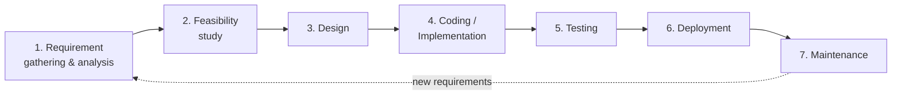
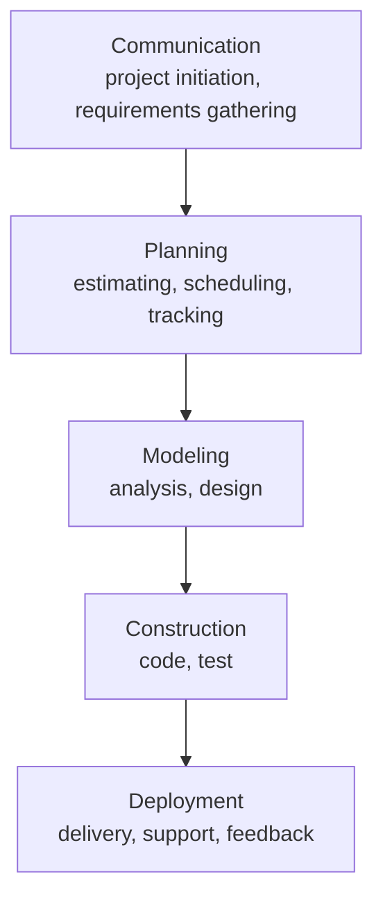
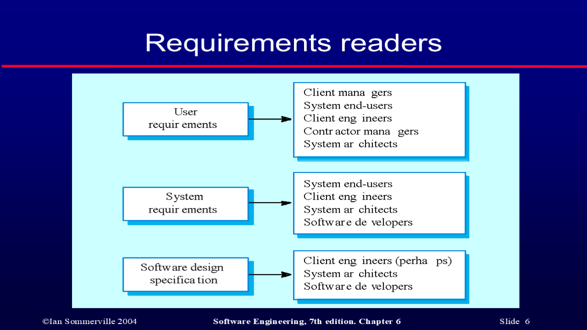
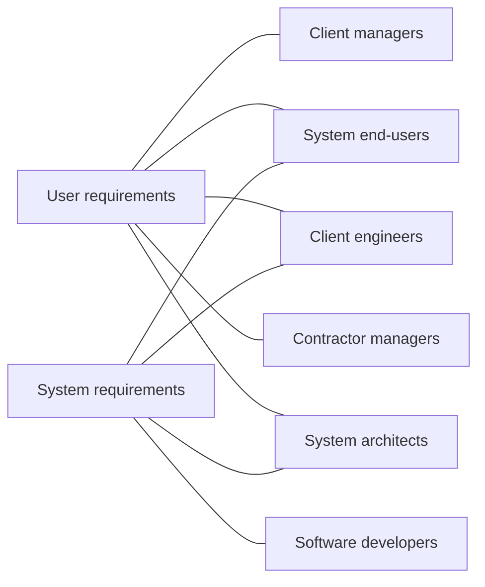
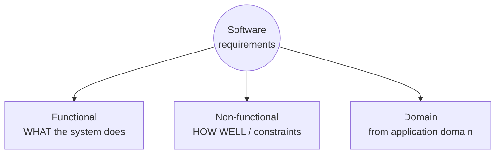
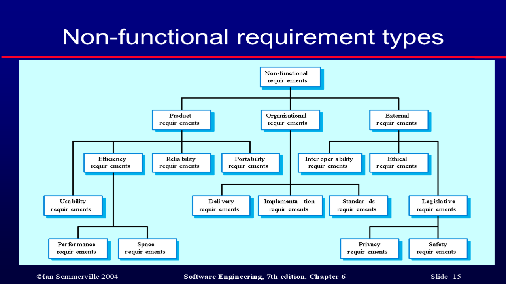
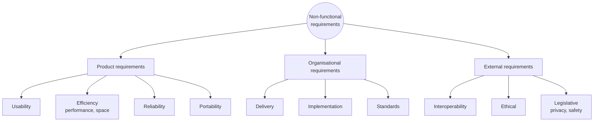
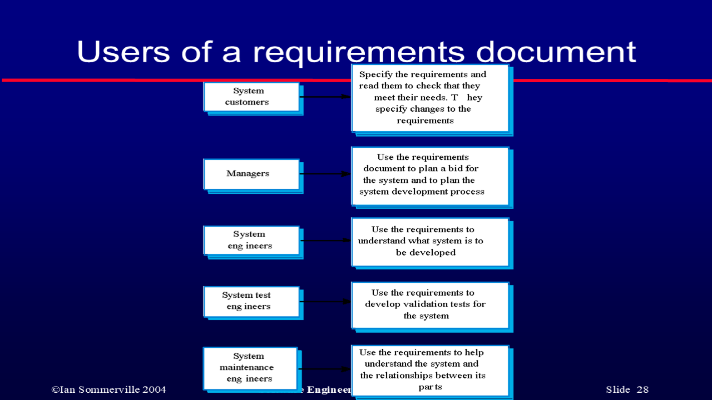

# Unit II — Process Models & Software Requirements

> **Topics:** Requirements engineering, user vs system requirements, functional / non-functional / domain requirements, requirement imprecision, completeness & consistency, writing user requirements, system requirements, the SRS document (IEEE structure). 📘 Process models — Waterfall, SDLC, Incremental, Evolutionary (Prototyping, Spiral), Agile.
>
> **Source:** *SE UNIT 2.ppt* (SNIST) · *SE_important.docx*.
> Sections marked 📘 are **not in the Unit II slides** but are asked in *SE_important.docx* (Waterfall, SDLC, Agile) — added from Pressman / Sommerville to complete the unit.

**Importance legend:** ★★★ = very frequently asked (long answer) · ★★ = medium · ★ = short answer

---

## Table of Contents
1. [📘 Software Development Life Cycle (SDLC)](#1--software-development-life-cycle-sdlc-)
2. [📘 Waterfall Model](#2--waterfall-model-)
3. [📘 Incremental & Evolutionary Models](#3--incremental--evolutionary-models-)
4. [📘 Agile Development](#4--agile-development-)
5. [Requirements Engineering](#5-requirements-engineering-)
6. [User Requirements vs System Requirements](#6-user-requirements-vs-system-requirements-)
7. [Functional, Non-functional & Domain Requirements](#7-functional-non-functional--domain-requirements-)
8. [Requirements Imprecision, Completeness & Consistency](#8-requirements-imprecision-completeness--consistency-)
9. [Non-functional Requirements in Detail](#9-non-functional-requirements-in-detail-)
10. [Writing User Requirements](#10-writing-user-requirements-)
11. [System Requirements](#11-system-requirements-)
12. [The Software Requirements Document (SRS)](#12-the-software-requirements-document-srs-)
13. [Unit II — One-Page Summary](#unit-ii--one-page-summary)

---

## 1. 📘 Software Development Life Cycle (SDLC) ★★★

The **SDLC** is a structured sequence of phases that a software product passes through from conception to retirement.

| Phase | Activities | Output |
|---|---|---|
| **Requirement analysis** | Gather needs from customer/stakeholders | SRS |
| **Feasibility study** | Technical, economic, operational, schedule feasibility | Feasibility report |
| **Design** | High-level (architecture) and low-level (modules, data structures) design | SDD (design document) |
| **Coding** | Translate design into source code | Source code |
| **Testing** | Unit, integration, system, acceptance testing | Test reports, defect logs |
| **Deployment** | Install in production environment | Released product |
| **Maintenance** | Corrective, adaptive, perfective, preventive changes | Updated versions |

---

## 2. 📘 Waterfall Model ★★★

Also called the **classic life cycle / linear sequential model** (Royce, 1970). Each phase must be **completed before** the next one starts; output of one phase is input to the next.

**When to use:** requirements are **well understood and stable**, technology is known, project is short/small.

| Advantages | Disadvantages |
|---|---|
| Simple and easy to understand and use | Real projects rarely follow a sequential flow |
| Phases processed one at a time; easy to manage | Difficult for customer to state **all requirements explicitly** at the start |
| Clearly defined stages and milestones | A **working version** is available only late in the project |
| Good documentation at each phase | A major blunder found late can be **disastrous**; costly to go back |
| Works well for small projects with clear requirements | **Blocking states** — team members wait for others to finish |
| | Not suitable for changing requirements |

---

## 3. 📘 Incremental & Evolutionary Models ★★

### 3.1 Incremental Model
- Combines linear sequential elements applied in a **staggered** fashion.
- Each linear sequence produces a deliverable **increment**; the **first increment is the core product**.
- Useful when staffing is limited or an early working product is needed.

### 3.2 Evolutionary — Prototyping
- Customer defines general objectives; a **quick prototype** is built, evaluated by the customer, and refined.
- Good when requirements are **fuzzy**. Risk: customer sees prototype as the product; quick-and-dirty design choices persist.

### 3.3 Evolutionary — Spiral Model (Boehm)
- Combines iterative nature of prototyping with controlled, systematic waterfall.
- Each loop = planning → **risk analysis** → engineering → customer evaluation. **Risk-driven**; good for large, high-risk projects.

---

## 4. 📘 Agile Development ★★★

**Agility** = the ability to respond effectively to **change**. Agile development delivers software in **small, frequent increments** with close customer collaboration.

### 4.1 Agile Manifesto — values
| We value… | …over |
|---|---|
| **Individuals and interactions** | processes and tools |
| **Working software** | comprehensive documentation |
| **Customer collaboration** | contract negotiation |
| **Responding to change** | following a plan |

### 4.2 Key principles (12, summarised)
- Highest priority: satisfy the customer through **early and continuous delivery**.
- **Welcome changing requirements**, even late.
- Deliver working software **frequently** (weeks rather than months).
- Business people and developers work **together daily**; face-to-face conversation.
- Build projects around **motivated individuals**; **self-organising teams**.
- Working software is the primary measure of progress; **sustainable pace**; simplicity; regular reflection and adjustment.

### 4.3 Agile process models
| Model | Key idea |
|---|---|
| **Extreme Programming (XP)** | Planning game (user stories), small releases, **pair programming**, test-first, refactoring, continuous integration |
| **Scrum** | **Sprints** (2–4 weeks), product backlog, sprint backlog, daily scrum meeting, Scrum Master, Product Owner |
| **Others** | ASD, DSDM, Crystal, FDD, Lean |

| Waterfall | Agile |
|---|---|
| Sequential, plan-driven | Iterative, incremental, change-driven |
| Requirements fixed up-front | Requirements evolve |
| Heavy documentation | Working software preferred |
| Customer involved at start and end | Customer involved continuously |
| Late delivery of working product | Frequent deliveries |

---

## 5. Requirements Engineering ★★★

- **Requirements** reflect the **needs of customers** for a system that helps solve some problem (controlling a device, placing an order, finding information).
- **Requirements engineering (RE)** = the process of **finding out, analysing, documenting and checking** the services that the customer requires from a system and the **constraints** under which it operates and is developed.
- The **requirements** themselves are the **descriptions of the system services and constraints** generated during RE.

**Why requirements must be abstract first, then detailed** (contracting view):
1. A company letting a contract for a large project must define its needs **abstractly** so that a solution is not pre-defined — several contractors can then **bid**.
2. After the contract is awarded, the contractor writes a **detailed system definition** so the client can understand and **validate** what the software will do.

---

## 6. User Requirements vs System Requirements ★★★

| | **User requirements** | **System requirements** |
|---|---|---|
| Form | **Natural language + diagrams** | **Structured document** with detailed descriptions |
| Content | Services the system provides and its operational constraints | Functions, services and operational constraints in detail; defines **what should be implemented** |
| Written for | **Customers**, client managers, end-users | **Software engineers**, system architects; may be part of the **contract** |
| Level | Abstract, high level | Detailed; starting point for design |

**Readers of different types of requirements:**

---

## 7. Functional, Non-functional & Domain Requirements ★★★

### 7.1 Functional Requirements
- **Statements of services** the system should provide, how it should **react to particular inputs**, and how it should **behave in particular situations**.
- Functional *user* requirements may be high-level; functional *system* requirements describe the service in detail — **inputs, outputs, exceptions**.
- May also state what the system should **not** do.

**Example system — LIBSYS:** a library system providing a single interface to several article databases in different libraries; users can **search, download and print** articles for personal study.

Examples of functional requirements:
1. The user shall be able to **search** either all of the initial set of databases or select a subset from it.
2. The system shall provide appropriate **viewers** for the user to read documents in the document store.
3. Every order shall be allocated a **unique identifier (ORDER_ID)** which the user shall be able to copy to the account's permanent storage area.

### 7.2 Non-functional Requirements
- **Constraints** on the services or functions offered: timing constraints, constraints on the development process, standards, etc.
- Define system **properties** (reliability, response time, storage) and constraints (I/O device capability, data representations).
- May include **process requirements** (mandating a programming language or method).
- Often **more critical** than functional requirements — **if they are not met, the system is useless**.

### 7.3 Domain Requirements
- Come from the **application domain** of the system and reflect characteristics of that domain (e.g., a train-control system must compute deceleration using the domain formula; a library system must follow copyright law).
- May be new functional requirements, constraints, or specific computations. Problem: often written in **domain jargon** that software engineers may not understand, or so obvious to domain experts that they are left implicit.

| Functional | Non-functional |
|---|---|
| What the system **does** | How **well** it does it / constraints |
| Related to features/services | Related to quality attributes |
| e.g., "User can search articles" | e.g., "Search completes in < 2 s" |
| Usually easy to verify by test | May be hard to state precisely and verify |
| Failure → missing feature | Failure → whole system may be unusable |

---

## 8. Requirements Imprecision, Completeness & Consistency ★★

### 8.1 Imprecision
- Problems arise when requirements are **not precisely stated**; **ambiguous** requirements are interpreted differently by developers and users.
- Example — "*appropriate viewers*":
  - **User's intention:** a special-purpose viewer for **each** document type;
  - **Developer's interpretation:** a **text viewer** that shows the contents of the document.

### 8.2 Completeness & Consistency
- **Complete:** include descriptions of **all facilities** required.
- **Consistent:** **no conflicts or contradictions** between descriptions of system facilities.
- In practice, it is **impossible** to produce a complete and consistent requirements document (large systems, many stakeholders with conflicting needs).

---

## 9. Non-functional Requirements in Detail ★★★

### 9.1 Classification

| Class | Meaning | LIBSYS example |
|---|---|---|
| **Product requirements** | Delivered product must **behave in a particular way** — execution speed, reliability, memory | "The user interface shall be implemented as **simple HTML** without frames or Java applets." |
| **Organisational requirements** | Consequence of **organisational policies and procedures** — process standards, implementation requirements | "The development process and deliverable documents shall conform to the process and deliverables defined in XYZCo-SP-STAN-95." |
| **External requirements** | Arise from factors **external** to the system and its process — interoperability, legislative, ethical | "The system shall **not disclose any personal information** about customers apart from name and reference number to the operators." |

### 9.2 Goals vs Verifiable Requirements
- Non-functional requirements are often **difficult to state precisely**, and imprecise requirements are **difficult to verify**.
- **Goal:** a general intention of the user, e.g., "*the system should be easy to use*".
- **Verifiable non-functional requirement:** a statement using some **measure that can be objectively tested**, e.g., "*experienced controllers shall be able to use all system functions after 2 hours of training; average errors shall not exceed 2 per day*".
- Goals are still useful — they convey user intentions to developers.

**Metrics for specifying non-functional requirements:**

| Property | Measure |
|---|---|
| Speed | Transactions/sec, response time, screen refresh time |
| Size | KB, number of RAM chips |
| Ease of use | Training time, number of help frames |
| Reliability | MTTF, probability of unavailability, rate of failure, availability |
| Robustness | Time to restart after failure, % events causing failure |
| Portability | % target-dependent statements, number of target systems |

---

## 10. Writing User Requirements ★★

- Should describe functional and non-functional requirements so they are **understandable by users without technical knowledge**.
- Do **not** use software structured notations or formal notations; use **natural language, simple tables and diagrams**.

### 10.1 Problems with Natural Language
| Problem | Explanation |
|---|---|
| **Lack of clarity** | Precision is difficult without making the document hard to read |
| **Requirements confusion** | Functional and non-functional requirements get **mixed up** |
| **Requirements amalgamation** | **Several different requirements** expressed together as one |

### 10.2 Examples of Bad Requirements
- **LIBSYS 4.5:** "*LIBSYS shall provide a financial accounting system that maintains records of all payments made by users. System managers may configure this system so that regular users may receive discounted rates.*"
  → mixes **conceptual** info (need for accounting) with **detail** (managers can configure discounts) that is unnecessary at this level.
- **Editor grid requirement 2.6:** "*To assist in positioning entities on a diagram, the user may turn on a grid in either centimetres or inches… Initially the grid is off… may be toggled… reduced number of grid lines on reduce-to-fit view.*"
  → mixes **three** kinds: conceptual **functional** (need for a grid), **non-functional** (grid units), **non-functional UI** (grid switching).

### 10.3 Guidelines for Writing Requirements
1. Invent a **standard format** and use it for all requirements.
2. Use language **consistently** — "**shall**" for mandatory, "**should**" for desirable requirements.
3. Use **text highlighting** to identify key parts.
4. **Avoid computer jargon.**
5. (Good practice) Include a **rationale** for each requirement.

---

## 11. System Requirements ★★

- **More detailed** specifications of system functions, services and constraints than user requirements.
- Intended as a **basis for designing** the system; may be **incorporated into the system contract**.
- Used by software engineers as the **starting point for design**; they add detail and explain **how** user requirements should be provided.
- Should describe only the **external behaviour** and **operational constraints** — not how it is designed or implemented (in practice, requirements and design are inseparable to some extent).
- Can be expressed using structured natural language, design description languages, graphical notations (UML use cases, sequence diagrams) or mathematical specifications.

---

## 12. The Software Requirements Document (SRS) ★★★

The **software requirements document** — **Software Requirements Specification (SRS)** — is the **official statement of what is required** of the system developers. It includes both a **definition of user requirements** and a **specification of system requirements**. It should state **WHAT** the system should do, not **HOW**.

### 12.1 Purpose of SRS
- **Communication** among customer, analyst, developers, maintainers.
- **Firm foundation** for the design phase.
- Supports **system testing** (test cases derived from it).
- Supports **project management** and control (estimates, schedule).
- Controls the **evolution** of the system (baseline for changes).

### 12.2 Users of the Requirements Document

| User | Uses SRS to… |
|---|---|
| **System customers** | Specify the requirements and check they meet their needs; specify changes |
| **Managers** | Plan a bid for the system and plan the development process |
| **System engineers** | Understand what system is to be developed |
| **System test engineers** | Develop validation tests for the system |
| **System maintenance engineers** | Understand the system and relationships between its parts |

### 12.3 IEEE Requirements Standard (IEEE 830)
Generic structure, instantiated for each system:
1. **Introduction** — purpose, scope, definitions/acronyms, references, overview
2. **General description** — product perspective, functions, user characteristics, constraints, assumptions & dependencies
3. **Specific requirements** — functional, non-functional, interface requirements
4. **Appendices**
5. **Index**

### 12.4 Requirements Document Structure (Sommerville)

| Chapter | Content |
|---|---|
| **Preface** | Expected readership, version history, rationale for new versions |
| **Introduction** | Need for the system, its functions, how it works with other systems, business objectives |
| **Glossary** | Technical terms used |
| **User requirements definition** | Services provided to the user and non-functional requirements (natural language + diagrams) |
| **System architecture** | High-level overview of the architecture and distribution of functions across modules |
| **System requirements specification** | Detailed functional and non-functional requirements; interfaces to other systems |
| **System models** | Graphical models showing relationships between components and environment (object, data-flow, data models) |
| **System evolution** | Assumptions on which the system is based; anticipated changes (hardware, user needs) |
| **Appendices** | Hardware and database descriptions, specific details |
| **Index** | Alphabetic index, index of diagrams, functions |

### 12.5 Characteristics of a good SRS
Correct · Unambiguous · Complete · Consistent · Ranked for importance/stability · **Verifiable** · Modifiable · Traceable.

---

## Unit II — One-Page Summary

| Topic | Key points |
|---|---|
| **📘 SDLC** | Requirements → Feasibility → Design → Coding → Testing → Deployment → Maintenance. |
| **📘 Waterfall** | Linear sequential (Communication → Planning → Modeling → Construction → Deployment). Simple, documented; but rigid, late working version, costly late changes. Use for stable requirements. |
| **📘 Incremental / Evolutionary** | Incremental: staggered linear sequences, core product first. Prototyping: quick design → evaluate → refine. Spiral: risk-driven loops. |
| **📘 Agile** | Individuals & interactions, working software, customer collaboration, responding to change. XP (pair programming, test-first), Scrum (sprints, backlog, daily stand-up). |
| **Requirements engineering** | Finding out, analysing, documenting and checking services and constraints. Abstract first (for bidding), detailed later (for validation). |
| **User vs System req.** | User: natural language + diagrams, for customers. System: structured, detailed, basis for design & contract. |
| **Functional** | Services, reactions to inputs, behaviour. LIBSYS: search databases, viewers, ORDER_ID. |
| **Non-functional** | Constraints/properties; may be more critical. **Product** (speed, reliability, HTML UI) · **Organisational** (process standards) · **External** (legislative, privacy, interoperability). |
| **Domain** | From application domain; may be implicit/jargon. |
| **Imprecision** | Ambiguity → "appropriate viewers". Complete + consistent ideal but impossible in practice. |
| **Goals vs verifiable** | Goal = general intention (easy to use). Verifiable = measurable (training time, MTTF, response time). |
| **Natural-language problems** | Lack of clarity · requirements confusion · requirements amalgamation (LIBSYS 4.5, grid 2.6). |
| **Writing guidelines** | Standard format · "shall" vs "should" · highlighting · avoid jargon. |
| **SRS** | Official statement of WHAT is required. Purpose: communication, design base, testing, management, evolution. Users: customers, managers, system/test/maintenance engineers. |
| **IEEE structure** | Introduction · General description · Specific requirements · Appendices · Index. Sommerville: Preface, Introduction, Glossary, User req., Architecture, System req., Models, Evolution, Appendices, Index. |
