# Unit III — Introduction to UML (Modeling & Design)

> **Topics:** What is UML, why we model, importance & principles of modeling, UML applications, conceptual model of UML — building blocks (things, relationships, diagrams), rules, common mechanisms; structural / behavioural / grouping / annotational things; dependency, generalization, association (multiplicity, aggregation, composition), realization; common modeling techniques; the nine UML diagrams. 📘 Software architecture and design principles (asked in *SE_important.docx*).
>
> **Source:** *SE UNIT 3.pptx* (SNIST) · *SE_important.docx*

**Importance legend:** ★★★ = very frequently asked (long answer) · ★★ = medium · ★ = short answer

---

## Table of Contents
1. [What is UML?](#1-what-is-uml-)
2. [Why We Model — Importance of Modeling](#2-why-we-model--importance-of-modeling-)
3. [Principles of Modeling](#3-principles-of-modeling-)
4. [Applications of UML](#4-applications-of-uml-)
5. [Conceptual Model of the UML](#5-conceptual-model-of-the-uml-)
6. [Things — Structural Things](#6-structural-things-)
7. [Behavioural, Grouping & Annotational Things](#7-behavioural-grouping--annotational-things-)
8. [Relationships](#8-relationships-)
9. [Association in Depth — Multiplicity, Aggregation, Composition](#9-association-in-depth-)
10. [Common Modeling Techniques](#10-common-modeling-techniques-)
11. [Diagrams in the UML](#11-diagrams-in-the-uml-)
12. [Rules & Common Mechanisms](#12-rules--common-mechanisms-of-the-uml-)
13. [📘 Software Architecture & Design Principles](#13--software-architecture--design-principles-)
14. [Unit III — One-Page Summary](#unit-iii--one-page-summary)

---

## 1. What is UML? ★★

The **Unified Modeling Language (UML)** is a **graphical language** for **Visualizing, Specifying, Constructing and Documenting** the artifacts (work products) of a software-intensive system.

- An **industry-standard** language (OMG), created by **Booch, Rumbaugh and Jacobson** ("three amigos").
- **Process-independent** — can be used with any development process.
- A **modeling language** is one whose vocabulary and rules focus on the **conceptual and physical representation** of a system — UML is the standard language for **software blueprints**.
- UML is **not a visual programming language**, but models can be mapped to programming languages.

| UML is a language for… | Meaning |
|---|---|
| **Visualizing** | Explicit models facilitate communication; everyone speaks the same symbols with well-defined semantics. Some things (e.g., a class hierarchy) can't be grasped by staring at code. |
| **Specifying** | Builds models that are **precise, unambiguous and complete** (analysis, design and implementation decisions). |
| **Constructing** | Models map directly to Java, C++, VB… → **Forward engineering** (code from model) and **Reverse engineering** (model from code). |
| **Documenting** | Documents architecture, requirements, tests, project planning and release management. |

---

## 2. Why We Model — Importance of Modeling ★★★

A **model** is a **simplification of reality**; it provides the **blueprints** of a system (Grady Booch). A model may be:
- **Structural** — emphasising the **organisation** of the system, or
- **Behavioural** — emphasising the **dynamics** of the system.

We build models to **better understand the system** we are developing:
- **Analyse the problem domain** — simplify reality, capture requirements, visualise the system in its entirety, specify structure and/or behaviour.
- **Design the solution** — document the solution in terms of structure and behaviour.

**Four aims of modeling (Booch):**
1. Models help us **visualise** a system as it is or as we want it to be (communicates the vision).
2. Models permit us to **specify the structure or behaviour** of a system before coding.
3. Models give a **template that guides construction** (road map for developers).
4. Models **document the decisions** we have made ("hard" information, not memory).

> We build models of complex systems **because we cannot comprehend such a system in its entirety**.

---

## 3. Principles of Modeling ★★

1. **The choice of what models to create has a profound influence** on how a problem is attacked and how a solution is shaped.
2. **Every model may be expressed at different levels of precision** (30,000-ft view vs detailed).
3. **The best models are connected to reality.**
4. **No single model is sufficient.** Every non-trivial system is best approached through a **small set of nearly independent models** (views).

---

## 4. Applications of UML ★

UML is intended primarily for **software-intensive systems** and has been used in: enterprise information systems, banking & financial services, telecommunications, transportation, defence/aerospace, medical electronics, scientific systems, distributed web-based services.

---

## 5. Conceptual Model of the UML ★★★

To understand UML you need a **conceptual model** made of **three major elements**:

1. **Basic building blocks** of the UML
2. **Rules** that dictate how the building blocks may be put together
3. **Common mechanisms** that apply throughout the UML

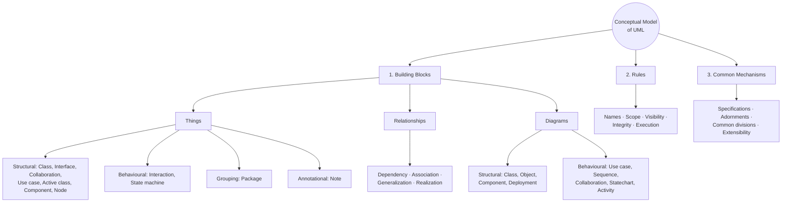

### 5.1 Building Blocks (three kinds)
| Building block | Role |
|---|---|
| **Things** | Abstractions that are **first-class citizens** in a model |
| **Relationships** | **Tie** things together |
| **Diagrams** | **Group** interesting collections of things and relationships |

### 5.2 Four kinds of Things
**Structural** (nouns, static) · **Behavioural** (verbs, dynamic) · **Grouping** (organisational) · **Annotational** (explanatory).

---

## 6. Structural Things ★★★

Structural things are the **nouns** of UML models — mostly **static** parts, conceptual or physical. There are **7**:

| # | Thing | Definition | Notation |
|---|---|---|---|
| 1 | **Class** | Description of a set of objects that share the same **attributes, operations, relationships and semantics**; implements one or more interfaces | Rectangle with **three compartments**: name, attributes, operations |
| 2 | **Interface** | Collection of operations that specify a **service** of a class or component — operation *specifications*, never implementations | **Circle (lollipop/ball)** with name, or rectangle with keyword **«interface»** |
| 3 | **Collaboration** | Defines an interaction; a **society of roles** and elements that work together to provide cooperative behaviour | **Ellipse with dashed lines** with name |
| 4 | **Use case** | Description of a **set of sequences of actions** a system performs that yields an **observable result of value to an actor**; realised by a collaboration | **Ellipse with solid line** (e.g., *Withdraw money*) |
| 5 | **Active class** | Class whose objects **own one or more processes or threads** and can **initiate control activity** (passive classes only store data / serve others) | Class with **heavy (thick) border** (e.g., *EventManager* with `suspend()`, `flush()`) |
| 6 | **Component** | **Physical and replaceable** part of a system that conforms to and realises a set of interfaces; physical packaging of classes, interfaces, collaborations | Rectangle with tabs (e.g., `orderform.java`) |
| 7 | **Node** | **Physical element existing at run time** representing a computational resource with memory and processing capability; components reside on / migrate between nodes | **3-D cube** (e.g., *Database server*) |

- Class, interface, collaboration, use case, active class → **conceptual/logical** things.
- Component and node → **physical** things.
- Active class, component and node are **class-like** (describe sets of objects with attributes, operations, relationships).

**Class notation example:**

```
+------------------+
|      Window      |   ← name
+------------------+
| origin           |   ← attributes
| size             |
+------------------+
| open()           |   ← operations
| close()          |
| move()           |
| display()        |
+------------------+
```

**Interface realisation (ball notation):** interface *SiteSearch* is realised by *SearchService*.

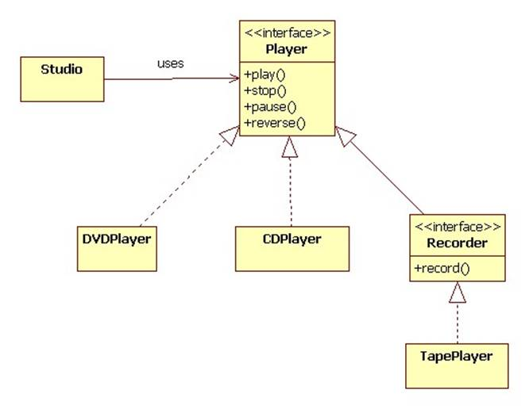

---

## 7. Behavioural, Grouping & Annotational Things ★★

### 7.1 Behavioural Things — the **verbs** (dynamic parts; behaviour over time and space)
| Thing | Definition | Notation |
|---|---|---|
| **Interaction** | A behaviour comprising a **set of messages exchanged among objects** within a context to accomplish a purpose; involves messages, action sequences and links | Directed line with operation name (e.g., `display` →) |
| **State machine** | Specifies the **sequence of states** an object or interaction goes through during its lifetime **in response to events**, together with its responses; involves states, transitions, events and activities | **Rounded rectangle** with state name (e.g., *Waiting*) |

### 7.2 Grouping Things — organisational parts
- **Package** — general-purpose mechanism for **organising elements into groups**. Structural, behavioural and even other grouping things may be placed in a package. Purely conceptual (exists only at development time).
- Notation: **tabbed folder**. Examples: Java package `io` (InputStreamReader, OutputStreamWriter); a *Software* package containing MS-Office, VLC, JDK, Rational Software Architect.

### 7.3 Annotational Things — explanatory parts
- **Note** — a symbol for rendering **constraints and comments** attached to an element or collection of elements.
- Notation: **rectangle with a dog-eared corner** (e.g., "return copy of self").

---

## 8. Relationships ★★★

A **relationship** is a connection among things. In OO modelling the three most important are **dependency, generalization and association**; **realization** relates interfaces/use cases to the classifiers that implement them.

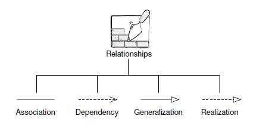

| Relationship | Meaning | Notation | Example |
|---|---|---|---|
| **Dependency** | **Using** relationship: a change in specification of one thing may affect another that uses it | **Dashed directed arrow** → to the thing depended on | `FilmClip` uses `Channel` (parameter) |
| **Generalization** | Between a **general** thing (superclass/parent) and a **more specific** thing (subclass/child) — "**is-a-kind-of**" | **Solid line with hollow triangle** pointing to parent | `Square` is-a `Rectangle` is-a `Shape` |
| **Association** | **Structural** relationship: objects of one thing are connected to objects of another; navigation both ways | **Solid line** (with name, roles, multiplicity) | `Person` works-for `Company` |
| **Realization** | Semantic relationship between classifiers: one specifies a **contract**, another **guarantees** to carry it out | **Dashed line with hollow triangle** | `SearchService` realises `SiteSearch` |

### 8.1 Dependency
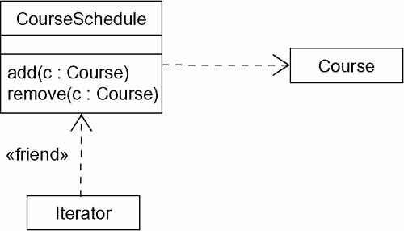

### 8.2 Generalization
- Child inherits attributes and operations of the parent; if child method has same signature as parent method it **overrides** it (**method overriding**).
- Use it to show **parent/child** relationships.

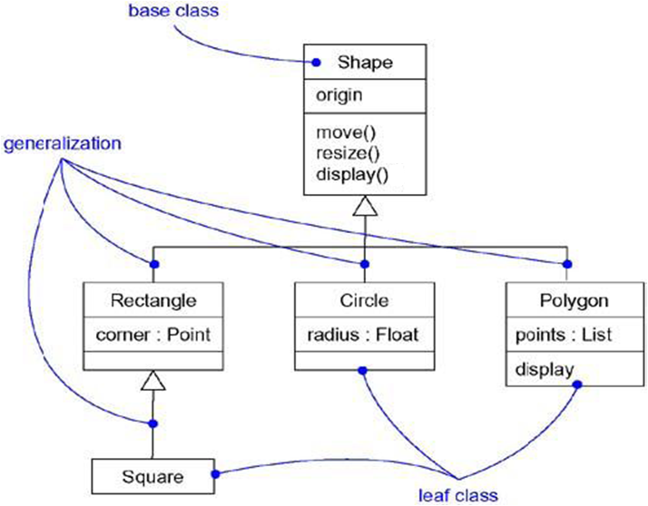

**In Java:** the HelloWorld applet `extends java.applet.Applet` (generalization) and **uses** `Graphics` (dependency).

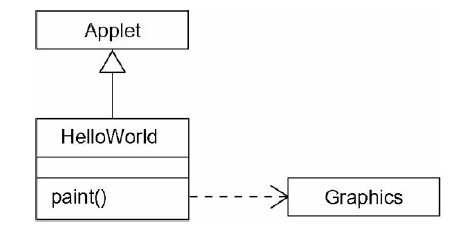

### 8.3 Realization
- Used between an **interface and the class/component** that provides its operations. An interface may be realised by many classes; a class may realise many interfaces.
- Two forms: **canonical** (interface stereotype + dashed arrow with large open arrowhead) and **elided** (lollipop).
- Also used between a **use case and the collaboration** that realises it (almost always canonical form).

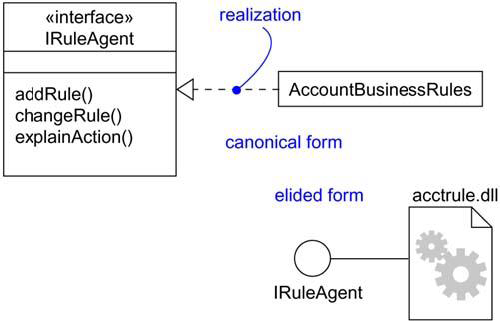
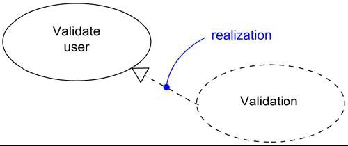

---

## 9. Association in Depth ★★★

Adornments of an association: **name**, **role**, **multiplicity**, **aggregation**.

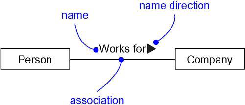

### 9.1 Multiplicity
"**How many** objects may be connected across an instance of an association" — written at the association end.

| Notation | Meaning |
|---|---|
| `1` | Exactly one |
| `0..1` | Zero or one |
| `*` or `0..*` | Zero or more |
| `1..*` | One or more |
| `n..m` | Range (e.g., `2..4`) |

**Example — Cricket team:** a team has **11** players; one is the **captain**; a player plays for only **one** team; the captain leads the other **10** members.

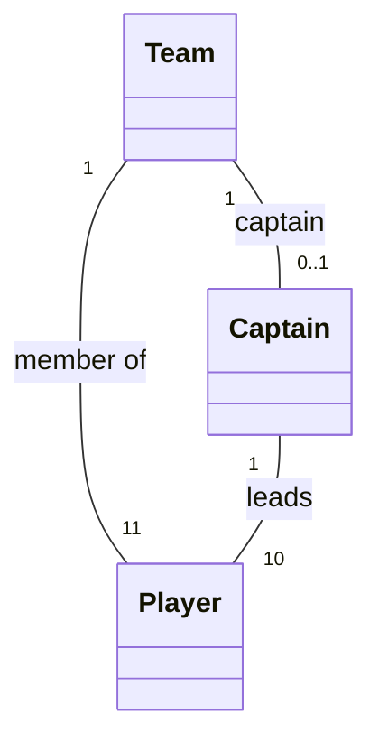

### 9.2 Aggregation ("has-a", whole/part)
- A plain association is between **peers**. To model a **whole/part** relationship where the whole consists of parts → **aggregation**.
- Notation: association adorned with an **open (hollow) diamond at the whole end**.
- Parts can exist independently / be **shared** — e.g., **DegreeProgram ◇— Course** (a C-programming course is shared by engineering and CS degrees); College ◇— Department; Car ◇— Engine, Wheels; Pen ◇— tip, barrel, ink reservoir.

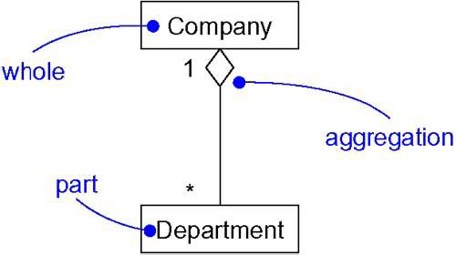

### 9.3 Composition (strong aggregation)
- A special form of aggregation where **parts are inseparable from the whole** — parts live and die with the whole; a part belongs to only one whole.
- Notation: **filled (solid) diamond** at the whole end.
- Examples: **Hand ◆— Finger**, Body ◆— Heart, Body ◆— Brain, Blood ◆— Blood cells.

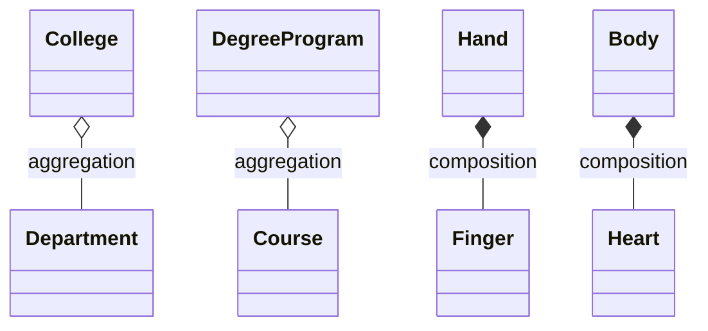

| Association | Aggregation | Composition |
|---|---|---|
| Peers | Whole/part ("has-a") | Strong whole/part ("owns") |
| Plain line | Hollow diamond ◇ | Filled diamond ◆ |
| Independent lifetimes | Part can exist without whole; can be shared | Part's lifetime bound to whole; not shared |

---

## 10. Common Modeling Techniques ★★

### 10.1 Modeling Simple Dependencies
- Create a **dependency** pointing **from the class with the operation** to the **class used as a parameter** in the operation.

### 10.2 Modeling Single Inheritance
1. Given a set of classes, look for responsibilities, attributes and operations **common to two or more classes**.
2. **Elevate** these to a **more general class**; create a new class if necessary.
3. Draw a **generalization** from each specialised class to its more-general parent.

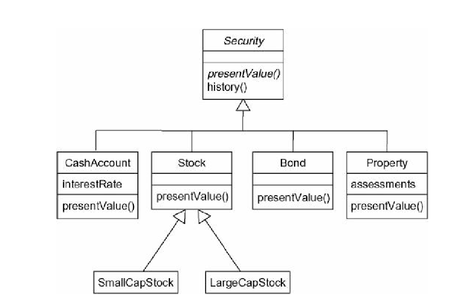

### 10.3 Modeling Structural Relationships
1. For each pair of classes, if you need to **navigate** from objects of one to objects of another, specify an **association**.
2. For each association, specify **multiplicity** and **role names**.
3. If one class is structurally a **whole** compared with the others (parts), mark it as an **aggregation** (diamond at the whole end).

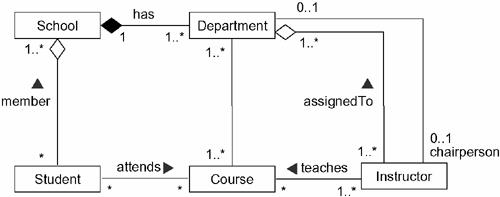

---

## 11. Diagrams in the UML ★★★

A **diagram** is the **graphical presentation of a set of things and relationships** — drawn to visualise a system from **different perspectives**. A model element may appear on one or more diagrams.

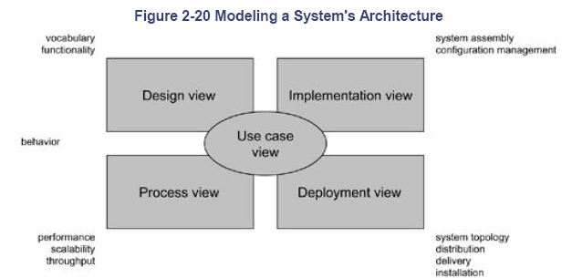

| Structural diagrams (static aspects — 4) | Behavioural diagrams (dynamic aspects — 5) |
|---|---|
| 1. **Class** — classes, interfaces, collaborations | 1. **Use case** — organises behaviours of the system |
| 2. **Object** — objects | 2. **Sequence** — **time ordering** of messages |
| 3. **Component** — components | 3. **Collaboration** — **structural organisation** of objects sending/receiving messages |
| 4. **Deployment** — nodes | 4. **Statechart** — changing **state** driven by events |
| | 5. **Activity** — **flow of control** from activity to activity |

- **Structural diagrams** → static aspects = existence and placement of things.
- **Behavioural diagrams** → dynamic aspects = changing parts, flow of messages over time and space.

### 11.1 Class Diagram ★★★
Shows a set of **classes, interfaces, collaborations and their relationships**; illustrates the **static design view**. Most common diagram in OO modelling.

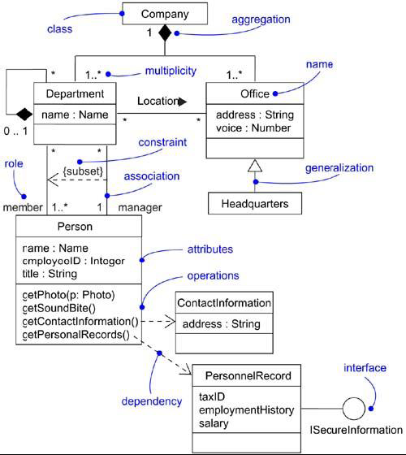

### 11.2 Object Diagram ★★
Shows a set of **objects and their relationships** at a point in time (a snapshot of class-diagram instances); static design or process view.

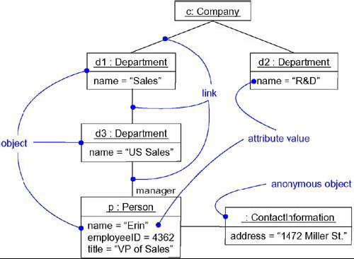

### 11.3 Component Diagram ★★
Shows a set of **components and their relationships**; illustrates the **static implementation view**. A component typically maps to one or more classes, interfaces or collaborations.

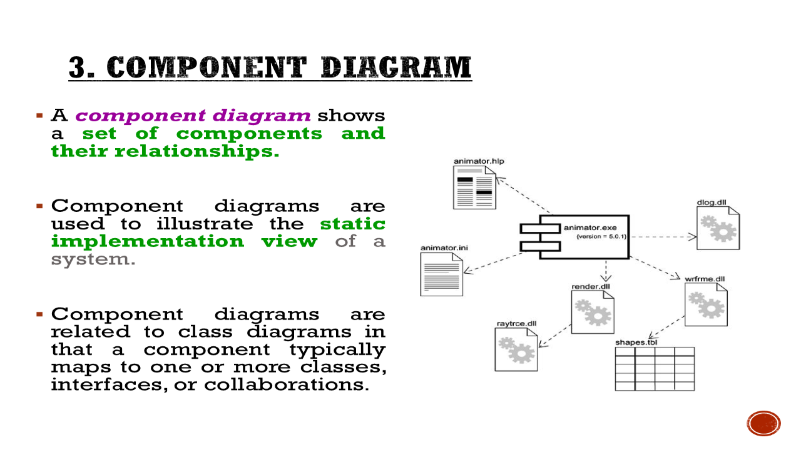

### 11.4 Deployment Diagram ★★
Shows a set of **nodes and their relationships**; illustrates the **static deployment view** of an architecture. A node typically encloses one or more components.

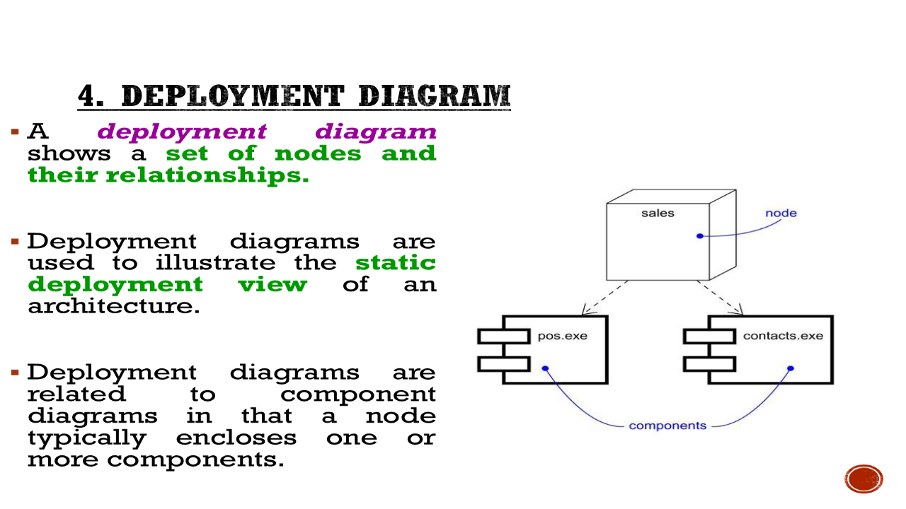

### 11.5 Use Case Diagram ★★★
Shows a set of **use cases and actors** and their relationships (association, include, extend, generalization); illustrates the **static use-case view**; especially important for **organising and modeling the behaviours** of a system and for **requirements elicitation**.

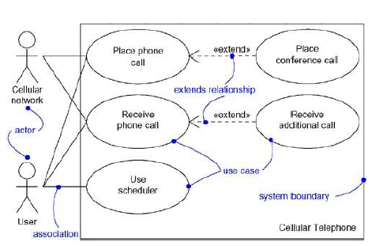

**Use cases in requirements elicitation (ATM example):**

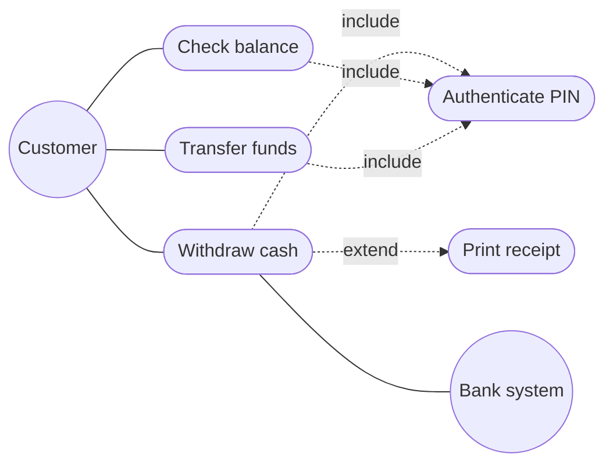

- **Actor** = role played by a user/external system; **use case** = goal-oriented functionality.
- Each use case has a **description**: actors, pre-conditions, main flow, alternate flows, post-conditions — helps identify functional requirements, discover missing ones and build test cases.

### 11.6 Interaction Diagrams — Sequence & Collaboration ★★★
- **Interaction diagram** is the collective name for **sequence** and **collaboration** diagrams; shows an interaction (objects, relationships, messages); addresses the **dynamic view**.
- **Sequence diagram** — emphasises the **time ordering** of messages (lifelines, activation bars, messages top-to-bottom).
- **Collaboration (communication) diagram** — emphasises the **structural organisation** of objects (links with numbered messages).
- The two are **isomorphic** — one can be transformed into the other without loss of information.

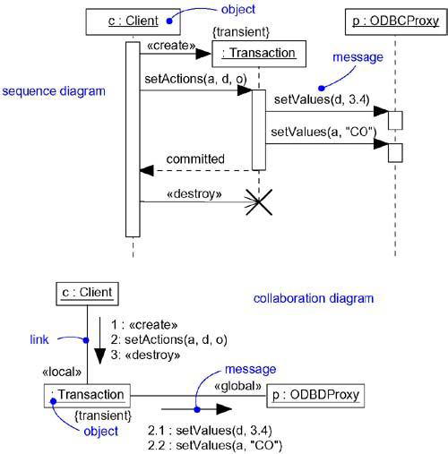

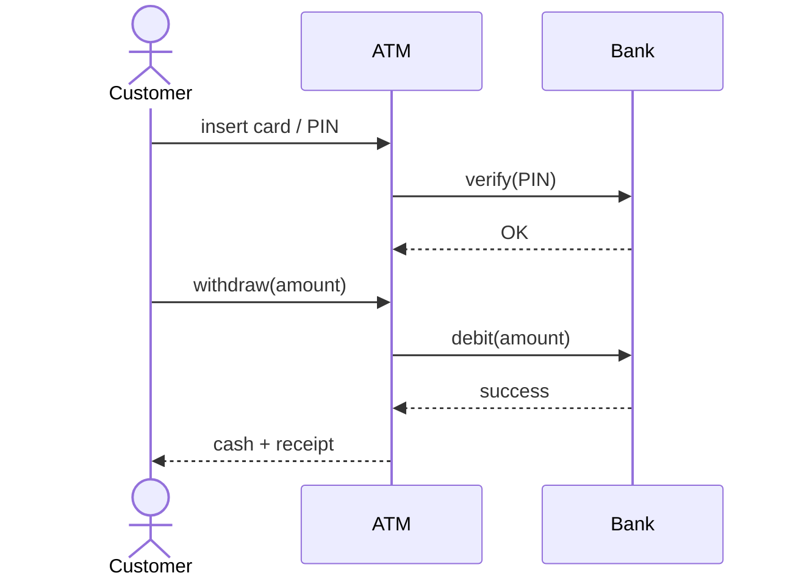

### 11.7 Statechart Diagram ★★
Shows a **state machine** — states, transitions, events and activities; focuses on the **event-ordered behaviour** of an object (e.g., reactive objects).

### 11.8 Activity Diagram ★★
Shows the **flow from activity to activity** (sequential or branching) within a system; emphasises the **flow of control** among objects; like a flowchart with forks/joins and swim-lanes.

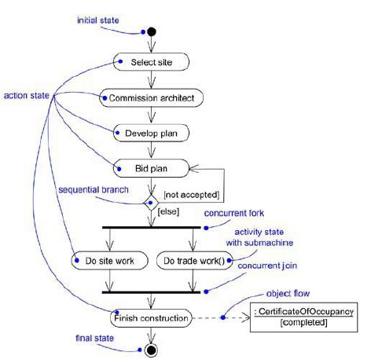

### 11.9 UML 2.x Additions
**Composite structure** (internal structure of a class at runtime), **communication** (renamed collaboration), **state machine**, plus timing, interaction-overview and package diagrams.

---

## 12. Rules & Common Mechanisms of the UML ★★

### 12.1 Rules (well-formed models)
UML has semantic rules for:
| Rule | Concerns |
|---|---|
| **Names** | What you can call things, relationships and diagrams |
| **Scope** | The context that gives specific meaning to a name |
| **Visibility** | How names can be seen and used by others (+ public, − private, # protected, ~ package) |
| **Integrity** | How things properly and consistently relate to one another |
| **Execution** | What it means to run or simulate a dynamic model |

### 12.2 Four Common Mechanisms
| Mechanism | Meaning |
|---|---|
| **Specifications** | Behind every graphical notation is a **textual specification** of its syntax and semantics |
| **Adornments** | Additional graphical/textual details on the basic notation (visibility, multiplicity, roles) |
| **Common divisions** | Class vs object (`Customer` vs `Jan : Customer`), interface vs implementation |
| **Extensibility mechanisms** | **Stereotypes** («interface»), **tagged values** ({version = 1.2}), **constraints** ({ordered}) to extend UML |

---

## 13. 📘 Software Architecture & Design Principles ★★

**Software architecture** = the **structure(s)** of a system — software components, their **externally visible properties**, and the **relationships** among them. It is a high-level blueprint that lets stakeholders reason about quality attributes before building.

**Architectural styles:** data-centred (repository), data-flow (pipes & filters), call-and-return (main/sub-program, layered), object-oriented, layered, client-server, MVC.

**Principles of software design (Davis):**
1. Design should not suffer from **"tunnel vision"** — consider alternatives.
2. Design should be **traceable** to the analysis model.
3. Design should **not reinvent the wheel** (reuse patterns).
4. Design should **minimise the intellectual distance** between software and the real-world problem.
5. Design should exhibit **uniformity and integration**.
6. Design should be structured to **accommodate change**.
7. Design should **degrade gently** under abnormal conditions.
8. **Design is not coding**; coding is not design.
9. Design should be **assessed for quality** as it is being created.
10. Design should be **reviewed** to minimise conceptual (semantic) errors.

**Key design concepts:** abstraction, modularity, information hiding, functional independence (**high cohesion, low coupling**), refinement, refactoring, patterns.

---

## Unit III — One-Page Summary

| Topic | Key points |
|---|---|
| **UML** | Graphical language for **Visualizing, Specifying, Constructing, Documenting**; OMG standard; process-independent; forward & reverse engineering. |
| **Why model** | Model = simplification of reality / blueprint; structural or behavioural. Aims: visualise, specify, template for construction, document decisions. |
| **Principles** | Choice of model shapes solution · different precision levels · connected to reality · no single model is sufficient. |
| **Conceptual model** | **Building blocks** (things, relationships, diagrams) + **Rules** (names, scope, visibility, integrity, execution) + **Common mechanisms** (specifications, adornments, common divisions, extensibility). |
| **Structural things (7)** | Class (3 compartments), Interface (lollipop/«interface»), Collaboration (dashed ellipse), Use case (ellipse), Active class (thick border), Component (physical, replaceable), Node (cube, runtime resource). |
| **Behavioural things** | Interaction (messages) · State machine (states, transitions, events). |
| **Grouping / Annotational** | Package (tabbed folder) · Note (dog-eared rectangle). |
| **Relationships** | Dependency (dashed arrow, "uses") · Generalization (solid + hollow triangle, "is-a-kind-of") · Association (solid line, name/role/multiplicity) · Realization (dashed + hollow triangle, interface contract). |
| **Aggregation vs Composition** | Aggregation: hollow diamond, "has-a", parts shareable (DegreeProgram–Course). Composition: filled diamond, parts die with whole (Hand–Finger). |
| **Modeling techniques** | Simple dependencies (to parameter class) · single inheritance (elevate common features) · structural relationships (associations + multiplicity + aggregation). |
| **Diagrams (9)** | Structural: Class, Object, Component, Deployment. Behavioural: Use case, Sequence (time order), Collaboration (structure), Statechart, Activity (flow of control). Sequence ≅ Collaboration (isomorphic). |
| **📘 Architecture & design** | Architecture = components + visible properties + relationships. Design principles: traceable, reuse, accommodate change, degrade gently, design ≠ coding, review; high cohesion, low coupling. |
