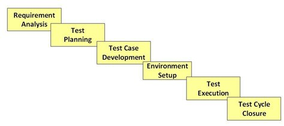
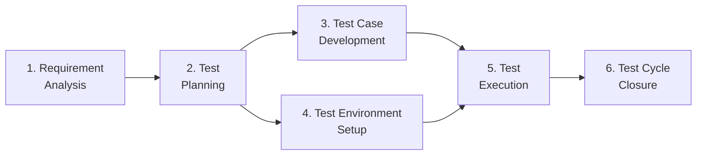
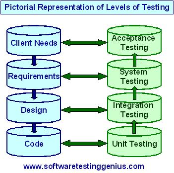
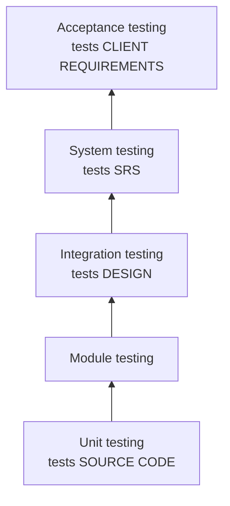
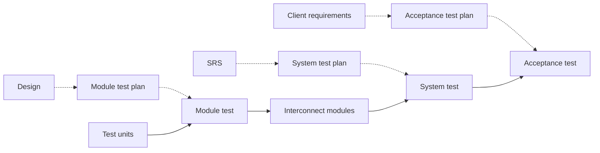
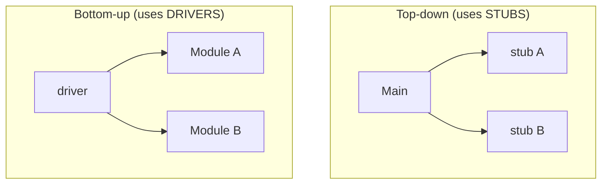
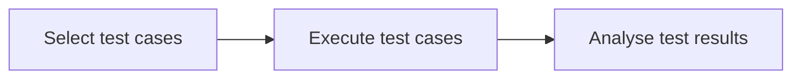
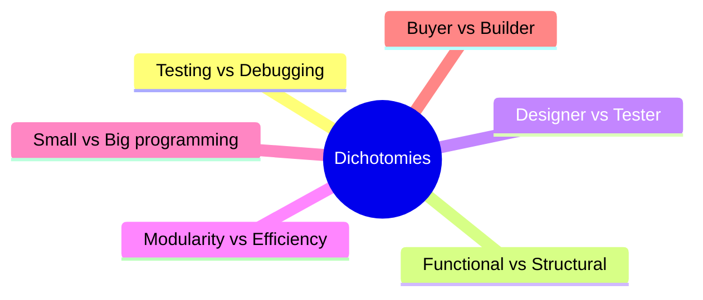

# Unit IV — Software Testing Fundamentals

> **Syllabus:** Testing: What is testing, characteristics of test engineers, Software Testing Life Cycle, levels of testing, testing approaches, test cases — format for writing test cases, test plan — format to prepare a test plan. Purpose of testing, dichotomies, consequences of bugs.
>
> **Source:** *SE Unit 4.ppt* (= *unit 4(Testing).ppt*, identical) — based on Boris Beizer, *Software Testing Techniques* · *SE_important.docx*

**Importance legend:** ★★★ = very frequently asked (long answer) · ★★ = medium · ★ = short answer

---

## Table of Contents
1. [What is Testing?](#1-what-is-testing-)
2. [Characteristics of a Test Engineer](#2-characteristics-of-a-test-engineer-)
3. [Software Testing Life Cycle (STLC)](#3-software-testing-life-cycle-stlc-)
4. [Levels of Testing](#4-levels-of-testing-)
5. [Testing Approaches](#5-testing-approaches-)
6. [Test Cases](#6-test-cases-)
7. [Test Plan](#7-test-plan-)
8. [Purpose of Testing](#8-purpose-of-testing-)
9. [Dichotomies](#9-dichotomies-)
10. [Consequences of Bugs](#10-consequences-of-bugs-)
11. [📘 Verification vs Validation, Testing Principles & Coverage](#11--verification-vs-validation-testing-principles--coverage-)
12. [Unit IV — One-Page Summary](#unit-iv--one-page-summary)

---

## 1. What is Testing? ★★

Four views of testing — from weakest to best:

| Definition | Comment |
|---|---|
| "Testing is the process to **prove that the software works correctly**." | **Not a good definition.** A developer testing their own code gives only inputs that produce correct results. |
| "Testing is the process to **prove that the software does not work**." | Strictly better — an aim to break the software makes testing good. Used by **SQA and client teams**. |
| "Testing is the process of **executing a program with the intention of finding errors**." (Myers) | Classic definition. |
| "Testing is the process to **detect defects and minimise the risk** associated with residual defects." | Modern, risk-based definition. |

> A **successful test** is one that **uncovers an as-yet-undiscovered error**.

---

## 2. Characteristics of a Test Engineer ★★★

A test engineer must understand the application well, study functionality to find **where bugs are likely**, study code so **every line is tested**, design **rigorous** test cases to uncover hidden bugs, and ensure the software is **usable and reliable**.

| # | Characteristic | Explanation |
|---|---|---|
| 1 | **Understand the application domain** | Software may be a client/server DBMS, telecom, data communication, embedded… Understand it from the **end-user's** point of view first. |
| 2 | **Learn the development environment** | OS (Windows/Unix/Linux), language (C, C++, Java) etc. vary with application and user needs. |
| 3 | **Learn how to use the application** | Assume you are the end user and run it to get a feel — only then can you generate test cases and automated procedures. |
| 4 | **Study the source code** | If asked to validate code, generate test cases from it (white-box). |
| 5 | **Study the SRS** | SRS gives **functional, performance and reliability** requirements — all must be tested. Be **eagle-eyed**: check every requirement is **testable**. "Response should be very fast" is untestable → ask for a **metric** (e.g., 10 s). |
| 6 | **Study the Acceptance Test Procedure (ATP)** | ATP = the test plan by which the **user validates** the software; prepared by development + testing teams with the customer representative. |

Personal traits (general): **curious, suspicious/sceptical, detail-oriented, good communicator, patient, "destructive" mindset**, domain and tool knowledge.

---

## 3. Software Testing Life Cycle (STLC) ★★★





| Phase | What happens | Key activities | Deliverables |
|---|---|---|---|
| **1. Requirement Analysis** | Test team studies requirements from a **testing point of view** to identify **testable** requirements; may interact with client, BA, tech leads, architects. Functional + non-functional requirements. | Identify types of tests; testing priorities; prepare **Requirement Traceability Matrix (RTM)**; identify test environment; **automation feasibility** | RTM; automation feasibility report |
| **2. Test Planning** (Test Strategy phase) | Senior QA manager determines **effort and cost** estimates and finalises the Test Plan | Test plan/strategy document; **test tool selection**; effort estimation; resource planning, roles & responsibilities; training needs | Test plan/strategy; effort estimation document |
| **3. Test Case Development** | Create, verify and rework **test cases & scripts**; identify/create test data | Create test cases & automation scripts; review & **baseline**; create test data | Test cases/scripts; test data |
| **4. Test Environment Setup** | Decides the **hardware/software conditions** for testing; can run **in parallel** with test-case development. If provided by customer/dev team, testers do a **readiness check (smoke test)** | Understand architecture; prepare HW/SW list; set up environment & test data; **smoke test** the build | Environment ready with test data; smoke-test results |
| **5. Test Execution** | Execute tests per plan; report bugs to development; **retest** | Execute; document results; **log defects**; map defects to RTM; retest fixes; track defects to closure | Completed RTM with execution status; updated test cases; **defect reports** |
| **6. Test Cycle Closure** | Team meets to analyse artifacts, learn lessons, remove bottlenecks for future cycles | Evaluate completion criteria (time, coverage, cost, software, critical business objectives, quality); prepare **test metrics**; document learning; **test closure report**; defect distribution by type & severity | Test closure report; test metrics |

---

## 4. Levels of Testing ★★★

During design, software is divided into **modules**, each into **units**. Combining everything and testing the whole system at once is impractical; testing is divided into **levels**:





| Level | What is tested | By whom / how |
|---|---|---|
| **Unit testing** | The **smallest entity** — each unit against its specification. Extra code (**drivers/stubs**) may be needed since a unit can't run alone. | **Developers** |
| **Module testing** | Tested units integrated into an **independent module**; each module tested separately (e.g., DBMS → back-end DB tested via SQL, front-end UI separately). A **module-level test report** is prepared. | Developers / testers |
| **Integration testing** | Modules combined **systematically and incrementally** (not all at once — debugging would be hard); tests the **design / interfaces** | Testers |
| **System testing** | Whole integrated system tested for **functional and non-functional** requirements (SRS) — performance, stress, security, etc. | Independent test team |
| **Acceptance testing** | Software tested by the **client/user** — at developer's premises (**alpha**) or client's premises (**beta**) | Customer |

**V-relationship (test plans ↔ documents):**



---

## 5. Testing Approaches ★★★

In a large project, all modules can't be integrated in one shot — the system is built and tested **incrementally**, which makes debugging easier.

### 5.1 Top-down vs Bottom-up Integration
| Top-down | Bottom-up |
|---|---|
| Testing starts at the **top** of the module hierarchy | Testing starts at the **bottom** |
| Lower modules not ready are replaced by **stubs** (dummy routines that **simulate** a called module) | Upper modules not ready are replaced by **drivers** (dummy routines that **invoke** the module) |
| Early skeleton/prototype of the system | Low-level utilities tested thoroughly first |
| Lower-level modules tested late | No working program until the end |



### 5.2 Functional vs Structural Testing
- **Functional (black-box) testing** — functionality tested against **specifications**; internal structure not considered.
- **Structural (white-box) testing** — tests the **implementation**; source code is examined. Involves **(a) statement coverage, (b) branch coverage, (c) path coverage**.

### 5.3 Mutation Testing ★★
- Used to evaluate the **quality of test cases** (good debugging mechanism).
- Program is **modified slightly** (usually **one change** per mutant) to obtain **mutants**; the same test cases are run on each mutant.
- If the mutants **fail** (are "killed") while the original passes → confidence in the program and the **test cases are good**. Different mutants should give different results.
- **Mutation operators:** constant replacement, variable replacement, arithmetic operator replacement, relational operator replacement, go-to label replacement.

### 5.4 Regression Testing ★★★
- **Testing a modified build** is called regression testing.
- When a defect is fixed, the change may introduce **another defect** not immediately visible. So after every change a **pre-defined set of test cases** is re-run to ensure **no ill effects on other parts**.

**Example:**
```
input x;
y = x ** 2;
print y;
if (y == 100) print "Alarm: x value is 10";
```
Later the logic is changed to `y = x*x*x` (cube). Testing with 2, 6 and 8 "passes", but the program is wrong — the `if (y == 100)` must also change to `1000`. Regression tests (including the alarm case x = 10) would catch this.

---

## 6. Test Cases ★★★

- **Test cases** = sets of **input parameters** for which the software will be tested.
- Testing all combinations of inputs = **exhaustive testing** — costly, time-consuming and usually **impossible**; so a **subset** (test cases) is selected.



**Definitions:**
- **Test case:** step-by-step instructions (driving directions) to test a **specific requirement/functionality**; may have one or more steps.
- **Test scenario:** a document specifying a **sequence of actions** for execution of a test.
- **Test data:** data that exists before a test is executed and affects or is affected by the system under test.

**Criteria:** a set of test cases is **reliable** if it detects **all** errors; **valid** if **at least one** test case reveals the errors.

### 6.1 Test-case selection techniques
| Technique | Idea |
|---|---|
| **Equivalence class partitioning** | Divide inputs into classes of **valid and invalid** inputs; one representative per class |
| **Boundary value analysis** | Values **on the boundaries** of equivalence classes are **high-yield** test cases |
| **Cause-effect graphing** | Identify **causes (inputs)** and **effects (outputs)**, draw a cause-effect graph, derive a decision table |

### 6.2 How to create effective test cases
1. **Base them on requirements** — business requirements are the input; multiple cases per requirement if needed.
2. **Validate them** — check coverage of requirements; review with a functional expert; target **high-risk functions** first.
3. **Maintain traceability** — map test cases to requirements, components and scripts (important when requirements change).
4. **Repeatability** — manual scripts detailed enough for anyone to follow.
5. **Manual and automated** test cases.

### 6.3 IEEE Test-Case Format ★★★
| # | Field | Meaning |
|---|---|---|
| 1 | **Test Case ID** | Unique name/ID |
| 2 | **Test Case Name** | Name of the test condition |
| 3 | **Feature to be tested** | Module/function/service |
| 4 | **Test Suite ID** | Batch the case belongs to |
| 5 | **Priority** | **P0** basic functionality · **P1** general functionality (input domain, error handling, compatibility) · **P2** cosmetic (UI) |
| 6 | **Test Environment** | Required hardware & software |
| 7 | **Test Effort** | Person-hours (e.g., 20 min) |
| 8 | **Test Duration** | Date & time (scheduling) |
| 9 | **Test Setup** | Tasks before execution |
| 10 | **Test Procedure** | Step-by-step from base state to end state (table below) |
| 11 | **Pass/Fail Criteria** | When this test passes/fails |

| S.No | Action | Input required | Expected | Actual | Result | Comments |
|---|---|---|---|---|---|---|
| ← *filled during test design* → | | | | ← *filled during execution* → | | |

### 6.4 Example — Test cases for validating an ATM card (from *SE_important*)
| TC ID | Test scenario | Input | Expected result |
|---|---|---|---|
| TC01 | Insert valid card | Valid card | Card accepted, PIN prompt shown |
| TC02 | Insert card upside-down / wrong way | Card inverted | Card rejected/ejected with message |
| TC03 | Insert expired card | Expired card | "Card expired" message, card returned |
| TC04 | Insert blocked/hot-listed card | Blocked card | Card retained/declined, message |
| TC05 | Insert damaged card (unreadable chip/strip) | Damaged card | "Unable to read card" |
| TC06 | Insert card of another bank | Other-bank card | Accepted if network supported, else rejected |
| TC07 | Enter valid PIN | Correct PIN | Main menu displayed |
| TC08 | Enter invalid PIN | Wrong PIN | "Invalid PIN", retry allowed |
| TC09 | Invalid PIN 3 times | Wrong PIN ×3 | Card blocked/retained |
| TC10 | No action after card insert | Timeout | Session cancelled, card ejected |

---

## 7. Test Plan ★★★

A **test plan** is a **systematic approach to testing** containing detailed information about the upcoming testing effort — **scope, deliverables, staff, schedule, risks**. Prepared **before** testing starts.
- *Template:* a pre-formatted starting file for a new document.
- *Document:* written/printed/electronic matter serving as an official record.

### 7.1 Test Plan Template (IEEE 829 style) — 17 items
| # | Section | Content |
|---|---|---|
| 1 | **Test plan identifier** | Unique company ID; tells whether it's a master, level or integration plan |
| 2 | **Introduction** | Purpose of the plan and level (executive summary) |
| 3 | **Test items** | Things to be tested within scope |
| 4 | **References** | Supporting documents with version/release numbers |
| 5 | **Features to be tested** | User's view of what the system does |
| 6 | **Features not to be tested** | What is excluded (e.g., features of a previous version) |
| 7 | **Test approach** | Overall test strategy, rules and processes |
| 8 | **Entry criteria** | When to **start** testing |
| 9 | **Exit criteria** | When to **stop** testing |
| 10 | **Suspension criteria** | When to stop testing **temporarily** (blocking problems) |
| 11 | **Roles & responsibilities** | Test lead and team members |
| 12 | **Schedule** | For all test activities |
| 13 | **Training** | Domain training and tool training |
| 14 | **Test environment / lab** | Required HW & SW |
| 15 | **Test deliverables** | Test cases, procedures, logs, reports |
| 16 | **Approvals** | Who approves completion and moving to the next level |
| 17 | **Glossary** | Terms and acronyms |

**IEEE short format:** Test Plan ID · Introduction · Test Items · Features To Be Tested · Features Not To Be Tested · Approach · Feature Pass/Fail Criteria · Suspension Criteria · Test Environment · Test Deliverables · Test Tasks · Staff & Training Needs (+ responsibilities, schedule, risks, approvals).

---

## 8. Purpose of Testing ★★★

### 8.1 To catch bugs
- Bugs arise from **imperfect communication** among programmers (specs, design, low-level functionality).
- Statistics: about **3 bugs per 100 statements**.

### 8.2 Productivity-related reasons
- Insufficient QA → high rejection ratio → **more rework** → higher net cost.
- QA cost: ~**2 %** of cost for consumer products, up to **80 %** for critical software (spacecraft, aircraft, nuclear, medical).
- **Quality ⇔ productivity** — the biggest part of software cost is the cost of bugs and rework.

### 8.3 Goals of testing
- **Primary goal: bug prevention** — a prevented bug saves all rework (reporting, debugging, correction, retesting).
- **Secondary goal: bug discovery** — good test design gives clear diagnosis and easy correction.
- **Test-design thinking:** write test specs from the requirement specs **before coding** — this alone eliminates many bugs at each stage.

### 8.4 Five Phases in a Tester's Thinking (Beizer) ★★★
| Phase | Belief | Problem |
|---|---|---|
| **Phase 0** | No difference between **testing and debugging** | Barrier to good testing and quality software |
| **Phase 1** | Testing is to **show that software works** | One failed test shows it doesn't — objective **unachievable** |
| **Phase 2** | Testing is to show **software does not work** | One failed test proves it; but we never know **when to stop** |
| **Phase 3** | Testing is for **risk reduction** | Statistical quality control; release when **risk** is below a pre-determined limit |
| **Phase 4** | A **state of mind** — knowing what testing can and cannot do, and what makes software **testable** | Testable software needs less testing effort and has fewer bugs |

The phases are **cumulative and complementary** — the most testable software must be debugged, must work and must be **hard to break**.

### 8.5 Testing & Inspection
- **Inspection** = **static testing**. Methods and purposes differ but both catch/prevent bugs. Use **reviews, inspections, code reading and walkthroughs**, then testing.
- **Bug prevention** mix: inspection methods, design style, **static analysis**, languages with strong syntax/path verification, design methodologies and development environment.
- Know the **Pesticide paradox** — every method used to prevent/find bugs leaves a residue of subtler bugs against which it is ineffective.
- **Complexity barrier** — software complexity (and bugs) grows to the limit of our ability to manage it.

---

## 9. Dichotomies ★★★

A **dichotomy** = division into two mutually exclusive or contradictory groups. Six dichotomies (Beizer):



### 9.1 Testing vs Debugging
Testing **finds bugs**; debugging **finds the cause** (misconception) of a bug.

| # | Testing | Debugging |
|---|---|---|
| 1 | Starts with **known conditions**, predefined procedure, **predictable** outcomes | Starts with possibly **unknown** conditions; end **unpredictable** |
| 2 | **Planned, designed and scheduled** | Procedures and duration **not constrained** |
| 3 | A demonstration of error or apparent correctness | A **deductive** process |
| 4 | Proves programmer's success or failure | Programmer's **vindication** |
| 5 | Should be predictable, dull, constrained, rigid, inhuman | Intuitive leaps, conjecture, experimentation, freedom |
| 6 | Much can be done **without design knowledge** | **Impossible without detailed design knowledge** |
| 7 | Can be done by an **outsider** | Must be done by an **insider** |
| 8 | Theory establishes what testing can/cannot do | Only rudimentary results |
| 9 | Test execution and design can be **automated** | Automating debugging is still a **dream** |

### 9.2 Functional vs Structural Testing
- **Functional** — program is a **black box**; outputs verified against specs from the **user's** point of view.
- **Structural** — looks at **implementation details**: programming style, control method, source language, database and coding details.
- A good program is built in **layers**: outer layer = pure system function; each layer is a structure whose outer layer is its function (User → Application → OS → malloc()/link block() → devices).
- Both target different bugs: **functional tests can in principle detect all bugs but would take infinite time; structural tests are finite but cannot detect all bugs.** The art is in the allocation between them.

### 9.3 Designer vs Tester
Completely separated in black-box testing; unit testing may be done by either. Tests are more efficient when designer, programmer and tester are **independent**.

| Programmer/Designer | Tester |
|---|---|
| Tests oriented towards **structural** testing, with its limitations | Knowing internal design, can **eliminate useless tests** and optimise |
| Likely to be **biased** | Independent tests are **bias-free** |
| Tries to do the job simplest/cleanest way, reducing complexity | Must be **suspicious, uncompromising, hostile, obsessed with destroying** the program |

### 9.4 Modularity (design) vs Efficiency
A **module** = well-defined discrete component with **size, internal complexity and interface complexity**.

| Modularity | Efficiency |
|---|---|
| Smaller components are easier to understand | But more components → more interfaces → more complexity, **less efficiency**, more bugs |
| Small modules can be retested independently with less rework | Higher efficiency at module level when a bug occurs |
| Microscopic test cases need individual setups → can have bugs | More test cases → more bugs in tests → more rework |
| Easier to design large modules with small interfaces at high level | Less complex & efficient, but may need breaking down for implementation |

→ **Optimise module size** and balance internal vs interface complexity; optimise test-design scope to minimise cost without compromising effectiveness.

### 9.5 Programming in the Small vs in the Big
| Small | Big |
|---|---|
| 1–2 people, small intelligent user population; informal, intuitive | Large number of programmers and components |
| For oneself, one's office or institute | Size causes **non-linear** effects on complexity, bugs, effort, rework |
| Complete test coverage easy | Acceptance: **100 % unit coverage**, **≥ 80 %** overall coverage |

### 9.6 Buyer vs Builder
Buyer and builder being the same organisation **clouds accountability** → separate them to increase motivation for quality.

| Role | Responsibility |
|---|---|
| **Builder** | Designs for and is **accountable to the buyer** |
| **Buyer** | **Pays** for the system; hopes for profit from services to the user |
| **User** | **Ultimate beneficiary**; interests guarded by the tester |
| **Tester** | Dedicated to the **destruction** of the software; tests in the interest of the user/operator |
| **Operator** | Lives with builder's mistakes, buyer's murky specs, tester's oversights and user's complaints |

---

## 10. Consequences of Bugs ★★★

Consequences range from **mild to catastrophic** on a **10-point scale**:

| # | Severity | Example |
|---|---|---|
| 1 | **Mild** | Aesthetic — misspelled output, mis-aligned printout |
| 2 | **Moderate** | Outputs misleading or redundant; impacts performance |
| 3 | **Annoying** | Dehumanising behaviour — names truncated, bills for $0.00; operators need unnatural command sequences |
| 4 | **Disturbing** | **Legitimate transactions refused** (ATM rejects valid card) |
| 5 | **Serious** | **Loses track of transactions** — accountability lost |
| 6 | **Very serious** | Does **another transaction** than requested — credits wrong account, converts withdrawals to deposits |
| 7 | **Extreme** | Very serious problems occur **frequently and arbitrarily** |
| 8 | **Intolerable** | **Long-term unrecoverable corruption of the database** |
| 9 | **Catastrophic** | System **fails and shuts down** |
| 10 | **Infectious** | **Corrupts other systems** even if it doesn't fail itself |

### 10.1 Assignment of severity
- Assign **flexible, relative** values to bug types; number and severity of bugs measure quality quantitatively.
- Weights depend on environment, application, culture, correction cost, SDLC phase, etc.

### 10.2 Nightmares & When to Stop Testing ★★★
1. List all **nightmares** in terms of symptoms and user reactions.
2. Convert consequences into **cost** (rework, lawsuits, lost business, reactor meltdown…).
3. Order from **costliest to cheapest**; discard those you can live with.
4. Postulate the bug types causing each symptom ("**bug design process**"); a bug type can cause multiple symptoms.
5. Order causative bugs by **decreasing probability**, and compute:

$$\text{Importance of bug type } j = \sum_{k} C_{jk}\,P_{jk}$$

where **C<sub>jk</sub>** = cost due to bug type *j* causing nightmare *k*, **P<sub>jk</sub>** = probability of bug type *j* causing nightmare *k*. (Cost of all bug types = Σ<sub>j</sub> Σ<sub>k</sub> C<sub>jk</sub> P<sub>jk</sub>.)

6. **Rank** bug types by importance; design tests and QA inspections **most effective against the most important bugs**.
7. As tests pass/bugs are fixed, nightmares disappear — **revise** probabilities, nightmare list and strategy.
8. **Stop testing** when the probability (importance × cost) becomes **inconsequential**.

> Note: **test suites wear out** — as programmers improve, update the test suites.

---

## 11. 📘 Verification vs Validation, Testing Principles & Coverage ★★

| Verification | Validation |
|---|---|
| "Are we building the product **right**?" | "Are we building the **right product**?" |
| Checks conformance to **specifications** at each phase | Checks the final product meets **user needs** |
| Static — reviews, walkthroughs, inspections | Dynamic — executing the software (testing) |
| Done before validation | Done after verification |

**Testing principles:** testing shows the presence of defects, not their absence · exhaustive testing is impossible · **early testing** saves cost · **defect clustering** (Pareto 80/20) · **pesticide paradox** · testing is context-dependent · absence-of-errors fallacy · tests should be traceable to requirements.

**Test coverage criteria:** statement coverage (every statement ≥ once) · branch/decision coverage (every branch true & false) · condition coverage · path coverage (every independent path) · requirement coverage. **Testing issues:** when to stop, exhaustive testing impossible, test-oracle problem, changing requirements, test-environment availability, cost & time limits.

---

## Unit IV — One-Page Summary

| Topic | Key points |
|---|---|
| **Testing** | Executing a program with intent to find errors; detect defects & minimise residual risk. "Prove it works" is a bad definition. |
| **Test engineer** | Understand domain · learn dev environment · use the app as user · study source code · study SRS (demand measurable requirements) · study ATP. |
| **STLC** | Requirement analysis (RTM) → Test planning (plan, effort) → Test case development → Environment setup (smoke test) → Test execution (defect reports) → Test cycle closure (closure report, metrics). |
| **Levels** | Unit (code, by developers) → Module → Integration (design) → System (SRS) → Acceptance (client; alpha/beta). |
| **Approaches** | Top-down (stubs) vs bottom-up (drivers); functional (black-box) vs structural (statement/branch/path coverage); **mutation** (one change per mutant; operators: constant, variable, arithmetic, relational, goto); **regression** (re-run tests after change; x² → x³ example). |
| **Test cases** | Subset of inputs (exhaustive impossible). Reliable vs valid. ECP, BVA, cause-effect graphing. IEEE format: ID, name, feature, suite, priority P0/P1/P2, environment, effort, duration, setup, procedure, pass/fail. |
| **Test plan** | Identifier, intro, items, references, features (not) to be tested, approach, entry/exit/suspension criteria, roles, schedule, training, environment, deliverables, approvals, glossary. |
| **Purpose** | Catch bugs (3/100 statements), productivity (QA 2 %–80 %), **prevention** primary, discovery secondary. Phases 0–4 of tester's thinking. Inspection = static testing; pesticide paradox; complexity barrier. |
| **Dichotomies** | Testing vs debugging · functional vs structural · designer vs tester · modularity vs efficiency · small vs big · buyer vs builder (builder, buyer, user, tester, operator). |
| **Consequences** | Mild, moderate, annoying, disturbing, serious, very serious, extreme, intolerable, catastrophic, infectious. Importance of bug type j = Σ C<sub>jk</sub>P<sub>jk</sub>; stop testing when importance is inconsequential. |
| **📘 V&V** | Verification = built right (static); validation = right product (dynamic). |
