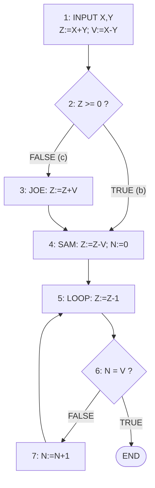
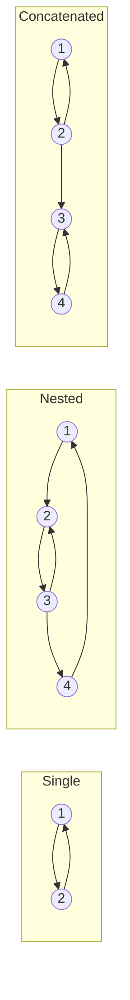
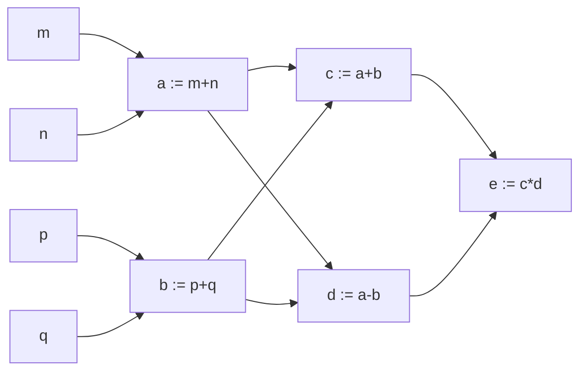
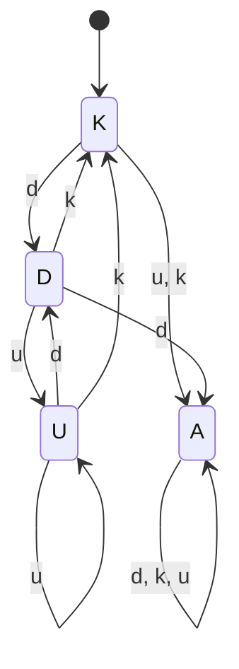
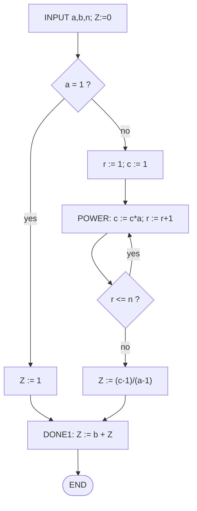
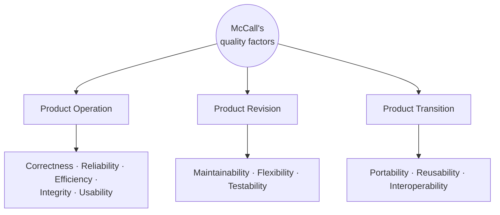

# Unit V — Flow Graphs & Path Testing, Data-Flow Testing, Logic-Based Testing, Software Metrics

> **Syllabus:** Flow graphs and path testing: basic concepts of path testing. Data-flow testing: basics. Logic-based testing: decision tables. Software metrics: software quality, metrics for the analysis model, design model, source code, testing and maintenance.
>
> **Source:** *SE Unit 5.ppt* (= *unit5(pathtesting).ppt*, identical) — Boris Beizer, *Software Testing Techniques*; Pressman for metrics · *SE_important.docx*

**Importance legend:** ★★★ = very frequently asked (long answer / numericals) · ★★ = medium · ★ = short answer

---

## Table of Contents
1. [Path Testing — Definition & Assumptions](#1-path-testing--definition--assumptions-)
2. [Control Flow Graphs](#2-control-flow-graphs-)
3. [Path Testing Concepts](#3-path-testing-concepts-)
4. [Path Selection Criteria — P, C1, C2](#4-path-selection-criteria--p-c1-c2-)
5. [Loop Testing](#5-loop-testing-)
6. [Effectiveness & Limitations of Path Testing](#6-effectiveness--limitations-of-path-testing-)
7. [Predicates, Path Predicate Expressions & Testing Blindness](#7-predicates-path-predicate-expressions--testing-blindness-)
8. [Achievable Paths & Applications of Path Testing](#8-achievable-paths--applications-of-path-testing-)
9. [Data-Flow Testing — Basics](#9-data-flow-testing--basics-)
10. [Logic-Based Testing — Decision Tables](#10-logic-based-testing--decision-tables-)
11. [Software Quality & Product Metrics](#11-software-quality--product-metrics-)
12. [Metrics for the Analysis Model — Function Points](#12-metrics-for-the-analysis-model--function-points-)
13. [Metrics for the Design Model](#13-metrics-for-the-design-model-)
14. [Metrics for Source Code & Testing — Halstead](#14-metrics-for-source-code--testing--halstead-)
15. [Metrics for Maintenance — SMI](#15-metrics-for-maintenance--smi-)
16. [Unit V — One-Page Summary](#unit-v--one-page-summary)

---

## 1. Path Testing — Definition & Assumptions ★★★

**Path testing** = a family of **structural (white-box)** test techniques based on **judiciously selecting a set of test paths** through the program.

- **Goal:** pick enough paths to ensure **every source statement is executed at least once**.
- A measure of **thoroughness of code coverage**; used mostly for **unit testing of new software**; effectiveness drops as software size increases.
- **Code coverage** = (number of statements executed at least once) / (total number of statements).

**Assumptions:**
1. Software takes a **different path than intended** because of some error.
2. **Specifications are correct** and achievable.
3. **Data definition and access are correct** (no data bugs).

**Observations:** structured languages need **less** path testing; assembly, COBOL, FORTRAN, BASIC make path testing **necessary**.

---

## 2. Control Flow Graphs ★★★

A **control flow graph (CFG)** is a **simplified, abstract, graphical representation** of a program's control structure using **process blocks, decisions and junctions**.

| Element | Definition | Example |
|---|---|---|
| **Process block** | Sequence of statements **uninterrupted by decisions or junctions**, single entry & single exit | `Do process A` |
| **Decision** | Program point where control flow can **diverge** (based on a condition) | `IF A = B ?` → YES / NO |
| **Junction** | Point where control flow can **merge** | Target of GOTO, jump, continue |
| **Case statement** | **Multi-way** branch/decision | switch, jump table; treated like a decision for test design |

### 2.1 Control Flow Graph vs Flowchart ★★
| Control Flow Graph | Flowchart |
|---|---|
| **Compact** representation of the program | Usually a multi-page description |
| Focuses on **inputs, outputs and control flow** into and out of blocks | Focuses on the **process steps inside** |
| Inside details of a process block are **not shown** | **Every part** of a process block is drawn |

### 2.2 Building a CFG from a Program
Steps: (1) one statement → one element (classical flowchart); (2) add labels; (3) **merge process steps**; (4) a process box is implied on every junction and decision; (5) remove external labels; (6) number the elements → **nodes and links**.

**Example program:**
```
INPUT X, Y
Z := X + Y
V := X - Y
IF Z >= 0 GOTO SAM
JOE: Z := Z + V
SAM: Z := Z - V
FOR N = 0 TO V
    Z := Z - 1
NEXT N
END
```



**Linked-list notation:**

| Node | Processing / label / decision | Next node |
|---|---|---|
| 1 | BEGIN; INPUT X,Y; Z:=X+Y; V:=X−Y | 2 |
| 2 | Z ≥ 0 ? | 4 (TRUE), 3 (FALSE) |
| 3 | JOE: Z:=Z+V | 4 |
| 4 | SAM: Z:=Z−V; N:=0 | 5 |
| 5 | LOOP; Z:=Z−1 | 6 |
| 6 | N = V ? | 7 (FALSE), END (TRUE) |
| 7 | N:=N+1 | 5 |

---

## 3. Path Testing Concepts ★★

| Term | Meaning |
|---|---|
| **Path** | Sequence of statements starting at an entry, junction or decision and ending at another (or the same) junction, decision or exit |
| **Node** | A junction or decision |
| **Link** | A single process (block) between two nodes |
| **Segment** | A sequence of links; a path consists of many segments |
| **Path segment** | Succession of consecutive links belonging to the same path, e.g., (3,4,5) |
| **Length of a path** | Number of links (or nodes traversed) |
| **Name of a path** | Set of node names along it, e.g., (1,2,3,4,5,6) or (1,2,3,4,5,6,7,5,6,7,5,6) |
| **Path-testing path** | An **entry-to-exit** path through a processing block |

### 3.1 Single vs Multi-entry/Multi-exit Routines
- **Single-entry/single-exit** routines are **well-formed** — a formal basis for testing exists and tools can generate test cases.
- **Multi-entry/multi-exit** routines are **ill-formed**: many inter-process interfaces (integration problems), more test cases, no good formal basis, tools may fail.
- **Conversion:** use an **entry parameter + case statement** at the entry (→ single entry); merge all exits to a **single exit** after setting an **exit parameter** (`SET E = 1, 2…`).
- **Test strategy:** get rid of them; control those you can't; convert; unit-test each entry/exit combination as a separate routine; expect heavier integration testing; verify that automatic test generators handle them.

---

## 4. Path Selection Criteria — P, C1, C2 ★★★

**Complete path-testing prescriptions:**
1. Exercise **every path** from entry to exit.
2. Exercise **every statement** at least once.
3. Exercise **every branch and case statement in each direction** at least once.

Point 1 ⇒ 2 and 3 (but 1 is impractical). Points 2 and 3 are not the same; for structured languages **3 ⇒ 2**.

| Criterion | Requirement | Coverage |
|---|---|---|
| **Path testing (P∞)** | Execute **all possible control-flow paths** (entry–exit) | 100 % path coverage — **impossible** in practice |
| **Statement testing (P1) — C1** | Execute **every statement at least once** | 100 % statement = 100 % **node** coverage; **minimum** requirement of IEEE unit test standard (ANSI 87B) |
| **Branch testing (P2) — C2** | Exercise **every branch alternative** at least once | 100 % branch = 100 % **link** coverage; includes C1 for structured software |

### 4.1 Picking the fewest paths for C1 + C2 (example above, links a–g)
| Path | Decision 2 | Decision 5(6) | a | b | c | d | e | f | g |
|---|---|---|---|---|---|---|---|---|---|
| abdeg | Y | Y | ✓ | ✓ | | ✓ | ✓ | | ✓ |
| acdeg | N | Y | ✓ | | ✓ | ✓ | ✓ | | ✓ |
| abdefeg | Y | N | ✓ | ✓ | | ✓ | ✓ | ✓ | ✓ |
| acdefeg | N | Y | ✓ | | ✓ | ✓ | ✓ | ✓ | ✓ |

Checklist: does every decision have Y & N (C2)? Are all case-statement cases marked (C2)? Is every 3-way branch covered (C2)? Is every link covered at least once (C1)?

### 4.2 Revised Path Selection Rules
1. Pick the **simplest, functionally sensible** entry/exit path.
2. Pick additional paths as **small variations** of previous ones (no loops, shorter, meaningful) — change **one link/node at a time**.
3. Pick additional paths without obvious functional meaning **only to achieve C1 + C2**.
4. Be comfortable with chosen paths; use hunches and intuition.
5. Don't follow rules slavishly — **except for coverage**.

---

## 5. Loop Testing ★★★

Bugs in loops are often **not** found by C1 + C2 — they are found by testing at the **boundaries of the loop variable**.

**Kinds of loops:** single · nested · concatenated · horrible.

Notation: n<sub>min</sub> = min iterations, n<sub>max</sub> = max iterations, V = loop-control variable, n = iterations carried out.



### 5.1 Single loop
**Case 1 — n<sub>min</sub> = 0, n<sub>max</sub> = N, no excluded values:**
1. **Bypass** the loop (n = 0) — if you can't, there's a bug.
2. Could V be **negative**?
3. One pass (n = 1).
4. Two passes (n = 2) — detects **initialisation data-flow anomalies** (defined but not used in loop; initialised in loop and used outside).
5. Typical n (n<sub>min</sub> < n < n<sub>max</sub>).
6. n = n<sub>max</sub> − 1.
7. n = n<sub>max</sub>.
8. n = n<sub>max</sub> + 1 — what prevents it? What if forced?

**Case 2 — non-zero minimum (n<sub>min</sub> > 0):** try n<sub>min</sub> − 1, n<sub>min</sub>, n<sub>min</sub> + 1, once, twice (unless already covered), typical, n<sub>max</sub> − 1, n<sub>max</sub>, n<sub>max</sub> + 1. (No n = 0 case.)

**Case 3 — single loop with excluded values:** treat as **two sets** of loops. E.g., V = 1 to 20 excluding 7–10 → test V = **0, 1, 2, 4, 6, 7** and **10, 11, 15, 19, 20, 21** (0, 7, 10, 21 should not work).

### 5.2 Nested loops
Multiplying tests for each nest explodes the count. Technique:
1. Start at the **innermost** loop; set all outer loops to **minimum** values.
2. Test V<sub>min</sub>, V<sub>min</sub>+1, typical V, V<sub>max</sub>−1, V<sub>max</sub> for the innermost loop (expand for out-of-range/excluded values).
3. Move **out one loop**, repeat with all other loops at **typical** values.
4. Continue until the outermost loop is done.
5. Do the five cases for **all loops simultaneously**.
(Assignment: 12 tests for nesting 2, 16 for 3, 19 for 4.) Apply **Huang's twice-through theorem** to catch initialisation problems.

### 5.3 Concatenated loops
Two loops are concatenated if one can be reached after exiting the other on an entry–exit path. If **independent** → test as independent loops; if iteration values are **inter-dependent** → treat like nested loops. Processing times are **additive**.

### 5.4 Horrible loops
Jumps into/out of loops, intersecting loops, hidden loops — **avoid them**; test cases are never definitive and too many.

### 5.5 Loop-testing time
Long test times for extreme combinations may indicate **bugs in software or specs**. Fixes: show specs are wrong; prove combined extremes can't occur; add limits/checks; **rescale** test limit values (separate compile, patching, parameters).

---

## 6. Effectiveness & Limitations of Path Testing ★★

- Path testing (P1 & P2) catches **~65 % of unit-test bugs**, i.e. **~35 % of all bugs**; more effective for **unstructured** code.
- **Limitations:**
  - May not achieve expected coverage if bugs block paths.
  - May not reveal **totally wrong or missing functions**.
  - Unit-level path testing misses **interface errors** between routines and bugs in one routine caused by another.
  - **Database and data-flow errors** may be missed; not all **initialisation errors** are caught.
  - **Specification errors** cannot be caught.
- **A lot of work:** building the flow graph, selecting paths, finding input values to force them, setting up loop cases.
- **Careful test design catches as many bugs as running the tests.**
- Strategies stronger than P2 (between P2 and P∞) are complicated and impractical; weaker ones are cost-effective for **regression** testing.

---

## 7. Predicates, Path Predicate Expressions & Testing Blindness ★★★

| Term | Meaning |
|---|---|
| **Predicate** | Logical function evaluated at a decision → **True/False** |
| **Compound predicate** | Two or more predicates combined with AND, OR… |
| **Path predicate** | Predicate associated with a path — the succession of T/F values along it (e.g., "X > 0 is TRUE AND W is negative or equal to 122 is TRUE") |
| **Multi-way branch** | Multi-valued logic (case/switch, `ON X GOTO A, B, C`) — treated as several binary predicates |
| **Input vector** | Set of inputs to a routine arranged as a 1-D array |
| **Predicate interpretation** | **Symbolic substitution** of operations along the path to express the predicate **solely in terms of the input vector** |

**Example of interpretation:**
```
INPUT X                         -- path-dependent interpretation
IF X < 0 THEN Y := 2 ELSE Y := 1
IF X + Y*Y > 0 THEN ...         -- on the X<0 path this becomes  X + 4 > 0
                                -- on the X>=0 path this becomes X + 1 > 0
```

### 7.1 Process dependency & correlation
- An input variable is **process-independent** if processing doesn't change its value; otherwise **process-dependent**.
- A predicate is **process-dependent** if its **truth value** can change as a result of processing (e.g., `X + Y = 10` stays true if X++ and Y−−; `X is odd` stays true if an even number is added → process-independent despite dependent variables).
- If all input variables of a predicate are process-independent, the predicate is process-independent.
- Two variables are **correlated** if every combination of values cannot be specified independently; **correlated predicates** share variables.
- Every path is achievable only if all predicates are **uncorrelated**. A routine with a loop needs **at least one process-dependent** predicate, otherwise it can loop forever.

### 7.2 Path Predicate Expression
For a selected path, write the (interpreted) predicates in terms of inputs → a **Boolean expression** characterising the inputs that drive that path.

Example: `IF X5 > 0 .OR. X6 < 0 THEN` followed by `X1 + 3X2 + 17 ≥ 0`, `X3 = 17`, `X4 − X1 ≥ 14X2`.
Let A: X5 > 0, E: X6 < 0, B: X1+3X2+17 ≥ 0, C: X3 = 17, D: X4−X1 ≥ 14X2.
→ Path expression **ABCD + EBCD = (A + E)BCD**; the alternative path at D gives **(A + E)BC D̄**.

### 7.3 Predicate Coverage
- Due to short-circuit evaluation, the whole expression may not be evaluated → a bug may hide; even with **C2**, control-flow bugs can remain.
- **Predicate coverage** = all possible combinations of truth values for the selected path explored — **stronger than branch coverage**. All combinations of all predicates under all interpretations ≡ total path testing.

### 7.4 Testing Blindness ★★★
Reaching the **right path through a wrong (buggy) predicate**, because the chosen input values make the buggy and correct predicates agree.

| Type | Correct | Buggy | Why bug is hidden |
|---|---|---|---|
| **Assignment blinding** | `X := 7; IF Y > 0` | `X := 7; IF X + Y > 0` | Value assigned works with both (check Y = 1) |
| **Equality blinding** | `IF Y = 2 …; IF X + Y > 3` | `IF Y = 2 …; IF X > 1` | Prior equality forces a value that satisfies both (any X > 1) |
| **Self-blinding** | `X := A; IF X − 1 > 0` | `X := A; IF X + A − 2 > 0` | Buggy predicate is a multiple of correct one (2A−2 > 0 ≡ A−1 > 0) |

Blindness **cannot be detected by path testing** — other strategies are needed.

---

## 8. Achievable Paths & Applications of Path Testing ★★

### 8.1 Achievable paths
1. Extract the CFG; select tentative covering paths (for C1 + C2).
2. For each path, **interpret the predicates**.
3. Trace the path, **multiplying** compound predicates → Boolean expression, e.g., (A + BC)(D + E).
4. Expand to **sum-of-products**: AD + AE + BCD + BCE.
5. Each product term = a set of **inequalities**; solving any one yields an **input vector** that drives the path.
6. Solution found ⇒ path **achievable**; otherwise **unachievable** (possibly a bug).

### 8.2 Applications
| Context | How path testing is applied |
|---|---|
| **Integration / called components** | Ideal bottom-up: one component at a time with stubs; in reality blocks of components → may need to treat subroutines as in-line code; sensitisation harder; paths may be blocked. Weakness: assumes testing one level at a time is enough; predicate coverage problems & blinding. |
| **New code** | Path tests for **C1 + C2**; mechanised test suite; a blocked/unachievable path may mean a bug. |
| **Maintenance** | Apply first to the **modified component**; bottom-up without stubs; select paths to achieve **C2 over the changed code**. |
| **Rehosting** (moving old software to a new environment) | Build a complete C1 + C2 suite for the old software, run it in the old environment; outcomes become the **specification** for the rehosted software; translators adapt code and tests. Costly, but avoids the risk of rewriting. |

### 8.3 📘 Transaction Flow Graph (asked in *SE_important*)
A **transaction flow graph** models the **behaviour of a system from the transaction's point of view** — nodes are processing steps a transaction goes through (input, validation, processing, output, archive), links are the flow of the transaction. Used for **transaction-flow testing** at the **system/functional** level (e.g., online banking, reservations), analogous to path testing on a CFG.

---

## 9. Data-Flow Testing — Basics ★★★

**Data-flow testing (DFT)** = a family of test strategies based on **selecting paths through the program's control flow** to explore the **sequence of events related to the status of data objects**. E.g., pick enough paths to assure every data item is **initialised before use** and every defined object is **used**.

- DFT uses the **CFG** to explore **data-flow anomalies**; it leads to strategies **between P∞ and P1/P2** in strength.
- **Anomaly** = unreasonable processing on data — e.g., **use before definition**, defined object **never used**.

**Motivation:** confidence in the program; data-dominated designs (code migrates to data); a large share of source code is data declarations; **data-flow machines vs von Neumann** — e.g., computing `e = (m+n+p+q)*(m+n−p−q)`:


The **data-flow graph** specifies relations among data objects (a and b can be computed in parallel); the CFG is just one of many possible serialisations. Covering the DFG ⇒ explore all relations under some test.

### 9.1 Data Object States & Actions
| Action | Symbol | Meaning |
|---|---|---|
| **Defined** (created/initialised) | **d** | Explicitly or implicitly given a value |
| **Killed** (released/undefined) | **k** | Directly or indirectly |
| **Used** | **u** | In a **calculation** (**c**) or in a **predicate** (**p**) |

### 9.2 Two-letter Data-Flow Anomalies ★★★
| Sequence | Verdict | Sequence | Verdict |
|---|---|---|---|
| **dd** | Harmless but **suspicious** | **ku** | **A bug** (use after kill) |
| **dk** | **Probably a bug** (defined, never used) | **ud** | Normal (redefinition) |
| **du** | Normal | **uk** | Normal |
| **kd** | Normal | **uu** | Normal |
| **kk** | Harmless, **probably a bug** | | |

Single-letter (with "−" = no action from start / till exit): **−d** normal; **−u** anomaly (use without definition); **−k** anomaly; **k−** normal; **u−** normal (possibly anomaly); **d−** possibly anomalous (defined, never used).

### 9.3 Data-Flow Anomaly State Graphs
Object states: **K** (undefined/killed), **D** (defined), **U** (used), **A** (anomalous).


- **Unforgiving** state graph: once anomalous, **always anomalous**.
- **Forgiving** state graph: allows recovery from DD, DK, KU anomalies.
- Choice depends on application, language and context.

### 9.4 Static vs Dynamic Anomaly Detection
- **Static analysis** — at compile time, without executing (compilers detect many anomalies).
- **Dynamic analysis** — during execution, using intermediate data values.
- **Insufficiency of static analysis:** dead variables, array pointers, pointers to records, dynamic subroutine addresses, false anomalies on unachievable paths, recoverable anomalies, concurrency/interrupts/system issues.

### 9.5 Data-Flow Model
- Based on the **CFG annotated with program actions** — link weights like **dk, dp, du, cd, ckd** — one model **per variable/data object** (not the same as a DFG).
- Build: entry & exit nodes, unique node IDs, weights on out-links, predicate nodes, concatenate weights along sequences of links.

**Example** — compute Z = b + (aⁿ − 1)/(a − 1):
```
INPUT a, b, n
Z := 0
IF a = 1 THEN Z := 1; GOTO DONE1
r := 1; c := 1
POWER: c := c * a; r := r + 1
       IF r <= n THEN GOTO POWER
Z := (c - 1) / (a - 1)
DONE1: Z := b + Z
END
```
Annotated actions: **Z** → d / kd / cd / ckd; **c** → −d, ckd/kd, c−; **r** → −d, ckd/kd, p−; **a** → used in predicate (a = 1?) and calculation; **n** → used in predicate p (r ≤ n?); **b** → used in calculation.



---

## 10. Logic-Based Testing — Decision Tables ★★★

"Logic" is one of the most-used words in programmers' vocabulary but one of their least-used techniques. **Boolean algebra is to logic as arithmetic is to mathematics.**

### 10.1 Structure of a Decision Table
A decision table has **four areas**:

| | Rule 1 | Rule 2 | Rule 3 | Rule 4 |
|---|---|---|---|---|
| **Condition 1** | YES | YES | NO | NO |
| **Condition 2** | YES | I | NO | I |
| **Condition 3** | NO | YES | NO | I |
| **Condition 4** | NO | YES | NO | YES |
| **Action 1** | YES | YES | NO | NO |
| **Action 2** | NO | NO | YES | NO |
| **Action 3** | NO | NO | NO | YES |

- **Condition stub** (top-left) — list of condition names.
- **Condition entry** (top-right) — YES = must be met, NO = must not be met, **I = immaterial**.
- **Action stub** (bottom-left) — actions the routine takes.
- **Action entry** (bottom-right) — YES = action takes place, NO = it doesn't.
- Each **column is a rule**. E.g., *Action 1 occurs if conditions 1 & 2 are met and 3 & 4 are not (rule 1), or if conditions 1, 3 and 4 are met (rule 2).*
- Combinations not specified → **default rules** (default action).

### 10.2 Decision-Table Processors
Decision tables can be **automatically translated into code** (a higher-order language). The translator checks for **consistency and completeness** and fills in default rules. Virtues: **clarity, direct correspondence to specs, maintainability**.

### 10.3 Decision Tables as a Basis for Test-Case Design
Use when:
1. The specification is given as (or easily converted to) a decision table.
2. The **order of evaluating predicates doesn't affect** interpretation or action.
3. Once a rule is satisfied and action selected, **no other rule** need be examined.
4. If a rule triggers several actions, their **order doesn't matter**.

### 10.4 Expansion of Immaterial Cases
- **Improperly specified immaterial (I) entries cause most contradictions.** "Immaterial" means satisfying the rule doesn't depend on that condition — **not** that the case is impossible.
- Example: *Rule 1:* male and over 30 → 15 % raise; *Rule 2:* female → 10 % raise. Age is material for males, **immaterial** for females.
- Each "I" is **expanded** into YES and NO columns (a rule with k immaterial entries → 2ᵏ rules). An **inconsistent specification** shows up when expanded sub-rules of two rules have **identical conditions but different actions**.

### 10.5 Test-Case Design
1. Check the specification's **consistency and completeness** by **expanding all immaterial cases**.
2. Then design tests to show that the implementation gives the **correct action for all combinations** of predicate values.
3. Decision tables can also describe program **structure** — a decision tree with conditions A–D and actions 1–3 maps to a table of 6 rules.

---

## 11. Software Quality & Product Metrics ★★

**McCall's quality factors** — factors affecting quality fall into two groups:
- Factors that can be **measured directly** (defects found in testing);
- Factors measured only **indirectly** (usability, maintainability).



| Term | Definition |
|---|---|
| **Measure** | Quantitative indication of the **extent, amount, dimension, capacity or size** of an attribute |
| **Metric** (IEEE 1993) | A quantitative measure of the **degree to which** a system, component or process possesses a given attribute |
| **Indicator** | A metric or combination of metrics providing **insight** into the process, project or product |

---

## 12. Metrics for the Analysis Model — Function Points ★★★

**Function Point (FP)** metric — proposed by **Albrecht**; measures the **functionality delivered** by the system.

### 12.1 Information Domain Values
| Parameter | Meaning |
|---|---|
| **External Inputs (EIs)** | From a user or another application; provide distinct application-oriented data/control; often update ILFs |
| **External Outputs (EOs)** | Derived within the application, provide information to the user — reports, screens, error messages |
| **External Inquiries (EQs)** | Online input that produces an **immediate online output** (often retrieved from an ILF) |
| **Internal Logical Files (ILFs)** | Logical grouping of data **within** the application boundary, maintained via EIs |
| **External Interface Files (EIFs)** | Logical grouping of data **external** to the application that provides useful data |

### 12.2 Weighting Factors
| Information domain | Simple | Average | Complex |
|---|---|---|---|
| EIs | 3 | 4 | 6 |
| EOs | 4 | 5 | 7 |
| EQs | 3 | 4 | 6 |
| ILFs | 7 | 10 | 15 |
| EIFs | 5 | 7 | 10 |

### 12.3 Computation
1. Collect information-domain counts.
2. Multiply each count by its weight and sum → **count total**.
3. Evaluate the **14 value adjustment factors** Fᵢ (each 0 = not important … 5 = absolutely essential).
4. **FP = count total × [0.65 + 0.01 × ΣFᵢ]**

**14 value adjustment factors:** reliable backup & recovery · specialised data communications · distributed processing · performance critical · heavily utilised operational environment · online data entry · online entry over multiple screens · ILFs updated online · complex inputs/outputs/files/inquiries · complex internal processing · reusable code · conversion & installation in design · multiple installations in different organisations · designed to facilitate change and ease of use.

### 12.4 Worked Example
| Information domain | Count | × weight (simple) | = |
|---|---|---|---|
| External inputs | 3 | 3 | 9 |
| External outputs | 2 | 4 | 8 |
| External inquiries | 2 | 3 | 6 |
| Internal logical files | 1 | 7 | 7 |
| External interface files | 4 | 5 | 20 |
| **Count total** | | | **50** |

With ΣFᵢ = 46: **FP = 50 × [0.65 + 0.01 × 46] = 50 × 1.11 = 55.5 ≈ 56**.

---

## 13. Metrics for the Design Model ★★★

Design metrics emphasise **architectural structure and effectiveness of modules**; they are "black-box" (no knowledge of inner workings needed).

### 13.1 Hierarchical Architecture Metrics (Card & Glass)
- **Fan-out f<sub>out</sub>(i)** = number of modules **immediately subordinate** to module i (directly invoked by it).

| Measure | Formula |
|---|---|
| **Structural complexity** | S(i) = f<sub>out</sub>(i)² |
| **Data complexity** | D(i) = v(i) / [f<sub>out</sub>(i) + 1], v(i) = number of input & output variables passed to/from i |
| **System complexity** | C(i) = S(i) + D(i) |

As these increase, overall architectural complexity — and integration/testing effort — increases.

### 13.2 Morphology Metrics (Fenton)
| Measure | Formula |
|---|---|
| **Size** | size = n + a (n = nodes, a = arcs) |
| **Depth** | Longest path from root to a leaf |
| **Width** | Maximum number of nodes at any one level |
| **Arc-to-node ratio (connectivity density)** | r = a / n — simple indication of **coupling** |

**Example:** n = 17, a = 18 → size = **35**, depth = **4**, width = **6**, r = 18/17 = **1.06**.

### 13.3 Design Structure Quality Index (DSQI) — US Air Force
Compute from data and architectural design:

| Value | Meaning |
|---|---|
| S1 | Total number of modules |
| S2 | Modules whose correct function depends on **data input source** |
| S3 | Modules whose function depends on **prior processing** |
| S4 | Number of database items |
| S5 | Number of **unique** database items |
| S6 | Number of database segments |
| S7 | Modules with **single entry and exit** |

Intermediate values:
- D1 (program structure) = 1 if a standard design method was followed, else 0
- D2 (module independence) = 1 − S2/S1
- D3 (modules not dependent on prior processing) = 1 − S3/S1
- D4 (database size) = 1 − S5/S4
- D5 (database compartmentalisation) = 1 − S6/S4
- D6 (module entry/exit characteristic) = 1 − S7/S1

**DSQI = Σ wᵢDᵢ** (i = 1…6), Σwᵢ = 1 (equal weights → wᵢ ≈ 0.167). Compare with past designs — if DSQI is significantly **lower than average**, further design work and review are needed.

---

## 14. Metrics for Source Code & Testing — Halstead ★★★

**Halstead's Software Science (HSS)** — primitive measures derived after code is generated (or estimated after design):

| Symbol | Meaning |
|---|---|
| **n1** | Number of **distinct operators** |
| **n2** | Number of **distinct operands** |
| **N1** | Total operator **occurrences** |
| **N2** | Total operand **occurrences** |

| Measure | Formula |
|---|---|
| **Estimated program length** | N = n1 log₂ n1 + n2 log₂ n2 |
| **Program volume** | V = N log₂(n1 + n2) |
| **Program level** (testing metric) | PL = 1 / [(n1/2) × (N2/n2)] |
| **Effort** | e = V / PL |

Halstead uses these to derive overall length, minimum potential volume, actual volume (bits to specify a program), language level, development effort, time and even projected faults.

### 14.1 Worked Example (from slides & *SE_important*)
```c
if (k < 2)
{
    if (k > 3)
        x = x * k;
}
```
- Distinct operators: `if ( ) { } > < = * ;` → **n1 = 10**
- Distinct operands: `k 2 3 x` → **n2 = 4**
- **N1 = 13**, **N2 = 7**

Calculations:
- Estimated length N = 10 log₂10 + 4 log₂4 = 33.22 + 8 = **41.22** (actual length N1 + N2 = 20)
- Volume V = N log₂(n1 + n2) = 20 × log₂14 = 20 × 3.807 ≈ **76.1** (using actual length; with estimated N, V ≈ 156.9)
- **Program level** PL = 1 / [(10/2) × (7/4)] = 1 / 8.75 ≈ **0.114**
- **Effort** e = V / PL = 76.1 / 0.114 ≈ **666** (≈ 1373 if estimated N is used)

---

## 15. Metrics for Maintenance — SMI ★★

IEEE 982.1-1988 **Software Maturity Index (SMI)**:

| Symbol | Meaning |
|---|---|
| M<sub>T</sub> | Number of modules in the **current release** |
| F<sub>c</sub> | Modules in the current release that have been **changed** |
| F<sub>a</sub> | Modules that have been **added** |
| F<sub>d</sub> | Modules from the preceding release **deleted** in the current release |

$$SMI = \frac{M_T - (F_a + F_c + F_d)}{M_T}$$

- As **SMI → 1.0**, the product begins to **stabilise**.
- Average time to produce a release can be correlated with SMI → empirical models for maintenance effort.

*Example:* M<sub>T</sub> = 100, F<sub>c</sub> = 8, F<sub>a</sub> = 5, F<sub>d</sub> = 2 → SMI = (100 − 15)/100 = **0.85**.

---

## Unit V — One-Page Summary

| Topic | Key points |
|---|---|
| **Path testing** | Structural; select paths so every statement executes; assumes wrong path due to bug, correct specs, correct data. Best for unit testing; ~65 % unit bugs / 35 % all bugs. |
| **CFG** | Process block, decision, junction, case. CFG compact vs flowchart detailed. Nodes = junctions/decisions, links = process blocks. |
| **Concepts** | Path, node, link, segment, length, name; single vs multi-entry/exit (convert using entry parameter + case, exit parameter). |
| **Criteria** | P∞ all paths (impossible) · **C1** statement/node coverage (IEEE minimum) · **C2** branch/link coverage (⊇ C1 for structured code). Path selection: simplest first, small variations. |
| **Loops** | Single: bypass, 1, 2, typical, max−1, max, max+1 (+ min−1, min, min+1 when n<sub>min</sub>>0); excluded values → two sets. Nested: innermost first, outer at min. Concatenated: independent or nested. Horrible: avoid. |
| **Predicates** | Predicate, compound, path predicate, interpretation (in terms of input vector), process dependence, correlation, path predicate expression (A+E)BCD, predicate coverage > C2. |
| **Blindness** | Assignment, equality, self-blinding — right path through wrong predicate; not detectable by path testing. |
| **Achievable paths** | Multiply predicates → sum of products → solve inequalities → input vector. Applications: new code, maintenance (C2 over changes), rehosting. |
| **Data-flow testing** | Paths chosen by data object status. Actions d, k, u (c, p). Anomalies: **dd** suspicious, **dk** probably bug, **kk** probably bug, **ku** bug; −u, −k anomalies. State graph K/D/U/A (forgiving vs unforgiving). Static vs dynamic detection. |
| **Decision tables** | Condition stub/entry, action stub/entry; YES/NO/I; rules = columns; default rules. Expand immaterial entries to find inconsistency; test all combinations. |
| **Quality** | McCall: operation, revision, transition. Measure vs metric vs indicator. |
| **FP** | EI(3/4/6), EO(4/5/7), EQ(3/4/6), ILF(7/10/15), EIF(5/7/10); **FP = count total × [0.65 + 0.01 ΣFᵢ]**, 14 Fᵢ (0–5). Example 50 × 1.11 = 56. |
| **Design metrics** | S(i) = f<sub>out</sub>², D(i) = v/(f<sub>out</sub>+1), C = S + D; size = n + a, r = a/n; DSQI = Σ wᵢDᵢ (S1–S7, D1–D6). |
| **Halstead** | n1, n2, N1, N2; N = n1log n1 + n2log n2; V = N log(n1+n2); PL = 1/[(n1/2)(N2/n2)]; e = V/PL. Example: n1=10, n2=4, N1=13, N2=7, PL ≈ 0.114. |
| **SMI** | SMI = [M<sub>T</sub> − (F<sub>a</sub>+F<sub>c</sub>+F<sub>d</sub>)]/M<sub>T</sub>; → 1 means stable. |
