# Unit VI — Software Testing Techniques & Automated Testing Tools

> **Syllabus:** Black-box, white-box, gray-box testing, boundary value analysis, regression testing, cause-effect graphing, CRUD, database testing, mutation testing, random testing, performance / stress / spike testing, acceptance testing, alpha & beta testing, V&V. Automated testing tools: need for automated tools, taxonomy of testing tools, exposure to Selenium and UFT.
>
> **Source:** *SE Unit 6.ppt* (= *SE- VI Unit.ppt*, identical) — William E. Lewis, *Software Testing and Continuous Quality Improvement* · *SE_important.docx*.
> Sections marked 📘 (acceptance/alpha/beta, V&V, automated tools, Selenium, UFT, mutation recap) are in the syllabus slide but **not detailed in the deck** — completed from standard references.

**Importance legend:** ★★★ = very frequently asked (long answer) · ★★ = medium · ★ = short answer

---

## Table of Contents
1. [Overview of Testing Techniques](#1-overview-of-testing-techniques-)
2. [Black-box Testing](#2-black-box-testing-)
3. [Equivalence Partitioning & Boundary Value Analysis](#3-equivalence-partitioning--boundary-value-analysis-)
4. [Cause-Effect Graphing](#4-cause-effect-graphing-)
5. [White-box Testing](#5-white-box-testing-)
6. [Gray-box Testing](#6-gray-box-testing-)
7. [Bottom-up (Integration) Testing](#7-bottom-up-integration-testing-)
8. [Regression Testing](#8-regression-testing-)
9. [Performance, Load, Stress, Spike, Endurance & Volume Testing](#9-performance-testing-family-)
10. [Random Testing, Mutation Testing & Histograms](#10-random-testing-mutation-testing--histograms-)
11. [Database Testing & CRUD](#11-database-testing--crud-)
12. [JADs](#12-jads-joint-application-design-)
13. [📘 Acceptance, Alpha & Beta Testing; V&V](#13--acceptance-alpha--beta-testing-vv-)
14. [📘 Automated Testing Tools — Need & Taxonomy](#14--automated-testing-tools--need--taxonomy-)
15. [📘 Selenium and UFT](#15--selenium-and-uft-)
16. [Unit VI — One-Page Summary](#unit-vi--one-page-summary)

---

## 1. Overview of Testing Techniques ★

Lewis lists many techniques: black box, boundary value, bottom-up, branch coverage, cause-effect graphing, CRUD, database, exceptions, gray box, histograms, inspections, JADs, Pareto analysis, prototyping, random testing, risk-based testing, regression testing, structured walkthroughs, thread testing, performance testing, white box testing.

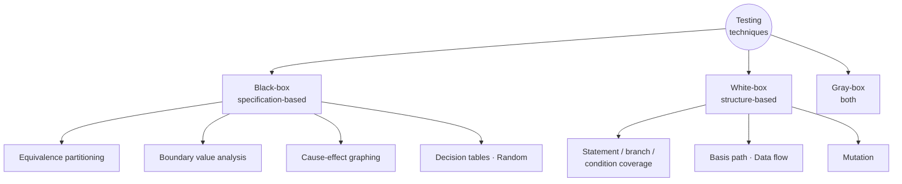

---

## 2. Black-box Testing ★★★

**Black-box testing** = **functional testing**: test conditions are developed from the program's **functionality** (specifications). The tester knows the **legal inputs and expected outputs**, but **not how** the program produces them.

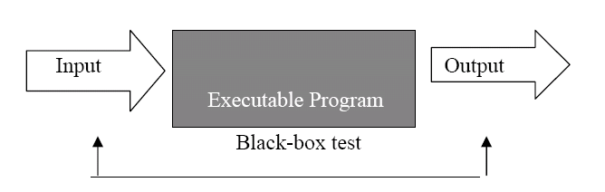

### 2.1 Errors found by black-box testing
- **Interface errors** — functions unable to send/receive data to/from other software.
- **Incorrect functions** producing undesired outputs.
- **Missing functions** and erroneous data structures.
- **Erroneous databases** leading to incorrect outputs.
- **Incorrect conditions** causing wrong outputs.
- **Termination errors** — conditions causing infinite loops.

Techniques: decision tables, equivalence partitioning, range testing, boundary value testing, database integrity testing, cause-effect graphing, orthogonal array testing, array & table testing, exception testing, limit testing, random testing.

### 2.2 Anatomy of a black-box test case
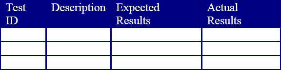

| Column | Content |
|---|---|
| **Test ID** | Unique identifier (e.g., *playerMovement1*) — lets you track which cases haven't passed |
| **Description / steps / input** | Specific steps and/or inputs for the condition being tested |
| **Expected results** | The **oracle** — what should come out of the black box for that input |
| **Actual results** | Filled when executed |

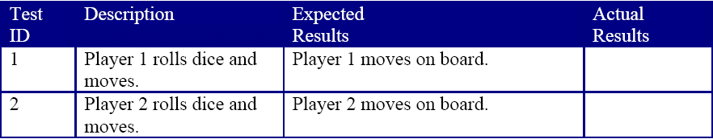

### 2.3 Advantages and Disadvantages
| Advantages | Disadvantages |
|---|---|
| Tester needs **no knowledge of implementation** or language | Only a **small number of inputs** can be tested |
| Reveals **ambiguities and inconsistencies** in specs | **Unnecessary repetition** if tester doesn't know what developers already tried |
| **Efficient for large systems** | Leaves **many program paths untested** |
| **Non-technical** people can perform it | Cannot be directed at specific code segments → more error-prone |
| Tests from the user's point of view; tester & developer independent | Test cases hard to design without clear specs |

---

## 3. Equivalence Partitioning & Boundary Value Analysis ★★★

### 3.1 Equivalence Partitioning (EP)
- The **input domain is divided into equivalence classes**; one representative per class is tested — reduces test cases to a finite, testable set while covering maximum requirements.
- **Example — input box accepting 1 to 1000:**
  1. **Valid class:** any value in 1–1000 (e.g., 500) — one case is enough.
  2. **Invalid class (below):** any value < 1 (e.g., −5).
  3. **Invalid class (above):** any value > 1000 (e.g., 1500).

### 3.2 Boundary Value Analysis (BVA)
> "**Bugs lurk in corners and congregate at boundaries.**" — Boris Beizer

- **Boundary value** = a data value that corresponds to a **minimum or maximum** input, internal or output value specified for a system.
- BVA is the **next part of EP** — test cases are chosen **at the edges** of equivalence classes. It finds **off-by-one** errors (e.g., using `>=` instead of `>`).

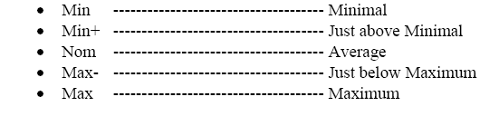

**Rules:**
1. Range **a to b** (e.g., 100–300): test **a−1, a, a+1, b−1, b, b+1** → 99, 100, 101, 299, 300, 301.
2. If input specifies a **number of allowed values**, test those limits: 1 ≤ Day ≤ 31; 1 ≤ Month ≤ 12; 1812 ≤ Year ≤ 2012.

**Examples:**
- Discount for purchases of **$50 or more** → test **$49, $50, $51**.
- Input 1–1000 → **0, 1, 2** and **999, 1000, 1001**.
- BVA is often considered part of **stress and negative testing**.

| Equivalence partitioning | Boundary value analysis |
|---|---|
| Picks **any** value from each class | Picks values **at/near the edges** of classes |
| Fewer test cases | Slightly more, but **high-yield** |
| Finds class-level errors | Finds **off-by-one** / relational-operator errors |

---

## 4. Cause-Effect Graphing ★★★

- **Cause-effect (Ishikawa / fishbone) diagrams** analyse causes of an unsatisfactory condition: visual display of cause relationships, stimulate ideas, keep asking *why, what, where, who, how* to reach **root causes**.
- Applied to **test-case design** (functional testing): systematically selects a set of test cases with **high probability of detecting errors** by exploring **inputs and combinations of input conditions** — without examining internal behaviour. Expected outputs are derived from the requirement specs.

### 4.1 Methodology ★★★
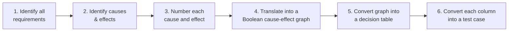

### 4.2 Example — "If A OR B, then C"
| A | B | C |
|---|---|---|
| T | T | T |
| T | F | T |
| F | T | T |
| F | F | F |

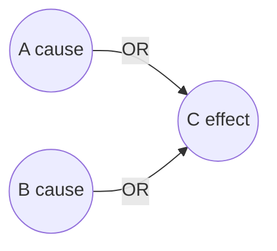

- A and B are **cause nodes**, C is an **effect node**; lines are **vectors**.
- Four relationships: **Identity** (A → C), **NOT** (~), **OR** (∨), **AND** (∧).

**Inspection-process application:** excessive size of material inspected → preparation rate too high → excessive inspection rate → **fewer defects found**. Insight: limit material size and preparation rate.

---

## 5. White-box Testing ★★★

**White-box (structural / clear-box / glass-box / transparent) testing** — test conditions are designed by **examining paths of logic**; requires **knowledge of internal program structure and logic** ("as a mechanic knows the inner workings of an automobile").

**Techniques:** basis path analysis, **statement coverage**, **branch coverage**, **condition coverage**, branch/condition coverage, data-flow testing, path testing.

### 5.1 Basic procedure
1. **Input** — requirements, functional specs, detailed design, source code, security specs (preparation).
2. **Processing** — risk analysis, test plan, **execute** test cases, communicate results.
3. **Output** — final report of preparations and results (e.g., **coverage report**).

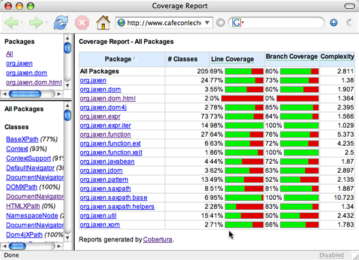

### 5.2 Advantages / Disadvantages
| Advantages | Disadvantages |
|---|---|
| **Thorough**, focuses on produced code | Does **not verify that specifications are correct** |
| Internal knowledge → errors or deliberate programmer mischief more likely detected | Cannot detect **missing paths** and **data-sensitive errors** — e.g., code `if (a−b) < 1` instead of `if |a−b| < 10` isn't detectable without the spec |
| Helps optimise code, remove dead code | Cannot execute **all logic paths** (astronomical number) |
| | Needs skilled testers with programming knowledge |

Applicable at unit, integration and system levels, but **usually done at unit level**.

### 5.3 Black-box vs White-box vs Gray-box ★★★
| Aspect | Black-box | White-box | Gray-box |
|---|---|---|---|
| Knowledge of internals | None | Full | Partial |
| Based on | Requirements/specs | Code/logic | Specs + design/architecture |
| Also called | Functional, behavioural | Structural, glass, clear | Translucent |
| Done by | Testers, users | Developers | Testers with dev input |
| Levels | System, acceptance | Unit, integration | Integration, web/functional |
| Finds | Missing/incorrect functions, interface errors | Logic, path, coverage errors | Structural misuse, integration defects |

---

## 6. Gray-box Testing ★★

- A **combination of black-box and white-box** testing — **translucent testing**.
- Tester studies the requirement specs **and talks to the developer** to understand internal structure — to clear up ambiguous specs and "**read between the lines**".
- **Aim:** find defects due to **improper structure or improper usage** of applications.

**Examples:**
- Functionality **reused** throughout an application → after understanding the design, it may be tested **once**, eliminating many tests.
- A command with **7 parameters in any order** → in theory **7! = 5040** tests; after learning that the parser treats each parameter **independently**, only **7** tests are needed.

**Applications:** well suited for **web applications** (distributed; no source code for white-box; WSDL gives significant information) and **functional/business-domain** testing.

---

## 7. Bottom-up (Integration) Testing ★★

**Integration testing** = integrating modules and checking total functionality. Two types: **top-down** and **bottom-up**.

- **Bottom-up** is incremental: **lowest-level modules** are integrated and tested first; testing proceeds hierarchically to the top.
- A **driver** — a temporary test program that **invokes** the unit under test and supplies its inputs — replaces incomplete higher-level modules.
- Common for **large complex systems**; takes long to make the system visible; **menus and UIs are tested last**, so users can't review them early; writing drivers needs effort and may **introduce new errors**.

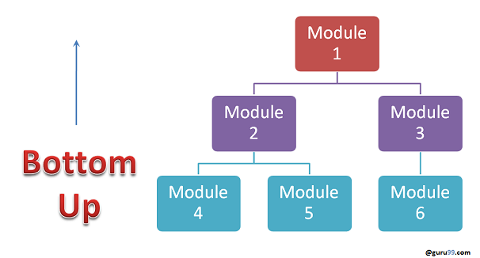

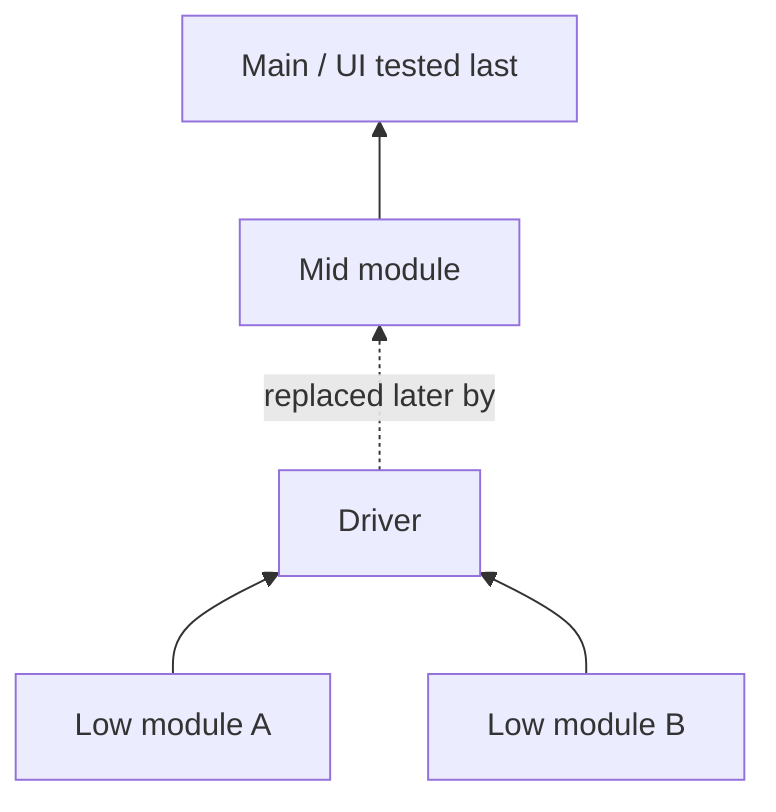

---

## 8. Regression Testing ★★★

- **Testing the modified build** — tests the application in light of changes from a development spiral, debugging, maintenance or new release.
- Confirms changes have **no unintended side effects**; old code still works after new changes.
- A **full or partial selection of already-executed test cases** is re-executed.
- Triggered by errors in logic/control flow, computation, interfaces.

**When required:** change in requirements → code modified · new feature added · defect fixing · performance fix.

### 8.1 Techniques
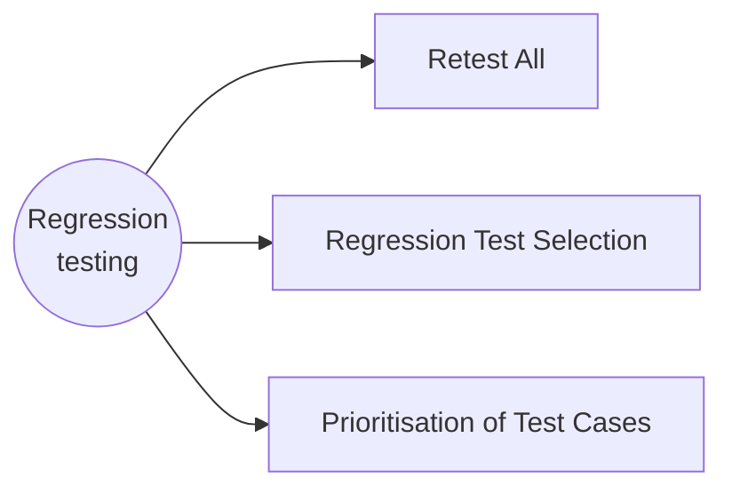
| Technique | Description |
|---|---|
| **Retest all** | Re-execute **every test** in the existing suite — very **expensive** in time and resources |
| **Regression test selection** | Run **part** of the suite; cases categorised as **reusable** (usable in later cycles) or **obsolete** |
| **Prioritisation of test cases** | Prioritise by **business impact, critical and frequently used** functionality — greatly reduces the suite |

### 8.2 Selecting test cases for regression
Many customer-reported defects come from **last-minute bug fixes**. Select:
- Cases with **frequent defects**; functionality **visible to users**; **core features**;
- Functionality with **recent/many changes**; **all integration** test cases; **all complex** test cases;
- **Boundary-value** test cases; a sample of **successful** and **failed** cases.

### 8.3 Regression testing tools
With frequent changes, manual regression cost escalates → **automate**. Extent depends on how many cases remain reusable.
- **QTP/UFT** (HP) — automates functional & regression tests using **VBScript**; data-driven, keyword-based.
- **Rational Functional Tester (RFT)** (IBM) — Java-based; integrates with Rational Test Manager.
- **Selenium** — open-source, browser-based regression testing of web apps.

### 8.4 📘 Boundary Value Analysis vs Regression Testing (asked in *SE_important*)
| BVA | Regression testing |
|---|---|
| **Test-design technique** (black-box) | **Test type** performed after changes |
| Chooses inputs at **edges** of equivalence classes | **Re-runs** existing test cases on a modified build |
| Finds off-by-one / boundary errors | Finds **side effects** of changes |
| Applied when designing new test cases | Applied after fixes, enhancements, new releases |
| Example: 0, 1, 2, 999, 1000, 1001 | Example: rerun login/payment suites after fixing cart bug |

---

## 9. Performance Testing Family ★★★

**Performance testing** verifies that **performance requirements** are achieved — response times, transaction rates, other time-sensitive requirements — under **expected workload** (e.g., a web site under a range of loads to find where response time degrades or fails).

Focus — **Speed** (responds quickly?), **Scalability** (max user load), **Stability** (stable under varying loads).

**Why:** gives stakeholders information on speed, stability and scalability; uncovers what must be improved **before release**; avoids slowness with concurrent users, OS inconsistencies, poor usability.

| Type | Purpose |
|---|---|
| **Load testing** | Performance under **anticipated user loads**; find **bottlenecks** before go-live |
| **Stress testing** | Under **extreme workloads** (high traffic/data) to find the **breaking point** |
| **Endurance (soak) testing** | Handles expected load over a **long period** (memory leaks, degradation) |
| **Spike testing** | Reaction to **sudden large spikes** in user load |
| **Volume testing** | Large **amounts of data** in the database; behaviour under varying DB volumes |

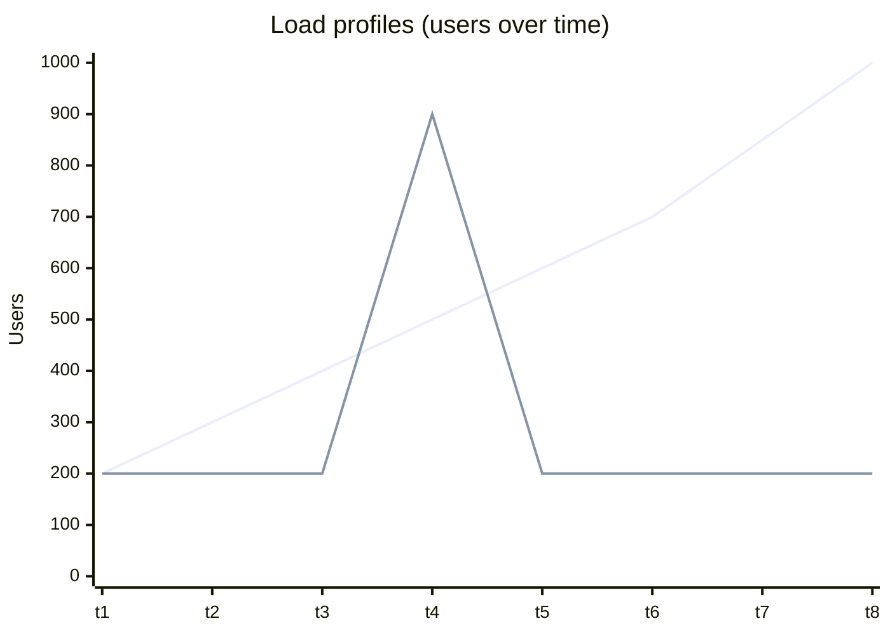
*(rising line ≈ stress test ramp; flat line with sudden jump ≈ spike test)*

**Tools:** **HP LoadRunner** (simulates hundreds of thousands of **virtual users**, VuGen), **HTTP Load** (throughput testing of web servers), **Proxy Sniffer** (cloud-based load testing), JMeter (open source).

---

## 10. Random Testing, Mutation Testing & Histograms ★★

### 10.1 Random Testing
- Inputs selected **at random** from a set of possible values, each equally likely.
- **Not optimal** — low probability of detecting many defects — but sometimes uncovers defects that standard techniques miss → an **add-on** technique.
- A form of **functional** testing; useful when writing directed tests takes too long or the combination space is too large.

### 10.2 📘 Mutation Testing (recap)
- Small faults (**mutants**) are deliberately injected — one change per mutant (constant, variable, arithmetic/relational operator replacement).
- Tests are run on each mutant: a mutant **killed** (test fails) ⇒ the suite is sensitive; **survived** ⇒ add better tests.
- **Mutation score = killed mutants / total non-equivalent mutants** — measures **test-suite quality**.

### 10.3 Histograms
- A **graphical description of measured values organised by frequency** (bar graph grouping data by intervals).
- Example: 100 client/server **response times** measured with a performance tool; spec says < 3 s; the histogram clearly shows many responses above 3 s → **performance problem**.
- Useful for defects by type/source, delivery times, skill levels, cycle times, survey responses; shows whether a process is in/out of control (not a substitute for SPC charts).

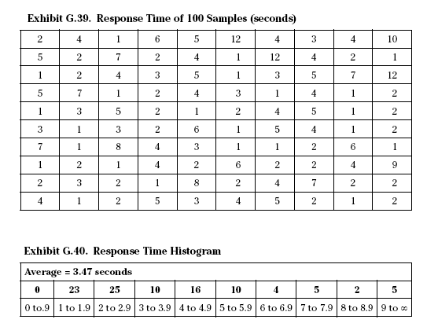

---

## 11. Database Testing & CRUD ★★★

Every application — web or desktop, banking or spacecraft — has a **database at the back end** (MS Access, SQL Server, Oracle, MySQL, PostgreSQL, DB2…). End users mainly use **CRUD** operations:

| Letter | Operation | Triggered by user action |
|---|---|---|
| **C** | **Create** | *Save* a new transaction |
| **R** | **Retrieve / Read** | *Search* or *view* a saved transaction |
| **U** | **Update** | *Edit / modify* an existing record |
| **D** | **Delete** | *Remove* a record |

The user doesn't care whether joins, sub-queries, triggers or stored procedures were used — every DB operation from the UI is one of these four.

### 11.1 How to test a database
1. **Create your own queries** — needs good **SQL (DML)** knowledge and understanding of the AUT's DB structure (most accurate).
2. **Observe data table by table** — if not good at SQL, verify CRUD results by viewing tables.
3. **Get the query from the developer** — perform a CRUD operation from the GUI and verify with the developer's query (needs neither SQL nor schema knowledge).

### 11.2 CRUD Matrix (process/data matrix) ★★
- Optionally developed in the **analysis phase**; **links data and process models**; ensures data and processes are discovered; identifies and resolves **omissions and conflicts**.
- Built **before** the physical system/GUI exists; as the GUI evolves a **CRUD test matrix** is built.
- Verifies the **life cycle of all business objects** — each CRUD cell is tested; a "–" marks an operation an object doesn't have.

| Process ↓ / Entity → | Customer | Order | Product |
|---|---|---|---|
| Register customer | **C** | – | – |
| Place order | R | **C** | R |
| Modify order | R | **U** | R |
| Cancel order | R | **D** | – |
| Update catalogue | – | – | **C U D** |

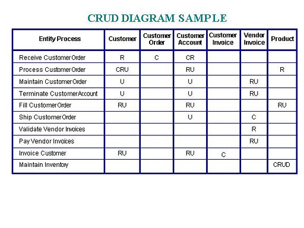

**EP** (asked in *SE_important*) = **Equivalence Partitioning** (§3.1).

---

## 12. JADs (Joint Application Design) ★

- A technique that brings **users and developers together** to jointly design systems in **facilitated sessions**.
- Goes beyond one-on-one interviews; promotes **communication, cooperation and teamwork**, placing **users in the driver's seat**.
- Three phases: **customisation → session → wrap-up**.

---

## 13. 📘 Acceptance, Alpha & Beta Testing; V&V ★★★

### 13.1 Acceptance Testing
Formal testing by the **customer/user** to decide whether to **accept** the system — validates that it meets **business requirements**; based on the **Acceptance Test Plan**. Types: user acceptance (UAT), operational, contract/regulation, **alpha** and **beta**.

| Alpha testing | Beta testing |
|---|---|
| At the **developer's site** | At the **customer's site** (real environment) |
| By customers/internal users **with developers present** | By real end users **without developers** |
| **Controlled** environment | **Uncontrolled**, real-world environment |
| Before beta; product not yet public | Before final release; "pre-release" version |
| Both white- and black-box | Black-box only |
| Bugs fixed immediately | Feedback collected and fixed in later versions |

### 13.2 Stress Testing (short note)
Executes the system in a manner that demands resources in **abnormal quantity, frequency or volume** (e.g., 10× normal interrupts, max memory) to find the **breaking point** and verify graceful degradation/recovery.

### 13.3 Verification & Validation (V&V)
| Verification | Validation |
|---|---|
| "Are we building the product **right**?" | "Are we building the **right product**?" |
| Conformance to specs at each phase | Product meets **user needs** |
| **Static**: reviews, walkthroughs, inspections | **Dynamic**: executing the software |
| QA activity; finds bugs early | QC activity; finds bugs the verification missed |

---

## 14. 📘 Automated Testing Tools — Need & Taxonomy ★★★

**Automation testing** = using **software tools to execute pre-scripted tests**, compare actual vs expected outcomes and report results.

### 14.1 Need / Advantages of automated testing
- **Speed** — tests run much faster than manual execution; overnight runs.
- **Reusability & repeatability** — same scripts re-run for every build (ideal for **regression**).
- **Accuracy** — removes human error in repetitive tasks.
- **Coverage** — more tests, more data combinations, multiple browsers/platforms.
- **Cost-effective** in the long run; frees testers for exploratory testing.
- Enables **load/performance testing** (thousands of virtual users) — impossible manually.
- Supports **CI/CD** and early feedback.

*Limitations:* high initial cost, script maintenance, not suitable for usability/ad-hoc testing.

### 14.2 Taxonomy of Testing Tools
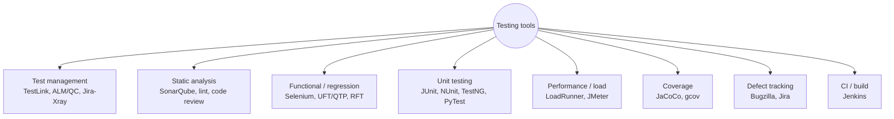

| Category | Purpose | Examples |
|---|---|---|
| **Test management** | Plan, organise test cases, track execution | HP ALM/Quality Center, TestLink |
| **Static analysis** | Analyse code without executing | SonarQube, PMD, lint |
| **Unit test frameworks** | Automate unit tests | JUnit, TestNG, NUnit |
| **Functional / GUI / regression** | Record/script UI interactions | **Selenium**, **UFT (QTP)**, RFT |
| **Performance / load** | Simulate virtual users | LoadRunner, JMeter |
| **Coverage analysers** | Measure statement/branch coverage | JaCoCo, gcov |
| **Defect tracking** | Log and track bugs | Bugzilla, Jira |

---

## 15. 📘 Selenium and UFT ★★★

### 15.1 Selenium
- **Open-source** suite for **automating web browsers** — functional and regression testing of **web applications**.
- Supports many languages (**Java, Python, C#, JavaScript, Ruby**), browsers (Chrome, Firefox, Edge, Safari) and OSes.

| Component | Role |
|---|---|
| **Selenium IDE** | Browser extension for **record & playback** of tests |
| **Selenium RC** | Older remote-control server (deprecated) |
| **Selenium WebDriver** | Programming API that drives the browser natively — the core of Selenium 2+ |
| **Selenium Grid** | Runs tests **in parallel** on multiple machines/browsers |

```java
WebDriver driver = new ChromeDriver();
driver.get("https://example.com/login");
driver.findElement(By.id("user")).sendKeys("test");
driver.findElement(By.id("pwd")).sendKeys("secret");
driver.findElement(By.id("login")).click();
assert driver.getTitle().contains("Dashboard");
driver.quit();
```
**Pros:** free, multi-language, multi-browser, large community, integrates with TestNG/JUnit/Jenkins. **Cons:** web only (no desktop apps), no built-in reporting, needs programming skill, image/captcha testing not possible.

### 15.2 UFT (Unified Functional Testing, formerly HP QTP)
- **Commercial** tool (Micro Focus/OpenText, formerly HP) for **functional and regression** testing of **web, desktop, mobile, SAP, Java, .NET** and API applications.
- Scripts in **VBScript**; **keyword-driven** and **data-driven** testing; **record & playback**; **object repository**; checkpoints; integrates with **ALM/Quality Center**.

| Selenium | UFT |
|---|---|
| Open source, free | Licensed, costly |
| Web applications only | Web, desktop, mobile, SAP, etc. |
| Java, Python, C#, JS, Ruby… | VBScript |
| Needs external frameworks for reports | Built-in reporting, object repository |
| Many browsers & OSes | Mainly Windows |

---

## Unit VI — One-Page Summary

| Topic | Key points |
|---|---|
| **Black-box** | Functional, spec-based; finds interface, incorrect/missing functions, DB, condition, termination errors. Test case: ID, steps/input, expected (oracle). No code knowledge; misses paths. |
| **EP & BVA** | EP: valid + invalid classes (1–1000 → 500, −5, 1500). BVA: edges a−1, a, a+1, b−1, b, b+1 (0,1,2,999,1000,1001; $49/$50/$51). "Bugs congregate at boundaries." |
| **Cause-effect graphing** | Identify requirements → causes & effects → number → Boolean graph → decision table → test cases. Relations: identity, NOT, OR, AND. |
| **White-box** | Structural/glass/clear; statement, branch, condition, basis-path, data-flow. Thorough but can't verify specs or find missing paths. Usually unit level. |
| **Gray-box** | Translucent; specs + developer insight; 7! = 5040 → 7 tests; ideal for web apps (WSDL). |
| **Bottom-up** | Lowest modules first with **drivers**; UI last; drivers may add errors. |
| **Regression** | Retest modified build; Retest All · Selection (reusable/obsolete) · Prioritisation. Pick frequent-defect, visible, core, changed, integration, complex, boundary cases. Tools: QTP/UFT, RFT, Selenium. |
| **Performance** | Speed, scalability, stability. Load (expected), Stress (breaking point), Endurance/Soak (long), Spike (sudden), Volume (data). LoadRunner, HTTP Load, Proxy Sniffer. |
| **Random / mutation / histogram** | Random: add-on functional technique. Mutation: kill mutants → measure suite quality. Histogram: frequency bar chart (response times vs 3 s spec). |
| **DB testing & CRUD** | Create/Retrieve/Update/Delete; test via own SQL, table inspection, or developer's queries. CRUD matrix links processes & data; tests object life cycle. |
| **JAD** | Users + developers in facilitated sessions; customisation → session → wrap-up. |
| **Acceptance** | Alpha (developer site, controlled) vs Beta (customer site, real). V&V: built right vs right product. |
| **Automation** | Speed, reuse, accuracy, coverage, load simulation, CI. Taxonomy: management, static, unit, functional, performance, coverage, defect tracking. |
| **Selenium vs UFT** | Selenium: open-source web automation (IDE, WebDriver, Grid), many languages. UFT: commercial, VBScript, keyword/data-driven, web+desktop+SAP. |
